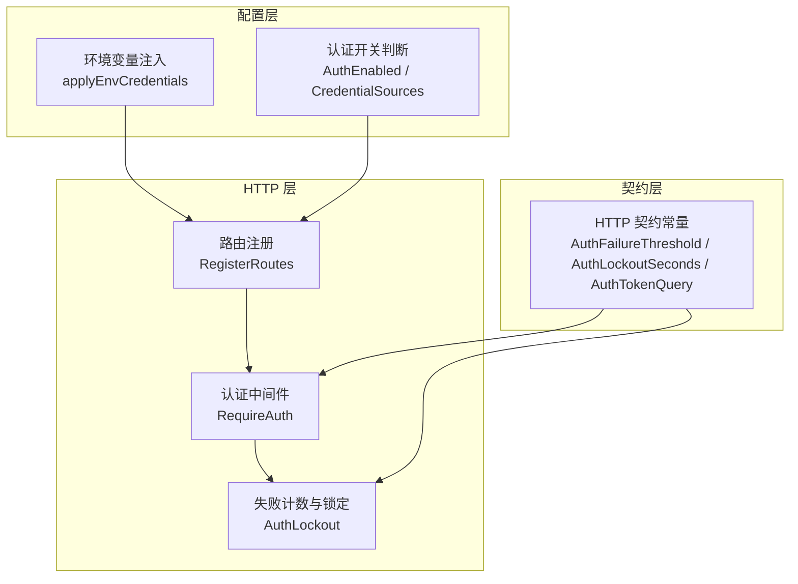
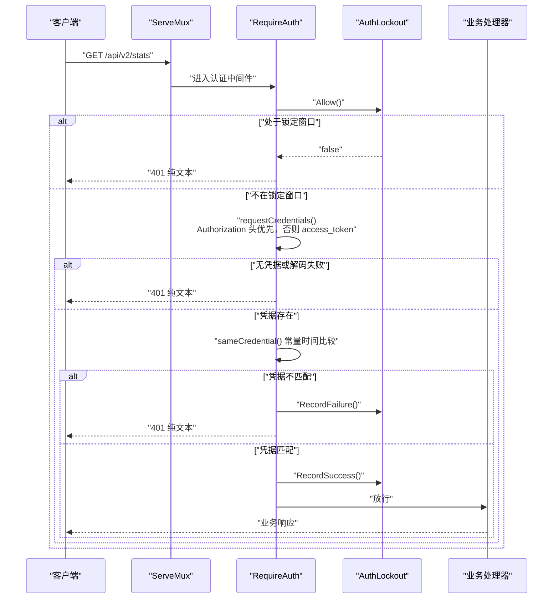
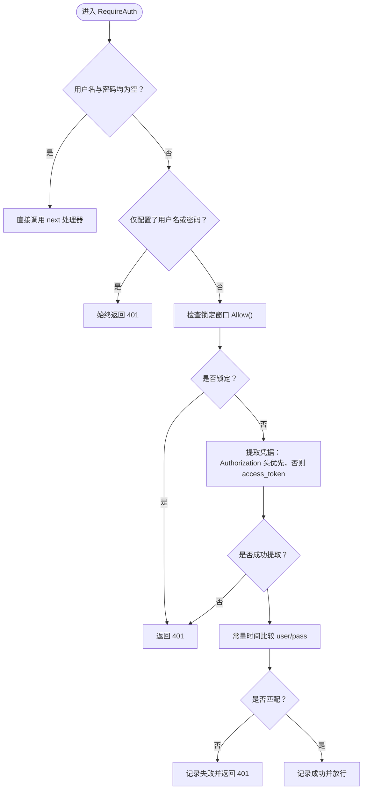
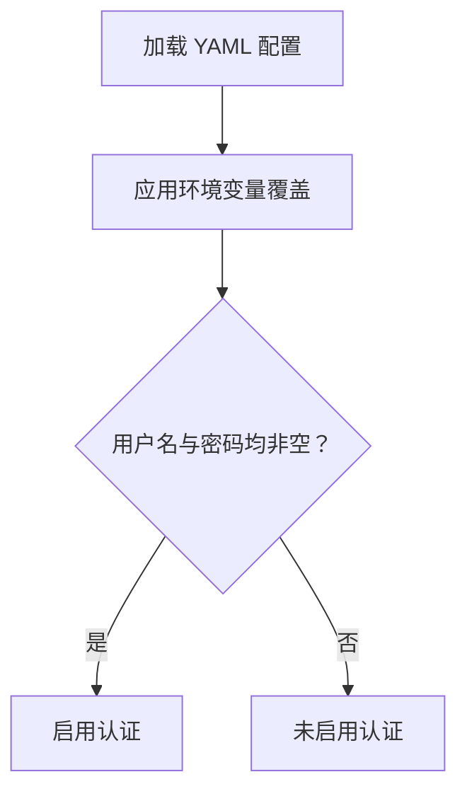
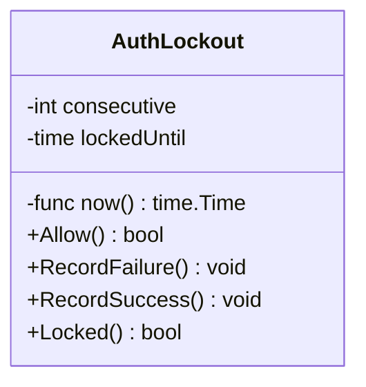
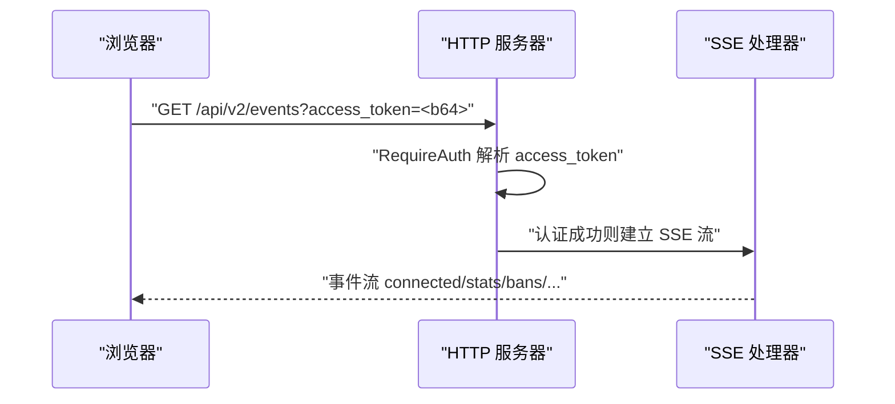
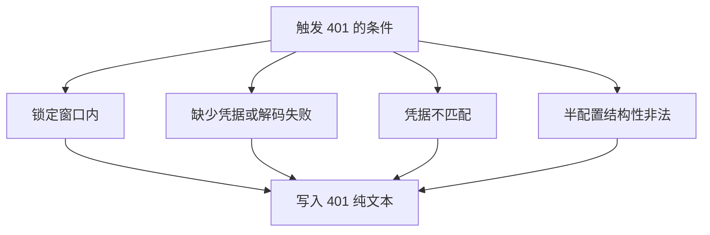
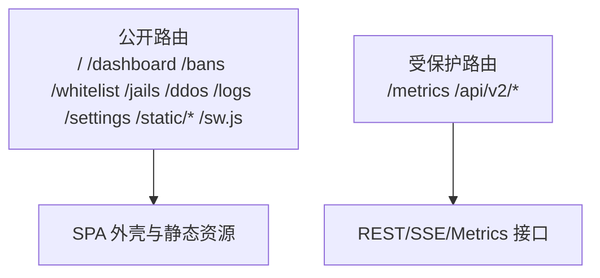
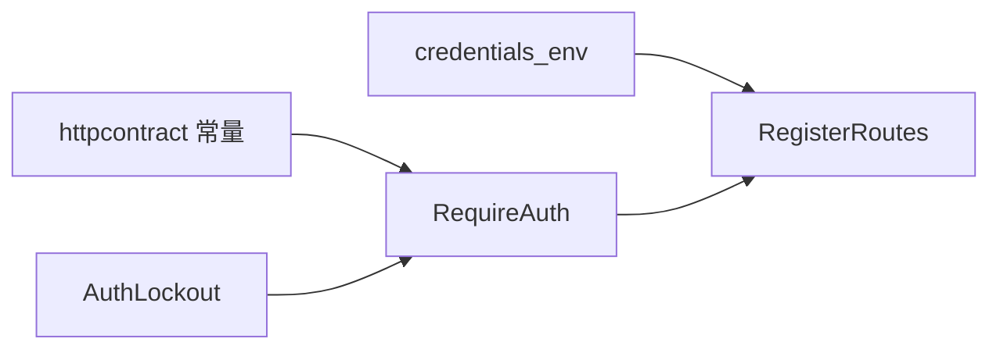

# 认证授权机制

<cite>
**本文引用的文件**   
- [auth.go](file://src/daemon/internal/http/auth.go)
- [auth_lockout.go](file://src/daemon/internal/http/auth_lockout.go)
- [credentials_env.go](file://src/daemon/internal/config/credentials_env.go)
- [routes.go](file://src/daemon/internal/http/routes.go)
- [http_contract.go](file://src/daemon/internal/httpcontract/http_contract.go)
</cite>

## 目录
1. [引言](#引言)
2. [项目结构](#项目结构)
3. [核心组件](#核心组件)
4. [架构总览](#架构总览)
5. [详细组件分析](#详细组件分析)
6. [依赖关系分析](#依赖关系分析)
7. [性能与安全考量](#性能与安全考量)
8. [故障排查指南](#故障排查指南)
9. [结论](#结论)

## 引言
本文件聚焦守护进程 HTTP 层的认证与授权机制，覆盖以下要点：
- HTTP Basic 认证的实现原理与凭据来源（YAML 配置与环境变量）。
- 认证失败锁定机制（连续失败阈值与锁定时长）。
- SSE 连接认证与 token_query 参数在 SSE 和免登录直达中的用途。
- 未授权状态码 401 的处理逻辑。
- 面板 SPA 外壳的公开路由设计。
- 认证流程时序图、错误处理策略、安全最佳实践与常见问题排查。

## 项目结构
认证相关代码主要分布在以下模块：
- HTTP 认证中间件与处理器：src/daemon/internal/http
- 认证失败计数与锁定窗口：src/daemon/internal/http
- 凭据环境变量注入：src/daemon/internal/config
- HTTP 契约与路由常量：src/daemon/internal/httpcontract
- 路由注册与 RequireAuth 包装：src/daemon/internal/http

**图表来源**
- [auth.go:22-69](file://src/daemon/internal/http/auth.go#L22-L69)
- [auth_lockout.go:15-82](file://src/daemon/internal/http/auth_lockout.go#L15-L82)
- [credentials_env.go:21-72](file://src/daemon/internal/config/credentials_env.go#L21-L72)
- [routes.go:79-233](file://src/daemon/internal/http/routes.go#L79-L233)
- [http_contract.go:21-34](file://src/daemon/internal/httpcontract/http_contract.go#L21-L34)

**章节来源**
- [auth.go:1-116](file://src/daemon/internal/http/auth.go#L1-L116)
- [auth_lockout.go:1-83](file://src/daemon/internal/http/auth_lockout.go#L1-L83)
- [credentials_env.go:1-73](file://src/daemon/internal/config/credentials_env.go#L1-L73)
- [routes.go:79-233](file://src/daemon/internal/http/routes.go#L79-L233)
- [http_contract.go:21-34](file://src/daemon/internal/httpcontract/http_contract.go#L21-L34)

## 核心组件
- RequireAuth：认证中间件，负责从请求头或查询参数提取 Basic 凭据，执行失败计数与成功复位，并在锁定窗口内拒绝所有请求。
- AuthLockout：进程级失败计数器与锁定窗口，使用生成契约常量作为阈值与时长。
- applyEnvCredentials：将环境变量中的用户名与密码覆盖到 YAML 配置之上，实现“配置 + 环境变量”的双源凭据。
- RegisterRoutes：将所有需认证的 REST/SSE/Metrics 路由统一用 RequireAuth 包裹；健康检查与 SPA 外壳为公开路由。
- httpcontract：集中定义认证相关常量（阈值、锁定时长、token 查询键名、Basic Scheme）与路由表。

**章节来源**
- [auth.go:22-116](file://src/daemon/internal/http/auth.go#L22-L116)
- [auth_lockout.go:15-82](file://src/daemon/internal/http/auth_lockout.go#L15-L82)
- [credentials_env.go:21-72](file://src/daemon/internal/config/credentials_env.go#L21-L72)
- [routes.go:79-233](file://src/daemon/internal/http/routes.go#L79-L233)
- [http_contract.go:21-34](file://src/daemon/internal/httpcontract/http_contract.go#L21-L34)

## 架构总览
下图展示一次受保护 API 请求的认证流程，包括锁定检查、凭据解析、比较与结果分支。

**图表来源**
- [auth.go:36-107](file://src/daemon/internal/http/auth.go#L36-L107)
- [auth_lockout.go:36-72](file://src/daemon/internal/http/auth_lockout.go#L36-L72)

## 详细组件分析

### HTTP Basic 认证与凭据来源
- 认证入口：RequireAuth 包装所有需要认证的端点。
- 凭据来源优先级：
  - Authorization: Basic <base64(user:pass)>
  - 查询参数 access_token=<base64(user:pass)>（SSE 无法设置请求头时使用）
- 半配置防护：若只配置了用户名或密码之一，视为结构性非法，整组端点一律返回 401。
- 未配置认证：两项都为空时，直接放行，不套额外闭包。
- 常量时间比较：使用 subtle.ConstantTimeCompare 避免侧信道泄露。

**图表来源**
- [auth.go:36-107](file://src/daemon/internal/http/auth.go#L36-L107)

**章节来源**
- [auth.go:22-107](file://src/daemon/internal/http/auth.go#L22-L107)

### 凭据来源：YAML 配置与环境变量
- 环境变量覆盖：FIREWALL_METRICS_USERNAME、FIREWALL_METRICS_PASSWORD 可覆盖 YAML 中的默认值。
- 语义一致性：环境变量显式设为空串也视为“来自环境变量”，用于显式关闭某项凭据。
- 认证开关：只有用户名与密码均非空才启用认证；否则视为未配置认证。
- 日志溯源：CredentialSources 输出凭据来源（环境变量/配置文件/未配置），不包含实际值。

**图表来源**
- [credentials_env.go:21-72](file://src/daemon/internal/config/credentials_env.go#L21-L72)

**章节来源**
- [credentials_env.go:1-73](file://src/daemon/internal/config/credentials_env.go#L1-L73)

### 认证失败锁定机制
- 阈值与时长：由契约常量定义，failure_threshold=10，lockout_seconds=60。
- 进程级账本：AuthLockout 为进程级计数器，不按路由或 IP 切分。
- 锁定行为：达到阈值后进入锁定窗口，期间连正确凭据也拒绝。
- 成功复位：认证成功会清零连续失败计数。

**图表来源**
- [auth_lockout.go:15-82](file://src/daemon/internal/http/auth_lockout.go#L15-L82)

**章节来源**
- [auth_lockout.go:1-83](file://src/daemon/internal/http/auth_lockout.go#L1-L83)
- [http_contract.go:21-34](file://src/daemon/internal/httpcontract/http_contract.go#L21-L34)

### token_query 参数在 SSE 与免登录直达中的作用
- token_query 键名：access_token。
- SSE 场景：浏览器 EventSource 不支持自定义请求头，因此通过 URL 查询参数携带 Basic 凭据进行认证。
- 免登录直达：SPA 外壳公开路由（如 /dashboard、/bans 等）允许带 access_token 重定向直达页面，前端在首次访问时将凭据附加到 URL 以便后续导航。

**图表来源**
- [auth.go:77-99](file://src/daemon/internal/http/auth.go#L77-L99)
- [http_contract.go:21-34](file://src/daemon/internal/httpcontract/http_contract.go#L21-L34)

**章节来源**
- [auth.go:77-99](file://src/daemon/internal/http/auth.go#L77-L99)
- [http_contract.go:21-34](file://src/daemon/internal/httpcontract/http_contract.go#L21-L34)

### 未授权状态码 401 的处理逻辑
- 响应体：纯文本 “401 Unauthorized\n”，不带 JSON 信封。
- 不发送 WWW-Authenticate：避免浏览器弹出原生对话框导致前端 UI 卡住。
- 触发条件：
  - 锁定窗口内任何请求。
  - 缺少凭据或凭据解码失败。
  - 凭据比较失败。
  - 半配置（只填一项）时的结构性非法。

**图表来源**
- [auth.go:17-20](file://src/daemon/internal/http/auth.go#L17-L20)
- [auth.go:36-75](file://src/daemon/internal/http/auth.go#L36-L75)
- [auth.go:109-115](file://src/daemon/internal/http/auth.go#L109-L115)

**章节来源**
- [auth.go:17-20](file://src/daemon/internal/http/auth.go#L17-L20)
- [auth.go:36-75](file://src/daemon/internal/http/auth.go#L36-L75)
- [auth.go:109-115](file://src/daemon/internal/http/auth.go#L109-L115)

### 面板 SPA 外壳的公开路由设计
- 公开路由：根路径、SPA 页面（/dashboard、/bans、/whitelist、/jails、/ddos、/logs、/settings）、静态资源与 Service Worker。
- 目的：允许用户先获取 SPA 外壳与静态资源，再在应用内完成认证；同时支持带 access_token 的重定向直达。
- 认证边界：这些路由不经过 RequireAuth；API、Metrics、SSE 等敏感接口均被 RequireAuth 包裹。

**图表来源**
- [http_contract.go:122-146](file://src/daemon/internal/httpcontract/http_contract.go#L122-L146)
- [routes.go:79-103](file://src/daemon/internal/http/routes.go#L79-L103)

**章节来源**
- [http_contract.go:122-146](file://src/daemon/internal/httpcontract/http_contract.go#L122-L146)
- [routes.go:79-103](file://src/daemon/internal/http/routes.go#L79-L103)

## 依赖关系分析
- RequireAuth 依赖：
  - AuthLockout：用于锁定检查与计数。
  - httpcontract：提供常量（AuthTokenQuery、AuthScheme、AuthUnauthorizedStatus）。
- RegisterRoutes 依赖：
  - RequireAuth：对所有敏感路由进行认证包装。
  - httpcontract：提供路由常量与认证标记。
- credentials_env 依赖：
  - os.LookupEnv：读取环境变量并覆盖 YAML 配置。
  - Config.AuthEnabled/CredentialSources：对外暴露认证开关与来源诊断。

**图表来源**
- [auth.go:1-12](file://src/daemon/internal/http/auth.go#L1-L12)
- [auth_lockout.go:1-13](file://src/daemon/internal/http/auth_lockout.go#L1-L13)
- [credentials_env.go:1-13](file://src/daemon/internal/config/credentials_env.go#L1-L13)
- [routes.go:1-12](file://src/daemon/internal/http/routes.go#L1-L12)

**章节来源**
- [auth.go:1-12](file://src/daemon/internal/http/auth.go#L1-L12)
- [auth_lockout.go:1-13](file://src/daemon/internal/http/auth_lockout.go#L1-L13)
- [credentials_env.go:1-13](file://src/daemon/internal/config/credentials_env.go#L1-L13)
- [routes.go:1-12](file://src/daemon/internal/http/routes.go#L1-L12)

## 性能与安全考量
- 性能
  - 常量时间比较避免侧信道泄露，代价极小。
  - 进程级锁定账本减少并发开销，无需按 IP 或路由切分。
  - 锁定窗口内快速拒绝，避免不必要的凭据比较。
- 安全
  - 禁止发送 WWW-Authenticate，防止浏览器原生对话框挂起前端。
  - 半配置即拒，避免因配置笔误开放 API。
  - 环境变量覆盖 YAML，便于在生产环境隔离凭据。
  - 公开路由仅限 SPA 外壳与静态资源，敏感接口全部 RequireAuth。
  - CSP 等安全头在契约中集中管理，避免实现散落。

[本节为通用指导，不直接分析具体文件]

## 故障排查指南
- 现象：打开页面后按钮一直转圈，且控制台出现 401。
  - 可能原因：未携带 access_token 或 Authorization 头；或凭据错误。
  - 排查步骤：
    - 确认前端是否正确构造 access_token 或 Authorization 头。
    - 检查环境变量 FIREWALL_METRICS_USERNAME/FIREWALL_METRICS_PASSWORD 是否与后端一致。
    - 查看启动日志中的 CredentialSources，确认认证是否启用。
- 现象：频繁尝试登录后被锁定。
  - 可能原因：连续失败达到阈值（10 次），进入 60 秒锁定窗口。
  - 排查步骤：
    - 等待锁定窗口结束。
    - 修正凭据后再试。
    - 检查是否有自动化脚本重复发起错误请求。
- 现象：SSE 连接失败或断连。
  - 可能原因：EventSource 无法设置请求头，必须使用 access_token。
  - 排查步骤：
    - 确认 URL 中包含正确的 access_token。
    - 检查服务端是否处于锁定窗口。
    - 查看 /api/v2/stats/sse-status 的诊断信息。

**章节来源**
- [credentials_env.go:46-72](file://src/daemon/internal/config/credentials_env.go#L46-L72)
- [auth_lockout.go:47-72](file://src/daemon/internal/http/auth_lockout.go#L47-L72)
- [auth.go:77-99](file://src/daemon/internal/http/auth.go#L77-L99)

## 结论
本项目采用基于 HTTP Basic 的认证机制，结合 YAML 配置与环境变量双源凭据，并通过进程级失败计数与锁定窗口抵御暴力破解。SSE 通过 access_token 查询参数绕过浏览器限制，SPA 外壳公开路由确保前端资源可达而敏感接口严格受控。401 响应以纯文本形式返回且不触发浏览器原生对话框，兼顾安全性与可用性。建议在生产环境中优先使用环境变量注入凭据，并配合反向代理与网络层访问控制，进一步提升整体安全性。