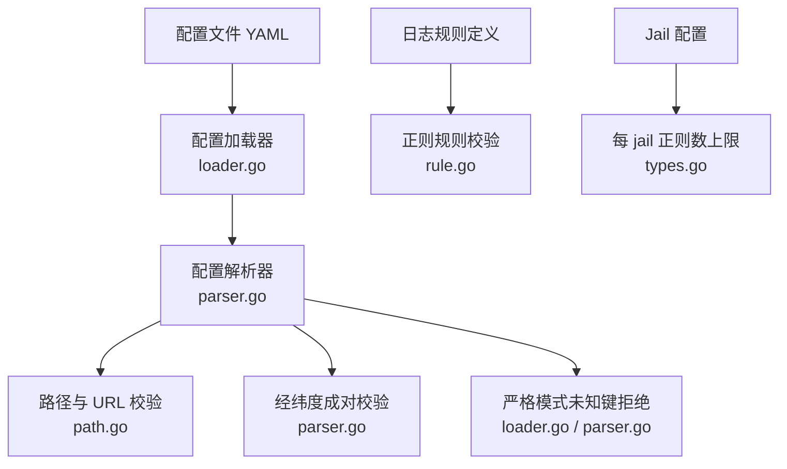
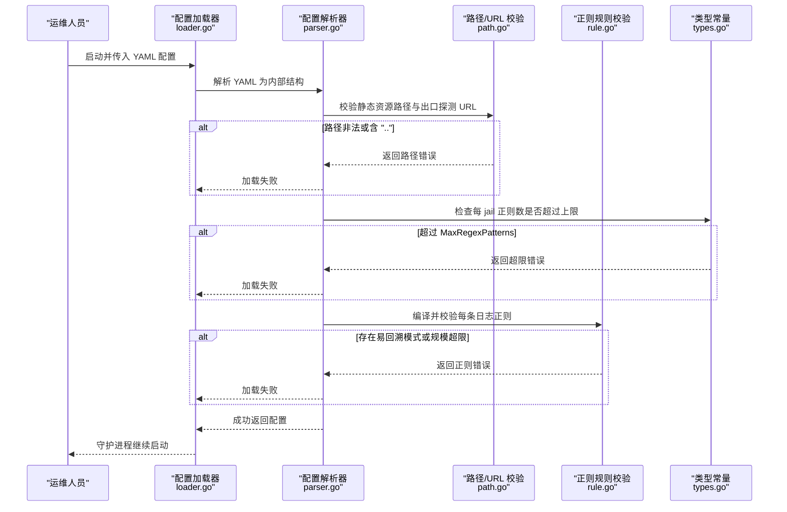
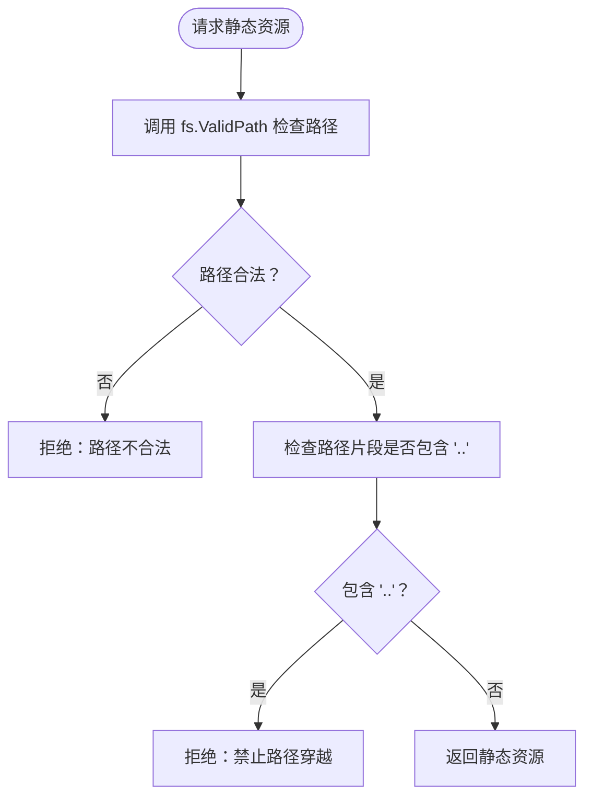
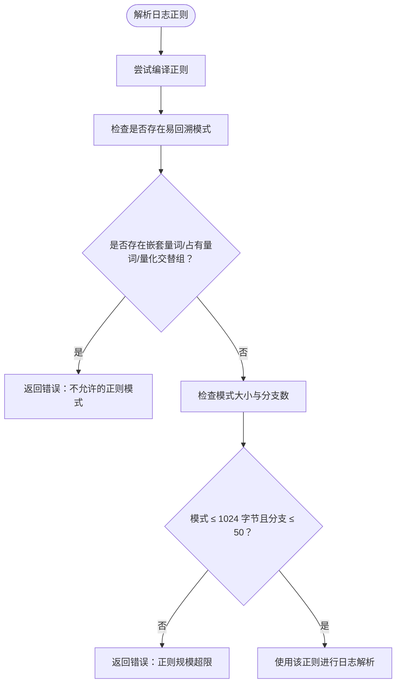
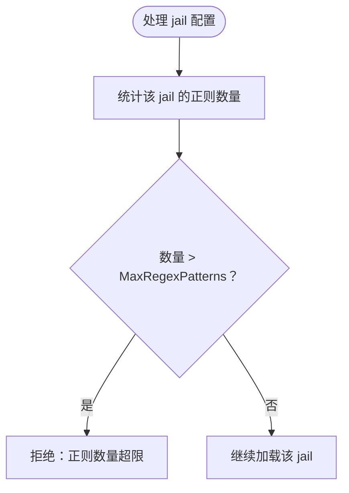
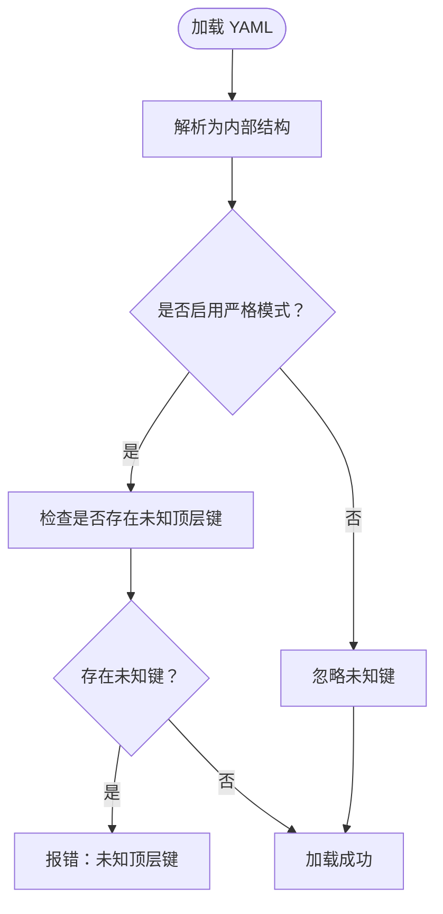
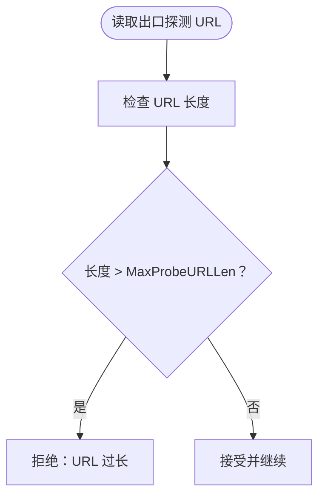
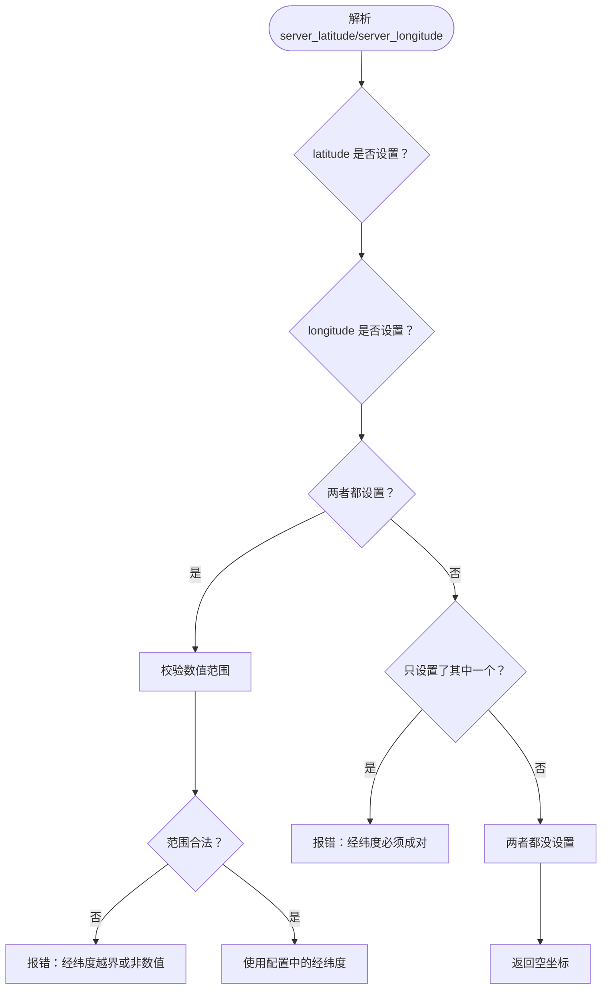
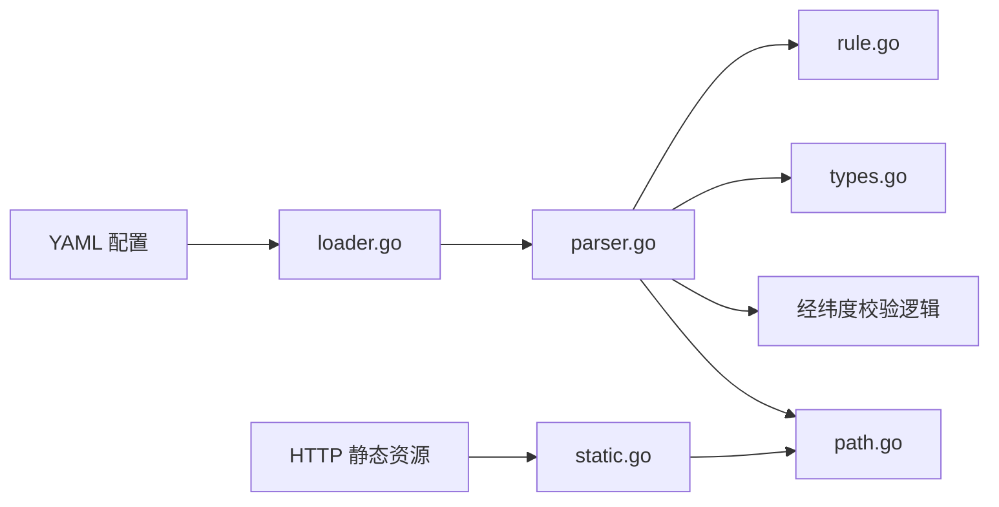

# 输入验证策略

<cite>
**本文引用的文件**   
- [SECURITY.md](file://SECURITY.md)
- [path.go](file://src/daemon/internal/config/path.go)
- [parser.go](file://src/daemon/internal/config/parser.go)
- [loader.go](file://src/daemon/internal/config/loader.go)
- [config_test.go](file://src/daemon/internal/config/config_test.go)
- [rule.go](file://src/daemon/internal/logparse/rule.go)
- [types.go](file://src/daemon/internal/config/types.go)
- [http.fwidl](file://contract/http.fwidl)
</cite>

## 目录
1. [引言](#引言)
2. [项目结构](#项目结构)
3. [核心组件](#核心组件)
4. [架构总览](#架构总览)
5. [详细组件分析](#详细组件分析)
6. [依赖关系分析](#依赖关系分析)
7. [性能考量](#性能考量)
8. [故障排查指南](#故障排查指南)
9. [结论](#结论)

## 引言
本文聚焦守护进程在加载配置、解析规则与提供静态资源时的输入验证策略。目标是让读者理解：
- 哪些输入会被拒绝；
- 为什么这些限制是必要的；
- 各层校验如何协作，避免路径穿越、正则回溯灾难、配置漂移和地理坐标语义错误；
- 当校验失败时，典型错误信息长什么样；
- 如何写出安全且可维护的配置。

本仓库的安全文档已将“输入校验”作为信任边界的一部分列出，并给出各校验面的出处。本文在此基础上展开实现细节与安全意义。

**章节来源**
- [SECURITY.md:109-119](file://SECURITY.md#L109-L119)

## 项目结构
与输入验证直接相关的代码主要分布在以下位置：
- 配置路径与 URL 校验：`src/daemon/internal/config/path.go`、`src/daemon/internal/config/parser.go`
- 严格模式与配置加载：`src/daemon/internal/config/loader.go`、`src/daemon/internal/config/parser.go`
- 日志解析正则校验与规模限制：`src/daemon/internal/logparse/rule.go`
- 每 jail 正则数量上限：`src/daemon/internal/config/types.go`
- 本机经纬度契约与测试用例：`contract/http.fwidl`、`src/daemon/internal/config/config_test.go`

**图表来源**
- [loader.go:40-115](file://src/daemon/internal/config/loader.go#L40-L115)
- [parser.go:25-26](file://src/daemon/internal/config/parser.go#L25-L26)
- [parser.go:601-605](file://src/daemon/internal/config/parser.go#L601-L605)
- [path.go:14-45](file://src/daemon/internal/config/path.go#L14-L45)
- [rule.go](file://src/daemon/internal/logparse/rule.go)
- [types.go](file://src/daemon/internal/config/types.go)

**章节来源**
- [SECURITY.md:109-119](file://SECURITY.md#L109-L119)

## 核心组件
本节按“输入面”梳理验证点，并说明其安全目标。

| 输入面 | 验证规则 | 安全意义 | 关键实现位置 |
|---|---|---|---|
| 静态资源路径 | 使用 `fs.ValidPath` 检查，并显式拒绝包含 `..` 的路径名 | 防止路径穿越，避免通过静态资源接口读取任意系统文件 | `src/daemon/internal/http/static.go`（见安全文档引用） |
| 配置正则 | 拒绝嵌套量词、占有量词、量化交替组等易回溯模式 | 防止 ReDoS，避免恶意规则导致 CPU 耗尽 | `src/daemon/internal/logparse/rule.go` |
| 正则规模 | 模式字节上限 1024，分支上限 50 | 控制编译代价与匹配开销，降低资源消耗风险 | `src/daemon/internal/logparse/rule.go` |
| 每 jail 正则数 | 上限 10 条 | 防止单个 jail 用大量规则拖垮日志解析与匹配 | `src/daemon/internal/config/types.go` 的 `MaxRegexPatterns` |
| 配置结构 | 默认严格模式：未知顶层键直接报错；仅 `--no-strict` 忽略 | 防止配置漂移、拼写错误引入未预期行为 | `src/daemon/internal/config/parser.go`、`src/daemon/internal/config/loader.go` |
| 出口探测地址 | 有长度上限 `MaxProbeURLLen` | 防止超长 URL 占用内存或触发下游解析异常 | `src/daemon/internal/config/parser.go` |
| 本机经纬度 | 必须成对给出；只给纬度或只给经度拒绝加载 | 保证地理语义一致，避免半配导致的误导输出 | `src/daemon/internal/config/parser.go`、`contract/http.fwidl` |

**章节来源**
- [SECURITY.md:109-119](file://SECURITY.md#L109-L119)
- [types.go](file://src/daemon/internal/config/types.go)
- [http.fwidl:937-964](file://contract/http.fwidl#L937-L964)

## 架构总览
下图展示一次配置加载过程中，输入从 YAML 进入后经过的各层校验。

**图表来源**
- [loader.go:40-115](file://src/daemon/internal/config/loader.go#L40-L115)
- [parser.go:25-26](file://src/daemon/internal/config/parser.go#L25-L26)
- [parser.go:601-605](file://src/daemon/internal/config/parser.go#L601-L605)
- [path.go:14-45](file://src/daemon/internal/config/path.go#L14-L45)
- [rule.go](file://src/daemon/internal/logparse/rule.go)
- [types.go](file://src/daemon/internal/config/types.go)

## 详细组件分析

### 静态资源路径校验：`fs.ValidPath` 与 `..` 拒绝
- 实现要点
  - 使用标准库路径合法性检查，确保路径不包含非法字符、空段、绝对路径等。
  - 额外拒绝任何包含 `..` 的路径片段，即使它最终被规范化为合法路径。
- 安全意义
  - 静态资源通常暴露给 HTTP 服务；若允许 `..`，攻击者可能尝试读取 `/etc/shadow`、密钥文件或内核符号表。
  - 仅依赖规范化不够，因为某些文件系统或代理行为可能绕过简单规范化；显式拒绝 `..` 是最强防御。
- 典型错误信息格式
  - 错误会明确指出“静态资源路径非法”，并指出路径中包含不允许的片段。
  - 前端或管理 API 收到错误后应显示“无法访问该静态资源，请检查路径”。

**图表来源**
- [SECURITY.md:113](file://SECURITY.md#L113)
- [path.go:14-45](file://src/daemon/internal/config/path.go#L14-L45)

**章节来源**
- [SECURITY.md:113](file://SECURITY.md#L113)
- [path.go:14-45](file://src/daemon/internal/config/path.go#L14-L45)

### 配置正则：拒绝易回溯模式与规模限制
- 拒绝的模式类别
  - 嵌套量词：例如 `(a+)+`、`(a*)*` 等，容易引发指数级回溯。
  - 占有量词：部分引擎中占有量词组合仍可能带来复杂回溯路径，仓库策略将其纳入拒绝范围。
  - 量化交替组：例如 `(a|b)*` 这类交替被量词包裹的结构，容易产生灾难性回溯。
- 规模限制
  - 模式字节上限：1024 字节。
  - 分支上限：50 个分支。
- 安全意义
  - 日志正则由管理员配置，可能被恶意利用；ReDoS 可导致单核 CPU 打满，影响封禁、统计、面板等所有功能。
  - 规模限制控制编译时间与匹配成本，避免单个 jail 用超大正则拖垮系统。
- 典型错误信息格式
  - “正则表达式包含不允许的模式：嵌套量词 / 占有量词 / 量化交替组”。
  - “正则表达式过大：模式长度超过 1024 字节 / 分支数量超过 50”。

**图表来源**
- [rule.go](file://src/daemon/internal/logparse/rule.go)

**章节来源**
- [SECURITY.md:114-115](file://SECURITY.md#L114-L115)
- [rule.go](file://src/daemon/internal/logparse/rule.go)

### 每 jail 正则数上限：`MaxRegexPatterns`
- 实现要点
  - 每个 jail 可配置的日志正则数量不得超过 `MaxRegexPatterns`，当前值为 10。
  - 该限制在配置解析阶段检查，超出即拒绝加载。
- 安全意义
  - 防止单个服务 jail 通过大量规则制造高负载。
  - 保持日志解析管线稳定，避免某个 jail 的规则集合膨胀影响整体吞吐。
- 典型错误信息格式
  - “jail 名称的正则数量超过上限：当前 N 条，最大允许 10 条”。

**图表来源**
- [types.go](file://src/daemon/internal/config/types.go)

**章节来源**
- [SECURITY.md:116](file://SECURITY.md#L116)
- [types.go](file://src/daemon/internal/config/types.go)

### 配置结构的严格模式：未知顶层键直接报错
- 行为差异
  - 默认开启严格模式：遇到未知顶层键直接报错，阻止配置加载。
  - 使用 `--no-strict` 时，未知键会被忽略，但这是退让模式，不应长期启用。
- 安全意义
  - 防止拼写错误或旧字段残留导致配置漂移。
  - 强制运维人员显式修正配置，而不是静默忽略。
- 典型错误信息格式
  - “严格模式下不允许的顶层键：键名”。
  - “请使用正确字段名，或在明确了解风险时使用 `--no-strict`”。

**图表来源**
- [loader.go:40-115](file://src/daemon/internal/config/loader.go#L40-L115)
- [parser.go](file://src/daemon/internal/config/parser.go)

**章节来源**
- [SECURITY.md:117](file://SECURITY.md#L117)
- [loader.go:40-115](file://src/daemon/internal/config/loader.go#L40-L115)
- [parser.go](file://src/daemon/internal/config/parser.go)

### 出口探测地址长度限制：`MaxProbeURLLen`
- 实现要点
  - 出口探测 URL 有最大长度限制，由 `MaxProbeURLLen` 控制。
  - 超长 URL 会在配置解析阶段被拒绝。
- 安全意义
  - 防止超长 URL 造成内存分配压力。
  - 避免下游 HTTP 客户端或代理因 URL 过长而崩溃或产生不可预测行为。
- 典型错误信息格式
  - “出口探测 URL 过长：超过允许的最大长度”。

**图表来源**
- [parser.go](file://src/daemon/internal/config/parser.go)

**章节来源**
- [SECURITY.md:118](file://SECURITY.md#L118)
- [parser.go](file://src/daemon/internal/config/parser.go)

### 本机经纬度成对验证
- 契约语义
  - 本机经纬度用于地理分布相关输出；当前实现没有 GeoIP 读库，也没有 egress 探测推断，因此地理能力受限。
  - 如果配置了 `server_latitude` 与 `server_longitude`，则返回配置来源的坐标；否则返回空值。
- 校验规则
  - 两者必须同时出现或同时缺失；只给一个会拒绝加载。
  - 数值必须在合理范围内，非数值也会报错。
- 安全意义
  - 避免半配导致前端或监控误以为已启用地理定位。
  - 保证输出数据结构稳定，不会出现纬度有值而经度为空的情况。
- 典型错误信息格式
  - “本机经纬度必须成对配置：只提供了纬度，缺少经度”。
  - “本机经纬度必须成对配置：只提供了经度，缺少纬度”。
  - “经纬度必须是有效数值且在合理范围内”。

**图表来源**
- [http.fwidl:937-964](file://contract/http.fwidl#L937-L964)
- [config_test.go:202-209](file://src/daemon/internal/config/config_test.go#L202-L209)
- [parser.go:25-26](file://src/daemon/internal/config/parser.go#L25-L26)
- [parser.go:601-605](file://src/daemon/internal/config/parser.go#L601-L605)

**章节来源**
- [http.fwidl:937-964](file://contract/http.fwidl#L937-L964)
- [config_test.go:202-209](file://src/daemon/internal/config/config_test.go#L202-L209)
- [parser.go:25-26](file://src/daemon/internal/config/parser.go#L25-L26)
- [parser.go:601-605](file://src/daemon/internal/config/parser.go#L601-L605)

## 依赖关系分析
输入验证不是孤立模块，而是贯穿配置加载、日志解析与 HTTP 静态资源服务的多层防线。

**图表来源**
- [loader.go:40-115](file://src/daemon/internal/config/loader.go#L40-L115)
- [parser.go:25-26](file://src/daemon/internal/config/parser.go#L25-L26)
- [parser.go:601-605](file://src/daemon/internal/config/parser.go#L601-L605)
- [path.go:14-45](file://src/daemon/internal/config/path.go#L14-L45)
- [rule.go](file://src/daemon/internal/logparse/rule.go)
- [types.go](file://src/daemon/internal/config/types.go)
- [SECURITY.md:113](file://SECURITY.md#L113)

**章节来源**
- [SECURITY.md:109-119](file://SECURITY.md#L109-L119)

## 性能考量
- 正则拒绝与规模限制能显著降低最坏情况下的回溯时间和内存占用。
- 每 jail 正则数上限防止单个服务成为瓶颈。
- 静态资源路径校验在每次请求时执行，但检查成本低，且能有效阻断路径穿越。
- 经纬度校验发生在配置加载阶段，属于一次性成本。

[本节为通用性能建议，不直接分析具体文件]

## 故障排查指南
当配置加载失败时，可按以下顺序排查：

1. **静态资源路径错误**
   - 检查路径是否包含 `..`。
   - 确认路径符合 `fs.ValidPath` 要求。
   - 错误信息通常会指出“路径非法”或“禁止路径穿越”。

2. **正则表达式错误**
   - 检查是否存在嵌套量词、占有量词、量化交替组。
   - 检查模式是否超过 1024 字节，分支是否超过 50。
   - 错误信息会明确说明是哪一类不允许的模式或哪一项规模超限。

3. **每 jail 正则数超限**
   - 减少该 jail 的正则数量至 10 条以内。
   - 合并相似规则，避免重复。

4. **严格模式未知键**
   - 检查 YAML 顶层键是否拼写正确。
   - 如确需兼容旧配置，可临时使用 `--no-strict`，但应尽快修正配置。

5. **出口探测 URL 过长**
   - 缩短探测 URL，避免携带过长查询参数。
   - 检查是否有动态拼接导致 URL 无限增长。

6. **经纬度配置不完整**
   - 同时提供 `server_latitude` 与 `server_longitude`。
   - 确保两者都是有效数值，并在合理范围内。

**章节来源**
- [SECURITY.md:109-119](file://SECURITY.md#L109-L119)
- [config_test.go:202-209](file://src/daemon/internal/config/config_test.go#L202-L209)

## 结论
本系统的输入验证采用“纵深防御”思路：
- 路径层拒绝 `..` 与非法路径，保护文件系统。
- 正则层拒绝易回溯模式并限制规模，保护 CPU 与内存。
- 配置层通过严格模式和数量上限，保护配置正确性与系统稳定性。
- 地理坐标层强制成对校验，保护输出语义一致性。

运维人员在编写配置时应遵循：
- 不使用 `..`，只使用白名单内的静态资源路径。
- 使用简洁、确定性的日志正则，避免嵌套量词与复杂交替。
- 保持每个 jail 的正则数量不超过 10 条。
- 保持严格模式开启，及时修正未知键。
- 如需出口探测，使用简短稳定的 URL。
- 如需本机坐标，始终成对配置纬度和经度。

[本节为总结性内容，不直接分析具体文件]