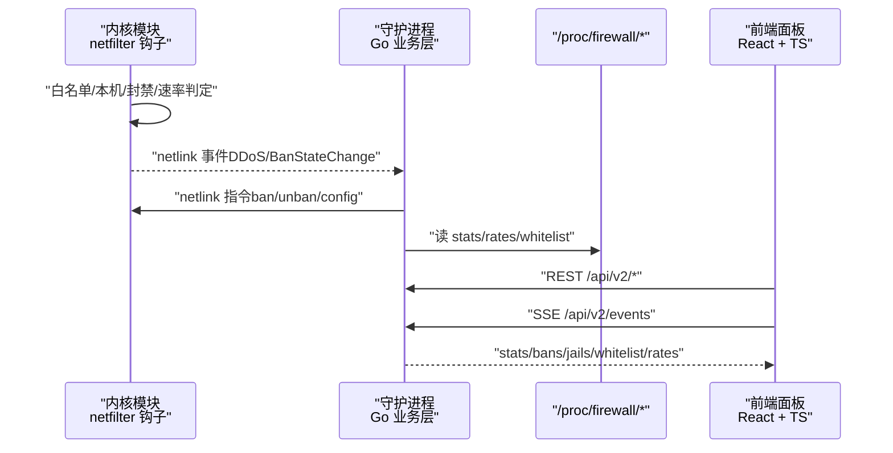
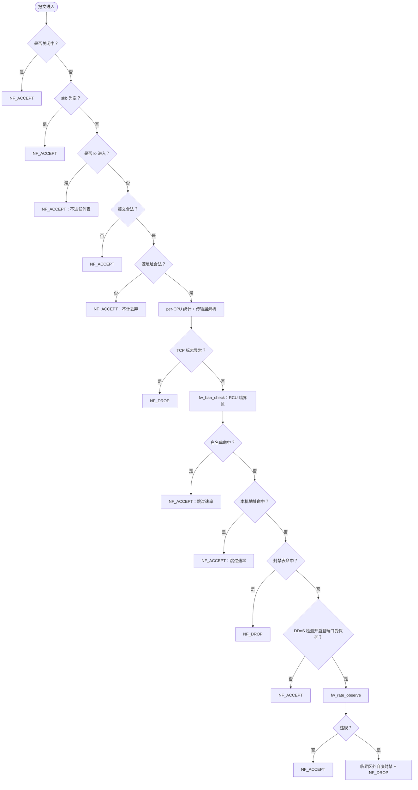
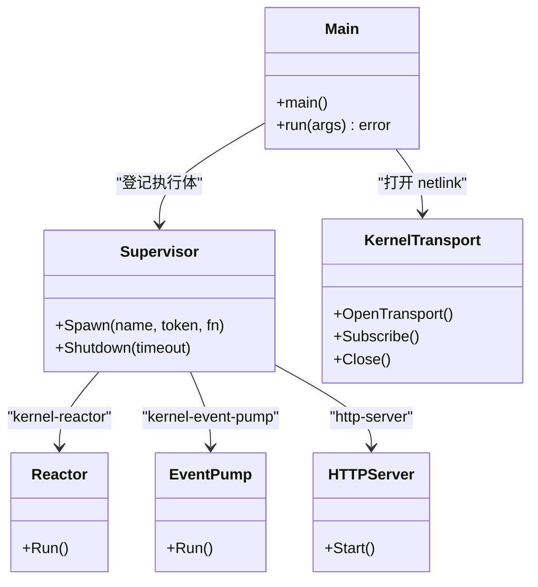
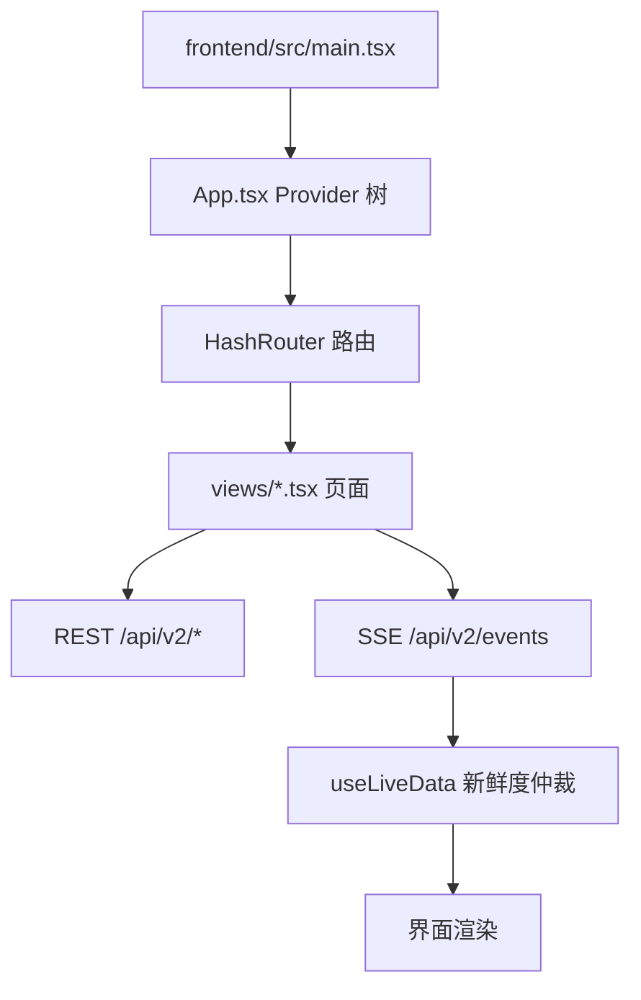
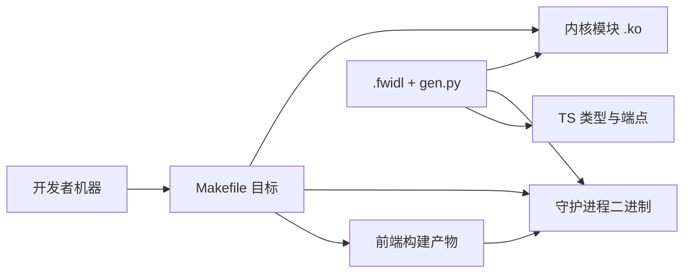
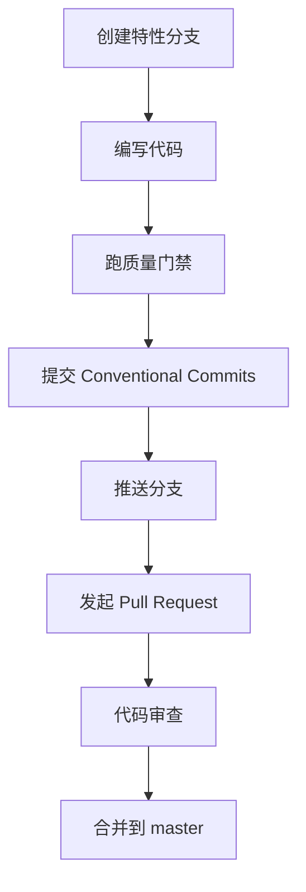

# 开发指南

<cite>
**本文引用的文件**   
- [CONTRIBUTING.md](file://CONTRIBUTING.md)
- [README.md](file://README.md)
- [docs/zh/development/README.md](file://docs/zh/development/README.md)
- [docs/zh/development/building.md](file://docs/zh/development/building.md)
- [docs/zh/development/testing.md](file://docs/zh/development/testing.md)
- [.github/PULL_REQUEST_TEMPLATE.md](file://.github/PULL_REQUEST_TEMPLATE.md)
- [docs/zh/architecture/kernel-module.md](file://docs/zh/architecture/kernel-module.md)
- [docs/zh/architecture/daemon.md](file://docs/zh/architecture/daemon.md)
- [docs/zh/architecture/frontend.md](file://docs/zh/architecture/frontend.md)
- [src/kernel-module/fw_ban.c](file://src/kernel-module/fw_ban.c)
- [src/daemon/cmd/firewall-daemon/main.go](file://src/daemon/cmd/firewall-daemon/main.go)
- [frontend/src/main.tsx](file://frontend/src/main.tsx)
</cite>

## 目录
1. [引言](#引言)
2. [项目结构](#项目结构)
3. [核心组件](#核心组件)
4. [架构总览](#架构总览)
5. [详细组件分析](#详细组件分析)
6. [依赖关系分析](#依赖关系分析)
7. [性能与调试](#性能与调试)
8. [代码规范与提交规范](#代码规范与提交规范)
9. [Pull Request 流程与审查标准](#pull-request-流程与审查标准)
10. [贡献者行为准则与社区参与](#贡献者行为准则与社区参与)
11. [问题报告流程](#问题报告流程)
12. [结论](#结论)

## 引言
本指南面向新贡献者，目标是让开发者在本地快速搭建环境、理解内核模块 + Go 守护进程 + TypeScript 前端三层职责，并按仓库既定的构建、测试、契约和评审门禁完成一次高质量提交。文档同时覆盖 C 内核模块、Go 守护进程、TypeScript 前端的特定要求，以及调试技巧、性能分析、代码审查标准、贡献者行为准则和问题报告流程。

## 项目结构
仓库采用「内核模块 + 用户态守护进程 + Web 面板 + 契约生成」的三层架构：
- `src/kernel-module`：C 内核模块，负责 netfilter 钩子、封禁表、白名单、速率检测与 procfs/netlink 接口。
- `src/daemon`：Go 守护进程，负责日志采集、风险判定、netlink 下发、HTTP/SSE/Metrics 与面板托管。
- `frontend`：React 19 + TypeScript 前端，通过 Vite 构建后嵌入守护进程二进制。
- `contract`：`.fwidl` 契约与 Python 生成器，保证 HTTP、procfs、netlink 三端一致性。
- `tests`：pytest 集成测试与 Playwright 端到端测试。
- `config`、`scripts`、`grafana`、`debian`：配置、脚本、监控与打包元数据。

```mermaid
graph TB
ROOT["linux-firewall-kmod/"]
KERNEL["src/kernel-module/<br/>C 内核模块"]
DAEMON["src/daemon/<br/>Go 守护进程"]
FRONTEND["frontend/<br/>React 19 + Vite"]
STATIC["src/daemon/web_ui/static/<br/>assets.go 持有 go:embed"]
OBJ["build/obj/frontend/<br/>vite 产物"]
CONTRACT["contract/<br/>.fwidl + gen.py + 三个校验器"]
SUPPORT["config/ · tests/ · docs/ · scripts/ · grafana/ · debian/"]
ROOT --> KERNEL
ROOT --> DAEMON
ROOT --> FRONTEND
ROOT --> CONTRACT
ROOT --> SUPPORT
FRONTEND --> |"vite build"| OBJ
OBJ --> |"make daemon 临时拷入"| STATIC
STATIC --> |"//go:embed *"| DAEMON
CONTRACT --> |"gen.py 生成"| KERNEL
CONTRACT --> |"gen.py 生成"| DAEMON
CONTRACT --> |"生成 TS"| FRONTEND
DAEMON < --> |"netlink"| KERNEL
```

**图示来源**
- [docs/zh/development/README.md:45-70](file://docs/zh/development/README.md#L45-L70)

**章节来源**
- [docs/zh/development/README.md:45-113](file://docs/zh/development/README.md#L45-L113)
- [README.md:10-31](file://README.md#L10-L31)

## 核心组件
- **内核模块**：以 `firewall` 为模块名，注册 IPv4/IPv6 的 `NF_INET_PRE_ROUTING` 钩子，按白名单 → 本机地址 → 封禁表 → 速率检测顺序短路判定；命中封禁即丢包。
- **守护进程**：组合根装配日志采集、内核链路、HTTP/SSE、持久化与面板服务；通过 netlink 与内核通信，通过 `/proc/firewall/*` 暴露运维接口。
- **前端面板**：桌面优先 SPA，侧边栏 + 顶栏 + 内容区；REST 首帧拉取，SSE 增量推送，PWA 离线兜底。

**章节来源**
- [docs/zh/architecture/kernel-module.md:18-50](file://docs/zh/architecture/kernel-module.md#L18-L50)
- [docs/zh/architecture/daemon.md:1-31](file://docs/zh/architecture/daemon.md#L1-L31)
- [docs/zh/architecture/frontend.md:9-46](file://docs/zh/architecture/frontend.md#L9-L46)

## 架构总览
系统由三条主路径组成：
1. 报文路径：内核钩子快速判定并丢包，零用户态开销。
2. 判定路径：守护进程读取日志，计算风险，经 netlink 下发封禁或白名单。
3. 管理路径：Web 面板通过 REST/SSE 展示状态并下发操作。



**图示来源**
- [docs/zh/architecture/kernel-module.md:54-156](file://docs/zh/architecture/kernel-module.md#L54-L156)
- [docs/zh/architecture/daemon.md:120-213](file://docs/zh/architecture/daemon.md#L120-L213)
- [docs/zh/architecture/frontend.md:233-297](file://docs/zh/architecture/frontend.md#L233-L297)

## 详细组件分析

### C 内核模块开发要点
- 模块入口与生命周期：`fw_main.c` 的 `module_init` / `module_exit`，初始化顺序有硬约束，退出时逆序清理。
- Netfilter 钩子：IPv4/IPv6 各一个，优先级比 filter 小 1，先于 filter 看到报文。
- 判定顺序：关闭中、lo、非法报文、源地址非法、白名单、本机地址、封禁表、DDoS 端口门控、速率检测。
- RCU 与锁：热路径只进一次 RCU 临界区；写侧用 `hlist_del_rcu` + `call_rcu`；桶锁与位图维护顺序严格。
- 速率表 per-CPU 槽：分块申请避开单次 per-CPU 32 KiB 上限；表满走失败开放方向。
- ProcFS 接口：13 个条目，权限与文法冻结在契约生成头。



**图示来源**
- [docs/zh/architecture/kernel-module.md:69-156](file://docs/zh/architecture/kernel-module.md#L69-L156)

**章节来源**
- [docs/zh/architecture/kernel-module.md:18-156](file://docs/zh/architecture/kernel-module.md#L18-L156)
- [docs/zh/architecture/kernel-module.md:284-380](file://docs/zh/architecture/kernel-module.md#L284-L380)
- [docs/zh/architecture/kernel-module.md:494-539](file://docs/zh/architecture/kernel-module.md#L494-L539)
- [src/kernel-module/fw_ban.c:1-83](file://src/kernel-module/fw_ban.c#L1-L83)

### Go 守护进程开发要点
- 组合根：`cmd/firewall-daemon/main.go` 的 `run(args []string)` 是可测入口，装配顺序决定依赖关系与关停顺序。
- 运行时形态：ingest、kernel-reactor、kernel-event-pump、http-server 四条 goroutine，Supervisor 登记逆序关停。
- netlink 层：codec/transport/router/reactor/client/consumer 分层，消息类型配对与分页收尾语义固定。
- SSE 与状态：telemetry.Store 唯一写入，读侧不可变快照；域载荷由纯函数派生，REST 与 SSE 同形。
- 配置与热重载：SIGHUP 或文件变化触发重读、差异比较、正则重编译、内核白名单同步；失败保留旧快照。
- 持久化：SQLite 保存 ban_history、ban_events、ip_reputation；Facts 缓存按 IP 折叠并周期刷盘。



**图示来源**
- [src/daemon/cmd/firewall-daemon/main.go:44-200](file://src/daemon/cmd/firewall-daemon/main.go#L44-L200)
- [docs/zh/architecture/daemon.md:58-119](file://docs/zh/architecture/daemon.md#L58-L119)

**章节来源**
- [docs/zh/architecture/daemon.md:58-119](file://docs/zh/architecture/daemon.md#L58-L119)
- [docs/zh/architecture/daemon.md:120-213](file://docs/zh/architecture/daemon.md#L120-L213)
- [docs/zh/architecture/daemon.md:270-313](file://docs/zh/architecture/daemon.md#L270-L313)
- [src/daemon/cmd/firewall-daemon/main.go:44-200](file://src/daemon/cmd/firewall-daemon/main.go#L44-L200)

### TypeScript 前端开发要点
- 技术栈：React 19 + TypeScript + Ant Design 6 + ECharts + Vite 8。
- 构建落点：Vite 输出到 `build/obj/frontend`，`make daemon` 临时拷入 `src/daemon/web_ui/static/` 并由 `//go:embed` 嵌入二进制。
- JSX 运行时：`jsx: "react-jsx"` + `jsxImportSource: "react"` + `@vitejs/plugin-react` 必须成对维护。
- 数据面：REST 首帧拉取，SSE 增量推送，`useLiveData` 仲裁新鲜度；连接超限降级 REST 轮询。
- 认证：Basic Authorization 与 `?access_token=` 双通道；sessionStorage 存储令牌；401 自动登出。
- PWA：manifest + sw.js；非安全上下文下 SW API 不存在属浏览器限制，不视为缺陷。



**图示来源**
- [frontend/src/main.tsx:1-32](file://frontend/src/main.tsx#L1-L32)
- [docs/zh/architecture/frontend.md:233-297](file://docs/zh/architecture/frontend.md#L233-L297)

**章节来源**
- [docs/zh/architecture/frontend.md:25-85](file://docs/zh/architecture/frontend.md#L25-L85)
- [docs/zh/architecture/frontend.md:104-184](file://docs/zh/architecture/frontend.md#L104-L184)
- [docs/zh/architecture/frontend.md:233-355](file://docs/zh/architecture/frontend.md#L233-L355)
- [docs/zh/architecture/frontend.md:380-408](file://docs/zh/architecture/frontend.md#L380-L408)

## 依赖关系分析
- 构建依赖：Go 1.26.0、Node.js 22、clang-format 18、Python 3、sqlite3。
- 内核依赖：内核头文件与运行内核一致；模块加载需 vermagic 匹配。
- 前端依赖：`frontend/package.json` 与 `frontend/package-lock.json` 必须同步提交。
- 契约依赖：`.fwidl` 改动必须重新生成并跑 `make contract-check`。



**图示来源**
- [docs/zh/development/building.md:6-19](file://docs/zh/development/building.md#L6-L19)
- [docs/zh/development/building.md:98-165](file://docs/zh/development/building.md#L98-L165)
- [docs/zh/development/building.md:166-189](file://docs/zh/development/building.md#L166-L189)

**章节来源**
- [docs/zh/development/building.md:6-19](file://docs/zh/development/building.md#L6-L19)
- [docs/zh/development/building.md:27-48](file://docs/zh/development/building.md#L27-L48)
- [docs/zh/development/building.md:166-189](file://docs/zh/development/building.md#L166-L189)

## 性能与调试
- 内核模块性能：热路径只进一次 RCU 临界区，per-CPU 统计与速率槽避免跨 CPU 竞争；速率表分块申请规避 per-CPU 32 KiB 上限。
- 守护进程性能：ingest 单 goroutine 顺序处理，无队列背压；SSE 慢消费者断开，REST 与 SSE 各自计数。
- 前端性能：懒加载页面组件，SSE 单例连接，指数退避重连，连接超限停手并降级 REST。
- 调试建议：
  - 内核：`dmesg | grep firewall`，关注 `pr_err`/`pr_warn_ratelimited`。
  - 守护进程：`make daemon` 带 `-ldflags "-s -w=1"` 生产体积；调试构建可单独 `go build -o firewall-daemon-debug`。
  - 前端：`make frontend-typecheck` 等价 `tsc --noEmit`；改前端后必须重编守护进程才可见。

**章节来源**
- [docs/zh/architecture/kernel-module.md:323-380](file://docs/zh/architecture/kernel-module.md#L323-L380)
- [docs/zh/architecture/daemon.md:58-83](file://docs/zh/architecture/daemon.md#L58-L83)
- [docs/zh/architecture/frontend.md:262-297](file://docs/zh/architecture/frontend.md#L262-L297)
- [CONTRIBUTING.md:91-99](file://CONTRIBUTING.md#L91-L99)

## 代码规范与提交规范
- C 内核模块：遵循 `.clang-format`，snake_case 命名，2 空格缩进，80 列行宽，K&R 括号，函数不超过 50 行，中文注释解释为什么。
- Go 守护进程：`gofmt` 干净，`go vet` 通过，错误用 `%w` 包装，纯 Go 无 cgo，中文注释。
- TypeScript 前端：tsconfig strict，JSX 自动运行时三处成对，类型检查 `make frontend-typecheck`，依赖锁定同步提交。
- 提交信息：Conventional Commits，类型包括 feat/fix/docs/style/refactor/perf/test/chore，范围用 kmod/daemon/web/build/contract/ci/docs。

**章节来源**
- [CONTRIBUTING.md:115-189](file://CONTRIBUTING.md#L115-L189)
- [CONTRIBUTING.md:191-216](file://CONTRIBUTING.md#L191-L216)
- [docs/zh/development/README.md:115-185](file://docs/zh/development/README.md#L115-L185)

## Pull Request 流程与审查标准
- 分支策略：主干 `master`，特性分支 `feature/short-name`，PR 向 `master` 发起。
- PR 模板：描述、Issue 链接、变更类型、影响范围、兼容性说明、性能基准、测试覆盖、检查清单。
- 审查重点：正确性、并发、包路径、契约、失败语义、兼容性、构建、可读性、测试、安全。
- 硬性回退：门禁没过、改测试迁就实现、契约未重跑、引入 cgo、文档留未跑命令、文档写成变更记录。



**图示来源**
- [CONTRIBUTING.md:218-249](file://CONTRIBUTING.md#L218-L249)
- [.github/PULL_REQUEST_TEMPLATE.md:1-194](file://.github/PULL_REQUEST_TEMPLATE.md#L1-L194)

**章节来源**
- [CONTRIBUTING.md:218-274](file://CONTRIBUTING.md#L218-L274)
- [.github/PULL_REQUEST_TEMPLATE.md:1-194](file://.github/PULL_REQUEST_TEMPLATE.md#L1-L194)

## 贡献者行为准则与社区参与
- 讨论针对问题，不针对人。
- 反对方案时给理由和替代方案。
- 尊重他人时间，评审意见一次说清。
- 许可证：MIT License，提交代码即同意以 MIT 发布。

**章节来源**
- [CONTRIBUTING.md:284-293](file://CONTRIBUTING.md#L284-L293)

## 问题报告流程
- Bug 报告：使用 `.github/ISSUE_TEMPLATE/bug_report.md`，写明内核版本、发行版、项目版本、复现步骤、期望与实际、相关日志。
- 功能请求：使用 `.github/ISSUE_TEMPLATE/feature_request.md`，写明使用场景、替代方案、期望行为。
- 安全问题：走 `SECURITY.md` 渠道，不开公开 Issue。

**章节来源**
- [CONTRIBUTING.md:275-283](file://CONTRIBUTING.md#L275-L283)

## 结论
本指南总结了开发环境搭建、代码规范、提交规范、PR 流程，以及 C 内核模块、Go 守护进程、TypeScript 前端的特定要求。配合契约系统、构建门禁、三层测试与审查标准，新贡献者可快速融入项目并保持代码质量与稳定性。遇到问题时，优先查阅文档与测试用例，再按行为规格定位实现偏差。