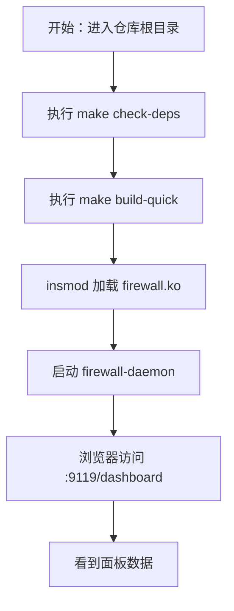
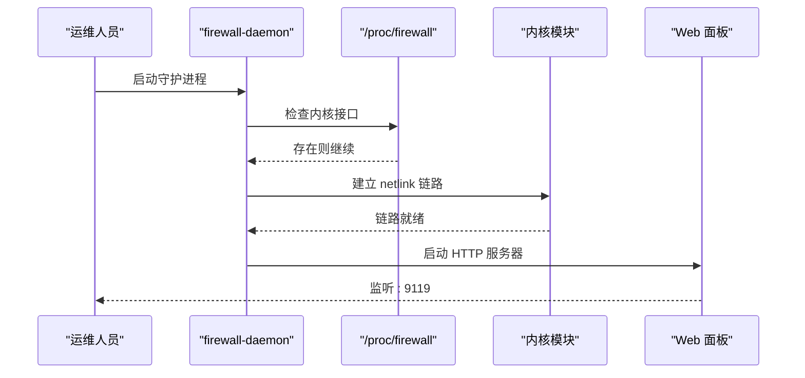

# 快速开始

<cite>
**本文引用的文件**   
- [README.md](file://README.md)
- [安装文档](file://docs/zh/getting-started/installation.md)
- [快速上手文档](file://docs/zh/getting-started/quick-start.md)
- [ProcFS 接口文档](file://docs/zh/configuration/procfs.md)
- [默认配置](file://config/default.yaml)
- [守护进程服务单元](file://firewall-daemon.service)
- [构建系统 Makefile](file://Makefile)
- [守护进程主程序](file://src/daemon/cmd/firewall-daemon/main.go)
- [配置加载器](file://src/daemon/internal/config/loader.go)
</cite>

## 目录
1. [简介](#简介)
2. [5 分钟部署总览](#5-分钟部署总览)
3. [环境依赖检查](#环境依赖检查)
4. [编译与产物](#编译与产物)
5. [加载内核模块](#加载内核模块)
6. [启动守护进程](#启动守护进程)
7. [访问 Web 面板](#访问-web-面板)
8. [基础封禁与解封操作](#基础封禁与解封操作)
9. [默认配置说明](#默认配置说明)
10. [开机自启与服务管理](#开机自启与服务管理)
11. [故障排查与验证方法](#故障排查与验证方法)
12. [常见问题速查](#常见问题速查)
13. [下一步](#下一步)

## 简介
本项目是一个面向 Linux 的智能内核防火墙，采用“用户态智能判定 + 内核态高速封禁”的三层架构：内核模块负责 netfilter 包过滤和封禁表，守护进程负责日志采集、风险判定、HTTP API 与 Web 面板，前端面板提供实时监控、配置管理和可视化分析。

对新手来说，核心体验路径只有五步：**检查依赖 → 编译 → 加载内核模块 → 启动守护进程 → 打开面板**。只要这五步跑通，就能看到封禁列表、统计数据和实时事件流。

**章节来源**
- [README.md:10-31](file://README.md#L10-L31)

## 5 分钟部署总览
以下命令在仓库根目录执行，且需要 root 权限。

| 步骤 | 命令或动作 | 预期结果 |
|------|-----------|---------|
| 1. 检查依赖 | `make check-deps` | 输出“所有构建依赖检查通过” |
| 2. 快速构建 | `make build-quick` | 生成 `build/kernel-module/firewall.ko` 和 `build/daemon/firewall-daemon` |
| 3. 加载模块 | `sudo insmod build/kernel-module/firewall.ko fw_ban_time=600` | 无输出，退出码为 0 |
| 4. 启动守护进程 | `sudo ./build/daemon/firewall-daemon -c config/default.yaml` | 终端持续打印日志，出现“内核 netlink 链路已就绪”和“HTTP 服务器已启动” |
| 5. 打开面板 | 浏览器访问 `http://<主机地址>:9119/dashboard` | 看到仪表盘；若配置了用户名口令则先登录 |

如果第 3 步失败，通常是内核头文件或运行内核不匹配；如果第 4 步直接报错退出，通常是内核模块未加载。

**章节来源**
- [README.md:33-74](file://README.md#L33-L74)
- [快速上手文档:9-82](file://docs/zh/getting-started/quick-start.md#L9-L82)



[本图为概念流程示意，不对应具体源码结构]

## 环境依赖检查
项目构建涉及三类依赖：内核模块 C 编译依赖、Go 守护进程依赖、前端 Node.js 依赖。

### 最低要求
| 依赖 | 要求 | 用途 |
|------|------|------|
| 内核头文件 | 与当前运行内核一致 | 编译内核模块 |
| gcc / make | Debian/Ubuntu 通常由 `build-essential` 提供 | C 模块构建 |
| clang-format | 可选但推荐 | 代码格式检查 |
| Go | 1.26 及以上 | 编译守护进程 |
| Node.js | 22（CI 使用） | 构建前端面板 |
| npm | 随 Node.js 安装 | 安装前端依赖 |
| root 权限 | 必需 | 加载模块、安装 systemd 服务 |

### 一键检查
```bash
make check-deps
```

该目标会依次检查：
- gcc 是否可用
- make 是否可用
- `/lib/modules/$(uname -r)/build` 是否存在
- clang-format 是否可用（缺失时仅警告）
- Go 版本是否满足要求
- Node.js 和 npm 是否可用

如果提示缺少内核头文件，常见修复是安装对应版本的 `linux-headers`，或通过 `KDIR` 指定正确的内核构建目录。

**章节来源**
- [安装文档:6-46](file://docs/zh/getting-started/installation.md#L6-L46)
- [构建系统 Makefile:71-155](file://Makefile#L71-L155)

## 编译与产物
### 常用构建命令
| 命令 | 作用 |
|------|------|
| `make` | 默认目标：格式检查 + 内核模块 + 守护进程 |
| `make build-quick` | 跳过格式检查的快速构建 |
| `make kernel-module` 或 `make kmod` | 只编译内核模块 |
| `make daemon` | 只编译守护进程（含前端静态资源嵌入） |
| `make frontend` | 只构建前端 |
| `make clean` | 清理构建产物 |

### 产物位置
| 产物 | 路径 |
|------|------|
| 内核模块 | `build/kernel-module/firewall.ko` |
| 守护进程 | `build/daemon/firewall-daemon` |

### 内核头文件不在标准位置
如果 CI 环境中内核头文件不在默认路径，可以显式指定：
```bash
make kernel-module KDIR=/lib/modules/$(uname -r)/build
```

也可以先查找可用的内核构建目录：
```bash
find /lib/modules -maxdepth 2 -name build -type d
```

**章节来源**
- [安装文档:47-87](file://docs/zh/getting-started/installation.md#L47-L87)
- [构建系统 Makefile:184-319](file://Makefile#L184-L319)

## 加载内核模块
内核模块是防火墙的数据平面：它把封禁表放在内核中，命中即丢，避免用户态成为瓶颈。

### 手动加载
```bash
sudo insmod build/kernel-module/firewall.ko fw_ban_time=600
```

参数 `fw_ban_time=600` 表示默认封禁时长为 600 秒。你也可以不传参数，使用模块默认值。

### 验证模块已加载
```bash
lsmod | grep firewall
```

预期输出第一列包含 `firewall`。

### 查看内核侧 ProcFS 接口
```bash
ls /proc/firewall/
sudo cat /proc/firewall/config
```

模块加载成功后，`/proc/firewall/` 下会出现多个条目，包括 `bans`、`whitelist`、`config`、`stats` 等。`config` 会显示当前封禁时长、封禁条目数和白名单条目数。

### 卸载模块
```bash
sudo rmmod firewall
```

卸载后 `lsmod | grep firewall` 不应再有输出，`/proc/firewall/` 目录也会消失。

**章节来源**
- [快速上手文档:9-39](file://docs/zh/getting-started/quick-start.md#L9-L39)
- [安装文档:191-237](file://docs/zh/getting-started/installation.md#L191-L237)
- [ProcFS 接口文档:1-30](file://docs/zh/configuration/procfs.md#L1-L30)

## 启动守护进程
守护进程是防火墙的控制面：它读取日志、计算风险、下发封禁、暴露 HTTP API 和 Web 面板。

### 前台试跑
```bash
sudo ./build/daemon/firewall-daemon -c config/default.yaml
```

### 预期日志
成功启动后，终端会持续输出结构化日志，其中关键行包括：
- “内核 netlink 链路已就绪”
- “HTTP 服务器已启动”

如果内核模块未加载，守护进程会在启动阶段检测到 `/proc/firewall/...` 不存在，并直接以非零退出码退出，错误信息类似“内核接口不可用”。

### 常用参数
| 参数 | 作用 |
|------|------|
| `-c`、`--config <文件>` | 指定单个配置文件 |
| `-C`、`--config-dir <目录>` | 指定配置目录，按字母序合并 |
| `-d`、`--daemon` | 后台运行并写 PID 文件 |
| `--no-strict` | 忽略未知配置键 |
| `--rollback` | 向正在运行的守护进程请求回滚上一个配置 |
| `-h`、`--help` | 打印帮助 |

### 启动流程概览


**图表来源**
- [守护进程主程序:51-124](file://src/daemon/cmd/firewall-daemon/main.go#L51-L124)
- [守护进程主程序:173-200](file://src/daemon/cmd/firewall-daemon/main.go#L173-L200)
- [守护进程主程序:228-354](file://src/daemon/cmd/firewall-daemon/main.go#L228-L354)

**章节来源**
- [快速上手文档:41-60](file://docs/zh/getting-started/quick-start.md#L41-L60)
- [安装文档:238-253](file://docs/zh/getting-started/installation.md#L238-L253)
- [守护进程主程序:51-124](file://src/daemon/cmd/firewall-daemon/main.go#L51-L124)
- [守护进程主程序:512-521](file://src/daemon/cmd/firewall-daemon/main.go#L512-L521)

## 访问 Web 面板
### 访问地址
```text
http://<主机地址>:9119/dashboard
```

默认端口来自配置的 `defaults.metrics_port`，值为 9119。默认监听地址来自 `defaults.metrics_bind_address`，值为 `0.0.0.0`，因此局域网内其他机器也能访问。

### 认证
如果配置了 `metrics_username` 和 `metrics_password`，面板会显示登录表单。令牌保存在浏览器的 `sessionStorage` 中，关闭标签页后失效。

注意：如果面板绑定在非回环地址但没有配置认证，守护进程会在启动日志中给出安全告警。生产环境务必修改默认口令或使用环境变量覆盖凭据。

### 已知限制
Service Worker 只在安全上下文（HTTPS 或 localhost）注册。通过 `http://<局域网IP>:9119` 访问时界面正常，但无法“添加到主屏幕”。

**章节来源**
- [快速上手文档:62-86](file://docs/zh/getting-started/quick-start.md#L62-L86)
- [默认配置:7-22](file://config/default.yaml#L7-L22)
- [守护进程主程序:106-120](file://src/daemon/cmd/firewall-daemon/main.go#L106-L120)

## 基础封禁与解封操作
### 手工封禁 IP
```bash
echo "203.0.113.9" | sudo tee /proc/firewall/bans
```

### 指定时长或永久封禁
```bash
echo "203.0.113.10 3600" | sudo tee /proc/firewall/bans   # 一小时
echo "203.0.113.11 0"     | sudo tee /proc/firewall/bans   # 永久
```

### 查看封禁列表
```bash
sudo cat /proc/firewall/bans
```

### 解封
```bash
echo "unban 203.0.113.9"  | sudo tee /proc/firewall/bans
echo "unban 203.0.113.10" | sudo tee /proc/firewall/bans
echo "unban 203.0.113.11" | sudo tee /proc/firewall/bans
```

### 查看统计
```bash
sudo cat /proc/firewall/stats | grep -E "^(total_bans|total_unbans|current_bans) "
```

### 白名单
```bash
echo "203.0.113.0/24" | sudo tee /proc/firewall/whitelist
```

### 修改内核默认封禁时长
```bash
echo "ban_time 300" | sudo tee /proc/firewall/config
```

**章节来源**
- [快速上手文档:87-164](file://docs/zh/getting-started/quick-start.md#L87-L164)
- [ProcFS 接口文档:44-153](file://docs/zh/configuration/procfs.md#L44-L153)

## 默认配置说明
默认配置文件位于 `config/default.yaml`，主要字段如下：

| 配置段 | 关键字段 | 默认值或含义 |
|--------|---------|-------------|
| `defaults` | `findtime` | 10 分钟检测窗口 |
| `defaults` | `ban_time` | 15 分钟默认封禁时长 |
| `defaults` | `metrics_port` | 9119 |
| `defaults` | `metrics_bind_address` | `0.0.0.0` |
| `defaults` | `metrics_username` / `metrics_password` | 出厂占位值，生产环境必须修改 |
| `defaults` | `log_file` | `/var/log/firewall.log` |
| `defaults` | `history_db_path` | `/var/lib/firewall/history.db` |
| `jails.sshd` | `enabled` | true |
| `webui` | `sse_push_interval` | 1 秒 |
| `ddos` | `enabled` | true |
| `threat_feeds` | `enabled` | true |

### 面板凭据优先级
面板凭据有两个来源：
1. YAML 配置中的 `defaults.metrics_username` / `metrics_password`
2. 环境变量 `FIREWALL_METRICS_USERNAME` / `FIREWALL_METRICS_PASSWORD`

systemd 服务会通过 `/etc/firewall/credentials.env` 注入环境变量。如果该文件存在且取消注释，它会覆盖 YAML 中的值。

### 配置加载方式
守护进程支持两种配置模式：
- 单文件：`-c config/default.yaml`
- 目录：`-C /etc/firewall`，目录下所有 `.yaml` / `.yml` 按文件名字母序合并

目录模式下，以 `_` 开头的自动管理文件最后合并，拥有最终覆盖权。

**章节来源**
- [默认配置:1-198](file://config/default.yaml#L1-L198)
- [安装文档:121-137](file://docs/zh/getting-started/installation.md#L121-L137)
- [配置加载器:17-50](file://src/daemon/internal/config/loader.go#L17-L50)
- [配置加载器:53-128](file://src/daemon/internal/config/loader.go#L53-L128)

## 开机自启与服务管理
### 安装到系统
```bash
sudo env "PATH=$PATH" make install
```

该命令会完成以下工作：
1. 构建内核模块和守护进程
2. 安装内核模块并执行 `depmod -a`
3. 安装守护进程二进制
4. 安装配置文件到 `/etc/firewall/`
5. 准备 `/etc/firewall/credentials.env`
6. 创建状态目录 `/var/lib/firewall/`
7. 安装 systemd 服务单元和模块自动加载配置
8. 加载模块、enable 并 start 服务
9. 验证安装结果

### 服务管理命令
| 命令 | 作用 |
|------|------|
| `sudo systemctl start firewall-daemon` | 启动 |
| `sudo systemctl stop firewall-daemon` | 停止 |
| `sudo systemctl enable firewall-daemon` | 开机自启 |
| `sudo systemctl status firewall-daemon` | 查看状态 |
| `sudo journalctl -u firewall-daemon -f` | 追看日志 |

### 服务单元行为
服务单元定义在 `firewall-daemon.service`，主要特点：
- 以 root 运行
- 启动命令为 `/usr/sbin/firewall-daemon -C /etc/firewall`
- 支持 `systemctl reload` 触发热重载
- 启用多项 systemd 安全加固选项
- 限制可访问的系统调用族和网络地址族
- 限制最大文件描述符数和进程数

开机自动加载内核模块由 `/etc/modules-load.d/firewall.conf` 负责。

**章节来源**
- [安装文档:88-189](file://docs/zh/getting-started/installation.md#L88-L189)
- [守护进程服务单元:1-51](file://firewall-daemon.service#L1-L51)
- [构建系统 Makefile:673-800](file://Makefile#L673-L800)

## 故障排查与验证方法
### 第一步：确认内核模块是否加载
```bash
lsmod | grep firewall
ls /proc/firewall/
sudo cat /proc/firewall/config
```

如果 `/proc/firewall/` 不存在，说明模块未加载或加载失败。

### 第二步：确认守护进程是否启动
```bash
sudo systemctl status firewall-daemon
sudo journalctl -u firewall-daemon -f
```

如果守护进程启动后立即退出，重点看第一条错误日志。常见原因是：
- 内核模块未加载
- 前端静态资源缺失
- 配置路径不存在
- 面板监听地址对外开放但未配置认证

### 第三步：确认面板是否可达
```bash
curl -s http://localhost:9119/metrics | head
```

如果能返回 Prometheus 指标片段，说明 HTTP 服务器已启动。

### 第四步：确认封禁是否生效
```bash
sudo cat /proc/firewall/bans
sudo cat /proc/firewall/stats | grep current_bans
```

### 第五步：查看内核日志
```bash
sudo dmesg | tail
```

ProcFS 写入失败时，内核不会返回详细文本错误，拒绝原因通常只能从 `dmesg` 中看到。

### 第六步：恢复与卸载
```bash
sudo systemctl stop firewall-daemon
sudo rmmod firewall
sudo make uninstall
```

卸载顺序是：停服务 → 卸模块 → 删服务单元 → 删开机加载配置 → 删二进制和运行期文件 → 删配置目录 → 复查。

**章节来源**
- [快速上手文档:165-174](file://docs/zh/getting-started/quick-start.md#L165-L174)
- [ProcFS 接口文档:251-270](file://docs/zh/configuration/procfs.md#L251-L270)
- [守护进程主程序:512-521](file://src/daemon/cmd/firewall-daemon/main.go#L512-L521)

## 常见问题速查
| 现象 | 可能原因 | 处理建议 |
|------|---------|---------|
| `make check-deps` 报缺少内核头文件 | 未安装 `linux-headers-$(uname -r)` | 安装对应内核头文件或指定 `KDIR` |
| `insmod` 失败 | 内核版本不兼容或缺少符号 | 检查内核版本、重新编译模块 |
| 守护进程启动时报“内核接口不可用” | 内核模块未加载 | 先加载模块，再启动守护进程 |
| 面板能打开但一直提示未认证 | 使用了默认口令或未配置凭据 | 修改 `credentials.env` 或 YAML 中的用户名口令 |
| 面板绑定公网地址但没配密码 | 安全风险 | 立即设置凭据或将 `metrics_bind_address` 改为 `127.0.0.1` |
| 写 `/proc/firewall/bans` 无输出但没生效 | 命令语法错误或目标被白名单拦截 | 查看 `dmesg`、检查白名单和 stats |
| 面板添加不到主屏幕 | 非 HTTPS 或非 localhost | 使用 HTTPS 或本地回环访问 |
| 想打包但不想直接装到本机 | 本地部署守卫阻止直接安装 | 使用 `DESTDIR`、`.deb` 或远程部署脚本 |

**章节来源**
- [README.md:33-74](file://README.md#L33-L74)
- [安装文档:139-168](file://docs/zh/getting-started/installation.md#L139-L168)
- [守护进程主程序:106-120](file://src/daemon/cmd/firewall-daemon/main.go#L106-L120)

## 下一步
当你已经能在浏览器中看到面板数据，说明核心功能已经跑通。接下来可以根据实际需求：
- 让服务开机自启：参考 systemd 服务部分
- 添加自己的服务防护：编辑 `config/default.yaml` 或新增 YAML 配置
- 调整 DDoS 防护阈值：修改 `ddos` 配置段
- 接入威胁情报源：根据 `threat_feeds` 配置启用更多源
- 集成监控：访问 `/metrics` 对接 Prometheus 或 Grafana
- 阅读完整文档：架构、配置、开发、运维相关文档都在 `docs/zh/` 下

**章节来源**
- [README.md:133-150](file://README.md#L133-L150)
- [快速上手文档:176-181](file://docs/zh/getting-started/quick-start.md#L176-L181)