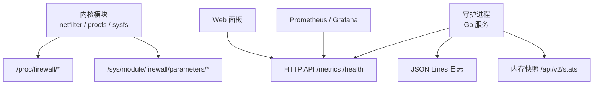
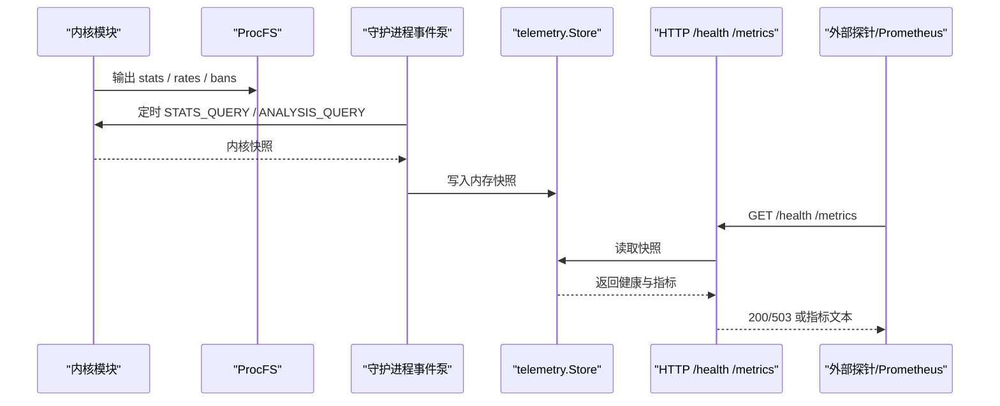
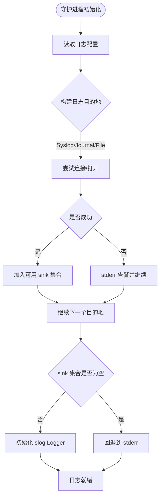
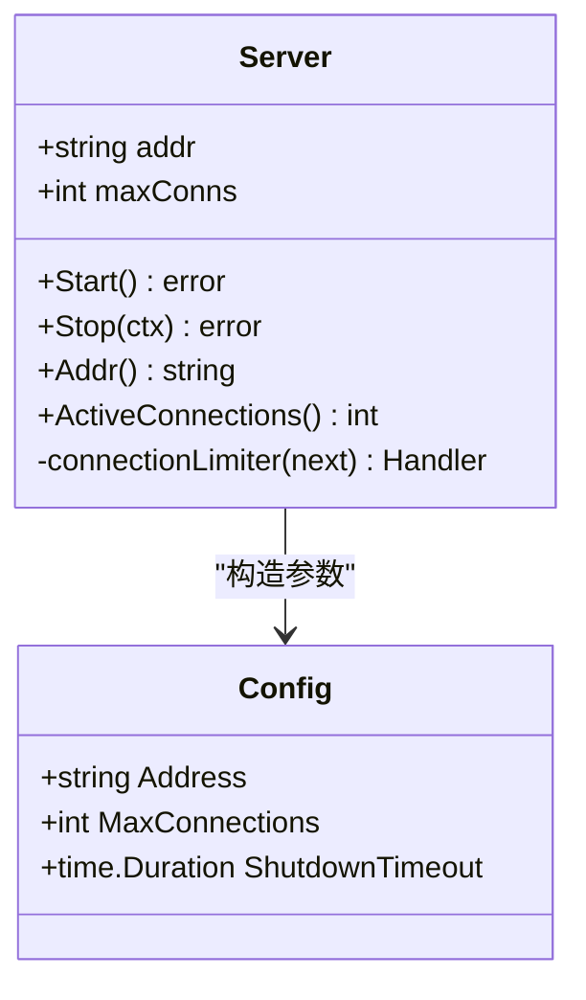
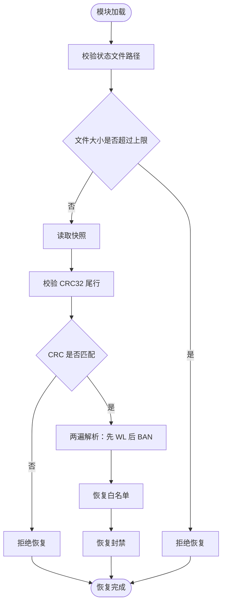
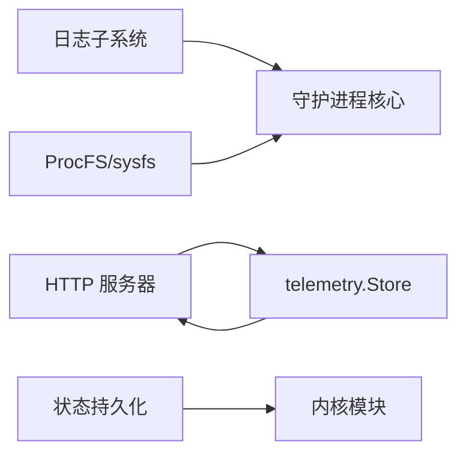

# 故障排查

<cite>
**本文引用的文件**   
- [README.md](file://README.md)
- [monitoring.md](file://docs/zh/operations/monitoring.md)
- [management.md](file://docs/zh/operations/management.md)
- [logger.go](file://src/daemon/internal/logger/logger.go)
- [logging.go](file://src/daemon/internal/config/logging.go)
- [server.go](file://src/daemon/internal/http/server.go)
- [fw_state.c](file://src/kernel-module/fw_state.c)
</cite>

## 目录
1. [引言](#引言)
2. [项目结构](#项目结构)
3. [核心组件](#核心组件)
4. [架构总览](#架构总览)
5. [详细组件分析](#详细组件分析)
6. [依赖关系分析](#依赖关系分析)
7. [性能注意事项](#性能注意事项)
8. [故障排查指南](#故障排查指南)
9. [结论](#结论)
10. [附录](#附录)

## 引言
本指南面向运维与平台工程师，聚焦“内核模块加载失败、守护进程启动异常、网络连接问题、性能下降”等典型场景。文档以仓库现有监控与管理文档为基础，结合守护进程日志、HTTP 健康检查、Prometheus 指标、ProcFS 计数与内核状态文件恢复逻辑，给出可操作的诊断路径、定位方法与排障步骤。

## 项目结构
本项目采用三层架构：内核模块负责高速封禁与统计；守护进程负责日志采集、风险判定、HTTP API 与面板服务；前端面板提供可视化与配置管理。故障排查需要同时关注内核态与用户态两条链路。

图示来源
- [README.md:10-31](file://README.md#L10-L31)
- [monitoring.md:15-28](file://docs/zh/operations/monitoring.md#L15-L28)
- [management.md:94-121](file://docs/zh/operations/management.md#L94-L121)

章节来源
- [README.md:10-31](file://README.md#L10-L31)
- [monitoring.md:15-28](file://docs/zh/operations/monitoring.md#L15-L28)
- [management.md:94-121](file://docs/zh/operations/management.md#L94-L121)

## 核心组件
- 内核模块：提供 netfilter 钩子、封禁表、白名单、速率表、ProcFS 与 SysFS 参数。
- 守护进程：解析日志、计算风险、下发封禁、暴露 HTTP API、聚合 telemetry。
- 监控面：`/metrics`（Prometheus）、`/health`、`/api/v2/stats`、`/proc/firewall/stats`。
- 日志系统：JSON Lines，支持文件、syslog、journald，具备轮转与降级能力。
- 状态持久化：内核侧保存封禁与白名单，重启后按 CRC32 校验恢复。

章节来源
- [README.md:76-131](file://README.md#L76-L131)
- [monitoring.md:53-79](file://docs/zh/operations/monitoring.md#L53-L79)
- [monitoring.md:183-229](file://docs/zh/operations/monitoring.md#L183-L229)
- [fw_state.c:46-75](file://src/kernel-module/fw_state.c#L46-L75)

## 架构总览
下图展示从内核到守护进程再到外部观测系统的常见数据流，以及故障定位的关键断点。

图示来源
- [monitoring.md:15-28](file://docs/zh/operations/monitoring.md#L15-L28)
- [monitoring.md:157-181](file://docs/zh/operations/monitoring.md#L157-L181)

## 详细组件分析

### 守护进程日志子系统
守护进程使用结构化 JSON Lines 日志，默认路径为 `/var/log/firewall.log`，支持 syslog/journald/file/both 多种目的地。任一目的地不可用时仅告警并降级，不会导致进程退出。

关键要点
- 日志级别由配置映射，NONE 对应静默。
- 文件打开失败会回退 stderr，保证至少可写。
- 日志轮转内置，不依赖 logrotate。
- 日志路径可通过配置登记，供日志查看器读取。

图示来源
- [logger.go:92-116](file://src/daemon/internal/logger/logger.go#L92-L116)
- [logger.go:118-170](file://src/daemon/internal/logger/logger.go#L118-L170)
- [logging.go:8-13](file://src/daemon/internal/config/logging.go#L8-L13)

章节来源
- [logger.go:15-27](file://src/daemon/internal/logger/logger.go#L15-L27)
- [logger.go:92-116](file://src/daemon/internal/logger/logger.go#L92-L116)
- [logger.go:118-170](file://src/daemon/internal/logger/logger.go#L118-L170)
- [logger.go:188-233](file://src/daemon/internal/logger/logger.go#L188-L233)
- [logging.go:8-13](file://src/daemon/internal/config/logging.go#L8-L13)

### HTTP 服务器与健康检查
HTTP 服务器默认监听 `127.0.0.1:9119`，具备连接数限制、优雅关停与安全头。`/health` 直接读 telemetry 快照，用于快速判断内核链路、procfs、缓存与历史库是否就绪。

关键点
- 连接超限返回 503，避免雪崩。
- 优雅关停超时后会强制关闭，防止端口占用。
- `/health` 有意不套信封，便于轻量探针。

图示来源
- [server.go:14-32](file://src/daemon/internal/http/server.go#L14-L32)
- [server.go:34-73](file://src/daemon/internal/http/server.go#L34-L73)
- [server.go:84-113](file://src/daemon/internal/http/server.go#L84-L113)
- [server.go:129-149](file://src/daemon/internal/http/server.go#L129-L149)

章节来源
- [server.go:14-32](file://src/daemon/internal/http/server.go#L14-L32)
- [server.go:34-73](file://src/daemon/internal/http/server.go#L34-L73)
- [server.go:84-113](file://src/daemon/internal/http/server.go#L84-L113)
- [server.go:129-149](file://src/daemon/internal/http/server.go#L129-L149)

### 内核状态持久化与恢复
内核模块在卸载时保存封禁与白名单，加载时恢复。恢复前进行路径校验、文件大小上限检查与 CRC32 尾行校验；恢复顺序为先白名单后封禁，确保封禁白名单前检生效。

重点行为
- 状态文件路径只允许 `/var/lib/`、`/tmp/`、`/etc/` 下，且拒绝危险字符。
- 文件过大直接拒绝恢复，避免半截快照污染运行态。
- CRC32 缺失或校验失败一律拒绝恢复。
- 封禁条目带前缀长度，网段封禁重启后仍保持 CIDR。

图示来源
- [fw_state.c:81-116](file://src/kernel-module/fw_state.c#L81-L116)
- [fw_state.c:360-401](file://src/kernel-module/fw_state.c#L360-L401)
- [fw_state.c:542-653](file://src/kernel-module/fw_state.c#L542-L653)

章节来源
- [fw_state.c:46-75](file://src/kernel-module/fw_state.c#L46-L75)
- [fw_state.c:81-116](file://src/kernel-module/fw_state.c#L81-L116)
- [fw_state.c:360-401](file://src/kernel-module/fw_state.c#L360-L401)
- [fw_state.c:542-653](file://src/kernel-module/fw_state.c#L542-L653)

## 依赖关系分析
- 守护进程依赖日志子系统、HTTP 服务器、内核通信通道与 telemetry 存储。
- HTTP 层依赖 telemetry 快照对外暴露健康与指标。
- 内核模块通过 ProcFS/sysfs 暴露运行时状态，供守护进程与运维命令使用。
- 状态持久化依赖文件系统与用户态工具（原子替换）。

图示来源
- [monitoring.md:15-28](file://docs/zh/operations/monitoring.md#L15-L28)
- [management.md:94-121](file://docs/zh/operations/management.md#L94-L121)
- [fw_state.c:145-160](file://src/kernel-module/fw_state.c#L145-L160)

章节来源
- [monitoring.md:15-28](file://docs/zh/operations/monitoring.md#L15-L28)
- [management.md:94-121](file://docs/zh/operations/management.md#L94-L121)
- [fw_state.c:145-160](file://src/kernel-module/fw_state.c#L145-L160)

## 性能注意事项
- 内核侧计数不走 Prometheus，需自行采集 `/proc/firewall/stats` 才能进入监控系统。
- 速率表溢出时活跃源超出上限，新源不做速率判定，应关注 `rate_slot_spill`。
- 封禁表满、白名单拒绝、分配失败等都会影响封禁效果，需结合 `stats` 键值判断。
- 日志解析跟不上时，`firewall_lines_skipped_total` 会持续增长。

章节来源
- [monitoring.md:24-31](file://docs/zh/operations/monitoring.md#L24-L31)
- [monitoring.md:111-155](file://docs/zh/operations/monitoring.md#L111-L155)
- [monitoring.md:338-349](file://docs/zh/operations/monitoring.md#L338-L349)

## 故障排查指南

### 通用定位流程
1. 确认内核模块是否加载：`lsmod | grep '^firewall '`。
2. 确认守护进程是否运行：`systemctl status firewall-daemon`。
3. 确认 ProcFS 接口是否可用：`sudo cat /proc/firewall/stats`。
4. 检查 HTTP 健康：`curl http://127.0.0.1:9119/health`。
5. 观察 Prometheus 指标：`/metrics` 中 netlink 错误、内核拒绝指令、封禁速率等。
6. 查看守护进程日志：`journalctl -u firewall-daemon -f` 或 `/var/log/firewall.log`。
7. 查看内核日志：`dmesg --follow | grep firewall`。

章节来源
- [management.md:59-92](file://docs/zh/operations/management.md#L59-L92)
- [management.md:316-335](file://docs/zh/operations/management.md#L316-L335)
- [monitoring.md:157-181](file://docs/zh/operations/monitoring.md#L157-L181)
- [monitoring.md:338-349](file://docs/zh/operations/monitoring.md#L338-L349)

### 内核模块加载失败
现象
- `insmod` 失败，或 `lsmod` 无 `firewall`。
- `dmesg` 出现模块相关错误。

诊断步骤
- 查看 `dmesg` 中防火墙相关错误信息。
- 检查内核头文件与编译环境是否与运行内核一致。
- 确认模块参数合法，必要时带参重新加载。
- 若状态文件损坏，模块可能拒绝恢复并报错。

处理建议
- 修复内核头文件或内核版本不匹配问题。
- 清理损坏的状态文件后重试加载。
- 使用最小参数加载逐步定位参数问题。

章节来源
- [management.md:59-92](file://docs/zh/operations/management.md#L59-L92)
- [fw_state.c:360-401](file://src/kernel-module/fw_state.c#L360-L401)
- [fw_state.c:542-653](file://src/kernel-module/fw_state.c#L542-L653)

### 守护进程启动异常
现象
- 守护进程无法启动或启动后立即退出。
- 日志文件无法打开或系统日志不可用。

诊断步骤
- 查看守护进程日志输出位置与级别。
- 检查日志目的地配置：syslog/journald/file/both。
- 确认配置文件语法与路径正确。
- 前台运行一次作为配置检查。

处理建议
- 修正 YAML 配置或路径权限。
- 若所有日志目的地不可用，进程会回退 stderr，请检查终端或 systemd 日志。
- 调整日志级别以便获取更多上下文。

章节来源
- [logger.go:92-116](file://src/daemon/internal/logger/logger.go#L92-L116)
- [logger.go:118-170](file://src/daemon/internal/logger/logger.go#L118-L170)
- [management.md:35-57](file://docs/zh/operations/management.md#L35-L57)
- [management.md:316-335](file://docs/zh/operations/management.md#L316-L335)

### 网络连接问题
现象
- Web 面板无法访问。
- Prometheus 抓取失败。
- HTTP 返回 503 或连接被限流。

诊断步骤
- 检查监听地址与端口是否正确。
- 查看 `/health` 返回值。
- 观察连接数是否达到上限。
- 检查安全组、防火墙规则与 SELinux/AppArmor。

处理建议
- 调整监听地址与端口绑定。
- 提高连接上限或优化客户端并发。
- 确保 `/health` 可达后再做更复杂探测。

章节来源
- [server.go:34-73](file://src/daemon/internal/http/server.go#L34-L73)
- [server.go:84-113](file://src/daemon/internal/http/server.go#L84-L113)
- [server.go:129-149](file://src/daemon/internal/http/server.go#L129-L149)
- [monitoring.md:157-181](file://docs/zh/operations/monitoring.md#L157-L181)

### 性能下降
现象
- 封禁延迟增加。
- 日志解析滞后。
- 速率表样本丢失。
- 内核丢包突增。

诊断步骤
- 查看 Prometheus 指标：解析速率、跳过行数、正则命中率、封禁速率。
- 查看内核 `stats`：`packets_dropped`、`tcp_anomaly_dropped`、`recent_additions`。
- 查看速率表溢出标志：`rate_slot_spill`。
- 检查封禁表是否已满、白名单是否拒绝过多请求。

处理建议
- 调优速率表容量与阈值。
- 调整日志解析与轮转策略。
- 扩容封禁表与白名单容量。
- 针对 TCP 标志异常丢弃，检查协议栈或攻击特征。

章节来源
- [monitoring.md:53-79](file://docs/zh/operations/monitoring.md#L53-L79)
- [monitoring.md:111-155](file://docs/zh/operations/monitoring.md#L111-L155)
- [monitoring.md:338-349](file://docs/zh/operations/monitoring.md#L338-L349)

### 内核链路不稳或指令被拒绝
现象
- `/health` 显示内核链路未就绪。
- Prometheus 中 netlink 发送/接收错误非零。
- 内核拒绝下发的指令计数增长。

诊断步骤
- 检查 `/health` 的链路字段。
- 观察四个 netlink 计数器是否失衡。
- 查看内核日志中 netlink 相关错误。
- 确认守护进程事件泵已启动。

处理建议
- 重启守护进程重建 netlink 链路。
- 检查内核模块加载与版本兼容性。
- 降低下发频率或批量合并指令。

章节来源
- [monitoring.md:15-28](file://docs/zh/operations/monitoring.md#L15-L28)
- [monitoring.md:175-181](file://docs/zh/operations/monitoring.md#L175-L181)
- [monitoring.md:338-349](file://docs/zh/operations/monitoring.md#L338-L349)

### 状态文件损坏或恢复失败
现象
- 模块加载后封禁/白名单未恢复。
- `dmesg` 出现状态文件 CRC32 错误或大小超限。

诊断步骤
- 检查状态文件是否存在与大小。
- 查看内核日志中的 CRC32 与路径校验错误。
- 确认状态文件未被截断或篡改。

处理建议
- 删除损坏的状态文件后重新加载模块。
- 避免在模块卸载过程中中断状态写入。
- 确保状态文件路径位于允许目录。

章节来源
- [fw_state.c:360-401](file://src/kernel-module/fw_state.c#L360-L401)
- [fw_state.c:542-653](file://src/kernel-module/fw_state.c#L542-L653)

## 结论
故障排查应以“内核态—用户态—观测面”为主线：先用健康检查与 ProcFS 快速定位范围，再用 Prometheus 指标与守护进程日志细化原因，最后结合内核日志与状态文件恢复逻辑确认根因。对内核模块加载、守护进程启动、HTTP 连接与性能问题，分别对应不同的关键读数与处置动作。

## 附录

### 常用命令速查
- 服务管理：`systemctl start/stop/restart/status/reload firewall-daemon`
- 模块管理：`insmod/rmmod/modinfo lsmod modprobe`
- 运行时操作：`echo ... | sudo tee /proc/firewall/bans`
- 日志查看：`journalctl -u firewall-daemon -f`、`tail -f /var/log/firewall.log`
- 健康检查：`curl http://127.0.0.1:9119/health`

章节来源
- [management.md:357-379](file://docs/zh/operations/management.md#L357-L379)
- [monitoring.md:290-310](file://docs/zh/operations/monitoring.md#L290-L310)