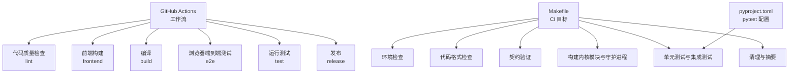
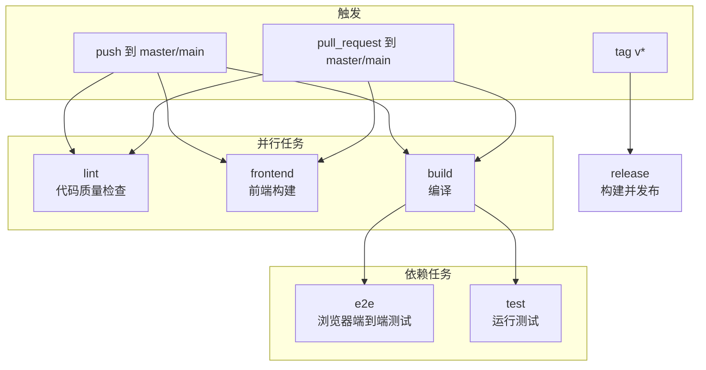
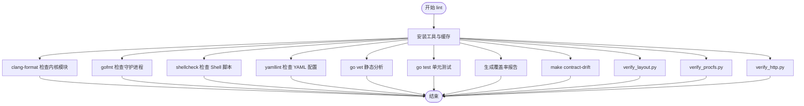
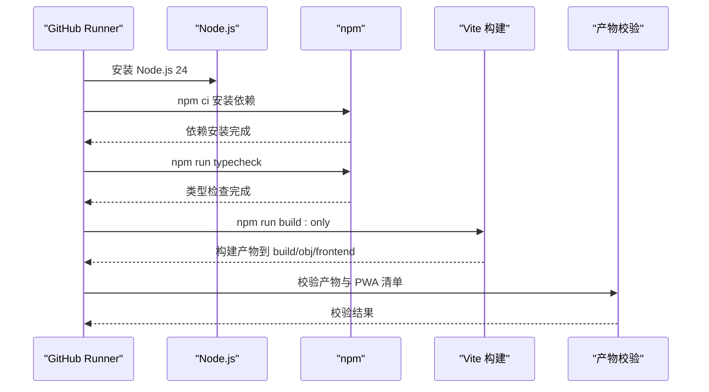
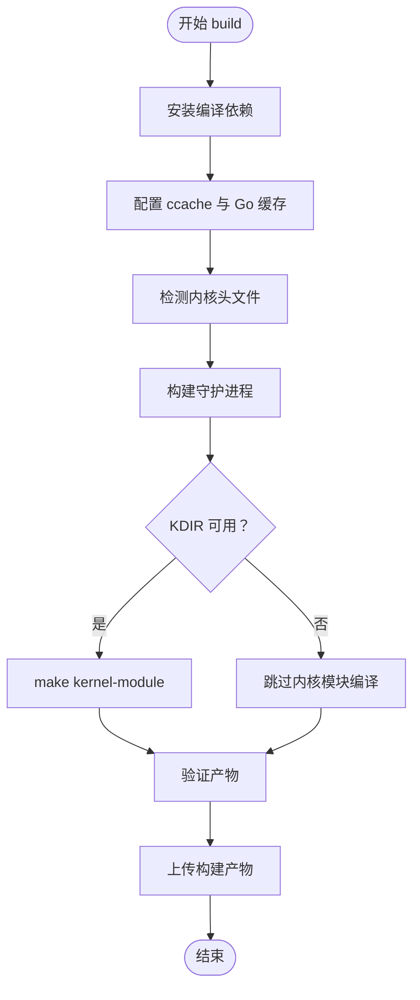
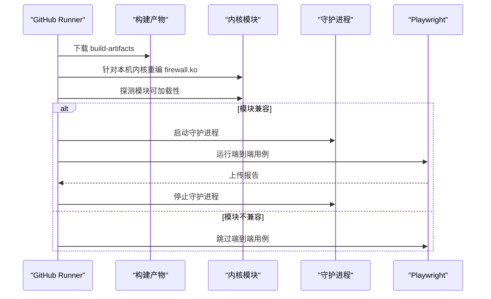
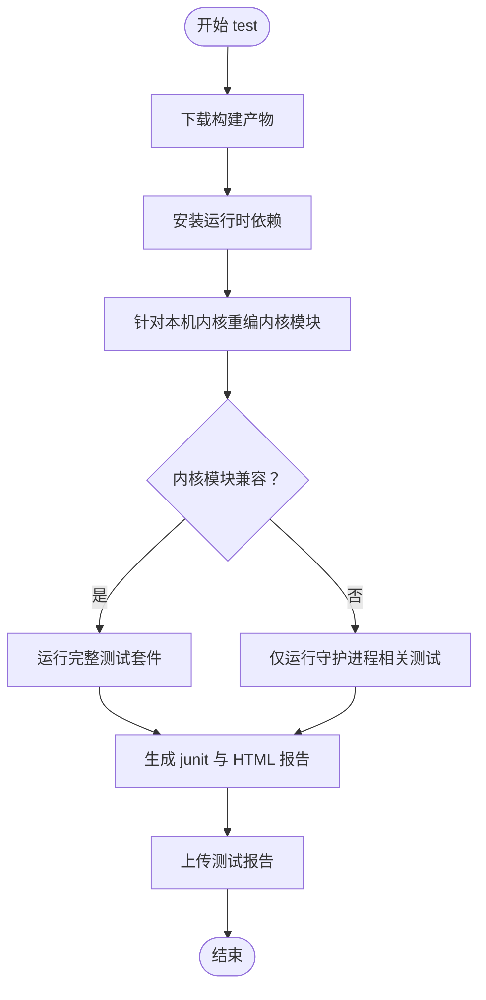
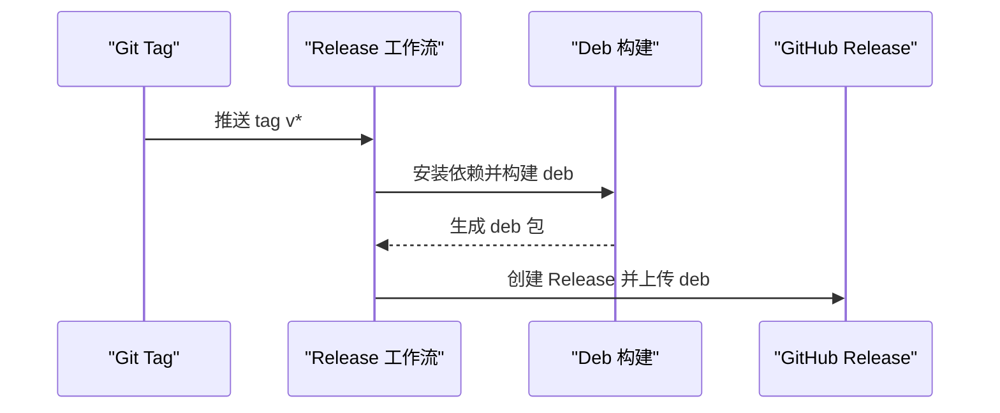
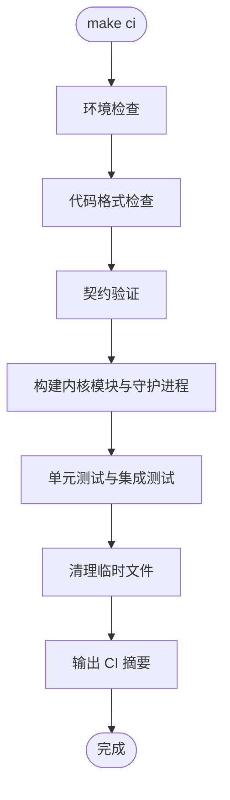
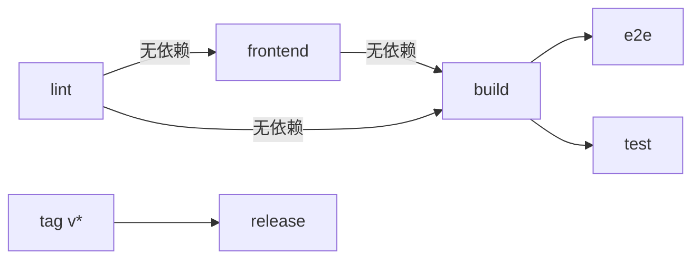

# CI/CD流水线

<cite>
**本文引用的文件**   
- [.github/workflows/ci.yml](file://.github/workflows/ci.yml)
- [.github/workflows/release.yml](file://.github/workflows/release.yml)
- [.github/workflows/gitbook.yml](file://.github/workflows/gitbook.yml)
- [Makefile](file://Makefile)
- [pyproject.toml](file://pyproject.toml)
</cite>

## 目录
1. [引言](#引言)
2. [项目结构](#项目结构)
3. [核心组件](#核心组件)
4. [架构总览](#架构总览)
5. [详细组件分析](#详细组件分析)
6. [依赖关系分析](#依赖关系分析)
7. [性能与缓存优化](#性能与缓存优化)
8. [故障排除指南](#故障排除指南)
9. [结论](#结论)
10. [附录：CI规则与最佳实践](#附录ci规则与最佳实践)

## 引言
本文件面向团队开发者与维护者，系统化说明 Linux Firewall Kernel Module 项目的持续集成与持续交付流水线。内容覆盖 GitHub Actions 工作流、代码格式检查、契约验证、Go 单元测试、Python 集成测试、前端类型检查与构建、浏览器端到端测试、构建产物缓存、并行执行策略，以及自定义 CI 规则、故障排除和性能优化建议。目标是让团队在本地与 CI 中都能高效完成代码质量检查和自动化测试，并稳定产出可部署的内核模块与守护进程二进制。

## 项目结构
仓库的 CI/CD 相关能力由三类文件共同构成：
- GitHub Actions 工作流：定义触发条件、任务编排、环境准备、缓存策略、产物上传与发布流程。
- Makefile：封装完整的 CI 阶段（环境检查、格式检查、契约验证、构建、测试、清理），并提供本地一键运行入口。
- Python 工具链配置：pytest 标记、测试路径、覆盖率收集等。

**图表来源**
- [.github/workflows/ci.yml:1-564](file://.github/workflows/ci.yml#L1-L564)
- [Makefile:325-543](file://Makefile#L325-L543)
- [pyproject.toml:1-49](file://pyproject.toml#L1-L49)

**章节来源**
- [.github/workflows/ci.yml:1-564](file://.github/workflows/ci.yml#L1-L564)
- [Makefile:325-543](file://Makefile#L325-L543)
- [pyproject.toml:1-49](file://pyproject.toml#L1-L49)

## 核心组件
- 代码质量检查（lint）：clang-format 检查内核模块 C/C++ 风格，gofmt 检查 Go 守护进程风格，shellcheck 检查 Shell 脚本，yamllint 检查 YAML 配置，go vet 做静态分析，同时生成并上传 Go 覆盖率报告。
- 契约验证：通过 make contract-drift 与多个 verify_* 脚本校验 .fwidl 描述与生成物、内核/守护进程实现、HTTP 契约一致性。
- 前端构建：Node.js + Vite + TypeScript，进行类型检查、构建与产物校验，包括 PWA manifest 与 Service Worker 语法检查。
- 编译：构建内核模块与守护进程，使用 ccache 加速重复编译，按可用内核头文件情况回退处理。
- 浏览器端到端测试：基于 Playwright，启动真实守护进程，探测内核模块兼容性后执行用例，并上传报告。
- 运行测试：复用 build 产物，针对本机内核重编内核模块，根据兼容性选择完整测试或仅守护进程相关测试，生成 junit 与 HTML 报告。
- 发布：打 tag 时构建 deb 包并发布到 GitHub Release。

**章节来源**
- [.github/workflows/ci.yml:10-106](file://.github/workflows/ci.yml#L10-L106)
- [.github/workflows/ci.yml:107-170](file://.github/workflows/ci.yml#L107-L170)
- [.github/workflows/ci.yml:171-342](file://.github/workflows/ci.yml#L171-L342)
- [.github/workflows/ci.yml:343-458](file://.github/workflows/ci.yml#L343-L458)
- [.github/workflows/ci.yml:459-564](file://.github/workflows/ci.yml#L459-L564)
- [.github/workflows/release.yml:1-48](file://.github/workflows/release.yml#L1-L48)

## 架构总览
下图展示一次典型 push 到 master/main 分支时的 CI 执行顺序与依赖关系。lint、frontend、build 三个任务并行；e2e 与 test 依赖 build；release 仅在 tag 触发。

**图表来源**
- [.github/workflows/ci.yml:1-10](file://.github/workflows/ci.yml#L1-L10)
- [.github/workflows/ci.yml:10-106](file://.github/workflows/ci.yml#L10-L106)
- [.github/workflows/ci.yml:107-170](file://.github/workflows/ci.yml#L107-L170)
- [.github/workflows/ci.yml:171-342](file://.github/workflows/ci.yml#L171-L342)
- [.github/workflows/ci.yml:343-458](file://.github/workflows/ci.yml#L343-L458)
- [.github/workflows/ci.yml:459-564](file://.github/workflows/ci.yml#L459-L564)
- [.github/workflows/release.yml:1-48](file://.github/workflows/release.yml#L1-L48)

## 详细组件分析

### 代码质量检查（lint）
lint 任务负责最先执行的静态检查，确保提交代码符合风格与配置规范，并快速发现潜在问题。

- 安装与缓存
  - 安装 clang-format、shellcheck、pip yamllint。
  - 配置 Go 模块缓存与 pip 缓存，减少重复安装与下载时间。
  - 设置 Go 版本为 1.26，启用 go 缓存。
- 代码风格检查
  - 内核模块：clang-format --dry-run --Werror 检查 C/C++ 源码。
  - 守护进程：gofmt 检查 cmd 与 internal 目录。
  - Shell 脚本：shellcheck 检查 build-deb.sh 与 scripts/*.sh。
  - YAML 配置：yamllint 检查 config/*.yaml。
- 静态分析与单元测试
  - go vet 对守护进程进行静态分析。
  - go test ./... 运行守护进程单元测试。
  - 生成 coverage.out 并输出覆盖率统计。
- 契约校验
  - make contract-drift 校验生成物与生成器一致。
  - python3 contract/verify_layout.py 与 verify_procfs.py 校验 netlink 线格式与 procfs 文本协议。
  - python3 contract/verify_http.py 校验 HTTP 契约与 daemon 实现。

**图表来源**
- [.github/workflows/ci.yml:10-106](file://.github/workflows/ci.yml#L10-L106)

**章节来源**
- [.github/workflows/ci.yml:10-106](file://.github/workflows/ci.yml#L10-L106)

### 前端构建（frontend）
前端任务独立于 lint 并行执行，负责类型检查、构建与产物校验。

- Node.js 与 npm 缓存
  - 使用 actions/setup-node@v5 安装 Node.js 24，启用 npm 缓存。
- 依赖安装与类型检查
  - frontend/package-lock.json 锁定依赖，npm ci 保证可复现。
  - npm run typecheck 执行 tsc --noEmit 类型检查。
- 构建与产物校验
  - npm run build:only 构建前端，产物位于 build/obj/frontend。
  - 校验 index.html、app.js、style.css、sw.js、manifest.webmanifest 与图标资源。
  - 校验 manifest.webmanifest 必需字段与 display=standalone。
  - 校验 Service Worker 语法。

**图表来源**
- [.github/workflows/ci.yml:107-170](file://.github/workflows/ci.yml#L107-L170)

**章节来源**
- [.github/workflows/ci.yml:107-170](file://.github/workflows/ci.yml#L107-L170)

### 编译（build）
编译任务负责构建内核模块与守护进程，并处理内核头文件兼容性与 ccache 缓存。

- 依赖与环境
  - 安装 build-essential、ccache、linux-headers（优先当前运行内核，失败则回退通用头）。
  - 守护进程为纯 Go 构建，无需系统库。
- 缓存预热与统计
  - 初始化 ccache 统计，便于观察命中情况。
- 内核头文件检测
  - 若 /lib/modules/$(uname -r)/build 存在，直接使用；否则寻找替代目录或跳过内核模块编译。
- 构建守护进程
  - make all -j$(nproc) 并行构建，包含前端构建与格式检查。
  - 校验产物 firewall-daemon 是否存在与大小。
- 构建内核模块
  - 若 KDIR 可用，make kernel-module；否则记录 skip=true。
- 产物验证与上传
  - 校验 firewall.ko 与 firewall-daemon。
  - 上传 build-artifacts 供 e2e 与 test 使用。

**图表来源**
- [.github/workflows/ci.yml:171-342](file://.github/workflows/ci.yml#L171-L342)

**章节来源**
- [.github/workflows/ci.yml:171-342](file://.github/workflows/ci.yml#L171-L342)

### 浏览器端到端测试（e2e）
e2e 任务依赖 build 产物，在真实守护进程上运行 Playwright 用例，并处理内核模块兼容性。

- 环境与依赖
  - 下载 build-artifacts，赋予防火墙守护进程执行权限。
  - 安装运行时依赖（build-essential、ccache、linux-headers）。
  - 安装 Node.js 与 Playwright chromium。
- 内核模块重编与探测
  - 删除下载的 .ko，针对本机内核重新编译。
  - 使用 scripts/e2e-daemon.sh probe 探测模块是否可加载。
- 启动守护进程与运行用例
  - 若模块兼容，启动守护进程并设置环境变量。
  - 运行 npm run test:e2e，上传 Playwright 报告。
- 清理
  - 停止守护进程并清理。

**图表来源**
- [.github/workflows/ci.yml:343-458](file://.github/workflows/ci.yml#L343-L458)

**章节来源**
- [.github/workflows/ci.yml:343-458](file://.github/workflows/ci.yml#L343-L458)

### 运行测试（test）
test 任务复用 build 产物，根据内核模块兼容性选择测试范围，并生成 junit 与 HTML 报告。

- 环境与依赖
  - 下载 build-artifacts，赋予守护进程执行权限。
  - 安装 sqlite3、pytest、PyYAML、pytest-html。
- 内核模块重编与兼容性验证
  - 针对本机内核重编 firewall.ko。
  - 尝试 insmod 验证兼容性；若不兼容，仅运行守护进程相关测试。
- 执行测试与报告
  - 完整环境：sudo python3 -m pytest tests/ -v --junitxml=junit.xml --html=report.html --self-contained-html。
  - 非完整环境：过滤仅运行守护进程相关测试。
  - 上传 junit.xml 与 report.html。

**图表来源**
- [.github/workflows/ci.yml:459-564](file://.github/workflows/ci.yml#L459-L564)

**章节来源**
- [.github/workflows/ci.yml:459-564](file://.github/workflows/ci.yml#L459-L564)

### 发布（release）
release 任务在推送 tag v* 时触发，构建 deb 包并发布到 GitHub Release。

- 依赖安装
  - 安装 build-essential、dpkg-dev、debhelper、nodejs、npm、python3。
- 版本号获取与 deb 构建
  - 从 tag 提取版本号，执行 ./build-deb.sh "$VERSION"。
- 创建 GitHub Release
  - 上传 linux-firewall-kmod-*.deb，自动生成 release notes。

**图表来源**
- [.github/workflows/release.yml:1-48](file://.github/workflows/release.yml#L1-L48)

**章节来源**
- [.github/workflows/release.yml:1-48](file://.github/workflows/release.yml#L1-L48)

### Makefile CI 流程
Makefile 提供本地与 CI 统一的 CI 目标，将环境检查、格式检查、契约验证、构建、测试、清理串联起来。

- ci 目标
  - 顺序执行 ci-setup、ci-format、ci-contract、ci-build、ci-test、ci-cleanup、ci-summary。
- ci-setup
  - 调用 check-deps 检查内核模块、守护进程、前端依赖。
- ci-format
  - 检查 C 代码格式（clang-format）、Go 代码格式（gofmt）、Go 静态分析（go vet）、YAML 配置（yamllint）。
- ci-contract
  - 生成契约文件，检查契约漂移，运行契约校验器。
- ci-build
  - 构建内核模块与守护进程，验证产物存在与大小。
- ci-test
  - 运行守护进程单元测试与 Python 集成测试（需要 root）。
- ci-cleanup 与 ci-summary
  - 清理临时文件，保留构建产物，输出摘要。

**图表来源**
- [Makefile:325-543](file://Makefile#L325-L543)

**章节来源**
- [Makefile:325-543](file://Makefile#L325-L543)

### Python 测试配置
pyproject.toml 定义 pytest 行为与测试标记，帮助团队理解测试分类与执行策略。

- 测试路径与选项
  - testpaths = ["tests"]
  - addopts 启用详细输出、短 traceback、严格标记与配置。
- 测试标记
  - slow：耗时超过 10 秒的测试。
  - requires_daemon：需要外部守护进程运行。
  - requires_module：需要内核模块加载。
  - requires_sqlite3：需要 sqlite3 CLI。
  - e2e：端到端测试。
  - stress：压力测试。
  - perf：性能测试。
- 覆盖率配置
  - 针对 tests 目录，忽略 conftest.py 与 config.py。
  - 覆盖率对 Python 测试意义不大，主要用于完整性。

**章节来源**
- [pyproject.toml:1-49](file://pyproject.toml#L1-L49)

## 依赖关系分析
CI 任务之间的依赖如下：
- lint、frontend、build 并行执行，互不依赖。
- e2e 与 test 依赖 build。
- release 仅在 tag 触发，独立于 CI。

**图表来源**
- [.github/workflows/ci.yml:1-10](file://.github/workflows/ci.yml#L1-L10)
- [.github/workflows/ci.yml:10-106](file://.github/workflows/ci.yml#L10-L106)
- [.github/workflows/ci.yml:107-170](file://.github/workflows/ci.yml#L107-L170)
- [.github/workflows/ci.yml:171-342](file://.github/workflows/ci.yml#L171-L342)
- [.github/workflows/ci.yml:343-458](file://.github/workflows/ci.yml#L343-L458)
- [.github/workflows/ci.yml:459-564](file://.github/workflows/ci.yml#L459-L564)
- [.github/workflows/release.yml:1-48](file://.github/workflows/release.yml#L1-L48)

**章节来源**
- [.github/workflows/ci.yml:1-564](file://.github/workflows/ci.yml#L1-L564)
- [.github/workflows/release.yml:1-48](file://.github/workflows/release.yml#L1-L48)

## 性能与缓存优化
- Go 模块缓存
  - 缓存 ~/go/pkg/mod 与 ~/.cache/go-build，key 基于 src/daemon/go.sum。
  - restore-keys 支持部分匹配恢复，提升缓存命中率。
- pip 缓存
  - 缓存 ~/.cache/pip，key 基于 runner.os-pip-yamllint。
- ccache 缓存
  - 缓存 ~/.ccache，key 基于内核模块源文件哈希。
  - 预热统计清零，便于观察本次构建命中情况。
- 前端依赖缓存
  - 使用 actions/setup-node@v5 的 npm 缓存，依赖路径 frontend/package-lock.json。
- 并行构建
  - make all -j$(nproc) 利用多核并行构建守护进程与前端。
- 选择性跳过
  - SKIP_FORMAT_CHECK=1 跳过格式检查。
  - SKIP_TESTS=1 跳过测试。
  - 内核头文件不可用时跳过内核模块编译，避免 CI 长期失败。

**章节来源**
- [.github/workflows/ci.yml:19-50](file://.github/workflows/ci.yml#L19-L50)
- [.github/workflows/ci.yml:191-212](file://.github/workflows/ci.yml#L191-L212)
- [.github/workflows/ci.yml:252-267](file://.github/workflows/ci.yml#L252-L267)
- [Makefile:346-406](file://Makefile#L346-L406)
- [Makefile:469-499](file://Makefile#L469-L499)

## 故障排除指南
- 内核头文件不可用
  - 现象：build 任务检测到 /lib/modules/$(uname -r)/build 不存在，回退到通用头或跳过内核模块编译。
  - 处理：确认已安装 linux-headers-generic，或指定 KDIR 指向可用内核构建目录。
- 内核模块 vermagic 不匹配
  - 现象：e2e 与 test 任务中，跨 VM 的 .ko 无法加载，提示 Invalid module format。
  - 处理：针对本机内核重新编译 firewall.ko，再尝试 insmod。
- 守护进程依赖缺失
  - 现象：go vet 或 go test 失败，提示缺少静态分析工具或依赖。
  - 处理：确保 PATH 中存在 go，且版本满足要求；必要时安装 golang-go。
- YAML 配置检查失败
  - 现象：yamllint 报错，提示配置文件不符合规范。
  - 处理：根据 yamllint 输出修复 config/*.yaml。
- 前端构建产物缺失
  - 现象：校验步骤发现 index.html 或 app.js 缺失。
  - 处理：检查 frontend/package-lock.json 是否更新，重新运行 npm ci 与 npm run build:only。
- 端到端测试跳过
  - 现象：因内核模块不可加载，Playwright 用例整体跳过。
  - 处理：这是环境限制，非代码问题；可在本地真实环境中验证。

**章节来源**
- [.github/workflows/ci.yml:214-250](file://.github/workflows/ci.yml#L214-L250)
- [.github/workflows/ci.yml:399-421](file://.github/workflows/ci.yml#L399-L421)
- [.github/workflows/ci.yml:506-535](file://.github/workflows/ci.yml#L506-L535)

## 结论
本项目通过 GitHub Actions 实现了完整的 CI/CD 流水线，涵盖代码质量检查、契约验证、前端构建、内核模块与守护进程编译、单元测试与集成测试、浏览器端到端测试，以及 deb 包发布。Makefile 提供了本地与 CI 统一的入口，pyproject.toml 明确了测试分类与执行策略。通过 Go 模块缓存、pip 缓存、ccache 缓存与并行构建，显著提升了 CI 效率。团队可在本地通过 make ci 快速验证，并在 PR 与 push 时获得一致的自动化反馈。

## 附录：CI规则与最佳实践
- 代码风格
  - 始终使用 clang-format 与 gofmt 保持代码风格一致。
  - 提交前运行 make format-check 或本地格式化。
- 契约管理
  - 修改 .fwidl 后必须重新生成契约文件，并通过 make contract-drift 与 contract-check。
  - 禁止手改生成物，避免漂移。
- 测试策略
  - 新增功能应补充单元测试与集成测试。
  - 使用 pytest markers 区分慢测试与依赖测试，合理筛选执行范围。
- 缓存优化
  - 保持 go.sum、package-lock.json 与依赖列表更新，提升缓存命中率。
  - 合理使用 restore-keys，避免缓存失效导致全量重建。
- 故障定位
  - 查看 GitHub Actions 日志中的 step 输出，定位失败环节。
  - 对于内核模块相关问题，优先检查内核头文件与 vermagic 匹配。
- 发布流程
  - 打 tag v* 自动触发 release，确保版本号与 deb 包一致。
  - 发布前确保所有 CI 任务通过，避免发布不稳定版本。

**章节来源**
- [Makefile:325-543](file://Makefile#L325-L543)
- [pyproject.toml:1-49](file://pyproject.toml#L1-L49)
- [.github/workflows/ci.yml:10-106](file://.github/workflows/ci.yml#L10-L106)
- [.github/workflows/release.yml:1-48](file://.github/workflows/release.yml#L1-L48)