# GitHub Actions工作流

<cite>
**本文引用的文件**   
- [ci.yml](file://.github/workflows/ci.yml)
- [gitbook.yml](file://.github/workflows/gitbook.yml)
- [release.yml](file://.github/workflows/release.yml)
- [Makefile](file://Makefile)
- [build-deb.sh](file://build-deb.sh)
- [e2e-daemon.sh](file://scripts/e2e-daemon.sh)
</cite>

## 目录
1. [引言](#引言)
2. [项目结构](#项目结构)
3. [核心工作流总览](#核心工作流总览)
4. [持续集成工作流：CI](#持续集成工作流ci)
5. [文档构建与发布工作流：GitBook](#文档构建与发布工作流gitbook)
6. [版本发布工作流：Release](#版本发布工作流release)
7. [依赖关系与并行执行模型](#依赖关系与并行执行模型)
8. [缓存策略与性能优化](#缓存策略与性能优化)
9. [代码质量、契约验证与多语言测试](#代码质量契约验证与多语言测试)
10. [环境变量与运行环境说明](#环境变量与运行环境说明)
11. [自定义工作流最佳实践](#自定义工作流最佳实践)
12. [故障排除指南](#故障排除指南)
13. [结论](#结论)

## 引言
本仓库使用 GitHub Actions 实现完整的 CI/CD 流水线，覆盖代码质量检查、前端构建、内核模块与守护进程编译、浏览器端到端测试、Python 集成测试、GitBook 文档站点部署以及带 deb 包的版本发布。三个工作流分别承担不同职责：

- `ci.yml`：代码质量、契约校验、构建、E2E 与测试。
- `gitbook.yml`：基于 docs 变更构建并部署 GitBook 到 GitHub Pages。
- `release.yml`：按 `v*` 标签构建 deb 包并发布 GitHub Release。

这些工作流通过 Makefile 和辅助脚本统一编排构建、契约生成、安装与测试流程，使本地开发体验与 CI 行为保持一致。

**章节来源**
- [ci.yml:1-10](file://.github/workflows/ci.yml#L1-L10)
- [gitbook.yml:1-20](file://.github/workflows/gitbook.yml#L1-L20)
- [release.yml:1-15](file://.github/workflows/release.yml#L1-L15)

## 项目结构
GitHub Actions 配置集中在 `.github/workflows` 下，每个 YAML 文件对应一个独立工作流；构建、契约、打包与 E2E 夹具逻辑则放在仓库根目录的 `Makefile`、`build-deb.sh` 与 `scripts/e2e-daemon.sh` 中。

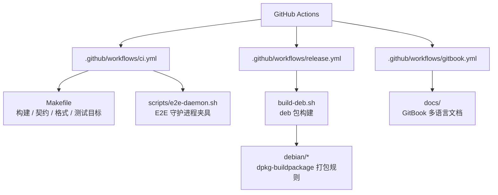

**图表来源**
- [ci.yml:1-10](file://.github/workflows/ci.yml#L1-L10)
- [gitbook.yml:1-20](file://.github/workflows/gitbook.yml#L1-L20)
- [release.yml:1-15](file://.github/workflows/release.yml#L1-L15)
- [Makefile:1-10](file://Makefile#L1-L10)
- [build-deb.sh:1-10](file://build-deb.sh#L1-L10)
- [e2e-daemon.sh:1-20](file://scripts/e2e-daemon.sh#L1-L20)

**章节来源**
- [ci.yml:1-10](file://.github/workflows/ci.yml#L1-L10)
- [gitbook.yml:1-20](file://.github/workflows/gitbook.yml#L1-L20)
- [release.yml:1-15](file://.github/workflows/release.yml#L1-L15)
- [Makefile:1-10](file://Makefile#L1-L10)
- [build-deb.sh:1-10](file://build-deb.sh#L1-L10)
- [e2e-daemon.sh:1-20](file://scripts/e2e-daemon.sh#L1-L20)

## 核心工作流总览
| 工作流 | 触发条件 | 主要任务 | 输出产物 |
|---|---|---|---|
| CI | 推送到 `master`/`main`，或针对这两个分支的 Pull Request | 代码质量、前端构建、守护进程与内核模块编译、E2E、测试 | 覆盖率报告、Playwright 报告、测试报告、构建产物 |
| GitBook | 推送 `docs/**` 或工作流文件本身到 `master`，或手动触发 | 安装 HonKit、构建多语言文档、上传 GitHub Pages 制品 | GitHub Pages 站点 |
| Release | 推送 `v*` 标签 | 安装打包依赖、提取版本号、构建 deb、创建 GitHub Release | `.deb` 包及自动生成的 Release 说明 |

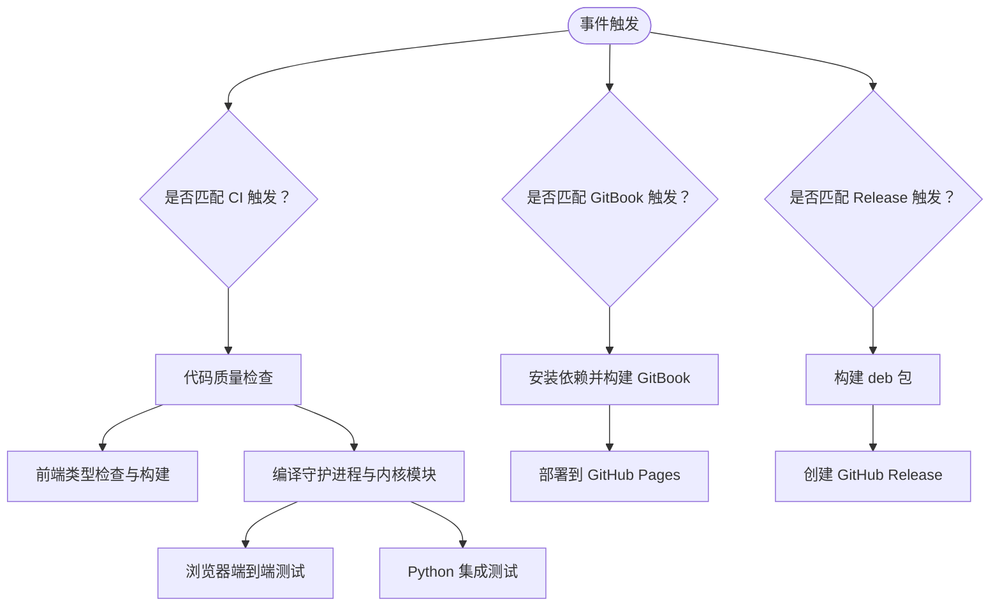

**图表来源**
- [ci.yml:3-10](file://.github/workflows/ci.yml#L3-L10)
- [gitbook.yml:3-20](file://.github/workflows/gitbook.yml#L3-L20)
- [release.yml:3-15](file://.github/workflows/release.yml#L3-L15)

**章节来源**
- [ci.yml:3-10](file://.github/workflows/ci.yml#L3-L10)
- [gitbook.yml:3-20](file://.github/workflows/gitbook.yml#L3-L20)
- [release.yml:3-15](file://.github/workflows/release.yml#L3-L15)

## 持续集成工作流：CI
### 触发条件
CI 在以下情况运行：
- 向 `master` 或 `main` 分支推送提交。
- 针对 `master` 或 `main` 分支打开或更新 Pull Request。

这意味着所有合并请求都会经过完整的质量门禁，主分支上的每次提交也会自动验证。

**章节来源**
- [ci.yml:3-8](file://.github/workflows/ci.yml#L3-L8)

### 并行任务设计
CI 将任务拆分为多个 job，充分利用 GitHub Actions 的并行能力：

| Job | 职责 | 依赖 |
|---|---|---|
| `lint` | Go/C/Shell/YAML 格式检查、Go 单元测试、覆盖率、契约漂移与契约校验 | 无 |
| `frontend` | Node.js 类型检查、Vite 构建、PWA 清单与 Service Worker 校验 | 无 |
| `build` | 安装编译依赖、ccache 预热、守护进程与内核模块编译、产物验证 | 无 |
| `e2e` | 下载 build 产物、重编内核模块、启动真实守护进程、运行 Playwright | `build` |
| `test` | 下载 build 产物、重编内核模块、运行 Python 集成测试并生成报告 | `build` |

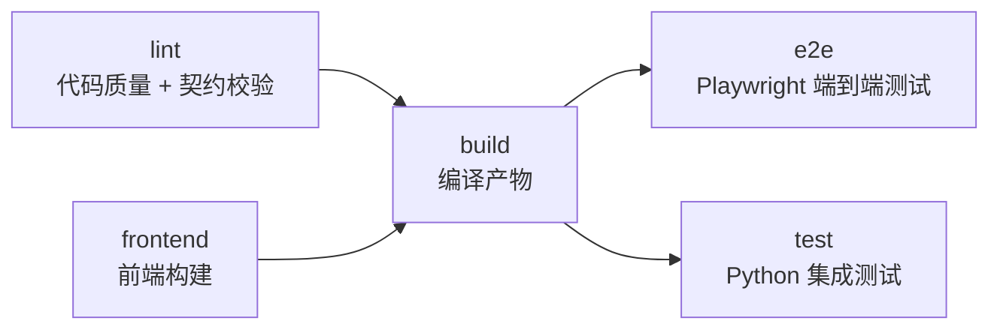

**图表来源**
- [ci.yml:9-106](file://.github/workflows/ci.yml#L9-L106)
- [ci.yml:107-169](file://.github/workflows/ci.yml#L107-L169)
- [ci.yml:170-342](file://.github/workflows/ci.yml#L170-L342)
- [ci.yml:343-457](file://.github/workflows/ci.yml#L343-L457)
- [ci.yml:459-564](file://.github/workflows/ci.yml#L459-L564)

### lint 任务详解
`lint` 是第一个执行的静态检查阶段，重点包括：

1. **工具安装与环境准备**
   - 安装 `clang-format`、`shellcheck`、`yamllint`。
   - 配置 Go 1.26 与 Go 模块缓存。
   - 配置 pip 缓存以加速 yamllint 等 Python 工具安装。

2. **代码风格检查**
   - 内核模块 C 代码使用 `clang-format --dry-run --Werror`。
   - 守护进程 Go 代码使用 `gofmt` 检查 `cmd` 与 `internal`。
   - Shell 脚本使用 `shellcheck` 检查 `build-deb.sh` 与 `scripts/*.sh`。
   - YAML 配置使用 `yamllint` 检查 `config/*.yaml`。

3. **守护进程静态分析与单元测试**
   - 先创建 `src/daemon/web_ui/static/`，因为 `go:embed` 需要该目录存在。
   - 执行 `go vet ./cmd/... ./internal/...`。
   - 执行 `go test ./...`。
   - 生成覆盖率报告 `coverage.out` 并上传为 artifact。

4. **契约校验**
   - 通过 `make contract-drift` 检查生成物是否与生成器一致。
   - 通过 `python3 contract/verify_layout.py` 与 `python3 contract/verify_procfs.py` 校验 netlink 与 procfs。
   - 通过 `python3 contract/verify_http.py` 校验 HTTP 契约与 daemon 实现。

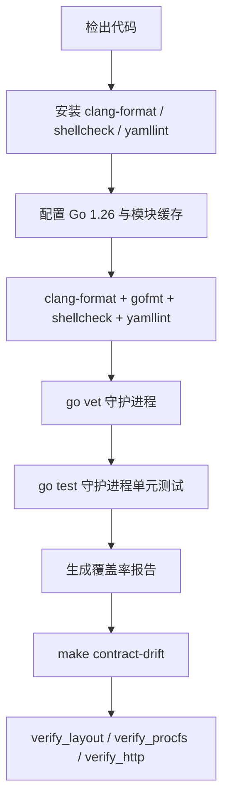

**图表来源**
- [ci.yml:15-106](file://.github/workflows/ci.yml#L15-L106)

**章节来源**
- [ci.yml:11-106](file://.github/workflows/ci.yml#L11-L106)

### frontend 任务详解
`frontend` 负责前端构建质量，不依赖其他 job，因此可与 `lint` 并行执行：

1. 安装 Node.js 24，并使用 npm 缓存。
2. 通过 `npm ci --no-audit --no-fund` 安装依赖。
3. 执行 TypeScript 类型检查。
4. 执行 Vite 构建。
5. 校验构建产物是否存在：`index.html`、`app.js`、`style.css`、`sw.js`、`manifest.webmanifest` 与图标。
6. 校验 PWA manifest 必需字段与图标尺寸。
7. 校验 Service Worker 语法。

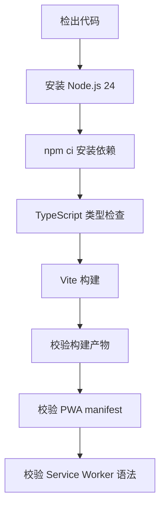

**图表来源**
- [ci.yml:107-169](file://.github/workflows/ci.yml#L107-L169)

**章节来源**
- [ci.yml:107-169](file://.github/workflows/ci.yml#L107-L169)

### build 任务详解
`build` 是 CI 的核心构建阶段，负责产出守护进程二进制与内核模块：

1. **编译依赖**
   - 优先尝试安装当前运行内核的头文件。
   - 失败时回退到 `linux-headers-generic`。
   - 安装 `build-essential` 与 `ccache`。

2. **缓存预热**
   - ccache 统计清零，便于观察命中情况。
   - Go 模块缓存与 ccache 缓存均启用。

3. **内核头文件检测**
   - 如果 `/lib/modules/$(uname -r)/build` 存在，则使用该 KDIR。
   - 否则查找可用内核构建目录。
   - 若完全不可用，跳过内核模块编译并记录警告。

4. **守护进程构建**
   - 调用 `make all -j$(nproc)`，包含前端构建与格式检查。
   - 校验 `build/daemon/firewall-daemon` 是否存在。

5. **内核模块构建**
   - 如果 KDIR 可用，调用 `make kernel-module KDIR=...`。
   - 如果不可用，标记 `skip=true` 并跳过。

6. **产物验证与上传**
   - 校验 `firewall.ko` 与 `firewall-daemon`。
   - 使用 `ldd` 检查守护进程动态依赖。
   - 上传 `build-artifacts`，保留 1 天。

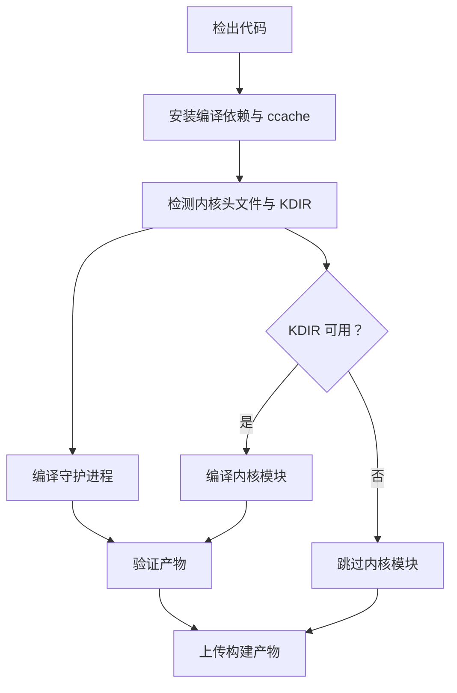

**图表来源**
- [ci.yml:170-342](file://.github/workflows/ci.yml#L170-L342)

**章节来源**
- [ci.yml:170-342](file://.github/workflows/ci.yml#L170-L342)

### e2e 任务详解
`e2e` 是浏览器端到端测试，依赖 `build` 产出的守护进程与内核模块：

1. 下载 `build-artifacts`。
2. 安装运行时依赖：`build-essential`、`ccache`、内核头文件、Node.js、Playwright Chromium。
3. 针对本机内核重新编译内核模块，避免跨 VM 的 `vermagic` 不匹配。
4. 使用 `scripts/e2e-daemon.sh probe` 探测内核模块可加载性。
5. 如果兼容，启动真实守护进程。
6. 设置 `BASE_URL`、认证凭据与 `E2E_LAN_ORIGIN`。
7. 运行 `npm run test:e2e`。
8. 上传 Playwright 报告。
9. 停止守护进程并清理。

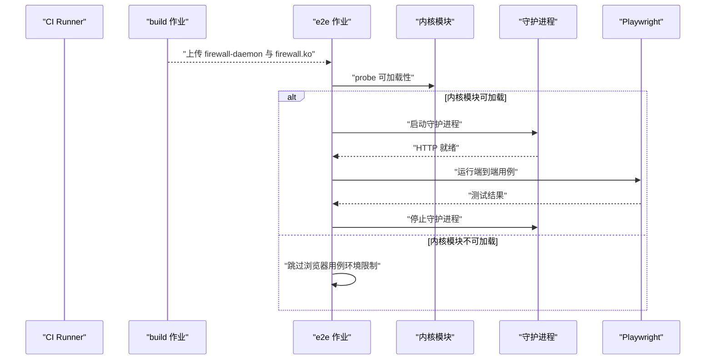

**图表来源**
- [ci.yml:343-457](file://.github/workflows/ci.yml#L343-L457)
- [e2e-daemon.sh:1-20](file://scripts/e2e-daemon.sh#L1-L20)

**章节来源**
- [ci.yml:343-457](file://.github/workflows/ci.yml#L343-L457)
- [e2e-daemon.sh:1-20](file://scripts/e2e-daemon.sh#L1-L20)

### test 任务详解
`test` 运行 Python 集成测试，也依赖 `build` 产物：

1. 设置 `SKIP_COMPILE=1`，复用 build 产物。
2. 下载 `build-artifacts`。
3. 安装 Python 测试依赖：`pytest`、`PyYAML`、`pytest-html`、`sqlite3`。
4. 针对本机内核重新编译内核模块。
5. 尝试 `insmod` 验证内核模块兼容性。
6. 如果模块可加载，运行全部测试。
7. 如果模块不可加载，仅运行守护进程相关测试。
8. 上传 JUnit XML 与 HTML 测试报告。

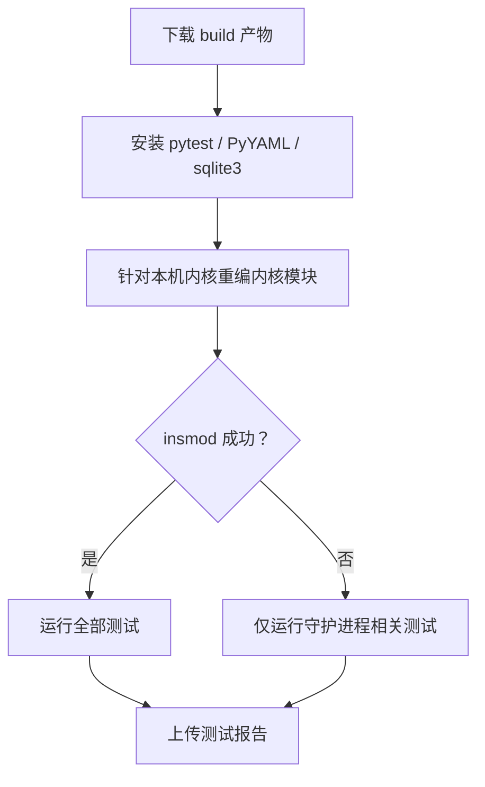

**图表来源**
- [ci.yml:459-564](file://.github/workflows/ci.yml#L459-L564)

**章节来源**
- [ci.yml:459-564](file://.github/workflows/ci.yml#L459-L564)

## 文档构建与发布工作流：GitBook
### 触发条件
GitBook 工作流在以下情况触发：
- 向 `master` 分支推送，且路径包含 `docs/**` 或 `.github/workflows/gitbook.yml`。
- 手动触发 `workflow_dispatch`。

### 权限与并发控制
- 授予 `contents: read`、`pages: write`、`id-token: write`。
- 使用 `concurrency.group: pages` 并 `cancel-in-progress: true`，防止重复部署互相干扰。

### 构建流程
1. 检出代码。
2. 安装 Node.js 24，缓存 npm 依赖。
3. 进入 `docs` 目录安装 HonKit 与插件。
4. 执行 `npx honkit build . _book` 构建多语言站点。
5. 清理构建产物中的冗余文件，减少 GitHub Pages 体积。
6. 上传 `docs/_book/` 作为 GitHub Pages 制品。
7. 部署到 GitHub Pages。

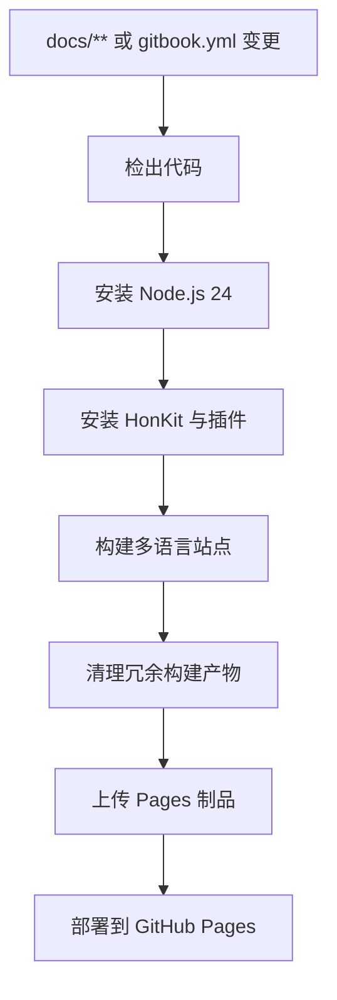

**图表来源**
- [gitbook.yml:3-66](file://.github/workflows/gitbook.yml#L3-L66)

**章节来源**
- [gitbook.yml:1-66](file://.github/workflows/gitbook.yml#L1-L66)

## 版本发布工作流：Release
### 触发条件
Release 仅在推送 `v*` 标签时触发，例如 `v2.4.0`。

### 权限
- 授予 `contents: write`，用于创建 GitHub Release 并上传附件。

### 构建与发布流程
1. 检出代码。
2. 安装 `build-essential`、`dpkg-dev`、`debhelper`、`nodejs`、`npm`、`python3`。
3. 从 `GITHUB_REF` 提取版本号。
4. 执行 `./build-deb.sh "$VERSION"` 构建 deb 包。
5. 使用 `softprops/action-gh-release@v3` 创建 Release。
6. 自动上传 `build/deb/linux-firewall-kmod-*.deb`。
7. 自动生成 Release Notes。

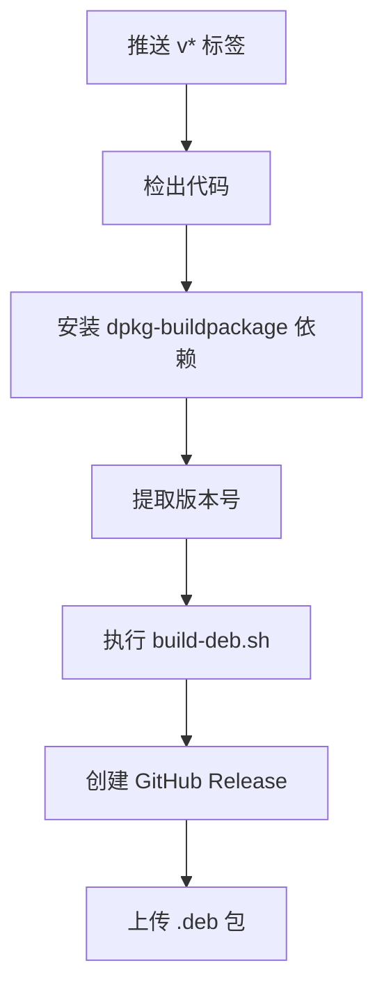

**图表来源**
- [release.yml:3-48](file://.github/workflows/release.yml#L3-L48)
- [build-deb.sh:1-75](file://build-deb.sh#L1-L75)

**章节来源**
- [release.yml:1-48](file://.github/workflows/release.yml#L1-L48)
- [build-deb.sh:1-75](file://build-deb.sh#L1-L75)

## 依赖关系与并行执行模型
CI 工作流采用“轻量检查先行、构建居中、测试后置”的结构：

- `lint`、`frontend`、`build` 相互独立，可并行执行。
- `e2e` 与 `test` 都依赖 `build`，但彼此独立，也可并行执行。
- GitBook 与 Release 是独立工作流，不受 CI 影响。

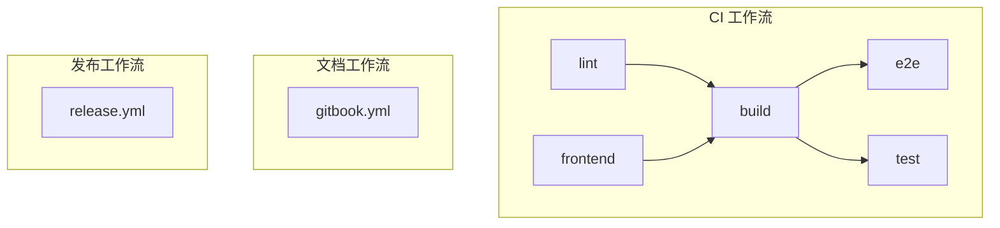

**图表来源**
- [ci.yml:9-564](file://.github/workflows/ci.yml#L9-L564)
- [gitbook.yml:1-66](file://.github/workflows/gitbook.yml#L1-L66)
- [release.yml:1-48](file://.github/workflows/release.yml#L1-L48)

**章节来源**
- [ci.yml:9-564](file://.github/workflows/ci.yml#L9-L564)

## 缓存策略与性能优化
### 已实现的缓存
| 缓存项 | 路径或键 | 作用 |
|---|---|---|
| Go 模块缓存 | `~/go/pkg/mod`、`~/.cache/go-build` | 加速 Go 依赖下载与编译 |
| pip 缓存 | `~/.cache/pip` | 加速 yamllint 等 Python 工具安装 |
| ccache | `~/.ccache` | 加速内核模块 C 编译 |
| npm 缓存 | Node.js action 内置缓存 | 加速前端依赖安装 |

### 关键优化点
1. **Go 缓存键基于 `src/daemon/go.sum`**，确保依赖变化时缓存失效。
2. **ccache 在 build 任务中预热**，通过 `ccache -z` 清零统计，便于观察命中率。
3. **前端依赖锁定**：使用 `frontend/package-lock.json` 与 `npm ci`，保证可复现构建。
4. **并行执行**：`lint`、`frontend`、`build` 同时运行，缩短整体 CI 时间。
5. **按需重编内核模块**：e2e 与 test 针对本机内核重新编译，避免跨 VM 的 `vermagic` 问题。

**章节来源**
- [ci.yml:19-35](file://.github/workflows/ci.yml#L19-L35)
- [ci.yml:191-212](file://.github/workflows/ci.yml#L191-L212)
- [ci.yml:252-257](file://.github/workflows/ci.yml#L252-L257)
- [ci.yml:399-411](file://.github/workflows/ci.yml#L399-L411)
- [ci.yml:506-518](file://.github/workflows/ci.yml#L506-L518)

## 代码质量、契约验证与多语言测试
### 代码质量门禁
| 检查项 | 工具 | 范围 | 失败行为 |
|---|---|---|---|
| C 代码格式 | `clang-format --dry-run --Werror` | `src/kernel-module/*.c`、`*.h` | 立即失败 |
| Go 代码格式 | `gofmt -l` | `src/daemon/cmd`、`src/daemon/internal` | 列出未格式化文件并失败 |
| Shell 脚本 | `shellcheck` | `build-deb.sh`、`scripts/*.sh` | 报告脚本问题 |
| YAML 配置 | `yamllint` | `config/*.yaml` | 报告配置格式问题 |
| Go 静态分析 | `go vet` | `src/daemon/cmd/...`、`src/daemon/internal/...` | 发现潜在问题即失败 |

### 契约系统
契约文件是接口一致性保障的核心：

1. **单一真相源**：`.fwidl` 描述 netlink、HTTP、procfs 线格式与文本协议。
2. **生成器**：`contract/gen.py` 生成 C 头文件、TS 类型与 Go 契约代码。
3. **漂移检查**：`make contract-drift` 比较生成器输出与已提交生成物。
4. **契约校验**：`verify_layout.py`、`verify_procfs.py`、`verify_http.py` 分别校验内核布局、procfs 协议与 HTTP 实现。

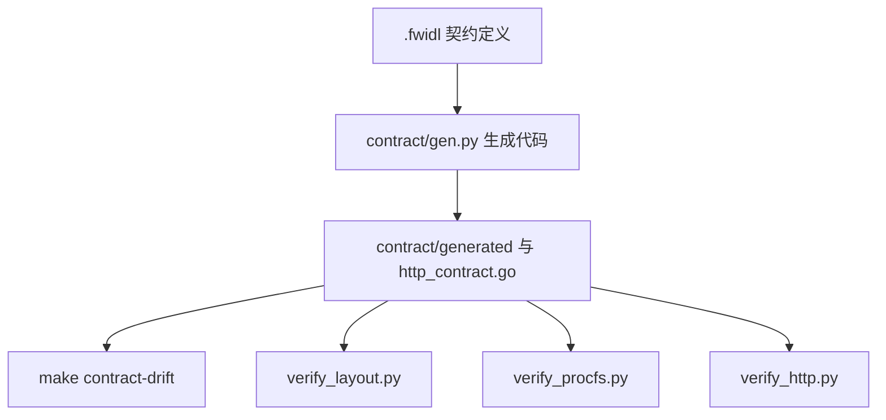

**图表来源**
- [Makefile:157-178](file://Makefile#L157-L178)
- [Makefile:574-621](file://Makefile#L574-L621)
- [ci.yml:96-105](file://.github/workflows/ci.yml#L96-L105)

**章节来源**
- [ci.yml:52-105](file://.github/workflows/ci.yml#L52-L105)
- [Makefile:157-178](file://Makefile#L157-L178)
- [Makefile:321-406](file://Makefile#L321-L406)
- [Makefile:574-621](file://Makefile#L574-L621)

### 多语言测试
项目支持三类测试：

| 语言/框架 | 用途 | 执行方式 |
|---|---|---|
| Go | 守护进程单元测试 | `cd src/daemon && go test ./...` |
| Python | 内核模块与守护进程集成测试 | `sudo python3 -m pytest tests/` |
| TypeScript + Playwright | 浏览器端到端测试 | `npm run test:e2e` |

**章节来源**
- [ci.yml:71-91](file://.github/workflows/ci.yml#L71-L91)
- [ci.yml:427-453](file://.github/workflows/ci.yml#L427-L453)
- [ci.yml:537-553](file://.github/workflows/ci.yml#L537-L553)

## 环境变量与运行环境说明
### CI 通用环境
- 运行环境：`ubuntu-26.04`。
- Go 版本：1.26。
- Node.js 版本：24。
- 内核头文件：优先匹配运行内核，失败时回退通用头文件。

### E2E 专用环境变量
由 `scripts/e2e-daemon.sh env` 输出：

| 变量 | 默认值或含义 | 用途 |
|---|---|---|
| `BASE_URL` | `http://127.0.0.1:9119` | Playwright baseURL |
| `E2E_METRICS_USER` | `e2e` | 面板认证用户名 |
| `E2E_METRICS_PASSWORD` | `e2e-password` | 面板认证密码 |
| `E2E_KERNEL_MODULE` | `1` | 表示内核模块已加载，写操作链路可用 |
| `E2E_LAN_ORIGIN` | 可选 | 非安全上下文下的局域网地址 |

### Release 专用环境变量
| 变量 | 来源 | 用途 |
|---|---|---|
| `VERSION` | `GITHUB_REF` 去掉 `refs/tags/` | deb 包版本号 |
| `GITHUB_TOKEN` | GitHub Secrets | 创建 Release 并上传附件 |

**章节来源**
- [ci.yml:13-14](file://.github/workflows/ci.yml#L13-L14)
- [ci.yml:46-50](file://.github/workflows/ci.yml#L46-L50)
- [ci.yml:117-121](file://.github/workflows/ci.yml#L117-L121)
- [ci.yml:427-443](file://.github/workflows/ci.yml#L427-L443)
- [e2e-daemon.sh:33-47](file://scripts/e2e-daemon.sh#L33-L47)
- [e2e-daemon.sh:217-226](file://scripts/e2e-daemon.sh#L217-L226)
- [release.yml:28-37](file://.github/workflows/release.yml#L28-L37)

## 自定义工作流最佳实践
### 1. 明确触发条件
- 使用精确分支与路径过滤，避免无关 PR 触发昂贵任务。
- 对文档类任务使用 `paths` 限制，如 GitBook 只监听 `docs/**`。

### 2. 拆分并行任务
- 将静态检查、构建、测试拆分为独立 job。
- 让互不依赖的任务并行执行，缩短 CI 时间。

### 3. 使用缓存
- Go 模块缓存、npm 缓存、pip 缓存、ccache 都应显式配置。
- 缓存键应包含依赖锁文件或源码哈希，避免脏缓存。

### 4. 产物与报告分离
- 构建产物、测试报告、覆盖率报告分别上传为 artifact。
- 设置合理的 `retention-days`，避免长期占用存储。

### 5. 优雅降级
- 内核模块不可加载时，不应让整个 CI 失败，而应跳过相关测试并说明原因。
- 使用 `continue-on-error` 与条件步骤控制风险。

### 6. 使用 Makefile 统一入口
- CI 应尽量调用 `make` 目标，而不是直接拼接命令。
- 这样本地开发与 CI 行为一致，降低“在我机器上能跑”的问题。

### 7. 安全敏感信息
- 不要在工作流中硬编码密钥。
- 使用 `secrets.GITHUB_TOKEN` 或其他 GitHub Secrets。

**章节来源**
- [gitbook.yml:3-19](file://.github/workflows/gitbook.yml#L3-L19)
- [ci.yml:19-35](file://.github/workflows/ci.yml#L19-L35)
- [ci.yml:191-212](file://.github/workflows/ci.yml#L191-L212)
- [ci.yml:85-91](file://.github/workflows/ci.yml#L85-L91)
- [ci.yml:413-421](file://.github/workflows/ci.yml#L413-L421)
- [ci.yml:520-535](file://.github/workflows/ci.yml#L520-L535)

## 故障排除指南
### CI 构建失败
**现象**：`build` 任务失败，提示内核头文件不可用。  
**原因**：GitHub Actions Azure VM 使用自定义内核，apt 源可能没有匹配的内核头文件。  
**处理**：
- 检查工作流日志中的 KDIR 检测结果。
- 如果确实不可用，内核模块编译会被跳过，但守护进程仍可构建。
- 本地开发时使用 `make kmod KDIR=/lib/modules/<版本>/build`。

**章节来源**
- [ci.yml:214-250](file://.github/workflows/ci.yml#L214-L250)
- [Makefile:91-112](file://Makefile#L91-L112)

### E2E 测试被跳过
**现象**：e2e 任务输出“本机内核无法加载 kernel module，浏览器用例将跳过”。  
**原因**：托管 runner 的内核与编译出的 `firewall.ko` 不兼容。  
**处理**：
- 确认 `scripts/e2e-daemon.sh probe` 是否返回兼容。
- 确认是否针对本机内核重新编译了内核模块。
- 这不是代码缺陷，而是运行环境限制。

**章节来源**
- [ci.yml:413-421](file://.github/workflows/ci.yml#L413-L421)
- [e2e-daemon.sh:82-100](file://scripts/e2e-daemon.sh#L82-L100)

### 守护进程未就绪
**现象**：e2e 启动守护进程后超时。  
**原因**：端口被占用、内核模块未加载、守护进程提前退出。  
**处理**：
- 检查 `scripts/e2e-daemon.sh start` 输出的守护进程日志。
- 确认端口未被其他服务占用。
- 确认 `/proc/firewall/bans` 是否出现。

**章节来源**
- [e2e-daemon.sh:110-213](file://scripts/e2e-daemon.sh#L110-L213)

### 契约校验失败
**现象**：`make contract-drift` 或 `contract-check` 失败。  
**原因**：修改了 `.fwidl` 但未重新生成契约代码，或手改了生成物。  
**处理**：
- 运行 `python3 contract/gen.py` 重新生成。
- 再次运行 `make contract-drift`。
- 提交生成后的契约文件。

**章节来源**
- [Makefile:592-607](file://Makefile#L592-L607)
- [Makefile:614-621](file://Makefile#L614-L621)

### deb 包构建失败
**现象**：Release 工作流中 `./build-deb.sh` 失败。  
**原因**：缺少 `dpkg-dev`、`debhelper`、`nodejs`、`npm`、`python3`，或版本号无效。  
**处理**：
- 确认 Release 工作流已安装打包依赖。
- 确认版本号符合 deb 命名规范。
- 检查 `debian/changelog` 是否由脚本正确生成。

**章节来源**
- [release.yml:20-37](file://.github/workflows/release.yml#L20-L37)
- [build-deb.sh:13-28](file://build-deb.sh#L13-L28)
- [build-deb.sh:39-52](file://build-deb.sh#L39-L52)

## 结论
该项目的 GitHub Actions 配置体现了现代 CI/CD 的最佳实践：

- **职责分离**：CI、文档、发布三个工作流各司其职。
- **并行优化**：lint、frontend、build 并行，e2e 与 test 并行。
- **缓存优先**：Go、npm、pip、ccache 全面缓存。
- **契约驱动**：`.fwidl` 作为接口真相源，配合生成器与校验器保证三端一致性。
- **环境容错**：内核模块不可加载时优雅降级，不掩盖真正代码问题。
- **本地与 CI 一致**：通过 Makefile 统一构建、契约、测试入口。

团队扩展 CI/CD 时，建议遵循现有模式：新增检查任务放入独立 job，新增构建目标写入 Makefile，新增测试通过 artifact 传递产物，新增发布流程保持最小权限与可审计性。