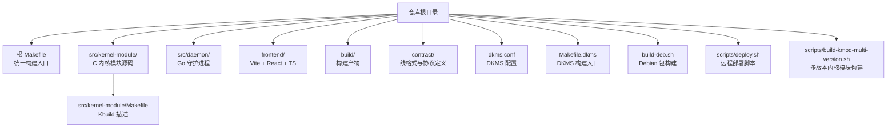
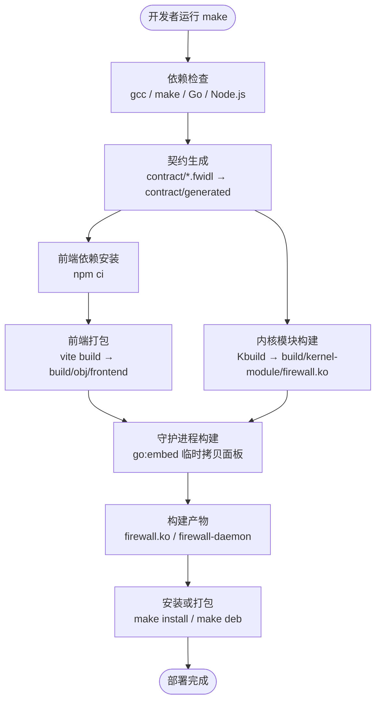
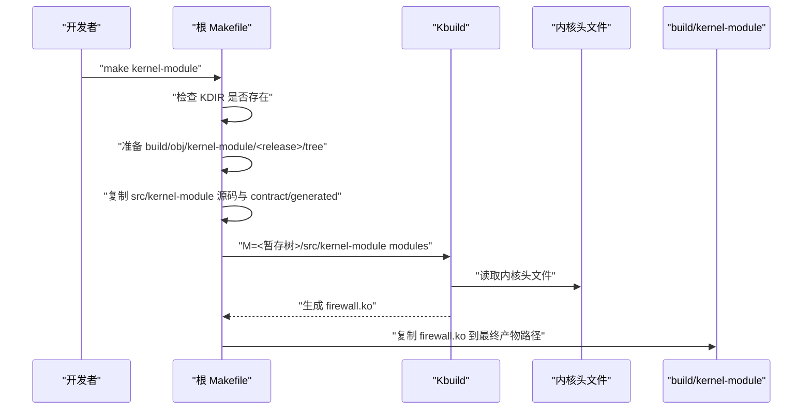
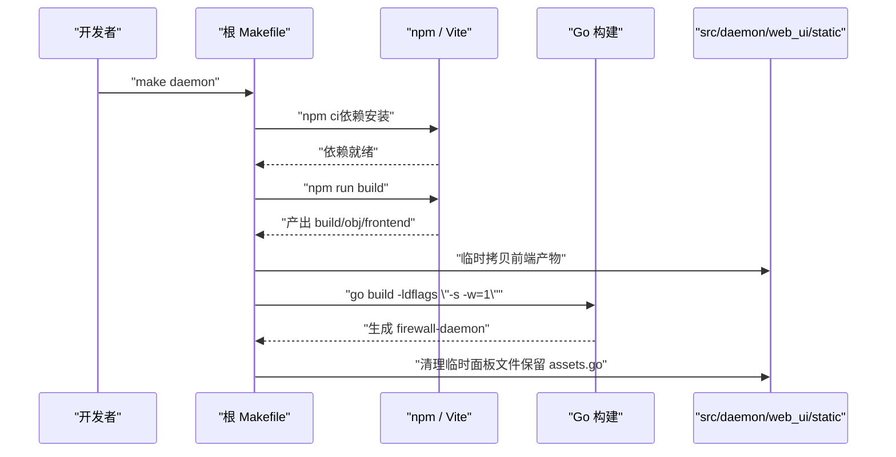
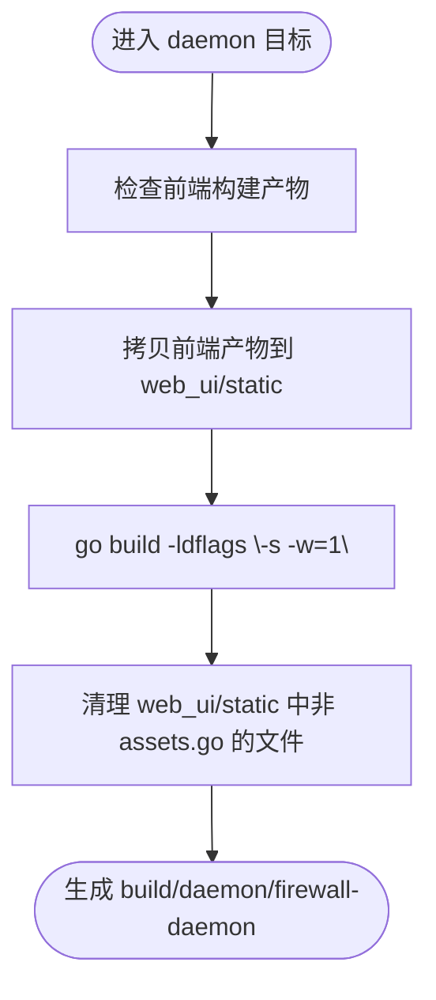
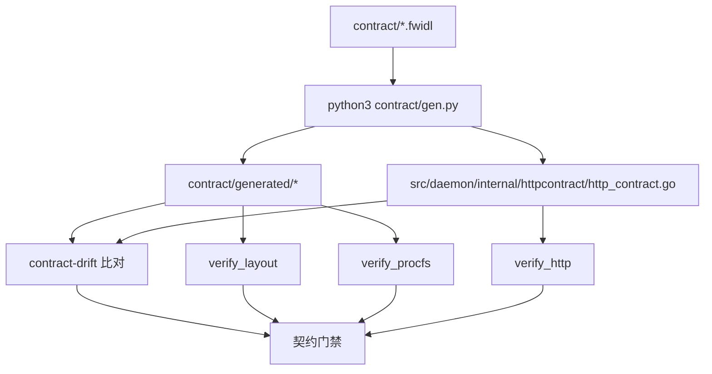
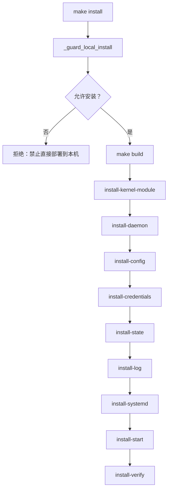
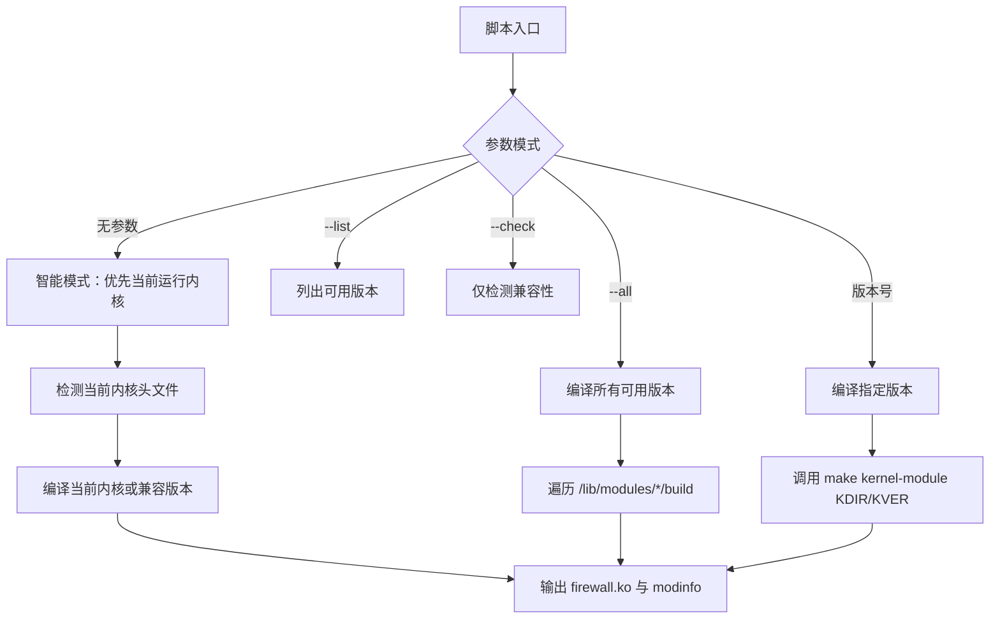
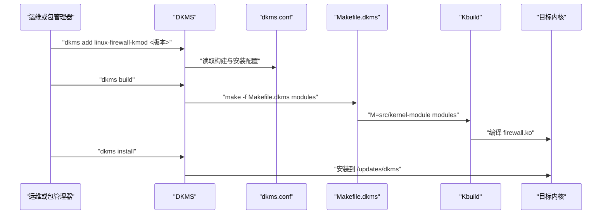

# 构建系统

<cite>
**本文引用的文件**   
- [Makefile](file://Makefile)
- [Makefile.dkms](file://Makefile.dkms)
- [dkms.conf](file://dkms.conf)
- [scripts/build-kmod-multi-version.sh](file://scripts/build-kmod-multi-version.sh)
- [src/kernel-module/Makefile](file://src/kernel-module/Makefile)
- [frontend/package.json](file://frontend/package.json)
- [frontend/vite.config.ts](file://frontend/vite.config.ts)
- [build-deb.sh](file://build-deb.sh)
- [scripts/deploy.sh](file://scripts/deploy.sh)
- [docs/zh/development/building.md](file://docs/zh/development/building.md)
- [src/daemon/go.mod](file://src/daemon/go.mod)
- [frontend/tsconfig.json](file://frontend/tsconfig.json)
</cite>

## 目录

1. [引言](#引言)
2. [项目结构](#项目结构)
3. [核心组件](#核心组件)
4. [架构总览](#架构总览)
5. [详细组件分析](#详细组件分析)
6. [依赖与参数配置](#依赖与参数配置)
7. [多版本内核模块与 DKMS](#多版本内核模块与-dkms)
8. [交叉编译支持](#交叉编译支持)
9. [自定义构建规则与扩展点](#自定义构建规则与扩展点)
10. [性能优化技巧](#性能优化技巧)
11. [常见构建问题与排错](#常见构建问题与排错)
12. [结论](#结论)

## 引言

本项目的构建系统围绕三个语言层展开：

- **C 内核模块**：通过 Kbuild 编译 `firewall.ko`，产物位于 `build/kernel-module/firewall.ko`。
- **Go 守护进程**：源码在 `src/daemon`，最终二进制为 `build/daemon/firewall-daemon`，并通过 `//go:embed` 内嵌前端面板。
- **前端面板**：React + TypeScript + Vite，产物输出到 `build/obj/frontend`，由守护进程构建阶段临时拷贝进 embed 目录。

根 `Makefile` 是统一入口，负责依赖检查、契约生成、代码格式检查、内核模块构建、前端打包、守护进程构建、安装卸载、Debian 包构建和 CI 流程。DKMS 则负责目标机上的多版本内核模块自动编译。

## 项目结构

构建相关的关键目录与文件如下：

**图表来源**  
- [Makefile:1-66](file://Makefile#L1-L66)  
- [src/kernel-module/Makefile:1-29](file://src/kernel-module/Makefile#L1-L29)  
- [frontend/vite.config.ts:1-63](file://frontend/vite.config.ts#L1-L63)  
- [dkms.conf:1-8](file://dkms.conf#L1-L8)  
- [Makefile.dkms:1-13](file://Makefile.dkms#L1-L13)  
- [build-deb.sh:1-75](file://build-deb.sh#L1-L75)  
- [scripts/deploy.sh:1-407](file://scripts/deploy.sh#L1-L407)  
- [scripts/build-kmod-multi-version.sh:1-364](file://scripts/build-kmod-multi-version.sh#L1-L364)

**章节来源**  
- [Makefile:1-66](file://Makefile#L1-L66)  
- [docs/zh/development/building.md:316-327](file://docs/zh/development/building.md#L316-L327)

## 核心组件

### 根 Makefile

根 `Makefile` 承担以下职责：

| 职责 | 说明 |
|---|---|
| 路径与变量 | 定义 `PREFIX`、`SBINDIR`、`FIREWALLETC`、`STATEDIR`、`KERNEL_MODDIR`、`KVER`、`KDIR`、`BUILD_DIR`、`DAEMON_BIN`、`KERNEL_MODULE` 等。 |
| 依赖检查 | `check-deps`、`check-deps-kmod`、`check-deps-daemon`、`check-deps-frontend` 分别校验 gcc/make、Go 版本、Node.js/npm。 |
| 契约生成 | `contract` 调用 Python 生成器；`contract-drift` 与 `contract-check` 做漂移与实现一致性校验。 |
| 内核模块构建 | `kernel-module` 把源码复制到 `build/obj/kernel-module/<kernel.release>/tree/`，再调用 Kbuild。 |
| 前端构建 | `frontend-install` 用 `npm ci`，`frontend` 触发 `npm run build`，产物写入 `build/obj/frontend`。 |
| 守护进程构建 | `daemon` 把前端产物临时拷入 `src/daemon/web_ui/static`，执行 `go build -ldflags "-s -w=1"`，退出时清理临时文件。 |
| 安装与卸载 | `install-*` 子目标按顺序安装内核模块、守护进程、配置、状态目录、systemd 单元并启动服务；`uninstall-*` 反向清理。 |
| Debian 包 | `deb` 目标委托给 `build-deb.sh`。 |
| CI 流程 | `ci` 串联环境检查、格式检查、契约验证、构建、测试、清理与摘要。 |

默认目标是 `all`，即先跑格式检查，再构建内核模块与守护进程。

**章节来源**  
- [Makefile:8-66](file://Makefile#L8-L66)  
- [Makefile:71-155](file://Makefile#L71-L155)  
- [Makefile:161-178](file://Makefile#L161-L178)  
- [Makefile:186-272](file://Makefile#L186-L272)  
- [Makefile:277-319](file://Makefile#L277-L319)  
- [Makefile:673-846](file://Makefile#L673-L846)  
- [Makefile:853-856](file://Makefile#L853-L856)  
- [Makefile:862-975](file://Makefile#L862-L975)  
- [Makefile:981-1017](file://Makefile#L981-L1017)  
- [Makefile:1023-1115](file://Makefile#L1023-L1115)

### 内核模块 Kbuild

`src/kernel-module/Makefile` 是 Kbuild 描述文件：

- 模块名：`obj-m := firewall.o`
- 参与编译的 `.o` 列表对应多个 `fw_*.c` 源文件。
- 头文件搜索路径包含 `contract/generated`，用于读取生成的线格式与文本协议头。
- 开启 `-Wall -Wextra -Wno-unused-parameter`，适配热路径中大量 `static inline` 与 `__maybe_unused` 的设计。

**章节来源**  
- [src/kernel-module/Makefile:1-29](file://src/kernel-module/Makefile#L1-L29)

### 前端构建配置

前端使用 Vite + React 19 + TypeScript + Ant Design。关键约束包括：

- `base: '/static/'`：守护进程对外提供 `/static/*path`，前端资源引用必须带该前缀。
- `assetsDir: ''`：资源平铺输出，文件名固定，便于 `//go:embed` 按名查找。
- `outDir: '../build/obj/frontend'`：产物落在源码树之外，避免污染源码目录。
- `entryFileNames: 'app.js'`：固定入口文件名，使嵌入契约稳定。
- `emptyOutDir: true`：每次构建清空输出目录，但不会删除源码树中的 `assets.go`。

**章节来源**  
- [frontend/vite.config.ts:1-63](file://frontend/vite.config.ts#L1-L63)  
- [frontend/package.json:1-34](file://frontend/package.json#L1-L34)  
- [frontend/tsconfig.json:1-25](file://frontend/tsconfig.json#L1-L25)

### 守护进程 Go 模块

守护进程模块声明 Go 版本为 `go 1.26.0`，依赖包括 `golang.org/x/sys`、`gopkg.in/yaml.v3` 以及 SQLite 相关间接依赖。构建时使用 `-ldflags "-s -w=1"` 去掉符号表，得到 stripped 二进制。

**章节来源**  
- [src/daemon/go.mod:1-22](file://src/daemon/go.mod#L1-L22)  
- [Makefile:277-289](file://Makefile#L277-L289)

## 架构总览

整体构建流程可以理解为一条从源码到可部署产物的流水线：

**图表来源**  
- [Makefile:71-155](file://Makefile#L71-L155)  
- [Makefile:161-178](file://Makefile#L161-L178)  
- [Makefile:237-272](file://Makefile#L237-L272)  
- [Makefile:299-319](file://Makefile#L299-L319)  
- [Makefile:277-289](file://Makefile#L277-L289)

## 详细组件分析

### 内核模块构建流程

内核模块构建不是直接对 `src/kernel-module` 编译，而是采用“暂存树”策略：

1. 根据当前内核版本计算 `KERNEL_RELEASE`。
2. 创建 `build/obj/kernel-module/<kernel.release>/tree/src/kernel-module`。
3. 复制 C 源码、头文件和 `Makefile`。
4. 复制 `contract/generated` 下的生成头。
5. 调用 `$(MAKE) -C $(KDIR) M=<暂存树>/src/kernel-module modules`。
6. 将 `firewall.ko` 复制到 `build/kernel-module/firewall.ko`。

这样做的好处是源码树保持零中间产物，`.o`、`.cmd`、`Module.symvers` 等全部留在 `build/obj`。

**图表来源**  
- [Makefile:237-272](file://Makefile#L237-L272)  
- [src/kernel-module/Makefile:6-24](file://src/kernel-module/Makefile#L6-L24)

**章节来源**  
- [Makefile:23-31](file://Makefile#L23-L31)  
- [Makefile:56-66](file://Makefile#L56-L66)  
- [Makefile:237-272](file://Makefile#L237-L272)  
- [src/kernel-module/Makefile:1-29](file://src/kernel-module/Makefile#L1-L29)

### 前端面板打包流程

前端构建分为两步：

1. `frontend-install`：执行 `npm ci --no-audit --no-fund`，保证依赖可复现。
2. `frontend`：执行 `cd frontend && npm run build`，等价于 `tsc --noEmit && vite build`。

守护进程构建时，Makefile 会把 `build/obj/frontend` 的内容临时拷贝到 `src/daemon/web_ui/static`，然后执行 `go build`，并在 shell trap 中清理除 `assets.go` 外的所有临时文件。

**图表来源**  
- [Makefile:277-289](file://Makefile#L277-L289)  
- [Makefile:299-319](file://Makefile#L299-L319)  
- [frontend/package.json:7-12](file://frontend/package.json#L7-L12)  
- [frontend/vite.config.ts:23-48](file://frontend/vite.config.ts#L23-L48)

**章节来源**  
- [Makefile:277-319](file://Makefile#L277-L319)  
- [frontend/package.json:1-34](file://frontend/package.json#L1-L34)  
- [frontend/vite.config.ts:1-63](file://frontend/vite.config.ts#L1-L63)

### 守护进程构建流程

守护进程构建的关键点是 `//go:embed` 要求静态资源位于包目录内。因此 `make daemon` 在执行 `go build` 前先把前端产物拷贝进 `src/daemon/web_ui/static`，并使用 shell trap 确保无论成功、失败还是中断都清理临时文件。

**图表来源**  
- [Makefile:277-289](file://Makefile#L277-L289)

**章节来源**  
- [Makefile:277-289](file://Makefile#L277-L289)  
- [docs/zh/development/building.md:127-164](file://docs/zh/development/building.md#L127-L164)

### 契约生成与门禁

契约文件 `contract/*.fwidl` 是线格式与文本协议的单一真相源。构建系统提供：

- `contract`：生成头文件与 Go 契约文件。
- `contract-clean`：清理生成物。
- `contract-drift`：重新生成到临时目录，比对 `contract/generated` 与 `src/daemon/internal/httpcontract/http_contract.go`。
- `contract-check`：依次运行 `verify_layout`、`verify_procfs`、`verify_http`，不短路，确保一次 CI 能看到所有不一致。

**图表来源**  
- [Makefile:161-178](file://Makefile#L161-L178)  
- [Makefile:582-621](file://Makefile#L582-L621)

**章节来源**  
- [Makefile:161-178](file://Makefile#L161-L178)  
- [Makefile:582-621](file://Makefile#L582-L621)  
- [docs/zh/development/building.md:166-189](file://docs/zh/development/building.md#L166-L189)

### 安装、卸载与本地部署守卫

`make install` 会先经过 `_guard_local_install` 守卫：如果 `DESTDIR` 为空且没有显式传入 `FIREWALL_REMOTE_DEPLOY=1`，则拒绝直接在本机写根文件系统。

安装顺序为：

1. 本地部署守卫
2. 构建
3. 安装内核模块
4. 安装守护进程
5. 安装配置
6. 准备凭据模板
7. 创建状态目录
8. 创建日志文件
9. 安装 systemd 单元与模块自动加载配置
10. 尝试加载模块并启动服务
11. 验证安装结果

卸载顺序相反，并安全处理已加载模块、systemd 单元、配置文件、状态目录和日志文件。

**图表来源**  
- [Makefile:630-671](file://Makefile#L630-L671)  
- [Makefile:673-846](file://Makefile#L673-L846)

**章节来源**  
- [Makefile:630-671](file://Makefile#L630-L671)  
- [Makefile:673-846](file://Makefile#L673-L846)  
- [Makefile:862-975](file://Makefile#L862-L975)  
- [docs/zh/development/building.md:201-239](file://docs/zh/development/building.md#L201-L239)

### Debian 包构建

`make deb` 调用 `build-deb.sh`，后者：

1. 从 `CHANGELOG.md` 提取最新版本号。
2. 生成 `debian/changelog`。
3. 调用 `dpkg-buildpackage -b -us -uc`。
4. 将产物移动到 `build/deb/linux-firewall-kmod-<版本>.deb`。

注意：deb 包只编译守护进程（含前端），内核模块由目标机的 DKMS 在安装时编译。

**章节来源**  
- [Makefile:848-856](file://Makefile#L848-L856)  
- [build-deb.sh:1-75](file://build-deb.sh#L1-L75)  
- [docs/zh/development/building.md:245-273](file://docs/zh/development/building.md#L245-L273)

### 远程部署脚本

`scripts/deploy.sh` 支持两种模式：

| 模式 | 行为 |
|---|---|
| `deb` | 本地打包 deb，远端安装依赖、安装包、验证服务与面板可达性。 |
| `script` | 上传本地预编译的 `firewall.ko` 与 `firewall-daemon`，要求 vermagic 与远端内核一致。 |

脚本会校验参数顺序、检测 SSH 用户与主机、防止重复部署、清理旧残留、安装依赖、验证 systemd 状态、内核模块加载状态和 HTTP 面板响应。

**章节来源**  
- [scripts/deploy.sh:1-407](file://scripts/deploy.sh#L1-L407)

## 依赖与参数配置

### 主要构建变量

| 变量 | 默认值或含义 | 用途 |
|---|---|---|
| `PREFIX` | `/usr/local` | 安装前缀 |
| `SBINDIR` | `$(PREFIX)/sbin` | 守护进程安装路径 |
| `FIREWALLETC` | `/etc/firewall` | 配置文件目录 |
| `STATEDIR` | `/var/lib` | 状态数据目录 |
| `SYSTEMDDIR` | `/etc/systemd/system` | systemd 单元安装路径 |
| `KERNEL_MODDIR` | `/lib/modules/$(uname -r)/extra` | 内核模块安装路径 |
| `DESTDIR` | 空 | 打包暂存安装前缀 |
| `KVER` | `$(shell uname -r)` | 指定内核版本 |
| `KDIR` | `/lib/modules/$(KVER)/build` | 内核构建目录 |
| `GOC` | `go` | Go 命令 |
| `GOVER` | `1.23` | Makefile 引导检查的最小 Go 版本 |
| `CCACHE` | `ccache` | C 编译器缓存命令 |
| `PYTHON` | `python3` | 契约生成与校验工具 |
| `SKIP_FORMAT_CHECK` | 空 | 跳过 clang-format 检查 |
| `HOST` | 无 | 远程编译目标主机 |
| `USER` | 当前用户 | 远程编译 SSH 用户 |

**章节来源**  
- [Makefile:13-66](file://Makefile#L13-L66)  
- [Makefile:1082-1087](file://Makefile#L1082-L1087)

### 依赖版本

| 组件 | 版本要求 | 来源 |
|---|---|---|
| Go | 守护进程模块声明 `go 1.26.0` | `src/daemon/go.mod` |
| Makefile Go 引导检查 | `>= 1.23` | 根 `Makefile` |
| Node.js | CI 使用较新 LTS，文档提到 Node 24 | GitHub Actions 与文档 |
| npm | 随 Node.js 使用 | 前端构建 |
| clang-format | 文档建议对齐 CI 使用的 18 | 文档与 CI 约定 |
| Python 3 | 契约生成与校验 | 根 `Makefile` |
| 内核头文件 | 与运行内核匹配 | `KDIR` 指向的内核构建目录 |

**章节来源**  
- [src/daemon/go.mod:1-4](file://src/daemon/go.mod#L1-L4)  
- [Makefile:41-42](file://Makefile#L41-L42)  
- [Makefile:114-155](file://Makefile#L114-L155)  
- [docs/zh/development/building.md:6-24](file://docs/zh/development/building.md#L6-L24)

## 多版本内核模块与 DKMS

### 多版本内核模块构建脚本

`scripts/build-kmod-multi-version.sh` 提供智能构建能力：

- 无参数：优先编译当前运行内核。
- `--all`：编译所有已安装内核头文件对应的版本。
- `--list`：列出可用版本与兼容性。
- `--check`：仅检测兼容性。
- 直接传版本号：编译指定版本。

脚本会检测主版本和次版本是否兼容，区分“可直接加载测试”和“仅可编译”的版本。每个版本产物放在 `build/kernel-module/<version>/firewall.ko`。

**图表来源**  
- [scripts/build-kmod-multi-version.sh:1-364](file://scripts/build-kmod-multi-version.sh#L1-L364)

**章节来源**  
- [scripts/build-kmod-multi-version.sh:1-364](file://scripts/build-kmod-multi-version.sh#L1-L364)  
- [Makefile:196-201](file://Makefile#L196-L201)

### DKMS 多版本内核模块支持

DKMS 配置由 `dkms.conf` 和 `Makefile.dkms` 组成：

- `dkms.conf` 指定 `MAKE="make -f Makefile.dkms"`、`CLEAN="make -f Makefile.dkms clean"`、模块名称、模块位置、安装位置、包名和版本占位符。
- `Makefile.dkms` 作为 DKMS 调用的构建入口，把构建转发到 `src/kernel-module` 的 Kbuild。

DKMS 的典型工作流是：

1. 目标机安装 `linux-headers-$(uname -r)`。
2. `dkms add` 注册源码。
3. `dkms build` 调用 `Makefile.dkms` 编译内核模块。
4. `dkms install` 安装到 `/updates/dkms`。
5. 包管理器维护者脚本在 postinst 中执行 dkms add/build/install，并加载模块、预创建日志文件、启用并启动服务。

**图表来源**  
- [dkms.conf:1-8](file://dkms.conf#L1-L8)  
- [Makefile.dkms:1-13](file://Makefile.dkms#L1-L13)

**章节来源**  
- [dkms.conf:1-8](file://dkms.conf#L1-L8)  
- [Makefile.dkms:1-13](file://Makefile.dkms#L1-L13)  
- [docs/zh/development/building.md:245-273](file://docs/zh/development/building.md#L245-L273)

## 交叉编译支持

### 内核模块

内核模块遵循 Kbuild 常规变量：

- `ARCH`
- `CROSS_COMPILE`
- `KDIR`

根 `Makefile` 不设置这两个变量，因此它们由环境变量继承到 `$(MAKE) -C $(KDIR)`。文档明确说明本项目未做过交叉编译验证。

### 守护进程

守护进程是纯 Go，走 Go 自己的交叉编译变量：

- `GOOS`
- `GOARCH`
- `CGO_ENABLED`（本项目无 cgo）

示例中展示了 `GOOS=linux GOARCH=arm64 go build` 的方式。

### 前端面板

前端产物通过 `//go:embed` 内嵌进守护进程二进制，不需要单独部署。

**章节来源**  
- [docs/zh/development/building.md:295-314](file://docs/zh/development/building.md#L295-L314)  
- [Makefile:268-270](file://Makefile#L268-L270)

## 自定义构建规则与扩展点

### 新增内核模块源文件

若新增 `fw_xxx.c`，需要：

1. 在 `src/kernel-module/Makefile` 的 `firewall-y` 中添加对应 `.o`。
2. 确保头文件路径能通过 `ccflags-y += -I$(src)/../../contract/generated` 访问。
3. 如需新的线格式或文本协议字段，修改 `contract/*.fwidl` 后重新生成契约。

**章节来源**  
- [src/kernel-module/Makefile:6-24](file://src/kernel-module/Makefile#L6-L24)  
- [Makefile:161-178](file://Makefile#L161-L178)

### 新增守护进程功能

守护进程源码位于 `src/daemon`，新增功能后：

1. 在 `src/daemon` 下添加 Go 源码。
2. 如果需要暴露 HTTP API，需同步更新契约与前端类型。
3. 重新运行 `make daemon`，因为面板产物会通过 `//go:embed` 内嵌。

**章节来源**  
- [Makefile:277-289](file://Makefile#L277-L289)  
- [src/daemon/go.mod:1-22](file://src/daemon/go.mod#L1-L22)

### 新增前端页面

前端新增页面后：

1. 修改 `frontend/src` 下的路由与视图。
2. 运行 `make frontend-typecheck` 进行类型检查。
3. 运行 `make frontend` 或 `make daemon` 重新打包。
4. 确认 `vite.config.ts` 的 `base`、`assetsDir`、`entryFileNames` 仍满足守护进程嵌入契约。

**章节来源**  
- [Makefile:299-319](file://Makefile#L299-L319)  
- [frontend/vite.config.ts:23-48](file://frontend/vite.config.ts#L23-L48)

### 新增构建目标

可在根 `Makefile` 中新增 `.PHONY` 目标，例如：

- 新增质量检查目标
- 新增本地调试目标
- 新增特定环境的构建目标

建议遵循现有命名风格：`check-*`、`build-*`、`deploy-*`、`clean-*`。

**章节来源**  
- [Makefile:325-543](file://Makefile#L325-L543)  
- [Makefile:981-1017](file://Makefile#L981-L1017)

## 性能优化技巧

### 使用 ccache 加速内核模块编译

根 `Makefile` 默认使用 `CCACHE ?= ccache`，并在调用 Kbuild 时传入 `CC="$(CCACHE) gcc"`。重复构建相同内核版本时可显著减少编译时间。

可通过 `make kernel-module CCACHE=` 禁用 ccache。

**章节来源**  
- [Makefile:44-46](file://Makefile#L44-L46)  
- [Makefile:268-270](file://Makefile#L268-L270)

### 快速构建

开发调试时可使用：

- `make build-quick`：跳过格式检查。
- `make SKIP_FORMAT_CHECK=1 all`：通过变量跳过格式检查。
- `make kmod`：仅编译内核模块。
- `make daemon`：仅编译守护进程。

**章节来源**  
- [Makefile:186-194](file://Makefile#L186-L194)  
- [docs/zh/development/building.md:50-55](file://docs/zh/development/building.md#L50-L55)

### 前端增量构建

前端依赖锁定在 `frontend/package-lock.json`，CI 使用 `npm ci` 保证可复现。本地开发时，Vite 本身支持增量构建；Makefile 通过 stamp 文件记录前端构建新鲜度，避免重复执行 `npm run build`。

**章节来源**  
- [Makefile:297-319](file://Makefile#L297-L319)  
- [frontend/package.json:7-12](file://frontend/package.json#L7-L12)

### 守护进程二进制体积优化

守护进程构建使用 `-ldflags "-s -w=1"`，链接期去掉符号表，减小二进制体积。

**章节来源**  
- [Makefile:288-289](file://Makefile#L288-L289)  
- [docs/zh/development/building.md:148-154](file://docs/zh/development/building.md#L148-L154)

## 常见构建问题与排错

### 依赖缺失

| 症状 | 原因 | 解决方案 |
|---|---|---|
| `gcc` 未安装 | 缺少 C 编译器 | `sudo apt install gcc` |
| `make` 未安装 | 缺少构建工具 | `sudo apt install make` |
| Go 未安装或版本过低 | 守护进程无法构建 | 安装 Go 1.23+，守护进程模块声明 `go 1.26.0` |
| Node.js 或 npm 未安装 | 前端无法构建 | 安装 Node.js 18+ 与 npm |
| 内核构建目录不存在 | 缺少内核头文件 | `sudo apt install linux-headers-$(uname -r)` 或指定 `KDIR` |

**章节来源**  
- [Makefile:77-112](file://Makefile#L77-L112)  
- [Makefile:114-155](file://Makefile#L114-L155)  
- [Makefile:237-257](file://Makefile#L237-L257)

### 内核模块构建失败

| 症状 | 原因 | 解决方案 |
|---|---|---|
| `ERROR: Kernel configuration is invalid.` | 内核头文件与运行内核不匹配 | 重装内核头文件 |
| 多版本编译失败 | 某些版本头文件缺失或不兼容 | 使用 `--list` 查看兼容性，安装对应头文件 |
| 远程编译失败 | 目标机缺少内核头文件或权限不足 | 检查 `HOST`、`USER` 和目标机环境 |

**章节来源**  
- [docs/zh/development/building.md:88-96](file://docs/zh/development/building.md#L88-L96)  
- [scripts/build-kmod-multi-version.sh:137-183](file://scripts/build-kmod-multi-version.sh#L137-L183)  
- [Makefile:203-230](file://Makefile#L203-L230)

### 守护进程构建失败

| 症状 | 原因 | 解决方案 |
|---|---|---|
| `go: 没有那个文件或目录` | `sudo` 的 `secure_path` 不含 Go | 使用 `sudo env "PATH=$PATH" make daemon` |
| `go build` 报「包内无 .go 文件」 | `assets.go` 被清理动作误删 | 检查清理逻辑是否保留 `assets.go` |
| 面板改了但界面不变 | 只跑了 `make frontend`，没重跑 `make daemon` | 重新执行 `make daemon` |

**章节来源**  
- [docs/zh/development/building.md:329-340](file://docs/zh/development/building.md#L329-L340)  
- [Makefile:283-289](file://Makefile#L283-L289)

### 前端构建问题

| 症状 | 原因 | 解决方案 |
|---|---|---|
| CI 的 `tsc` 找不到 `react` | `npm ci` 未执行或依赖声明缺失 | 使用 `make frontend-install`，检查 `frontend/package.json` |
| 面板构建产物路径异常 | 修改了 `vite.config.ts` 但未同步守护进程嵌入契约 | 保持 `base`、`assetsDir`、`entryFileNames` 与守护进程契约一致 |

**章节来源**  
- [Makefile:297-319](file://Makefile#L297-L319)  
- [frontend/vite.config.ts:1-20](file://frontend/vite.config.ts#L1-L20)

### 安装与部署问题

| 症状 | 原因 | 解决方案 |
|---|---|---|
| `make install` 拒绝本机安装 | 本地部署守卫阻止直接写根文件系统 | 使用 `DESTDIR`、`./scripts/deploy.sh` 或 `FIREWALL_REMOTE_DEPLOY=1` |
| 守护进程未启动 | 内核模块未加载或配置错误 | 检查 `journalctl -u firewall-daemon.service` |
| 面板不可达 | 守护进程未运行或端口 9119 被占用 | 检查服务状态与 HTTP 响应 |

**章节来源**  
- [Makefile:630-671](file://Makefile#L630-L671)  
- [Makefile:792-814](file://Makefile#L792-L814)  
- [scripts/deploy.sh:160-201](file://scripts/deploy.sh#L160-L201)

## 结论

本项目的构建系统以根 `Makefile` 为核心，串联 C 内核模块、Go 守护进程和前端面板三个语言层，并通过契约生成机制保证内核态与用户态接口一致性。DKMS 提供目标机上的多版本内核模块自动编译能力，而 `scripts/deploy.sh` 与 `build-deb.sh` 覆盖远程部署与 Debian 包分发场景。

对于开发者而言，理解以下关键点即可有效扩展构建流程：

1. 内核模块源码变更需要同步 Kbuild 描述和契约文件。
2. 前端变更必须重新构建守护进程才能生效。
3. 多版本内核模块推荐使用脚本或 DKMS，而不是手动多次调用 `make kernel-module`。
4. 本地安装应优先使用 `DESTDIR` 或 `scripts/deploy.sh`，避免污染宿主机。
5. 性能优化可从 ccache、快速构建目标和前端增量构建入手。