# 测试自动化

<cite>
**本文引用的文件**   
- [tests/README.md](file://tests/README.md)
- [docs/zh/development/testing.md](file://docs/zh/development/testing.md)
- [pyproject.toml](file://pyproject.toml)
- [tests/conftest.py](file://tests/conftest.py)
- [tests/config.py](file://tests/config.py)
- [scripts/e2e-daemon.sh](file://scripts/e2e-daemon.sh)
- [scripts/test-kernel-compat.sh](file://scripts/test-kernel-compat.sh)
- [scripts/bench/Makefile](file://scripts/bench/Makefile)
- [.github/workflows/ci.yml](file://.github/workflows/ci.yml)
- [tests/test_07_concurrency.py](file://tests/test_07_concurrency.py)
- [tests/test_08_stress_perf.py](file://tests/test_08_stress_perf.py)
</cite>

## 目录
1. [引言](#引言)
2. [项目结构](#项目结构)
3. [核心组件](#核心组件)
4. [架构总览](#架构总览)
5. [详细组件分析](#详细组件分析)
6. [依赖关系分析](#依赖关系分析)
7. [性能与基准测试](#性能与基准测试)
8. [环境搭建与调试](#环境搭建与调试)
9. [覆盖率统计](#覆盖率统计)
10. [故障排查](#故障排查)
11. [结论](#结论)

## 引言
本仓库采用三层测试体系：Go 单元测试、Python 集成测试、Playwright 端到端测试。三者分别覆盖守护进程内部逻辑、内核模块与守护进程行为契约，以及浏览器界面与真实服务交互。CI 通过 GitHub Actions 并行执行代码质量检查、契约校验、前端构建、内核模块编译、端到端测试和集成测试，并在内核不兼容时降级运行守护进程相关子集，避免把环境问题误判为代码缺陷。

## 项目结构
测试相关代码集中在 `tests/`，配置在 `pyproject.toml`，CI 编排位于 `.github/workflows/ci.yml`，端到端夹具脚本位于 `scripts/e2e-daemon.sh`，内核兼容性检查脚本位于 `scripts/test-kernel-compat.sh`，性能工具构建规则位于 `scripts/bench/Makefile`。

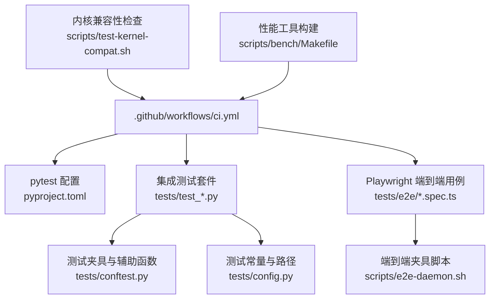

**图表来源**
- [.github/workflows/ci.yml:1-10](file://.github/workflows/ci.yml#L1-L10)
- [pyproject.toml:1-26](file://pyproject.toml#L1-L26)
- [tests/conftest.py:1-28](file://tests/conftest.py#L1-L28)
- [tests/config.py:1-20](file://tests/config.py#L1-L20)
- [scripts/e2e-daemon.sh:1-49](file://scripts/e2e-daemon.sh#L1-L49)
- [scripts/test-kernel-compat.sh:1-35](file://scripts/test-kernel-compat.sh#L1-L35)
- [scripts/bench/Makefile:1-17](file://scripts/bench/Makefile#L1-L17)

**章节来源**
- [tests/README.md:1-35](file://tests/README.md#L1-L35)
- [docs/zh/development/testing.md:1-14](file://docs/zh/development/testing.md#L1-L14)

## 核心组件
- pytest 配置：定义测试路径、默认参数、标记、警告过滤与覆盖率收集范围。
- 测试夹具：封装内核模块加载卸载、procfs 读写、守护进程生命周期、HTTP 请求、指标轮询等能力。
- 测试配置：集中管理构建产物路径、procfs 路径、测试 IP、超时与性能阈值。
- 端到端夹具脚本：负责探测内核可加载性、启动真实守护进程、等待就绪、输出连接参数、清理状态。
- 内核兼容性脚本：按当前内核或所有已编译版本执行 insmod/rmmod 并打印兼容性日志。
- 性能工具 Makefile：构建 C 语言压力源与接收器，供底层压测使用。

**章节来源**
- [pyproject.toml:7-26](file://pyproject.toml#L7-L26)
- [tests/conftest.py:29-140](file://tests/conftest.py#L29-L140)
- [tests/config.py:1-80](file://tests/config.py#L1-L80)
- [scripts/e2e-daemon.sh:1-49](file://scripts/e2e-daemon.sh#L1-L49)
- [scripts/test-kernel-compat.sh:36-81](file://scripts/test-kernel-compat.sh#L36-L81)
- [scripts/bench/Makefile:1-27](file://scripts/bench/Makefile#L1-L27)

## 架构总览
三层测试的自动化执行流程如下：

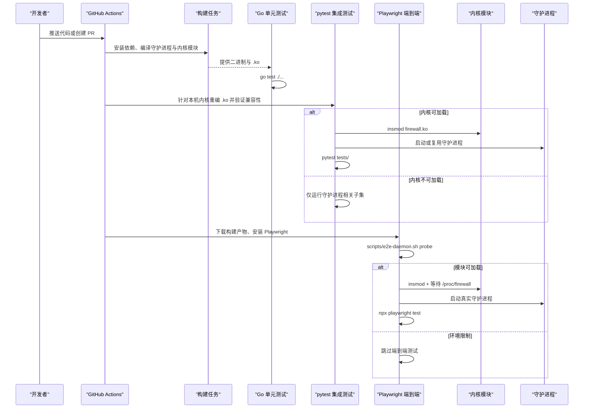

**图表来源**
- [.github/workflows/ci.yml:71-82](file://.github/workflows/ci.yml#L71-L82)
- [.github/workflows/ci.yml:343-457](file://.github/workflows/ci.yml#L343-L457)
- [.github/workflows/ci.yml:459-563](file://.github/workflows/ci.yml#L459-L563)
- [scripts/e2e-daemon.sh:85-100](file://scripts/e2e-daemon.sh#L85-L100)
- [scripts/e2e-daemon.sh:110-214](file://scripts/e2e-daemon.sh#L110-L214)

## 详细组件分析

### pytest 框架与测试标记
pytest 通过 `pyproject.toml` 统一配置：
- 测试路径指向 `tests`。
- 默认启用详细输出、短回溯、严格标记与严格配置。
- 定义 `slow`、`requires_daemon`、`requires_module`、`requires_sqlite3`、`e2e`、`stress`、`perf` 等标记，用于筛选慢测试、需要外部守护进程或内核模块的用例。
- 覆盖率配置将 `tests` 作为 source，排除夹具与配置模块；但文档明确说明 Python 集成测试主要验证内核与守护进程行为，覆盖率对 Python 测试意义有限。

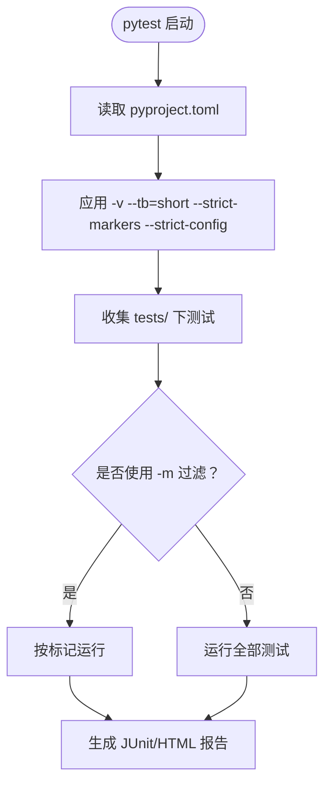

**图表来源**
- [pyproject.toml:7-26](file://pyproject.toml#L7-L26)
- [tests/README.md:76-96](file://tests/README.md#L76-L96)

**章节来源**
- [pyproject.toml:1-49](file://pyproject.toml#L1-L49)
- [tests/README.md:42-96](file://tests/README.md#L42-L96)

### 测试夹具与数据隔离
`tests/conftest.py` 提供会话级与用例级夹具：
- `session_setup`：确保 root、模块存在、模块加载成功；会话结束时重置数据并卸载模块。
- `test_isolation`：每个用例前清空数据、确保模块就绪；用例后清理残留进程，并在起过 daemon 的轮次重载模块以释放内核租约。
- `clean_bans`：显式保证封禁列表为空。
- 内核模块管理：`load_module`、`unload_module`、`check_module_ready`。
- 内核租约卫生：`mark_daemon_launched`、`release_kernel_lease`、`terminate_process`。
- Procfs 辅助：`get_stat`、`count_bans`、`count_whitelist`、封禁解封白名单操作。
- 守护进程辅助：`daemon_starts_ok`、`is_daemon_running`、`run_daemon_captured`、`daemon_run_probe`、端口与凭据读取、curl 封装、Prometheus 指标轮询。
- 临时配置生成：`generate_test_yaml`。

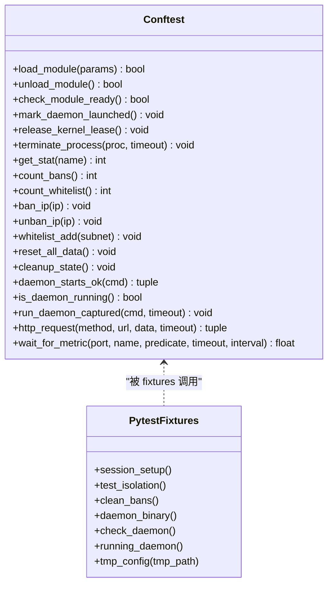

**图表来源**
- [tests/conftest.py:34-83](file://tests/conftest.py#L34-L83)
- [tests/conftest.py:89-140](file://tests/conftest.py#L89-L140)
- [tests/conftest.py:147-320](file://tests/conftest.py#L147-L320)
- [tests/conftest.py:326-533](file://tests/conftest.py#L326-L533)
- [tests/conftest.py:574-662](file://tests/conftest.py#L574-L662)

**章节来源**
- [tests/conftest.py:1-662](file://tests/conftest.py#L1-L662)

### 测试配置与数据管理
`tests/config.py` 集中管理：
- 构建产物路径：`KERNEL_MODULE_PATH`、`DAEMON_PATH`。
- procfs 路径：`PROC_DIR`、`PROC_BANS`、`PROC_WHITELIST`、`PROC_STATS`、`PROC_CONFIG`。
- 测试 IP 池与特殊地址：用于并发、压力、白名单、广播、多播等场景。
- 超时与同步延迟：模块加载、守护进程启动、procfs 同步等。
- 性能阈值：封禁、解封、压力测试耗时上限。
- 日志解析测试用日志行：SSH、FTP、Nginx、FRP 等样例。

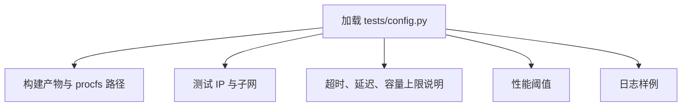

**图表来源**
- [tests/config.py:1-80](file://tests/config.py#L1-L80)

**章节来源**
- [tests/config.py:1-80](file://tests/config.py#L1-L80)

### 并发测试与竞态条件
`tests/test_07_concurrency.py` 通过多线程模拟并发写入与读写混合场景：
- 并发封禁多个 IP，断言整体耗时不超过阈值。
- 同时封禁与解封同一批 IP，验证模块仍有响应。
- 并发白名单与封禁操作，验证接口未崩溃。
- 读取期间修改封禁列表，验证统计信息非负且稳定。

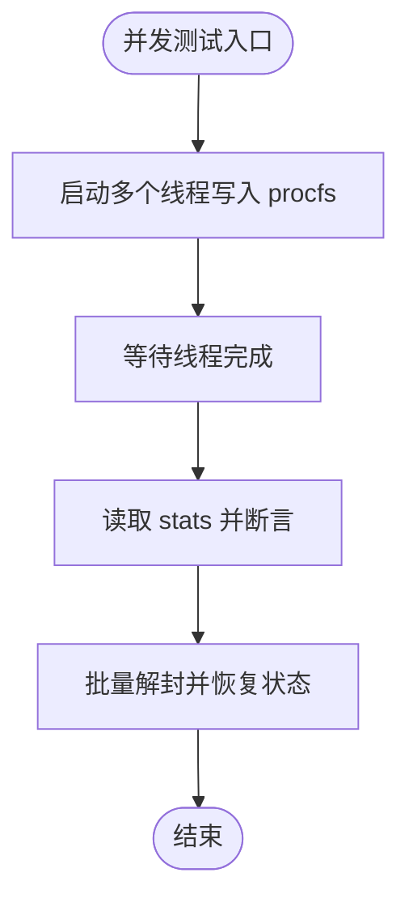

**图表来源**
- [tests/test_07_concurrency.py:32-135](file://tests/test_07_concurrency.py#L32-L135)

**章节来源**
- [tests/test_07_concurrency.py:1-135](file://tests/test_07_concurrency.py#L1-L135)

### 压力与性能测试
`tests/test_08_stress_perf.py` 标记为 `slow`、`stress`、`perf`，包含：
- 封禁性能：连续写入大量 IP，断言总耗时不超过 `BAN_PERF_THRESHOLD_MS`。
- 解封性能：先填充再批量解封，断言总耗时不超过 `UNBAN_PERF_THRESHOLD_MS`。
- 压力测试：快速写入大量 IP，断言总耗时不超过 `STRESS_THRESHOLD_MS`。

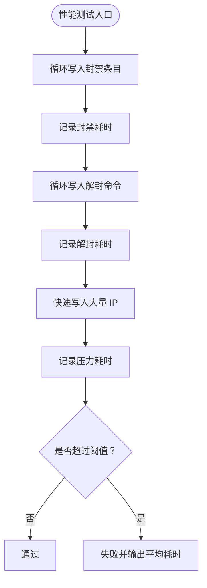

**图表来源**
- [tests/test_08_stress_perf.py:17-93](file://tests/test_08_stress_perf.py#L17-L93)

**章节来源**
- [tests/test_08_stress_perf.py:1-93](file://tests/test_08_stress_perf.py#L1-L93)

### 端到端测试夹具与守护进程生命周期
`scripts/e2e-daemon.sh` 提供 `probe`、`start`、`stop`、`env` 四个子命令：
- `probe`：检测当前内核能否加载 `firewall.ko`，不改变系统状态。
- `start`：创建临时配置、加载内核模块、等待 `/proc/firewall/bans` 出现、启动守护进程、轮询 HTTP 面就绪（不要求 200）。
- `stop`：优雅停止守护进程、卸载模块、清理临时目录。
- `env`：输出 `BASE_URL`、凭据、内核模块可用标志，供 Playwright 使用。

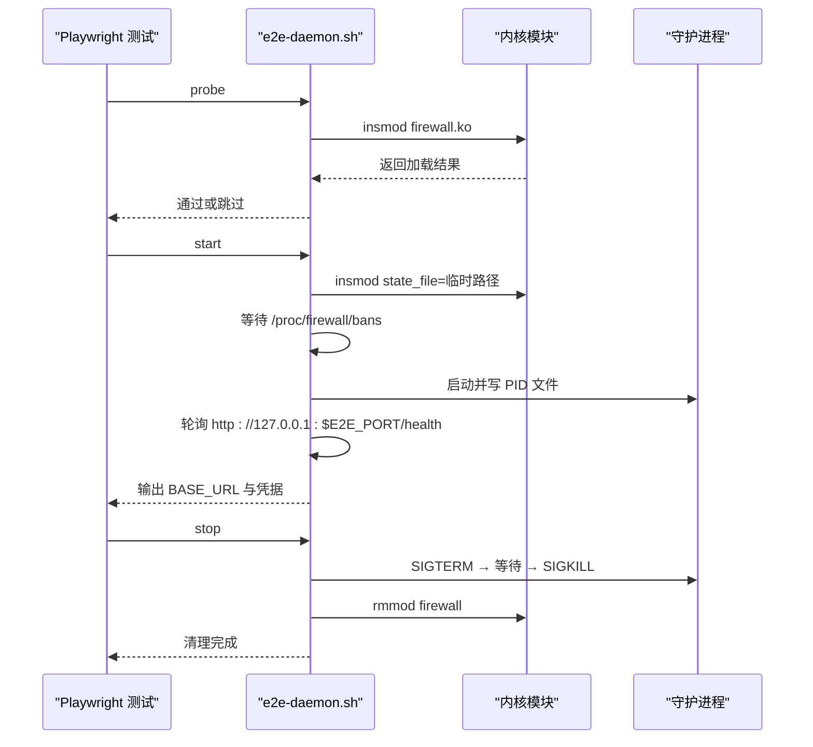

**图表来源**
- [scripts/e2e-daemon.sh:85-100](file://scripts/e2e-daemon.sh#L85-L100)
- [scripts/e2e-daemon.sh:110-214](file://scripts/e2e-daemon.sh#L110-L214)
- [scripts/e2e-daemon.sh:217-266](file://scripts/e2e-daemon.sh#L217-L266)

**章节来源**
- [scripts/e2e-daemon.sh:1-278](file://scripts/e2e-daemon.sh#L1-L278)

### 内核兼容性测试
`scripts/test-kernel-compat.sh` 支持：
- 无参数：测试当前运行内核，若缺少对应 `.ko` 则尝试编译。
- `--all`：遍历 `build/kernel-module-*` 下所有已编译版本，逐个 insmod/rmmod 并打印兼容性日志。
- 错误处理：加载失败时输出 dmesg 中最近的内核模块日志。

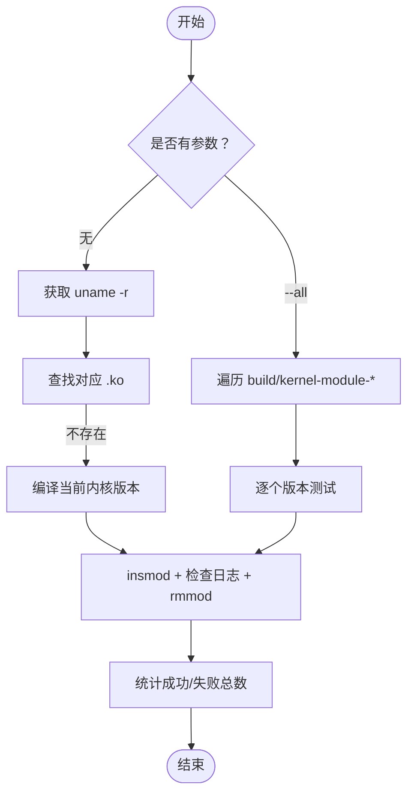

**图表来源**
- [scripts/test-kernel-compat.sh:36-111](file://scripts/test-kernel-compat.sh#L36-L111)
- [scripts/test-kernel-compat.sh:113-154](file://scripts/test-kernel-compat.sh#L113-L154)
- [scripts/test-kernel-compat.sh:156-184](file://scripts/test-kernel-compat.sh#L156-L184)

**章节来源**
- [scripts/test-kernel-compat.sh:1-184](file://scripts/test-kernel-compat.sh#L1-L184)

## 依赖关系分析
CI 工作流将测试任务拆分为多个 job，关键依赖如下：
- `lint`：代码风格、shellcheck、go vet、YAML lint、契约一致性、守护进程单元测试与覆盖率。
- `frontend`：Node.js 安装、npm ci、类型检查、Vite 构建、产物与 PWA 清单校验。
- `build`：安装内核头文件、ccache、Go 缓存、编译守护进程与内核模块、上传产物。
- `e2e`：下载构建产物、安装 Playwright、针对本机内核重编 `.ko`、探测模块可加载性、启动守护进程、运行 Playwright、上传报告。
- `test`：下载构建产物、安装 sqlite3、pytest、PyYAML、针对本机内核重编 `.ko`、验证内核兼容性、运行 pytest 并生成报告。

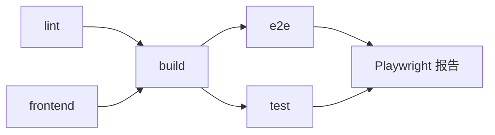

**图表来源**
- [.github/workflows/ci.yml:10-106](file://.github/workflows/ci.yml#L10-L106)
- [.github/workflows/ci.yml:107-169](file://.github/workflows/ci.yml#L107-L169)
- [.github/workflows/ci.yml:170-342](file://.github/workflows/ci.yml#L170-L342)
- [.github/workflows/ci.yml:343-457](file://.github/workflows/ci.yml#L343-L457)
- [.github/workflows/ci.yml:459-563](file://.github/workflows/ci.yml#L459-L563)

**章节来源**
- [.github/workflows/ci.yml:1-564](file://.github/workflows/ci.yml#L1-L564)

## 性能与基准测试
- 集成层性能测试：`tests/test_08_stress_perf.py` 通过 procfs 批量封禁/解封测量耗时，并使用 `BAN_PERF_THRESHOLD_MS`、`UNBAN_PERF_THRESHOLD_MS`、`STRESS_THRESHOLD_MS` 进行阈值断言。
- 底层压测工具：`scripts/bench/Makefile` 构建 `blast2` 与 `sink`，仅依赖 libc 与 pthread，便于在不引入第三方库的情况下产生网络流量。
- CI 中的 Go 覆盖率：`ci.yml` 在 `lint` 任务中执行 `go test -coverprofile=coverage.out -covermode=atomic ./...`，并上传 `coverage.out` 作为 artifact。

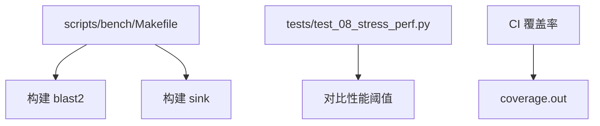

**图表来源**
- [scripts/bench/Makefile:1-27](file://scripts/bench/Makefile#L1-L27)
- [tests/test_08_stress_perf.py:17-93](file://tests/test_08_stress_perf.py#L17-L93)
- [.github/workflows/ci.yml:77-91](file://.github/workflows/ci.yml#L77-L91)

**章节来源**
- [scripts/bench/Makefile:1-27](file://scripts/bench/Makefile#L1-L27)
- [tests/test_08_stress_perf.py:1-93](file://tests/test_08_stress_perf.py#L1-L93)
- [.github/workflows/ci.yml:77-91](file://.github/workflows/ci.yml#L77-L91)

## 环境搭建与调试
- 前置条件：root 权限、构建产物 `build/kernel-module/firewall.ko` 与 `build/daemon/firewall-daemon`、Python 依赖 `pytest` 与 `yaml`。
- 基本运行：`sudo python3 -m pytest tests/ -v` 或通过 `make test`。
- 按标记运行：`-m slow`、`-m requires_daemon`、`-m requires_module`、`-m stress`。
- 端到端运行：`sudo bash scripts/e2e-daemon.sh start`、`eval "$(bash scripts/e2e-daemon.sh env)"`、`npx playwright test`、`sudo bash scripts/e2e-daemon.sh stop`。
- 调试技巧：
  - 使用 `--collect-only` 查看用例数量而不执行。
  - 使用 `--tb=short` 缩短回溯。
  - 使用 `E2E_KEEP=1` 保留 e2e 临时目录与 `daemon.log`。
  - 使用 `scripts/test-kernel-compat.sh --all` 检查所有已编译内核版本的加载情况。
  - 在 CI 中，内核不可加载时会降级运行守护进程相关测试，避免环境限制导致整仓失败。

**章节来源**
- [tests/README.md:44-84](file://tests/README.md#L44-L84)
- [docs/zh/development/testing.md:34-48](file://docs/zh/development/testing.md#L34-L48)
- [docs/zh/development/testing.md:100-119](file://docs/zh/development/testing.md#L100-L119)
- [scripts/e2e-daemon.sh:259-266](file://scripts/e2e-daemon.sh#L259-L266)
- [scripts/test-kernel-compat.sh:113-154](file://scripts/test-kernel-compat.sh#L113-L154)
- [.github/workflows/ci.yml:520-553](file://.github/workflows/ci.yml#L520-L553)

## 覆盖率统计
- Go 单元测试覆盖率：CI 在 `lint` 任务中生成 `coverage.out` 并上传 artifact。
- Python 覆盖率：`pyproject.toml` 定义了 coverage 的 source 与排除项，但文档明确指出集成测试主要验证内核与守护进程行为，覆盖率对 Python 测试意义不大，通常不带 `--cov` 运行 pytest。

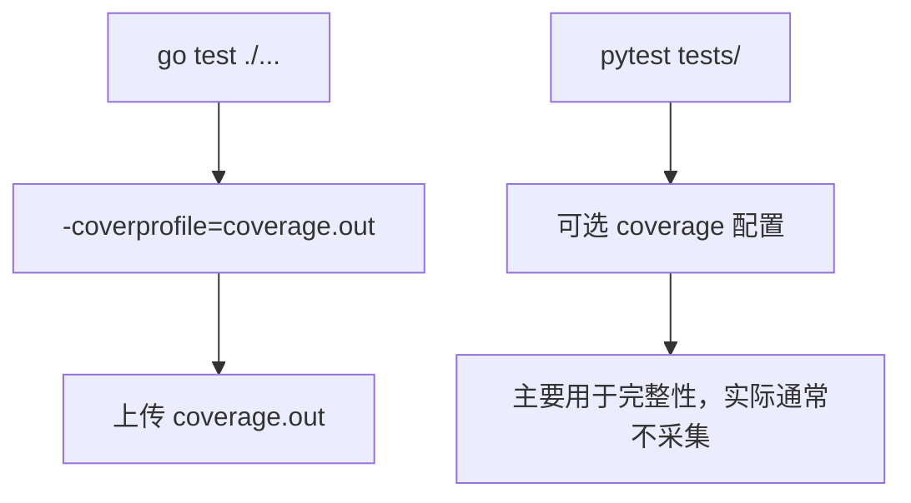

**图表来源**
- [.github/workflows/ci.yml:77-91](file://.github/workflows/ci.yml#L77-L91)
- [pyproject.toml:28-49](file://pyproject.toml#L28-L49)

**章节来源**
- [.github/workflows/ci.yml:77-91](file://.github/workflows/ci.yml#L77-L91)
- [pyproject.toml:28-49](file://pyproject.toml#L28-L49)

## 故障排查
- “模块未加载”：确认以 root 运行，并确保 `build/kernel-module/firewall.ko` 存在；测试会尝试自动加载。
- “守护进程不存在”：先构建守护进程二进制，或使用 `make daemon`。
- 性能测试不稳定：阈值硬编码在 `tests/config.py`，不同机器差异较大，可调整 `BAN_PERF_THRESHOLD_MS`、`UNBAN_PERF_THRESHOLD_MS`、`STRESS_THRESHOLD_MS`。
- CI 绿不代表内核模块套件跑过：Azure VM 自定义内核可能无法加载模块，此时集成测试会降级运行守护进程子集；要验证内核侧必须在能 `insmod` 的机器上运行 `make test`。
- 编译通过不等于加载成功：`make kernel-module` 只检查符号与头文件，`insmod` 还会检查 vermagic、per-CPU 申请上限、init 路径返回值等。

**章节来源**
- [tests/README.md:153-175](file://tests/README.md#L153-L175)
- [docs/zh/development/testing.md:159-189](file://docs/zh/development/testing.md#L159-L189)

## 结论
该项目的测试自动化围绕三层测试展开：Go 单元测试保障守护进程内部逻辑正确性，pytest 集成测试验证内核模块与守护进程的接口契约，Playwright 端到端测试覆盖浏览器界面与真实服务的完整链路。CI 通过并行任务与降级策略兼顾速度与稳定性，夹具脚本与内核兼容性检查确保环境差异不会掩盖真实问题。团队在扩展测试套件时，应遵循现有编号规则、标记约定与 fixture 使用方式，优先维护行为规格而非迁就实现变更，并通过性能阈值与内核兼容性脚本持续评估系统健康度。