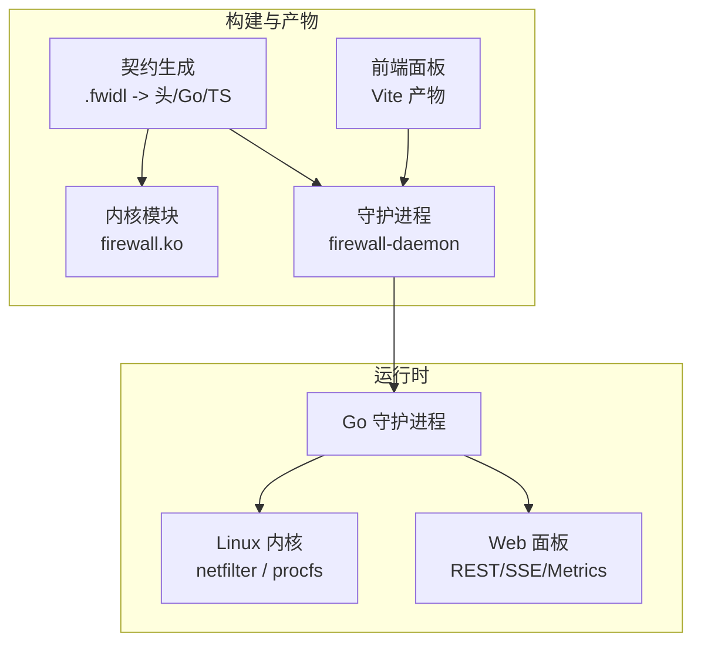
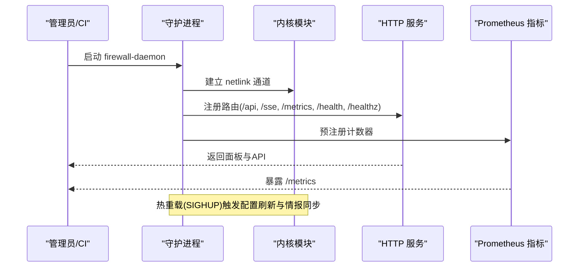
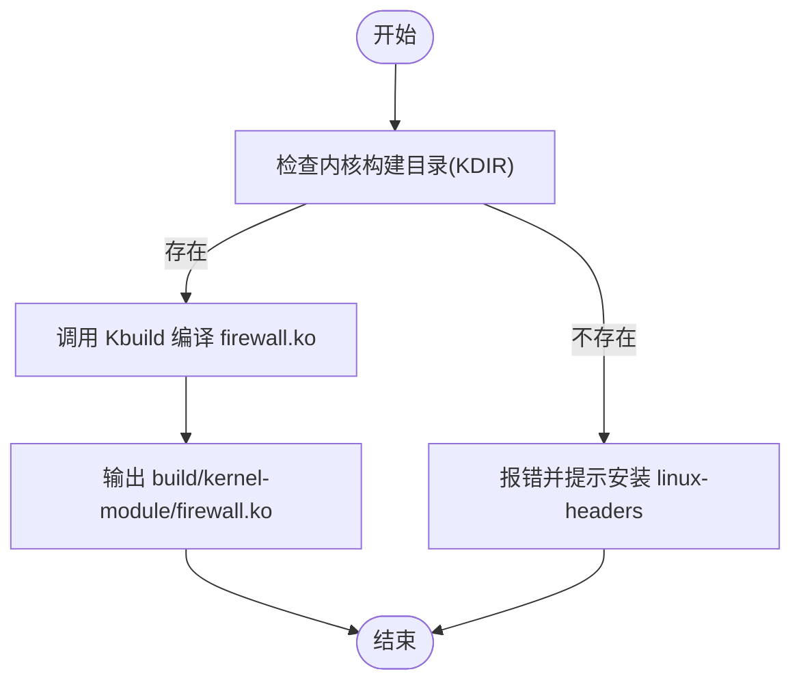
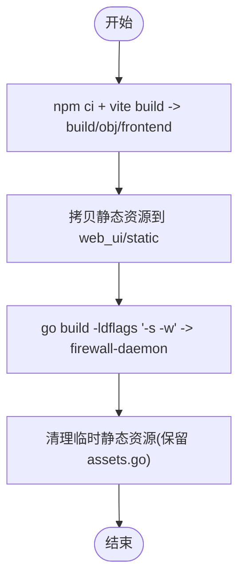
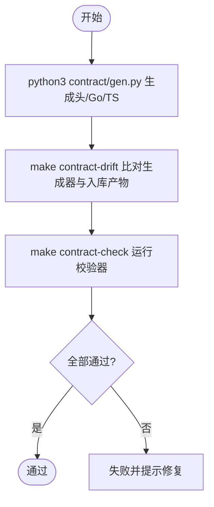
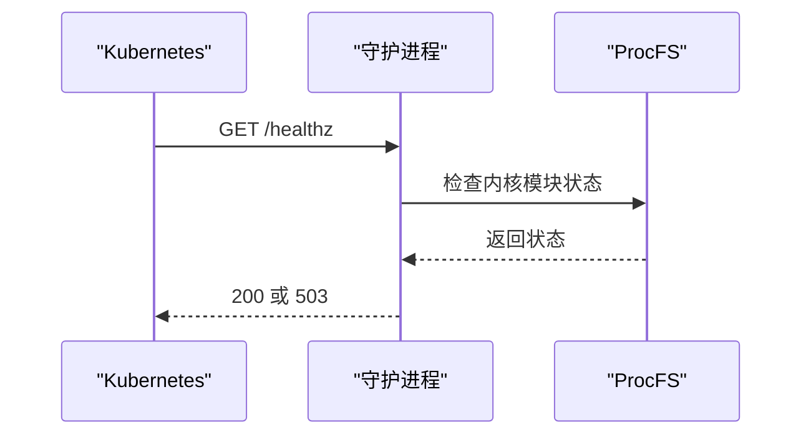
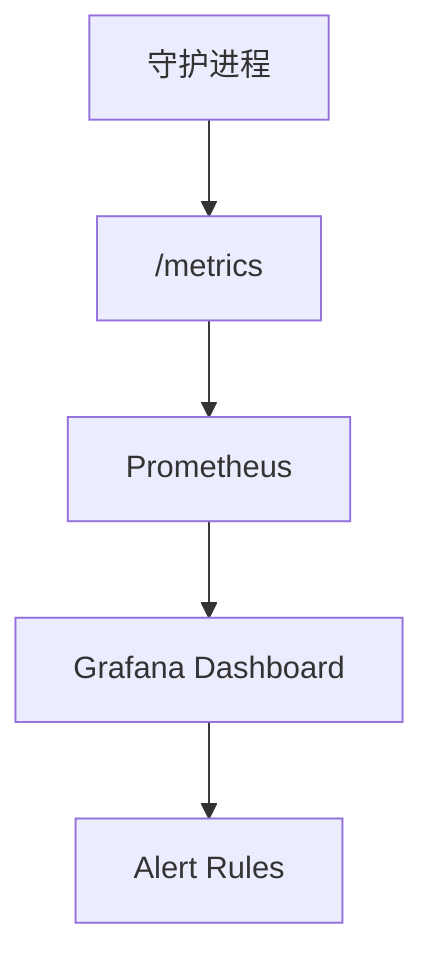
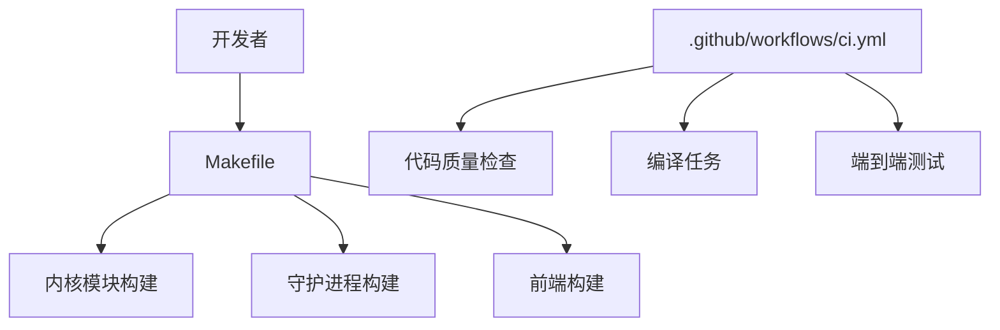

# 容器化部署

<cite>
**本文引用的文件**   
- [README.md](file://README.md)
- [Makefile](file://Makefile)
- [src/kernel-module/Makefile](file://src/kernel-module/Makefile)
- [config/docker.yaml](file://config/docker.yaml)
- [.github/workflows/ci.yml](file://.github/workflows/ci.yml)
- [src/daemon/cmd/firewall-daemon/main.go](file://src/daemon/cmd/firewall-daemon/main.go)
- [src/daemon/internal/http/routes.go](file://src/daemon/internal/http/routes.go)
- [src/daemon/internal/http/health.go](file://src/daemon/internal/http/health.go)
- [grafana/alert-rules.yaml](file://grafana/alert-rules.yaml)
</cite>

## 目录
1. [引言](#引言)
2. [项目结构](#项目结构)
3. [核心组件](#核心组件)
4. [架构总览](#架构总览)
5. [详细组件分析](#详细组件分析)
6. [依赖关系分析](#依赖关系分析)
7. [性能与资源优化](#性能与资源优化)
8. [故障排查指南](#故障排查指南)
9. [结论](#结论)
10. [附录：镜像构建与编排清单](#附录镜像构建与编排清单)

## 引言
本指南面向在容器环境中稳定运行和扩展该防火墙系统的运维与平台工程师。文档围绕以下目标展开：
- 说明如何为内核模块、守护进程、前端面板分别构建容器镜像，并给出多阶段构建与分层策略建议。
- 解释守护进程的启动流程、健康检查、指标暴露与配置加载机制。
- 提供 Kubernetes 部署与 Helm Chart 设计思路、服务编排要点。
- 给出容器安全加固、资源限制、监控集成的最佳实践。
- 结合仓库现有构建系统与 CI 流程，确保可复现、可审计的镜像产出。

本项目采用三层架构：内核模块负责高速封禁，守护进程负责日志采集、风险判定、HTTP API 与面板服务，前端面板提供可视化界面。守护进程通过 netlink 与内核模块通信，并通过 HTTP 暴露 REST API、SSE 事件流与 Prometheus 指标。

**章节来源**
- [README.md:10-31](file://README.md#L10-L31)
- [README.md:76-131](file://README.md#L76-L131)

## 项目结构
从容器化视角，仓库的关键产物与职责如下：
- 内核模块：C 源码 + Kbuild Makefile，编译输出 firewall.ko。
- 守护进程：Go 源码，编译输出 firewall-daemon；前端静态资源通过 go:embed 嵌入二进制。
- 前端面板：React + TypeScript + Vite，构建产物由守护进程在构建期临时拷贝进 embed 目录。
- 契约系统：Python 生成头文件与 Go/TS 代码，保证 netlink、procfs、HTTP 接口一致性。
- 配置文件：YAML 配置（含 Docker 防护示例），systemd 单元与安装脚本。
- CI 流水线：代码质量、前端构建、守护进程与内核模块编译、端到端测试与报告。

**图示来源**
- [Makefile:232-289](file://Makefile#L232-L289)
- [src/kernel-module/Makefile:1-29](file://src/kernel-module/Makefile#L1-L29)
- [README.md:10-31](file://README.md#L10-L31)

**章节来源**
- [Makefile:232-319](file://Makefile#L232-L319)
- [src/kernel-module/Makefile:1-29](file://src/kernel-module/Makefile#L1-L29)
- [README.md:194-217](file://README.md#L194-L217)

## 核心组件
- 内核模块
  - 使用 Kbuild 构建，按数据所有权切分多个 .c 源文件，最终链接为单一模块对象。
  - 引入契约生成的头文件，保证线格式与文本协议一致。
- 守护进程
  - Go 实现，内嵌前端静态资源，提供 HTTP API、SSE、Prometheus 指标。
  - 通过 netlink 与内核模块通信，读取 procfs 状态。
  - 支持 SIGHUP 热重载配置，具备认证与速率限制能力。
- 前端面板
  - React + TypeScript + Vite，构建产物被守护进程在构建期临时拷贝进 embed 目录，最终随二进制分发。
- 契约系统
  - Python 生成器维护 .fwidl 为唯一真相源，校验生成物与内核/守护进程/前端的漂移。

**章节来源**
- [src/kernel-module/Makefile:1-29](file://src/kernel-module/Makefile#L1-L29)
- [Makefile:274-319](file://Makefile#L274-L319)
- [README.md:76-131](file://README.md#L76-L131)

## 架构总览
守护进程启动后，完成以下关键步骤：
- 初始化日志、配置加载、内核通信通道（netlink）。
- 注册 HTTP 路由，包括 REST API、SSE、/metrics、/health 与 /healthz。
- 启动统计收集与持久化（SQLite），威胁情报拉取调度。
- 暴露指标给 Prometheus，供 Grafana 展示与告警。

**图示来源**
- [src/daemon/cmd/firewall-daemon/main.go:130-140](file://src/daemon/cmd/firewall-daemon/main.go#L130-L140)
- [src/daemon/cmd/firewall-daemon/main.go:191-191](file://src/daemon/cmd/firewall-daemon/main.go#L191-L191)
- [src/daemon/cmd/firewall-daemon/main.go:308-320](file://src/daemon/cmd/firewall-daemon/main.go#L308-L320)
- [src/daemon/internal/http/routes.go:82-82](file://src/daemon/internal/http/routes.go#L82-L82)
- [src/daemon/internal/http/health.go:5-5](file://src/daemon/internal/http/health.go#L5-L5)

**章节来源**
- [src/daemon/cmd/firewall-daemon/main.go:130-140](file://src/daemon/cmd/firewall-daemon/main.go#L130-L140)
- [src/daemon/internal/http/routes.go:82-82](file://src/daemon/internal/http/routes.go#L82-L82)
- [src/daemon/internal/http/health.go:5-5](file://src/daemon/internal/http/health.go#L5-L5)

## 详细组件分析

### 内核模块构建与容器集成
- 构建方式
  - 通过顶层 Makefile 调用 Kbuild，将 C 源文件编译为 firewall.ko。
  - 支持 ccache 加速重复构建，支持远程编译与多版本内核模块构建。
- 容器集成要点
  - 内核模块无法直接“容器化”，需在宿主机或特权容器中加载。
  - 推荐以 sidecar 或 hostNetwork/hostPID 模式运行守护进程，使其能访问内核接口。
  - 若必须隔离，可使用特权容器 + 挂载宿主 /lib/modules 与 /proc，但需严格权限控制。

**图示来源**
- [Makefile:237-272](file://Makefile#L237-L272)

**章节来源**
- [Makefile:237-272](file://Makefile#L237-L272)
- [src/kernel-module/Makefile:1-29](file://src/kernel-module/Makefile#L1-L29)

### 守护进程构建与前端嵌入
- 构建方式
  - 先构建前端（Vite）到 build/obj/frontend，再临时拷贝至 src/daemon/web_ui/static 供 go:embed 使用。
  - 使用 go build 编译守护进程二进制，剥离符号减小体积。
- 容器集成要点
  - 守护进程是纯 Go 静态二进制，无 CGO 依赖，适合小镜像。
  - 前端静态资源已嵌入二进制，无需额外卷挂载。
  - 可通过环境变量注入凭据（FIREWALL_METRICS_USERNAME/PASSWORD），避免硬编码。

**图示来源**
- [Makefile:274-319](file://Makefile#L274-L319)

**章节来源**
- [Makefile:274-319](file://Makefile#L274-L319)

### 契约系统与接口一致性
- 契约定义
  - .fwidl 描述 netlink、procfs、HTTP 接口，Python 生成器产出头文件与 Go/TS 代码。
- 校验机制
  - contract-drift 比较生成器输出与已入库生成物。
  - contract-check 运行 verify_layout、verify_procfs、verify_http 校验器。
- 容器集成要点
  - 建议在镜像构建阶段执行 make contract 与 make contract-check，确保契约不漂移。
  - 在 CI 中强制契约门禁，防止三端不一致导致运行时错误。

**图示来源**
- [Makefile:161-178](file://Makefile#L161-L178)
- [Makefile:592-621](file://Makefile#L592-L621)

**章节来源**
- [Makefile:161-178](file://Makefile#L161-L178)
- [Makefile:592-621](file://Makefile#L592-L621)

### 健康检查与就绪探针
- /health 与 /healthz
  - 两条路由指向同一处理器，/healthz 作为 /health 别名，供 k8s/负载均衡探针使用。
  - /health 的状态码承载就绪语义：200 表示就绪，503 表示未就绪。
- 容器集成要点
  - Kubernetes livenessProbe 与 readinessProbe 应基于 /healthz 或 /health 的状态码判断。
  - 注意守护进程启动期需要内核租约，初期可能返回 503，需合理设置初始延迟与重试间隔。

**图示来源**
- [src/daemon/internal/http/routes.go:82-82](file://src/daemon/internal/http/routes.go#L82-L82)
- [src/daemon/internal/http/health.go:5-5](file://src/daemon/internal/http/health.go#L5-L5)

**章节来源**
- [src/daemon/internal/http/routes.go:82-82](file://src/daemon/internal/http/routes.go#L82-L82)
- [src/daemon/internal/http/health.go:5-5](file://src/daemon/internal/http/health.go#L5-L5)

### 指标暴露与监控集成
- Prometheus 指标
  - /metrics 端点暴露计数与统计，支持认证与速率限制。
  - 守护进程启动时预注册计数器，确保指标从启动起有稳定样本。
- Grafana 集成
  - 提供 alert-rules.yaml 与 dashboard JSON，便于快速搭建监控看板。
- 容器集成要点
  - 将 /metrics 暴露给 Prometheus scrape，配置 ServiceMonitor 或 PodMonitor。
  - 在 Grafana 中导入 dashboard，配置告警规则。

**图示来源**
- [src/daemon/cmd/firewall-daemon/main.go:130-140](file://src/daemon/cmd/firewall-daemon/main.go#L130-L140)
- [grafana/alert-rules.yaml:1-1](file://grafana/alert-rules.yaml#L1-L1)

**章节来源**
- [src/daemon/cmd/firewall-daemon/main.go:130-140](file://src/daemon/cmd/firewall-daemon/main.go#L130-L140)
- [grafana/alert-rules.yaml:1-1](file://grafana/alert-rules.yaml#L1-L1)

## 依赖关系分析
- 构建依赖
  - 内核模块：gcc、make、内核头文件、可选 clang-format。
  - 守护进程：Go 1.23+，无 CGO 依赖。
  - 前端：Node.js 22+，npm。
- CI 依赖
  - GitHub Actions 中缓存 Go 模块、ccache、pip 包。
  - 前端类型检查与构建产物校验。
  - 契约漂移与校验器。

**图示来源**
- [Makefile:71-155](file://Makefile#L71-L155)
- [.github/workflows/ci.yml:10-106](file://.github/workflows/ci.yml#L10-L106)
- [.github/workflows/ci.yml:170-341](file://.github/workflows/ci.yml#L170-L341)

**章节来源**
- [Makefile:71-155](file://Makefile#L71-L155)
- [.github/workflows/ci.yml:10-106](file://.github/workflows/ci.yml#L10-L106)
- [.github/workflows/ci.yml:170-341](file://.github/workflows/ci.yml#L170-L341)

## 性能与资源优化
- 镜像分层策略
  - 基础镜像选择精简发行版（如 distroless 或 alpine），减少攻击面。
  - 多阶段构建：前端构建阶段与守护进程构建阶段分离，仅将必要产物复制到运行镜像。
  - 内核模块不在镜像中运行，仅在宿主机或特权容器加载。
- 资源限制
  - 在 Kubernetes 中为 Pod 设置 requests/limits，限制 CPU 与内存。
  - 对守护进程启用只读根文件系统，仅挂载必要的配置与日志目录。
- 监控与可观测性
  - 启用 /metrics，配置 Prometheus scrape 间隔与超时。
  - 使用 Grafana 仪表盘与告警规则，监控封禁数、DDoS 检测、威胁情报更新等关键指标。

[本节为通用指导，不直接分析具体文件]

## 故障排查指南
- 内核模块加载失败
  - 检查内核头文件是否匹配运行内核，必要时重新编译模块。
  - 查看 dmesg 与 journalctl 日志，确认 vermagic 与 ABI 兼容。
- 守护进程启动失败
  - 检查 /proc/firewall 是否存在，确认内核模块已加载。
  - 检查凭据环境变量与 YAML 配置，确保 metrics_username/password 正确。
- 健康检查失败
  - 确认 /health 与 /healthz 返回状态码符合预期。
  - 检查内核租约是否获取成功，初期可能返回 503。
- 指标不可用
  - 检查 /metrics 端点是否暴露，认证是否配置正确。
  - 确认 Prometheus 抓取配置与网络可达性。

**章节来源**
- [Makefile:237-272](file://Makefile#L237-L272)
- [src/daemon/cmd/firewall-daemon/main.go:113-132](file://src/daemon/cmd/firewall-daemon/main.go#L113-L132)
- [src/daemon/internal/http/health.go:5-5](file://src/daemon/internal/http/health.go#L5-L5)

## 结论
通过本指南，您可以在容器环境中稳定运行和扩展该防火墙系统。核心要点包括：
- 使用 Makefile 与 CI 流程确保构建可复现、契约不漂移。
- 守护进程作为主应用容器，前端静态资源嵌入二进制，简化部署。
- 内核模块在宿主机或特权容器中加载，通过 netlink 与守护进程通信。
- 通过 /healthz 与 /metrics 实现健康检查与监控集成。
- 遵循容器安全加固与资源限制最佳实践，确保系统在生产环境稳定运行。

[本节为总结性内容，不直接分析具体文件]

## 附录：镜像构建与编排清单
- 镜像构建建议
  - 前端构建阶段：Node.js 镜像，执行 npm ci 与 vite build。
  - 守护进程构建阶段：Go 镜像，执行 go build，嵌入前端静态资源。
  - 运行镜像：精简发行版，仅包含 firewall-daemon 二进制。
- Kubernetes 部署建议
  - Deployment：运行守护进程，设置资源限制与探针。
  - Service：暴露 /metrics 与 /dashboard（如需外部访问）。
  - ConfigMap/Secret：管理配置与凭据。
  - PodSecurityPolicy/SecurityContext：限制特权与文件系统权限。
- Helm Chart 设计建议
  - values.yaml：配置副本数、资源限制、探针参数、监控开关。
  - templates/deployment.yaml：渲染 Deployment、Service、ConfigMap、Secret。
  - templates/hpa.yaml：根据指标自动扩缩容。
  - templates/prometheus-service-monitor.yaml：暴露 /metrics 给 Prometheus。

[本节为概念性内容，不直接分析具体文件]