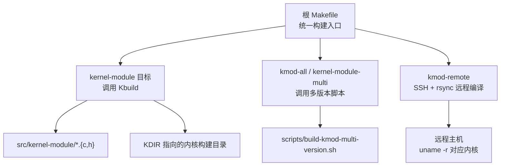
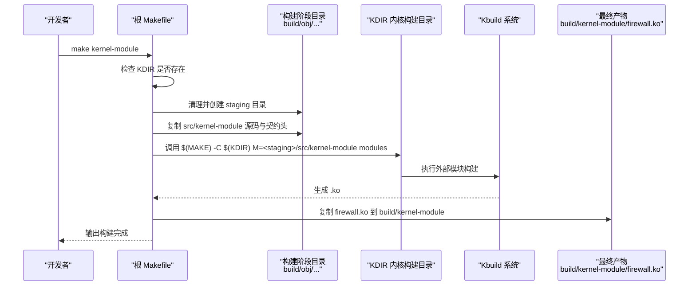
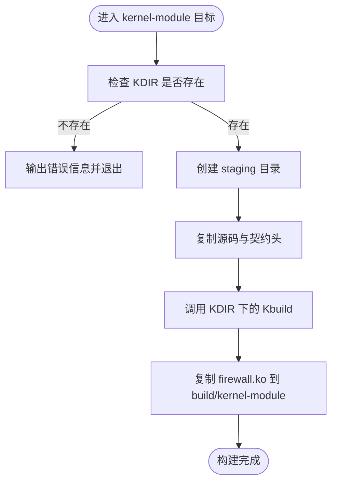
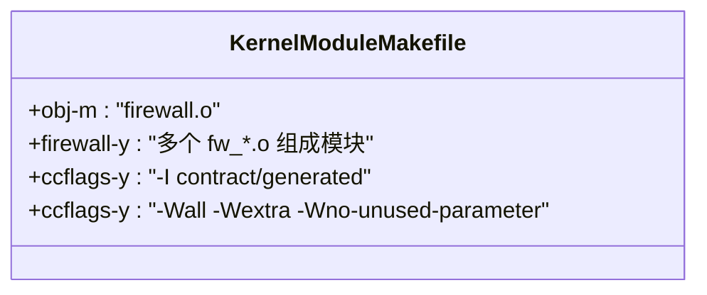
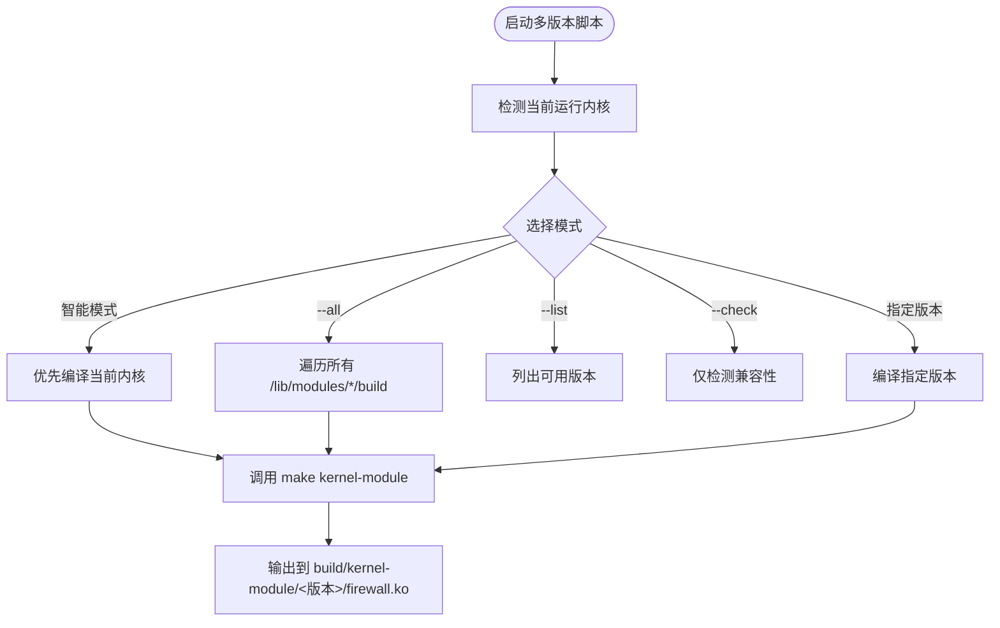
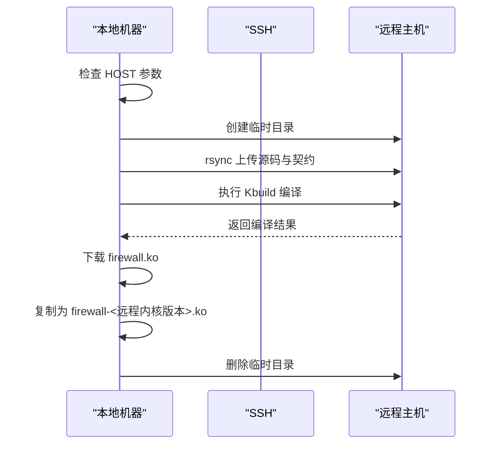
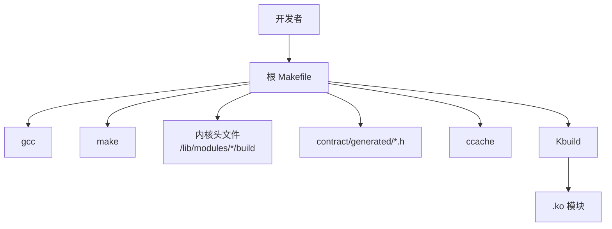

# 内核模块编译

<cite>
**本文引用的文件**   
- [Makefile](file://Makefile)
- [src/kernel-module/Makefile](file://src/kernel-module/Makefile)
- [scripts/build-kmod-multi-version.sh](file://scripts/build-kmod-multi-version.sh)
- [docs/zh/development/multi-version-kmod.md](file://docs/zh/development/multi-version-kmod.md)
- [docs/zh/development/building.md](file://docs/zh/development/building.md)
</cite>

## 目录
1. [简介](#简介)
2. [项目结构与构建入口](#项目结构与构建入口)
3. [核心编译目标与参数](#核心编译目标与参数)
4. [架构总览：从 make 到 kbuild](#架构总览从-make-到-kbuild)
5. [详细组件分析](#详细组件分析)
6. [依赖关系分析](#依赖关系分析)
7. [性能与缓存](#性能与缓存)
8. [常见问题与排错](#常见问题与排错)
9. [结论](#结论)

## 简介
本文面向需要编译本项目 C 语言内核模块的开发者与运维人员，重点说明以下内容：
- 如何使用 `make kernel-module` 编译当前运行内核对应的模块。
- `KDIR`、`KVER` 参数的作用以及内核版本匹配机制。
- 多版本内核模块编译 `make kmod-all` 的使用方法。
- 远程编译 `make kmod-remote` 的配置步骤。
- 编译输出位置、模块加载方式与调试技巧。
- 常见编译失败原因及解决方案，包括内核头文件缺失、编译器不兼容等。

本项目的内核模块位于 `src/kernel-module`，由根 `Makefile` 统一调度，底层通过 Linux Kbuild 系统完成 `.ko` 构建。

## 项目结构与构建入口
仓库采用“源码树零中间产物”的设计：所有构建产物都落在 `build/` 下，`src/` 只保留源码。内核模块相关的关键路径如下：
- 源码目录：`src/kernel-module`
- 根构建脚本：`Makefile`
- 模块级 Kbuild 描述：`src/kernel-module/Makefile`
- 多版本构建脚本：`scripts/build-kmod-multi-version.sh`
- 多版本文档：`docs/zh/development/multi-version-kmod.md`
- 通用构建文档：`docs/zh/development/building.md`



**图表来源**
- [Makefile:18-65](file://Makefile#L18-L65)
- [Makefile:196-272](file://Makefile#L196-L272)
- [Makefile:203-230](file://Makefile#L203-L230)
- [scripts/build-kmod-multi-version.sh:1-16](file://scripts/build-kmod-multi-version.sh#L1-L16)

**章节来源**
- [Makefile:18-65](file://Makefile#L18-L65)
- [docs/zh/development/building.md:57-68](file://docs/zh/development/building.md#L57-L68)

## 核心编译目标与参数
### 基本编译：`make kernel-module`
该目标用于为当前运行内核编译模块。默认行为：
- 使用当前运行内核版本作为 `KVER`。
- 使用 `/lib/modules/$(uname -r)/build` 作为 `KDIR`。
- 生成最终产物 `build/kernel-module/firewall.ko`。
- 中间产物写入 `build/obj/kernel-module/<kernel.release>/tree/`，源码树保持干净。

常用等价命令：
- `make kernel-module`
- `make kmod`
- `make build`（同时还会构建守护进程）

### 指定内核版本：`KVER`
`KVER` 表示“要使用的内核版本字符串”，常用于：
- 多版本构建时，让脚本把某个版本的产物放入独立目录。
- 手动指定非当前运行内核的版本进行编译。

示例：
```bash
make kmod KVER=6.8.0-147-generic
```

注意：仅设置 `KVER` 不一定能编译成功；如果对应内核头文件不存在，仍需配合 `KDIR` 或安装对应 `linux-headers-*`。

### 指定内核构建目录：`KDIR`
`KDIR` 是 Kbuild 真正使用的内核构建目录，通常指向已安装的内核头文件目录：
```text
/lib/modules/<内核版本>/build
```

典型用法：
```bash
make kernel-module KDIR=/lib/modules/6.8.0-147-generic/build
```

当 `KDIR` 不存在时，根 `Makefile` 会打印错误信息，并给出三种处理方式：
1. 安装当前运行内核的头文件。
2. 指定其他可用版本的内核构建目录。
3. 如果只需要守护进程，可跳过内核模块构建。

**章节来源**
- [Makefile:23-25](file://Makefile#L23-L25)
- [Makefile:91-112](file://Makefile#L91-L112)
- [Makefile:237-272](file://Makefile#L237-L272)
- [docs/zh/development/building.md:57-96](file://docs/zh/development/building.md#L57-L96)

## 架构总览：从 make 到 kbuild
内核模块编译的整体流程如下：



**图表来源**
- [Makefile:237-272](file://Makefile#L237-L272)
- [docs/zh/development/building.md:63-68](file://docs/zh/development/building.md#L63-L68)

关键点：
- 根 `Makefile` 不会直接在 `src/kernel-module` 中产生 `.o`、`.cmd`、`Module.symvers` 等中间文件。
- 源码被复制到 `build/obj/kernel-module/<kernel.release>/tree/src/kernel-module`，再交给 Kbuild。
- 最终 `.ko` 被复制到 `build/kernel-module/firewall.ko`。

## 详细组件分析

### 根 Makefile 中的内核模块目标
根 `Makefile` 负责：
- 定义 `KVER`、`KDIR`、`KERNEL_MODDIR`、`BUILD_DIR`、`KERNEL_BUILD_DIR` 等关键变量。
- 提供 `check-deps-kmod` 检查 gcc、make、内核头文件。
- 提供 `kernel-module`、`kmod`、`kmod-all`、`kmod-remote` 等目标。
- 在构建前校验 `KDIR`，并在缺失时给出明确修复建议。



**图表来源**
- [Makefile:237-272](file://Makefile#L237-L272)

**章节来源**
- [Makefile:76-112](file://Makefile#L76-L112)
- [Makefile:196-272](file://Makefile#L196-L272)

### 模块级 Kbuild 描述：`src/kernel-module/Makefile`
该文件是 Kbuild 的入口，主要职责：
- 声明模块名 `obj-m := firewall.o`。
- 将多个 `fw_*.c` 组合进一个模块对象。
- 引入契约生成头文件目录。
- 启用较严格的 C 警告选项。



**图表来源**
- [src/kernel-module/Makefile:6-29](file://src/kernel-module/Makefile#L6-L29)

**章节来源**
- [src/kernel-module/Makefile:1-29](file://src/kernel-module/Makefile#L1-L29)
- [docs/zh/development/building.md:70-87](file://docs/zh/development/building.md#L70-L87)

### 多版本内核模块编译：`make kmod-all`
`make kmod-all` 实际调用 `scripts/build-kmod-multi-version.sh`，该脚本支持多种模式：
- 无参数：智能模式，优先编译当前运行内核。
- `--all`：编译所有已安装内核头文件对应的版本。
- 指定版本号：例如 `./scripts/build-kmod-multi-version.sh 6.8.0-147-generic`。
- `--list`：列出已安装内核头文件与兼容性。
- `--check`：仅检测兼容性，不编译。

脚本内部逻辑要点：
- 扫描 `/lib/modules/*/build` 判断已安装内核头文件。
- 根据主版本和次版本判断“兼容”与“仅可编译”。
- 对每个版本调用 `make kernel-module KDIR=... KVER=...`。
- 将每个版本的 `.ko` 复制到 `build/kernel-module/<版本>/firewall.ko`。



**图表来源**
- [scripts/build-kmod-multi-version.sh:41-129](file://scripts/build-kmod-multi-version.sh#L41-L129)
- [scripts/build-kmod-multi-version.sh:136-183](file://scripts/build-kmod-multi-version.sh#L136-L183)
- [scripts/build-kmod-multi-version.sh:185-256](file://scripts/build-kmod-multi-version.sh#L185-L256)
- [scripts/build-kmod-multi-version.sh:258-296](file://scripts/build-kmod-multi-version.sh#L258-L296)

**章节来源**
- [Makefile:196-201](file://Makefile#L196-L201)
- [scripts/build-kmod-multi-version.sh:1-16](file://scripts/build-kmod-multi-version.sh#L1-L16)
- [scripts/build-kmod-multi-version.sh:41-129](file://scripts/build-kmod-multi-version.sh#L41-L129)
- [scripts/build-kmod-multi-version.sh:136-183](file://scripts/build-kmod-multi-version.sh#L136-L183)
- [scripts/build-kmod-multi-version.sh:185-256](file://scripts/build-kmod-multi-version.sh#L185-L256)
- [scripts/build-kmod-multi-version.sh:258-296](file://scripts/build-kmod-multi-version.sh#L258-L296)
- [docs/zh/development/multi-version-kmod.md:12-50](file://docs/zh/development/multi-version-kmod.md#L12-L50)
- [docs/zh/development/multi-version-kmod.md:127-185](file://docs/zh/development/multi-version-kmod.md#L127-L185)

### 远程编译：`make kmod-remote`
`make kmod-remote` 用于在远程主机上编译内核模块，适合以下场景：
- 本地没有目标机器的内核头文件。
- 目标机器 CPU 架构不同，需要交叉环境。
- CI 或集中构建环境中统一编译。

必需参数：
- `HOST`：远程主机地址，例如 `192.168.8.119`。
- 可选参数：`USER`：远程登录用户，省略时使用当前用户名。

工作流程：
1. 检查是否传入 `HOST`。
2. 通过 SSH 在远程主机创建临时目录。
3. 使用 `rsync` 上传 `src/kernel-module` 与 `contract`。
4. 在远程主机执行 Kbuild：`make -C /lib/modules/$(uname -r)/build M=$PWD modules`。
5. 下载生成的 `firewall.ko`。
6. 同时保存一份带远程内核版本命名的副本。
7. 清理远程临时目录。



**图表来源**
- [Makefile:203-230](file://Makefile#L203-L230)

**章节来源**
- [Makefile:203-230](file://Makefile#L203-L230)
- [Makefile:1042-1086](file://Makefile#L1042-L1086)

### 编译输出位置
内核模块的最终产物位置：
- 标准构建：`build/kernel-module/firewall.ko`
- 多版本构建：`build/kernel-module/<内核版本>/firewall.ko`
- 远程构建：下载到本地后，同时生成 `build/kernel-module/firewall-<远程内核版本>.ko`

安装后的内核模块位置：
- `/lib/modules/$(uname -r)/extra/firewall.ko`

**章节来源**
- [Makefile:18-19](file://Makefile#L18-L19)
- [Makefile:51-65](file://Makefile#L51-L65)
- [Makefile:237-272](file://Makefile#L237-L272)
- [Makefile:702-713](file://Makefile#L702-L713)
- [docs/zh/development/building.md:316-327](file://docs/zh/development/building.md#L316-L327)

### 模块加载方法
模块加载方式包括：
- 直接加载 `.ko`：`sudo insmod build/kernel-module/firewall.ko`
- 通过模块名加载：`sudo modprobe firewall`
- 查看是否加载：`lsmod | grep firewall`
- 查看模块信息：`modinfo build/kernel-module/firewall.ko`
- 卸载模块：`sudo rmmod firewall`

安装流程中，`install-start` 会尝试先 `insmod`，再回退到 `modprobe`，并通过 `lsmod` 检查是否成功加载。

**章节来源**
- [Makefile:792-800](file://Makefile#L792-L800)
- [docs/zh/development/multi-version-kmod.md:205-237](file://docs/zh/development/multi-version-kmod.md#L205-L237)

### 调试技巧
推荐调试手段：
- 查看内核日志：`dmesg | grep firewall`
- 查看模块信息：`modinfo <模块路径>`
- 检查模块是否加载：`lsmod | grep firewall`
- 查看守护进程状态：`systemctl status firewall-daemon.service`
- 查看守护进程日志：`journalctl -u firewall-daemon.service -f`
- 多版本加载测试：优先使用与当前内核版本匹配的 `.ko`

**章节来源**
- [docs/zh/development/multi-version-kmod.md:205-237](file://docs/zh/development/multi-version-kmod.md#L205-L237)
- [Makefile:792-800](file://Makefile#L792-L800)

## 依赖关系分析
内核模块编译依赖以下几类内容：

| 类别 | 依赖项 | 说明 |
|------|--------|------|
| 工具链 | gcc、make | 内核模块 C 编译必需 |
| 内核头文件 | `/lib/modules/<版本>/build` | Kbuild 所需内核源码接口 |
| 契约生成物 | `contract/generated/*.h` | netlink 与 procfs 协议头 |
| 可选工具 | ccache、clang-format | 加速重复构建与代码格式检查 |
| 远程编译 | ssh、rsync、scp | 远程构建与产物回传 |



**图表来源**
- [Makefile:44-47](file://Makefile#L44-L47)
- [Makefile:76-112](file://Makefile#L76-L112)
- [Makefile:237-272](file://Makefile#L237-L272)

**章节来源**
- [Makefile:44-47](file://Makefile#L44-L47)
- [Makefile:76-112](file://Makefile#L76-L112)
- [Makefile:237-272](file://Makefile#L237-L272)
- [docs/zh/development/building.md:6-19](file://docs/zh/development/building.md#L6-L19)

## 性能与缓存
### 使用 ccache
根 `Makefile` 默认启用 `CCACHE ?= ccache`，内核模块编译时会通过 `CC="$(CCACHE) gcc"` 调用编译器。这可以显著减少重复编译时间。

禁用方式：
```bash
make kernel-module CCACHE=
```

### 并行编译
多版本构建脚本本身按版本串行处理，但可以在外层设置 `MAKEFLAGS` 提升单次 Kbuild 的并行度：
```bash
export MAKEFLAGS="-j$(nproc)"
./scripts/build-kmod-multi-version.sh --all
```

**章节来源**
- [Makefile:44-47](file://Makefile#L44-L47)
- [Makefile:268-270](file://Makefile#L268-L270)
- [docs/zh/development/multi-version-kmod.md:331-349](file://docs/zh/development/multi-version-kmod.md#L331-L349)

## 常见问题与排错

### 内核头文件缺失
症状：
- 报错提示内核构建目录不存在。
- 提示 `KDIR = /lib/modules/<版本>/build`。
- 提示运行内核版本与构建目录不一致。

原因：
- 未安装当前运行内核的 `linux-headers-$(uname -r)`。
- `KDIR` 指向了错误的内核版本。
- 多版本环境下，`KVER` 与 `KDIR` 不匹配。

解决：
```bash
sudo apt install linux-headers-$(uname -r)
make kernel-module KDIR=/lib/modules/$(uname -r)/build
```

**章节来源**
- [Makefile:91-112](file://Makefile#L91-L112)
- [Makefile:237-257](file://Makefile#L237-L257)
- [docs/zh/development/building.md:88-96](file://docs/zh/development/building.md#L88-L96)

### 编译器版本不兼容
症状：
- 编译时报内核配置无效。
- 报与内核构建系统不匹配的编译器错误。
- 多版本编译时部分版本失败。

原因：
- 本机 gcc 版本与编译内核时使用的 gcc 不一致。
- 不同发行版或不同内核版本使用了不同编译器。

解决：
- 安装与目标内核匹配的编译器。
- 在多版本构建前先确认各版本内核的编译环境。
- 查看完整编译日志定位具体错误。

**章节来源**
- [docs/zh/development/multi-version-kmod.md:260-269](file://docs/zh/development/multi-version-kmod.md#L260-L269)
- [docs/zh/development/building.md:329-340](file://docs/zh/development/building.md#L329-L340)

### 模块加载失败：Invalid module format
症状：
```text
insmod: ERROR: could not insert module: Invalid module format
```

原因：
- `.ko` 是为其他内核版本编译的。
- vermagic 不匹配。

解决：
```bash
./scripts/build-kmod-multi-version.sh $(uname -r)
```

**章节来源**
- [docs/zh/development/multi-version-kmod.md:271-282](file://docs/zh/development/multi-version-kmod.md#L271-L282)

### 模块加载失败：Operation not permitted
症状：
```text
insmod: ERROR: could not insert module: Operation not permitted
```

原因：
- 没有 root 权限。

解决：
```bash
sudo insmod build/kernel-module/firewall.ko
```

**章节来源**
- [docs/zh/development/multi-version-kmod.md:284-293](file://docs/zh/development/multi-version-kmod.md#L284-L293)

### API 检查失败
症状：
- 模块加载后 dmesg 显示关键 API 不可用。
- 提示 netfilter、netlink 或 procfs API 缺失。

原因：
- 内核配置禁用了相关功能。
- 内核版本过旧或发行版定制导致 API 缺失。

排查：
```bash
dmesg | grep firewall
```

解决：
- 启用 `CONFIG_NETFILTER`、`CONFIG_NETLINK`、`CONFIG_PROC_FS`。
- 升级内核到支持所需 API 的版本。

**章节来源**
- [docs/zh/development/multi-version-kmod.md:295-310](file://docs/zh/development/multi-version-kmod.md#L295-L310)

### 远程编译失败
症状：
- 未指定 `HOST` 时报错。
- SSH 连接失败。
- rsync 或 scp 失败。
- 远程主机没有目标内核头文件。

排查：
```bash
make kmod-remote HOST=192.168.8.119 USER=ubuntu
```

解决：
- 确保 SSH 免密或密码正确。
- 确保远程主机有 `/lib/modules/$(uname -r)/build`。
- 检查防火墙与网络连通性。

**章节来源**
- [Makefile:203-230](file://Makefile#L203-L230)

## 结论
本项目内核模块编译体系围绕根 `Makefile` 与 Kbuild 展开，核心要点如下：
- 使用 `make kernel-module` 编译当前运行内核模块。
- 使用 `KDIR` 指定内核构建目录，使用 `KVER` 指定内核版本。
- 使用 `make kmod-all` 或 `./scripts/build-kmod-multi-version.sh --all` 编译多版本模块。
- 使用 `make kmod-remote HOST=<ip>` 在远程主机编译并拉取产物。
- 编译产物位于 `build/kernel-module/firewall.ko`，安装后位于 `/lib/modules/$(uname -r)/extra/firewall.ko`。
- 加载模块推荐使用 `insmod` 或 `modprobe`，并通过 `dmesg`、`lsmod`、`modinfo` 进行调试。
- 最常见的问题是内核头文件缺失、编译器版本不匹配、vermagic 不匹配以及内核配置缺少必要 API。