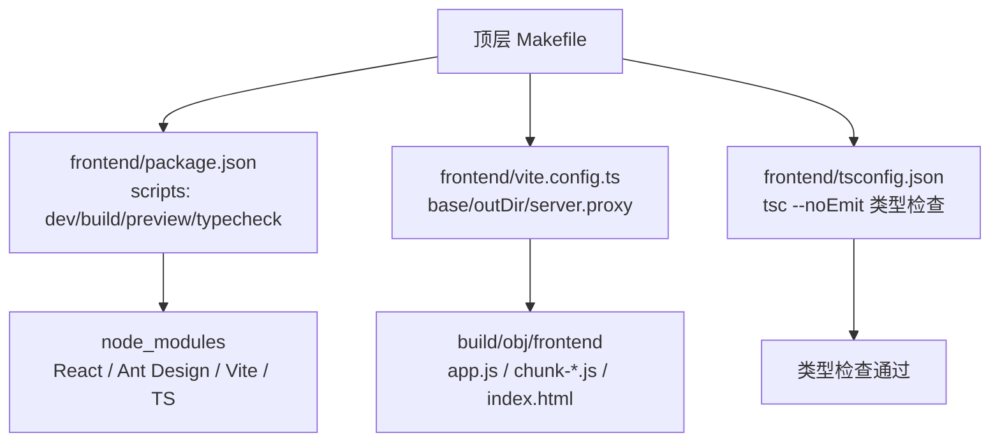
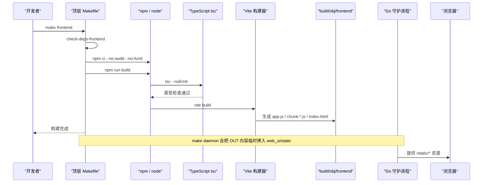
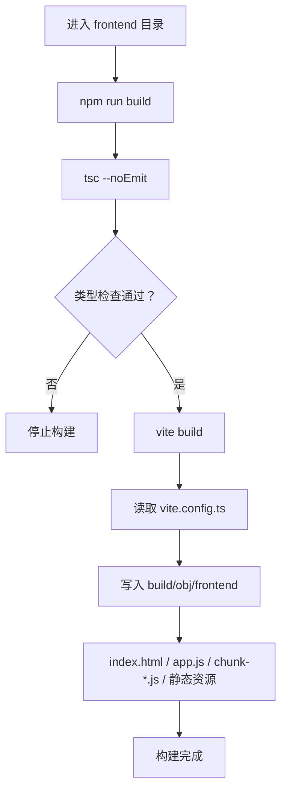
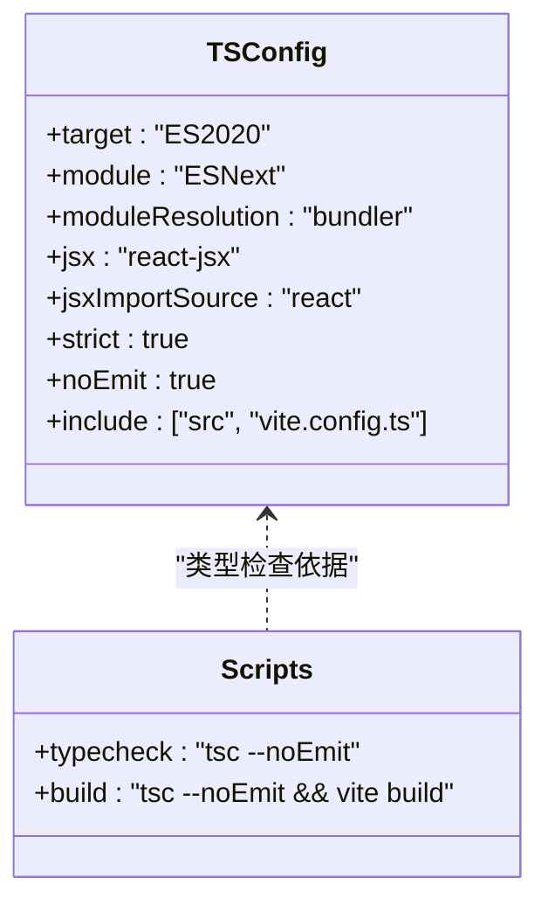
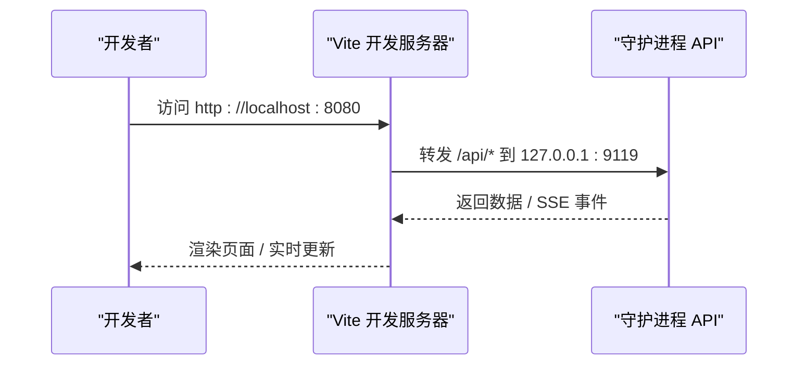
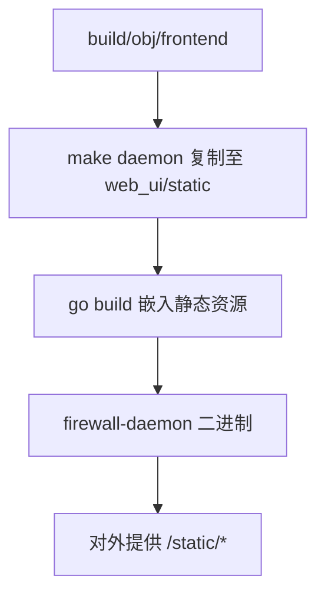
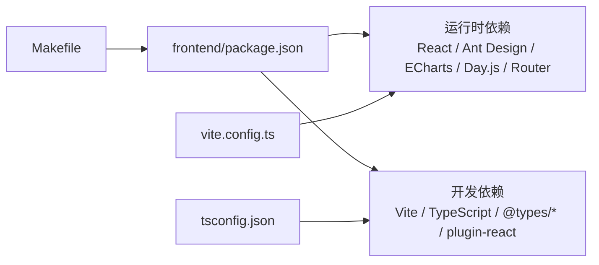

# 前端面板编译

<cite>
**本文引用的文件**   
- [Makefile](file://Makefile)
- [frontend/package.json](file://frontend/package.json)
- [frontend/vite.config.ts](file://frontend/vite.config.ts)
- [frontend/tsconfig.json](file://frontend/tsconfig.json)
</cite>

## 目录
1. [简介](#简介)
2. [项目结构](#项目结构)
3. [核心构建目标](#核心构建目标)
4. [架构总览](#架构总览)
5. [详细组件分析](#详细组件分析)
6. [依赖关系分析](#依赖关系分析)
7. [性能与产物优化](#性能与产物优化)
8. [常见问题排查](#常见问题排查)
9. [结论](#结论)

## 简介
本文面向使用 `make frontend` 编译 React + TypeScript 前端面板的开发者，说明：
- 如何通过顶层 Makefile 触发 Vite 构建。
- 前端依赖安装、类型检查、开发服务器启动与预览命令。
- Vite 构建流程、输出路径、资源命名规则与嵌入守护进程的方式。
- Node.js 版本要求、npm 依赖问题与 TypeScript 编译错误的处理建议。

该文档只基于仓库中的 Makefile、Vite 配置、TypeScript 配置和前端 package.json 进行分析，不臆造未出现的脚本或行为。

## 项目结构
前端源码位于 `frontend/`，由顶层 Makefile 统一编排构建。关键文件职责如下：
- `Makefile`：定义 `frontend`、`frontend-install`、`frontend-typecheck` 等目标，并负责 Node.js 环境检查、调用 npm 执行构建。
- `frontend/package.json`：声明脚本（dev/build/preview/typecheck）、运行时依赖与开发依赖。
- `frontend/vite.config.ts`：定义 Vite 插件、基础路径、构建输出、开发服务器代理等。
- `frontend/tsconfig.json`：定义 TypeScript 编译选项，包括 JSX 模式、模块解析、严格模式等。

**图表来源**
- [Makefile:296-319](file://Makefile#L296-L319)
- [frontend/package.json:7-13](file://frontend/package.json#L7-L13)
- [frontend/vite.config.ts:23-48](file://frontend/vite.config.ts#L23-L48)
- [frontend/tsconfig.json:1-24](file://frontend/tsconfig.json#L1-L24)

**章节来源**
- [Makefile:296-319](file://Makefile#L296-L319)
- [frontend/package.json:1-34](file://frontend/package.json#L1-L34)
- [frontend/vite.config.ts:1-63](file://frontend/vite.config.ts#L1-L63)
- [frontend/tsconfig.json:1-25](file://frontend/tsconfig.json#L1-L25)

## 核心构建目标
### make frontend
作用：
- 检查 Node.js 与 npm 是否可用，并校验 Node.js 版本不低于 18。
- 安装前端依赖。
- 根据前端源码变更触发 Vite 构建。
- 将产物写入 `build/obj/frontend`。

关键行为：
- 依赖检查目标会打印 Node.js 当前版本，若低于 18 则直接失败。
- 依赖安装使用 `npm ci --no-audit --no-fund`，保证可复现且跳过审计提示。
- 构建入口是 `cd frontend && npm run build`，而 `npm run build` 会先执行 `tsc --noEmit` 做类型检查，再执行 `vite build`。

典型输出位置：
- `build/obj/frontend/index.html`
- `build/obj/frontend/app.js`
- `build/obj/frontend/chunk-*.js`
- `build/obj/frontend` 下的静态资源（图片、字体等）

**章节来源**
- [Makefile:133-155](file://Makefile#L133-L155)
- [Makefile:296-309](file://Makefile#L296-L309)
- [frontend/package.json:7-13](file://frontend/package.json#L7-L13)

### make frontend-install
作用：
- 仅安装前端依赖，不执行构建。
- 适合 CI 中提前准备依赖，或本地快速修复依赖后重试构建。

实现要点：
- 依赖 `frontend/package-lock.json`，确保锁定依赖树。
- 使用 `npm ci`，比 `npm install` 更适合自动化场景。

**章节来源**
- [Makefile:311-315](file://Makefile#L311-L315)
- [frontend/package.json:1-34](file://frontend/package.json#L1-L34)

### make frontend-typecheck
作用：
- 安装依赖后执行 TypeScript 类型检查。
- 不产出任何构建物，只验证代码类型是否正确。

实现要点：
- 依赖 `frontend-install`。
- 实际执行 `cd frontend && npm run typecheck`，即 `tsc --noEmit`。

**章节来源**
- [Makefile:317-319](file://Makefile#L317-L319)
- [frontend/package.json:12](file://frontend/package.json#L12)
- [frontend/tsconfig.json:1-24](file://frontend/tsconfig.json#L1-L24)

## 架构总览
前端构建由 Makefile 驱动，最终产物被 Go 守护进程以 `go:embed` 方式嵌入，对外通过 `/static/*path` 提供。

**图表来源**
- [Makefile:133-155](file://Makefile#L133-L155)
- [Makefile:296-309](file://Makefile#L296-L309)
- [frontend/package.json:7-13](file://frontend/package.json#L7-L13)
- [frontend/vite.config.ts:23-48](file://frontend/vite.config.ts#L23-L48)

## 详细组件分析

### Vite 构建流程与产物结构
Vite 配置定义了以下关键行为：
- 使用 `@vitejs/plugin-react` 支持 React JSX。
- 基础路径为 `/static/`，适配守护进程对外暴露的路径。
- 构建输出目录为 `../build/obj/frontend`，即相对于 `frontend/` 的 `build/obj/frontend`。
- 清空输出目录，避免旧产物残留。
- 目标环境为 ES2020。
- 资源平铺输出，CSS 合并为单一文件。
- 入口文件名固定为 `app.js`，chunk 命名为 `chunk-[name].js`，静态资源保留原名扩展名。
- 开发服务器端口为 8080，并将 `/api` 请求代理到守护进程的 9119 端口。

**图表来源**
- [frontend/package.json:7-13](file://frontend/package.json#L7-L13)
- [frontend/vite.config.ts:23-48](file://frontend/vite.config.ts#L23-L48)

**章节来源**
- [frontend/vite.config.ts:1-63](file://frontend/vite.config.ts#L1-L63)
- [frontend/package.json:7-13](file://frontend/package.json#L7-L13)

### TypeScript 编译与类型检查
TypeScript 配置启用严格模式，并关闭 emit，表示只做类型检查而不生成 JS。
- 目标语言为 ES2020。
- 模块系统为 ESNext，模块解析策略为 bundler。
- JSX 使用 React 19 自动运行时模式。
- 包含 `src` 与 `vite.config.ts`。
- 开启多项严格检查，如未使用局部变量、未使用参数、switch 穿透等。

**图表来源**
- [frontend/tsconfig.json:1-24](file://frontend/tsconfig.json#L1-L24)
- [frontend/package.json:7-13](file://frontend/package.json#L7-L13)

**章节来源**
- [frontend/tsconfig.json:1-25](file://frontend/tsconfig.json#L1-L25)
- [frontend/package.json:7-13](file://frontend/package.json#L7-L13)

### 开发服务器与热重载
开发相关脚本：
- `npm run dev`：启动 Vite 开发服务器。
- `npm run preview`：预览生产构建产物。
- `npm run build:only`：跳过类型检查直接构建，适合调试构建阶段问题。

开发服务器配置：
- 默认监听 8080 端口。
- 将 `/api` 请求代理到 `http://127.0.0.1:9119`。
- 代理设置中关闭 WebSocket 缓冲，适配 SSE 长连接场景。

**图表来源**
- [frontend/vite.config.ts:50-61](file://frontend/vite.config.ts#L50-L61)
- [frontend/package.json:7-13](file://frontend/package.json#L7-L13)

**章节来源**
- [frontend/vite.config.ts:50-61](file://frontend/vite.config.ts#L50-L61)
- [frontend/package.json:7-13](file://frontend/package.json#L7-L13)

### 生产构建与嵌入守护进程
Makefile 中 `daemon` 目标会在 Go 构建前，把 `build/obj/frontend` 的内容复制到 `src/daemon/web_ui/static`，然后执行 `go build`。构建完成后，Makefile 会清理该目录，只保留 `assets.go`。

这意味着：
- 前端产物不是直接放在源码树中，而是作为中间产物存在。
- 守护进程二进制内嵌前端静态资源，对外提供 `/static/*`。
- Vite 的 `base` 必须为 `/static/`，否则浏览器加载资源路径错误。

**图表来源**
- [Makefile:274-289](file://Makefile#L274-L289)
- [frontend/vite.config.ts:23-48](file://frontend/vite.config.ts#L23-L48)

**章节来源**
- [Makefile:274-289](file://Makefile#L274-L289)
- [frontend/vite.config.ts:1-20](file://frontend/vite.config.ts#L1-L20)

## 依赖关系分析
前端依赖分为两类：
- 运行时依赖：React、Ant Design、ECharts、Day.js、路由库等。
- 开发依赖：Vite、TypeScript、React 类型定义、Node 类型定义、Vite React 插件。

**图表来源**
- [frontend/package.json:14-32](file://frontend/package.json#L14-L32)
- [frontend/vite.config.ts:20-24](file://frontend/vite.config.ts#L20-L24)
- [frontend/tsconfig.json:1-24](file://frontend/tsconfig.json#L1-L24)
- [Makefile:296-319](file://Makefile#L296-L319)

**章节来源**
- [frontend/package.json:14-32](file://frontend/package.json#L14-L32)
- [Makefile:296-319](file://Makefile#L296-L319)

## 性能与产物优化
从现有配置可见的优化点：
- 构建目标为 ES2020，兼顾现代浏览器与打包体积。
- CSS 合并为单一文件，减少请求数。
- 资源平铺输出，避免嵌套目录带来的相对路径复杂度。
- 入口文件名固定为 `app.js`，便于嵌入与引用稳定。
- 开发服务器代理 `/api` 到守护进程，避免跨域问题。

注意事项：
- 当前配置没有显式开启 Vite 的压缩、代码分割开关或 PWA 插件；PWA 的 service worker 由守护进程单独提供，不在 Vite 构建管线中接管导航。
- 如果后续需要进一步优化包体，可在 `vite.config.ts` 中调整 Rollup 输出策略，但需保持 `entryFileNames` 与 `assetsDir` 的约束，以免破坏 `go:embed` 的资源查找逻辑。

**章节来源**
- [frontend/vite.config.ts:23-48](file://frontend/vite.config.ts#L23-L48)

## 常见问题排查

### Node.js 版本过低
现象：
- 运行 `make frontend` 时报 Node.js 版本过低。

原因：
- Makefile 的前端依赖检查要求 Node.js 版本至少为 18。

解决：
- 升级 Node.js 到 18 或以上。
- 如果使用 nvm，切换到受支持的 LTS 版本。

**章节来源**
- [Makefile:133-155](file://Makefile#L133-L155)

### npm 依赖安装失败
现象：
- `make frontend-install` 或 `make frontend` 在安装依赖时报错。

可能原因：
- 网络问题导致 `npm ci` 拉取失败。
- `package-lock.json` 与当前环境不一致。
- 权限不足或缓存损坏。

解决：
- 确认已安装 Node.js 与 npm。
- 删除 `frontend/node_modules` 与 `frontend/package-lock.json` 后重新执行 `make frontend-install`。
- 在 CI 环境中优先使用仓库自带的 `package-lock.json`。

**章节来源**
- [Makefile:311-315](file://Makefile#L311-L315)
- [frontend/package.json:1-34](file://frontend/package.json#L1-L34)

### TypeScript 类型检查失败
现象：
- `make frontend-typecheck` 或 `make frontend` 报 TypeScript 类型错误。

原因：
- `npm run build` 会先执行 `tsc --noEmit`。
- `tsconfig.json` 启用了严格模式与多项检查。

解决：
- 先运行 `make frontend-typecheck` 定位具体类型错误。
- 修复类型定义、接口字段、React props 或第三方库类型问题。
- 如需临时跳过类型检查进行构建调试，可使用 `npm run build:only`，但不建议用于正式构建。

**章节来源**
- [frontend/package.json:7-13](file://frontend/package.json#L7-L13)
- [frontend/tsconfig.json:1-24](file://frontend/tsconfig.json#L1-L24)

### 开发服务器无法访问后端 API
现象：
- 前端能打开页面，但 `/api` 请求失败。

原因：
- 开发服务器默认将 `/api` 代理到 `http://127.0.0.1:9119`。
- 守护进程未启动或未监听 9119 端口。

解决：
- 确保守护进程已启动并监听 9119。
- 检查防火墙或安全组是否放行本地回环地址。
- 如需修改代理目标，请同步更新 `vite.config.ts` 中的代理配置。

**章节来源**
- [frontend/vite.config.ts:50-61](file://frontend/vite.config.ts#L50-L61)

### 构建产物路径错误
现象：
- 浏览器加载资源时出现 404，或嵌入守护进程后页面空白。

原因：
- Vite 的 `base` 必须为 `/static/`。
- 守护进程对外提供 `/static/*`，资源路径必须带该前缀。
- 产物输出目录为 `build/obj/frontend`，由 `make daemon` 临时拷贝进 `web_ui/static`。

解决：
- 不要修改 `base` 与 `outDir`，除非同时调整守护进程嵌入逻辑。
- 重新执行 `make frontend` 与 `make daemon`，确保产物被正确嵌入。

**章节来源**
- [frontend/vite.config.ts:1-20](file://frontend/vite.config.ts#L1-L20)
- [frontend/vite.config.ts:23-48](file://frontend/vite.config.ts#L23-L48)
- [Makefile:274-289](file://Makefile#L274-L289)

## 结论
本项目的前端构建由顶层 Makefile 统一管理，核心流程是：
- 检查 Node.js 与 npm。
- 使用 `npm ci` 安装依赖。
- 使用 `tsc --noEmit` 进行类型检查。
- 使用 Vite 构建 React + TypeScript 应用。
- 将产物写入 `build/obj/frontend`，再由 `make daemon` 嵌入守护进程。

推荐工作流：
- 首次构建：`make frontend-install` 然后 `make frontend`。
- 开发调试：`cd frontend && npm run dev`，并确保守护进程运行在 9119。
- 类型检查：`make frontend-typecheck`。
- 生产构建：`make frontend`，随后 `make daemon` 生成可部署的二进制。