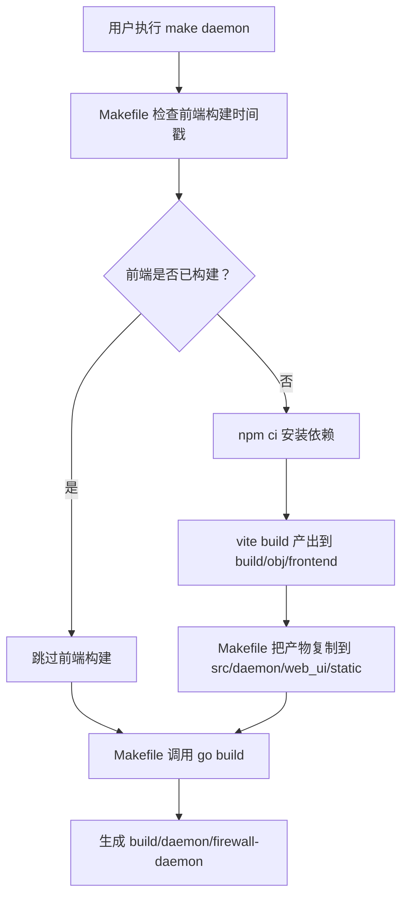
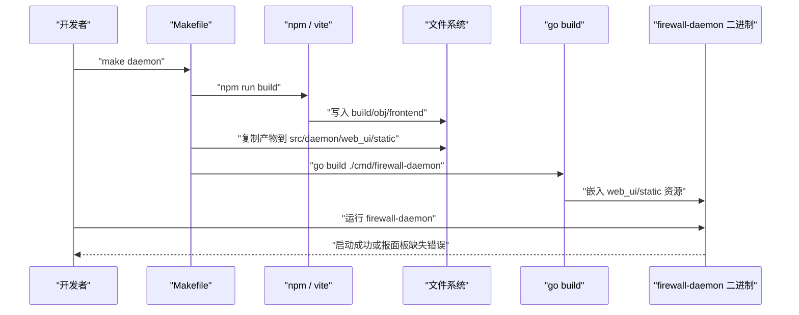
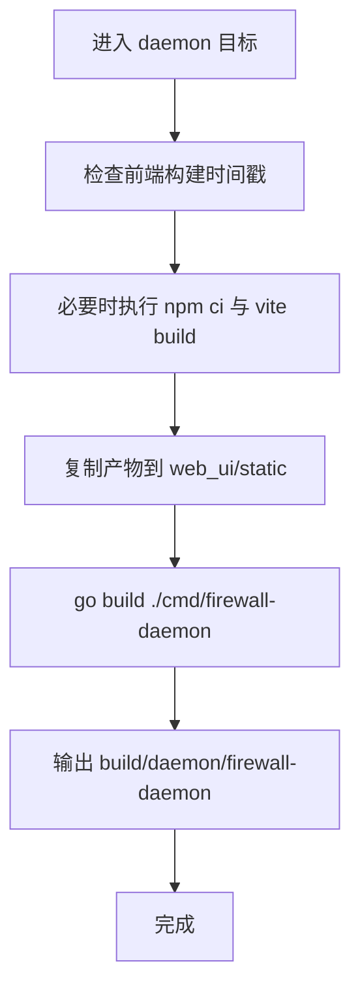
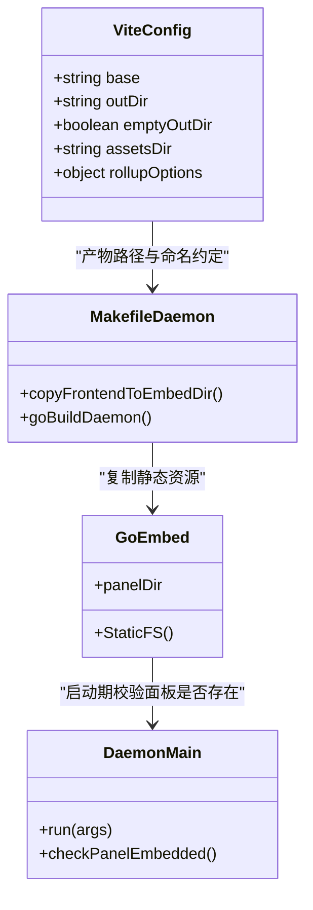
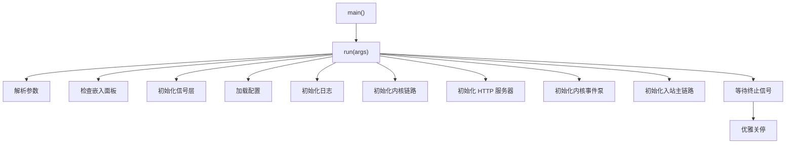
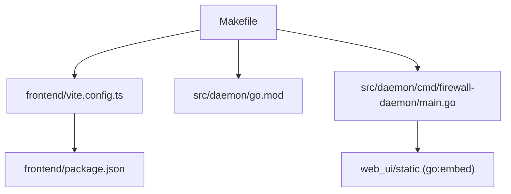

# 守护进程编译

<cite>
**本文引用的文件**   
- [Makefile](file://Makefile)
- [src/daemon/go.mod](file://src/daemon/go.mod)
- [frontend/vite.config.ts](file://frontend/vite.config.ts)
- [frontend/package.json](file://frontend/package.json)
- [src/daemon/cmd/firewall-daemon/main.go](file://src/daemon/cmd/firewall-daemon/main.go)
</cite>

## 目录
1. [简介](#简介)
2. [项目结构与构建入口](#项目结构与构建入口)
3. [核心组件与职责](#核心组件与职责)
4. [架构总览：前端产物如何进入 Go 二进制](#架构总览前端产物如何进入-go-二进制)
5. [详细组件分析](#详细组件分析)
6. [依赖关系分析](#依赖关系分析)
7. [性能与增量编译](#性能与增量编译)
8. [交叉编译与调试模式](#交叉编译与调试模式)
9. [常见问题排查](#常见问题排查)
10. [结论](#结论)

## 简介
本文面向需要编译并理解本项目 Go 守护进程的开发者与运维人员，重点说明以下内容：
- 如何使用 `make daemon` 编译 Go 守护进程。
- Go 版本要求、Go Module 依赖管理方式。
- Vite 前端构建产物如何通过 Makefile 临时拷贝到 `go:embed` 输入目录，并最终嵌入最终二进制。
- 增量编译优化、交叉编译配置和调试模式的使用方法。
- Go 模块依赖问题、CGO 相关编译错误的排查思路。

本项目的守护进程是 Go 程序，内核模块是 C 代码；前端使用 React + TypeScript + Vite 构建，静态资源通过 `go:embed` 集成进守护进程二进制，对外提供 `/static/*` 面板页面。

## 项目结构与构建入口
根级 `Makefile` 是统一构建入口，负责：
- 检查 Go、Node.js、gcc、make 等依赖。
- 生成契约文件。
- 构建前端（Vite）。
- 将前端产物临时拷贝到 `src/daemon/web_ui/static`。
- 调用 `go build` 编译守护进程。
- 输出最终二进制到 `build/daemon/firewall-daemon`。

**图表来源**
- [Makefile:277-289](file://Makefile#L277-L289)
- [Makefile:299-319](file://Makefile#L299-L319)
- [frontend/vite.config.ts:23-48](file://frontend/vite.config.ts#L23-L48)

**章节来源**
- [Makefile:10-66](file://Makefile#L10-L66)
- [Makefile:274-319](file://Makefile#L274-L319)

## 核心组件与职责
| 组件 | 位置 | 职责 |
|---|---|---|
| 顶层构建系统 | `Makefile` | 依赖检查、契约生成、前端构建、Go 守护进程构建、安装与清理。 |
| Go 守护进程模块 | `src/daemon/go.mod` | 定义 Go module、Go 版本、直接依赖与间接依赖。 |
| 守护进程入口 | `src/daemon/cmd/firewall-daemon/main.go` | 组合根：解析参数、加载配置、启动 HTTP、内核链路、事件泵、优雅关停。 |
| 前端构建配置 | `frontend/vite.config.ts` | 设置 Vite 输出路径、资源命名、base 路径、开发代理。 |
| 前端元信息 | `frontend/package.json` | 定义 Node 脚本、React、TypeScript、Vite 等依赖。 |

**章节来源**
- [Makefile:1-66](file://Makefile#L1-L66)
- [src/daemon/go.mod:1-22](file://src/daemon/go.mod#L1-L22)
- [src/daemon/cmd/firewall-daemon/main.go:1-49](file://src/daemon/cmd/firewall-daemon/main.go#L1-L49)
- [frontend/vite.config.ts:1-20](file://frontend/vite.config.ts#L1-L20)
- [frontend/package.json:1-13](file://frontend/package.json#L1-L13)

## 架构总览：前端产物如何进入 Go 二进制
守护进程在运行时需要前端静态面板。仓库采用“构建期嵌入”策略：
1. Vite 构建前端，产物写入 `build/obj/frontend`。
2. `make daemon` 在 Go 编译前，把 `build/obj/frontend` 的内容复制到 `src/daemon/web_ui/static`。
3. Go 源码中引用该目录作为 `go:embed` 的输入。
4. `go build` 生成最终二进制，面板资源被嵌入其中。
5. 守护进程启动时若发现嵌入面板为空，会直接报错，而不是等到请求静态资源时才失败。

**图表来源**
- [Makefile:277-289](file://Makefile#L277-L289)
- [Makefile:299-319](file://Makefile#L299-L319)
- [src/daemon/cmd/firewall-daemon/main.go:33-65](file://src/daemon/cmd/firewall-daemon/main.go#L33-L65)

**章节来源**
- [Makefile:274-319](file://Makefile#L274-L319)
- [src/daemon/cmd/firewall-daemon/main.go:33-65](file://src/daemon/cmd/firewall-daemon/main.go#L33-L65)

## 详细组件分析

### `make daemon` 构建流程
`make daemon` 的核心逻辑如下：
- 依赖前端构建时间戳目标。
- 确保前端产物存在。
- 将前端产物复制到 `src/daemon/web_ui/static`。
- 进入 `src/daemon` 目录执行 `go build`。
- 使用 `-ldflags "-s -w=1"` 去除符号表与调试信息，减小二进制体积。
- 输出守护进程二进制到 `build/daemon/firewall-daemon`。

**图表来源**
- [Makefile:277-289](file://Makefile#L277-L289)
- [Makefile:299-319](file://Makefile#L299-L319)

**章节来源**
- [Makefile:274-319](file://Makefile#L274-L319)

### Go 版本与依赖管理
Go 守护进程模块位于 `src/daemon`，其 `go.mod` 声明：
- Module 路径为 `github.com/snowcore8/linux-firewall-kmod/daemon`。
- Go 版本要求为 `go 1.26.0`。
- 直接依赖包括 `golang.org/x/sys` 与 `gopkg.in/yaml.v3`。
- 间接依赖包含 SQLite、fsnotify、uuid、isatty 等库。

需要注意：
- 根级 `Makefile` 中默认 Go 版本变量写的是 `GOVER ?= 1.23`，但 `src/daemon/go.mod` 明确声明 `go 1.26.0`。
- 如果本地 Go 工具链版本低于 `go.mod` 要求的版本，`go build` 可能拒绝构建。
- 推荐以 `go.mod` 为准，并确保本地 `go version` 满足模块要求。

**章节来源**
- [src/daemon/go.mod:1-22](file://src/daemon/go.mod#L1-L22)
- [Makefile:40-43](file://Makefile#L40-L43)
- [Makefile:114-131](file://Makefile#L114-L131)

### 前端资源嵌入机制
前端资源嵌入的关键约束由 `frontend/vite.config.ts` 维护：
- `base: '/static/'`：守护进程对外提供 `/static/*path`，因此前端资源引用必须带 `/static/` 前缀。
- `assetsDir: ''`：资源平铺输出，文件名固定，便于 `go:embed` 按名查找。
- `outDir: '../build/obj/frontend'`：产物落在源码树之外，避免污染源码目录。
- `emptyOutDir: true`：每次构建清空输出目录，保证嵌入内容稳定。
- 固定入口文件名 `app.js`，减少资源名称漂移风险。

守护进程入口 `main.go` 在启动时会检查嵌入面板是否为空；如果为空，直接返回错误，提示前端静态面板缺失。

**图表来源**
- [frontend/vite.config.ts:23-48](file://frontend/vite.config.ts#L23-L48)
- [Makefile:277-289](file://Makefile#L277-L289)
- [src/daemon/cmd/firewall-daemon/main.go:33-65](file://src/daemon/cmd/firewall-daemon/main.go#L33-L65)

**章节来源**
- [frontend/vite.config.ts:1-20](file://frontend/vite.config.ts#L1-L20)
- [frontend/vite.config.ts:23-48](file://frontend/vite.config.ts#L23-L48)
- [src/daemon/cmd/firewall-daemon/main.go:33-65](file://src/daemon/cmd/firewall-daemon/main.go#L33-L65)

### 守护进程入口与生命周期
`main.go` 是守护进程的组合根，主要职责包括：
- 解析命令行参数。
- 校验嵌入面板是否可用。
- 初始化信号层、日志、配置、HTTP 服务器、内核链路、事件泵、入站主链路。
- 优雅关停：先停 SSE 流，再关闭 HTTP 服务器，最后等待各执行体退出。

**图表来源**
- [src/daemon/cmd/firewall-daemon/main.go:44-49](file://src/daemon/cmd/firewall-daemon/main.go#L44-L49)
- [src/daemon/cmd/firewall-daemon/main.go:52-498](file://src/daemon/cmd/firewall-daemon/main.go#L52-L498)

**章节来源**
- [src/daemon/cmd/firewall-daemon/main.go:1-49](file://src/daemon/cmd/firewall-daemon/main.go#L1-L49)
- [src/daemon/cmd/firewall-daemon/main.go:52-498](file://src/daemon/cmd/firewall-daemon/main.go#L52-L498)

## 依赖关系分析
从构建角度，关键依赖关系如下：

**图表来源**
- [Makefile:277-319](file://Makefile#L277-L319)
- [frontend/vite.config.ts:23-48](file://frontend/vite.config.ts#L23-L48)
- [frontend/package.json:1-13](file://frontend/package.json#L1-L13)
- [src/daemon/go.mod:1-22](file://src/daemon/go.mod#L1-L22)
- [src/daemon/cmd/firewall-daemon/main.go:33-65](file://src/daemon/cmd/firewall-daemon/main.go#L33-L65)

**章节来源**
- [Makefile:274-319](file://Makefile#L274-L319)
- [frontend/vite.config.ts:23-48](file://frontend/vite.config.ts#L23-L48)
- [frontend/package.json:1-13](file://frontend/package.json#L1-L13)
- [src/daemon/go.mod:1-22](file://src/daemon/go.mod#L1-L22)

## 性能与增量编译
### 前端增量构建
- Vite 构建产物输出到 `build/obj/frontend`，源码树保持干净。
- `frontend/vite.config.ts` 设置 `emptyOutDir: true`，每次构建清空输出目录，避免旧产物残留。
- `Makefile` 使用 `.stamp` 文件记录前端构建时间，只有当前端源码变化时才重新构建。

### Go 构建优化
- `make daemon` 使用 `-ldflags "-s -w=1"`，去除符号表和调试信息，减小二进制体积。
- 正常构建只输出到 `build/`，不会污染 `src/daemon` 源码目录。
- `clean` 目标会删除 `build/`、`target/`，并清理 `src/daemon` 内手动 `go build` 留下的二进制。

### 建议的增量构建顺序
1. 修改前端代码后，优先运行 `make frontend` 或 `make daemon`，利用 Vite 与 Make 的时间戳机制。
2. 仅修改 Go 代码时，可直接运行 `make daemon`，无需重复构建前端。
3. 首次构建或切换分支后，建议运行 `make clean && make daemon`，确保嵌入资源与源码一致。

**章节来源**
- [Makefile:277-319](file://Makefile#L277-L319)
- [Makefile:981-1005](file://Makefile#L981-L1005)
- [frontend/vite.config.ts:30-48](file://frontend/vite.config.ts#L30-L48)

## 交叉编译与调试模式

### 交叉编译
当前 `make daemon` 没有显式设置 `GOOS` 与 `GOARCH`，因此默认在当前主机上编译守护进程。如果需要交叉编译，可以在调用 `go build` 时传入环境变量，例如：
- `GOOS=linux GOARCH=amd64 make daemon`
- `GOOS=linux GOARCH=arm64 make daemon`

注意：
- 如果守护进程依赖 CGO，交叉编译还需要目标平台的 C 工具链。
- 当前 `Makefile` 中守护进程构建命令未显式启用或禁用 CGO，因此行为取决于 `CGO_ENABLED` 与 Go 工具链环境。
- 内核模块部分有远程编译目标 `kmod-remote`，可用于在目标机器上编译内核模块，但这与 Go 守护进程交叉编译不同。

**章节来源**
- [Makefile:277-289](file://Makefile#L277-L289)
- [Makefile:203-230](file://Makefile#L203-L230)

### 调试模式
当前 `make daemon` 使用 `-ldflags "-s -w=1"`，这会移除符号表与调试信息，适合生产构建。如果需要调试：
- 可临时修改 `Makefile` 中的 `go build` 命令，去掉 `-s -w=1`，或改为更详细的 ldflags。
- 也可在 `src/daemon` 目录下手动执行 `go build -gcflags "all=-N -l" -o firewall-daemon ./cmd/firewall-daemon`，以便使用 Delve 等调试器。
- 注意：手动构建的二进制会被 `make clean` 清理，因为 `clean` 目标会删除 `src/daemon/firewall-daemon`。

**章节来源**
- [Makefile:277-289](file://Makefile#L277-L289)
- [Makefile:981-1005](file://Makefile#L981-L1005)

## 常见问题排查

### Go 版本不匹配
**现象**
- `go build` 报告 Go 版本过低或不符合 `go.mod` 要求。
- `make check-deps-daemon` 显示 Go 版本检查失败。

**原因**
- `src/daemon/go.mod` 声明 `go 1.26.0`。
- 根级 `Makefile` 中 `GOVER` 默认值为 `1.23`，可能与 `go.mod` 不一致。

**解决方案**
- 升级本地 Go 工具链至满足 `go.mod` 要求的版本。
- 如果 CI 或本地环境强制使用特定 Go 版本，应同步更新 `Makefile` 中的 `GOVER` 与实际工具链版本。

**章节来源**
- [src/daemon/go.mod:1-22](file://src/daemon/go.mod#L1-L22)
- [Makefile:40-43](file://Makefile#L40-L43)
- [Makefile:114-131](file://Makefile#L114-L131)

### Go Module 依赖问题
**现象**
- `go mod tidy`、`go build` 或 `go test` 失败。
- 提示找不到某个依赖包。

**排查步骤**
1. 确认网络可达，Go Proxy 配置正确。
2. 在 `src/daemon` 目录下执行 `go mod download` 或 `go mod tidy`。
3. 检查 `go.sum` 是否与 `go.mod` 一致。
4. 如果依赖来自私有仓库，确认 GOPRIVATE、GOPROXY、GONOSUMCHECK 等环境变量。
5. 如果是 CI 环境，确认缓存策略是否正确。

**章节来源**
- [src/daemon/go.mod:1-22](file://src/daemon/go.mod#L1-L22)

### CGO 编译错误
**现象**
- `go build` 报 CGO 相关错误，如缺少 gcc、C 头文件或链接失败。

**排查步骤**
1. 确认是否需要 CGO：如果守护进程依赖 CGO，则必须安装目标平台的 C 工具链。
2. 检查 `CGO_ENABLED`：
   - 如果不需要 CGO，可设置 `CGO_ENABLED=0` 禁用 CGO。
   - 如果需要 CGO，确保 `CC`、`CXX`、`PKG_CONFIG_PATH` 等环境变量正确。
3. 如果使用交叉编译，需安装对应架构的 C 工具链。
4. 如果不确定是否使用 CGO，可先尝试 `CGO_ENABLED=0 go build`，观察是否仍报错。

**章节来源**
- [Makefile:277-289](file://Makefile#L277-L289)

### 前端面板缺失
**现象**
- 守护进程启动时报错，提示前端静态面板缺失。
- 运行时访问 `/static/` 返回空或 404。

**原因**
- `make daemon` 没有成功构建前端。
- `build/obj/frontend` 为空或未复制到 `src/daemon/web_ui/static`。
- 手动清理了 `src/daemon/web_ui/static` 中除 `assets.go` 外的文件。

**解决方案**
1. 运行 `make frontend` 或 `make daemon` 重新构建前端。
2. 检查 `build/obj/frontend` 是否有产物。
3. 检查 `src/daemon/web_ui/static` 是否在构建后被清理。
4. 如果确实需要重新嵌入，先构建前端，再运行 `make daemon`。

**章节来源**
- [Makefile:277-319](file://Makefile#L277-L319)
- [src/daemon/cmd/firewall-daemon/main.go:62-65](file://src/daemon/cmd/firewall-daemon/main.go#L62-L65)

### Node.js 或前端依赖问题
**现象**
- `make frontend` 或 `make daemon` 报 Node.js、npm、TypeScript 或 Vite 相关错误。

**排查步骤**
1. 确认 Node.js 版本满足要求。
2. 确认 npm 可用。
3. 删除 `frontend/node_modules` 后重新运行 `make frontend-install` 或 `make frontend`。
4. 如果 CI 环境，确认 `package-lock.json` 已提交且未被忽略。

**章节来源**
- [Makefile:133-155](file://Makefile#L133-L155)
- [Makefile:299-319](file://Makefile#L299-L319)
- [frontend/package.json:1-13](file://frontend/package.json#L1-L13)

## 结论
本项目通过 `Makefile` 统一管理 Go 守护进程、前端与内核模块的构建流程。`make daemon` 是编译守护进程的主要入口，它负责：
- 检查 Go 与前端依赖。
- 构建 Vite 前端。
- 将前端产物临时复制到 `go:embed` 输入目录。
- 调用 `go build` 生成最终二进制。

实际使用中，建议：
- 以 `src/daemon/go.mod` 为准，确保本地 Go 版本满足模块要求。
- 首次构建或切换分支后，优先运行 `make clean && make daemon`。
- 生产构建保留 `-ldflags "-s -w=1"`，调试构建时按需调整。
- 遇到 CGO 问题时，根据是否需要 CGO 选择禁用或配置 C 工具链。
- 遇到前端面板缺失时，优先检查 Vite 构建产物与 `go:embed` 输入目录。