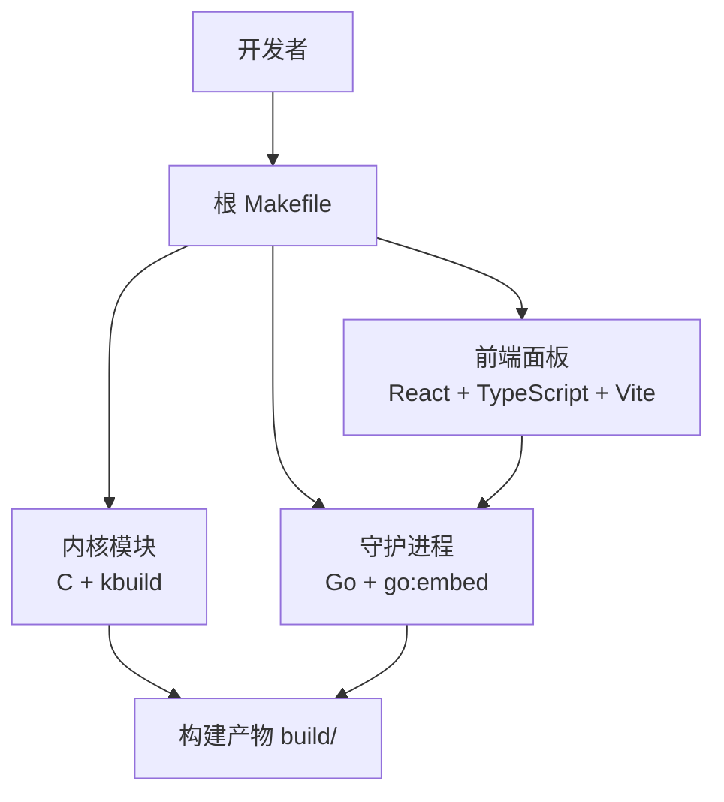
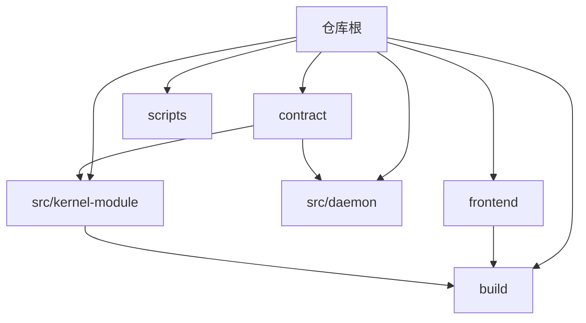
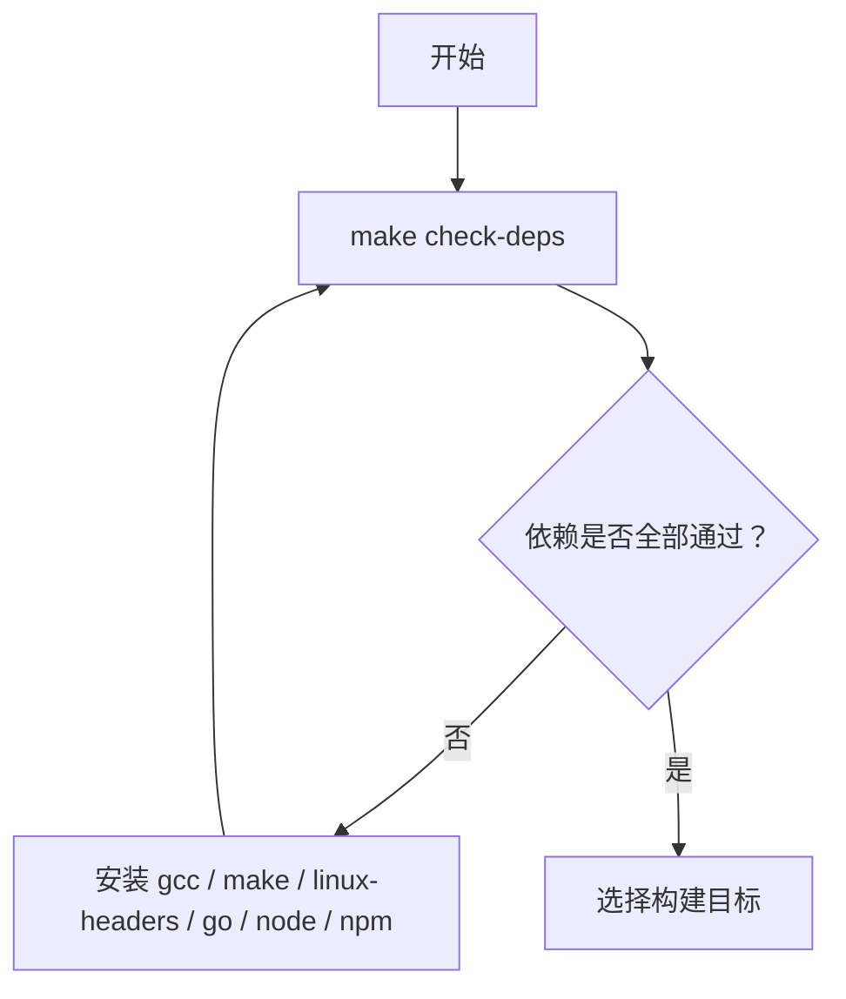
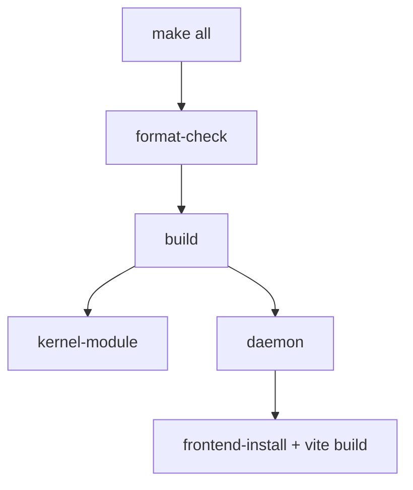
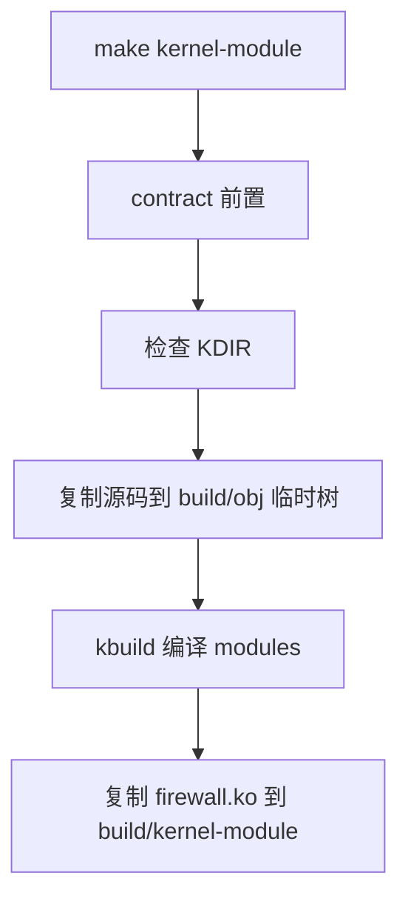
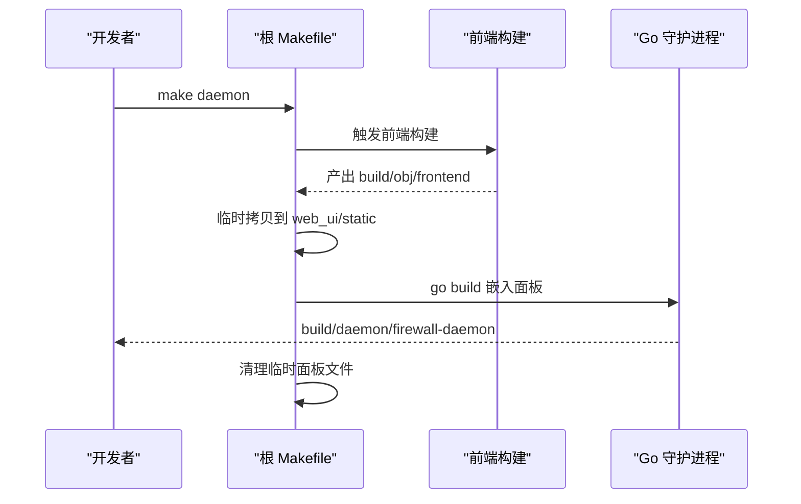
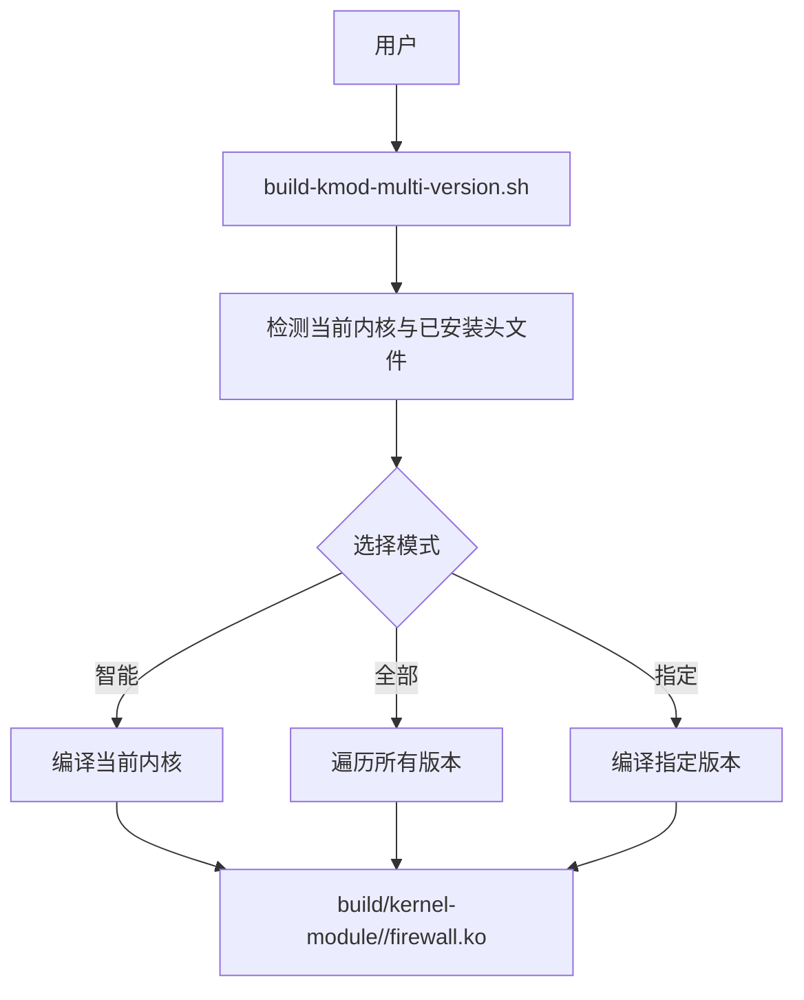
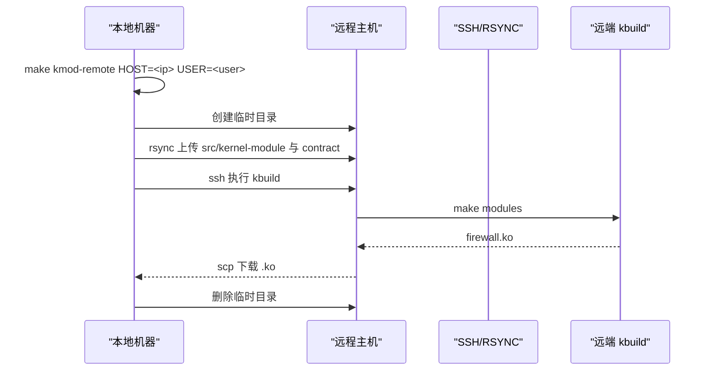
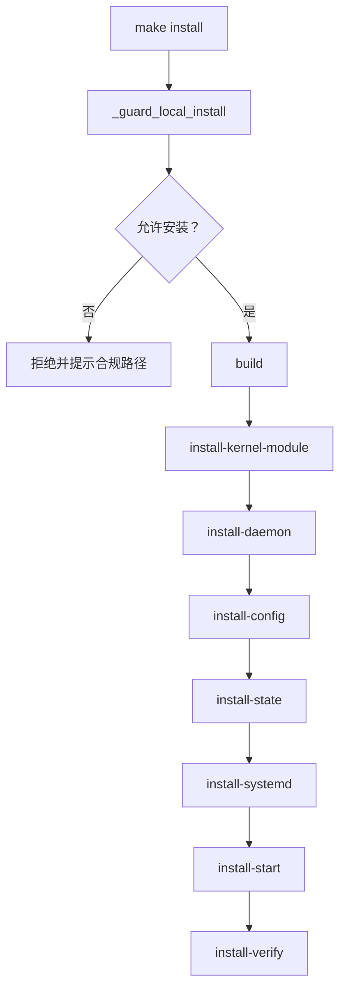

# 本地构建

<cite>
**本文引用的文件**   
- [Makefile](file://Makefile)
- [src/kernel-module/Makefile](file://src/kernel-module/Makefile)
- [scripts/build-kmod-multi-version.sh](file://scripts/build-kmod-multi-version.sh)
- [docs/zh/development/building.md](file://docs/zh/development/building.md)
- [docs/zh/development/multi-version-kmod.md](file://docs/zh/development/multi-version-kmod.md)
- [frontend/package.json](file://frontend/package.json)
</cite>

## 目录
1. [简介](#简介)
2. [项目结构与构建边界](#项目结构与构建边界)
3. [环境准备与依赖检查](#环境准备与依赖检查)
4. [核心构建目标](#核心构建目标)
5. [内核模块编译](#内核模块编译)
6. [守护进程与前端的增量构建](#守护进程与前端的增量构建)
7. [多版本内核模块编译](#多版本内核模块编译)
8. [远程编译与跨架构构建](#远程编译与跨架构构建)
9. [安装、卸载与打包](#安装卸载与打包)
10. [常见构建问题排查](#常见构建问题排查)
11. [性能优化建议](#性能优化建议)
12. [快速参考命令表](#快速参考命令表)

## 简介
本指南面向需要在本机完成内核模块、守护进程和前端面板构建的开发者。仓库使用根 `Makefile` 作为统一入口，分别协调 C 内核模块、Go 守护进程和 React/Vite 前端；同时提供多版本内核模块脚本、契约生成门禁、CI 流程以及 Debian 打包入口。

构建产物默认放在 `build/` 下，源码树保持零中间产物：
- 内核模块：`build/kernel-module/firewall.ko`
- 守护进程：`build/daemon/firewall-daemon`
- 前端构建物：`build/obj/frontend/`
- kbuild 中间产物：`build/obj/kernel-module/<kernel.release>/tree/`



**图表来源**
- [Makefile:51-65](file://Makefile#L51-L65)
- [Makefile:237-289](file://Makefile#L237-L289)
- [Makefile:299-319](file://Makefile#L299-L319)

**章节来源**
- [Makefile:1-65](file://Makefile#L1-L65)
- [docs/zh/development/building.md:316-327](file://docs/zh/development/building.md#L316-L327)

## 项目结构与构建边界
仓库按组件划分源码：
- `src/kernel-module/`：C 内核模块源码及 Kbuild 描述。
- `src/daemon/`：Go 守护进程源码，通过 `//go:embed` 嵌入前端静态资源。
- `frontend/`：React + TypeScript + Vite 前端。
- `contract/`：接口契约定义与生成器，生成头文件供内核模块和 Go 侧校验使用。
- `build/`：所有构建产物与中间对象，不入库。



**图表来源**
- [Makefile:30-38](file://Makefile#L30-L38)
- [Makefile:51-65](file://Makefile#L51-L65)
- [src/kernel-module/Makefile:6-24](file://src/kernel-module/Makefile#L6-L24)

**章节来源**
- [Makefile:30-65](file://Makefile#L30-L65)
- [src/kernel-module/Makefile:1-29](file://src/kernel-module/Makefile#L1-L29)
- [docs/zh/development/building.md:70-82](file://docs/zh/development/building.md#L70-L82)

## 环境准备与依赖检查
### 必需工具
| 组件 | 依赖 | 说明 |
|---|---|---|
| 内核模块 | `gcc`、`make`、内核头文件 | 内核头文件路径由 `KDIR` 决定，默认跟随当前运行内核 |
| 守护进程 | Go（Makefile 引导检查要求可用） | 守护进程为纯 Go，无 cgo |
| 前端 | Node.js、npm | 前端构建使用 `npm ci` 保证可复现 |
| 代码质量 | `clang-format`、`yamllint` | 可选但推荐；缺失时跳过对应检查 |
| 契约生成 | Python 3 | 用于生成和校验契约 |

### 推荐执行顺序
1. 先运行全量依赖检查。
2. 再按需构建内核模块、前端或守护进程。
3. 最后运行测试或打包。



**图表来源**
- [Makefile:71-155](file://Makefile#L71-L155)
- [docs/zh/development/building.md:6-24](file://docs/zh/development/building.md#L6-L24)

**章节来源**
- [Makefile:40-65](file://Makefile#L40-L65)
- [Makefile:71-155](file://Makefile#L71-L155)
- [docs/zh/development/building.md:6-24](file://docs/zh/development/building.md#L6-L24)

## 核心构建目标
根 `Makefile` 暴露了完整的构建、质量检查、测试、部署和清理目标。常用入口如下：

| 目标 | 行为 | 适用场景 |
|---|---|---|
| `make` 或 `make all` | 格式检查 + 构建内核模块 + 构建守护进程 | 完整构建 |
| `make build` | 构建内核模块 + 守护进程 | 跳过格式检查的常规构建 |
| `make build-quick` | 直接构建内核模块 + 守护进程 | 本地调试快速迭代 |
| `make kernel-module` | 编译当前内核版本的模块 | 仅改内核模块 |
| `make daemon` | 构建前端并嵌入守护进程 | 仅改守护进程或前端 |
| `make frontend` | 构建前端面板 | 仅改前端 |
| `make contract-check` | 契约漂移检查 + 三个校验器 | 修改契约后必须跑 |
| `make test` | 运行集成测试 | 需要已构建 `.ko` 和守护进程 |
| `make deb` | 调用 `./build-deb.sh` 构建 Debian 包 | 发布打包 |
| `make clean` | 清理构建产物 | 日常清理 |
| `make distclean` | 清理产物 + 内核中间文件 + clangd 缓存 | 彻底重建前 |



**图表来源**
- [Makefile:186-194](file://Makefile#L186-L194)
- [Makefile:277-319](file://Makefile#L277-L319)

**章节来源**
- [Makefile:186-194](file://Makefile#L186-L194)
- [Makefile:1023-1087](file://Makefile#L1023-L1087)
- [docs/zh/development/building.md:26-48](file://docs/zh/development/building.md#L26-L48)

## 内核模块编译
### 标准编译
```bash
make kernel-module
```
该目标会：
1. 确保契约文件已生成。
2. 检查 `KDIR` 是否存在。
3. 将源码复制到 `build/obj/kernel-module/<kernel.release>/tree/`。
4. 调用 kbuild 在外部源码目录编译。
5. 把 `firewall.ko` 复制到 `build/kernel-module/`。

### Kbuild 结构
`src/kernel-module/Makefile` 声明模块名为 `firewall.o`，并将多个 `fw_*.c` 组合进模块。它引入契约生成头目录，并开启严格警告。



**图表来源**
- [Makefile:237-272](file://Makefile#L237-L272)
- [src/kernel-module/Makefile:6-24](file://src/kernel-module/Makefile#L6-L24)

**章节来源**
- [Makefile:23-25](file://Makefile#L23-L25)
- [Makefile:237-272](file://Makefile#L237-L272)
- [src/kernel-module/Makefile:1-29](file://src/kernel-module/Makefile#L1-L29)
- [docs/zh/development/building.md:57-87](file://docs/zh/development/building.md#L57-L87)

## 守护进程与前端的增量构建
### 前端构建
前端使用 Vite 和 TypeScript，构建命令等价于类型检查加打包。构建产物写入 `build/obj/frontend/`，并通过 stamp 文件实现增量判断。

关键点：
- 依赖安装使用 `npm ci --no-audit --no-fund`。
- 构建输出在源码树之外。
- 类型检查可通过 `make frontend-typecheck` 单独执行。

### 守护进程构建
守护进程构建依赖前端产物：
1. 确保前端已构建。
2. 将前端产物临时拷贝到 `src/daemon/web_ui/static/`。
3. 执行 `go build`，并把面板资源嵌入二进制。
4. 退出时清理临时拷贝，保留 `assets.go`。



**图表来源**
- [Makefile:277-289](file://Makefile#L277-L289)
- [Makefile:299-319](file://Makefile#L299-L319)
- [frontend/package.json:7-12](file://frontend/package.json#L7-L12)

**章节来源**
- [Makefile:274-319](file://Makefile#L274-L319)
- [docs/zh/development/building.md:98-165](file://docs/zh/development/building.md#L98-L165)
- [frontend/package.json:1-34](file://frontend/package.json#L1-L34)

## 多版本内核模块编译
### 脚本能力
`scripts/build-kmod-multi-version.sh` 支持：
- 智能模式：优先编译当前运行内核。
- 列出已安装内核头文件与兼容性。
- 仅检测兼容性。
- 编译所有可用版本。
- 指定一个或多个内核版本。

### 使用方式
```bash
# 智能模式
./scripts/build-kmod-multi-version.sh

# 列出版本
./scripts/build-kmod-multi-version.sh --list

# 仅检测
./scripts/build-kmod-multi-version.sh --check

# 编译所有版本
./scripts/build-kmod-multi-version.sh --all

# 指定版本
./scripts/build-kmod-multi-version.sh 6.8.0-147-generic
```

### Makefile 集成
根 `Makefile` 提供 `kernel-module-multi` 和 `kmod-all`，内部调用该脚本。



**图表来源**
- [scripts/build-kmod-multi-version.sh:1-11](file://scripts/build-kmod-multi-version.sh#L1-L11)
- [scripts/build-kmod-multi-version.sh:136-183](file://scripts/build-kmod-multi-version.sh#L136-L183)
- [scripts/build-kmod-multi-version.sh:185-256](file://scripts/build-kmod-multi-version.sh#L185-L256)
- [scripts/build-kmod-multi-version.sh:258-296](file://scripts/build-kmod-multi-version.sh#L258-L296)
- [scripts/build-kmod-multi-version.sh:298-364](file://scripts/build-kmod-multi-version.sh#L298-L364)
- [Makefile:196-201](file://Makefile#L196-L201)

**章节来源**
- [scripts/build-kmod-multi-version.sh:1-364](file://scripts/build-kmod-multi-version.sh#L1-L364)
- [Makefile:196-201](file://Makefile#L196-L201)
- [docs/zh/development/multi-version-kmod.md:1-50](file://docs/zh/development/multi-version-kmod.md#L1-L50)
- [docs/zh/development/multi-version-kmod.md:127-185](file://docs/zh/development/multi-version-kmod.md#L127-L185)

## 远程编译与跨架构构建
### 远程编译内核模块
根 `Makefile` 提供 `kmod-remote` 目标，用于把内核模块源码上传到远程主机，在远端使用远端内核头文件编译，再把 `.ko` 拉回本地。

典型用法：
```bash
make kmod-remote HOST=192.168.8.119 USER=ubuntu
```

流程要点：
- 必须传入 `HOST`。
- 使用 `ssh` 和 `rsync` 上传 `src/kernel-module` 与 `contract`。
- 在远端执行 kbuild。
- 下载 `firewall.ko` 并保存为带远端内核版本的命名。
- 清理远端临时目录。



**图表来源**
- [Makefile:203-230](file://Makefile#L203-L230)

**章节来源**
- [Makefile:203-230](file://Makefile#L203-L230)
- [Makefile:1043-1046](file://Makefile#L1043-L1046)
- [Makefile:1075-1080](file://Makefile#L1075-L1080)

### 交叉编译
仓库对内核模块采用标准 kbuild 变量：
```bash
make kernel-module KDIR=/path/to/kernel/source
```
`ARCH` 与 `CROSS_COMPILE` 由环境变量继承，Makefile 本身不设置。文档明确说明未做过交叉编译验证。

守护进程走 Go 交叉编译变量：
```bash
cd src/daemon && GOOS=linux GOARCH=arm64 \
    go build -ldflags "-s -w=1" -o /tmp/firewall-daemon-arm64 ./cmd/firewall-daemon
```

**章节来源**
- [docs/zh/development/building.md:295-314](file://docs/zh/development/building.md#L295-L314)

## 安装、卸载与打包
### 安装守卫
直接在本机执行 `make install` 或 `make uninstall` 会被守卫拦截，除非：
- 设置了 `DESTDIR`（打包暂存模式）。
- 显式传入 `FIREWALL_REMOTE_DEPLOY=1`。

推荐做法：
- 使用 `./scripts/deploy.sh` 进行远程部署。
- 使用 `make install DESTDIR=$(pwd)/build/stage` 做暂存安装。
- 仅在受控沙箱中显式授权直写本机。

### 安装内容
安装顺序包括：
1. 内核模块安装。
2. 守护进程安装。
3. 配置文件安装。
4. 状态目录创建。
5. systemd 单元安装。
6. 尝试加载模块并启动服务。
7. 安装结果验证。

### 卸载内容
卸载顺序包括：
1. 停止守护进程。
2. 卸载内核模块。
3. 移除 systemd 单元。
4. 移除模块自动加载配置。
5. 删除二进制、运行时文件和配置。
6. 删除状态目录和日志。
7. 验证卸载结果。

### Debian 打包
```bash
sudo apt install debhelper   # 构建机一次性依赖
make deb
# 或
./build-deb.sh [版本号]
```
打包逻辑由 `build-deb.sh` 驱动，最终调用 `dpkg-buildpackage`。内核模块由 DKMS 在目标机安装时编译，守护进程含前端资源。



**图表来源**
- [Makefile:623-700](file://Makefile#L623-L700)
- [Makefile:702-814](file://Makefile#L702-L814)
- [Makefile:816-846](file://Makefile#L816-L846)

**章节来源**
- [Makefile:623-700](file://Makefile#L623-L700)
- [Makefile:702-846](file://Makefile#L702-L846)
- [Makefile:848-856](file://Makefile#L848-L856)
- [Makefile:858-975](file://Makefile#L858-L975)
- [docs/zh/development/building.md:201-258](file://docs/zh/development/building.md#L201-L258)

## 常见构建问题排查
| 症状 | 原因与处理 |
|---|---|
| `make: go: 没有那个文件或目录` | `sudo` 的 `secure_path` 不含用户 Go 安装位置；使用 `sudo env "PATH=$PATH" make ...` |
| `ERROR: Kernel configuration is invalid.` | 内核头文件与运行内核不匹配；重新安装对应 `linux-headers` |
| 面板改了但界面上看不到 | 只跑了 `make frontend`，没重跑 `make daemon`；二进制里嵌的是旧包 |
| `go build` 报「包内无 .go 文件」 | `assets.go` 被清理动作误删；确认清理逻辑保留该文件 |
| CI 的 `tsc` 全线找不到 `react` | `npm ci` 没执行，或 `frontend/package.json` 缺依赖声明 |
| `make format-check` 与 CI 行数不一致 | 本机 `clang-format` 大版本与 CI 不一致；对齐到仓库使用的版本 |
| 远程编译报错 | 未传 `HOST`；检查 SSH 免密、远端内核头文件、`rsync` 权限 |
| 多版本编译失败 | 缺少对应内核头文件；查看 `/lib/modules/<版本>/build` 是否存在 |

**章节来源**
- [docs/zh/development/building.md:329-341](file://docs/zh/development/building.md#L329-L341)
- [Makefile:77-112](file://Makefile#L77-L112)
- [Makefile:114-155](file://Makefile#L114-L155)
- [Makefile:237-272](file://Makefile#L237-L272)
- [Makefile:277-289](file://Makefile#L277-L289)
- [Makefile:203-230](file://Makefile#L203-L230)
- [scripts/build-kmod-multi-version.sh:136-183](file://scripts/build-kmod-multi-version.sh#L136-L183)

## 性能优化建议
### 使用 ccache
内核模块编译支持 `CCACHE` 变量，默认启用 `ccache gcc`，可显著加速重复构建。

```bash
make kernel-module CCACHE=ccache
```

### 并行编译
可在系统层面设置 `MAKEFLAGS`，让底层 kbuild 利用多核。

```bash
export MAKEFLAGS="-j$(nproc)"
make kernel-module-multi
```

### 增量构建策略
- 只改前端：`make frontend`，然后 `make daemon`。
- 只改守护进程：`make daemon`。
- 只改内核模块：`make kernel-module`。
- 快速迭代：`make build-quick`。
- 清理后再构建：`make clean` 或 `make distclean`。

**章节来源**
- [Makefile:44-47](file://Makefile#L44-L47)
- [Makefile:186-194](file://Makefile#L186-L194)
- [scripts/build-kmod-multi-version.sh:331-349](file://scripts/build-kmod-multi-version.sh#L331-L349)
- [docs/zh/development/building.md:274-314](file://docs/zh/development/building.md#L274-L314)

## 快速参考命令表
| 任务 | 命令 |
|---|---|
| 检查依赖 | `make check-deps` |
| 完整构建 | `make` 或 `make all` |
| 快速构建 | `make build-quick` |
| 仅内核模块 | `make kernel-module` |
| 仅守护进程 | `make daemon` |
| 仅前端 | `make frontend` |
| 前端类型检查 | `make frontend-typecheck` |
| 多版本内核模块 | `make kernel-module-multi` 或 `./scripts/build-kmod-multi-version.sh --all` |
| 远程编译 | `make kmod-remote HOST=<ip> USER=<user>` |
| 契约校验 | `make contract-check` |
| 运行测试 | `make test` |
| 构建 Debian 包 | `make deb` |
| 清理构建产物 | `make clean` |
| 彻底清理 | `make distclean` |
| 查看帮助 | `make help` |

**章节来源**
- [Makefile:1023-1087](file://Makefile#L1023-L1087)
- [docs/zh/development/building.md:26-48](file://docs/zh/development/building.md#L26-L48)