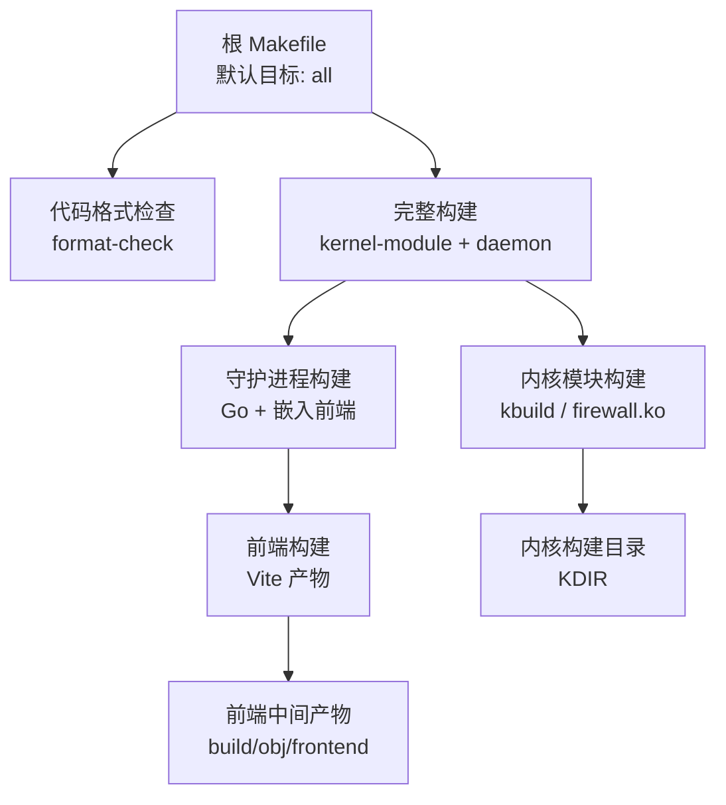
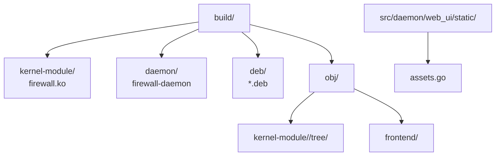
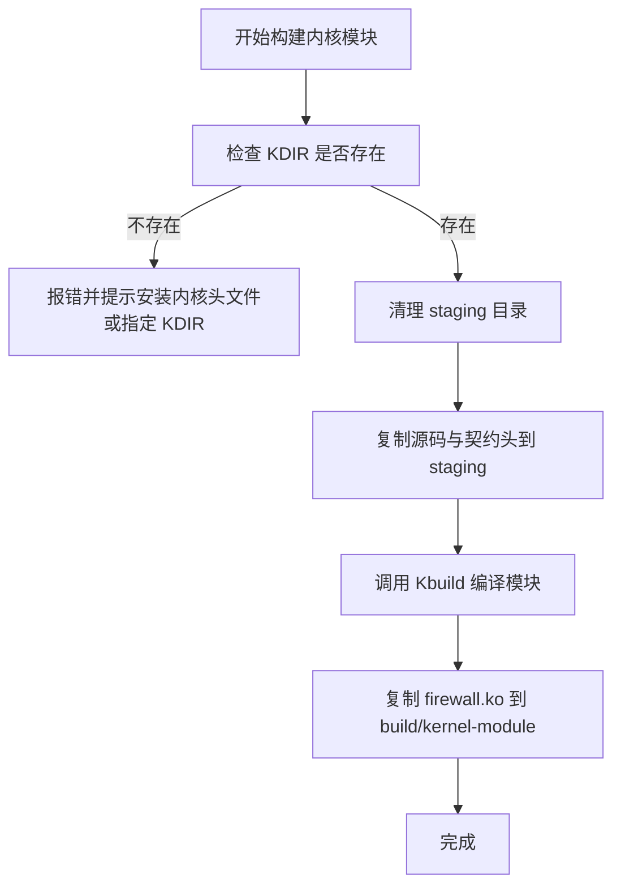
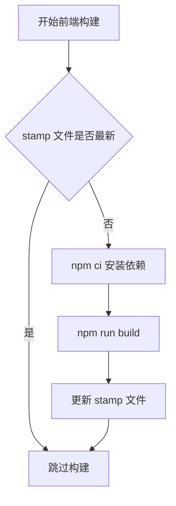
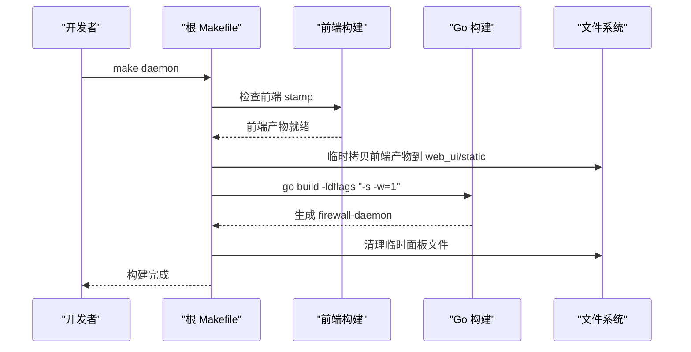
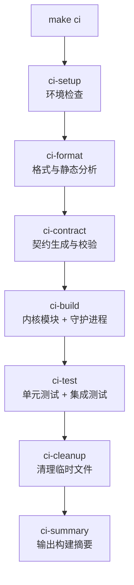
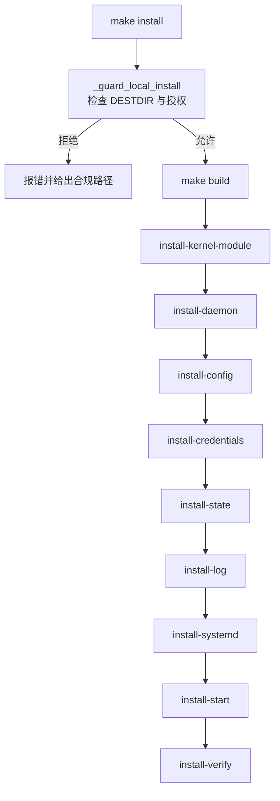

# 构建命令参考

<cite>
**本文引用的文件**   
- [Makefile](file://Makefile)
- [src/kernel-module/Makefile](file://src/kernel-module/Makefile)
- [docs/zh/development/building.md](file://docs/zh/development/building.md)
- [docs/zh/development/ci-workflow.md](file://docs/zh/development/ci-workflow.md)
- [build-deb.sh](file://build-deb.sh)
</cite>

## 目录
1. [简介](#简介)
2. [项目结构与构建入口](#项目结构与构建入口)
3. [核心构建目标总览](#核心构建目标总览)
4. [环境变量与参数说明](#环境变量与参数说明)
5. [构建输出目录结构](#构建输出目录结构)
6. [增量构建机制与性能优化](#增量构建机制与性能优化)
7. [常用构建场景与命令示例](#常用构建场景与命令示例)
8. [CI 流程详解](#ci-流程详解)
9. [安装、卸载与打包](#安装卸载与打包)
10. [故障排除指南](#故障排除指南)
11. [结论](#结论)

## 简介
本文面向需要频繁编译内核模块、守护进程和前端面板的开发者与维护者，系统化整理仓库根 `Makefile` 提供的构建命令、参数、环境变量、输出结构、增量行为、CI 流程以及常见问题的处理方法。文档内容直接对应仓库中的构建脚本与开发文档，避免抽象描述，便于快速定位实现位置。

## 项目结构与构建入口
项目的构建入口是仓库根目录下的 `Makefile`。默认目标是 `all`，它会先执行格式检查，再分别构建内核模块与守护进程；守护进程会内嵌前端面板产物。内核模块本身由 C 语言编写，使用 Kbuild 构建；守护进程由 Go 编写；前端基于 React、TypeScript 和 Vite。

**图表来源**
- [Makefile:8-8](file://Makefile#L8-L8)
- [Makefile:186-194](file://Makefile#L186-L194)
- [Makefile:237-272](file://Makefile#L237-L272)
- [Makefile:277-289](file://Makefile#L277-L289)
- [Makefile:299-309](file://Makefile#L299-L309)

**章节来源**
- [Makefile:1-66](file://Makefile#L1-L66)
- [Makefile:186-194](file://Makefile#L186-L194)
- [docs/zh/development/building.md:26-48](file://docs/zh/development/building.md#L26-L48)

## 核心构建目标总览
以下表格列出最常用的构建目标及其作用。更多目标可通过 `make help` 查看，但帮助信息只覆盖部分目标，完整清单应以根 `Makefile` 为准。

| 目标 | 作用 | 典型用法 |
|---|---|---|
| `make` 或 `make all` | 默认目标：执行格式检查后构建全部 | `make` |
| `make build` | 构建内核模块与守护进程，不强制格式检查 | `make build` |
| `make build-quick` | 跳过格式检查的快速构建 | `make build-quick` |
| `make kernel-module` 或 `make kmod` | 仅构建当前内核版本的内核模块 | `make kmod` |
| `make daemon` | 仅构建守护进程（含前端） | `make daemon` |
| `make frontend` | 仅构建前端面板 | `make frontend` |
| `make frontend-install` | 仅安装前端依赖 | `make frontend-install` |
| `make frontend-typecheck` | 仅做前端类型检查 | `make frontend-typecheck` |
| `make format` | 自动格式化内核模块 C 代码 | `make format` |
| `make format-check` | 检查 C 代码格式与 YAML 配置 | `make format-check` |
| `make contract` | 生成契约文件 | `make contract` |
| `make contract-drift` | 检查契约生成物是否与生成器一致 | `make contract-drift` |
| `make contract-check` | 运行契约漂移检查与三个校验器 | `make contract-check` |
| `make test` | 运行集成测试 | `make test` |
| `make ci` | 运行完整 CI 流程 | `make ci` |
| `make deb` | 构建 Debian 软件包 | `make deb` |
| `make install` | 安装到系统（受本地部署守卫限制） | `make install DESTDIR=...` |
| `make uninstall` | 从系统卸载 | `make uninstall` |
| `make clean` | 清理构建产物 | `make clean` |
| `make distclean` | 清理所有生成文件与工具缓存 | `make distclean` |
| `make help` | 打印构建帮助信息 | `make help` |

**章节来源**
- [Makefile:186-194](file://Makefile#L186-L194)
- [Makefile:233-272](file://Makefile#L233-L272)
- [Makefile:277-319](file://Makefile#L277-L319)
- [Makefile:325-406](file://Makefile#L325-L406)
- [Makefile:582-621](file://Makefile#L582-L621)
- [Makefile:853-856](file://Makefile#L853-L856)
- [Makefile:981-1017](file://Makefile#L981-L1017)
- [Makefile:1023-1093](file://Makefile#L1023-L1093)
- [docs/zh/development/building.md:26-48](file://docs/zh/development/building.md#L26-L48)

## 环境变量与参数说明
构建系统通过 Makefile 变量与环境变量控制编译器、路径、构建行为和部署策略。

### 构建路径与安装路径
| 变量 | 默认值或含义 | 用途 |
|---|---|---|
| `PREFIX` | `/usr/local` | 守护进程等二进制的基础安装前缀 |
| `SBINDIR` | `$(PREFIX)/sbin` | 守护进程安装目录 |
| `FIREWALLETC` | `/etc/firewall` | 配置文件目录 |
| `STATEDIR` | `/var/lib` | 状态数据目录 |
| `SYSTEMDDIR` | `/etc/systemd/system` | systemd 单元安装目录 |
| `KERNEL_MODDIR` | `/lib/modules/$(uname -r)/extra` | 内核模块安装目录 |
| `DESTDIR` | 空 | 打包暂存安装前缀；非空时不直接写本机根文件系统 |
| `KVER` | `$(shell uname -r)` | 指定内核版本 |
| `KDIR` | `/lib/modules/$(KVER)/build` | 内核构建目录 |

### 构建行为变量
| 变量 | 默认值或含义 | 用途 |
|---|---|---|
| `GOC` | `go` | Go 可执行文件路径 |
| `GOVER` | `1.23` | Makefile 中守护进程构建前的最低 Go 版本检查 |
| `CCACHE` | `ccache` | 内核模块 C 编译缓存命令；设为空字符串可禁用 |
| `PYTHON` | `python3` | 契约生成与校验使用的 Python |
| `SKIP_FORMAT_CHECK` | 未设置时启用格式检查 | 在 `make all`、`make ci`、`make format-check` 中跳过格式检查 |
| `SKIP_TESTS` | 未设置时运行测试 | 在 `make ci-test` 中跳过测试 |
| `VERBOSE` | 未设置 | CI 工作流文档中作为可选详细输出开关，但根 `Makefile` 的 CI 阶段没有统一使用该变量 |
| `HOST` | 无默认值 | `make kmod-remote` 必须提供远程主机地址 |
| `USER` | 默认取当前用户 | `make kmod-remote` 的 SSH 用户名 |
| `FIREWALL_REMOTE_DEPLOY` | 无默认值 | 仅在命令行传入且值为 `1` 时允许直接在本机安装 |

**章节来源**
- [Makefile:13-25](file://Makefile#L13-L25)
- [Makefile:40-46](file://Makefile#L40-L46)
- [Makefile:582-583](file://Makefile#L582-L583)
- [Makefile:204-230](file://Makefile#L204-L230)
- [Makefile:325-332](file://Makefile#L325-L332)
- [Makefile:347-406](file://Makefile#L347-L406)
- [Makefile:469-499](file://Makefile#L469-L499)
- [Makefile:642-671](file://Makefile#L642-L671)
- [docs/zh/development/ci-workflow.md:191-217](file://docs/zh/development/ci-workflow.md#L191-L217)

## 构建输出目录结构
构建产物集中在 `build/` 目录，源码树保持零中间产物。

| 路径 | 内容 | 说明 |
|---|---|---|
| `build/kernel-module/firewall.ko` | 内核模块最终产物 | 由 Kbuild 生成并复制到该位置 |
| `build/daemon/firewall-daemon` | 守护进程二进制 | stripped，内嵌前端面板 |
| `build/deb/*.deb` | Debian 软件包 | 由 `build-deb.sh` 与 debhelper 生成 |
| `build/obj/kernel-module/<kernel.release>/tree/` | kbuild 中间产物 | 源码副本、`.o`、`.cmd`、`Module.symvers` 等 |
| `build/obj/frontend/` | Vite 前端产物 | `index.html`、JS/CSS、图标、manifest 等 |
| `src/daemon/web_ui/static/assets.go` | go:embed 持有文件 | 入库文件；面板文件只在构建期间临时拷贝进该目录 |

**图表来源**
- [Makefile:51-65](file://Makefile#L51-L65)
- [Makefile:237-272](file://Makefile#L237-L272)
- [Makefile:277-289](file://Makefile#L277-L289)
- [Makefile:299-309](file://Makefile#L299-L309)
- [Makefile:853-856](file://Makefile#L853-L856)
- [docs/zh/development/building.md:316-327](file://docs/zh/development/building.md#L316-L327)

**章节来源**
- [Makefile:51-65](file://Makefile#L51-L65)
- [Makefile:237-272](file://Makefile#L237-L272)
- [Makefile:277-289](file://Makefile#L277-L289)
- [Makefile:299-309](file://Makefile#L299-L309)
- [Makefile:853-856](file://Makefile#L853-L856)
- [docs/zh/development/building.md:316-327](file://docs/zh/development/building.md#L316-L327)

## 增量构建机制与性能优化
### 内核模块增量构建
内核模块构建不会直接在 `src/kernel-module/` 下产生中间文件，而是把源码与契约头复制到一个 staging 目录 `build/obj/kernel-module/<kernel.release>/tree/`，再通过 Kbuild 在该副本上编译。这样源码树保持干净，重复构建时可以复用 staging 目录中的中间产物。

关键行为：
- 每次构建前清理 staging 目录，确保中间产物与源码同步。
- 调用 `$(MAKE) -C $(KDIR) M=<staging>/src/kernel-module modules`。
- 将生成的 `firewall.ko` 复制到 `build/kernel-module/`。
- 使用 `CC="$(CCACHE) gcc"` 支持 ccache。

**图表来源**
- [Makefile:237-272](file://Makefile#L237-L272)

### 前端增量构建
前端构建通过 stamp 文件 `build/obj/.frontend.stamp` 控制新鲜度。依赖包括前端依赖安装结果和前端源码集合。只有当依赖或源码变化时才会重新执行 `npm run build`。

关键点：
- `frontend-install` 使用 `npm ci --no-audit --no-fund`，保证可复现。
- `FRONTEND_SRCS` 包含 `package.json`、`package-lock.json`、`tsconfig.json`、`vite.config.ts`、`index.html` 以及 `frontend/src` 与 `frontend/public` 下的文件。
- 构建产物写入 `build/obj/frontend/`，不在源码树内。

**图表来源**
- [Makefile:299-319](file://Makefile#L299-L319)

### 守护进程构建与面板嵌入
守护进程构建依赖前端 stamp 文件。构建时会把前端产物临时拷贝到 `src/daemon/web_ui/static/`，然后执行 `go build`，并在退出时清理临时拷贝的文件，保留 `assets.go`。

关键点：
- `-ldflags "-s -w=1"` 去掉符号表，减小二进制体积。
- `-o` 必须使用绝对路径，否则二进制可能写到错误目录。
- 面板必须先产出，否则 embed 没有静态资源。

**图表来源**
- [Makefile:277-289](file://Makefile#L277-L289)

### 性能优化建议
- 使用 `make build-quick` 跳过格式检查，适合本地调试。
- 使用 `make SKIP_FORMAT_CHECK=1 all` 跳过格式检查。
- 启用 `CCACHE` 加速内核模块 C 编译；如需禁用可传 `CCACHE=`。
- 单独构建组件：`make kmod`、`make daemon`、`make frontend`。
- 使用 `make clean` 清理构建产物；使用 `make distclean` 清理更彻底。
- 在 CI 中可使用 `make ci SKIP_TESTS=1` 跳过耗时测试。

**章节来源**
- [Makefile:44-46](file://Makefile#L44-L46)
- [Makefile:186-194](file://Makefile#L186-L194)
- [Makefile:237-272](file://Makefile#L237-L272)
- [Makefile:277-289](file://Makefile#L277-L289)
- [Makefile:299-319](file://Makefile#L299-L319)
- [Makefile:981-1017](file://Makefile#L981-L1017)
- [docs/zh/development/building.md:50-55](file://docs/zh/development/building.md#L50-L55)
- [docs/zh/development/building.md:98-164](file://docs/zh/development/building.md#L98-L164)

## 常用构建场景与命令示例
| 场景 | 命令 | 说明 |
|---|---|---|
| 首次构建并检查依赖 | `make check-deps && make` | 检查 gcc、make、内核头文件、Go、Node.js、npm |
| 快速构建全部 | `make build-quick` | 跳过格式检查 |
| 仅构建内核模块 | `make kmod` | 使用当前内核版本 |
| 指定内核版本构建模块 | `make kmod KVER=6.8.0-147-generic` | 需配合 `KDIR` |
| 远程编译内核模块 | `make kmod-remote HOST=192.168.8.119 USER=ubuntu` | 通过 SSH 和 rsync 远程构建 |
| 仅构建守护进程 | `make daemon` | 包含前端面板 |
| 仅构建前端 | `make frontend` | 产物在 `build/obj/frontend/` |
| 仅安装前端依赖 | `make frontend-install` | 不产生物理构建文件 |
| 仅做前端类型检查 | `make frontend-typecheck` | 不产生物理构建文件 |
| 修复代码格式 | `make format` | 自动修复 C 代码格式 |
| 检查代码格式 | `make format-check` | 检查 C 代码与 YAML |
| 生成契约文件 | `make contract` | 生成 netlink、procfs、http 相关契约 |
| 检查契约漂移 | `make contract-drift` | 生成器输出与已生成物比对 |
| 完整契约校验 | `make contract-check` | 漂移检查加三个校验器 |
| 运行测试 | `make test` | 需要 root 权限 |
| 运行完整 CI | `make ci` | 环境检查、格式、契约、构建、测试、清理 |
| 构建 Debian 包 | `make deb` | 调用 `build-deb.sh` |
| 安装到系统 | `make install DESTDIR=$(pwd)/build/stage` | 推荐用 DESTDIR 暂存 |
| 卸载系统组件 | `make uninstall` | 停止服务、卸载模块、清理文件 |
| 清理构建产物 | `make clean` | 删除 build、target、测试产物等 |
| 彻底清理 | `make distclean` | 额外清理内核中间文件与工具缓存 |

**章节来源**
- [Makefile:71-155](file://Makefile#L71-L155)
- [Makefile:186-230](file://Makefile#L186-L230)
- [Makefile:233-319](file://Makefile#L233-L319)
- [Makefile:325-406](file://Makefile#L325-L406)
- [Makefile:582-621](file://Makefile#L582-L621)
- [Makefile:853-856](file://Makefile#L853-L856)
- [Makefile:981-1017](file://Makefile#L981-L1017)
- [Makefile:1023-1093](file://Makefile#L1023-L1093)

## CI 流程详解
`make ci` 是一个组合目标，按顺序执行六个子阶段：环境检查、代码格式检查、契约验证、构建、测试、清理，最后输出摘要。

**图表来源**
- [Makefile:325-332](file://Makefile#L325-L332)
- [Makefile:335-344](file://Makefile#L335-L344)
- [Makefile:347-406](file://Makefile#L347-L406)
- [Makefile:408-433](file://Makefile#L408-L433)
- [Makefile:435-467](file://Makefile#L435-L467)
- [Makefile:469-499](file://Makefile#L469-L499)
- [Makefile:501-543](file://Makefile#L501-L543)

### CI 各阶段行为
| 阶段 | 目标 | 主要动作 |
|---|---|---|
| 环境检查 | `ci-setup` | 调用 `make check-deps`，检查 gcc、make、内核头文件、Go、Node.js、npm |
| 代码格式检查 | `ci-format` | clang-format、gofmt、go vet、yamllint；可通过 `SKIP_FORMAT_CHECK=1` 跳过 |
| 契约验证 | `ci-contract` | 生成契约、检查漂移、运行契约校验器 |
| 构建 | `ci-build` | 构建内核模块与守护进程，并验证产物存在 |
| 测试 | `ci-test` | 运行 Go 单元测试与 pytest 集成测试；可通过 `SKIP_TESTS=1` 跳过 |
| 清理 | `ci-cleanup` | 清理 `tmp/`，保留构建产物 |
| 摘要 | `ci-summary` | 输出各阶段结果与下一步操作 |

**章节来源**
- [Makefile:325-543](file://Makefile#L325-L543)
- [docs/zh/development/ci-workflow.md:34-189](file://docs/zh/development/ci-workflow.md#L34-L189)

## 安装、卸载与打包
### 安装目标
`make install` 会先执行本地部署守卫 `_guard_local_install`，再依次安装内核模块、守护进程、配置、凭据、状态目录、日志、systemd 单元，并尝试加载模块、启动服务、验证安装。

安全策略：
- 如果 `DESTDIR` 为空且未通过命令行传入 `FIREWALL_REMOTE_DEPLOY=1`，则拒绝直接安装到本机。
- 推荐通过 `./scripts/deploy.sh` 远程部署，或通过 `DESTDIR` 暂存安装。
- 在 `DESTDIR` 模式下，不会执行 `depmod`、`insmod`、`systemctl` 等系统级操作。

**图表来源**
- [Makefile:629-671](file://Makefile#L629-L671)
- [Makefile:673-846](file://Makefile#L673-L846)

### 卸载目标
`make uninstall` 会停止守护进程、卸载内核模块、移除 systemd 单元、移除模块自动加载配置、删除二进制与运行时文件、删除配置目录、删除状态与日志文件，并验证卸载结果。

注意：
- 如果内核模块仍被使用，卸载会给出警告。
- 系统日志如 auth.log、journalctl 不属于本仓库卸载逻辑管理范围。

**章节来源**
- [Makefile:629-671](file://Makefile#L629-L671)
- [Makefile:673-846](file://Makefile#L673-L846)
- [Makefile:858-975](file://Makefile#L858-L975)
- [docs/zh/development/building.md:201-243](file://docs/zh/development/building.md#L201-L243)

### Debian 打包
`make deb` 调用 `build-deb.sh`，后者生成 `debian/changelog` 并调用 `dpkg-buildpackage`。打包逻辑位于 `debian/rules` 与维护者脚本中。

要点：
- 打包只构建守护进程（含前端），内核模块由目标机的 DKMS 编译。
- 版本号优先来自 `VERSION_ENV`，其次来自位置参数，最后从 `CHANGELOG.md` 提取。
- 维护者脚本在安装时执行 DKMS add/build/install，并处理服务启停。

**章节来源**
- [Makefile:848-856](file://Makefile#L848-L856)
- [Makefile:1109-1115](file://Makefile#L1109-L1115)
- [docs/zh/development/building.md:245-273](file://docs/zh/development/building.md#L245-L273)
- [build-deb.sh](file://build-deb.sh)

## 故障排除指南
### 构建依赖缺失
症状：
- 缺少 gcc、make、Go、Node.js、npm。
- 内核头文件目录不存在。

处理：
- 使用 `make check-deps` 查看全量依赖检查结果。
- 使用 `make check-deps-kmod`、`make check-deps-daemon`、`make check-deps-frontend` 分类排查。
- 根据错误提示安装对应依赖。

**章节来源**
- [Makefile:71-155](file://Makefile#L71-L155)

### 内核构建目录缺失
症状：
- 构建内核模块时报错，提示 `KDIR` 不存在。

处理：
- 安装当前内核头文件：`sudo apt install linux-headers-$(uname -r)`。
- 指定其他内核构建目录：`make KDIR=/lib/modules/<版本>/build`。
- 仅构建守护进程：`make daemon`。

**章节来源**
- [Makefile:237-257](file://Makefile#L237-L257)
- [docs/zh/development/building.md:88-96](file://docs/zh/development/building.md#L88-L96)

### 守护进程构建失败
症状：
- `go build` 报找不到 Go。
- `go build` 报「包内无 .go 文件」。
- 面板修改后界面无变化。

处理：
- 确认 `go version` 可用，必要时使用 `sudo env "PATH=$PATH" make daemon`。
- 不要误删 `assets.go`；清理面板文件时必须保留它。
- 修改前端后重新执行 `make daemon`，因为二进制内嵌的是旧面板。

**章节来源**
- [Makefile:277-289](file://Makefile#L277-L289)
- [docs/zh/development/building.md:127-164](file://docs/zh/development/building.md#L127-L164)
- [docs/zh/development/building.md:329-340](file://docs/zh/development/building.md#L329-L340)

### 代码格式检查失败
症状：
- `make format-check` 或 `make ci-format` 报 C 代码格式错误。
- 本机 clang-format 与 CI 不一致导致误报。

处理：
- 自动修复：`make format`。
- 对齐 clang-format 大版本到仓库要求。
- 紧急情况下使用 `SKIP_FORMAT_CHECK=1`。

**章节来源**
- [Makefile:347-406](file://Makefile#L347-L406)
- [Makefile:546-572](file://Makefile#L546-L572)
- [docs/zh/development/building.md:20-24](file://docs/zh/development/building.md#L20-L24)
- [docs/zh/development/building.md:329-340](file://docs/zh/development/building.md#L329-L340)

### 契约验证失败
症状：
- `make contract-drift` 或 `make contract-check` 失败。
- 生成物与生成器不一致。

处理：
- 重新生成契约：`python3 contract/gen.py`。
- 检查 `.fwidl` 文件是否有未提交修改。
- 再次运行 `make contract-check`。

**章节来源**
- [Makefile:161-178](file://Makefile#L161-L178)
- [Makefile:582-621](file://Makefile#L582-L621)
- [docs/zh/development/building.md:166-189](file://docs/zh/development/building.md#L166-L189)

### 安装被拒绝
症状：
- 直接运行 `make install` 报错「禁止直接部署到本机」。

处理：
- 使用远程部署：`./scripts/deploy.sh <host> [user] [--mode deb|script]`。
- 使用暂存安装：`make install DESTDIR=$(pwd)/build/stage`。
- 在受控沙箱中显式授权：`make install FIREWALL_REMOTE_DEPLOY=1`。

**章节来源**
- [Makefile:629-671](file://Makefile#L629-L671)
- [docs/zh/development/building.md:201-223](file://docs/zh/development/building.md#L201-L223)

### 清理不完整
症状：
- `make clean` 后仍有残留文件。
- 想彻底清理内核中间文件与工具缓存。

处理：
- 常规清理：`make clean`。
- 彻底清理：`make distclean`。
- 注意：`clean` 不会删除已入库的契约生成物；需要重新生成时用 `make contract`，清空重来用 `make contract-clean`。

**章节来源**
- [Makefile:981-1017](file://Makefile#L981-L1017)
- [docs/zh/development/building.md:274-293](file://docs/zh/development/building.md#L274-L293)

## 结论
本项目的构建系统以根 `Makefile` 为核心，围绕内核模块、守护进程和前端面板组织目标。日常开发推荐使用 `make build-quick` 或 `make build`，CI 场景使用 `make ci`，打包使用 `make deb`，安装与卸载通过 `make install` 与 `make uninstall` 配合 `DESTDIR` 与安全守卫完成。理解 `KDIR`、`KVER`、`CCACHE`、`SKIP_FORMAT_CHECK`、`DESTDIR` 等变量的作用，有助于在不同环境中稳定构建、快速定位问题并优化构建性能。