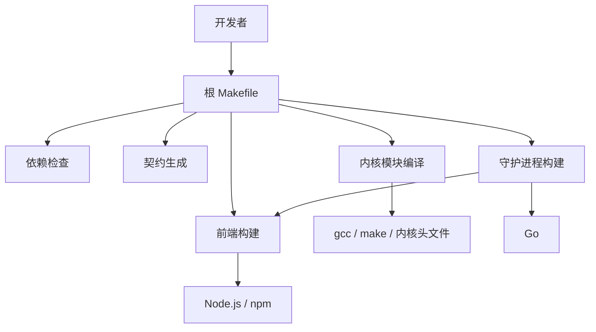
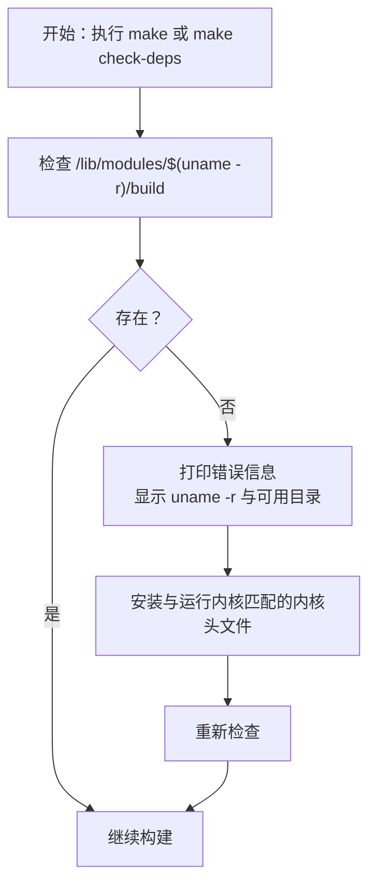

# 环境准备

<cite>
**本文引用的文件**   
- [README.md](file://README.md)
- [Makefile](file://Makefile)
- [安装指南](file://docs/zh/getting-started/installation.md)
- [构建文档](file://docs/zh/development/building.md)
- [守护进程模块声明](file://src/daemon/go.mod)
- [前端包配置](file://frontend/package.json)
- [CI 工作流](file://.github/workflows/ci.yml)
</cite>

## 目录
1. [引言](#引言)
2. [项目结构与依赖边界](#项目结构与依赖边界)
3. [核心开发环境要求](#核心开发环境要求)
4. [Linux 发行版依赖安装命令](#linux-发行版依赖安装命令)
5. [内核头文件与内核构建目录](#内核头文件与内核构建目录)
6. [ccache 缓存工具](#ccache-缓存工具)
7. [验证本地环境](#验证本地环境)
8. [常见环境问题与解决方案](#常见环境问题与解决方案)
9. [从零搭建环境的推荐步骤](#从零搭建环境的推荐步骤)
10. [结论](#结论)

## 引言
本指南面向首次在本机搭建 Linux 防火墙内核模块与守护进程开发环境的开发者。目标是明确列出 gcc、make、Go、Node.js、npm、clang-format、内核头文件等依赖，给出不同发行版的安装方式，说明 ccache 的可选安装与使用，并提供可操作的排查方法，帮助你在最短时间内完成“能编译、能运行测试”的本地环境。

本项目由三部分构成：
- 内核模块：C 语言实现，通过 Kbuild 编译为 `firewall.ko`。
- 守护进程：Go 语言实现，内嵌前端面板静态资源。
- 前端面板：React + TypeScript + Vite，产物被嵌入守护进程二进制。

因此，本地环境必须同时满足 C 内核模块编译、Go 守护进程编译以及 Node.js 前端构建三类需求。

**章节来源**
- [README.md:10-31](file://README.md#L10-L31)

## 项目结构与依赖边界
从构建视角看，仓库根 `Makefile` 是入口，它统一检查依赖、生成契约文件、编译内核模块、构建前端并打包守护进程。



**图表来源**
- [Makefile:71-155](file://Makefile#L71-L155)
- [Makefile:161-178](file://Makefile#L161-L178)
- [Makefile:232-289](file://Makefile#L232-L289)
- [Makefile:296-319](file://Makefile#L296-L319)

**章节来源**
- [Makefile:1-66](file://Makefile#L1-L66)
- [Makefile:68-155](file://Makefile#L68-L155)
- [Makefile:161-178](file://Makefile#L161-L178)
- [Makefile:232-319](file://Makefile#L232-L319)

## 核心开发环境要求
以下是构建和开发所需的核心工具及其最低版本或用途。

| 工具 | 作用 | 版本或要求 | 依据 |
|------|------|------------|------|
| gcc | 编译内核模块 C 源码 | 随 `build-essential` 提供 | [Makefile:77-112](file://Makefile#L77-L112) |
| make | 驱动构建系统 | 随 `build-essential` 提供 | [Makefile:85-90](file://Makefile#L85-L90) |
| 内核头文件 | 提供内核 API 与构建目录 `/lib/modules/$(uname -r)/build` | 与运行内核一致 | [Makefile:91-106](file://Makefile#L91-L106) |
| clang-format | C 代码格式检查 | 仓库以 18 为准 | [构建文档:8-24](file://docs/zh/development/building.md#L8-L24) |
| Go | 编译守护进程 | 至少 1.23；模块声明为 1.26.0 | [Makefile:40-43](file://Makefile#L40-L43)、[守护进程模块声明:1-3](file://src/daemon/go.mod#L1-L3) |
| Node.js | 构建前端面板 | 至少 18；CI 使用 22 | [Makefile:133-155](file://Makefile#L133-L155)、[安装指南:6-19](file://docs/zh/getting-started/installation.md#L6-L19) |
| npm | 安装前端依赖并执行构建脚本 | 随 Node.js 安装 | [Makefile:143-155](file://Makefile#L143-L155) |
| Python 3 | 契约生成与校验 | 默认 `python3` | [构建文档:8-19](file://docs/zh/development/building.md#L8-L19) |
| debhelper（可选） | 构建 Debian 包 | 仅打 `.deb` 时需要 | [构建文档:245-257](file://docs/zh/development/building.md#L245-L257) |

需要注意：
- 根 `Makefile` 在 Go 引导检查中要求 Go 版本不低于 1.23，但 `src/daemon/go.mod` 声明模块使用 Go 1.26.0。实际开发建议直接安装 1.26 或更高版本。
- 前端 `package.json` 使用 React 19、TypeScript、Vite 等现代前端工具链，Node.js 版本过低会导致类型检查或构建失败。
- 内核模块本身是纯 C，不依赖系统级 cgo 库；Go 守护进程也没有 cgo 依赖。

**章节来源**
- [Makefile:40-46](file://Makefile#L40-L46)
- [Makefile:77-155](file://Makefile#L77-L155)
- [守护进程模块声明:1-3](file://src/daemon/go.mod#L1-L3)
- [前端包配置:1-33](file://frontend/package.json#L1-L33)
- [安装指南:6-19](file://docs/zh/getting-started/installation.md#L6-L19)
- [构建文档:8-24](file://docs/zh/development/building.md#L8-L24)

## Linux 发行版依赖安装命令
以下命令用于在常见发行版上安装构建所需的系统依赖。请根据实际发行版选择对应命令。

### Debian / Ubuntu
```bash
sudo apt update
sudo apt install -y build-essential clang-format linux-headers-$(uname -r)
```

如果需要构建 Debian 包：
```bash
sudo apt install -y debhelper
```

如果还需要跑集成测试，通常还需要：
```bash
sudo apt install -y python3-pytest python3-yaml sqlite3
```

### RHEL / CentOS / Rocky / AlmaLinux
```bash
sudo dnf groupinstall -y "Development Tools"
sudo dnf install -y clang-format kernel-devel kernel-headers
```

如需 DKMS 或包构建能力，还可安装：
```bash
sudo dnf install -y rpm-build dkms
```

### openSUSE
```bash
sudo zypper install -y gcc make clang-devel kernel-devel kernel-default-devel
```

### Arch / Manjaro
```bash
sudo pacman -Syu base-devel clang linux-headers
```

注意：
- `build-essential` 或等价开发工具组会提供 gcc、make、binutils 等基础编译工具。
- `linux-headers-$(uname -r)` 或 `kernel-devel` 必须与当前运行的内核版本匹配，否则内核模块无法编译。
- clang-format 不是内核模块编译必需工具，但仓库默认目标会执行格式检查，缺少它会触发警告或 CI 失败。

**章节来源**
- [安装指南:34-45](file://docs/zh/getting-started/installation.md#L34-L45)
- [构建文档:245-257](file://docs/zh/development/building.md#L245-L257)

## 内核头文件与内核构建目录
内核模块通过 Kbuild 在外部模块模式下编译，依赖内核构建目录：
`/lib/modules/$(uname -r)/build`。

如果该目录不存在，根 `Makefile` 会在依赖检查和内核模块构建时分别给出错误提示，并列出可用目录。



**图表来源**
- [Makefile:91-106](file://Makefile#L91-L106)
- [Makefile:237-257](file://Makefile#L237-L257)

常见处理步骤：
1. 查看当前内核版本：
   ```bash
   uname -r
   ```
2. 安装与当前内核匹配的头文件：
   - Debian / Ubuntu：
     ```bash
     sudo apt install linux-headers-$(uname -r)
     ```
   - RHEL / CentOS / Rocky / AlmaLinux：
     ```bash
     sudo dnf install kernel-devel-$(uname -r) kernel-headers-$(uname -r)
     ```
3. 确认构建目录是否存在：
   ```bash
   ls -l /lib/modules/$(uname -r)/build
   ```
4. 如果头文件安装在非标准位置，可通过 `KDIR` 指定：
   ```bash
   make kernel-module KDIR=/lib/modules/$(uname -r)/build
   ```
5. 查找所有可用的内核构建目录：
   ```bash
   find /lib/modules -maxdepth 2 -name build -type d
   ```

如果只想编译守护进程而不编译内核模块，可以跳过内核头文件：
```bash
make daemon
```

**章节来源**
- [Makefile:23-25](file://Makefile#L23-L25)
- [Makefile:91-106](file://Makefile#L91-L106)
- [Makefile:237-257](file://Makefile#L237-L257)
- [安装指南:72-86](file://docs/zh/getting-started/installation.md#L72-L86)

## ccache 缓存工具
ccache 是可选加速工具，主要用于缓存内核模块的 C 编译结果，减少重复构建时间。

### 是否必须安装
- 不是必须。仓库没有把 ccache 作为强制依赖。
- 如果未安装，内核模块仍可使用 gcc 正常编译。
- CI 环境中安装了 ccache，并缓存 `~/.ccache`，以便跨任务复用编译结果。

### 如何安装
Debian / Ubuntu：
```bash
sudo apt install -y ccache
```

RHEL / CentOS / Rocky / AlmaLinux：
```bash
sudo dnf install -y ccache
```

openSUSE：
```bash
sudo zypper install -y ccache
```

Arch / Manjaro：
```bash
sudo pacman -Syu ccache
```

### 如何使用
仓库根 `Makefile` 默认启用 ccache：
- 变量 `CCACHE ?= ccache`。
- 内核模块编译时使用 `CC="$(CCACHE) gcc"`。

因此，只要系统中存在 `ccache` 命令，内核模块编译就会自动走缓存路径。

如果想禁用 ccache：
```bash
make kernel-module CCACHE=
```

如果想显式指定 ccache 命令：
```bash
make kernel-module CCACHE=/usr/bin/ccache
```

### CI 中的行为
CI 工作流会：
- 安装 `build-essential` 和 `ccache`。
- 将 `~/.ccache` 加入缓存键。
- 构建前清零统计，便于观察命中情况。
- 构建后输出 ccache 统计。

这说明 ccache 对内核模块重复编译有明显优化价值，尤其适合频繁修改 C 源码的开发场景。

**章节来源**
- [Makefile:44-46](file://Makefile#L44-L46)
- [Makefile:268-270](file://Makefile#L268-L270)
- [Makefile:1086-1086](file://Makefile#L1086-L1086)
- [CI 工作流:184-212](file://.github/workflows/ci.yml#L184-L212)
- [CI 工作流:310-311](file://.github/workflows/ci.yml#L310-L311)

## 验证本地环境
推荐使用仓库提供的依赖检查目标，而不是逐个手动判断工具是否安装。

### 全量依赖检查
```bash
make check-deps
```

该目标会依次检查：
- 内核模块依赖：gcc、make、内核构建目录、clang-format。
- 守护进程依赖：Go 及版本。
- 前端依赖：Node.js、npm 及版本。

### 分步检查
- 只检查内核模块依赖：
  ```bash
  make check-deps-kmod
  ```
- 只检查守护进程依赖：
  ```bash
  make check-deps-daemon
  ```
- 只检查前端依赖：
  ```bash
  make check-deps-frontend
  ```

### 快速构建验证
如果依赖检查通过，可先尝试快速构建：
```bash
make build-quick
```

成功后应得到：
- 内核模块：`build/kernel-module/firewall.ko`
- 守护进程：`build/daemon/firewall-daemon`

### 完整构建验证
```bash
make
```

这会执行格式检查、契约检查、构建和测试流程的一部分。若只想跳过格式检查，可使用：
```bash
make SKIP_FORMAT_CHECK=1 all
```

**章节来源**
- [Makefile:71-155](file://Makefile#L71-L155)
- [Makefile:184-194](file://Makefile#L184-L194)
- [README.md:33-53](file://README.md#L33-L53)

## 常见环境问题与解决方案

### gcc 或 make 未找到
**现象**：
- 依赖检查或构建时报 gcc/make 缺失。

**原因**：
- 未安装系统开发工具组。

**解决**：
- Debian / Ubuntu：
  ```bash
  sudo apt install -y build-essential
  ```
- RHEL / CentOS / Rocky / AlmaLinux：
  ```bash
  sudo dnf groupinstall -y "Development Tools"
  ```

**章节来源**
- [Makefile:77-90](file://Makefile#L77-L90)

### 内核构建目录不存在
**现象**：
- 报错提示内核构建目录不存在，或出现 `ERROR: Kernel configuration is invalid.`。

**原因**：
- 未安装与当前内核匹配的内核头文件或内核开发包。

**解决**：
1. 安装匹配头文件：
   ```bash
   sudo apt install linux-headers-$(uname -r)
   ```
2. 重新执行：
   ```bash
   make check-deps
   make kernel-module
   ```
3. 如果头文件不在标准路径，使用 `KDIR` 指定。

**章节来源**
- [Makefile:91-106](file://Makefile#L91-L106)
- [Makefile:237-257](file://Makefile#L237-L257)
- [构建文档:88-96](file://docs/zh/development/building.md#L88-L96)

### Go 未安装或版本过低
**现象**：
- 报 `go: 没有那个文件或目录`。
- 报 Go 版本低于期望值。

**原因**：
- PATH 中没有 Go。
- 使用 `sudo` 后丢失用户 PATH。
- 安装的 Go 版本低于仓库要求。

**解决**：
1. 确认当前用户能否找到 go：
   ```bash
   go version
   ```
2. 如果使用 sudo 调用 make，保留 PATH：
   ```bash
   sudo env "PATH=$PATH" make daemon
   ```
3. 安装符合要求的 Go 版本。仓库默认检查 1.23+，模块声明为 1.26.0，建议直接安装 1.26 或更高。

**章节来源**
- [Makefile:114-131](file://Makefile#L114-L131)
- [守护进程模块声明:1-3](file://src/daemon/go.mod#L1-L3)
- [构建文档:329-334](file://docs/zh/development/building.md#L329-L334)

### Node.js 或 npm 未安装
**现象**：
- 前端构建失败。
- 报 node/npm 找不到。
- CI 中 tsc 找不到 react 等依赖。

**原因**：
- 未安装 Node.js 或 npm。
- 本地已有 `node_modules` 但依赖声明不完整。
- 没有使用 `npm ci` 安装锁定依赖。

**解决**：
1. 安装 Node.js 和 npm。建议使用版本管理器安装，确保版本稳定。
2. 前端依赖锁定在 `frontend/package-lock.json`，构建应使用 `npm ci`。
3. 如果界面改了但二进制没更新，需要重新构建守护进程：
   ```bash
   make daemon
   ```

**章节来源**
- [Makefile:133-155](file://Makefile#L133-L155)
- [Makefile:296-319](file://Makefile#L296-L319)
- [构建文档:98-125](file://docs/zh/development/building.md#L98-L125)
- [构建文档:335-340](file://docs/zh/development/building.md#L335-L340)

### clang-format 版本不一致
**现象**：
- `make format-check` 在本地与 CI 上报错不一致。

**原因**：
- 本机 clang-format 大版本与 CI 不一致。

**解决**：
- 对齐到仓库使用的 clang-format 18。
- 如果系统包不可用，可按构建文档建议通过 pip 安装固定版本（该方式标注为未验证）。

**章节来源**
- [构建文档:20-24](file://docs/zh/development/building.md#L20-L24)
- [构建文档:339-340](file://docs/zh/development/building.md#L339-L340)

### assets.go 被清理导致 go build 报“包内无 .go 文件”
**现象**：
- 构建守护进程时报包内无 .go 文件。

**原因**：
- 临时拷贝的前端静态资源被清理动作删除，包括 `assets.go`。

**解决**：
- 不要手动删除 `src/daemon/web_ui/static/assets.go`。
- 让 `make daemon` 管理临时资源；它会在退出时清理除 `assets.go` 外的内容。

**章节来源**
- [Makefile:274-289](file://Makefile#L274-L289)
- [构建文档:133-164](file://docs/zh/development/building.md#L133-L164)
- [构建文档:337-338](file://docs/zh/development/building.md#L337-L338)

### 面板改了但界面上看不到
**现象**：
- 前端已构建，但守护进程界面仍是旧版本。

**原因**：
- 只跑了 `make frontend`，没有重跑 `make daemon`。
- 守护进程二进制内嵌的是上次构建的面板资源。

**解决**：
```bash
make daemon
```

**章节来源**
- [构建文档:133-164](file://docs/zh/development/building.md#L133-L164)
- [构建文档:337-337](file://docs/zh/development/building.md#L337-L337)

### 无法直接在本机安装
**现象**：
- 执行 `sudo make install` 被拒绝。

**原因**：
- 仓库内置本地部署守卫，防止误把未审版本直接装到宿主机。

**解决**：
- 远程部署：
  ```bash
  ./scripts/deploy.sh <主机> [用户] [--mode deb|script]
  ```
- 暂存安装：
  ```bash
  make install DESTDIR=$(pwd)/build/stage
  ```
- 显式授权（仅限受控沙箱或 CI）：
  ```bash
  sudo env "PATH=$PATH" make install FIREWALL_REMOTE_DEPLOY=1
  ```

**章节来源**
- [Makefile:630-671](file://Makefile#L630-L671)
- [安装指南:139-148](file://docs/zh/getting-started/installation.md#L139-L148)

## 从零搭建环境的推荐步骤
以下流程适合第一次克隆仓库的开发者。

### 第一步：安装系统依赖
Debian / Ubuntu：
```bash
sudo apt update
sudo apt install -y build-essential clang-format linux-headers-$(uname -r)
```

如果需要打 `.deb`：
```bash
sudo apt install -y debhelper
```

如果需要跑集成测试：
```bash
sudo apt install -y python3-pytest python3-yaml sqlite3
```

### 第二步：安装 Go
建议安装 1.26 或更高版本，使 Go 版本与 `src/daemon/go.mod` 保持一致。

安装后可验证：
```bash
go version
```

### 第三步：安装 Node.js 和 npm
建议使用版本管理器安装 Node.js 22，并确保 npm 可用。

验证：
```bash
node --version
npm --version
```

### 第四步：可选安装 ccache
```bash
sudo apt install -y ccache
```

### 第五步：克隆仓库并进入目录
```bash
git clone https://github.com/SnowCore8/linux-firewall-kmod.git
cd linux-firewall-kmod
```

### 第六步：检查依赖
```bash
make check-deps
```

### 第七步：构建
```bash
make build-quick
```

如果希望包含格式检查：
```bash
make
```

### 第八步：加载内核模块并启动守护进程
```bash
sudo insmod build/kernel-module/firewall.ko fw_ban_time=600
sudo ./build/daemon/firewall-daemon -c config/default.yaml
```

访问面板：
```text
http://<主机地址>:9119/dashboard
```

### 第九步：可选：安装到系统
```bash
sudo env "PATH=$PATH" make install
```

或使用暂存模式：
```bash
make install DESTDIR=$(pwd)/build/stage
```

**章节来源**
- [安装指南:34-86](file://docs/zh/getting-started/installation.md#L34-L86)
- [安装指南:88-168](file://docs/zh/getting-started/installation.md#L88-L168)
- [安装指南:191-242](file://docs/zh/getting-started/installation.md#L191-L242)
- [README.md:33-74](file://README.md#L33-L74)

## 结论
搭建本项目的本地开发环境，关键在于三点：
1. 安装与运行内核匹配的内核头文件，保证 `/lib/modules/$(uname -r)/build` 存在。
2. 安装 gcc、make、Go、Node.js、npm、clang-format，并通过 `make check-deps` 验证。
3. 理解仓库的构建边界：内核模块依赖 C 工具链，守护进程依赖 Go，前端依赖 Node.js，三者最终由根 `Makefile` 统一编排。

ccache 是可选加速项，能显著缩短内核模块重复编译时间，但不是构建必要条件。遇到问题时，优先使用 `make check-deps` 定位缺失工具，再对照各发行版的系统包名称安装。