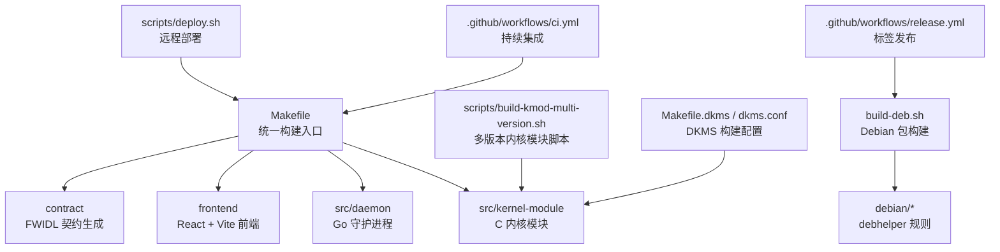
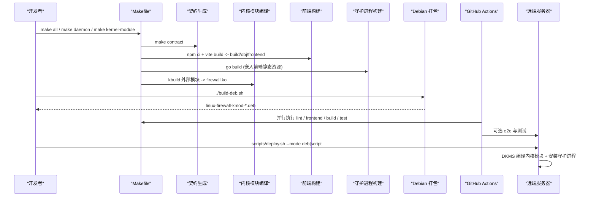
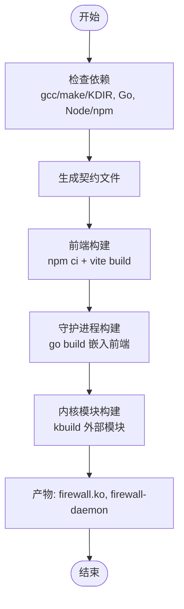
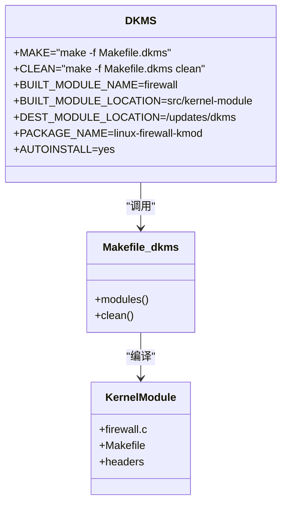
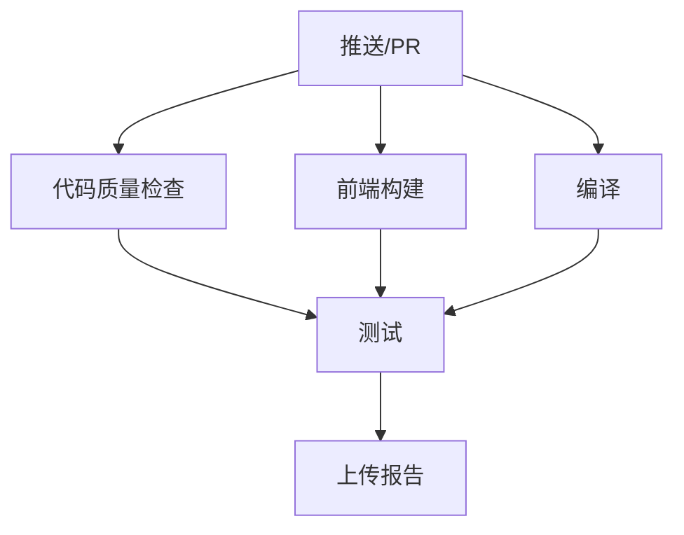
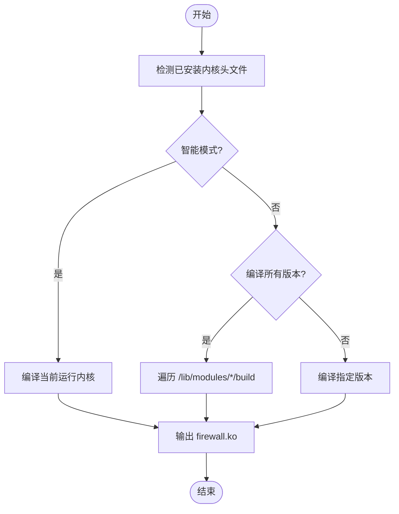
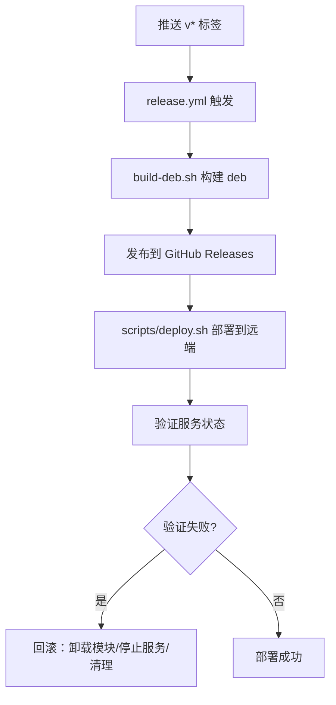
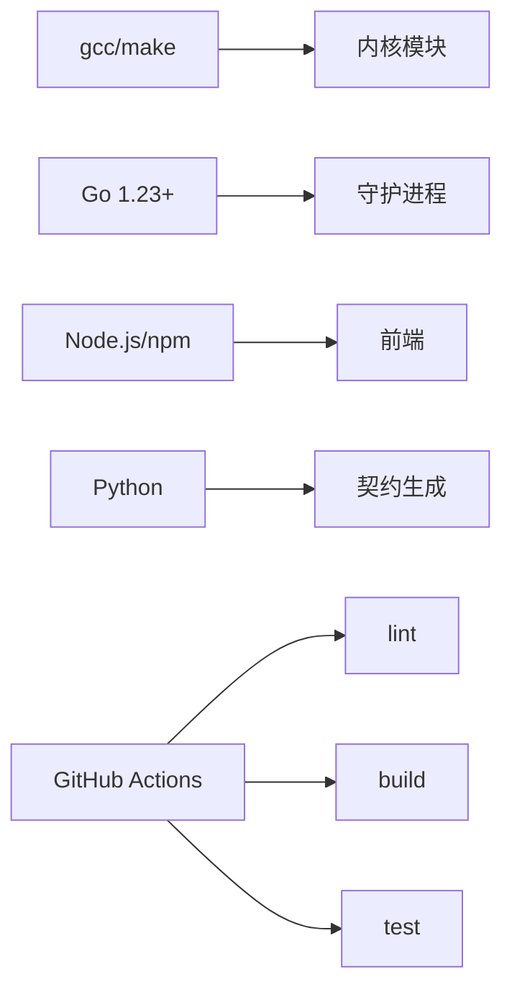

# 构建部署

<cite>
**本文引用的文件**   
- [Makefile](file://Makefile)
- [Makefile.dkms](file://Makefile.dkms)
- [dkms.conf](file://dkms.conf)
- [build-deb.sh](file://build-deb.sh)
- [ci.yml](file://.github/workflows/ci.yml)
- [release.yml](file://.github/workflows/release.yml)
- [deploy.sh](file://scripts/deploy.sh)
- [build-kmod-multi-version.sh](file://scripts/build-kmod-multi-version.sh)
</cite>

## 目录
1. [引言](#引言)
2. [项目结构](#项目结构)
3. [核心组件](#核心组件)
4. [架构总览](#架构总览)
5. [详细组件分析](#详细组件分析)
6. [依赖关系分析](#依赖关系分析)
7. [性能与缓存](#性能与缓存)
8. [故障排查指南](#故障排查指南)
9. [结论](#结论)
10. [附录：常用命令速查](#附录常用命令速查)

## 引言
本指南面向开发、测试与运维团队，系统化说明 Linux 防火墙项目的构建与部署体系。内容覆盖多语言构建系统（C 内核模块、Go 守护进程、前端静态资源）、DKMS 多版本支持、CI/CD 流水线、跨平台与远程编译、容器化打包、发布流程、版本管理与回滚策略。目标是让团队在本地、CI 和远端服务器上一致地构建、安装、升级和回滚防火墙组件。

## 项目结构
仓库采用“源码树零残留”的构建组织方式：所有中间产物输出到 `build/`，源码树只保留源码与契约定义；守护进程通过 Go embed 机制临时拷贝前端构建产物后再编译，退出时清理临时文件。

**图示来源**
- [Makefile:1-800](file://Makefile#L1-L800)
- [Makefile:801-1115](file://Makefile#L801-L1115)
- [Makefile.dkms:1-13](file://Makefile.dkms#L1-L13)
- [dkms.conf:1-8](file://dkms.conf#L1-L8)
- [build-deb.sh:1-75](file://build-deb.sh#L1-L75)
- [ci.yml:1-564](file://.github/workflows/ci.yml#L1-L564)
- [release.yml:1-48](file://.github/workflows/release.yml#L1-L48)
- [deploy.sh:1-407](file://scripts/deploy.sh#L1-L407)
- [build-kmod-multi-version.sh:1-364](file://scripts/build-kmod-multi-version.sh#L1-L364)

**章节来源**
- [Makefile:1-800](file://Makefile#L1-L800)
- [Makefile:801-1115](file://Makefile#L801-L1115)

## 核心组件
- 统一构建入口：顶层 Makefile 提供依赖检查、契约生成、内核模块编译、前端构建、守护进程编译、安装卸载、Deb 打包、CI 流程等目标。
- 内核模块：C 代码位于 `src/kernel-module`，通过 kbuild 外部模块方式编译，产物为 `firewall.ko`。
- 守护进程：Go 代码位于 `src/daemon`，使用 go:embed 嵌入前端静态资源，最终二进制为 `build/daemon/firewall-daemon`。
- 前端：React + TypeScript + Vite，构建产物输出到 `build/obj/frontend`，由守护进程构建阶段临时拷贝进 embed 目录。
- 契约系统：基于 FWIDL 的协议定义，生成头文件、TS 类型与 HTTP 契约校验器，确保内核、守护进程与前端协议一致。
- DKMS：通过 `Makefile.dkms` 与 `dkms.conf` 将内核模块纳入 DKMS，实现按目标机内核版本自动编译。
- Debian 打包：`build-deb.sh` 调用 dpkg-buildpackage，生成 `.deb`，内核模块由目标机 DKMS 编译。
- CI/CD：GitHub Actions 执行 lint、前端构建、内核模块与守护进程编译、端到端测试与报告上传。
- 远程部署：`scripts/deploy.sh` 支持 deb 模式（推荐）与 script 模式（预编译 .ko）。

**章节来源**
- [Makefile:1-800](file://Makefile#L1-L800)
- [Makefile:801-1115](file://Makefile#L801-L1115)
- [Makefile.dkms:1-13](file://Makefile.dkms#L1-L13)
- [dkms.conf:1-8](file://dkms.conf#L1-L8)
- [build-deb.sh:1-75](file://build-deb.sh#L1-L75)
- [ci.yml:1-564](file://.github/workflows/ci.yml#L1-L564)
- [release.yml:1-48](file://.github/workflows/release.yml#L1-L48)
- [deploy.sh:1-407](file://scripts/deploy.sh#L1-L407)

## 架构总览
下图展示从源码到可部署产物的完整链路，包括本地构建、CI 流水线、DKMS 与远程部署。

**图示来源**
- [Makefile:158-320](file://Makefile#L158-L320)
- [Makefile:274-319](file://Makefile#L274-L319)
- [Makefile:232-272](file://Makefile#L232-L272)
- [build-deb.sh:39-75](file://build-deb.sh#L39-L75)
- [ci.yml:10-106](file://.github/workflows/ci.yml#L10-L106)
- [ci.yml:170-341](file://.github/workflows/ci.yml#L170-L341)
- [deploy.sh:86-202](file://scripts/deploy.sh#L86-L202)
- [deploy.sh:204-391](file://scripts/deploy.sh#L204-L391)

## 详细组件分析

### 多语言构建系统
- 依赖检查：分别检查 gcc/make/内核头文件、Go 版本、Node.js/npm 版本。
- 契约生成：FWIDL 生成头文件与 TS 类型，并校验 HTTP 契约一致性。
- 前端构建：Vite 构建产物写入 `build/obj/frontend`，供守护进程 embed。
- 守护进程构建：go build 将前端静态资源嵌入二进制，构建后清理临时文件。
- 内核模块构建：kbuild 外部模块，源码 staging 到 `build/obj`，避免污染源码树。

**图示来源**
- [Makefile:67-156](file://Makefile#L67-L156)
- [Makefile:158-178](file://Makefile#L158-L178)
- [Makefile:274-319](file://Makefile#L274-L319)
- [Makefile:232-272](file://Makefile#L232-L272)

**章节来源**
- [Makefile:67-156](file://Makefile#L67-L156)
- [Makefile:158-178](file://Makefile#L158-L178)
- [Makefile:274-319](file://Makefile#L274-L319)
- [Makefile:232-272](file://Makefile#L232-L272)

### DKMS 多版本支持
- `Makefile.dkms` 作为 DKMS 构建入口，调用顶层 Makefile 的内核模块编译逻辑。
- `dkms.conf` 指定模块名称、位置、安装路径与自动安装策略。
- 目标机安装 deb 后，DKMS 根据运行内核自动编译对应版本的 `firewall.ko`。

**图示来源**
- [dkms.conf:1-8](file://dkms.conf#L1-L8)
- [Makefile.dkms:1-13](file://Makefile.dkms#L1-L13)

**章节来源**
- [dkms.conf:1-8](file://dkms.conf#L1-L8)
- [Makefile.dkms:1-13](file://Makefile.dkms#L1-L13)

### CI/CD 流水线配置
- Lint：clang-format、gofmt、shellcheck、yamllint、go vet。
- 前端：类型检查、构建、PWA 清单校验、Service Worker 语法检查。
- 构建：安装内核头文件、ccache、Go 模块缓存，编译守护进程与内核模块。
- 测试：Playwright 端到端测试、Python 集成测试，按内核兼容性跳过部分用例。
- 产物：上传覆盖率、Playwright 报告、Junit XML 与 HTML 报告。

**图示来源**
- [ci.yml:10-106](file://.github/workflows/ci.yml#L10-L106)
- [ci.yml:107-170](file://.github/workflows/ci.yml#L107-L170)
- [ci.yml:170-341](file://.github/workflows/ci.yml#L170-L341)
- [ci.yml:343-564](file://.github/workflows/ci.yml#L343-L564)

**章节来源**
- [ci.yml:10-106](file://.github/workflows/ci.yml#L10-L106)
- [ci.yml:107-170](file://.github/workflows/ci.yml#L107-L170)
- [ci.yml:170-341](file://.github/workflows/ci.yml#L170-L341)
- [ci.yml:343-564](file://.github/workflows/ci.yml#L343-L564)

### 内核模块编译
- 标准目标：`make kernel-module`，依赖契约生成，使用 kbuild 外部模块。
- 多版本：`scripts/build-kmod-multi-version.sh` 支持智能模式、全部版本、指定版本、列表与兼容性检测。
- 远程编译：`make kmod-remote HOST=<ip>` 通过 SSH/rsync/scp 在远端编译并下载产物。

**图示来源**
- [build-kmod-multi-version.sh:41-129](file://scripts/build-kmod-multi-version.sh#L41-L129)
- [build-kmod-multi-version.sh:136-183](file://scripts/build-kmod-multi-version.sh#L136-L183)
- [build-kmod-multi-version.sh:185-256](file://scripts/build-kmod-multi-version.sh#L185-L256)
- [build-kmod-multi-version.sh:258-296](file://scripts/build-kmod-multi-version.sh#L258-L296)
- [Makefile:196-230](file://Makefile#L196-L230)

**章节来源**
- [build-kmod-multi-version.sh:41-129](file://scripts/build-kmod-multi-version.sh#L41-L129)
- [build-kmod-multi-version.sh:136-183](file://scripts/build-kmod-multi-version.sh#L136-L183)
- [build-kmod-multi-version.sh:185-256](file://scripts/build-kmod-multi-version.sh#L185-L256)
- [build-kmod-multi-version.sh:258-296](file://scripts/build-kmod-multi-version.sh#L258-L296)
- [Makefile:196-230](file://Makefile#L196-L230)

### 守护进程打包
- 前端构建：`make frontend` 或 CI 中独立任务，产物到 `build/obj/frontend`。
- 守护进程构建：`make daemon` 临时拷贝前端静态资源到 `src/daemon/web_ui/static`，go build 后清理。
- 安装：`make install` 将二进制安装到 `/usr/sbin/firewall-daemon`，并注册 systemd 单元。

```mermaid
sequenceDiagram
participant Dev as "开发者"
participant Make as "Makefile"
participant NPM as "npm/vite"
participant Go as "go build"
participant System as "systemd"
Dev->>Make : make daemon
Make->>NPM : npm ci + vite build -> build/obj/frontend
Make->>Make : 拷贝前端到 src/daemon/web_ui/static
Make->>Go : go build -ldflags "-s -w=1"
Go-->>Make : build/daemon/firewall-daemon
Make->>System : systemctl enable/start
```

**图示来源**
- [Makefile:274-319](file://Makefile#L274-L319)
- [Makefile:715-790](file://Makefile#L715-L790)

**章节来源**
- [Makefile:274-319](file://Makefile#L274-L319)
- [Makefile:715-790](file://Makefile#L715-L790)

### 前端构建
- 依赖锁定：`frontend/package-lock.json` 入库，CI 使用 `npm ci` 保证可复现。
- 类型检查：`npm run typecheck` 在 CI 前端任务中执行。
- 构建产物：`index.html`、`app.js`、`style.css`、`sw.js`、`manifest.webmanifest` 及图标。
- PWA 校验：CI 检查 manifest 字段与图标尺寸，验证 Service Worker 语法。

**章节来源**
- [ci.yml:107-170](file://.github/workflows/ci.yml#L107-L170)
- [Makefile:296-319](file://Makefile#L296-L319)

### 跨平台编译与远程编译
- 跨平台：通过 `make kmod-remote HOST=<ip>` 在远端机器上编译内核模块，适用于不同架构或内核版本。
- 远程部署：`scripts/deploy.sh` 支持 deb 模式（推荐）与 script 模式（预编译 .ko），自动处理依赖、安装、验证与回滚。

**章节来源**
- [Makefile:203-230](file://Makefile#L203-L230)
- [deploy.sh:1-407](file://scripts/deploy.sh#L1-L407)

### 容器化部署
- 当前仓库未包含 Dockerfile 或容器化配置，但可通过以下方式实现：
  - 使用 `./build-deb.sh` 生成 `.deb`，在容器中安装。
  - 使用 `make install DESTDIR=<path>` 进行暂存安装，再复制到容器镜像。
  - 结合 CI 中的 `dpkg-buildpackage` 与 debhelper 环境构建 deb。

[本节为概念性说明，不直接分析具体文件]

### 发布流程、版本管理与回滚策略
- 版本号来源：`build-deb.sh` 从 `CHANGELOG.md` 自动提取最新版本，或通过环境变量/参数显式传入。
- 发布触发：GitHub Actions `release.yml` 监听 `v*` 标签，构建 deb 并发布到 GitHub Releases。
- 回滚策略：
  - deb 模式：`scripts/deploy.sh` 支持同版本重装（`--reinstall`），失败时清理半配置状态。
  - script 模式：部署失败时自动回滚，移除模块、停止服务、清理临时文件。
  - 内核模块：DKMS 管理多版本模块，可按需卸载旧版本。

**图示来源**
- [release.yml:1-48](file://.github/workflows/release.yml#L1-L48)
- [build-deb.sh:13-28](file://build-deb.sh#L13-L28)
- [deploy.sh:140-157](file://scripts/deploy.sh#L140-L157)
- [deploy.sh:224-238](file://scripts/deploy.sh#L224-L238)

**章节来源**
- [release.yml:1-48](file://.github/workflows/release.yml#L1-L48)
- [build-deb.sh:13-28](file://build-deb.sh#L13-L28)
- [deploy.sh:140-157](file://scripts/deploy.sh#L140-L157)
- [deploy.sh:224-238](file://scripts/deploy.sh#L224-L238)

## 依赖关系分析
- 构建依赖：gcc、make、内核头文件、Go 1.23+、Node.js 18+、npm。
- CI 依赖：clang-format、shellcheck、yamllint、pytest、playwright。
- 运行时依赖：systemd、curl、sqlite3（测试套件）、DKMS（目标机）。
- 契约依赖：Python 生成器、Go 编译器（用于契约校验）。

**图示来源**
- [Makefile:67-156](file://Makefile#L67-L156)
- [ci.yml:37-49](file://.github/workflows/ci.yml#L37-L49)
- [ci.yml:179-189](file://.github/workflows/ci.yml#L179-L189)

**章节来源**
- [Makefile:67-156](file://Makefile#L67-L156)
- [ci.yml:37-49](file://.github/workflows/ci.yml#L37-L49)
- [ci.yml:179-189](file://.github/workflows/ci.yml#L179-L189)

## 性能与缓存
- ccache：加速内核模块重复编译，CI 中缓存 `~/.ccache`。
- Go 模块缓存：CI 缓存 `~/go/pkg/mod` 与 `~/.cache/go-build`。
- npm 缓存：CI 缓存 `node_modules` 与 `package-lock.json`。
- 构建优化：`make build-quick` 跳过格式检查，`SKIP_TESTS=1` 跳过测试。

**章节来源**
- [ci.yml:191-212](file://.github/workflows/ci.yml#L191-L212)
- [Makefile:186-194](file://Makefile#L186-L194)

## 故障排查指南
- 内核头文件缺失：安装 `linux-headers-$(uname -r)` 或指定 `KDIR`。
- 守护进程启动失败：检查 systemd 日志 `journalctl -u firewall-daemon.service`。
- 面板不可达：确认端口 9119 是否监听，检查认证凭据。
- 内核模块加载失败：检查 vermagic 匹配，使用 `modinfo firewall.ko` 查看元信息。
- 契约漂移：运行 `make contract-drift` 重新生成契约文件。
- 远程部署失败：检查 SSH 连接、权限、远端依赖（DKMS、systemd、curl）。

**章节来源**
- [Makefile:91-106](file://Makefile#L91-L106)
- [Makefile:781-790](file://Makefile#L781-L790)
- [deploy.sh:160-201](file://scripts/deploy.sh#L160-L201)
- [deploy.sh:352-390](file://scripts/deploy.sh#L352-L390)

## 结论
本项目构建了完整的多语言构建体系，涵盖内核模块、守护进程与前端，并通过 DKMS 实现多版本内核支持。CI/CD 流水线确保代码质量、构建稳定性与测试覆盖率。远程部署脚本简化了生产环境的安装与维护，版本管理与回滚策略保障了发布的安全性。团队可依据本指南高效地进行构建、部署与故障排查。

## 附录：常用命令速查
- 检查依赖：`make check-deps`
- 编译内核模块：`make kernel-module`
- 编译守护进程：`make daemon`
- 快速构建：`make build-quick`
- 多版本内核模块：`./scripts/build-kmod-multi-version.sh --all`
- 远程编译：`make kmod-remote HOST=<ip> USER=<user>`
- 构建 deb：`./build-deb.sh <version>`
- 远程部署：`./scripts/deploy.sh <host> [user] [--mode deb|script]`
- 运行测试：`make test`
- 清理构建：`make clean`

**章节来源**
- [Makefile:1023-1093](file://Makefile#L1023-L1093)