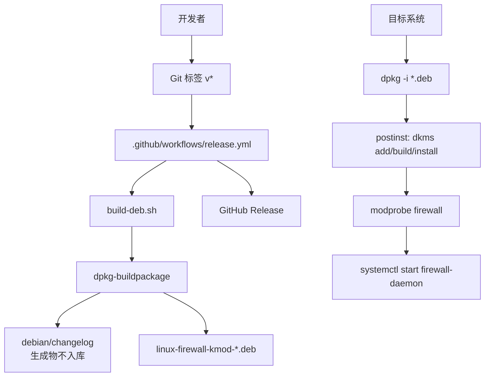
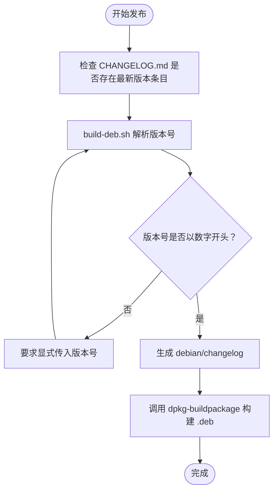
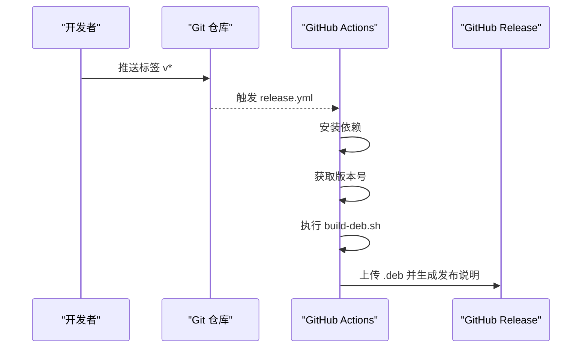
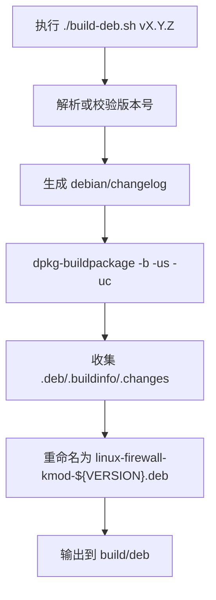
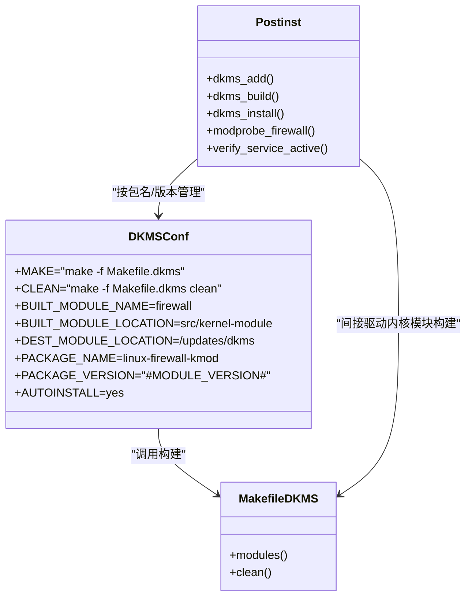
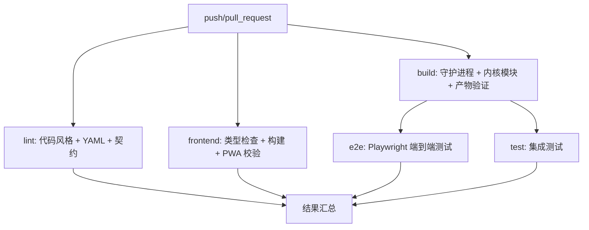
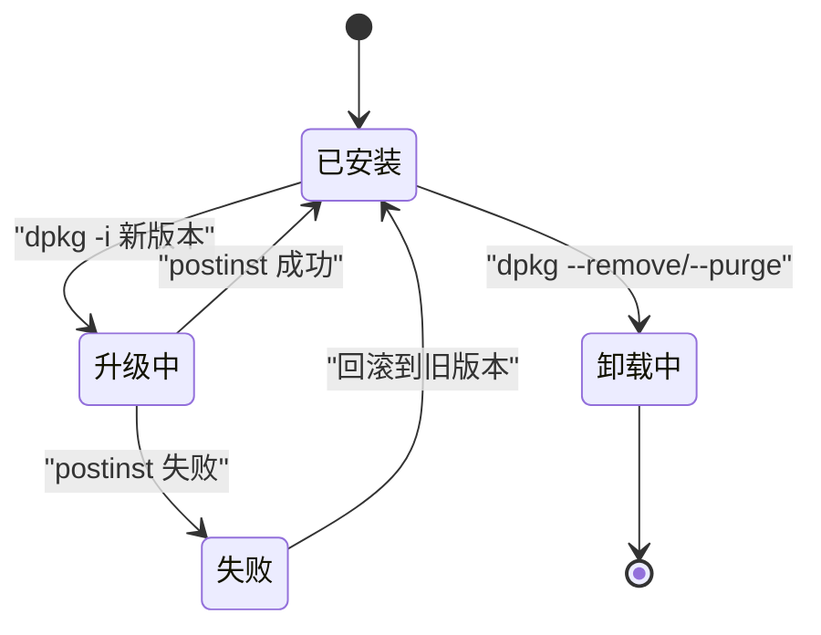
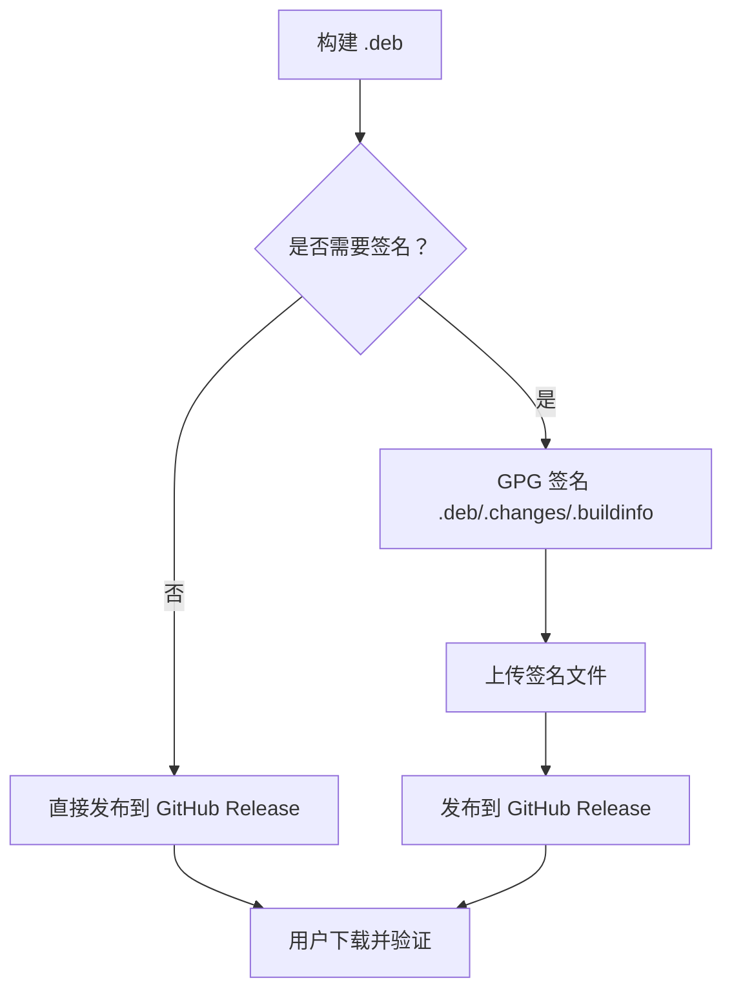
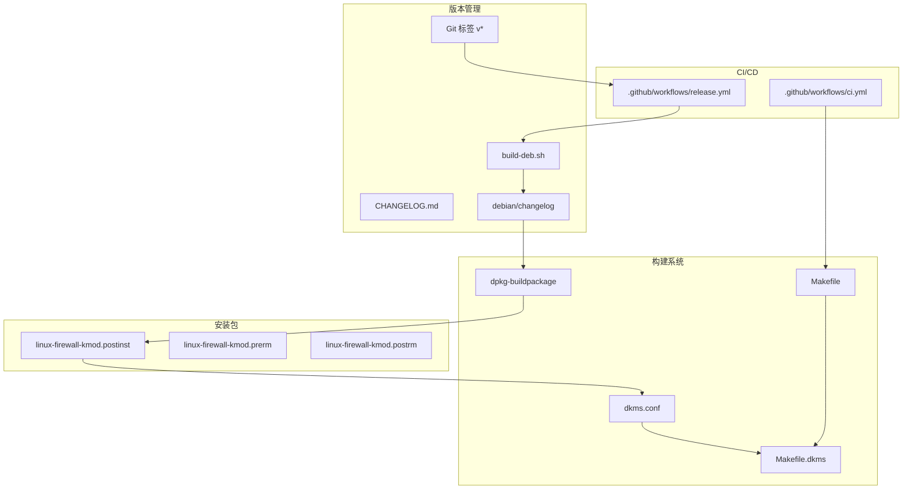

# 版本管理

<cite>
**本文引用的文件**   
- [README.md](file://README.md)
- [Makefile](file://Makefile)
- [build-deb.sh](file://build-deb.sh)
- [dkms.conf](file://dkms.conf)
- [Makefile.dkms](file://Makefile.dkms)
- [.github/workflows/ci.yml](file://.github/workflows/ci.yml)
- [.github/workflows/release.yml](file://.github/workflows/release.yml)
- [debian/linux-firewall-kmod.postinst](file://debian/linux-firewall-kmod.postinst)
- [debian/linux-firewall-kmod.prerm](file://debian/linux-firewall-kmod.prerm)
- [debian/linux-firewall-kmod.postrm](file://debian/linux-firewall-kmod.postrm)
</cite>

## 目录
1. [引言](#引言)
2. [项目结构与版本相关入口](#项目结构与版本相关入口)
3. [版本号规范与变更日志](#版本号规范与变更日志)
4. [Git 标签与发布分支策略](#git-标签与发布分支策略)
5. [Debian 包构建流程](#debian-包构建流程)
6. [DKMS 模块打包与多发行版兼容](#dkms-模块打包与多发行版兼容)
7. [CI 质量门禁与可追溯性](#ci-质量门禁与可追溯性)
8. [回滚机制与热更新支持](#回滚机制与热更新支持)
9. [发布前检查清单](#发布前检查清单)
10. [签名验证与分发渠道](#签名验证与分发渠道)
11. [依赖关系图](#依赖关系图)
12. [结论](#结论)

## 引言
本文面向维护者、运维人员和发布负责人，系统化说明本仓库的版本管理流程。内容覆盖版本号规范、Git 标签管理、变更日志维护、Debian 包构建、DKMS 内核模块打包、多发行版兼容性处理、发布分支策略、回滚机制、热更新支持、发布前检查清单、签名验证和分发渠道管理。目标是让每次版本发布都可追溯、可回滚、安全可靠。

## 项目结构与版本相关入口
与版本管理直接相关的核心入口如下：
- 顶层构建与 CI 入口：`Makefile`、`.github/workflows/ci.yml`
- Debian 包构建脚本：`build-deb.sh`
- DKMS 配置与构建入口：`dkms.conf`、`Makefile.dkms`
- Debian 安装/卸载钩子：`debian/linux-firewall-kmod.postinst`、`prerm`、`postrm`
- 发布自动化：`.github/workflows/release.yml`
- 项目说明与版本展示：`README.md`

**图示来源**
- [.github/workflows/release.yml:1-48](file://.github/workflows/release.yml#L1-L48)
- [build-deb.sh:1-75](file://build-deb.sh#L1-L75)
- [debian/linux-firewall-kmod.postinst:1-82](file://debian/linux-firewall-kmod.postinst#L1-L82)

**章节来源**
- [README.md:1-250](file://README.md#L1-L250)
- [Makefile:1-800](file://Makefile#L1-L800)
- [build-deb.sh:1-75](file://build-deb.sh#L1-L75)
- [dkms.conf:1-8](file://dkms.conf#L1-L8)
- [Makefile.dkms:1-13](file://Makefile.dkms#L1-L13)
- [.github/workflows/ci.yml:1-564](file://.github/workflows/ci.yml#L1-L564)
- [.github/workflows/release.yml:1-48](file://.github/workflows/release.yml#L1-L48)
- [debian/linux-firewall-kmod.postinst:1-82](file://debian/linux-firewall-kmod.postinst#L1-L82)
- [debian/linux-firewall-kmod.prerm:1-14](file://debian/linux-firewall-kmod.prerm#L1-L14)
- [debian/linux-firewall-kmod.postrm:1-42](file://debian/linux-firewall-kmod.postrm#L1-L42)

## 版本号规范与变更日志
### 版本号规范
- Git 标签使用 `v` 前缀的语义化版本，例如 `v2.4.0`。
- `README.md` 中通过 GitHub Releases 徽章显示当前版本，表明对外发布的稳定版本以 Git 标签为准。
- `build-deb.sh` 会从 `CHANGELOG.md` 自动提取最新版本号；若无法解析或版本号不以数字开头，会要求显式传入版本号。
- Debian 包内部版本号必须以数字开头，因此脚本会在构建前移除 `v` 前缀。

建议规范：
- 主版本：破坏性变更
- 次版本：向后兼容的功能新增
- 修订版本：向后兼容的问题修复
- 预发布版本：在正式发布前可使用 `vX.Y.Z-rc.N` 等格式，但 deb 包最终版本号仍需符合 Debian 规则。

### 变更日志维护
- `build-deb.sh` 从 `CHANGELOG.md` 读取最新已发布条目，并派生 `debian/changelog`。
- `debian/changelog` 是 Debian 侧唯一的版本来源，由脚本生成，不应手动提交到仓库。
- 发布前应确保 `CHANGELOG.md` 包含清晰的版本条目，否则 `build-deb.sh` 可能无法确定版本号。

**图示来源**
- [build-deb.sh:13-28](file://build-deb.sh#L13-L28)
- [build-deb.sh:39-46](file://build-deb.sh#L39-L46)
- [build-deb.sh:51-75](file://build-deb.sh#L51-L75)

**章节来源**
- [README.md:7-8](file://README.md#L7-L8)
- [build-deb.sh:13-28](file://build-deb.sh#L13-L28)
- [build-deb.sh:39-46](file://build-deb.sh#L39-L46)

## Git 标签与发布分支策略
### 触发条件
- `.github/workflows/release.yml` 监听 `push` 事件中的 `tags: v*`。
- 只有以 `v` 开头的 Git 标签才会触发自动化发布流程。

### 推荐分支策略
- `main` 或 `master`：主开发分支，持续集成运行。
- `release/vX.Y.Z`：可选的发布候选分支，用于冻结代码、回归测试和签发补丁。
- `hotfix/vX.Y.Z-N`：紧急修复分支，合并回主分支后打新标签。
- 所有正式版本必须通过 Git 标签发布，禁止直接推送未标记的构建产物作为“稳定版本”。

### 发布流程
1. 在目标分支完成功能开发与测试。
2. 更新 `CHANGELOG.md`，确认最新版本条目。
3. 创建并推送 Git 标签，例如 `git tag -a v2.4.0 -m "Release v2.4.0"`。
4. 推送标签后，GitHub Actions 自动构建 deb 包并发布到 GitHub Releases。

**图示来源**
- [.github/workflows/release.yml:1-48](file://.github/workflows/release.yml#L1-L48)

**章节来源**
- [.github/workflows/release.yml:1-48](file://.github/workflows/release.yml#L1-L48)

## Debian 包构建流程
### 构建入口
- `build-deb.sh` 是 Debian 包构建的主脚本。
- 它负责：
  - 自动或显式获取版本号。
  - 清理旧构建产物。
  - 生成 `debian/changelog`。
  - 调用 `dpkg-buildpackage`。
  - 将产物移动到 `build/deb` 并重命名为统一格式。

### 构建产物
- 标准产物包括 `.deb`、`.buildinfo`、`.changes`。
- 最终 deb 文件名约定为 `linux-firewall-kmod-${VERSION}.deb`。
- 该命名约定被 `scripts/deploy.sh` 与 `release.yml` 引用，因此发布流程依赖此契约。

### 构建环境
- CI 中安装 `build-essential`、`dpkg-dev`、`debhelper`、`nodejs`、`npm`、`python3`。
- 内核模块由 DKMS 在安装时编译，构建机不需要内核头文件。
- 守护进程前端由 Node.js/npm 构建，并嵌入到 Go 二进制中。

**图示来源**
- [build-deb.sh:13-28](file://build-deb.sh#L13-L28)
- [build-deb.sh:39-46](file://build-deb.sh#L39-L46)
- [build-deb.sh:51-75](file://build-deb.sh#L51-L75)

**章节来源**
- [build-deb.sh:1-75](file://build-deb.sh#L1-L75)

## DKMS 模块打包与多发行版兼容
### DKMS 配置
- `dkms.conf` 指定：
  - 构建命令：`make -f Makefile.dkms`
  - 清理命令：`make -f Makefile.dkms clean`
  - 模块名称：`firewall`
  - 源码位置：`src/kernel-module`
  - 安装位置：`/updates/dkms`
  - 包名：`linux-firewall-kmod`
  - 包版本：由 DKMS 注入 `#MODULE_VERSION#`
  - 自动安装：`AUTOINSTALL=yes`

### DKMS 构建入口
- `Makefile.dkms` 调用内核 kbuild，指向 `src/kernel-module`。
- 目标系统安装 deb 后，`postinst` 会执行：
  - `dkms add`
  - `dkms build`
  - `dkms install --force`
  - `modprobe firewall`
  - 启动并断言 `firewall-daemon.service` 处于 active 状态。

### 多发行版兼容性
- DKMS 会根据目标系统的内核版本动态编译内核模块，避免跨内核加载失败。
- `postinst` 会清理残留 DKMS 条目、卸载内存中的旧模块、重新编译并加载新版本。
- 卸载时 `postrm` 会清理 `/var/lib/dkms`、`/lib/modules/*/updates/dkms`、`/lib/modules/*/extra` 下的残留模块。

**图示来源**
- [dkms.conf:1-8](file://dkms.conf#L1-L8)
- [Makefile.dkms:1-13](file://Makefile.dkms#L1-L13)
- [debian/linux-firewall-kmod.postinst:1-82](file://debian/linux-firewall-kmod.postinst#L1-L82)

**章节来源**
- [dkms.conf:1-8](file://dkms.conf#L1-L8)
- [Makefile.dkms:1-13](file://Makefile.dkms#L1-L13)
- [debian/linux-firewall-kmod.postinst:1-82](file://debian/linux-firewall-kmod.postinst#L1-L82)
- [debian/linux-firewall-kmod.postrm:1-42](file://debian/linux-firewall-kmod.postrm#L1-L42)

## CI 质量门禁与可追溯性
### CI 阶段
- `.github/workflows/ci.yml` 定义了多个并行任务：
  - `lint`：代码风格、YAML 检查、契约漂移校验、契约校验器。
  - `frontend`：前端类型检查、构建、PWA 资源校验。
  - `build`：守护进程与内核模块编译、产物验证、ccache 统计。
  - `e2e`：浏览器端到端测试，探测内核模块兼容性。
  - `test`：集成测试，根据内核模块兼容性选择测试集。

### 可追溯性保障
- 所有构建步骤明确记录环境与工具版本。
- 构建产物通过 GitHub Actions artifact 上传，便于回溯。
- 契约系统保证 netlink、procfs、HTTP 接口一致性，防止 ABI 漂移。
- 内核模块构建使用 ccache 加速重复构建，同时保留构建统计。

**图示来源**
- [.github/workflows/ci.yml:1-564](file://.github/workflows/ci.yml#L1-L564)

**章节来源**
- [.github/workflows/ci.yml:1-564](file://.github/workflows/ci.yml#L1-L564)

## 回滚机制与热更新支持
### 回滚机制
- **Git 层回滚**：通过 Git 标签定位历史版本，可快速检出并重新发布。
- **包层回滚**：目标系统可通过 `dpkg` 安装旧版本 deb 包实现回滚。
- **DKMS 层回滚**：`postinst` 会清理旧 DKMS 树、卸载内存中的旧模块、重新编译并加载新版本；卸载时 `postrm` 清理 DKMS 残留。
- **服务层回滚**：`prerm` 在 remove/deconfigure 时卸载内核模块；`postinst` 在升级时先卸载内存中的旧模块，再安装新版本。

### 热更新支持
- 守护进程支持热重载：SIGHUP 或配置文件变化触发配置重载。
- 威胁情报源支持热重载：SIGHUP 触发配置重载时同步刷新情报。
- 内核模块通过 DKMS 在升级时重新编译并加载，避免重启系统。

**图示来源**
- [debian/linux-firewall-kmod.postinst:1-82](file://debian/linux-firewall-kmod.postinst#L1-L82)
- [debian/linux-firewall-kmod.prerm:1-14](file://debian/linux-firewall-kmod.prerm#L1-L14)
- [debian/linux-firewall-kmod.postrm:1-42](file://debian/linux-firewall-kmod.postrm#L1-L42)

**章节来源**
- [debian/linux-firewall-kmod.postinst:1-82](file://debian/linux-firewall-kmod.postinst#L1-L82)
- [debian/linux-firewall-kmod.prerm:1-14](file://debian/linux-firewall-kmod.prerm#L1-L14)
- [debian/linux-firewall-kmod.postrm:1-42](file://debian/linux-firewall-kmod.postrm#L1-L42)
- [README.md:95-129](file://README.md#L95-L129)

## 发布前检查清单
### 代码与契约
- 运行完整 CI：`make ci`
- 确认契约无漂移：`make contract-drift`
- 运行契约校验器：`make contract-check`
- 前端类型检查与构建通过

### 构建与产物
- 守护进程构建成功：`make daemon`
- 内核模块构建成功：`make kmod`
- Debian 包构建成功：`./build-deb.sh vX.Y.Z`
- 产物路径正确：`build/deb/linux-firewall-kmod-${VERSION}.deb`

### 版本与文档
- `CHANGELOG.md` 包含最新版本条目
- `README.md` 中版本号与 Git 标签一致
- Git 标签已推送：`git push origin vX.Y.Z`

### 安全与签名
- 确认未提交敏感凭据
- 如需签名，准备 GPG 私钥与密钥环
- 确认分发渠道权限与访问控制

### 部署验证
- 在测试环境安装 deb 包
- 验证 DKMS 编译与模块加载
- 验证 `firewall-daemon.service` 处于 active 状态
- 验证 ProcFS、HTTP API、面板功能正常

**章节来源**
- [Makefile:325-543](file://Makefile#L325-L543)
- [build-deb.sh:13-75](file://build-deb.sh#L13-L75)
- [debian/linux-firewall-kmod.postinst:1-82](file://debian/linux-firewall-kmod.postinst#L1-L82)

## 签名验证与分发渠道
### 当前状态
- `.github/workflows/release.yml` 使用 `softprops/action-gh-release@v3` 上传 `.deb` 并生成发布说明。
- 当前发布流程未包含 GPG 签名步骤。
- `dpkg-buildpackage` 调用参数为 `-us -uc`，表示跳过用户签名和 changelog 签名。

### 建议增强
- 在 CI 中引入 GPG 签名步骤，对 `.deb`、`.changes`、`.buildinfo` 进行签名。
- 将签名公钥上传至可信渠道，供用户验证。
- 在发布说明中提供签名验证命令与指纹。
- 考虑使用 Cosign 或 Sigstore 进行现代化签名与透明性日志。

### 分发渠道
- GitHub Releases：当前主要分发渠道。
- 企业私有仓库：可将 deb 包上传至内部制品库。
- 镜像站：适用于大规模分发场景。

**图示来源**
- [.github/workflows/release.yml:39-48](file://.github/workflows/release.yml#L39-L48)
- [build-deb.sh:51-75](file://build-deb.sh#L51-L75)

**章节来源**
- [.github/workflows/release.yml:1-48](file://.github/workflows/release.yml#L1-L48)
- [build-deb.sh:51-75](file://build-deb.sh#L51-L75)

## 依赖关系图

**图示来源**
- [build-deb.sh:13-75](file://build-deb.sh#L13-L75)
- [Makefile:325-543](file://Makefile#L325-L543)
- [Makefile.dkms:1-13](file://Makefile.dkms#L1-L13)
- [dkms.conf:1-8](file://dkms.conf#L1-L8)
- [.github/workflows/ci.yml:1-564](file://.github/workflows/ci.yml#L1-L564)
- [.github/workflows/release.yml:1-48](file://.github/workflows/release.yml#L1-L48)
- [debian/linux-firewall-kmod.postinst:1-82](file://debian/linux-firewall-kmod.postinst#L1-L82)
- [debian/linux-firewall-kmod.prerm:1-14](file://debian/linux-firewall-kmod.prerm#L1-L14)
- [debian/linux-firewall-kmod.postrm:1-42](file://debian/linux-firewall-kmod.postrm#L1-L42)

## 结论
本项目的版本管理以 Git 标签为核心触发点，结合 `build-deb.sh` 与 DKMS 实现 Debian 包构建与内核模块动态编译。CI 提供代码质量、契约一致性、构建与测试门禁，确保发布质量。发布流程目前通过 GitHub Actions 自动生成 deb 包并发布到 GitHub Releases。为保障可追溯、可回滚、安全可靠，建议：
- 严格遵循版本号规范与变更日志维护。
- 强化签名验证与分发渠道管理。
- 完善回滚演练与热更新验证。
- 在 CI 中增加签名与完整性校验步骤。