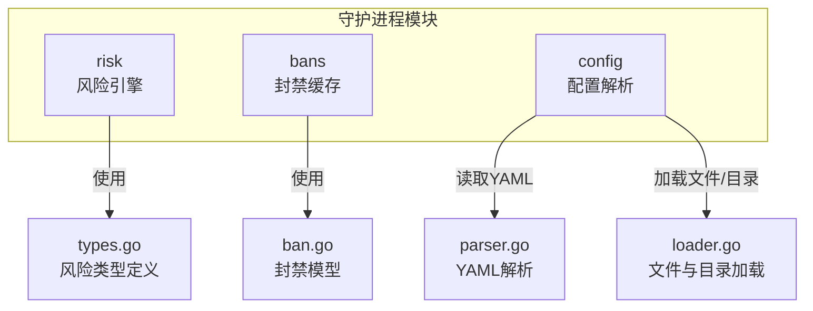
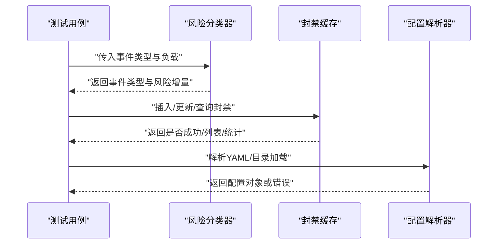
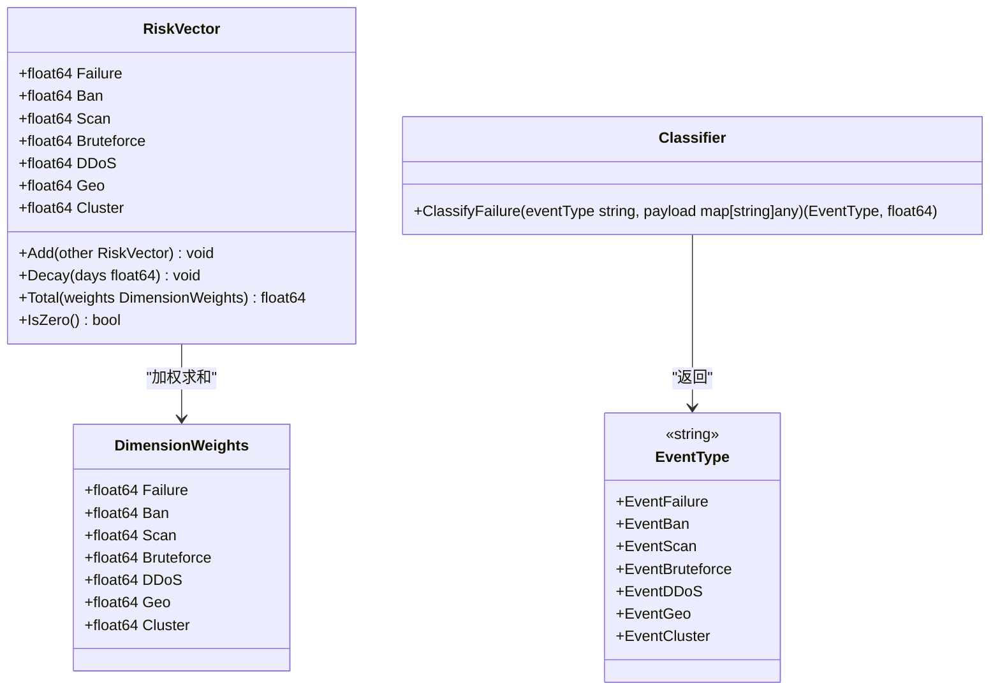
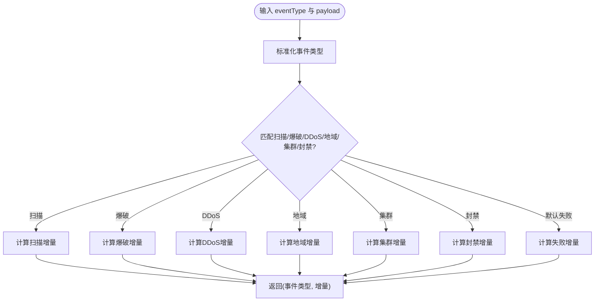
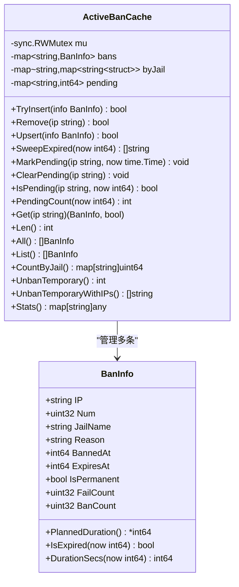
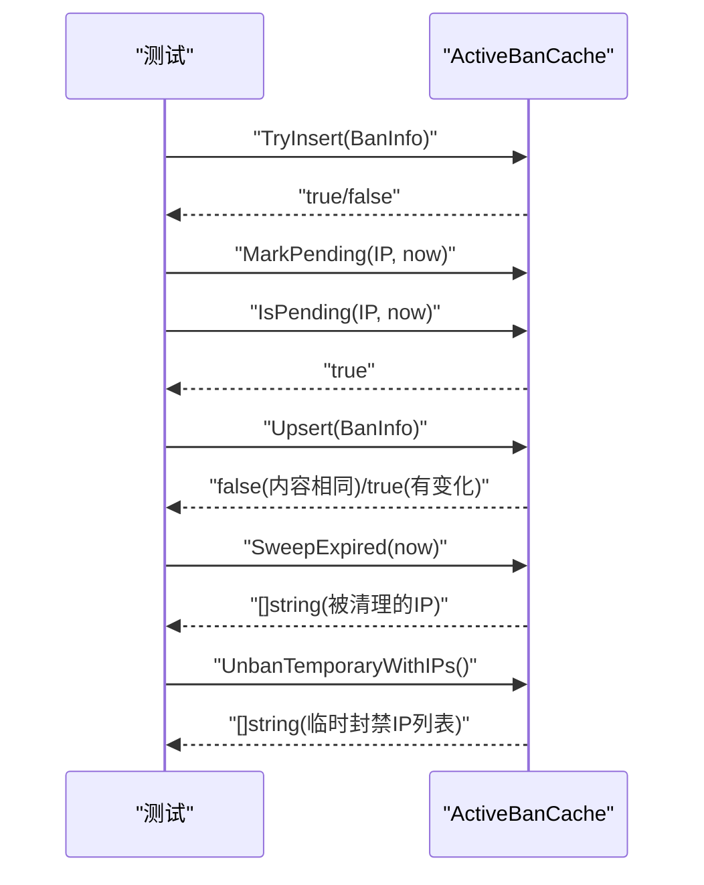
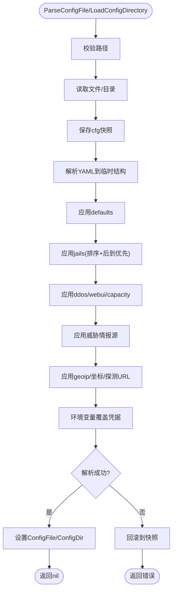
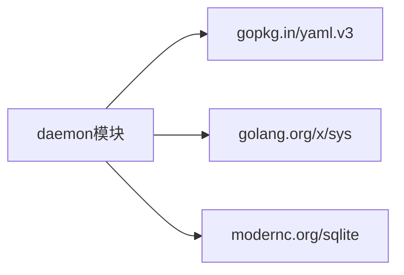

# Go后端单元测试

<cite>
**本文引用的文件**   
- [src/daemon/go.mod](file://src/daemon/go.mod)
- [src/daemon/internal/risk/classifier.go](file://src/daemon/internal/risk/classifier.go)
- [src/daemon/internal/risk/classifier_test.go](file://src/daemon/internal/risk/classifier_test.go)
- [src/daemon/internal/risk/types.go](file://src/daemon/internal/risk/types.go)
- [src/daemon/internal/bans/cache.go](file://src/daemon/internal/bans/cache.go)
- [src/daemon/internal/bans/cache_test.go](file://src/daemon/internal/bans/cache_test.go)
- [src/daemon/internal/bans/ban.go](file://src/daemon/internal/bans/ban.go)
- [src/daemon/internal/config/loader.go](file://src/daemon/internal/config/loader.go)
- [src/daemon/internal/config/parser.go](file://src/daemon/internal/config/parser.go)
- [src/daemon/internal/config/config_test.go](file://src/daemon/internal/config/config_test.go)
</cite>

## 目录
1. [引言](#引言)
2. [项目结构](#项目结构)
3. [核心组件](#核心组件)
4. [架构总览](#架构总览)
5. [详细组件分析](#详细组件分析)
6. [依赖分析](#依赖分析)
7. [性能考虑](#性能考虑)
8. [故障排查指南](#故障排查指南)
9. [结论](#结论)

## 引言
本文面向Go后端开发者，系统梳理本仓库中风险引擎分类器、封禁缓存与配置解析器等核心组件的单元测试实践。文档重点包括：
- Go标准测试框架testing包的使用方式
- table-driven tests模式与子测试组织
- 断言策略（基于标准库t.Errorf/t.Fatalf）
- Mock与外部依赖隔离方法
- 并发安全测试、错误路径测试与基准测试最佳实践
- 如何为风险引擎、封禁缓存和配置加载编写高质量单测

## 项目结构
本项目的Go代码位于`src/daemon`模块下，核心业务逻辑集中在`internal`子包中。与单元测试直接相关的三个关键目录如下：
- `internal/risk`：风险向量、事件分类与衰减
- `internal/bans`：封禁数据模型、活跃封禁缓存与白名单键归一化
- `internal/config`：YAML配置解析、目录加载、运行时覆盖与校验

**图表来源**
- [src/daemon/internal/risk/types.go:1-131](file://src/daemon/internal/risk/types.go#L1-L131)
- [src/daemon/internal/bans/ban.go:1-132](file://src/daemon/internal/bans/ban.go#L1-L132)
- [src/daemon/internal/config/parser.go:1-731](file://src/daemon/internal/config/parser.go#L1-L731)
- [src/daemon/internal/config/loader.go:1-129](file://src/daemon/internal/config/loader.go#L1-L129)

**章节来源**
- [src/daemon/go.mod:1-22](file://src/daemon/go.mod#L1-L22)

## 核心组件
本节聚焦三类核心组件及其测试要点：
- 风险引擎分类器：纯函数式分类，按事件类型与负载计算风险增量
- 封禁缓存：并发安全的活跃封禁内存权威存储，含反向索引与待确认标记
- 配置解析器：严格模式YAML解析、目录合并、运行期覆盖与原子回滚

**章节来源**
- [src/daemon/internal/risk/classifier.go:1-145](file://src/daemon/internal/risk/classifier.go#L1-L145)
- [src/daemon/internal/bans/cache.go:1-293](file://src/daemon/internal/bans/cache.go#L1-L293)
- [src/daemon/internal/config/parser.go:1-731](file://src/daemon/internal/config/parser.go#L1-L731)
- [src/daemon/internal/config/loader.go:1-129](file://src/daemon/internal/config/loader.go#L1-L129)

## 架构总览
下图展示风险引擎、封禁缓存与配置解析器在守护进程中的协作关系，以及测试关注点。

**图表来源**
- [src/daemon/internal/risk/classifier.go:15-34](file://src/daemon/internal/risk/classifier.go#L15-L34)
- [src/daemon/internal/bans/cache.go:46-115](file://src/daemon/internal/bans/cache.go#L46-L115)
- [src/daemon/internal/config/parser.go:155-207](file://src/daemon/internal/config/parser.go#L155-L207)

## 详细组件分析

### 风险引擎分类器
风险分类器是纯函数，不依赖任何状态，便于独立测试。它根据事件类型字符串与负载map决定事件类别与风险向量增量。

#### 类图

**图表来源**
- [src/daemon/internal/risk/types.go:9-131](file://src/daemon/internal/risk/types.go#L9-L131)
- [src/daemon/internal/risk/classifier.go:15-34](file://src/daemon/internal/risk/classifier.go#L15-L34)

#### 测试要点
- Table-driven tests：用结构化测试表覆盖不同事件类型与负载组合
- 子测试：每个用例通过`t.Run`组织，输出清晰
- 基准测试：提供`BenchmarkClassifyFailure`评估分类性能

**图表来源**
- [src/daemon/internal/risk/classifier.go:15-145](file://src/daemon/internal/risk/classifier.go#L15-L145)

**章节来源**
- [src/daemon/internal/risk/classifier.go:1-145](file://src/daemon/internal/risk/classifier.go#L1-L145)
- [src/daemon/internal/risk/classifier_test.go:1-127](file://src/daemon/internal/risk/classifier_test.go#L1-L127)
- [src/daemon/internal/risk/types.go:1-131](file://src/daemon/internal/risk/types.go#L1-L131)

### 封禁缓存
封禁缓存是活跃封禁的内存权威存储，使用读写锁保护主表与反向索引，确保读方不会看到中间态。它还维护“等待内核确认”的IP集合，防止对账误删刚下发的封禁。

#### 类图

**图表来源**
- [src/daemon/internal/bans/cache.go:21-293](file://src/daemon/internal/bans/cache.go#L21-L293)
- [src/daemon/internal/bans/ban.go:82-132](file://src/daemon/internal/bans/ban.go#L82-L132)

#### 并发安全测试要点
- 写入原子性：`TryInsert`保证同一IP只一次成功；`Upsert`保证字段变化时正确报告变更
- 反向索引一致性：jail变更后旧归属被清理
- 待确认标记生命周期：`MarkPending`/`IsPending`/`ClearPending`/`PendingCount`
- 过期清理：`SweepExpired`仅删除已过期条目，保留永久封禁
- 批量解封：`UnbanTemporaryWithIPs`清理pending并保留永久封禁

**图表来源**
- [src/daemon/internal/bans/cache.go:46-115](file://src/daemon/internal/bans/cache.go#L46-L115)
- [src/daemon/internal/bans/cache.go:156-199](file://src/daemon/internal/bans/cache.go#L156-L199)
- [src/daemon/internal/bans/cache.go:247-272](file://src/daemon/internal/bans/cache.go#L247-L272)

**章节来源**
- [src/daemon/internal/bans/cache.go:1-293](file://src/daemon/internal/bans/cache.go#L1-L293)
- [src/daemon/internal/bans/cache_test.go:1-278](file://src/daemon/internal/bans/cache_test.go#L1-L278)
- [src/daemon/internal/bans/ban.go:1-132](file://src/daemon/internal/bans/ban.go#L1-L132)

### 配置解析器
配置解析器负责YAML解析、目录加载、运行期覆盖与严格模式校验。其设计强调原子性：解析失败时整体回滚到调用前快照。

#### 流程概览

**图表来源**
- [src/daemon/internal/config/loader.go:20-51](file://src/daemon/internal/config/loader.go#L20-L51)
- [src/daemon/internal/config/loader.go:60-128](file://src/daemon/internal/config/loader.go#L60-L128)
- [src/daemon/internal/config/parser.go:155-207](file://src/daemon/internal/config/parser.go#L155-L207)

#### 测试要点
- 默认值验证：`Default()`各字段默认值
- YAML解析：`default.yaml`等夹具文件的解析结果
- 严格模式：未知字段应被拒绝
- Jail合并：同名jail后到优先，智能默认生效
- 坐标配对与范围校验
- 探测URL规范化
- 路径校验与安全限制
- 监听地址合成与IPv6方括号处理
- 历史数据库可配置性

**章节来源**
- [src/daemon/internal/config/parser.go:1-731](file://src/daemon/internal/config/parser.go#L1-L731)
- [src/daemon/internal/config/loader.go:1-129](file://src/daemon/internal/config/loader.go#L1-L129)
- [src/daemon/internal/config/config_test.go:1-401](file://src/daemon/internal/config/config_test.go#L1-L401)

## 依赖分析
Go模块依赖较少，主要依赖标准库与少量第三方库用于YAML解析与SQLite持久化（间接）。

**图表来源**
- [src/daemon/go.mod:1-22](file://src/daemon/go.mod#L1-L22)

**章节来源**
- [src/daemon/go.mod:1-22](file://src/daemon/go.mod#L1-L22)

## 性能考虑
- 风险分类器提供基准测试，可用于评估事件分类的性能开销
- 封禁缓存使用读写锁分离读多写少场景，避免全局锁竞争
- 配置解析器在目录加载时对文件排序与快照回滚，保证一致性的同时减少重复解析

[本节为通用指导，不直接分析具体文件]

## 故障排查指南
- 风险分类器：若事件类型未命中预期分支，检查eventType字符串大小写与payload字段类型
- 封禁缓存：若出现“幽灵封禁”，检查PendingAckTimeout与对账逻辑；若反向索引不一致，检查Upsert/jail变更路径
- 配置解析器：严格模式下未知字段会报错；路径校验失败需检查符号链接与长度限制；坐标必须成对且范围合法

**章节来源**
- [src/daemon/internal/risk/classifier.go:15-145](file://src/daemon/internal/risk/classifier.go#L15-L145)
- [src/daemon/internal/bans/cache.go:156-199](file://src/daemon/internal/bans/cache.go#L156-L199)
- [src/daemon/internal/config/parser.go:637-706](file://src/daemon/internal/config/parser.go#L637-L706)

## 结论
本仓库的Go单元测试覆盖了核心业务组件的关键路径：
- 风险引擎分类器采用纯函数设计，配合table-driven tests与基准测试，确保分类逻辑正确且高效
- 封禁缓存通过并发安全的数据结构与完善的测试用例，保障活跃封禁的一致性与可靠性
- 配置解析器强调原子性与严格校验，测试覆盖默认值、合并规则、安全限制与边界条件

开发者可参考上述模式，为其他组件编写高质量的Go单元测试，重点关注：
- 使用testing包与table-driven tests组织用例
- 通过子测试提升可读性与定位效率
- 基于标准库断言进行行为验证
- 隔离外部依赖，必要时使用Mock或测试夹具
- 覆盖并发安全、错误路径与性能基准