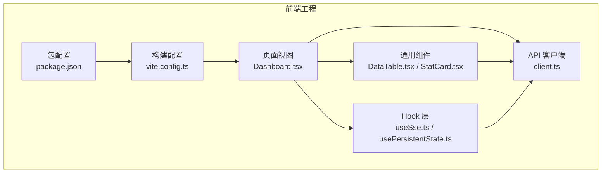
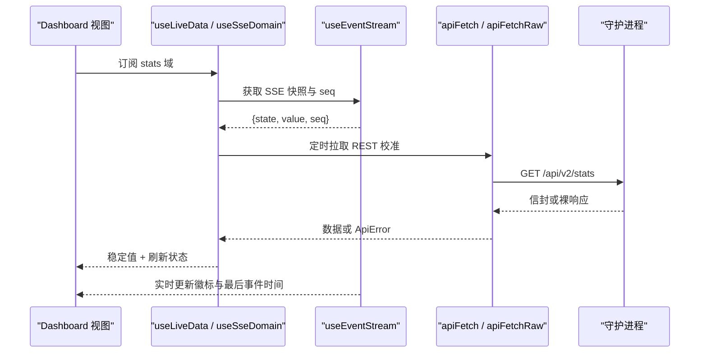
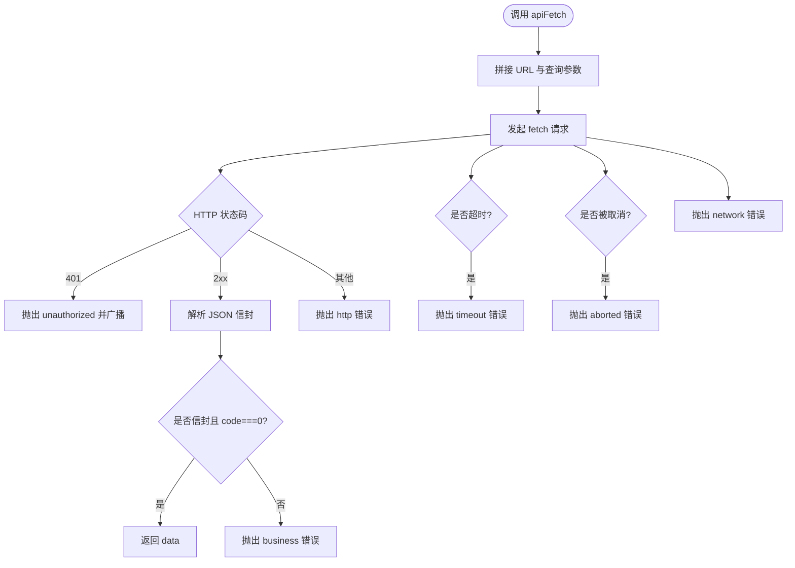
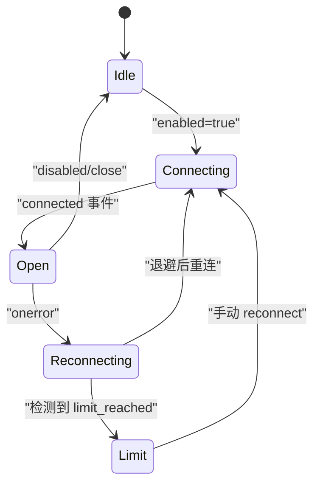
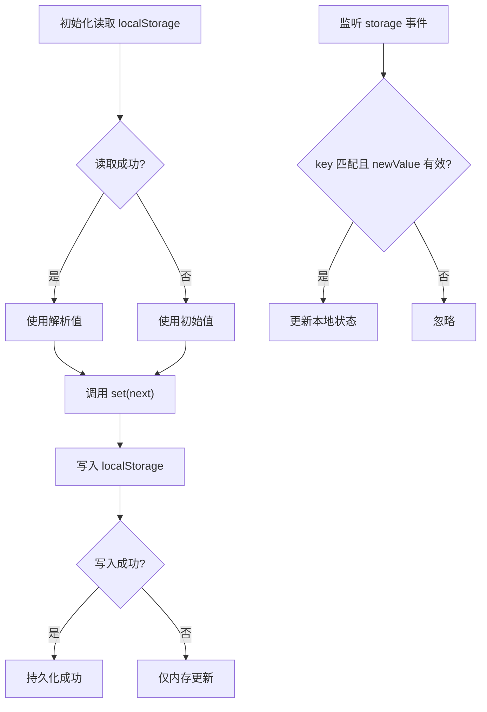
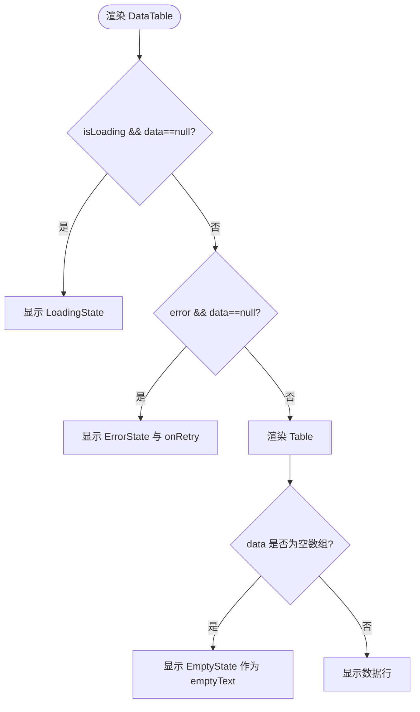
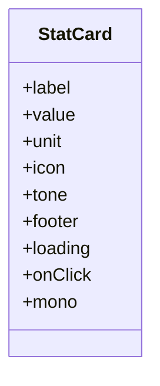
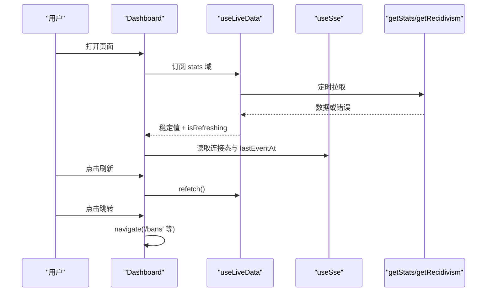
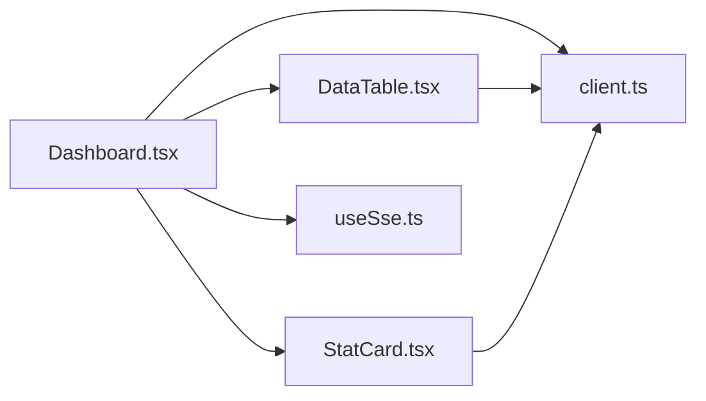

# 前端TypeScript单元测试

<cite>
**本文引用的文件**   
- [frontend/package.json](file://frontend/package.json)
- [frontend/vite.config.ts](file://frontend/vite.config.ts)
- [frontend/src/api/client.ts](file://frontend/src/api/client.ts)
- [frontend/src/hooks/useSse.ts](file://frontend/src/hooks/useSse.ts)
- [frontend/src/hooks/usePersistentState.ts](file://frontend/src/hooks/usePersistentState.ts)
- [frontend/src/components/DataTable.tsx](file://frontend/src/components/DataTable.tsx)
- [frontend/src/components/StatCard.tsx](file://frontend/src/components/StatCard.tsx)
- [frontend/src/views/Dashboard.tsx](file://frontend/src/views/Dashboard.tsx)
</cite>

## 目录
1. [引言](#引言)
2. [项目结构](#项目结构)
3. [核心组件](#核心组件)
4. [架构总览](#架构总览)
5. [详细组件分析](#详细组件分析)
6. [依赖关系分析](#依赖关系分析)
7. [性能与可测性建议](#性能与可测性建议)
8. [测试排错指南](#测试排错指南)
9. [结论](#结论)
10. [附录：测试用例清单](#附录测试用例清单)

## 引言
本文面向使用 TypeScript 的前端开发者，目标是建立一套高质量、可维护的单元测试体系。文档围绕以下目标展开：
- 基于 React Testing Library 的组件渲染测试、用户交互模拟与状态变化验证。
- Hook 测试方法：自定义 Hook 的输入输出、副作用（定时器、事件监听、网络）处理。
- API 客户端测试：HTTP 请求拦截、响应 Mock、错误分类与重试策略。
- 结合仓库中的真实代码，给出组件生命周期、事件处理、异步操作的最佳实践示例路径。

本项目的当前前端工程尚未包含任何单元测试文件；现有测试集中在后端与端到端场景。因此，本文以“如何为现有模块编写单元测试”为主线，提供可直接落地的方案与断言思路。

## 项目结构
前端采用 React 19 + TypeScript + Vite 技术栈，UI 使用 Ant Design，图表使用 ECharts。关键目录如下：
- `src/api`：统一 HTTP 客户端、类型与端点定义。
- `src/hooks`：业务与基础设施 Hook（SSE、持久化、刷新信号等）。
- `src/components`：通用 UI 组件（表格、指标卡、状态展示等）。
- `src/views`：页面级视图（仪表盘、封禁、日志等）。
- `vite.config.ts`：构建与开发代理配置。
- `package.json`：脚本与依赖声明。

**图示来源**
- [frontend/src/api/client.ts:1-205](file://frontend/src/api/client.ts#L1-L205)
- [frontend/src/hooks/useSse.ts:1-259](file://frontend/src/hooks/useSse.ts#L1-L259)
- [frontend/src/hooks/usePersistentState.ts:1-73](file://frontend/src/hooks/usePersistentState.ts#L1-L73)
- [frontend/src/components/DataTable.tsx:1-91](file://frontend/src/components/DataTable.tsx#L1-L91)
- [frontend/src/components/StatCard.tsx:1-127](file://frontend/src/components/StatCard.tsx#L1-L127)
- [frontend/src/views/Dashboard.tsx:1-303](file://frontend/src/views/Dashboard.tsx#L1-L303)
- [frontend/vite.config.ts:1-63](file://frontend/vite.config.ts#L1-L63)
- [frontend/package.json:1-34](file://frontend/package.json#L1-L34)

**章节来源**
- [frontend/package.json:1-34](file://frontend/package.json#L1-L34)
- [frontend/vite.config.ts:1-63](file://frontend/vite.config.ts#L1-L63)

## 核心组件
本节聚焦三类可测单元：API 客户端、Hook、UI 组件。

### API 客户端
- 职责：统一发起 fetch、超时控制、认证头注入、信封解包、错误分类（网络/超时/未认证/业务/解析/中止）、401 广播。
- 可测点：
  - 成功路径：返回 `data`。
  - 失败路径：按 `ApiError.kind` 区分并携带 `status`、`code`。
  - 401：触发全局未认证事件。
  - 取消与超时：通过 `AbortSignal` 与内部计时器。
  - 裸接口：直接解析 JSON。

**章节来源**
- [frontend/src/api/client.ts:1-205](file://frontend/src/api/client.ts#L1-L205)

### SSE Hook
- 职责：管理 `/api/v2/events` 连接、事件分发、退避重连、连接上限检测、数据新鲜度序号。
- 可测点：
  - 初始态与启用/禁用切换。
  - 各域事件（stats/bans/jails/whitelist/rates）更新快照。
  - 断线后按退避策略重连。
  - 达到连接上限时进入 `limit` 状态。
  - 手动重连入口。

**章节来源**
- [frontend/src/hooks/useSse.ts:1-259](file://frontend/src/hooks/useSse.ts#L1-L259)

### 持久化 Hook
- 职责：读写 `localStorage`，跨标签同步，脏值回退。
- 可测点：
  - 首次读取默认值。
  - 写入后读回一致。
  - 跨标签 `storage` 事件同步。
  - 存储异常（如隐私模式）不抛错。

**章节来源**
- [frontend/src/hooks/usePersistentState.ts:1-73](file://frontend/src/hooks/usePersistentState.ts#L1-L73)

### 数据表格组件
- 职责：封装加载/空/错误态，统一表格行为。
- 可测点：
  - 加载中显示骨架。
  - 无数据且失败显示错误与重试。
  - 有数据渲染表格，空数组显示空态。
  - 工具条与交互按钮存在性。

**章节来源**
- [frontend/src/components/DataTable.tsx:1-91](file://frontend/src/components/DataTable.tsx#L1-L91)

### 指标卡组件
- 职责：KPI 展示，语义色、图标、单位、点击跳转。
- 可测点：
  - 不同 tone 的颜色与背景。
  - loading 骨架。
  - onClick 触发。
  - mono 数值等宽。

**章节来源**
- [frontend/src/components/StatCard.tsx:1-127](file://frontend/src/components/StatCard.tsx#L1-L127)

### 仪表盘页面
- 职责：聚合 SSE 与 REST 数据，渲染威胁等级、统计卡片、趋势图、Top 攻击源。
- 可测点：
  - 首次加载与刷新。
  - SSE 连接态影响实时徽标。
  - 错误与空数据分支。
  - 导航跳转与按钮交互。

**章节来源**
- [frontend/src/views/Dashboard.tsx:1-303](file://frontend/src/views/Dashboard.tsx#L1-L303)

## 架构总览
下图展示了从页面到 Hook 与 API 客户端的调用链，以及 SSE 流对状态的影响。

**图示来源**
- [frontend/src/views/Dashboard.tsx:43-68](file://frontend/src/views/Dashboard.tsx#L43-L68)
- [frontend/src/hooks/useSse.ts:99-257](file://frontend/src/hooks/useSse.ts#L99-L257)
- [frontend/src/api/client.ts:154-204](file://frontend/src/api/client.ts#L154-L204)

## 详细组件分析

### API 客户端测试设计
- 测试目标：
  - 成功：信封 `code === 0` 返回 `data`。
  - 401：抛出 `ApiError('unauthorized')`，并触发未认证广播。
  - 业务错误：`code !== 0`，抛出 `ApiError('business')`。
  - 网络/超时：抛出对应 kind，支持自动重试判断。
  - 解析失败：非 JSON 响应体抛出 `parse` 或 `http`。
  - 取消：传入 `AbortSignal` 被中止时抛出 `aborted`。
  - 裸接口：直接解析 JSON。

**图示来源**
- [frontend/src/api/client.ts:93-148](file://frontend/src/api/client.ts#L93-L148)
- [frontend/src/api/client.ts:154-204](file://frontend/src/api/client.ts#L154-L204)

**章节来源**
- [frontend/src/api/client.ts:1-205](file://frontend/src/api/client.ts#L1-L205)

### SSE Hook 测试设计
- 测试目标：
  - 初始态为 `idle`，启用后进入 `connecting`，成功后为 `open`。
  - 收到 stats/bans/jails/whitelist/rates 事件后更新对应字段与 `seq`。
  - 断线后按退避公式重连，并在达到连接上限时进入 `limit`。
  - 关闭或禁用时清理定时器与 EventSource。
  - 手动 `reconnect` 重置退避计数并立即重连。

**图示来源**
- [frontend/src/hooks/useSse.ts:33-61](file://frontend/src/hooks/useSse.ts#L33-L61)
- [frontend/src/hooks/useSse.ts:128-235](file://frontend/src/hooks/useSse.ts#L128-L235)

**章节来源**
- [frontend/src/hooks/useSse.ts:1-259](file://frontend/src/hooks/useSse.ts#L1-L259)

### 持久化 Hook 测试设计
- 测试目标：
  - 初始值正确。
  - 设置新值后 localStorage 同步更新。
  - 跨标签 storage 事件触发后本地状态同步。
  - 脏数据或写失败时回退默认值且不抛错。

**图示来源**
- [frontend/src/hooks/usePersistentState.ts:25-71](file://frontend/src/hooks/usePersistentState.ts#L25-L71)

**章节来源**
- [frontend/src/hooks/usePersistentState.ts:1-73](file://frontend/src/hooks/usePersistentState.ts#L1-L73)

### DataTable 组件测试设计
- 测试目标：
  - 加载中显示骨架。
  - 无数据且 error 显示错误与重试按钮。
  - 有数据渲染表格，空数组显示空态。
  - toolbar 与交互按钮存在并可点击。
  - rowKey 默认序列化记录。

**图示来源**
- [frontend/src/components/DataTable.tsx:41-90](file://frontend/src/components/DataTable.tsx#L41-L90)

**章节来源**
- [frontend/src/components/DataTable.tsx:1-91](file://frontend/src/components/DataTable.tsx#L1-L91)

### StatCard 组件测试设计
- 测试目标：
  - 不同 tone 的边框颜色与图标背景。
  - loading 骨架。
  - onClick 触发。
  - mono 数值等宽样式。
  - unit 与 footer 渲染。

**图示来源**
- [frontend/src/components/StatCard.tsx:38-51](file://frontend/src/components/StatCard.tsx#L38-L51)
- [frontend/src/components/StatCard.tsx:53-126](file://frontend/src/components/StatCard.tsx#L53-L126)

**章节来源**
- [frontend/src/components/StatCard.tsx:1-127](file://frontend/src/components/StatCard.tsx#L1-L127)

### Dashboard 页面测试设计
- 测试目标：
  - 首次加载显示加载态或错误态。
  - 数据就绪后渲染威胁等级、统计卡片、趋势图、Top 攻击源。
  - 刷新按钮触发 refetch。
  - 导航跳转到相关页面。
  - SSE 连接态影响实时徽标与最后事件时间。

**图示来源**
- [frontend/src/views/Dashboard.tsx:43-68](file://frontend/src/views/Dashboard.tsx#L43-L68)
- [frontend/src/views/Dashboard.tsx:120-141](file://frontend/src/views/Dashboard.tsx#L120-L141)
- [frontend/src/views/Dashboard.tsx:152-299](file://frontend/src/views/Dashboard.tsx#L152-L299)

**章节来源**
- [frontend/src/views/Dashboard.tsx:1-303](file://frontend/src/views/Dashboard.tsx#L1-L303)

## 依赖关系分析
- 组件与 Hook 耦合：
  - Dashboard 依赖 useLiveData、useSse、useSseDomain 与 API 端点。
  - DataTable 依赖统一的 ApiError 类型与状态组件。
  - StatCard 依赖主题变量与 Ant Design。
- 外部依赖：
  - fetch、EventSource、localStorage、window 事件。
  - Ant Design、ECharts、react-router-dom。

**图示来源**
- [frontend/src/views/Dashboard.tsx:1-303](file://frontend/src/views/Dashboard.tsx#L1-L303)
- [frontend/src/components/DataTable.tsx:1-91](file://frontend/src/components/DataTable.tsx#L1-L91)
- [frontend/src/components/StatCard.tsx:1-127](file://frontend/src/components/StatCard.tsx#L1-L127)
- [frontend/src/hooks/useSse.ts:1-259](file://frontend/src/hooks/useSse.ts#L1-L259)
- [frontend/src/api/client.ts:1-205](file://frontend/src/api/client.ts#L1-L205)

**章节来源**
- [frontend/src/views/Dashboard.tsx:1-303](file://frontend/src/views/Dashboard.tsx#L1-L303)
- [frontend/src/components/DataTable.tsx:1-91](file://frontend/src/components/DataTable.tsx#L1-L91)
- [frontend/src/components/StatCard.tsx:1-127](file://frontend/src/components/StatCard.tsx#L1-L127)
- [frontend/src/hooks/useSse.ts:1-259](file://frontend/src/hooks/useSse.ts#L1-L259)
- [frontend/src/api/client.ts:1-205](file://frontend/src/api/client.ts#L1-L205)

## 性能与可测性建议
- 避免在渲染中执行昂贵计算：使用 useMemo 缓存图表选项与派生数据。
- 减少不必要的重渲染：将稳定的回调与引用放入 useCallback，避免子组件无效更新。
- 合理拆分状态：SSE 与 REST 数据分离，避免单一状态树过大。
- 可测性优先：
  - 将网络逻辑下沉到 Hook 或服务层，便于 Mock。
  - 组件尽量纯函数式，减少对外部 DOM 的直接操作。
  - 使用明确的 props 暴露交互入口（如 onRetry、onEmptyAction）。

[本节为通用指导，无需具体文件来源]

## 测试排错指南
常见问题与定位思路：
- 401 未触发登出：检查是否订阅了未认证广播，并确保客户端在 401 时抛出对应错误。
- SSE 不断重连：确认是否检测到连接上限并进入 `limit` 状态，避免无限重试。
- localStorage 同步失效：检查 storage 事件 key 匹配与 newValue 有效性。
- 表格空态不显示：确认 data 是否为空数组，且 EmptyState 已作为 locale.emptyText。
- 图表不更新：检查 useMemo 依赖是否正确，确保数据变更能触发重新计算。

**章节来源**
- [frontend/src/api/client.ts:58-71](file://frontend/src/api/client.ts#L58-L71)
- [frontend/src/hooks/useSse.ts:201-235](file://frontend/src/hooks/useSse.ts#L201-L235)
- [frontend/src/hooks/usePersistentState.ts:56-69](file://frontend/src/hooks/usePersistentState.ts#L56-L69)
- [frontend/src/components/DataTable.tsx:66-82](file://frontend/src/components/DataTable.tsx#L66-L82)

## 结论
通过对 API 客户端、Hook 与 UI 组件的系统化测试设计，可以覆盖渲染、交互、状态变化、异步与副作用等关键路径。建议在工程中引入 React Testing Library 与合适的 Mock 策略，逐步补齐单测覆盖率，提升代码质量与回归安全性。

[本节为总结，无需具体文件来源]

## 附录：测试用例清单
以下为建议的测试用例清单，供落地实施参考：

- API 客户端
  - 成功返回 data。
  - 401 抛出 unauthorized 并广播。
  - 业务错误抛出 business。
  - 网络错误抛出 network。
  - 超时抛出 timeout。
  - 解析失败抛出 parse/http。
  - 取消请求抛出 aborted。
  - 裸接口直接解析 JSON。

- SSE Hook
  - 初始态 idle。
  - 启用后 connecting → open。
  - 各域事件更新快照与 seq。
  - 断线后按退避重连。
  - 达到连接上限进入 limit。
  - 手动 reconnect 重置退避。
  - 禁用或卸载清理资源。

- 持久化 Hook
  - 初始值正确。
  - 写入后读回一致。
  - 跨标签 storage 同步。
  - 脏数据回退默认值。
  - 写失败不抛错。

- DataTable 组件
  - 加载中显示骨架。
  - 无数据且错误显示错误与重试。
  - 有数据渲染表格。
  - 空数组显示空态。
  - 工具条与交互按钮存在。

- StatCard 组件
  - 不同 tone 的颜色与背景。
  - loading 骨架。
  - onClick 触发。
  - mono 数值等宽。
  - unit 与 footer 渲染。

- Dashboard 页面
  - 首次加载显示加载/错误。
  - 数据就绪渲染威胁等级、统计卡片、趋势图、Top 攻击源。
  - 刷新按钮触发 refetch。
  - 导航跳转。
  - SSE 连接态影响实时徽标与最后事件时间。

[本节为概念性清单，无需具体文件来源]