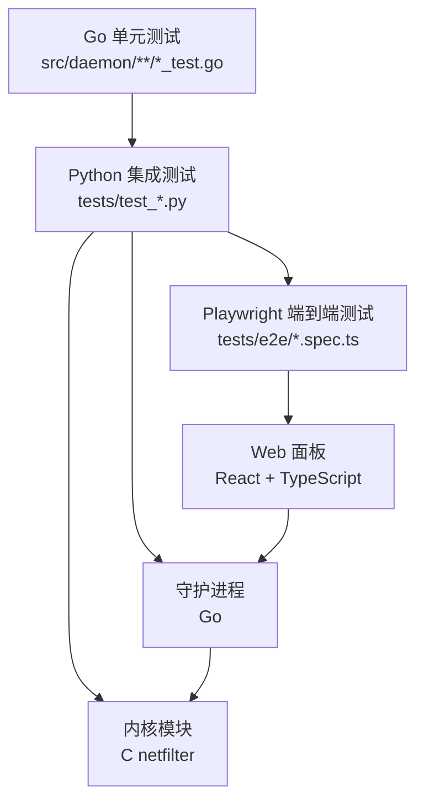
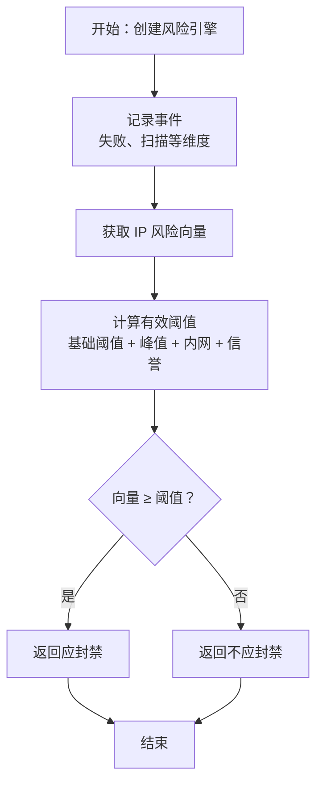
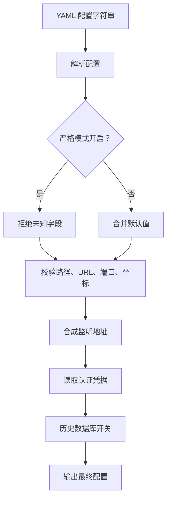
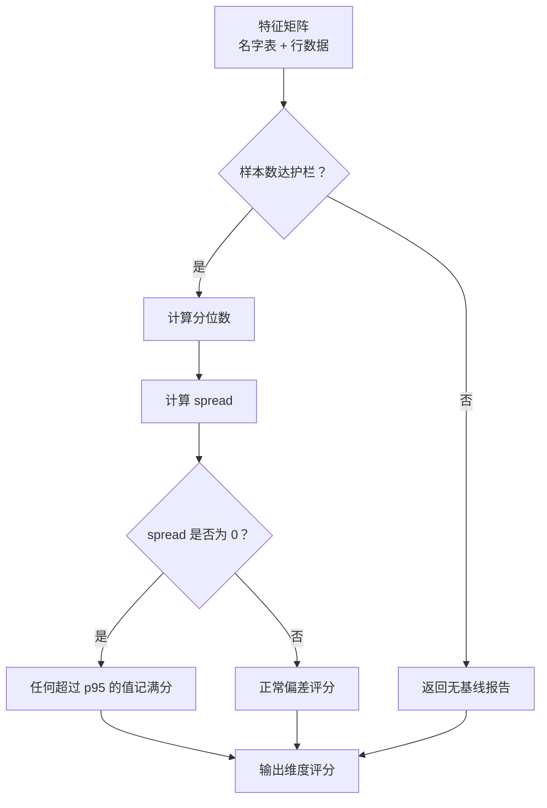
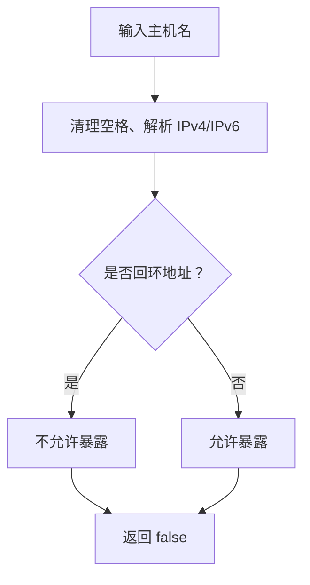
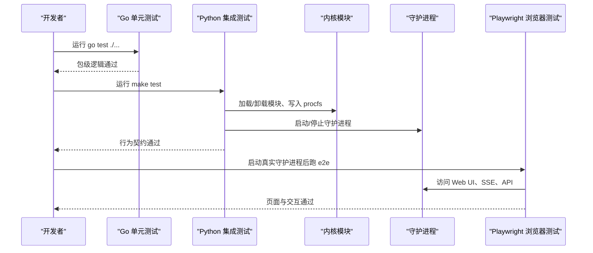
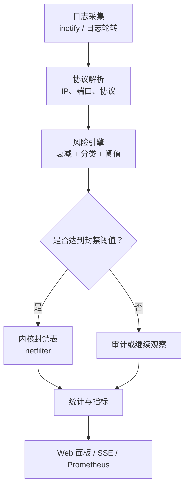
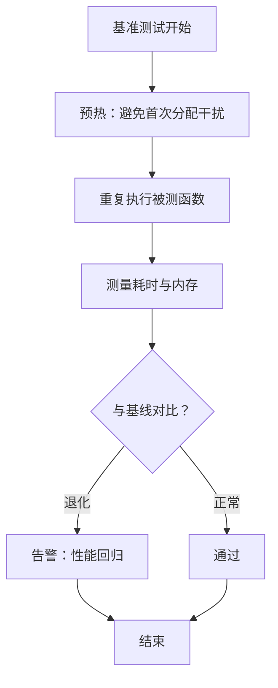
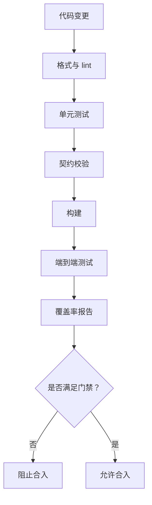

# 单元测试

<cite>
**本文引用的文件**   
- [README.md](file://README.md)
- [测试文档（开发指南）](file://docs/zh/development/testing.md)
- [守护进程模块定义](file://src/daemon/go.mod)
- [前端包配置](file://frontend/package.json)
- [绑定地址测试](file://src/daemon/cmd/firewall-daemon/bind_address_test.go)
- [异常偏离测试](file://src/daemon/internal/analysis/anomaly_test.go)
- [配置解析测试](file://src/daemon/internal/config/config_test.go)
- [风险引擎测试](file://src/daemon/internal/risk/engine_test.go)
</cite>

## 目录
1. [引言](#引言)
2. [项目结构与测试分层](#项目结构与测试分层)
3. [Go 语言单元测试规范](#go-语言单元测试规范)
4. [前端 TypeScript 与 React 测试策略](#前端-typescript-与-react-测试策略)
5. [核心功能测试示例](#核心功能测试示例)
6. [架构与数据流测试视图](#架构与数据流测试视图)
7. [依赖与外部集成点](#依赖与外部集成点)
8. [性能与基准测试](#性能与基准测试)
9. [覆盖率与质量门禁](#覆盖率与质量门禁)
10. [故障排查与常见问题](#故障排查与常见问题)
11. [结论](#结论)

## 引言
本仓库采用三层测试体系：Go 单元测试、Python 集成测试、Playwright 端到端测试。守护进程是 Go 模块，前端面板基于 React 与 TypeScript，内核模块通过 C 实现高速封禁。测试目标不是堆砌用例数量，而是保证“日志采集 → 风险判定 → 内核封禁 → Web 面板”这条链路在单元、集成和浏览器层都有可验证的契约。

仓库根说明文档明确了三层测试命令、CI 任务划分以及环境限制；开发指南中的测试文档进一步规定了 Go 单测运行方式、pytest 集成测试范围、Playwright E2E 前置条件与断言边界。

**章节来源**
- [README.md:10-31](file://README.md#L10-L31)
- [README.md:194-217](file://README.md#L194-L217)
- [测试文档（开发指南）:1-14](file://docs/zh/development/testing.md#L1-L14)

## 项目结构与测试分层
仓库测试按职责分为三类：

| 层级 | 位置 | 主要目的 | 是否需要 root |
|---|---|---|---|
| Go 单元测试 | `src/daemon/**/*_test.go` | 校验守护进程内部逻辑、配置解析、风险引擎、HTTP 契约等 | 否 |
| Python 集成测试 | `tests/test_*.py` | 驱动内核模块、procfs、守护进程生命周期、网络行为 | 是 |
| Playwright 端到端测试 | `tests/e2e/*.spec.ts` | 在真实守护进程的 Web UI 上验证路由、写操作回环、仪表盘、PWA 上下文 | 需要能启动守护进程 |

**图示来源**
- [README.md:10-31](file://README.md#L10-L31)
- [测试文档（开发指南）:1-14](file://docs/zh/development/testing.md#L1-L14)

**章节来源**
- [README.md:10-31](file://README.md#L10-L31)
- [测试文档（开发指南）:1-14](file://docs/zh/development/testing.md#L1-L14)

## Go 语言单元测试规范
### 组织方式
- 守护进程是 Go module，模块路径为 `github.com/snowcore8/linux-firewall-kmod/daemon`。
- 测试文件放在对应包的 `_test.go` 中，例如：
  - 组合根入口相关测试位于 `src/daemon/cmd/firewall-daemon/*_test.go`。
  - 分析、配置、风险、决策、检测、契约、HTTP、内核通信、持久化、威胁情报等子模块各自有独立测试文件。
- 运行命令统一从 `src/daemon` 目录执行，避免路径与模块路径不一致。

### 框架与断言
- 使用 Go 标准库 `testing` 包。
- 断言以 `t.Errorf` / `t.Fatalf` 为主，没有引入第三方断言库。
- 测试结构体 + 表驱动用例是常见模式，便于扩展输入输出场景。

### 推荐写法
- 每个被测函数至少覆盖正常路径、边界值、错误路径。
- 对外部依赖（文件系统、网络、时间、随机数）尽量用参数或接口隔离。
- 对不可变契约（YAML、HTTP 响应结构、netlink/procfs 格式）优先用静态解析或生成代码校验。
- 对耗时路径提供 `Benchmark*` 基准测试，防止回归。

**章节来源**
- [守护进程模块定义:1-8](file://src/daemon/go.mod#L1-L8)
- [测试文档（开发指南）:15-32](file://docs/zh/development/testing.md#L15-L32)

## 前端 TypeScript 与 React 测试策略
### 当前前端技术栈
前端包配置显示项目使用：
- React 19
- TypeScript
- Vite
- Ant Design
- ECharts
- react-router-dom

但当前 `package.json` 中没有显式声明 Jest、Vitest、React Testing Library、MSW、Playwright 等测试依赖。因此，前端侧目前更偏向类型检查与构建检查，而不是完整的组件级单元测试套件。

### 建议的前端测试分层
| 层级 | 工具建议 | 测试目标 | Mock 策略 |
|---|---|---|---|
| 类型与构建 | `tsc --noEmit`、`vite build` | 类型安全、打包产物 | 不依赖运行时 |
| 纯函数与 Hook | Vitest + @testing-library/react-hooks | 状态计算、副作用隔离 | 模拟时间、随机数、本地存储 |
| React 组件 | @testing-library/react | 渲染结果、用户交互、路由跳转 | 模拟 API、Provider、主题 |
| API 客户端 | MSW 或自定义 fetch/XHR mock | 请求构造、错误处理、重试 | 拦截网络请求 |
| 端到端 | Playwright | 页面路由、写操作回环、SSE、PWA | 连接真实守护进程 |

### 与仓库现有 E2E 的关系
仓库已有 Playwright 端到端测试，用于在真实守护进程上验证 Web UI。这与前端组件单元测试不同：E2E 关注“用户可见行为”，组件测试关注“组件内部状态与交互”。两者互补，不应互相替代。

**章节来源**
- [前端包配置:1-34](file://frontend/package.json#L1-L34)
- [测试文档（开发指南）:100-143](file://docs/zh/development/testing.md#L100-L143)

## 核心功能测试示例
以下示例基于仓库中已有的 Go 单元测试，展示如何编写高质量测试。

### 风险引擎测试
风险引擎负责记录事件、维护 IP 向量、计算阈值、判断是否封禁。测试应覆盖：
- 同一 IP 多次事件叠加。
- 未出现 IP 的查询返回不存在。
- 峰值时段、内网、信誉分对阈值的影响。
- 封禁判定边界。

**图示来源**
- [风险引擎测试:7-144](file://src/daemon/internal/risk/engine_test.go#L7-L144)

**章节来源**
- [风险引擎测试:7-180](file://src/daemon/internal/risk/engine_test.go#L7-L180)

### 配置解析测试
配置解析测试重点在于 YAML 默认值、严格模式、jail 合并、路径与安全校验、监听地址合成、凭据读取、历史数据库开关。

**图示来源**
- [配置解析测试:41-400](file://src/daemon/internal/config/config_test.go#L41-L400)

**章节来源**
- [配置解析测试:41-400](file://src/daemon/internal/config/config_test.go#L41-L400)

### 分析偏离测试
分析偏离测试关注多维特征矩阵的名字顺序、列下标一致性、样本护栏、零方差分支、缺列处理。这类测试特别适合“数值正确但维度错位”的隐蔽缺陷。

**图示来源**
- [异常偏离测试:1-132](file://src/daemon/internal/analysis/anomaly_test.go#L1-L132)

**章节来源**
- [异常偏离测试:1-132](file://src/daemon/internal/analysis/anomaly_test.go#L1-L132)

### 组合根绑定地址测试
组合根测试验证监听地址是否可能绑定到非回环地址，这是安全相关的小函数，但影响部署面。

**图示来源**
- [绑定地址测试:5-35](file://src/daemon/cmd/firewall-daemon/bind_address_test.go#L5-L35)

**章节来源**
- [绑定地址测试:1-36](file://src/daemon/cmd/firewall-daemon/bind_address_test.go#L1-L36)

## 架构与数据流测试视图
### 三层测试协作图

**图示来源**
- [测试文档（开发指南）:15-143](file://docs/zh/development/testing.md#L15-L143)

### 风险判定主流程

**图示来源**
- [README.md:10-31](file://README.md#L10-L31)
- [测试文档（开发指南）:1-14](file://docs/zh/development/testing.md#L1-L14)

## 依赖与外部集成点
### 外部依赖
- 内核模块：C 实现 netfilter、procfs、netlink。
- 守护进程：Go 实现日志采集、风险引擎、HTTP API、面板服务。
- 前端：React + TypeScript + Vite。
- 契约系统：Python + .fwidl 生成并校验 HTTP/netlink/procfs 契约。

### 测试依赖
- Go：`testing` 标准库。
- Python：pytest、yaml、sqlite3（部分集成测试）。
- Node：Vite、TypeScript、Playwright（E2E）。

### 外部集成点的 Mock 策略
| 外部点 | 单元测试策略 | 集成测试策略 | E2E 策略 |
|---|---|---|---|
| 内核模块 | 不直接调用，只测用户态逻辑 | 真实 insmod/rmmod、procfs 读写 | 通过守护进程间接验证 |
| 文件系统 | 临时目录、内存结构、路径校验 | 真实日志轮转、配置热重载 | 不直接断言磁盘细节 |
| 网络 | 模拟端口、超时、错误码 | 真实 netfilter 行为、SSE 长连接 | 真实浏览器访问 |
| 时间/随机 | 注入时间源、固定种子 | 依赖系统时间与调度 | 依赖真实时序 |

**章节来源**
- [README.md:10-31](file://README.md#L10-L31)
- [测试文档（开发指南）:34-143](file://docs/zh/development/testing.md#L34-L143)

## 性能与基准测试
Go 侧已包含风险引擎的基准测试，用于监控高频路径的性能回归。建议新增基准测试时遵循：
- 基准输入接近真实负载分布。
- 基准结果与历史基线对比，而非只看绝对值。
- 对 GC 敏感路径增加 `-benchmem` 分析。
- 对 I/O 路径区分 CPU 基准与 I/O 基准。

**图示来源**
- [风险引擎测试:167-179](file://src/daemon/internal/risk/engine_test.go#L167-L179)

**章节来源**
- [风险引擎测试:167-180](file://src/daemon/internal/risk/engine_test.go#L167-L180)

## 覆盖率与质量门禁
### 当前仓库的质量门禁
根据仓库文档，CI 包含代码质量检查、契约一致性、前端构建、编译、浏览器端到端测试、集成测试六个任务。Go 侧要求：
- `gofmt` 输出为空。
- `go vet` 通过。
- `go test ./cmd/... ./internal/...` 通过。
- 契约校验器全绿。

### 覆盖率建议
虽然仓库文档未强制覆盖率数字，但建议：
- 核心业务逻辑（风险引擎、配置解析、决策规则）覆盖率不低于 80%。
- 公共 API 与契约相关代码覆盖率不低于 90%。
- 仅覆盖分支比仅覆盖语句更有价值。
- 对“安全关键”路径（绑定地址、路径校验、URL 归一化、认证凭据）必须覆盖边界与错误分支。

**图示来源**
- [测试文档（开发指南）:144-200](file://docs/zh/development/testing.md#L144-L200)

**章节来源**
- [测试文档（开发指南）:144-200](file://docs/zh/development/testing.md#L144-L200)

## 故障排查与常见问题
### 无法加载内核模块
CI runner 的 Azure VM 使用自定义内核，可能无法加载仓库编译的内核模块。此时集成测试会降级为守护进程子集，E2E 可能跳过。本地要验证内核侧行为，必须在能 `insmod` 的机器上运行集成测试。

### sudo 环境变量问题
sudo 默认 secure_path 可能不含用户安装的 Go。文档建议使用保留 PATH 的方式运行测试或构建。

### 前端缺少测试依赖
当前前端包配置未包含常见前端测试库。若新增组件测试，需补充测试依赖，并明确测试运行脚本。

### 配置导致面板不可用
配置层测试覆盖了监听地址、认证凭据、历史数据库开关等关键点。若面板 503 或端口未就绪，优先检查：
- `metrics_bind_address` 与 `metrics_port`。
- 认证凭据是否两项都空或只填一项。
- 历史数据库路径是否被意外启用。

**章节来源**
- [测试文档（开发指南）:84-96](file://docs/zh/development/testing.md#L84-L96)
- [测试文档（开发指南）:159-178](file://docs/zh/development/testing.md#L159-L178)
- [配置解析测试:300-400](file://src/daemon/internal/config/config_test.go#L300-L400)

## 结论
本仓库的测试体系以 Go 单元测试为基础，以 Python 集成测试为行为契约，以 Playwright 端到端测试为浏览器层保障。高质量单元测试的关键是：
- 明确被测边界，不越界测内核或真实网络。
- 用表驱动用例覆盖正常、边界、错误路径。
- 对安全相关逻辑做严格断言。
- 对高频路径提供基准测试。
- 对前端组件与 Hook 建立独立的测试层，并与现有 E2E 分工清晰。

开发者在新增功能时，应先补单元测试，再考虑集成测试与 E2E；当契约发生变化时，应同步更新契约校验与对应测试。