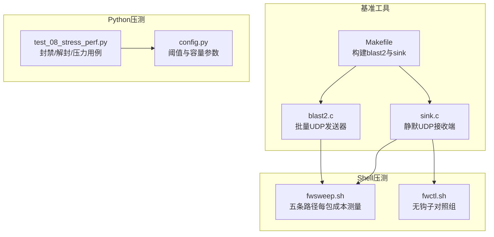
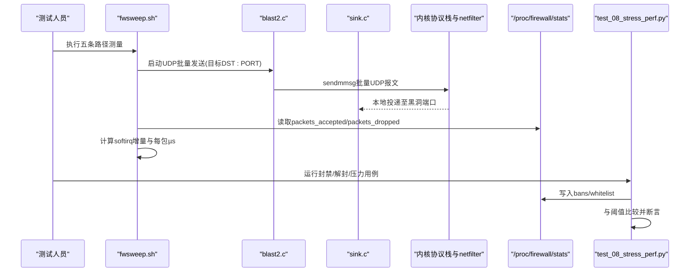
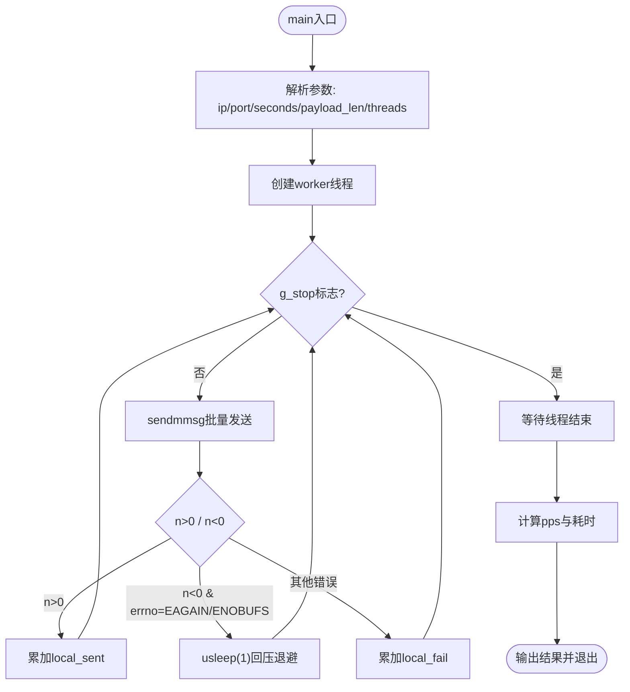
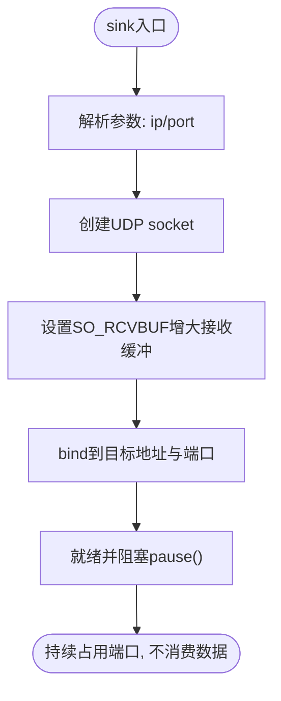
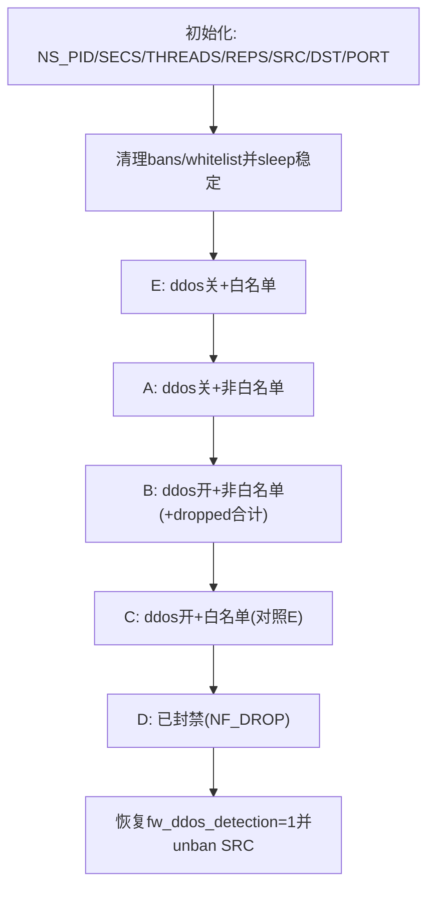
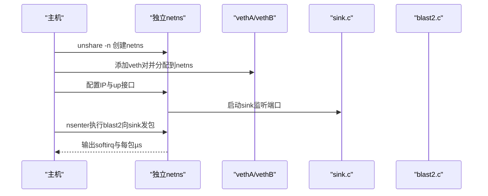
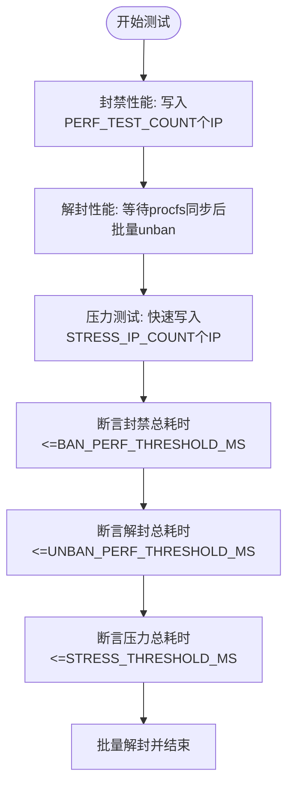
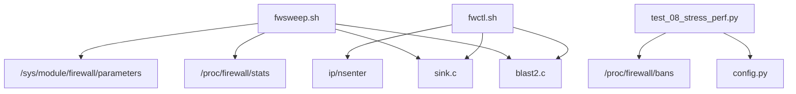

# 性能测试

<cite>
**本文引用的文件**   
- [blast2.c](file://scripts/bench/blast2.c)
- [sink.c](file://scripts/bench/sink.c)
- [fwsweep.sh](file://scripts/bench/fwsweep.sh)
- [fwctl.sh](file://scripts/bench/fwctl.sh)
- [Makefile](file://scripts/bench/Makefile)
- [test_08_stress_perf.py](file://tests/test_08_stress_perf.py)
- [config.py](file://tests/config.py)
</cite>

## 目录
1. [引言](#引言)
2. [项目结构](#项目结构)
3. [核心组件](#核心组件)
4. [架构总览](#架构总览)
5. [详细组件分析](#详细组件分析)
6. [依赖关系分析](#依赖关系分析)
7. [性能指标与收集方法](#性能指标与收集方法)
8. [吞吐量、延迟与内存监控](#吞吐量延迟与内存监控)
9. [阈值设定与回归检测](#阈值设定与回归检测)
10. [性能优化建议](#性能优化建议)
11. [故障排查指南](#故障排查指南)
12. [结论](#结论)

## 引言
本性能测试文档面向开发团队，目标是系统化说明防火墙内核模块与守护进程在压力场景下的评估方法。文档围绕以下重点展开：
- 压力测试设计思路：通过 C 语言基准程序构造高吞吐 UDP 流量，结合 Shell 脚本切换不同路径，测量每包成本与系统软中断开销。
- 基准工具使用：解释 blast2.c 的批量发送机制、sink.c 的静默接收端设计，以及 Makefile 的构建方式。
- 性能指标收集：以 softirq 增量和 procfs 统计为核心，计算处理包数、软中断耗时与每包微秒级成本。
- 流程说明：详解 fwsweep.sh 的五条路径对照实验，以及 fwctl.sh 的无钩子对照组。
- 吞吐、延迟与内存监控：给出可操作的观测维度与注意事项。
- 阈值与回归：基于 Python 压测脚本与配置常量，提供回归检测与阈值调整建议。
- 优化建议：从内核参数、用户态缓冲、并发线程与测试环境控制角度提出改进方向。

## 项目结构
与性能测试直接相关的代码与脚本集中在两个位置：
- scripts/bench：C 语言基准程序与 Shell 压测脚本。
- tests：Python 压测用例与性能阈值配置。

**图表来源**
- [blast2.c:1-104](file://scripts/bench/blast2.c#L1-L104)
- [sink.c:1-41](file://scripts/bench/sink.c#L1-L41)
- [Makefile:1-27](file://scripts/bench/Makefile#L1-L27)
- [fwsweep.sh:1-94](file://scripts/bench/fwsweep.sh#L1-L94)
- [fwctl.sh:1-59](file://scripts/bench/fwctl.sh#L1-L59)
- [test_08_stress_perf.py:1-93](file://tests/test_08_stress_perf.py#L1-L93)
- [config.py:53-61](file://tests/config.py#L53-L61)

**章节来源**
- [blast2.c:1-104](file://scripts/bench/blast2.c#L1-L104)
- [sink.c:1-41](file://scripts/bench/sink.c#L1-L41)
- [fwsweep.sh:1-94](file://scripts/bench/fwsweep.sh#L1-L94)
- [fwctl.sh:1-59](file://scripts/bench/fwctl.sh#L1-L59)
- [Makefile:1-27](file://scripts/bench/Makefile#L1-L27)
- [test_08_stress_perf.py:1-93](file://tests/test_08_stress_perf.py#L1-L93)
- [config.py:53-61](file://tests/config.py#L53-L61)

## 核心组件
本节聚焦性能测试的核心组件及其职责：
- blast2.c：多线程 UDP 批量发包器，使用 sendmmsg 将每批报文聚合到一次系统调用，降低用户态系统调用次数，使内核钩子成为瓶颈。
- sink.c：绑定 UDP 端口后不读取数据，让数据包进入本地投递路径并经过 NF_INET_PRE_ROUTING，避免 ICMP 应答干扰测量。
- fwsweep.sh：编排五条路径（白名单命中、两表未命中、速率引擎开启、已封禁等），采集 softirq 增量与 procfs 计数，输出每包成本中位数。
- fwctl.sh：在无 netfilter 钩子的 netns 内建立 veth 对，测量“无钩子”基线，用于交叉验证主测量的净钩子成本。
- test_08_stress_perf.py：Python 压测用例，覆盖封禁、解封与快速大量封禁的压力场景，并与 config.py 中的阈值比较。
- config.py：集中定义压力测试数量、并发数量与性能阈值。

**章节来源**
- [blast2.c:1-104](file://scripts/bench/blast2.c#L1-L104)
- [sink.c:1-41](file://scripts/bench/sink.c#L1-L41)
- [fwsweep.sh:1-94](file://scripts/bench/fwsweep.sh#L1-L94)
- [fwctl.sh:1-59](file://scripts/bench/fwctl.sh#L1-L59)
- [test_08_stress_perf.py:1-93](file://tests/test_08_stress_perf.py#L1-L93)
- [config.py:53-61](file://tests/config.py#L53-L61)

## 架构总览
下图展示压力测试的整体架构与数据流：用户态 blast2 产生 UDP 流量，经网络栈与 netfilter 钩子；sink 作为黑洞接收端；fwsweep.sh 协调环境与指标采集；fwctl.sh 提供无钩子对照；Python 用例对 procfs 写入进行压力与阈值校验。

**图表来源**
- [fwsweep.sh:32-53](file://scripts/bench/fwsweep.sh#L32-L53)
- [blast2.c:32-74](file://scripts/bench/blast2.c#L32-L74)
- [sink.c:15-40](file://scripts/bench/sink.c#L15-L40)
- [test_08_stress_perf.py:23-93](file://tests/test_08_stress_perf.py#L23-L93)

## 详细组件分析

### blast2.c：批量UDP发送器
- 设计要点：
  - 多线程 worker：每个线程创建 socket，设置较大的发送缓冲区，预构造 iovec/mmsghdr 数组，循环调用 sendmmsg 批量投递。
  - 失败处理：当返回 EAGAIN 或 ENOBUFS 时短暂休眠，继续重试，保证统计完整性。
  - 时间统计：使用 CLOCK_MONOTONIC 高精度计时，输出总发送包数、失败次数与 pps。
- 复杂度与性能：
  - 批量发送减少系统调用次数，提升吞吐；线程数可调，便于多核扩展。
  - 内存分配集中在 buf 与 msgs 数组，避免频繁分配。
- 错误处理：
  - 参数不足返回非零退出码；socket 创建失败直接返回。
  - 发送失败仅计数，不中断循环，确保长时间压测稳定性。

**图表来源**
- [blast2.c:76-103](file://scripts/bench/blast2.c#L76-L103)
- [blast2.c:32-74](file://scripts/bench/blast2.c#L32-L74)

**章节来源**
- [blast2.c:1-104](file://scripts/bench/blast2.c#L1-L104)

### sink.c：静默UDP接收端
- 设计要点：
  - 绑定 UDP 端口后不再读取，使数据包进入 init_net 本地投递路径，经过 NF_INET_PRE_ROUTING。
  - 增大接收缓冲区，避免过早丢弃导致 ICMP 不可达响应，从而保持测量纯净。
- 性能影响：
  - 不消费数据，内核在缓冲满后静默丢弃，减少 CPU 开销与额外网络往返。
- 错误处理：
  - socket/bind 失败打印错误并返回非零退出码。

**图表来源**
- [sink.c:15-40](file://scripts/bench/sink.c#L15-L40)

**章节来源**
- [sink.c:1-41](file://scripts/bench/sink.c#L1-L41)

### fwsweep.sh：五条路径每包成本测量
- 路径设计：
  - E：DDoS关闭 + 白名单命中，最短钩子路径。
  - A：DDoS关闭 + 非白名单，两表未命中。
  - B：DDoS开启 + 非白名单，增加速率引擎与违规检查。
  - C：DDoS开启 + 白名单，对照 E 以估算开关噪声。
  - D：已封禁，命中封禁表 → NF_DROP。
- 指标采集：
  - 通过 /proc/firewall/stats 读取 packets_accepted 与 packets_dropped。
  - 通过 /proc/stat 计算 softirq 增量，换算为秒与每包微秒。
  - 对 B 组合计 dropped，避免速率引擎中途封禁导致的分母偏差。
- 统计方法：
  - 多次采样取中位数，降低抖动影响。
  - 使用 nsenter 在指定 netns 内执行 blast2，隔离环境变量。

**图表来源**
- [fwsweep.sh:20-29](file://scripts/bench/fwsweep.sh#L20-L29)
- [fwsweep.sh:32-53](file://scripts/bench/fwsweep.sh#L32-L53)
- [fwsweep.sh:74-93](file://scripts/bench/fwsweep.sh#L74-L93)

**章节来源**
- [fwsweep.sh:1-94](file://scripts/bench/fwsweep.sh#L1-L94)

### fwctl.sh：无钩子对照组
- 设计目的：
  - 在独立 netns 内建立 veth 对，收发流量不出该 netns，因此不会经过 init_net 上的防火墙钩子。
  - 用“主测量 softirq − 对照 softirq”得到钩子净成本，交叉验证 fwsweep.sh 的路径差值。
- 执行流程：
  - 创建 netns，配置 veth 与 IP，启动 sink 接收端。
  - 在 netns 内运行 blast2 打流，采集 softirq 增量与 blast2 自报包数，计算每包成本。
- 清理策略：
  - 使用 trap EXIT 清理子进程，避免残留资源。

**图表来源**
- [fwctl.sh:19-43](file://scripts/bench/fwctl.sh#L19-L43)
- [fwctl.sh:46-57](file://scripts/bench/fwctl.sh#L46-L57)

**章节来源**
- [fwctl.sh:1-59](file://scripts/bench/fwctl.sh#L1-L59)

### Makefile：基准工具构建
- 构建规则：
  - 只依赖 libc 与 pthread，编译 blast2 与 sink。
  - 支持 make clean 清理产物。
- 使用建议：
  - 在执行 fwsweep.sh 与 fwctl.sh 前，先执行 make -C scripts/bench 构建二进制。

**章节来源**
- [Makefile:1-27](file://scripts/bench/Makefile#L1-L27)

### test_08_stress_perf.py：Python压测用例
- 用例覆盖：
  - 封禁性能：连续写入 bans，统计总耗时与平均值，与 BAN_PERF_THRESHOLD_MS 比较。
  - 解封性能：先写入 bans，等待 procfs 同步后，再批量写入 unban，统计总耗时与平均值，与 UNBAN_PERF_THRESHOLD_MS 比较。
  - 压力测试（快速大量封禁）：写入大量不同 IP，统计总耗时与 STRESS_THRESHOLD_MS 比较，随后批量解封。
- 异常处理：
  - 捕获 PermissionError/OSError，避免因权限问题中断测试。
- 阈值断言：
  - 使用 pytest 断言，失败时输出详细耗时与阈值信息。

**图表来源**
- [test_08_stress_perf.py:23-93](file://tests/test_08_stress_perf.py#L23-L93)

**章节来源**
- [test_08_stress_perf.py:1-93](file://tests/test_08_stress_perf.py#L1-L93)

### config.py：性能阈值与容量参数
- 关键常量：
  - STRESS_IP_COUNT：压力测试 IP 数量。
  - PERF_TEST_COUNT：封禁/解封性能测试次数。
  - BAN_PERF_THRESHOLD_MS、UNBAN_PERF_THRESHOLD_MS、STRESS_THRESHOLD_MS：各用例的性能阈值。
- 容量上限说明：
  - 真实上限由内核模块参数决定，而非硬编码；procfs 契约中的桶数与旧长度校验不是容量限制。

**章节来源**
- [config.py:53-61](file://tests/config.py#L53-L61)

## 依赖关系分析
- 组件耦合：
  - fwsweep.sh 依赖 blast2.c 与 sink.c 的可执行文件，并通过 /proc/firewall/stats 与 /sys/module/firewall/parameters 交互。
  - fwctl.sh 依赖 sink.c 与 blast2.c，并通过 ip/nsenter 管理 netns 与 veth。
  - test_08_stress_perf.py 依赖 config.py 的阈值与数量常量，并通过 /proc/firewall/bans 写入操作。
- 外部依赖：
  - Linux 内核模块 firewall.ko 与守护进程 firewall-daemon（由构建产物提供）。
  - 标准库：pthread、libc；Shell 工具：awk、grep、nsenter、ip。

**图表来源**
- [fwsweep.sh:28-33](file://scripts/bench/fwsweep.sh#L28-L33)
- [fwctl.sh:27-43](file://scripts/bench/fwctl.sh#L27-L43)
- [test_08_stress_perf.py:23-93](file://tests/test_08_stress_perf.py#L23-L93)
- [config.py:53-61](file://tests/config.py#L53-L61)

**章节来源**
- [fwsweep.sh:1-94](file://scripts/bench/fwsweep.sh#L1-L94)
- [fwctl.sh:1-59](file://scripts/bench/fwctl.sh#L1-L59)
- [test_08_stress_perf.py:1-93](file://tests/test_08_stress_perf.py#L1-L93)
- [config.py:53-61](file://tests/config.py#L53-L61)

## 性能指标与收集方法
- 主要指标：
  - 处理包数：packets_accepted 与 packets_dropped。
  - 软中断耗时：通过 /proc/stat 的 cpu 行 softirq 字段计算增量，转换为秒。
  - 每包成本：softirq增量秒 × 1e6 / 处理包数，单位为微秒。
- 采集步骤：
  - 在 fwsweep.sh 中，每次 before/after 快照 /proc/stat，记录 softirq 增量。
  - 读取 /proc/firewall/stats 对应计数字段，计算差值。
  - 对 B 组追加 dropped 计数，避免速率引擎封禁导致的分母偏小。
- 统计方法：
  - 多次重复采样，取中位数以降低抖动。
  - 使用 awk 进行数值计算与格式化输出。

**章节来源**
- [fwsweep.sh:32-53](file://scripts/bench/fwsweep.sh#L32-L53)

## 吞吐量、延迟与内存监控
- 吞吐量测试：
  - 使用 blast2.c 的多线程与批量发送，调节 threads 与 payload_len，观察 pps 与 softirq 增长。
  - 通过 fwsweep.sh 的五条路径对比，识别不同路径的吞吐差异。
- 延迟测试：
  - 每包微秒成本反映延迟特性；B 组因速率引擎可能更高。
  - 使用 fwctl.sh 的无钩子对照，分离钩子延迟与协议栈延迟。
- 内存使用监控：
  - blast2.c 设置 SO_SNDBUF 较大发送缓冲；sink.c 设置 SO_RCVBUF 较大接收缓冲。
  - 建议在压测期间监控 /proc/meminfo 与 dmesg OOM 日志，防止缓冲过大导致内存压力。
- 注意事项：
  - 避免在测量期间引入额外网络负载。
  - 固定 CPU 频率与调度策略，减少系统抖动。

**章节来源**
- [blast2.c:36-37](file://scripts/bench/blast2.c#L36-L37)
- [sink.c:25-26](file://scripts/bench/sink.c#L25-L26)
- [fwsweep.sh:32-53](file://scripts/bench/fwsweep.sh#L32-L53)
- [fwctl.sh:46-57](file://scripts/bench/fwctl.sh#L46-L57)

## 阈值设定与回归检测
- 阈值来源：
  - config.py 中定义 BAN_PERF_THRESHOLD_MS、UNBAN_PERF_THRESHOLD_MS、STRESS_THRESHOLD_MS。
  - 这些阈值用于 Python 压测用例的断言，判断是否发生性能回归。
- 回归检测流程：
  - 执行 test_08_stress_perf.py，若断言失败则报告具体耗时与阈值。
  - 结合 fwsweep.sh 的每包成本中位数，定位是哪条路径出现退化。
- 阈值调整建议：
  - 根据硬件性能与环境差异，适当放宽或收紧阈值。
  - 长期趋势分析：记录每次 CI 的结果，绘制阈值曲线，发现渐进式退化。

**章节来源**
- [config.py:53-61](file://tests/config.py#L53-L61)
- [test_08_stress_perf.py:38-85](file://tests/test_08_stress_perf.py#L38-L85)

## 性能优化建议
- 内核侧优化：
  - 调整 fw_max_ban_entries 与 fw_max_whitelist_entries，匹配业务规模。
  - 优化 netfilter 钩子优先级，减少不必要的遍历。
  - 启用 RPS/RFS 与网卡队列均衡，分散软中断负载。
- 用户态优化：
  - 合理设置 blast2.c 的 threads 与 payload_len，避免单核饱和。
  - 调整 SO_SNDBUF/SO_RCVBUF，平衡内存与吞吐。
- 测试环境优化：
  - 固定 CPU 亲和与隔离无关进程，减少上下文切换。
  - 使用 perf 与 bpftrace 分析热点路径，定位慢点。
- 回归治理：
  - 将 fwsweep.sh 与 test_08_stress_perf.py 纳入 CI，自动比对阈值。
  - 对每条路径建立基线，变更代码后必须通过回归。

[本节为通用指导，不直接分析具体文件]

## 故障排查指南
- 常见问题：
  - 缺少 sink 或 blast2 二进制：执行 make -C scripts/bench 构建。
  - 权限不足：确保有写入 /proc/firewall/bans 与 /proc/firewall/whitelist 的权限。
  - netns 资源未清理：fwctl.sh 使用 trap EXIT 清理，但需确认子进程确实终止。
  - 软中断统计异常：检查 /proc/stat 的 cpu 行格式与 HZ 时钟节拍。
- 诊断步骤：
  - 单独运行 blast2 与 sink，确认 UDP 连通性。
  - 手动写入 bans/whitelist，观察 /proc/firewall/stats 变化。
  - 使用 fwctl.sh 验证无钩子基线，排除内核钩子干扰。
  - 查看 dmesg 与内核日志，确认无 OOM 或 netfilter 错误。

**章节来源**
- [fwctl.sh:27-43](file://scripts/bench/fwctl.sh#L27-L43)
- [fwsweep.sh:32-53](file://scripts/bench/fwsweep.sh#L32-L53)
- [test_08_stress_perf.py:30-60](file://tests/test_08_stress_perf.py#L30-L60)

## 结论
本性能测试体系通过 C 语言基准程序与 Shell 脚本组合，构建了从用户态发送到内核钩子再到 procfs 统计的完整闭环。fwsweep.sh 的五条路径对照与 fwctl.sh 的无钩子基线，提供了清晰的每包成本与软中断开销度量；Python 压测用例则将封禁/解封与压力场景纳入自动化回归。开发团队可据此评估系统在不同配置与负载下的表现，及时调整内核参数与用户态缓冲，确保性能稳定与可回归。

[本节为总结性内容，不直接分析具体文件]