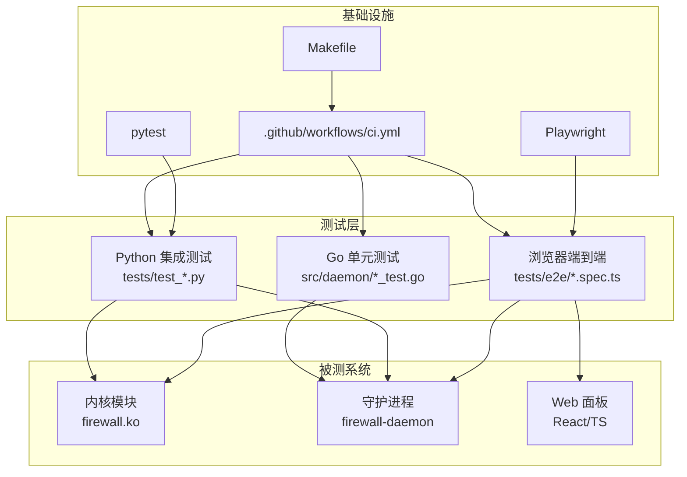
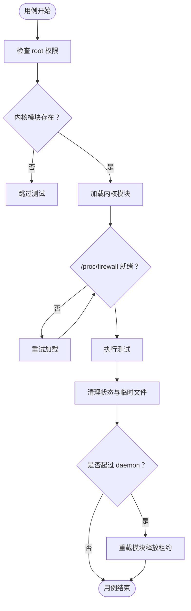
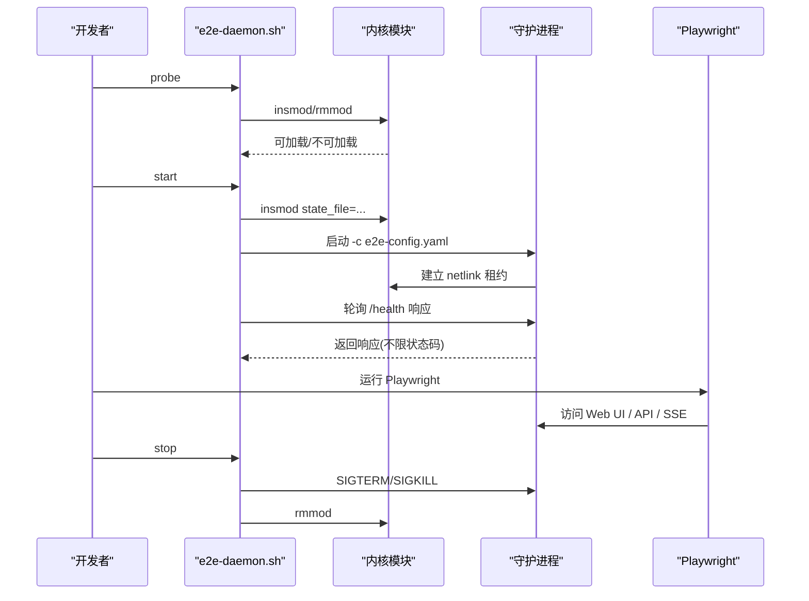
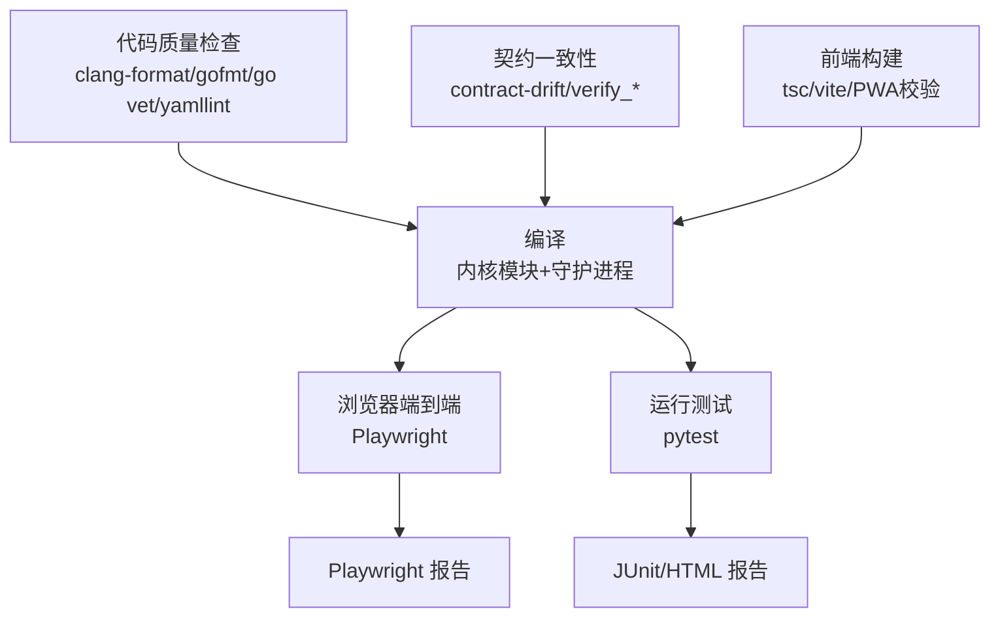
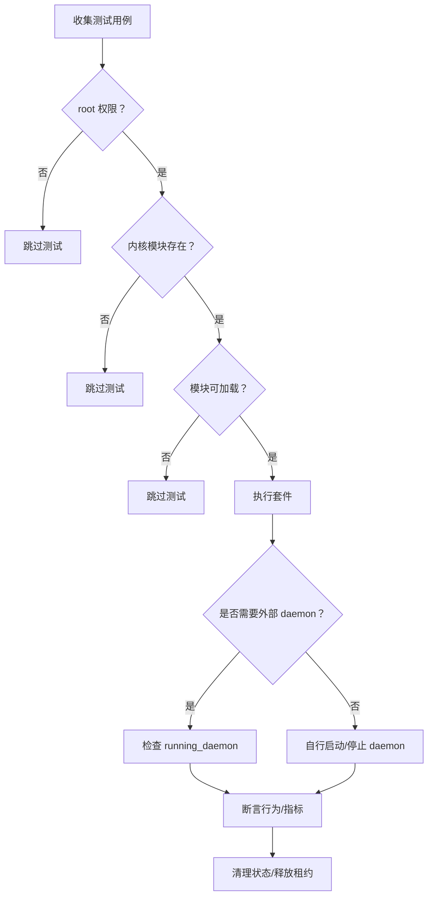
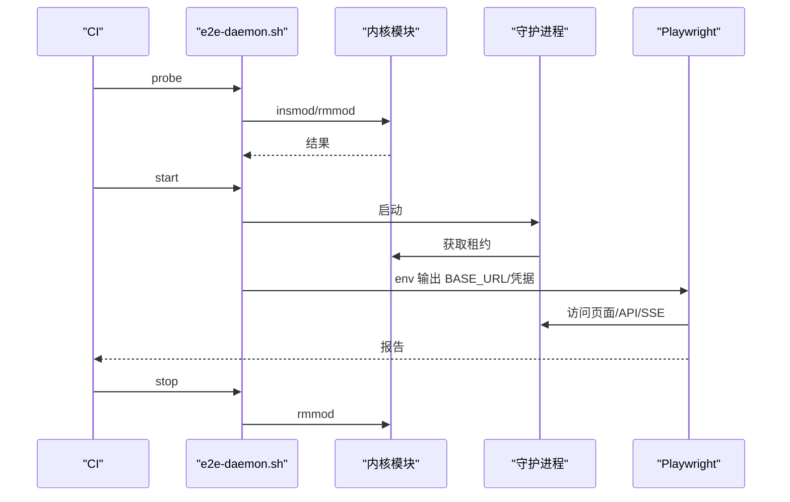
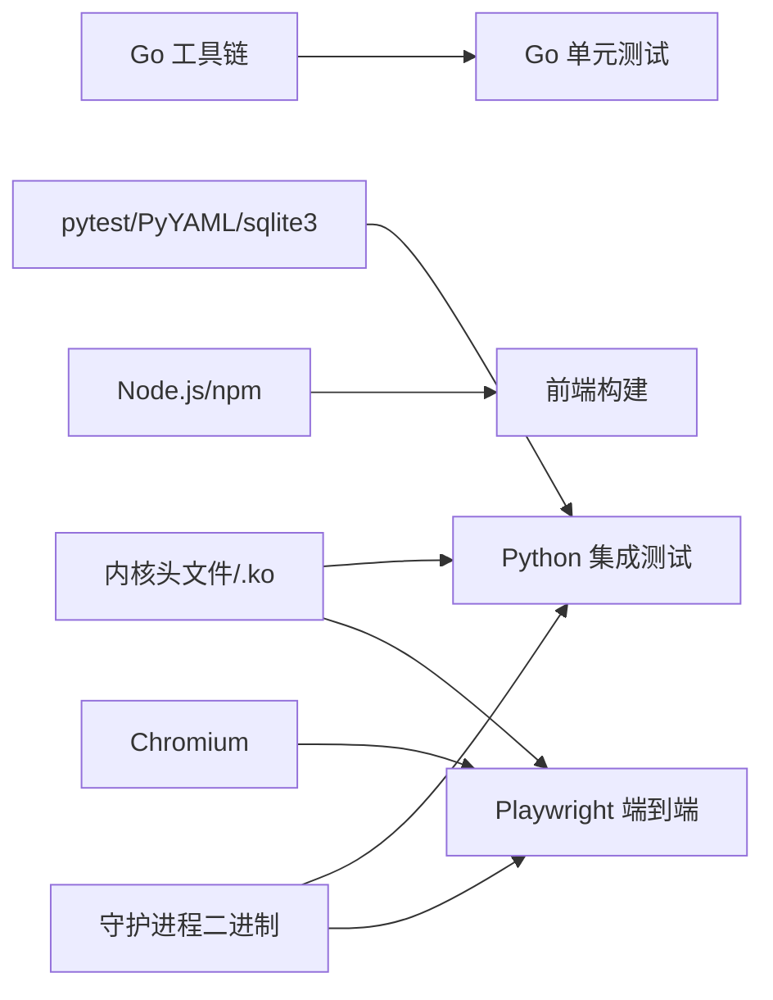

# 测试策略

<cite>
**本文引用的文件**   
- [README.md](file://README.md)
- [testing.md](file://docs/zh/development/testing.md)
- [tests README.md](file://tests/README.md)
- [pyproject.toml](file://pyproject.toml)
- [ci.yml](file://.github/workflows/ci.yml)
- [Makefile](file://Makefile)
- [conftest.py](file://tests/conftest.py)
- [config.py](file://tests/config.py)
- [e2e-daemon.sh](file://scripts/e2e-daemon.sh)
- [test_08_stress_perf.py](file://tests/test_08_stress_perf.py)
- [bench Makefile](file://scripts/bench/Makefile)
</cite>

## 目录
1. [引言](#引言)
2. [项目结构](#项目结构)
3. [核心组件](#核心组件)
4. [架构总览](#架构总览)
5. [详细组件分析](#详细组件分析)
6. [依赖分析](#依赖分析)
7. [性能考虑](#性能考虑)
8. [故障排查指南](#故障排查指南)
9. [结论](#结论)
10. [附录](#附录)

## 引言
本测试策略面向 linux-firewall-kmod 项目的三层测试体系：Go 单元测试、Python 集成测试与 Playwright 端到端测试。目标是让开发团队在本地与 CI 中都能稳定运行测试，明确内核模块、守护进程、Web UI 和契约校验的验证边界，并给出环境搭建、数据准备、自动化流程、覆盖率与质量门禁建议。

本项目采用“用户态智能判定 + 内核态高速封禁”的三层架构，测试也围绕这三层展开：内核模块通过 procfs/netlink/netfilter 行为验证；守护进程通过 Go 单测、pytest 行为测试与 Prometheus 指标断言；前端面板通过 Playwright 在真实守护进程上验证路由、写操作回环、SSE 状态灯与控制台洁净度。

**章节来源**
- [README.md:10-31](file://README.md#L10-L31)
- [testing.md:1-14](file://docs/zh/development/testing.md#L1-L14)

## 项目结构
测试相关代码主要分布在以下位置：
- `src/daemon`：Go 守护进程，包含 `_test.go` 单元测试。
- `tests/`：pytest 集成测试，覆盖内核模块生命周期、procfs 接口、封禁/解封、白名单、并发、压力、守护进程配置、日志解析、资源管理、DDoS 检测、netlink 通信、Web UI API、配置热重载、日志轮转、多 jail 等。
- `tests/e2e/`：Playwright 端到端测试，基于真实守护进程的 Web UI 行为断言。
- `scripts/e2e-daemon.sh`：E2E 夹具脚本，负责加载内核模块、启动守护进程、等待就绪、清理租约。
- `.github/workflows/ci.yml`：CI 六阶段流水线，包含 lint、contract、frontend、build、e2e、test。
- `Makefile`：本地 CI 入口 `make ci`，串联格式检查、契约校验、构建与测试。
- `pyproject.toml`：pytest 配置与覆盖率配置（说明 Python 集成测试覆盖率意义有限）。
- `tests/conftest.py`：pytest fixtures、内核模块管理、procfs 辅助函数、守护进程生命周期工具。
- `tests/config.py`：测试路径、IP、阈值等集中配置。
- `scripts/bench/Makefile`：性能基准工具构建目标。

**图表来源**
- [ci.yml:10-106](file://.github/workflows/ci.yml#L10-L106)
- [ci.yml:343-457](file://.github/workflows/ci.yml#L343-L457)
- [ci.yml:459-564](file://.github/workflows/ci.yml#L459-L564)
- [Makefile:325-543](file://Makefile#L325-L543)
- [testing.md:15-10](file://docs/zh/development/testing.md#L15-L10)

**章节来源**
- [tests README.md:5-35](file://tests/README.md#L5-L35)
- [testing.md:15-10](file://docs/zh/development/testing.md#L15-L10)
- [ci.yml:10-106](file://.github/workflows/ci.yml#L10-L106)
- [Makefile:325-543](file://Makefile#L325-L543)

## 核心组件
本节聚焦测试体系中的关键构件：pytest 框架与 fixtures、内核模块与守护进程生命周期管理、procfs 与 HTTP 辅助能力、E2E 夹具脚本、CI 任务与质量门禁。

### pytest 框架与测试组织
- 测试路径：`tests`。
- 标记：`slow`、`requires_daemon`、`requires_module`、`requires_sqlite3`、`e2e`、`stress`、`perf`。
- 报告：支持 JUnit XML 与 HTML 报告。
- 覆盖率：已配置但说明 Python 集成测试主要测内核与守护进程行为，覆盖率对 Python 代码本身意义不大；Go 单元测试覆盖率由 CI 生成。

**章节来源**
- [pyproject.toml:7-26](file://pyproject.toml#L7-L26)
- [pyproject.toml:31-48](file://pyproject.toml#L31-L48)
- [tests README.md:76-96](file://tests/README.md#L76-L96)

### 内核模块与守护进程生命周期
- 会话级 fixture `session_setup`：检查 root、模块存在、加载模块；结束时重置数据并卸载模块。
- 用例级 fixture `test_isolation`：每个用例前后重置数据、确保模块就绪；teardown 时清理状态、释放内核租约。
- 内核租约卫生：守护进程在内核侧以 portid 独占 + 活动超时实现，无注销消息；测试通过 `mark_daemon_launched` 与 `release_kernel_lease` 保证租约释放。
- 守护进程终止：先 SIGTERM，再兜底 SIGKILL，避免留下半写状态或残留租约。

**图表来源**
- [conftest.py:574-593](file://tests/conftest.py#L574-L593)
- [conftest.py:595-615](file://tests/conftest.py#L595-L615)
- [conftest.py:97-119](file://tests/conftest.py#L97-L119)
- [conftest.py:121-140](file://tests/conftest.py#L121-L140)

**章节来源**
- [conftest.py:34-83](file://tests/conftest.py#L34-L83)
- [conftest.py:89-140](file://tests/conftest.py#L89-L140)
- [conftest.py:574-615](file://tests/conftest.py#L574-L615)

### Procfs 与 HTTP 辅助能力
- Procfs 读写：`ban_ip`、`unban_ip`、`whitelist_add`、`get_stat`、`count_bans`、`reset_all_data`。
- HTTP 请求：`http_request`、`run_curl`、`daemon_credentials`、`get_prometheus_metrics`、`parse_metric`、`wait_for_metric`。
- 端口分配：`free_tcp_port` 用于自起 daemon 独占端口，避免与真实服务冲突。

**章节来源**
- [conftest.py:147-246](file://tests/conftest.py#L147-L246)
- [conftest.py:407-502](file://tests/conftest.py#L407-L502)
- [conftest.py:473-481](file://tests/conftest.py#L473-L481)

### E2E 夹具脚本
`scripts/e2e-daemon.sh` 提供 `probe`、`start`、`stop`、`env` 四个子命令：
- `probe`：仅探测内核模块能否加载，不改变状态。
- `start`：加载模块、生成临时配置、启动守护进程、等待 procfs 与 HTTP 就绪。
- `stop`：优雅停止守护进程、卸载模块、清理临时目录。
- `env`：输出 BASE_URL、凭据与内核模块可用标志，供 Playwright 使用。

**图表来源**
- [e2e-daemon.sh:85-100](file://scripts/e2e-daemon.sh#L85-L100)
- [e2e-daemon.sh:110-214](file://scripts/e2e-daemon.sh#L110-L214)
- [e2e-daemon.sh:217-226](file://scripts/e2e-daemon.sh#L217-L226)
- [e2e-daemon.sh:231-266](file://scripts/e2e-daemon.sh#L231-L266)

**章节来源**
- [e2e-daemon.sh:1-28](file://scripts/e2e-daemon.sh#L1-L28)
- [e2e-daemon.sh:85-100](file://scripts/e2e-daemon.sh#L85-L100)
- [e2e-daemon.sh:110-214](file://scripts/e2e-daemon.sh#L110-L214)
- [e2e-daemon.sh:217-266](file://scripts/e2e-daemon.sh#L217-L266)

### CI 任务与质量门禁
CI 六个任务：
- 代码质量检查：clang-format、gofmt、go vet、yamllint、Go 单元测试。
- 契约一致性：contract-drift、verify_layout、verify_procfs、verify_http。
- 前端构建：npm ci、tsc、vite build、产物与 PWA 清单校验。
- 编译：内核模块与守护进程构建，上传产物。
- 浏览器端到端测试：e2e-daemon.sh 起真守护进程后跑 Playwright。
- 运行测试：安装 sqlite3、pytest、PyYAML，执行 pytest，必要时降级为守护进程功能子集。

质量门禁要点：
- 六项全过才允许合入。
- CI runner 可能无法加载内核模块，此时 test 与 e2e 采取降级或跳过策略，并在报告中显式标注环境限制。
- Go 覆盖率报告生成并上传 artifact。

**章节来源**
- [ci.yml:10-106](file://.github/workflows/ci.yml#L10-L106)
- [ci.yml:107-169](file://.github/workflows/ci.yml#L107-L169)
- [ci.yml:170-342](file://.github/workflows/ci.yml#L170-L342)
- [ci.yml:343-457](file://.github/workflows/ci.yml#L343-L457)
- [ci.yml:459-564](file://.github/workflows/ci.yml#L459-L564)
- [testing.md:144-189](file://docs/zh/development/testing.md#L144-L189)

## 架构总览
下图展示从代码提交到测试产物的完整链路：lint/contract/frontend/build 并行执行，e2e 与 test 依赖 build 产物；e2e 需要真实内核模块与守护进程，test 在兼容环境下跑全部套件，否则降级。

**图表来源**
- [ci.yml:10-106](file://.github/workflows/ci.yml#L10-L106)
- [ci.yml:343-457](file://.github/workflows/ci.yml#L343-L457)
- [ci.yml:459-564](file://.github/workflows/ci.yml#L459-L564)

## 详细组件分析

### Go 单元测试
- 入口：`cd src/daemon && go test ./...`。
- 组合根可测入口：`cmd/firewall-daemon/main.go` 的 `run(args []string) error`。
- 契约生成的 `http_contract.go` 另有自检：`contract/verify_http.py` 会把它真编一遍，CI 传 `GO` 环境变量。

建议：
- 新增逻辑优先补充 Go 单测，确保包内 `_test.go` 覆盖分支。
- 使用 `go vet` 与 `gofmt` 保持静态分析与格式一致。

**章节来源**
- [testing.md:15-33](file://docs/zh/development/testing.md#L15-L33)
- [ci.yml:71-91](file://.github/workflows/ci.yml#L71-L91)

### Python 集成测试
- 运行方式：`make test` 或 `sudo python3 -m pytest tests/ -v`。
- 套件清单：按编号区分模块生命周期、procfs、封禁/解封、白名单、并发、压力、守护进程配置、日志解析、资源管理、永久封禁、FRP jail、netfilter 行为、DDoS 检测、Web UI API、配置热重载、日志轮转、netlink 通信、守护进程生命周期、多 jail、集群扫描。
- 标记过滤：`-m slow`、`-m requires_daemon`、`-m requires_module`、`-m stress`、`-m perf`。
- 报告：`--junitxml=junit.xml`、`--html=report.html --self-contained-html`。

**图表来源**
- [conftest.py:574-615](file://tests/conftest.py#L574-L615)
- [conftest.py:646-653](file://tests/conftest.py#L646-L653)
- [tests README.md:86-96](file://tests/README.md#L86-L96)

**章节来源**
- [testing.md:34-99](file://docs/zh/development/testing.md#L34-L99)
- [tests README.md:42-96](file://tests/README.md#L42-L96)
- [conftest.py:574-653](file://tests/conftest.py#L574-L653)

### 端到端测试（Playwright）
- 前置：加载内核模块并启动守护进程，等待 `/proc/firewall/bans` 与 HTTP 就绪。
- 断言范围：路由、写操作回环、仪表盘、控制台洁净度、PWA 上下文对照。
- 配置取舍：`retries=0`、`workers=1`，避免掩盖间歇性缺陷与连接位上限问题。
- 局域网对照：通过 `E2E_LAN_ORIGIN` 开启非安全上下文 SW 注册校验。

**图表来源**
- [ci.yml:343-457](file://.github/workflows/ci.yml#L343-L457)
- [e2e-daemon.sh:85-100](file://scripts/e2e-daemon.sh#L85-L100)
- [e2e-daemon.sh:110-214](file://scripts/e2e-daemon.sh#L110-L214)
- [e2e-daemon.sh:217-226](file://scripts/e2e-daemon.sh#L217-L226)

**章节来源**
- [testing.md:100-143](file://docs/zh/development/testing.md#L100-L143)
- [e2e-daemon.sh:110-214](file://scripts/e2e-daemon.sh#L110-L214)

### 性能基准测试
- 集成测试性能：`tests/test_08_stress_perf.py` 测量封禁/解封耗时与快速大量封禁压力。
- 基准工具：`scripts/bench/Makefile` 构建 `blast2` 与 `sink`，仅依赖 libc 与 pthread，用于更底层流量压测场景。

建议：
- 将性能阈值集中在 `tests/config.py`，便于不同机器调整。
- 在 CI 中可将 `stress`、`perf` 标记单独运行，避免拖慢主流程。

**章节来源**
- [test_08_stress_perf.py:1-93](file://tests/test_08_stress_perf.py#L1-L93)
- [bench Makefile:1-27](file://scripts/bench/Makefile#L1-L27)
- [tests/config.py:53-61](file://tests/config.py#L53-L61)

## 依赖分析
测试体系的依赖关系如下：
- Go 单元测试依赖 `src/daemon` 源码与 Go 工具链。
- Python 集成测试依赖 pytest、PyYAML、sqlite3 CLI、root 权限与可加载内核模块。
- 端到端测试依赖 Playwright、Chromium、可加载内核模块与真实守护进程。
- CI 通过缓存 Go 模块、pip、ccache 加速构建与测试。

**图表来源**
- [ci.yml:17-50](file://.github/workflows/ci.yml#L17-L50)
- [ci.yml:482-504](file://.github/workflows/ci.yml#L482-L504)
- [ci.yml:392-397](file://.github/workflows/ci.yml#L392-L397)

**章节来源**
- [ci.yml:17-50](file://.github/workflows/ci.yml#L17-L50)
- [ci.yml:392-397](file://.github/workflows/ci.yml#L392-L397)
- [ci.yml:482-504](file://.github/workflows/ci.yml#L482-L504)

## 性能考虑
- 内核模块编译：启用 ccache 加速重复构建；CI 中缓存 `~/.ccache`。
- Go 构建：缓存 `~/go/pkg/mod` 与 `~/.cache/go-build`。
- 前端构建：缓存 npm 依赖。
- 测试稳定性：E2E 关闭重试、单 worker，避免掩盖间歇性失败；守护进程连接位硬上限需与服务侧配额匹配。
- 性能阈值：集成测试中的封禁/解封/压力阈值集中在 `tests/config.py`，可在不同机器调整。

**章节来源**
- [ci.yml:191-212](file://.github/workflows/ci.yml#L191-L212)
- [ci.yml:199-207](file://.github/workflows/ci.yml#L199-L207)
- [ci.yml:392-397](file://.github/workflows/ci.yml#L392-L397)
- [tests/config.py:53-61](file://tests/config.py#L53-L61)
- [testing.md:132-139](file://docs/zh/development/testing.md#L132-L139)

## 故障排查指南
常见问题与处理：
- “模块未加载”：确认 root 权限与 `build/kernel-module/firewall.ko` 存在；测试会自动加载模块。
- “守护进程不存在”：先运行 `make daemon` 构建二进制。
- 性能测试不稳定：调整 `BAN_PERF_THRESHOLD_MS`、`UNBAN_PERF_THRESHOLD_MS`、`STRESS_THRESHOLD_MS`。
- CI 绿不代表内核模块套件跑过：GitHub Actions runner 可能无法加载内核模块，test 与 e2e 会降级或跳过，需在能 `insmod` 的机器上验证内核套件。
- 编译通过不等于加载成功：注意 vermagic、per-CPU 申请上限、init 路径返回值等差异。
- sudo PATH 问题：CI 保留当前 PATH，避免 `go: 没有那个文件或目录`。
- Python 依赖：pytest 与 PyYAML 必须装进系统站点目录，`--user` 对 root 不可见。

**章节来源**
- [tests README.md:153-175](file://tests/README.md#L153-L175)
- [testing.md:84-99](file://docs/zh/development/testing.md#L84-L99)
- [testing.md:159-189](file://docs/zh/development/testing.md#L159-L189)

## 结论
本测试策略以三层测试为核心：Go 单元测试保障守护进程内部逻辑正确性；Python 集成测试覆盖内核模块与守护进程的行为契约；Playwright 端到端测试在真实守护进程上验证 Web UI 与 SSE 行为。CI 通过六阶段流水线实现质量门禁，并在环境受限情况下采取降级或跳过策略，确保反馈清晰可追溯。建议在本地与 CI 中统一遵循本策略，持续完善用例、阈值与契约校验，形成可靠的测试体系。

## 附录
### 测试环境与执行命令速查
- Go 单元测试：`cd src/daemon && go test ./...`
- Python 集成测试：`make test` 或 `sudo python3 -m pytest tests/ -v`
- 端到端测试：`sudo bash scripts/e2e-daemon.sh start` → `npx playwright test` → `sudo bash scripts/e2e-daemon.sh stop`
- CI 全流程：`make ci`

**章节来源**
- [testing.md:15-42](file://docs/zh/development/testing.md#L15-L42)
- [testing.md:100-119](file://docs/zh/development/testing.md#L100-L119)
- [Makefile:325-543](file://Makefile#L325-L543)