# 测试自动化

<cite>
**本文引用的文件**   
- [Makefile](file://Makefile)
- [.github/workflows/ci.yml](file://.github/workflows/ci.yml)
- [tests/README.md](file://tests/README.md)
- [docs/zh/development/testing.md](file://docs/zh/development/testing.md)
- [tests/conftest.py](file://tests/conftest.py)
- [tests/config.py](file://tests/config.py)
</cite>

## 目录
1. [引言](#引言)
2. [项目结构](#项目结构)
3. [核心组件](#核心组件)
4. [架构总览](#架构总览)
5. [详细组件分析](#详细组件分析)
6. [依赖关系分析](#依赖关系分析)
7. [性能与并行](#性能与并行)
8. [故障排查](#故障排查)
9. [结论](#结论)

## 引言
本文面向持续集成中的测试自动化，覆盖以下目标：
- 说明 GitHub Actions 工作流中各任务如何组织测试执行。
- 解释 Makefile 提供的测试目标与 CI 流程入口。
- 说明测试依赖管理、环境准备、结果收集与报告生成。
- 说明当前仓库在并行测试、失败重试、测试隔离方面的现状与建议。
- 提供 CI/CD 集成示例、覆盖率上报与质量门禁配置思路。
- 确保测试能够自动执行并提供及时反馈。

本项目采用三层测试模型：Go 单元测试、Python 集成测试、浏览器端到端测试。CI 通过多个并行 job 加速反馈，并在内核模块不可加载时降级运行守护进程相关用例，避免环境限制导致长期误报。

## 项目结构
测试相关代码与配置主要分布在以下位置：
- `.github/workflows/ci.yml`：GitHub Actions 流水线定义，包含 lint、前端构建、编译、e2e、test 等任务。
- `Makefile`：统一构建、契约校验、CI 流程与测试入口。
- `tests/`：pytest 集成测试套件、夹具、配置常量与文档。
- `docs/zh/development/testing.md`：本地与 CI 测试命令、分层策略与注意事项。

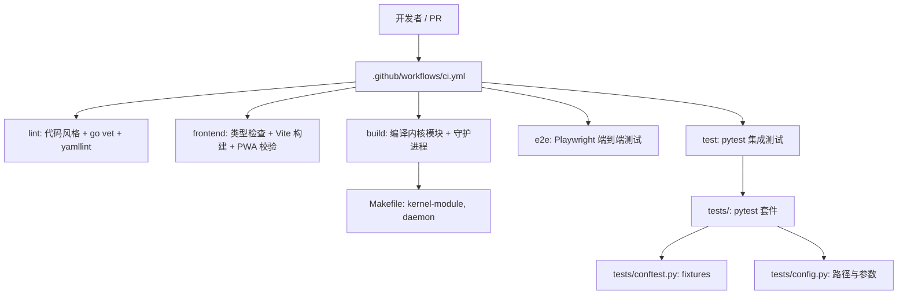

**图表来源**
- [.github/workflows/ci.yml:10-106](file://.github/workflows/ci.yml#L10-L106)
- [.github/workflows/ci.yml:171-341](file://.github/workflows/ci.yml#L171-L341)
- [.github/workflows/ci.yml:355-457](file://.github/workflows/ci.yml#L355-L457)
- [.github/workflows/ci.yml:460-564](file://.github/workflows/ci.yml#L460-L564)
- [Makefile:325-543](file://Makefile#L325-L543)
- [Makefile:1094-1107](file://Makefile#L1094-L1107)

**章节来源**
- [.github/workflows/ci.yml:1-106](file://.github/workflows/ci.yml#L1-L106)
- [Makefile:325-543](file://Makefile#L325-L543)
- [tests/README.md:1-35](file://tests/README.md#L1-L35)

## 核心组件
本节聚焦测试自动化中最关键的三个部分：GitHub Actions 工作流、Makefile 测试目标、pytest 测试框架。

### GitHub Actions 工作流
工作流定义了六个关键任务：
- `lint`：代码质量检查、Go 单元测试、覆盖率生成、契约一致性校验。
- `frontend`：前端类型检查、Vite 构建、PWA 清单与 Service Worker 校验。
- `build`：安装内核头文件、ccache 缓存、编译守护进程与内核模块、上传产物。
- `e2e`：下载 build 产物，针对本机内核重编模块，启动真实守护进程后运行 Playwright。
- `test`：下载 build 产物，安装 pytest、PyYAML、sqlite3，针对本机内核重编模块，运行 pytest 并生成 JUnit 与 HTML 报告。

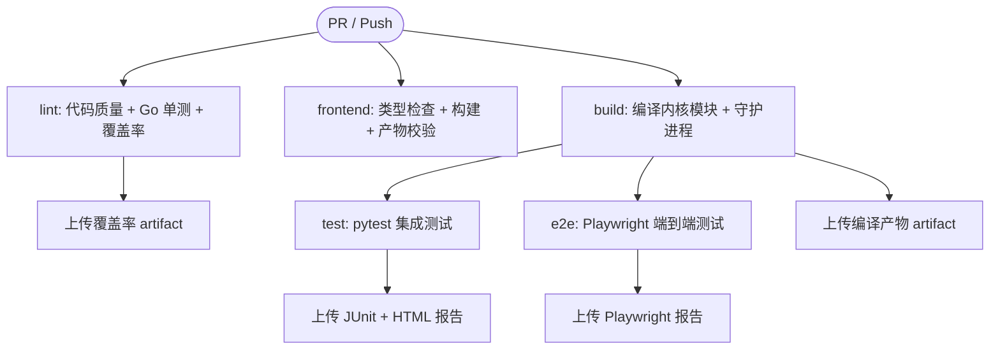

**图表来源**
- [.github/workflows/ci.yml:10-106](file://.github/workflows/ci.yml#L10-L106)
- [.github/workflows/ci.yml:171-341](file://.github/workflows/ci.yml#L171-L341)
- [.github/workflows/ci.yml:355-457](file://.github/workflows/ci.yml#L355-L457)
- [.github/workflows/ci.yml:460-564](file://.github/workflows/ci.yml#L460-L564)

**章节来源**
- [.github/workflows/ci.yml:10-106](file://.github/workflows/ci.yml#L10-L106)
- [.github/workflows/ci.yml:171-341](file://.github/workflows/ci.yml#L171-L341)
- [.github/workflows/ci.yml:355-457](file://.github/workflows/ci.yml#L355-L457)
- [.github/workflows/ci.yml:460-564](file://.github/workflows/ci.yml#L460-L564)

### Makefile 测试目标
Makefile 提供统一的 CI 流程与测试入口：
- `make ci`：串联环境检查、格式检查、契约验证、构建、测试、清理与摘要。
- `make ci-test`：调用 Go 单元测试与 pytest 集成测试；可通过 `SKIP_TESTS=1` 跳过。
- `make test`：依赖已构建的内核模块与守护进程二进制，执行 pytest。
- `make test-html`：生成 HTML 报告（需要 pytest-html）。
- `make test-cov`：生成 Python 测试覆盖率（集成测试覆盖率参考意义有限）。

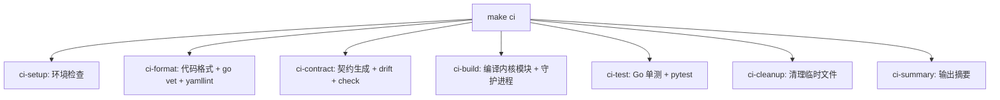

**图表来源**
- [Makefile:325-543](file://Makefile#L325-L543)
- [Makefile:1094-1107](file://Makefile#L1094-L1107)

**章节来源**
- [Makefile:325-543](file://Makefile#L325-L543)
- [Makefile:1094-1107](file://Makefile#L1094-L1107)

### pytest 测试框架
pytest 套件位于 `tests/`，由 `conftest.py` 提供 fixtures 与辅助函数，`config.py` 集中路径与参数。关键机制包括：
- `session_setup`：会话级检查 root、模块存在、加载模块；teardown 重置数据并卸载模块。
- `test_isolation`：每个用例前后重置数据、检查/加载模块、清理状态、释放内核租约。
- `clean_bans`：显式保证封禁列表为空。
- `running_daemon`：外部已有守护进程时继续，否则跳过。
- `daemon_starts_ok` / `run_daemon_captured` / `daemon_run_probe`：安全启动与停止守护进程，避免残留内核租约。

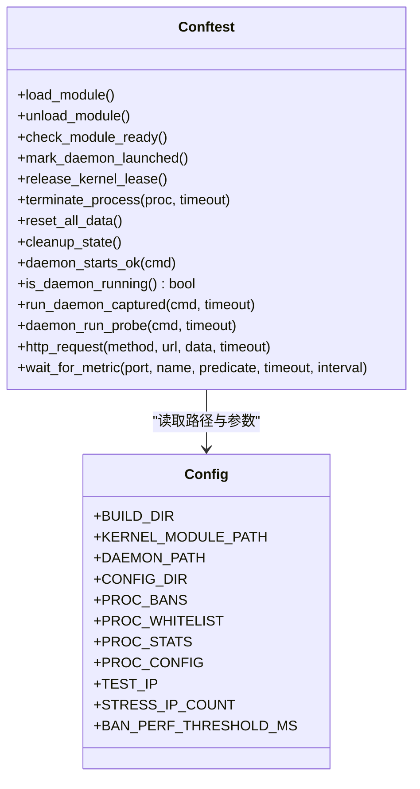

**图表来源**
- [tests/conftest.py:34-140](file://tests/conftest.py#L34-L140)
- [tests/conftest.py:254-319](file://tests/conftest.py#L254-L319)
- [tests/conftest.py:326-533](file://tests/conftest.py#L326-L533)
- [tests/conftest.py:574-662](file://tests/conftest.py#L574-L662)
- [tests/config.py:8-80](file://tests/config.py#L8-L80)

**章节来源**
- [tests/conftest.py:34-140](file://tests/conftest.py#L34-L140)
- [tests/conftest.py:254-319](file://tests/conftest.py#L254-L319)
- [tests/conftest.py:326-533](file://tests/conftest.py#L326-L533)
- [tests/conftest.py:574-662](file://tests/conftest.py#L574-L662)
- [tests/config.py:8-80](file://tests/config.py#L8-L80)

## 架构总览
从提交到报告产出的整体流程如下：

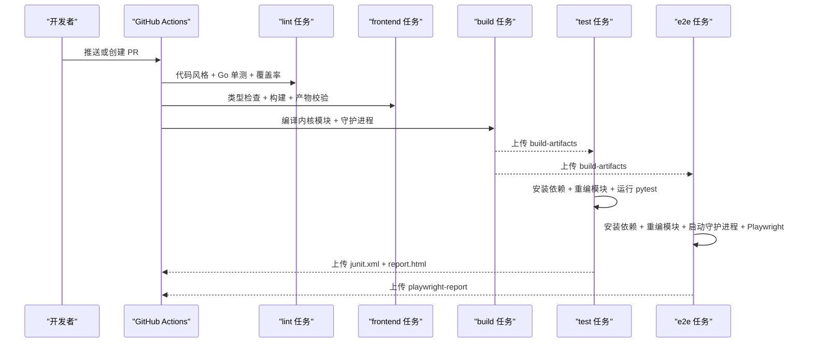

**图表来源**
- [.github/workflows/ci.yml:10-106](file://.github/workflows/ci.yml#L10-L106)
- [.github/workflows/ci.yml:171-341](file://.github/workflows/ci.yml#L171-L341)
- [.github/workflows/ci.yml:355-457](file://.github/workflows/ci.yml#L355-L457)
- [.github/workflows/ci.yml:460-564](file://.github/workflows/ci.yml#L460-L564)

## 详细组件分析

### 持续集成流水线中的测试执行
- Go 单元测试：在 `lint` 任务中执行 `cd src/daemon && go test ./...`，并通过 `-coverprofile=coverage.out -covermode=atomic` 生成覆盖率。
- pytest 集成测试：在 `test` 任务中执行 `sudo python3 -m pytest tests/ -v --tb=short --junitxml=junit.xml --html=report.html --self-contained-html`。
- 端到端测试：在 `e2e` 任务中通过 `scripts/e2e-daemon.sh` 启动真实守护进程，再执行 `npm run test:e2e`。

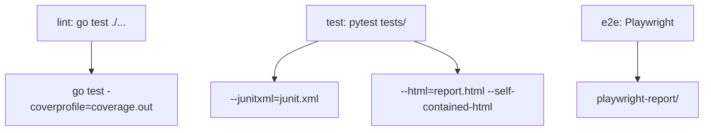

**图表来源**
- [.github/workflows/ci.yml:71-91](file://.github/workflows/ci.yml#L71-L91)
- [.github/workflows/ci.yml:537-564](file://.github/workflows/ci.yml#L537-L564)
- [.github/workflows/ci.yml:427-457](file://.github/workflows/ci.yml#L427-L457)

**章节来源**
- [.github/workflows/ci.yml:71-91](file://.github/workflows/ci.yml#L71-L91)
- [.github/workflows/ci.yml:537-564](file://.github/workflows/ci.yml#L537-L564)
- [.github/workflows/ci.yml:427-457](file://.github/workflows/ci.yml#L427-L457)

### GitHub Actions 工作流配置
- 触发条件：push 到 master/main，以及来自 master/main 的 pull_request。
- 并行任务：lint、frontend、build、e2e、test 并行执行，缩短反馈时间。
- 缓存：Go 模块缓存、pip 缓存、ccache、npm 缓存。
- 产物：upload-artifact 上传覆盖率、编译产物、Playwright 报告、JUnit/HTML 报告。

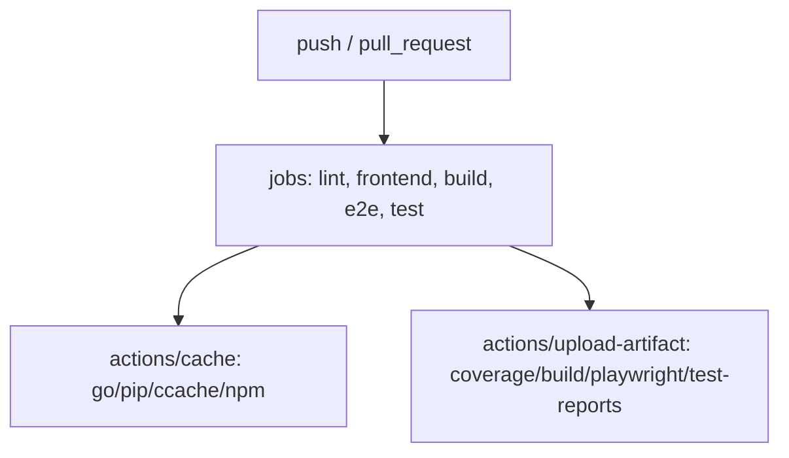

**图表来源**
- [.github/workflows/ci.yml:1-8](file://.github/workflows/ci.yml#L1-L8)
- [.github/workflows/ci.yml:19-35](file://.github/workflows/ci.yml#L19-L35)
- [.github/workflows/ci.yml:85-91](file://.github/workflows/ci.yml#L85-L91)
- [.github/workflows/ci.yml:333-341](file://.github/workflows/ci.yml#L333-L341)
- [.github/workflows/ci.yml:446-457](file://.github/workflows/ci.yml#L446-L457)
- [.github/workflows/ci.yml:555-564](file://.github/workflows/ci.yml#L555-L564)

**章节来源**
- [.github/workflows/ci.yml:1-8](file://.github/workflows/ci.yml#L1-L8)
- [.github/workflows/ci.yml:19-35](file://.github/workflows/ci.yml#L19-L35)
- [.github/workflows/ci.yml:85-91](file://.github/workflows/ci.yml#L85-L91)
- [.github/workflows/ci.yml:333-341](file://.github/workflows/ci.yml#L333-L341)
- [.github/workflows/ci.yml:446-457](file://.github/workflows/ci.yml#L446-L457)
- [.github/workflows/ci.yml:555-564](file://.github/workflows/ci.yml#L555-L564)

### Makefile 测试目标
- `make ci`：完整 CI 流程，包含环境检查、格式检查、契约验证、构建、测试、清理与摘要。
- `make ci-test`：执行 Go 单元测试与 pytest 集成测试；支持 `SKIP_TESTS=1`。
- `make test`：依赖已构建产物，执行 pytest。
- `make test-html`：生成 HTML 报告。
- `make test-cov`：生成 Python 测试覆盖率（参考意义有限）。

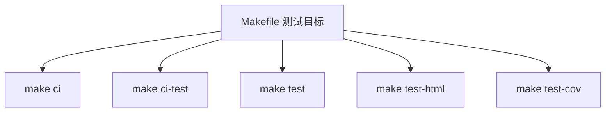

**图表来源**
- [Makefile:325-543](file://Makefile#L325-L543)
- [Makefile:1094-1107](file://Makefile#L1094-L1107)

**章节来源**
- [Makefile:325-543](file://Makefile#L325-L543)
- [Makefile:1094-1107](file://Makefile#L1094-L1107)

### 测试依赖管理与环境准备
- Go 依赖：`src/daemon/go.sum`，CI 使用 actions/setup-go 与 cache。
- Python 依赖：pytest、PyYAML、pytest-html，CI 通过 apt 与 pip 安装。
- Node.js 依赖：frontend/package-lock.json，CI 使用 npm ci。
- 系统依赖：build-essential、linux-headers、ccache、sqlite3。
- 内核模块：CI 针对本机内核重编 firewall.ko，避免因跨 VM vermagic 不匹配导致 insmod 失败。

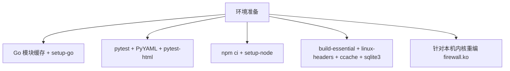

**图表来源**
- [.github/workflows/ci.yml:19-50](file://.github/workflows/ci.yml#L19-L50)
- [.github/workflows/ci.yml:116-125](file://.github/workflows/ci.yml#L116-L125)
- [.github/workflows/ci.yml:179-207](file://.github/workflows/ci.yml#L179-L207)
- [.github/workflows/ci.yml:482-504](file://.github/workflows/ci.yml#L482-L504)
- [.github/workflows/ci.yml:506-518](file://.github/workflows/ci.yml#L506-L518)

**章节来源**
- [.github/workflows/ci.yml:19-50](file://.github/workflows/ci.yml#L19-L50)
- [.github/workflows/ci.yml:116-125](file://.github/workflows/ci.yml#L116-L125)
- [.github/workflows/ci.yml:179-207](file://.github/workflows/ci.yml#L179-L207)
- [.github/workflows/ci.yml:482-504](file://.github/workflows/ci.yml#L482-L504)
- [.github/workflows/ci.yml:506-518](file://.github/workflows/ci.yml#L506-L518)

### 结果收集与报告生成
- Go 覆盖率：`coverage.out`，通过 upload-artifact 保留 7 天。
- pytest 报告：`junit.xml` 与 `report.html`，通过 upload-artifact 保留 7 天。
- Playwright 报告：`playwright-report/`，通过 upload-artifact 保留 7 天。

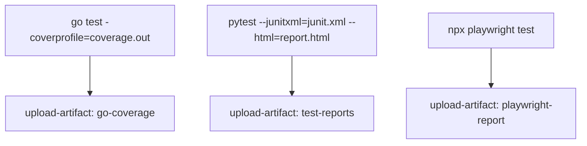

**图表来源**
- [.github/workflows/ci.yml:77-91](file://.github/workflows/ci.yml#L77-L91)
- [.github/workflows/ci.yml:537-564](file://.github/workflows/ci.yml#L537-L564)
- [.github/workflows/ci.yml:446-457](file://.github/workflows/ci.yml#L446-L457)

**章节来源**
- [.github/workflows/ci.yml:77-91](file://.github/workflows/ci.yml#L77-L91)
- [.github/workflows/ci.yml:537-564](file://.github/workflows/ci.yml#L537-L564)
- [.github/workflows/ci.yml:446-457](file://.github/workflows/ci.yml#L446-L457)

### 并行测试执行
- CI 任务并行：lint、frontend、build、e2e、test 并行执行。
- Go 单测：未启用 xdist，按包顺序执行。
- pytest：未启用 xdist，串行执行；并发场景由测试内部多进程模拟。
- Playwright：workers=1，避免 SSE 连接数超限导致偶发 503。

建议：
- 若需并行 pytest，可引入 pytest-xdist，但需评估共享资源竞争（procfs、内核模块、端口）。
- 对长耗时测试使用标记（slow、stress）并按需过滤。

**章节来源**
- [.github/workflows/ci.yml:10-106](file://.github/workflows/ci.yml#L10-L106)
- [docs/zh/development/testing.md:132-143](file://docs/zh/development/testing.md#L132-L143)

### 失败重试
- Playwright：retries=0，避免把间歇性缺陷洗成绿。
- pytest：未启用 retry，失败即失败。
- CI：continue-on-error 仅用于覆盖率生成与上传，不影响主流程。

建议：
- 对网络抖动类用例可考虑 pytest-retry，但应配合日志与截图，避免掩盖问题。
- 对内核模块加载失败的环境限制，当前策略是 skip 或降级运行，而非重试。

**章节来源**
- [docs/zh/development/testing.md:132-143](file://docs/zh/development/testing.md#L132-L143)
- [.github/workflows/ci.yml:77-91](file://.github/workflows/ci.yml#L77-L91)

### 测试隔离机制
- 会话级隔离：`session_setup` 确保模块加载，teardown 重置数据并卸载模块。
- 用例级隔离：`test_isolation` 在每个用例前后重置数据、检查/加载模块、清理状态、释放内核租约。
- 守护进程租约：内核实现 portid 独占 + 30 秒活动超时，无注销消息；测试通过重载模块释放租约。
- 进程终止：先 SIGTERM，等待退出，失败则 SIGKILL，避免留下半写状态。

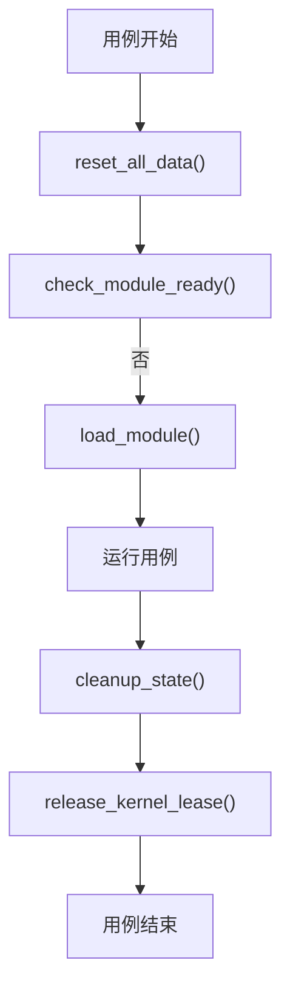

**图表来源**
- [tests/conftest.py:574-615](file://tests/conftest.py#L574-L615)
- [tests/conftest.py:107-140](file://tests/conftest.py#L107-L140)

**章节来源**
- [tests/conftest.py:574-615](file://tests/conftest.py#L574-L615)
- [tests/conftest.py:107-140](file://tests/conftest.py#L107-L140)

### CI/CD 集成示例
- 代码质量门禁：clang-format、gofmt、go vet、yamllint。
- 契约门禁：make contract-drift + verify_layout/verify_procfs/verify_http。
- 构建门禁：编译内核模块与守护进程，验证产物存在。
- 测试门禁：Go 单测通过、pytest 通过、Playwright 通过。
- 覆盖率上报：coverage.out 作为 artifact 上传，可结合第三方工具进行阈值门禁。

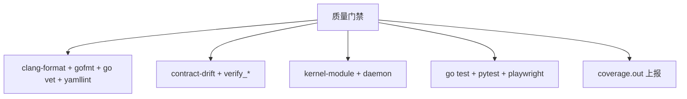

**图表来源**
- [.github/workflows/ci.yml:52-106](file://.github/workflows/ci.yml#L52-L106)
- [.github/workflows/ci.yml:171-341](file://.github/workflows/ci.yml#L171-L341)
- [.github/workflows/ci.yml:460-564](file://.github/workflows/ci.yml#L460-L564)

**章节来源**
- [.github/workflows/ci.yml:52-106](file://.github/workflows/ci.yml#L52-L106)
- [.github/workflows/ci.yml:171-341](file://.github/workflows/ci.yml#L171-L341)
- [.github/workflows/ci.yml:460-564](file://.github/workflows/ci.yml#L460-L564)

### 测试覆盖率上报
- Go 覆盖率：`cd src/daemon && go test -coverprofile=coverage.out -covermode=atomic ./...`，上传 `coverage.out`。
- Python 覆盖率：`make test-cov` 生成终端缺失行报告，但集成测试覆盖率参考意义有限。
- 建议：结合 codecov、coveralls 或自建覆盖率门禁，设置最低覆盖率阈值。

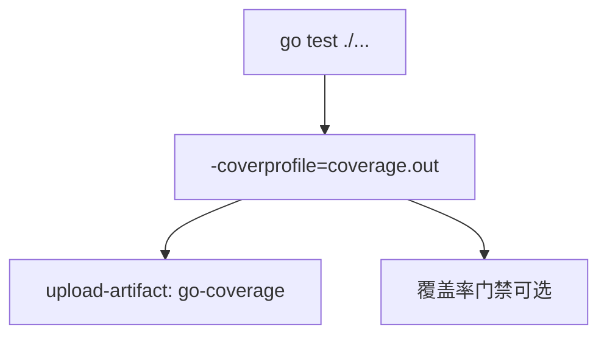

**图表来源**
- [.github/workflows/ci.yml:77-91](file://.github/workflows/ci.yml#L77-L91)
- [Makefile:1104-1107](file://Makefile#L1104-L1107)

**章节来源**
- [.github/workflows/ci.yml:77-91](file://.github/workflows/ci.yml#L77-L91)
- [Makefile:1104-1107](file://Makefile#L1104-L1107)

### 质量门禁配置
- 代码风格：clang-format --dry-run --Werror、gofmt -l、shellcheck。
- 静态分析：go vet。
- 契约一致性：make contract-drift + verify_layout/verify_procfs/verify_http。
- 前端构建：tsc --noEmit、vite build、manifest.webmanifest 字段校验、sw.js 语法校验。
- 构建产物：firewall.ko 与 firewall-daemon 存在性校验。
- 测试通过率：Go 单测、pytest、Playwright 全部通过。

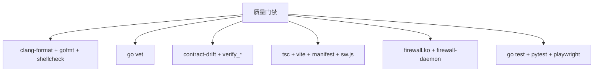

**图表来源**
- [.github/workflows/ci.yml:52-106](file://.github/workflows/ci.yml#L52-L106)
- [.github/workflows/ci.yml:127-168](file://.github/workflows/ci.yml#L127-L168)
- [.github/workflows/ci.yml:259-341](file://.github/workflows/ci.yml#L259-L341)

**章节来源**
- [.github/workflows/ci.yml:52-106](file://.github/workflows/ci.yml#L52-L106)
- [.github/workflows/ci.yml:127-168](file://.github/workflows/ci.yml#L127-L168)
- [.github/workflows/ci.yml:259-341](file://.github/workflows/ci.yml#L259-L341)

## 依赖关系分析
- CI 任务依赖：
  - e2e 依赖 build 产物。
  - test 依赖 build 产物。
  - lint 与 frontend 独立并行。
- Makefile 依赖：
  - ci 依赖 ci-setup、ci-format、ci-contract、ci-build、ci-test、ci-cleanup、ci-summary。
  - ci-test 依赖 Go 单测与 pytest。
- pytest 依赖：
  - conftest.py 提供 fixtures 与辅助函数。
  - config.py 提供路径与参数。

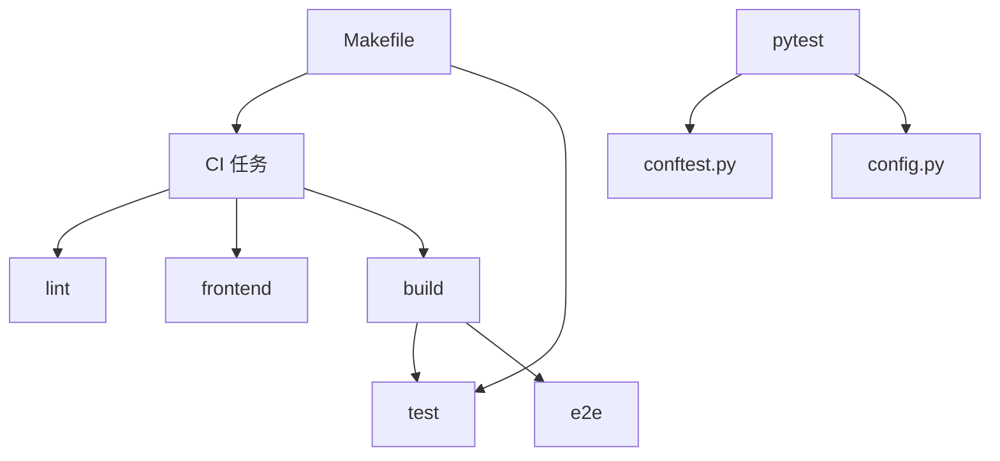

**图表来源**
- [.github/workflows/ci.yml:355-457](file://.github/workflows/ci.yml#L355-L457)
- [.github/workflows/ci.yml:460-564](file://.github/workflows/ci.yml#L460-L564)
- [Makefile:325-543](file://Makefile#L325-L543)
- [tests/conftest.py:574-662](file://tests/conftest.py#L574-L662)
- [tests/config.py:8-80](file://tests/config.py#L8-L80)

**章节来源**
- [.github/workflows/ci.yml:355-457](file://.github/workflows/ci.yml#L355-L457)
- [.github/workflows/ci.yml:460-564](file://.github/workflows/ci.yml#L460-L564)
- [Makefile:325-543](file://Makefile#L325-L543)
- [tests/conftest.py:574-662](file://tests/conftest.py#L574-L662)
- [tests/config.py:8-80](file://tests/config.py#L8-L80)

## 性能与并行
- CI 并行：lint、frontend、build、e2e、test 并行执行。
- Go 单测：未启用 xdist，按包顺序执行。
- pytest：未启用 xdist，串行执行；并发场景由测试内部多进程模拟。
- Playwright：workers=1，避免 SSE 连接数超限导致偶发 503。
- 建议：
  - 对长耗时测试使用标记（slow、stress）并按需过滤。
  - 若需并行 pytest，可引入 pytest-xdist，但需评估共享资源竞争。
  - 对内核模块加载失败的环境限制，当前策略是 skip 或降级运行，而非重试。

**章节来源**
- [.github/workflows/ci.yml:10-106](file://.github/workflows/ci.yml#L10-L106)
- [docs/zh/development/testing.md:132-143](file://docs/zh/development/testing.md#L132-L143)

## 故障排查
- 模块未加载：确保以 root 运行，且 `build/kernel-module/firewall.ko` 存在；测试会自动加载模块。
- 守护进程不存在：先运行 `make daemon` 构建守护进程二进制。
- 性能测试不稳定：性能阈值硬编码在 `config.py`，不同机器可能差异大；可调整 `BAN_PERF_THRESHOLD_MS` 等参数。
- CI runner 无法加载内核模块：GitHub Actions Azure VM 使用自定义内核，insmod 会失败；test 与 e2e 任务分别采取降级或 skip 策略。
- 端口冲突：fixture 提供 `free_tcp_port()`，避免与真实 daemon 或其他用例抢端口。
- 内核租约残留：通过 `release_kernel_lease()` 重载模块释放租约；避免使用 subprocess.run(timeout=...) 直接 SIGKILL。

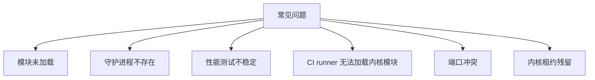

**图表来源**
- [tests/README.md:153-175](file://tests/README.md#L153-L175)
- [docs/zh/development/testing.md:159-189](file://docs/zh/development/testing.md#L159-L189)
- [tests/conftest.py:473-533](file://tests/conftest.py#L473-L533)

**章节来源**
- [tests/README.md:153-175](file://tests/README.md#L153-L175)
- [docs/zh/development/testing.md:159-189](file://docs/zh/development/testing.md#L159-L189)
- [tests/conftest.py:473-533](file://tests/conftest.py#L473-L533)

## 结论
本项目的测试自动化通过 GitHub Actions 工作流与 Makefile 统一编排，形成代码质量、契约一致性、构建、测试与报告的完整闭环。CI 并行执行多个任务以缩短反馈时间，并在内核模块不可加载时采取降级策略，避免环境限制导致长期误报。pytest 通过 fixtures 与辅助函数实现严格的测试隔离与内核租约卫生机制。覆盖率上报与质量门禁为持续集成提供了可量化的质量保障。未来可根据需求引入并行 pytest 与覆盖率阈值门禁，进一步提升效率与质量。