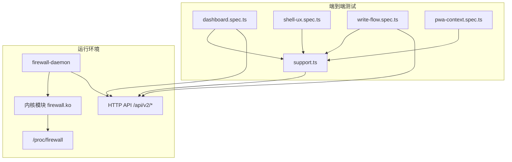
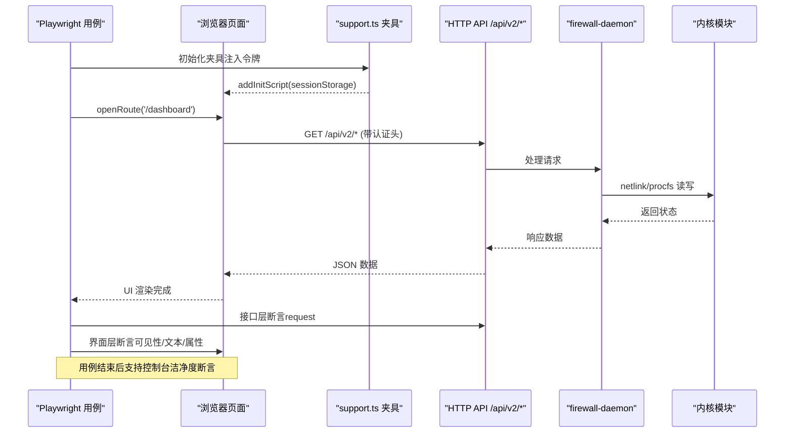
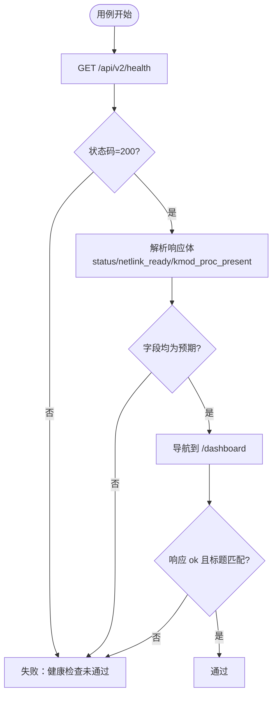
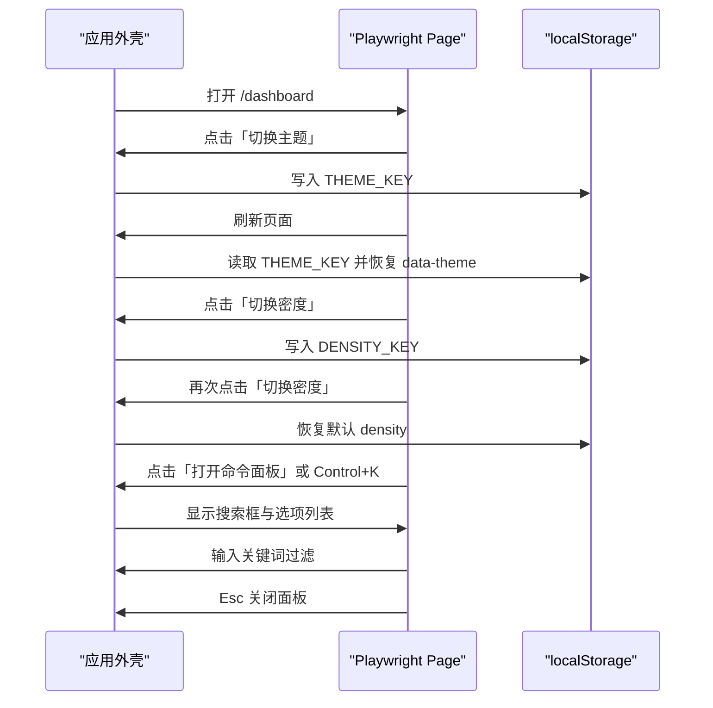
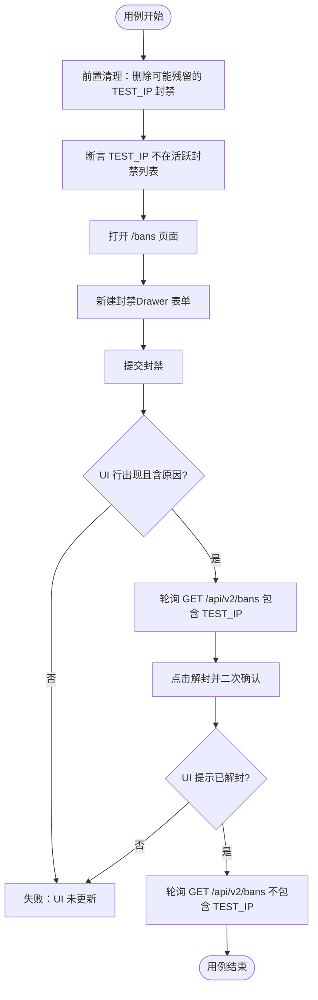
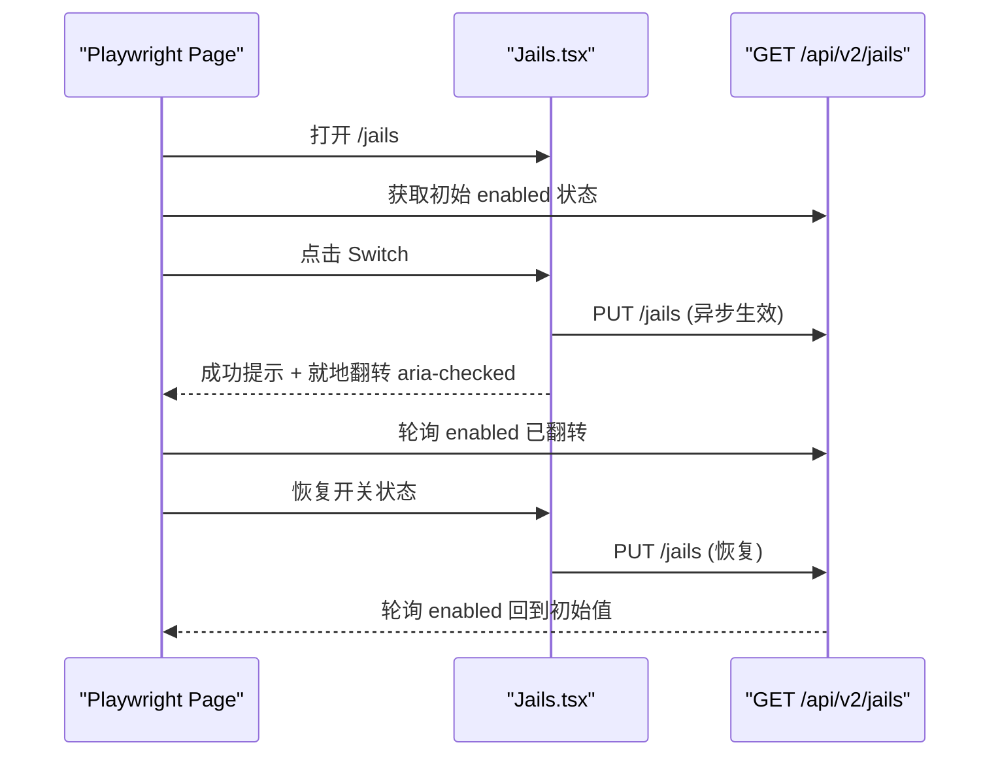
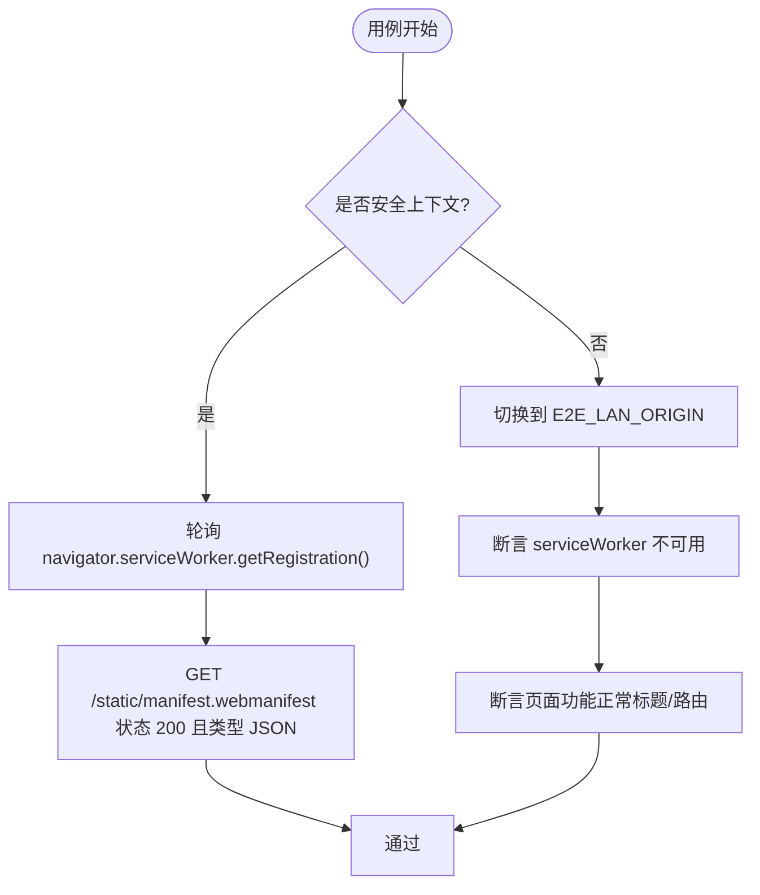
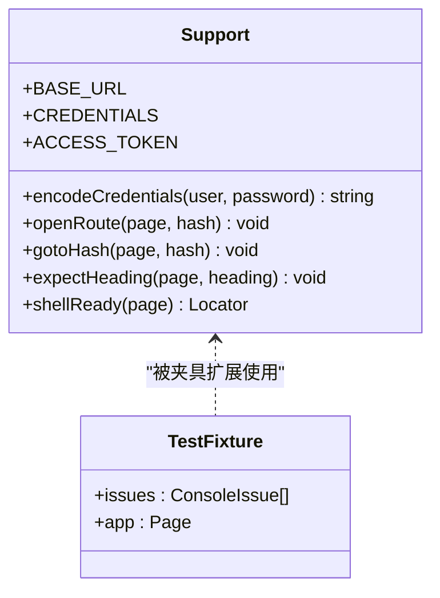
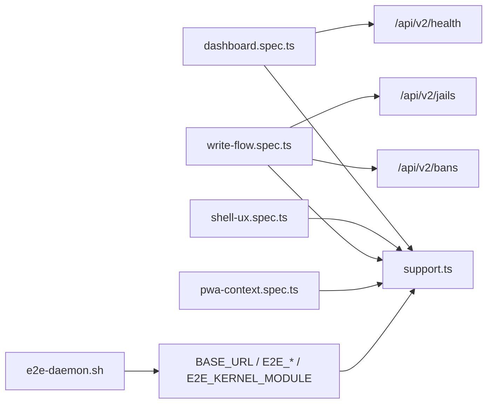

# 端到端测试

<cite>
**本文引用的文件**   
- [dashboard.spec.ts](file://tests/e2e/dashboard.spec.ts)
- [shell-ux.spec.ts](file://tests/e2e/shell-ux.spec.ts)
- [write-flow.spec.ts](file://tests/e2e/write-flow.spec.ts)
- [pwa-context.spec.ts](file://tests/e2e/pwa-context.spec.ts)
- [support.ts](file://tests/e2e/support.ts)
- [e2e-daemon.sh](file://scripts/e2e-daemon.sh)
- [README.md](file://tests/README.md)
</cite>

## 目录
1. [引言](#引言)
2. [项目结构](#项目结构)
3. [核心组件](#核心组件)
4. [架构总览](#架构总览)
5. [详细组件分析](#详细组件分析)
6. [依赖关系分析](#依赖关系分析)
7. [性能与稳定性考量](#性能与稳定性考量)
8. [故障排查指南](#故障排查指南)
9. [结论](#结论)

## 引言
本文件面向“端到端测试”目标，围绕 Playwright 浏览器自动化、用户交互模拟、关键业务路径验证展开。文档聚焦以下方面：
- 使用 Playwright 进行 Dashboard 页面、Shell UX、写入流程的端到端验证。
- 测试上下文管理、页面对象模式（以夹具和公共支撑模块实现）、截图与日志收集策略。
- 提供具体用例说明，展示如何模拟真实用户操作、验证 UI 行为、覆盖关键业务流程。
- 确保 E2E 测试能稳定回归守护进程健康、外壳交互、写操作回环、PWA 安全上下文等关键用户路径。

## 项目结构
端到端测试位于 `tests/e2e`，由一组 Playwright 规格文件与公共支撑模块组成；守护进程与内核模块的生命周期由脚本统一管理。

**图表来源**
- [dashboard.spec.ts:15-38](file://tests/e2e/dashboard.spec.ts#L15-L38)
- [shell-ux.spec.ts:23-145](file://tests/e2e/shell-ux.spec.ts#L23-L145)
- [write-flow.spec.ts:29-207](file://tests/e2e/write-flow.spec.ts#L29-L207)
- [pwa-context.spec.ts:20-80](file://tests/e2e/pwa-context.spec.ts#L20-L80)
- [support.ts:21-242](file://tests/e2e/support.ts#L21-L242)
- [e2e-daemon.sh:1-278](file://scripts/e2e-daemon.sh#L1-L278)

**章节来源**
- [README.md:1-175](file://tests/README.md#L1-L175)

## 核心组件
- 公共支撑模块 `support.ts`：封装鉴权注入、路由打开、标题断言、控制台洁净度守卫、Playwright 夹具扩展。
- Dashboard 健康检查 `dashboard.spec.ts`：校验守护进程健康端点与外壳可加载性。
- Shell UX 交互 `shell-ux.spec.ts`：主题/密度切换、命令面板、快捷键、侧边栏折叠等外壳体验自动化。
- 写入流程 `write-flow.spec.ts`：封禁/解封回环、Jail 开关就地生效，覆盖写路径与后端状态一致性。
- PWA 安全上下文 `pwa-context.spec.ts`：在安全与非安全上下文中验证 Service Worker 注册与降级行为。
- 守护进程夹具 `e2e-daemon.sh`：负责内核模块加载、守护进程启动、端口就绪探测、环境变量输出与清理。

**章节来源**
- [support.ts:21-242](file://tests/e2e/support.ts#L21-L242)
- [dashboard.spec.ts:15-38](file://tests/e2e/dashboard.spec.ts#L15-L38)
- [shell-ux.spec.ts:23-145](file://tests/e2e/shell-ux.spec.ts#L23-L145)
- [write-flow.spec.ts:29-207](file://tests/e2e/write-flow.spec.ts#L29-L207)
- [pwa-context.spec.ts:20-80](file://tests/e2e/pwa-context.spec.ts#L20-L80)
- [e2e-daemon.sh:1-278](file://scripts/e2e-daemon.sh#L1-L278)

## 架构总览
端到端测试通过 Playwright 驱动浏览器访问 Web UI，同时通过 `request` 夹具直接调用受保护的 HTTP API，形成“界面层 + 接口层 + 干净层”三层断言体系。守护进程与内核模块由脚本统一拉起，保证测试环境与产品部署一致。

**图表来源**
- [support.ts:136-193](file://tests/e2e/support.ts#L136-L193)
- [dashboard.spec.ts:17-37](file://tests/e2e/dashboard.spec.ts#L17-L37)
- [write-flow.spec.ts:41-50](file://tests/e2e/write-flow.spec.ts#L41-L50)
- [e2e-daemon.sh:189-213](file://scripts/e2e-daemon.sh#L189-L213)

## 详细组件分析

### 守护进程健康检查（Dashboard 可达性）
- 目标：确认守护进程与 Web UI 基本可达，不依赖凭据访问 `/api/v2/health`，并校验外壳可加载。
- 关键点：
  - 健康端点返回 200 且 body 中 status/netlink_ready/kmod_proc_present 为预期值。
  - 外壳 `/dashboard` 应返回 2xx，且页面标题匹配防火墙相关标识。
- 断言层次：
  - 接口层：GET /api/v2/health 状态码与响应体字段。
  - 界面层：外壳可加载、标题存在。

**图表来源**
- [dashboard.spec.ts:17-37](file://tests/e2e/dashboard.spec.ts#L17-L37)

**章节来源**
- [dashboard.spec.ts:15-38](file://tests/e2e/dashboard.spec.ts#L15-L38)

### Shell UX 交互（主题/密度/命令面板/侧边栏）
- 目标：将外壳级体验（主题切换、密度切换、命令面板、快捷键、侧边栏折叠）固化为可回归的自动化断言。
- 关键点：
  - 主题与密度偏好持久化到 localStorage，刷新后保持。
  - 命令面板可通过按钮或 Control+K 快捷键打开，搜索过滤、Esc 关闭。
  - 侧边栏折叠态落盘并在刷新后保持。
- 选择器策略：基于 ARIA role/name、data-theme/data-density、localStorage 键名，避免脆弱类名。

**图表来源**
- [shell-ux.spec.ts:26-37](file://tests/e2e/shell-ux.spec.ts#L26-L37)
- [shell-ux.spec.ts:39-78](file://tests/e2e/shell-ux.spec.ts#L39-L78)
- [shell-ux.spec.ts:80-121](file://tests/e2e/shell-ux.spec.ts#L80-L121)
- [shell-ux.spec.ts:123-145](file://tests/e2e/shell-ux.spec.ts#L123-L145)

**章节来源**
- [shell-ux.spec.ts:23-145](file://tests/e2e/shell-ux.spec.ts#L23-L145)

### 写入流程（封禁/解封与 Jail 开关）
- 目标：覆盖写路径的关键风险——封禁/解封经 daemon → netlink → 内核并等待确认；Jail 开关要落到运行时配置。
- 关键点：
  - 封禁写入后，UI 表格行出现、原因文案可见；接口层 GET /api/v2/bans 同步反映。
  - 解封触发二次确认，成功后 UI 与接口层均恢复原状。
  - Jail 开关就地翻转，无需整页刷新；接口层 GET /api/v2/jails 状态同步。
- 环境门禁：需要内核模块可用（E2E_KERNEL_MODULE），否则跳过用例而非误报缺陷。

**图表来源**
- [write-flow.spec.ts:52-129](file://tests/e2e/write-flow.spec.ts#L52-L129)

Jail 开关就地生效流程：

**图表来源**
- [write-flow.spec.ts:131-207](file://tests/e2e/write-flow.spec.ts#L131-L207)

**章节来源**
- [write-flow.spec.ts:29-207](file://tests/e2e/write-flow.spec.ts#L29-L207)

### PWA 安全上下文边界验收
- 目标：明确浏览器对 Service Worker 的安全上下文限制，固化期望行为而非修复浏览器约束。
- 关键点：
  - 安全上下文（localhost/127.0.0.1）：SW 可注册，manifest 可取。
  - 非安全上下文（局域网 IP）：SW 不可用，但页面功能正常，控制台洁净。
- 环境变量：E2E_LAN_ORIGIN 控制非安全上下文分支，未设置则跳过该侧。

**图表来源**
- [pwa-context.spec.ts:20-80](file://tests/e2e/pwa-context.spec.ts#L20-L80)

**章节来源**
- [pwa-context.spec.ts:20-80](file://tests/e2e/pwa-context.spec.ts#L20-L80)

### 测试上下文管理与页面对象模式
- 上下文管理：
  - 通过 Playwright 夹具扩展 `test = base.extend<{ issues; app }>`，在每个用例开始前注入访问令牌到 sessionStorage，用例结束后断言控制台无错误/警告或未捕获异常。
  - `openRoute` 与 `gotoHash` 提供稳定的路由打开与同文档导航能力，避免重复认证与外壳重载。
- 页面对象模式：
  - 虽未显式定义 Page Object 类，但通过 `support.ts` 中的公共函数（如 `openRoute`、`expectHeading`、`shellReady`）实现了类似职责分离，提高选择器与断言的可维护性。
- 截图与日志收集：
  - 当前支撑模块未内置自动截图逻辑；可在用例失败时结合 Playwright 的 `page.screenshot()` 与 `context.tracing.start()` 扩展。
  - 控制台问题收集已在夹具中实现，便于快速定位前端错误。

**图表来源**
- [support.ts:21-242](file://tests/e2e/support.ts#L21-L242)

**章节来源**
- [support.ts:21-242](file://tests/e2e/support.ts#L21-L242)

## 依赖关系分析
- 用例与支撑模块：
  - `dashboard.spec.ts`、`shell-ux.spec.ts`、`write-flow.spec.ts`、`pwa-context.spec.ts` 均导入 `support.ts` 提供的 `test`、`expect`、`openRoute`、`expectHeading` 等。
- 用例与 HTTP API：
  - `dashboard.spec.ts` 直接调用 `/api/v2/health`。
  - `write-flow.spec.ts` 调用 `/api/v2/bans` 与 `/api/v2/jails`，携带 Basic 认证头。
- 守护进程与环境：
  - `e2e-daemon.sh` 负责内核模块加载、守护进程启动、端口就绪探测，并输出 `BASE_URL`、凭据与 `E2E_KERNEL_MODULE` 供用例判断。

**图表来源**
- [dashboard.spec.ts:15-38](file://tests/e2e/dashboard.spec.ts#L15-L38)
- [shell-ux.spec.ts:23-145](file://tests/e2e/shell-ux.spec.ts#L23-L145)
- [write-flow.spec.ts:29-207](file://tests/e2e/write-flow.spec.ts#L29-L207)
- [pwa-context.spec.ts:20-80](file://tests/e2e/pwa-context.spec.ts#L20-L80)
- [support.ts:21-242](file://tests/e2e/support.ts#L21-L242)
- [e2e-daemon.sh:217-226](file://scripts/e2e-daemon.sh#L217-L226)

**章节来源**
- [dashboard.spec.ts:15-38](file://tests/e2e/dashboard.spec.ts#L15-L38)
- [shell-ux.spec.ts:23-145](file://tests/e2e/shell-ux.spec.ts#L23-L145)
- [write-flow.spec.ts:29-207](file://tests/e2e/write-flow.spec.ts#L29-L207)
- [pwa-context.spec.ts:20-80](file://tests/e2e/pwa-context.spec.ts#L20-L80)
- [support.ts:21-242](file://tests/e2e/support.ts#L21-L242)
- [e2e-daemon.sh:217-226](file://scripts/e2e-daemon.sh#L217-L226)

## 性能与稳定性考量
- 轮询与等待：
  - 写操作用例使用 `expect.poll` 轮询接口状态，避免固定延时导致的抖动。
  - PWA 用例轮询 Service Worker 注册状态，确保异步加载完成后再断言。
- 选择器稳健性：
  - 优先使用 ARIA role/name、data-* 属性与 localStorage 键名，降低因 UI 重构导致的选择器失效。
- 控制台洁净度：
  - 夹具统一收集 console.error/warning 与 pageerror，作为用例失败的门槛，提升早期发现问题的概率。
- 环境门禁：
  - 内核模块可用性通过 `E2E_KERNEL_MODULE` 控制，不具备时用例跳过而非失败，避免误报。

[本节为通用指导，不直接分析具体文件]

## 故障排查指南
- 守护进程未就绪：
  - 检查 `scripts/e2e-daemon.sh start` 是否成功，查看临时目录下的 `daemon.log`。
  - 确认端口未被占用，必要时更换 `E2E_PORT`。
- 健康端点返回 503：
  - 表示内核租约尚未就绪或内核模块未正确加载；写操作用例会据此跳过。
- 控制台报错：
  - 夹具会在用例结束后断言控制台问题，关注 `issues` 集合中的 `kind/type/text/url`。
- 非安全上下文 PWA 失败：
  - 这是浏览器硬性限制，不应视为缺陷；确保在非安全上下文下仅断言功能可用且不产生控制台噪音。

**章节来源**
- [e2e-daemon.sh:189-213](file://scripts/e2e-daemon.sh#L189-L213)
- [support.ts:195-242](file://tests/e2e/support.ts#L195-L242)
- [pwa-context.spec.ts:53-79](file://tests/e2e/pwa-context.spec.ts#L53-L79)

## 结论
本套端到端测试通过 Playwright 与公共支撑模块，覆盖了守护进程健康、外壳交互、写操作回环与 PWA 安全上下文等关键用户路径。借助接口层与界面层双重断言、控制台洁净度守卫与环境门禁机制，测试具备较强的稳定性与可维护性。建议在后续迭代中继续强化选择器稳健性、完善截图与追踪采集，并保持用例与环境脚本的一致性。