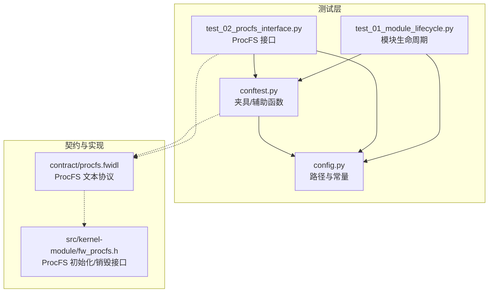
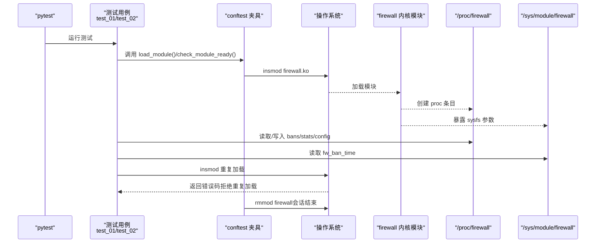
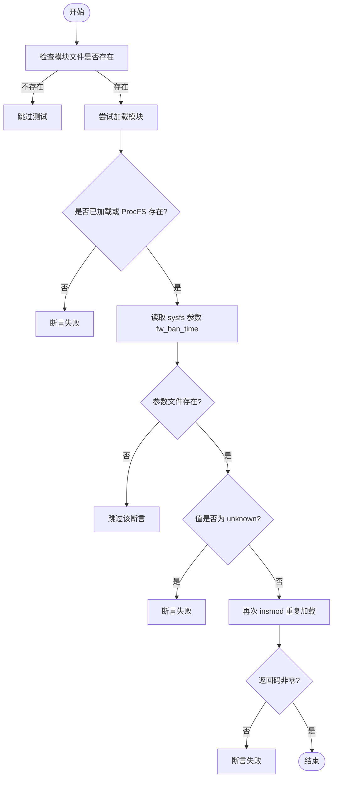
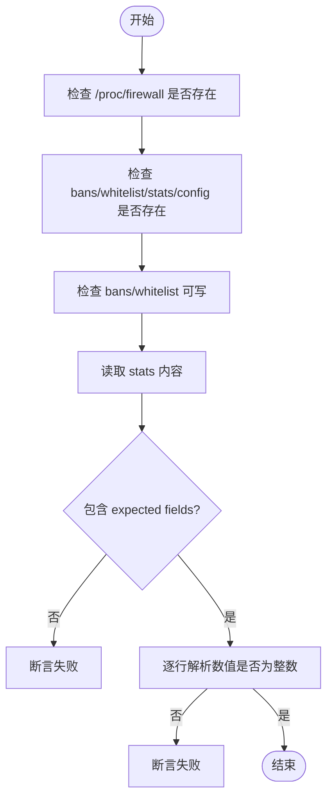
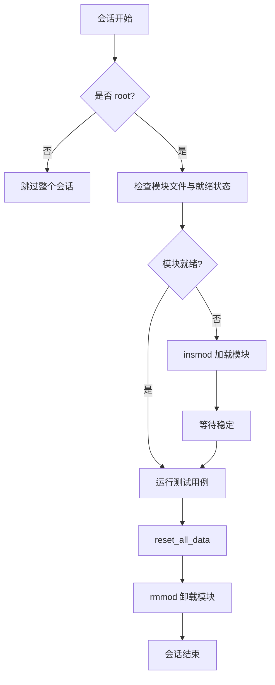
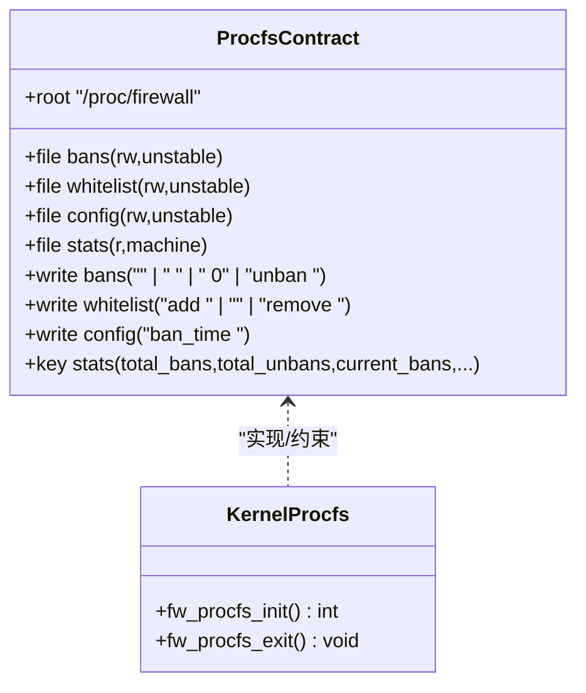
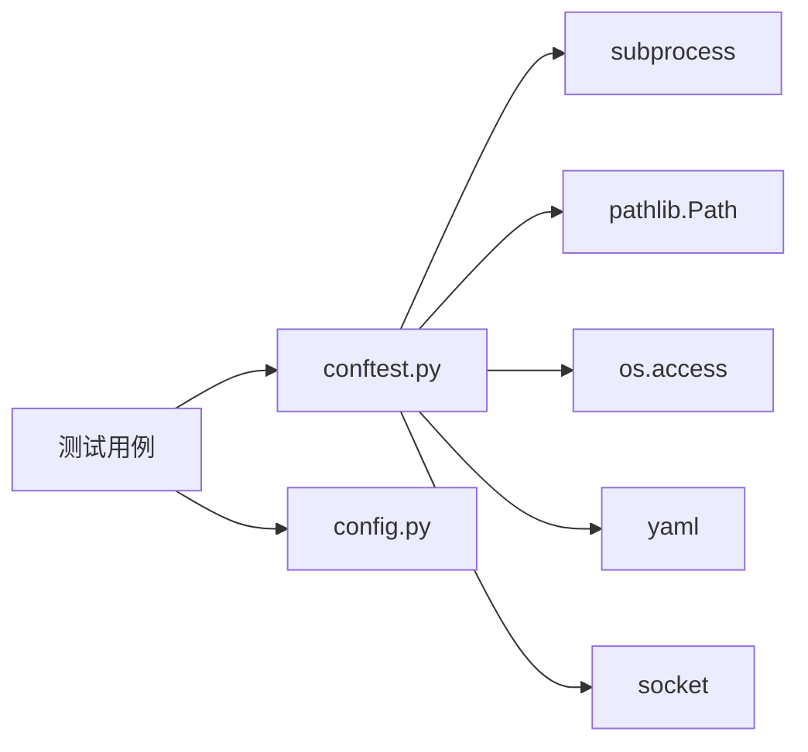

# 内核模块测试

<cite>
**本文引用的文件**   
- [tests/test_01_module_lifecycle.py](file://tests/test_01_module_lifecycle.py)
- [tests/test_02_procfs_interface.py](file://tests/test_02_procfs_interface.py)
- [tests/conftest.py](file://tests/conftest.py)
- [tests/config.py](file://tests/config.py)
- [contract/procfs.fwidl](file://contract/procfs.fwidl)
- [src/kernel-module/fw_procfs.h](file://src/kernel-module/fw_procfs.h)
</cite>

## 目录
1. [简介](#简介)
2. [项目结构](#项目结构)
3. [核心组件](#核心组件)
4. [架构总览](#架构总览)
5. [详细组件分析](#详细组件分析)
6. [依赖关系分析](#依赖关系分析)
7. [性能与稳定性考虑](#性能与稳定性考虑)
8. [故障排查指南](#故障排查指南)
9. [结论](#结论)

## 简介
本文面向“内核模块测试”这一目标，系统化梳理仓库中用于验证防火墙内核模块及其用户态接口的 pytest 测试套件。重点覆盖：
- 模块生命周期：模块文件存在性、加载成功、重复加载拒绝、卸载与资源清理。
- ProcFS 接口：/proc/firewall 下 bans、whitelist、stats、config 等文件的读写与状态查询。
- sysfs 参数可读性：/sys/module/firewall/parameters 下的参数文件是否可读且非未知值。
- 测试环境准备：root 权限检查、模块与守护进程二进制存在性、ProcFS 就绪等待。
- 依赖检查与资源清理：会话级与用例级隔离、内核租约释放、临时数据重置。
- 自动化示例：基于 pytest 的测试类与夹具组织方式，以及如何扩展新用例。

## 项目结构
本次文档聚焦 tests 目录中与内核模块和 ProcFS 相关的测试实现，以及支撑这些测试的配置与夹具。

图表来源
- [tests/test_01_module_lifecycle.py:1-39](file://tests/test_01_module_lifecycle.py#L1-L39)
- [tests/test_02_procfs_interface.py:1-69](file://tests/test_02_procfs_interface.py#L1-L69)
- [tests/conftest.py:1-120](file://tests/conftest.py#L1-L120)
- [tests/config.py:1-48](file://tests/config.py#L1-L48)
- [contract/procfs.fwidl:1-100](file://contract/procfs.fwidl#L1-L100)
- [src/kernel-module/fw_procfs.h:1-28](file://src/kernel-module/fw_procfs.h#L1-L28)

章节来源
- [tests/test_01_module_lifecycle.py:1-39](file://tests/test_01_module_lifecycle.py#L1-L39)
- [tests/test_02_procfs_interface.py:1-69](file://tests/test_02_procfs_interface.py#L1-L69)
- [tests/conftest.py:1-120](file://tests/conftest.py#L1-L120)
- [tests/config.py:1-48](file://tests/config.py#L1-L48)
- [contract/procfs.fwidl:1-100](file://contract/procfs.fwidl#L1-L100)
- [src/kernel-module/fw_procfs.h:1-28](file://src/kernel-module/fw_procfs.h#L1-L28)

## 核心组件
本节从“测试如何工作”的角度，拆解关键组件的职责与交互。

- 模块生命周期测试（test_01_module_lifecycle.py）
  - 断言内核模块文件存在。
  - 断言模块已加载或 /proc/firewall 目录存在。
  - 校验 sysfs 参数文件可读且值不为 unknown。
  - 通过 insmod 再次加载，断言返回失败以验证重复加载被拒绝。

- ProcFS 接口测试（test_02_procfs_interface.py）
  - 断言 /proc/firewall 根目录及 bans、whitelist、stats、config 文件存在。
  - 断言 bans、whitelist 可写；stats、config 可读。
  - 断言 stats 包含 expected fields（current_bans、total_bans、total_unbans）。
  - 断言 stats 每行数值为十进制整数。

- 夹具与辅助函数（conftest.py）
  - is_module_loaded/load_module/unload_module：封装 lsmod、insmod、rmmod。
  - check_module_ready：综合判断模块是否完全就绪（已加载、ProcFS 目录存在、bans 可写）。
  - reset_all_data/cleanup_state：清空封禁/白名单、删除临时文件、优雅终止测试专用 daemon。
  - release_kernel_lease：重载模块以释放内核侧守护进程租约，避免后续用例被拒。
  - wait_procfs/get_stat/count_bans/ban_ip/unban_ip 等：ProcFS 操作封装。

- 配置常量（config.py）
  - KERNEL_MODULE_PATH、DAEMON_PATH、CONFIG_DIR。
  - PROC_DIR、PROC_BANS、PROC_WHITELIST、PROC_STATS、PROC_CONFIG。
  - 测试 IP、超时、阈值等常量。

章节来源
- [tests/test_01_module_lifecycle.py:15-38](file://tests/test_01_module_lifecycle.py#L15-L38)
- [tests/test_02_procfs_interface.py:12-68](file://tests/test_02_procfs_interface.py#L12-L68)
- [tests/conftest.py:34-82](file://tests/conftest.py#L34-L82)
- [tests/conftest.py:147-246](file://tests/conftest.py#L147-L246)
- [tests/conftest.py:254-319](file://tests/conftest.py#L254-L319)
- [tests/config.py:8-48](file://tests/config.py#L8-L48)

## 架构总览
下图展示测试执行时，pytest、测试用例、夹具、内核模块与 ProcFS/sysfs 之间的交互关系。

图表来源
- [tests/test_01_module_lifecycle.py:19-38](file://tests/test_01_module_lifecycle.py#L19-L38)
- [tests/test_02_procfs_interface.py:12-68](file://tests/test_02_procfs_interface.py#L12-L68)
- [tests/conftest.py:40-82](file://tests/conftest.py#L40-L82)
- [contract/procfs.fwidl:32-97](file://contract/procfs.fwidl#L32-L97)

## 详细组件分析

### 模块生命周期测试
该测试类覆盖以下场景：
- 模块文件存在性：断言构建产物 firewall.ko 位于预期路径。
- 模块加载成功：通过 is_module_loaded 或 /proc/firewall 目录存在判定。
- sysfs 参数可读：读取 /sys/module/firewall/parameters/fw_ban_time，跳过不存在的情况，并断言值不是 unknown。
- 重复加载拒绝：再次执行 insmod，断言返回非零退出码。

图表来源
- [tests/test_01_module_lifecycle.py:15-38](file://tests/test_01_module_lifecycle.py#L15-L38)
- [tests/conftest.py:34-58](file://tests/conftest.py#L34-L58)

章节来源
- [tests/test_01_module_lifecycle.py:15-38](file://tests/test_01_module_lifecycle.py#L15-L38)
- [tests/conftest.py:34-58](file://tests/conftest.py#L34-L58)

### ProcFS 接口测试
该测试类覆盖以下场景：
- 目录与文件存在性：/proc/firewall、bans、whitelist、stats、config。
- 权限校验：bans、whitelist 可写；stats、config 可读。
- 内容校验：stats 包含 current_bans、total_bans、total_unbans；所有数值为十进制整数。

图表来源
- [tests/test_02_procfs_interface.py:12-68](file://tests/test_02_procfs_interface.py#L12-L68)

章节来源
- [tests/test_02_procfs_interface.py:12-68](file://tests/test_02_procfs_interface.py#L12-L68)

### 夹具与资源管理
conftest.py 提供会话级与用例级的夹具，确保测试环境一致性与可恢复性。

- 会话级夹具 session_setup
  - 需要 root 权限，否则跳过。
  - 检查模块文件存在，若未就绪则尝试加载。
  - 会话结束时重置数据并卸载模块。

- 用例级夹具 test_isolation
  - 每个用例前后执行 reset_all_data。
  - 若模块未就绪则重新加载。
  - 用例结束后 cleanup_state，并在曾启动过 daemon 的情况下重载模块以释放内核租约。

- 内核租约释放 release_kernel_lease
  - 内核侧守护进程租约在 daemon 退出后仍可能占用最多 30 秒。
  - 唯一可靠立即释放手段是重载模块，因此对曾起过 daemon 的用例轮次进行重载。

图表来源
- [tests/conftest.py:574-593](file://tests/conftest.py#L574-L593)
- [tests/conftest.py:595-615](file://tests/conftest.py#L595-L615)
- [tests/conftest.py:107-118](file://tests/conftest.py#L107-L118)

章节来源
- [tests/conftest.py:574-615](file://tests/conftest.py#L574-L615)
- [tests/conftest.py:107-118](file://tests/conftest.py#L107-L118)

### ProcFS 契约与实现映射
contract/procfs.fwidl 定义了 /proc/firewall 的文本协议，包括：
- 根目录与文件列表：bans、whitelist、config、stats、rates、udp_ports、icmp_types、pkt_sizes、ttl_dist、ip_frags、port_scanners、service_probes、protected_ports。
- 写文法：bans 支持默认时长、指定时长、永久封禁与解封；whitelist 支持 add/remove/隐式 add；config 支持 ban_time 设置。
- 读侧机器可读字段：stats 包含 total_bans、total_unbans、current_bans、current_whitelist 等键。

fw_procfs.h 声明了模块侧的 ProcFS 初始化与销毁接口，负责按契约创建/销毁条目，并确保读侧统计先刷新再输出。

图表来源
- [contract/procfs.fwidl:32-216](file://contract/procfs.fwidl#L32-L216)
- [src/kernel-module/fw_procfs.h:21-25](file://src/kernel-module/fw_procfs.h#L21-L25)

章节来源
- [contract/procfs.fwidl:32-216](file://contract/procfs.fwidl#L32-L216)
- [src/kernel-module/fw_procfs.h:21-25](file://src/kernel-module/fw_procfs.h#L21-L25)

### 具体测试用例示例与使用方式
- 模块文件存在性：断言构建产物路径存在。
- 模块加载成功：通过 is_module_loaded 或 /proc/firewall 目录存在判定。
- sysfs 参数可读：读取 /sys/module/firewall/parameters/fw_ban_time，跳过不存在情况，断言值不为 unknown。
- 重复加载拒绝：再次 insmod，断言返回非零。
- ProcFS 目录与文件存在性：/proc/firewall、bans、whitelist、stats、config。
- ProcFS 权限与内容：bans/whitelist 可写；stats/config 可读；stats 包含 expected fields；数值为整数。

以上用例均以 pytest 类组织，便于分组与并行执行。夹具 conftest.py 提供统一的模块加载、ProcFS 操作与资源清理能力。

章节来源
- [tests/test_01_module_lifecycle.py:15-38](file://tests/test_01_module_lifecycle.py#L15-L38)
- [tests/test_02_procfs_interface.py:12-68](file://tests/test_02_procfs_interface.py#L12-L68)
- [tests/conftest.py:147-246](file://tests/conftest.py#L147-L246)

## 依赖关系分析
测试代码依赖外部系统命令与内核子系统：
- subprocess：调用 lsmod、insmod、rmmod、pgrep、kill、curl 等。
- pathlib.Path：访问 /proc/firewall、/sys/module/firewall、构建产物路径。
- os.access：检查文件权限。
- yaml：读取默认配置中的 metrics_port 等。
- socket：分配空闲端口供自起 daemon 使用。

图表来源
- [tests/conftest.py:1-27](file://tests/conftest.py#L1-L27)
- [tests/config.py:1-48](file://tests/config.py#L1-L48)

章节来源
- [tests/conftest.py:1-27](file://tests/conftest.py#L1-L27)
- [tests/config.py:1-48](file://tests/config.py#L1-L48)

## 性能与稳定性考虑
- 模块加载与就绪等待：load_module 内置重试循环，check_module_ready 综合判断模块状态与 ProcFS 可用性。
- ProcFS 同步延迟：wait_procfs 使用 PROCFS_SYNC_DELAY 控制写入后的等待时间，避免竞态。
- 守护进程租约释放：release_kernel_lease 在曾启动 daemon 的用例轮次重载模块，避免内核租约残留导致后续用例失败。
- 优雅终止进程：terminate_process 先 SIGTERM 再兜底 SIGKILL，保证 daemon 完成清理路径。
- 指标轮询：wait_for_metric 采用事件驱动轮询，避免固定 sleep 导致的偶发失败或拖慢套件。

章节来源
- [tests/conftest.py:40-82](file://tests/conftest.py#L40-L82)
- [tests/conftest.py:121-140](file://tests/conftest.py#L121-L140)
- [tests/conftest.py:484-502](file://tests/conftest.py#L484-L502)

## 故障排查指南
常见问题与定位建议：
- 模块未加载或 ProcFS 不可用
  - 检查 is_module_loaded 与 check_module_ready 返回值。
  - 确认内核模块文件路径正确且具备加载权限。
  - 查看内核日志中 insmod/rmmod 的错误信息。

- ProcFS 文件权限异常
  - 使用 os.access 检查 bans/whitelist 的可写权限。
  - 确认模块已完全就绪（check_module_ready）。

- stats 内容为空或字段缺失
  - 确认 stats 文件可读且包含 expected fields。
  - 检查内核侧统计刷新逻辑（参考 contract/procfs.fwidl 的 machine 读侧契约）。

- 守护进程租约导致后续用例失败
  - 确认 release_kernel_lease 是否被调用。
  - 检查 terminate_process 是否正确执行 SIGTERM/SIGKILL。

- sysfs 参数不可读
  - 确认 /sys/module/firewall/parameters/fw_ban_time 存在。
  - 断言值不为 unknown，必要时检查模块参数初始化。

章节来源
- [tests/conftest.py:34-82](file://tests/conftest.py#L34-L82)
- [tests/conftest.py:107-140](file://tests/conftest.py#L107-L140)
- [tests/test_02_procfs_interface.py:42-68](file://tests/test_02_procfs_interface.py#L42-L68)
- [contract/procfs.fwidl:92-97](file://contract/procfs.fwidl#L92-L97)

## 结论
本测试套件围绕内核模块的生命周期与 ProcFS/sysfs 接口展开，提供了完整的自动化验证能力。通过 pytest 夹具与辅助函数，实现了模块加载、卸载、重复加载拒绝、ProcFS 读写与状态查询、sysfs 参数可读性检查等关键场景。同时，测试框架充分考虑了内核租约、进程优雅终止、指标轮询等稳定性问题，确保测试环境的隔离与可恢复性。建议在新增功能时，优先在 contract/procfs.fwidl 中明确契约变更，并在 tests 中补充对应断言，以保持契约与实现的强一致性。