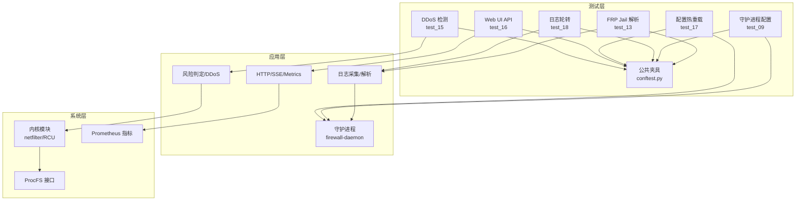
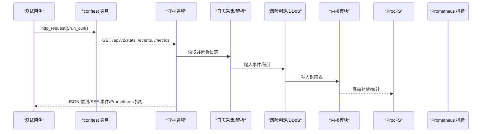
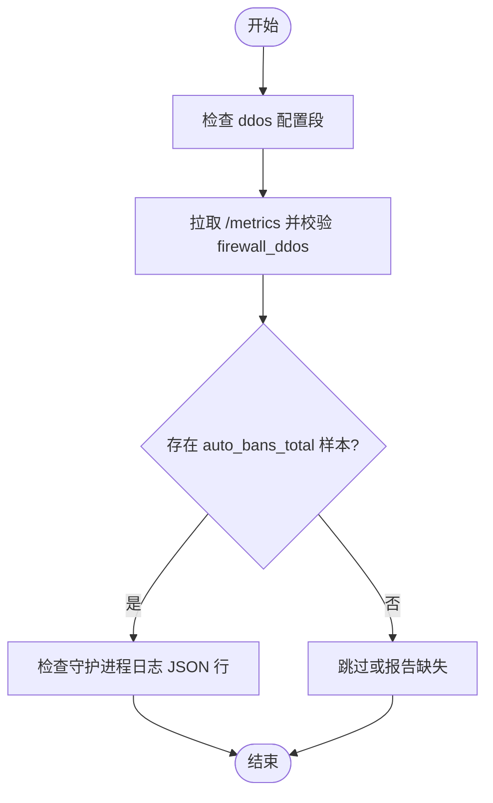
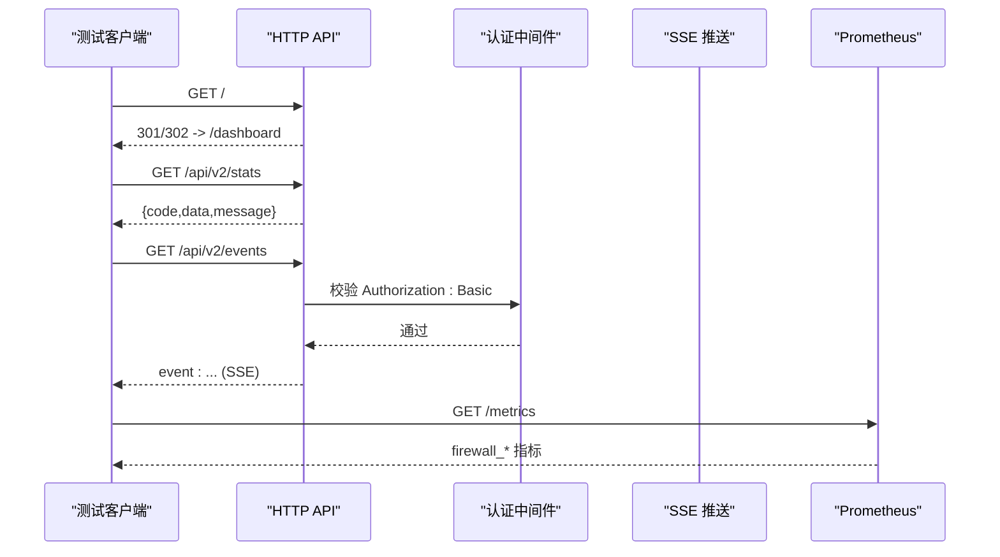
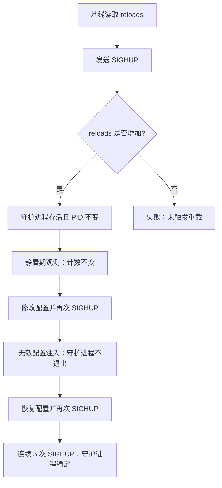
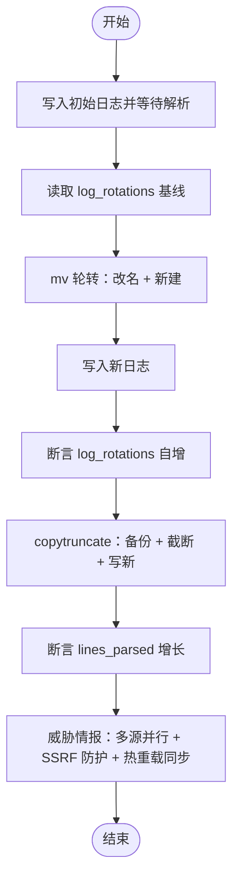
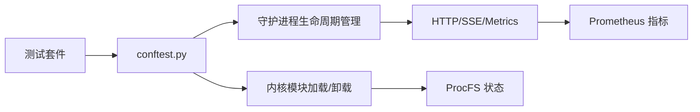

# 功能集成测试

<cite>
**本文引用的文件**   
- [README.md](file://README.md)
- [test_15_ddos_detection.py](file://tests/test_15_ddos_detection.py)
- [test_16_webui_api.py](file://tests/test_16_webui_api.py)
- [test_17_config_reload.py](file://tests/test_17_config_reload.py)
- [test_18_log_rotation.py](file://tests/test_18_log_rotation.py)
- [test_09_daemon_config.py](file://tests/test_09_daemon_config.py)
- [test_13_frp_jail.py](file://tests/test_13_frp_jail.py)
- [conftest.py](file://tests/conftest.py)
</cite>

## 目录
1. [引言](#引言)
2. [项目结构](#项目结构)
3. [核心组件](#核心组件)
4. [架构总览](#架构总览)
5. [详细组件分析](#详细组件分析)
6. [依赖关系分析](#依赖关系分析)
7. [性能与稳定性考虑](#性能与稳定性考虑)
8. [故障排查指南](#故障排查指南)
9. [结论](#结论)
10. [附录：端到端测试场景清单](#附录端到端测试场景清单)

## 引言
本文件面向“智能内核防火墙”项目的功能集成测试，聚焦以下目标：
- DDoS 检测功能的端到端验证：流量模拟、阈值触发、自动封禁。
- Web UI API 的集成测试：RESTful 接口调用、前端交互模拟、数据同步验证。
- 配置热重载与动态参数调整：SIGHUP 触发、无效配置容错、多次重载稳定性。
- 日志轮转与威胁情报更新：inotify + inode 重连、指标驱动断言。
- 子系统协作与数据一致性：守护进程、内核模块、ProcFS、HTTP/SSE、Prometheus 指标的一致性校验。

## 项目结构
本项目采用三层架构：内核模块（C/netfilter）、守护进程（Go）、前端面板（React/TypeScript），并通过契约系统保证三端接口一致性。测试套件位于 `tests/`，其中与本主题直接相关的用例包括：
- DDoS 检测：`tests/test_15_ddos_detection.py`
- Web UI API：`tests/test_16_webui_api.py`
- 配置热重载：`tests/test_17_config_reload.py`
- 日志轮转：`tests/test_18_log_rotation.py`
- 守护进程配置：`tests/test_09_daemon_config.py`
- FRP Jail 日志解析：`tests/test_13_frp_jail.py`
- 公共夹具与辅助函数：`tests/conftest.py`



图表来源
- [README.md:10-31](file://README.md#L10-L31)
- [conftest.py:326-400](file://tests/conftest.py#L326-L400)

章节来源
- [README.md:10-31](file://README.md#L10-L31)

## 核心组件
- DDoS 检测集成测试：检查 ddos 配置段、Prometheus 指标、自动封禁计数、守护进程日志。
- Web UI API 集成测试：根路径重定向、/api/v2/* 统一信封、SSE 事件流、404 处理、响应时间。
- 配置热重载：SIGHUP 触发、静置期无自持重载、修改配置后重载、无效配置容错、连续 SIGHUP。
- 日志轮转：mv 轮转（改名+新建）与 copytruncate（原地清空）两种形态，基于 Prometheus 指标断言。
- 守护进程配置：--help、默认/自定义配置目录、单配置文件、无效/不存在配置处理。
- FRP Jail：日志解析与封禁行为验证。

章节来源
- [test_15_ddos_detection.py:1-75](file://tests/test_15_ddos_detection.py#L1-L75)
- [test_16_webui_api.py:1-112](file://tests/test_16_webui_api.py#L1-L112)
- [test_17_config_reload.py:1-180](file://tests/test_17_config_reload.py#L1-L180)
- [test_18_log_rotation.py:1-166](file://tests/test_18_log_rotation.py#L1-L166)
- [test_09_daemon_config.py:1-96](file://tests/test_09_daemon_config.py#L1-L96)
- [test_13_frp_jail.py:1-80](file://tests/test_13_frp_jail.py#L1-L80)

## 架构总览
下图展示从测试到系统的端到端调用链：测试通过 conftest 提供的工具访问守护进程的 HTTP/SSE/Metrics，守护进程负责日志采集、风险判定与内核封禁，内核模块提供高速过滤能力，并通过 ProcFS 暴露状态。



图表来源
- [test_16_webui_api.py:35-112](file://tests/test_16_webui_api.py#L35-L112)
- [conftest.py:407-470](file://tests/conftest.py#L407-L470)

## 详细组件分析

### DDoS 检测端到端测试
- 配置验证：确保仓库内 `config/default.yaml` 存在非空的 `ddos:` 配置段。
- 指标验证：检查 `/metrics` 中是否存在 `firewall_ddos` 指标。
- 自动封禁触发：检查 `firewall_ddos_auto_bans_total` 是否存在标准样本行。
- 守护进程日志：确认 `/var/log/firewall.log` 存在且包含 JSON Lines 记录。



图表来源
- [test_15_ddos_detection.py:21-75](file://tests/test_15_ddos_detection.py#L21-L75)

章节来源
- [test_15_ddos_detection.py:21-75](file://tests/test_15_ddos_detection.py#L21-L75)

### Web UI API 集成测试
- 根路径重定向：`/` 应返回 3xx 重定向至 `/dashboard`，且 `/dashboard` 可访问。
- 统一信封：`/api/v2/stats`、`/api/v2/config` 等返回 `{code,data,message}`，data 为对象。
- 分页数据：`/api/v2/bans` 的 data.items 为数组。
- SSE 事件流：`/api/v2/events` 返回带 `event:` 字段的事件流。
- 错误处理：未知路径返回 404。
- 性能：`/api/v2/stats` 响应时间小于 1s。



图表来源
- [test_16_webui_api.py:40-112](file://tests/test_16_webui_api.py#L40-L112)
- [conftest.py:407-470](file://tests/conftest.py#L407-L470)

章节来源
- [test_16_webui_api.py:40-112](file://tests/test_16_webui_api.py#L40-L112)
- [conftest.py:407-470](file://tests/conftest.py#L407-L470)

### 配置热重载与动态参数调整
- SIGHUP 触发重载：发送信号后守护进程存活且 PID 不变；重载计数增加。
- 静置期无自持重载：两次采样期间计数不变，避免 inotify 回写风暴。
- 修改配置并重载：修改有效值后再次 SIGHUP，守护进程仍存活。
- 无效配置容错：非法 YAML 不导致守护进程退出，恢复后再次重载。
- 多次连续 SIGHUP：连续 5 次信号后守护进程仍稳定。



图表来源
- [test_17_config_reload.py:72-180](file://tests/test_17_config_reload.py#L72-L180)

章节来源
- [test_17_config_reload.py:72-180](file://tests/test_17_config_reload.py#L72-L180)

### 日志轮转与威胁情报更新
- mv 轮转：先改名再新建同名文件，inode 变化被识别为一次轮转，`firewall_log_rotations_total` 自增。
- copytruncate：原地清空后写新内容，偏移重置后新内容仍可被解析，`firewall_lines_parsed_total` 增长。
- 威胁情报更新：守护进程支持多源并行拉取、SSRF 防护、热重载时同步刷新（参考 README）。



图表来源
- [test_18_log_rotation.py:118-166](file://tests/test_18_log_rotation.py#L118-L166)
- [README.md:88-98](file://README.md#L88-L98)

章节来源
- [test_18_log_rotation.py:118-166](file://tests/test_18_log_rotation.py#L118-L166)
- [README.md:88-98](file://README.md#L88-L98)

### 守护进程配置与 FRP Jail
- 守护进程配置：--help、默认/自定义配置目录、单配置文件、无效/不存在配置处理。
- FRP Jail：日志解析与封禁行为验证，确保服务日志路径与正则规则生效。

```mermaid
classDiagram
class TestDaemonConfig {
+test_daemon_help()
+test_config_dir_exists()
+test_default_yaml_exists()
+test_default_config_dir_load()
+test_custom_config_dir()
+test_single_config_file()
+test_invalid_config()
+test_nonexistent_config()
}
class TestFrpJail {
+test_frp_jail_exists()
+test_frp_log_config()
+test_frp_log_parse()
}
TestDaemonConfig --> "使用" : generate_test_yaml()
TestFrpJail --> "使用" : run_daemon_captured()
```

图表来源
- [test_09_daemon_config.py:23-96](file://tests/test_09_daemon_config.py#L23-L96)
- [test_13_frp_jail.py:21-80](file://tests/test_13_frp_jail.py#L21-L80)
- [conftest.py:535-567](file://tests/conftest.py#L535-L567)

章节来源
- [test_09_daemon_config.py:23-96](file://tests/test_09_daemon_config.py#L23-L96)
- [test_13_frp_jail.py:21-80](file://tests/test_13_frp_jail.py#L21-L80)
- [conftest.py:535-567](file://tests/conftest.py#L535-L567)

## 依赖关系分析
- 测试对守护进程二进制与内核模块的依赖：会话级 fixture 确保模块加载与就绪。
- 守护进程租约机制：内核侧 portid 独占，daemon 退出后最多 30 秒租约残留；通过重载模块释放。
- HTTP/SSE/Metrics 共用端口：端口取自 `defaults.metrics_port`，认证凭据由夹具自动注入。
- Prometheus 指标作为权威读数：用于重载计数、轮转计数、DDoS 指标等。



图表来源
- [conftest.py:34-82](file://tests/conftest.py#L34-L82)
- [conftest.py:89-118](file://tests/conftest.py#L89-L118)
- [conftest.py:343-400](file://tests/conftest.py#L343-L400)

章节来源
- [conftest.py:34-82](file://tests/conftest.py#L34-L82)
- [conftest.py:89-118](file://tests/conftest.py#L89-L118)
- [conftest.py:343-400](file://tests/conftest.py#L343-L400)

## 性能与稳定性考虑
- 指标驱动的异步等待：所有涉及 daemon 主循环的任务（重载、轮转、周期任务）均通过 `wait_for_metric` 轮询，避免固定 sleep 导致的偶发失败或拖慢。
- 端口隔离：自起 daemon 使用空闲端口，避免与真实守护进程冲突。
- 优雅终止：`terminate_process` 先 SIGTERM 再 SIGKILL，确保清理路径执行，避免残留内核租约。
- 响应时间约束：Web UI API 关键端点要求 <1s，保障面板体验。

章节来源
- [conftest.py:484-502](file://tests/conftest.py#L484-L502)
- [conftest.py:121-140](file://tests/conftest.py#L121-L140)
- [test_16_webui_api.py:105-112](file://tests/test_16_webui_api.py#L105-L112)

## 故障排查指南
- 守护进程未运行：用例自动跳过；检查 `is_daemon_running()` 与端口可达性。
- Prometheus 端点不可达：DDoS 与轮转相关用例会跳过或失败；确认 metrics 端口与认证配置。
- 内核租约残留：若自起 daemon 被拒，需以 daemon-down 形态运行或在用例结束后重载模块释放租约。
- 配置热重载未触发：检查 SIGHUP 是否送达、reload 计数是否增加、是否存在静置期自持重载。
- 日志轮转未识别：确认 mv/copytruncate 流程与 offset 重置逻辑；查看 `log_rotations` 与 `lines_parsed` 指标。

章节来源
- [test_15_ddos_detection.py:39-75](file://tests/test_15_ddos_detection.py#L39-L75)
- [test_18_log_rotation.py:47-61](file://tests/test_18_log_rotation.py#L47-L61)
- [test_17_config_reload.py:86-100](file://tests/test_17_config_reload.py#L86-L100)
- [conftest.py:343-400](file://tests/conftest.py#L343-L400)

## 结论
本集成测试体系围绕守护进程、内核模块、HTTP/SSE/Metrics 与 ProcFS 构建端到端验证闭环：
- DDoS 检测通过配置、指标与日志三重校验，确保阈值触发与自动封禁可靠。
- Web UI API 通过统一信封、SSE 事件流与性能约束，保障前端交互与数据同步。
- 配置热重载在信号、文件变更、无效配置与连续压力下保持稳定。
- 日志轮转覆盖主流形态，并以指标为权威读数，避免只验证脚手架。
- 守护进程配置与 FRP Jail 解析补齐了服务化与多业务场景的覆盖。

## 附录：端到端测试场景清单
- DDoS 检测
  - 配置段存在且非空
  - Prometheus 指标 `firewall_ddos` 存在
  - 自动封禁计数 `firewall_ddos_auto_bans_total` 有标准样本行
  - 守护进程日志含 JSON Lines 记录
- Web UI API
  - 根路径重定向至 `/dashboard`
  - `/api/v2/stats`、`/api/v2/config` 返回统一信封
  - `/api/v2/bans` 分页 data.items 为数组
  - `/api/v2/jails` 可访问且 data 形状合法
  - `/api/v2/events` 返回 SSE 事件流
  - 未知路径返回 404
  - `/api/v2/stats` 响应时间 <1s
- 配置热重载
  - SIGHUP 触发重载且守护进程存活
  - 静置期无自持重载
  - 修改配置后重载成功
  - 无效配置不导致守护进程退出
  - 连续 5 次 SIGHUP 后守护进程稳定
- 日志轮转
  - mv 轮转识别并自增 `firewall_log_rotations_total`
  - copytruncate 后新内容仍被解析，`firewall_lines_parsed_total` 增长
- 守护进程配置
  - --help 正常
  - 默认/自定义配置目录加载
  - 单配置文件加载
  - 无效/不存在配置处理
- FRP Jail
  - 日志路径与正则规则生效
  - 日志解析后产生封禁

章节来源
- [test_15_ddos_detection.py:21-75](file://tests/test_15_ddos_detection.py#L21-L75)
- [test_16_webui_api.py:40-112](file://tests/test_16_webui_api.py#L40-L112)
- [test_17_config_reload.py:72-180](file://tests/test_17_config_reload.py#L72-L180)
- [test_18_log_rotation.py:118-166](file://tests/test_18_log_rotation.py#L118-L166)
- [test_09_daemon_config.py:23-96](file://tests/test_09_daemon_config.py#L23-L96)
- [test_13_frp_jail.py:21-80](file://tests/test_13_frp_jail.py#L21-L80)