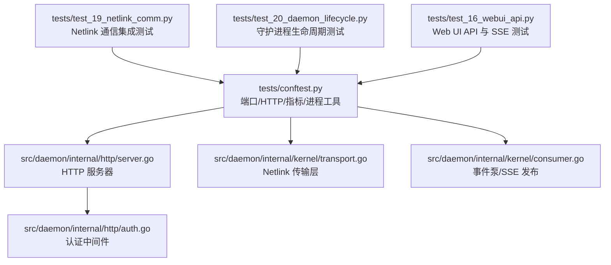
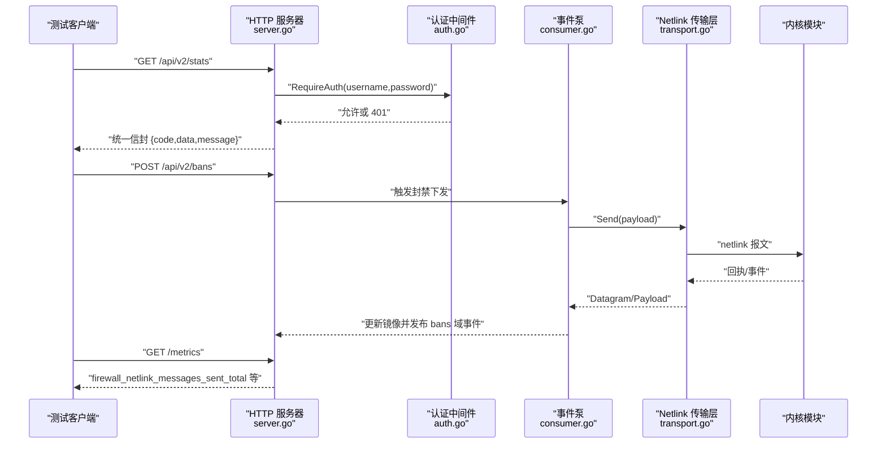
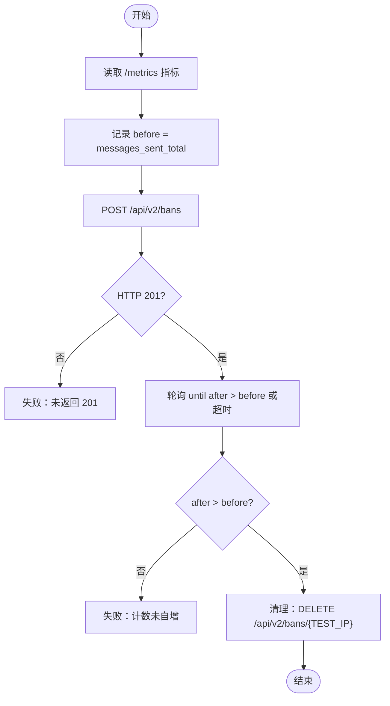
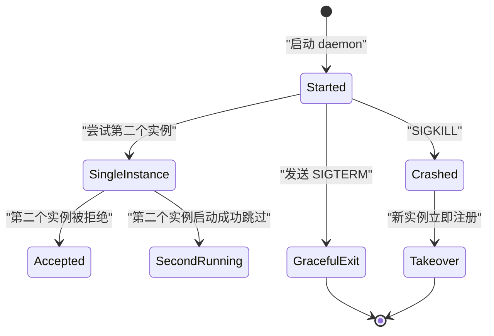
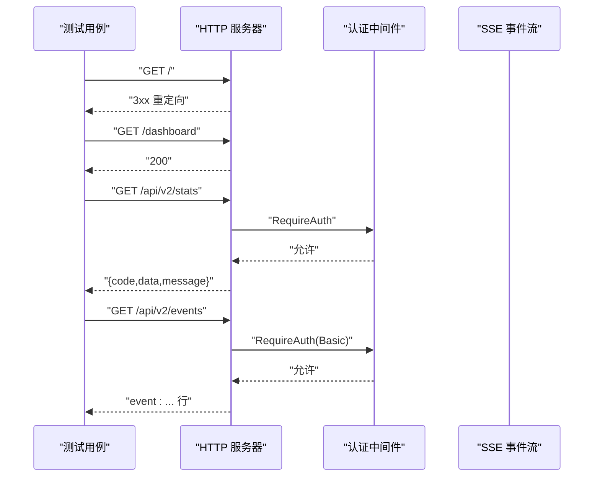
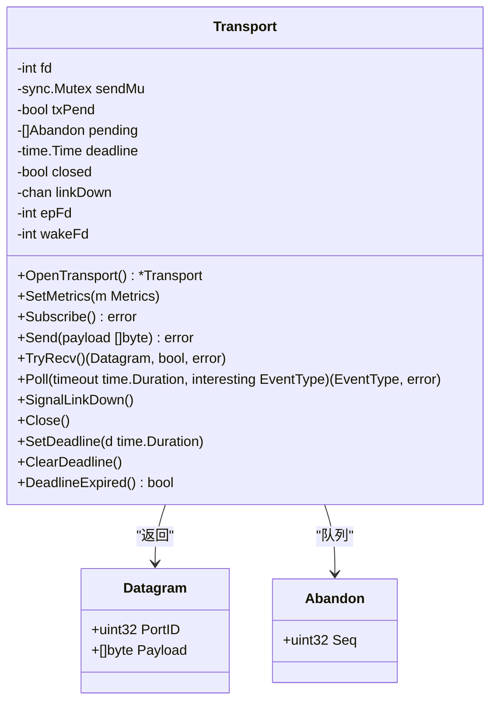
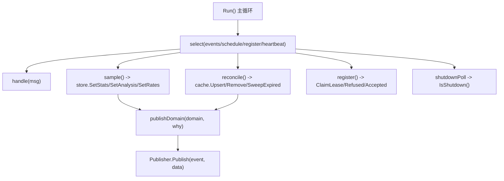
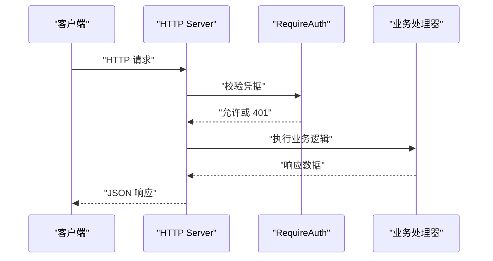
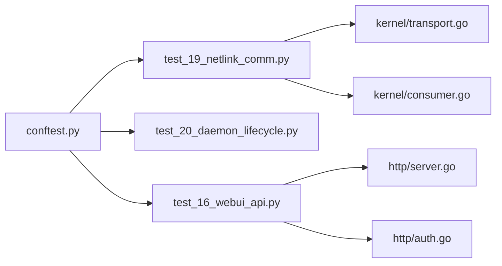

# 守护进程通信测试

<cite>
**本文引用的文件**   
- [tests/test_19_netlink_comm.py](file://tests/test_19_netlink_comm.py)
- [tests/test_20_daemon_lifecycle.py](file://tests/test_20_daemon_lifecycle.py)
- [tests/test_16_webui_api.py](file://tests/test_16_webui_api.py)
- [tests/conftest.py](file://tests/conftest.py)
- [src/daemon/internal/kernel/transport.go](file://src/daemon/internal/kernel/transport.go)
- [src/daemon/internal/kernel/consumer.go](file://src/daemon/internal/kernel/consumer.go)
- [src/daemon/internal/http/server.go](file://src/daemon/internal/http/server.go)
- [src/daemon/internal/http/auth.go](file://src/daemon/internal/http/auth.go)
</cite>

## 目录
1. [引言](#引言)
2. [项目结构](#项目结构)
3. [核心组件](#核心组件)
4. [架构总览](#架构总览)
5. [详细组件分析](#详细组件分析)
6. [依赖关系分析](#依赖关系分析)
7. [性能与超时策略](#性能与超时策略)
8. [故障排查指南](#故障排查指南)
9. [结论](#结论)

## 引言
本文件面向“守护进程通信”的集成测试，覆盖以下目标：
- Netlink 通信协议的测试实现：消息发送与接收、错误计数、连接管理。
- 守护进程生命周期测试：启动、单实例约束、优雅关闭、崩溃后接管。
- HTTP API 通信测试：版本化 /api/v2 接口、统一信封、SSE 事件流、认证授权。
- 异步通信测试策略与超时处理：事件驱动轮询、Prometheus 指标等待、内核确认延迟。
- 具体协议测试用例：如何模拟客户端请求并验证响应与内核侧行为。

## 项目结构
本次文档聚焦三类文件：
- 集成测试用例：Netlink 通信、守护进程生命周期、Web UI API。
- 测试夹具与辅助函数：端口读取、HTTP 请求封装、Prometheus 指标解析、进程管理。
- 守护进程内部实现：Netlink Transport、事件泵、HTTP Server、认证中间件。

**图表来源**
- [tests/test_19_netlink_comm.py:1-123](file://tests/test_19_netlink_comm.py#L1-L123)
- [tests/test_20_daemon_lifecycle.py:1-188](file://tests/test_20_daemon_lifecycle.py#L1-L188)
- [tests/test_16_webui_api.py:1-112](file://tests/test_16_webui_api.py#L1-L112)
- [tests/conftest.py:365-470](file://tests/conftest.py#L365-L470)
- [src/daemon/internal/http/server.go:14-158](file://src/daemon/internal/http/server.go#L14-L158)
- [src/daemon/internal/kernel/transport.go:13-137](file://src/daemon/internal/kernel/transport.go#L13-L137)
- [src/daemon/internal/kernel/consumer.go:53-109](file://src/daemon/internal/kernel/consumer.go#L53-L109)
- [src/daemon/internal/http/auth.go:22-116](file://src/daemon/internal/http/auth.go#L22-L116)

**章节来源**
- [tests/test_19_netlink_comm.py:1-123](file://tests/test_19_netlink_comm.py#L1-L123)
- [tests/test_20_daemon_lifecycle.py:1-188](file://tests/test_20_daemon_lifecycle.py#L1-L188)
- [tests/test_16_webui_api.py:1-112](file://tests/test_16_webui_api.py#L1-L112)
- [tests/conftest.py:326-502](file://tests/conftest.py#L326-L502)

## 核心组件
本节从测试视角梳理关键能力与断言点：
- Netlink 健康指标存在性与自增：通过 Prometheus /metrics 端点校验发送、接收、发送错误、接收错误四类计数器样本行；封禁操作后断言发送计数严格自增。
- 守护进程生命周期：二进制存在性检查、PID 文件一致性、单实例约束、SIGTERM 优雅退出、崩溃后立即接管。
- Web UI API：根路径重定向、/dashboard 可访问、/api/v2/stats/bans/jails/config 返回统一信封、/api/v2/events 返回 event: 字段、404 处理、响应时间阈值。
- 认证授权：Basic 认证头优先、query 参数兜底、半配置即拒绝、锁定期内拒绝。

**章节来源**
- [tests/test_19_netlink_comm.py:50-123](file://tests/test_19_netlink_comm.py#L50-L123)
- [tests/test_20_daemon_lifecycle.py:15-188](file://tests/test_20_daemon_lifecycle.py#L15-L188)
- [tests/test_16_webui_api.py:20-112](file://tests/test_16_webui_api.py#L20-L112)
- [src/daemon/internal/http/auth.go:22-116](file://src/daemon/internal/http/auth.go#L22-L116)

## 架构总览
守护进程对外暴露同一监听端口，承载 Web UI、JSON API、SSE 与 Prometheus metrics；对内通过 Netlink 与内核模块通信，事件泵负责采样、对账、发布域变更到 SSE。

**图表来源**
- [src/daemon/internal/http/server.go:34-113](file://src/daemon/internal/http/server.go#L34-L113)
- [src/daemon/internal/http/auth.go:36-116](file://src/daemon/internal/http/auth.go#L36-L116)
- [src/daemon/internal/kernel/consumer.go:269-344](file://src/daemon/internal/kernel/consumer.go#L269-L344)
- [src/daemon/internal/kernel/transport.go:233-262](file://src/daemon/internal/kernel/transport.go#L233-L262)

## 详细组件分析

### Netlink 通信集成测试（test_19）
- 指标存在性：断言四个 netlink 指标在 /metrics 中存在真实样本行。
- 封禁触发计数自增：发起 POST /api/v2/bans，轮询 Prometheus 指标直到 firewall_netlink_messages_sent_total 严格大于 before。
- 错误计数存在：断言 send_errors_total 与 recv_errors_total 有样本行。

**图表来源**
- [tests/test_19_netlink_comm.py:74-108](file://tests/test_19_netlink_comm.py#L74-L108)

**章节来源**
- [tests/test_19_netlink_comm.py:50-123](file://tests/test_19_netlink_comm.py#L50-L123)
- [tests/conftest.py:459-470](file://tests/conftest.py#L459-L470)

### 守护进程生命周期测试（test_20）
- 启动与 PID 文件：确保进程存活且 PID 文件内容匹配。
- 单实例约束：第二个实例应被拒绝或以非零码退出。
- SIGTERM 优雅退出：发送信号后进程应在时限内退出。
- 崩溃后立即接管：SIGKILL 第一个实例后，第二个实例应立即注册成功，不依赖 30 秒活动超时。

**图表来源**
- [tests/test_20_daemon_lifecycle.py:89-188](file://tests/test_20_daemon_lifecycle.py#L89-L188)

**章节来源**
- [tests/test_20_daemon_lifecycle.py:15-188](file://tests/test_20_daemon_lifecycle.py#L15-L188)
- [tests/conftest.py:121-140](file://tests/conftest.py#L121-L140)

### Web UI API 与 SSE 测试（test_16）
- 根路径重定向与 /dashboard 可访问。
- /api/v2/stats、/api/v2/bans、/api/v2/jails、/api/v2/config 返回统一信封，data 形状合法。
- /api/v2/events 返回 event: 字段，认证走 Basic 头优先。
- 404 处理与响应时间阈值。

**图表来源**
- [tests/test_16_webui_api.py:40-99](file://tests/test_16_webui_api.py#L40-L99)
- [src/daemon/internal/http/auth.go:36-99](file://src/daemon/internal/http/auth.go#L36-L99)

**章节来源**
- [tests/test_16_webui_api.py:20-112](file://tests/test_16_webui_api.py#L20-L112)
- [src/daemon/internal/http/server.go:34-113](file://src/daemon/internal/http/server.go#L34-L113)

### Netlink 传输层（transport.go）
- 协议号与组播组固定：NETLINK_USERSOCK、组号 1。
- 健康计数器：sent/received/send_error/recv_error 四个公开指标名。
- 收发语义：Send 原子投递并计数；TryRecv 使用 MSG_TRUNC 区分截断与畸形报文；Poll 支持 EventRx/EventLinkDown/EventDeadline/EventInterrupt。
- 连接管理：Subscribe 设置接收超时与非阻塞标志；Close 关闭 socket 并 SignalLinkDown；SetDeadline/ClearDeadline/DeadlineExpired 控制调用方截止时间。

**图表来源**
- [src/daemon/internal/kernel/transport.go:13-137](file://src/daemon/internal/kernel/transport.go#L13-L137)
- [src/daemon/internal/kernel/transport.go:233-308](file://src/daemon/internal/kernel/transport.go#L233-L308)
- [src/daemon/internal/kernel/transport.go:325-412](file://src/daemon/internal/kernel/transport.go#L325-L412)
- [src/daemon/internal/kernel/transport.go:460-529](file://src/daemon/internal/kernel/transport.go#L460-L529)

**章节来源**
- [src/daemon/internal/kernel/transport.go:13-137](file://src/daemon/internal/kernel/transport.go#L13-L137)
- [src/daemon/internal/kernel/transport.go:233-308](file://src/daemon/internal/kernel/transport.go#L233-L308)
- [src/daemon/internal/kernel/transport.go:325-412](file://src/daemon/internal/kernel/transport.go#L325-L412)
- [src/daemon/internal/kernel/transport.go:460-529](file://src/daemon/internal/kernel/transport.go#L460-L529)

### 事件泵与 SSE 发布（consumer.go）
- 周期任务：采样（stats/analysis/rates）、对账（bans）、注册续约（lease）。
- SSE 域名：bans、whitelist、stats、rates；载荷由 DomainMirror 提供，避免 REST 与 SSE 数据形状分叉。
- 指令回执：CmdResult 为唯一真实确认，失败时回写镜像并通知执行体。
- 关停检测：heartbeat 周期检查 shutdown 标志，保证空闲时也能及时退出。

**图表来源**
- [src/daemon/internal/kernel/consumer.go:269-344](file://src/daemon/internal/kernel/consumer.go#L269-L344)
- [src/daemon/internal/kernel/consumer.go:568-729](file://src/daemon/internal/kernel/consumer.go#L568-L729)

**章节来源**
- [src/daemon/internal/kernel/consumer.go:37-109](file://src/daemon/internal/kernel/consumer.go#L37-L109)
- [src/daemon/internal/kernel/consumer.go:269-344](file://src/daemon/internal/kernel/consumer.go#L269-L344)
- [src/daemon/internal/kernel/consumer.go:568-729](file://src/daemon/internal/kernel/consumer.go#L568-L729)

### HTTP 服务器与认证（server.go, auth.go）
- 服务器配置：默认地址 127.0.0.1:9119，最大连接数、关停超时、安全头、读写超时。
- Stop 幂等：先 graceful Shutdown，超时则 Close，避免端口占用。
- 认证中间件：RequireAuth 支持 Basic 头优先、query 参数兜底；半配置直接 401；锁定期内拒绝；常量时间比较凭据。

**图表来源**
- [src/daemon/internal/http/server.go:34-113](file://src/daemon/internal/http/server.go#L34-L113)
- [src/daemon/internal/http/auth.go:36-116](file://src/daemon/internal/http/auth.go#L36-L116)

**章节来源**
- [src/daemon/internal/http/server.go:14-158](file://src/daemon/internal/http/server.go#L14-L158)
- [src/daemon/internal/http/auth.go:22-116](file://src/daemon/internal/http/auth.go#L22-L116)

## 依赖关系分析
- 测试夹具 conftest.py 提供端口读取、HTTP 请求封装、Prometheus 指标解析、进程管理与租约释放。
- test_19 依赖 conftest 的 http_request、get_prometheus_metrics、parse_metric。
- test_20 依赖 conftest 的 mark_daemon_launched、terminate_process。
- test_16 依赖 conftest 的 daemon_http_port、http_request、run_curl。
- 守护进程内部：HTTP Server 依赖认证中间件；事件泵依赖 Transport 与 Sampler；Transport 暴露健康计数器供 /metrics 暴露。

**图表来源**
- [tests/conftest.py:365-502](file://tests/conftest.py#L365-L502)
- [tests/test_19_netlink_comm.py:16-23](file://tests/test_19_netlink_comm.py#L16-L23)
- [tests/test_20_daemon_lifecycle.py:11-12](file://tests/test_20_daemon_lifecycle.py#L11-L12)
- [tests/test_16_webui_api.py:8-9](file://tests/test_16_webui_api.py#L8-L9)

**章节来源**
- [tests/conftest.py:326-502](file://tests/conftest.py#L326-L502)
- [tests/test_19_netlink_comm.py:16-23](file://tests/test_19_netlink_comm.py#L16-L23)
- [tests/test_20_daemon_lifecycle.py:11-12](file://tests/test_20_daemon_lifecycle.py#L11-L12)
- [tests/test_16_webui_api.py:8-9](file://tests/test_16_webui_api.py#L8-L9)

## 性能与超时策略
- Prometheus 指标轮询：使用 wait_for_metric 或手动轮询，避免固定 sleep，采用事件驱动等待直至 predicate 成立或超时。
- Netlink 接收超时：SO_RCVTIMEO 设置为 500ms，使接收线程能周期性检查关停标志。
- HTTP 服务器超时：ReadHeaderTimeout 10s、ReadTimeout 30s、WriteTimeout 60s、IdleTimeout 120s；Stop 带 shutdownTimeout，超时强制 Close。
- 事件泵周期：SampleInterval 5s、ReconcileInterval 30s、RegisterInterval 10s、shutdownPollInterval 500ms。

**章节来源**
- [tests/conftest.py:484-502](file://tests/conftest.py#L484-L502)
- [src/daemon/internal/kernel/transport.go:43-48](file://src/daemon/internal/kernel/transport.go#L43-L48)
- [src/daemon/internal/http/server.go:63-71](file://src/daemon/internal/http/server.go#L63-L71)
- [src/daemon/internal/kernel/consumer.go:37-51](file://src/daemon/internal/kernel/consumer.go#L37-L51)

## 故障排查指南
- Netlink 指标缺失：检查 /metrics 是否可访问，确认四个计数器样本行存在；若发送计数未自增，检查封禁请求是否返回 201。
- 守护进程无法启动：检查二进制是否存在、PID 文件是否残留；确认内核模块已加载且租约已释放。
- 单实例约束失效：第二个实例启动成功需确认单实例机制是否启用；否则用例会跳过。
- SSE 无事件：确认 Basic 认证头是否正确注入；若使用 curl，确保 Authorization 头经 stdin 注入而非 argv。
- 认证 401：检查是否半配置凭据；若只填一项，所有 require_auth 端点一律 401。

**章节来源**
- [tests/test_19_netlink_comm.py:66-123](file://tests/test_19_netlink_comm.py#L66-L123)
- [tests/test_20_daemon_lifecycle.py:89-188](file://tests/test_20_daemon_lifecycle.py#L89-L188)
- [tests/test_16_webui_api.py:79-103](file://tests/test_16_webui_api.py#L79-L103)
- [src/daemon/internal/http/auth.go:36-75](file://src/daemon/internal/http/auth.go#L36-L75)

## 结论
本集成测试套件围绕守护进程的三大通信面展开：
- Netlink：通过健康指标与真实封禁操作验证内核交互的正确性与可观测性。
- HTTP API：统一信封、版本化路径、SSE 事件流与认证中间件共同构成稳定的外部契约。
- 守护进程生命周期：覆盖启动、单实例、优雅关闭与崩溃接管，确保系统在高可用场景下的健壮性。

测试设计强调事件驱动轮询与超时控制，避免固定 sleep 导致的偶发失败；同时通过 Prometheus 指标与内核回执形成闭环验证，确保“守护进程知道而内核不知道”的状态不再出现。