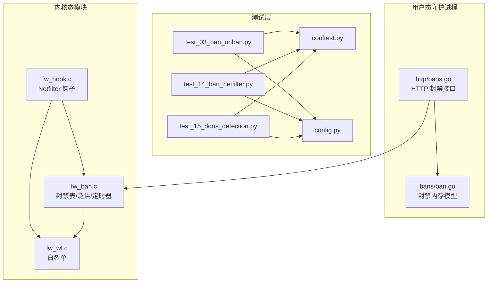
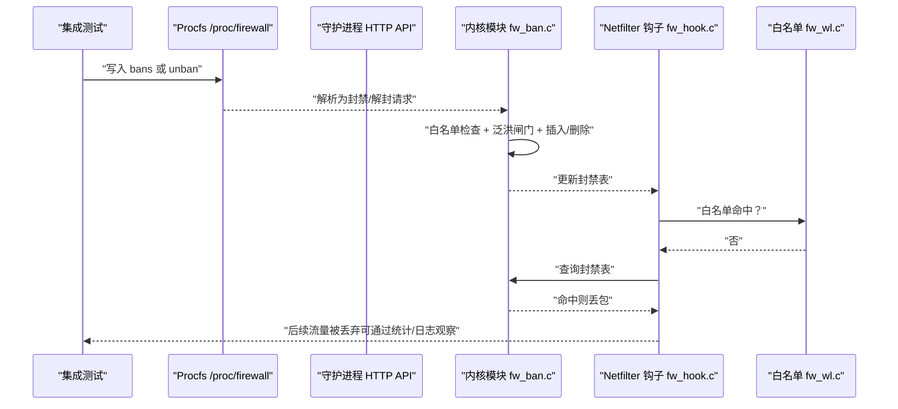
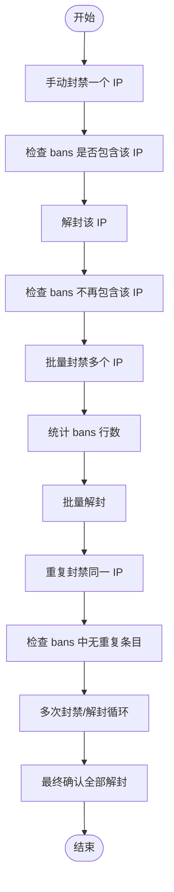
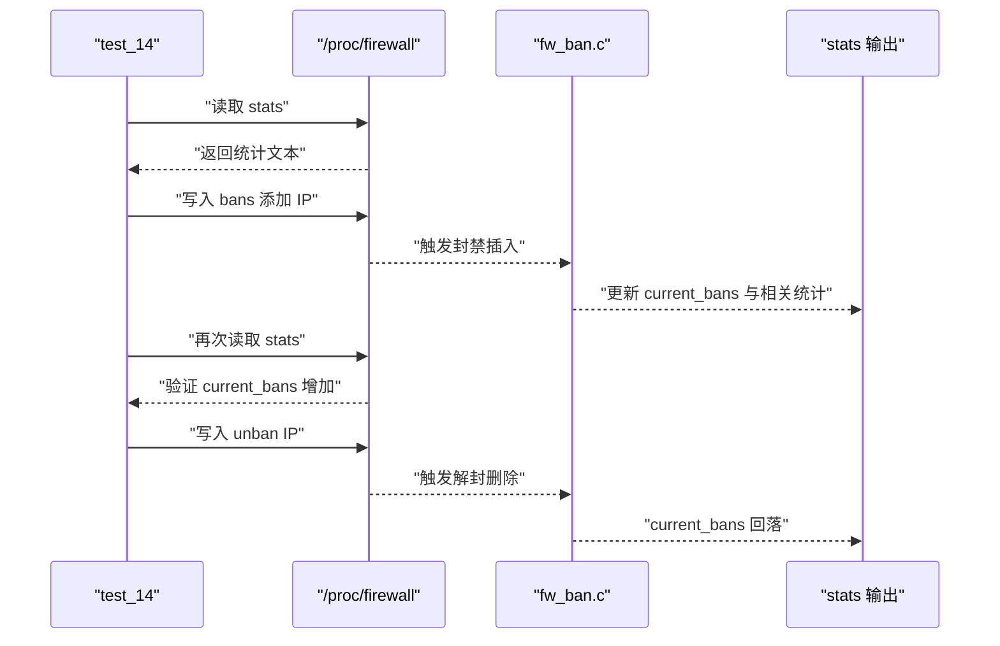
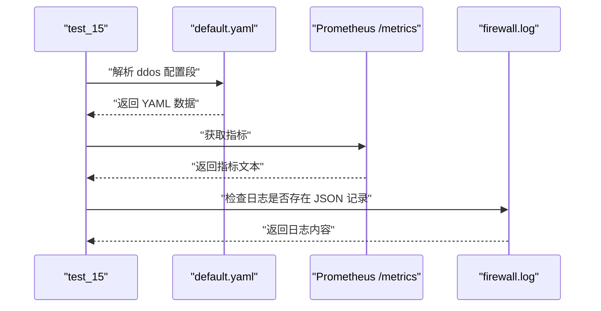
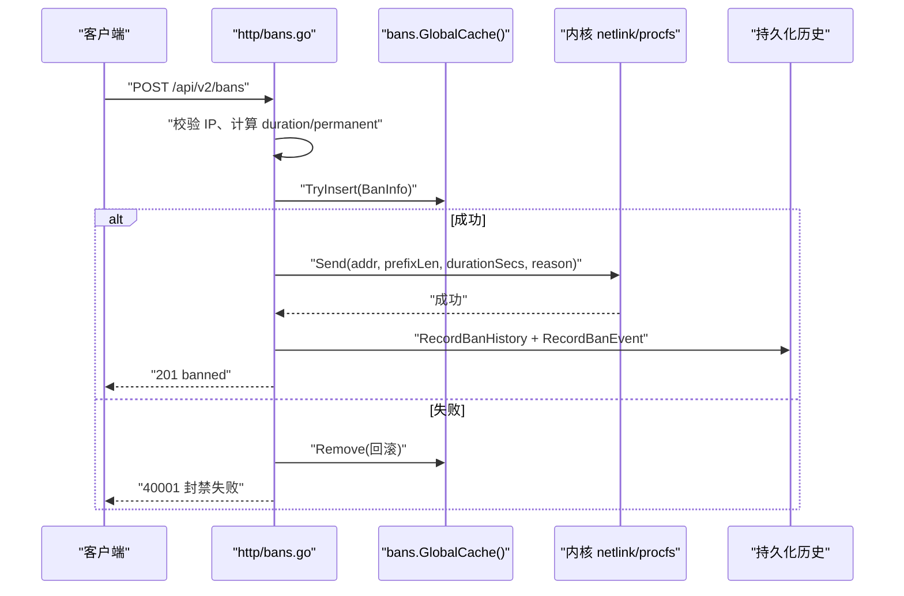
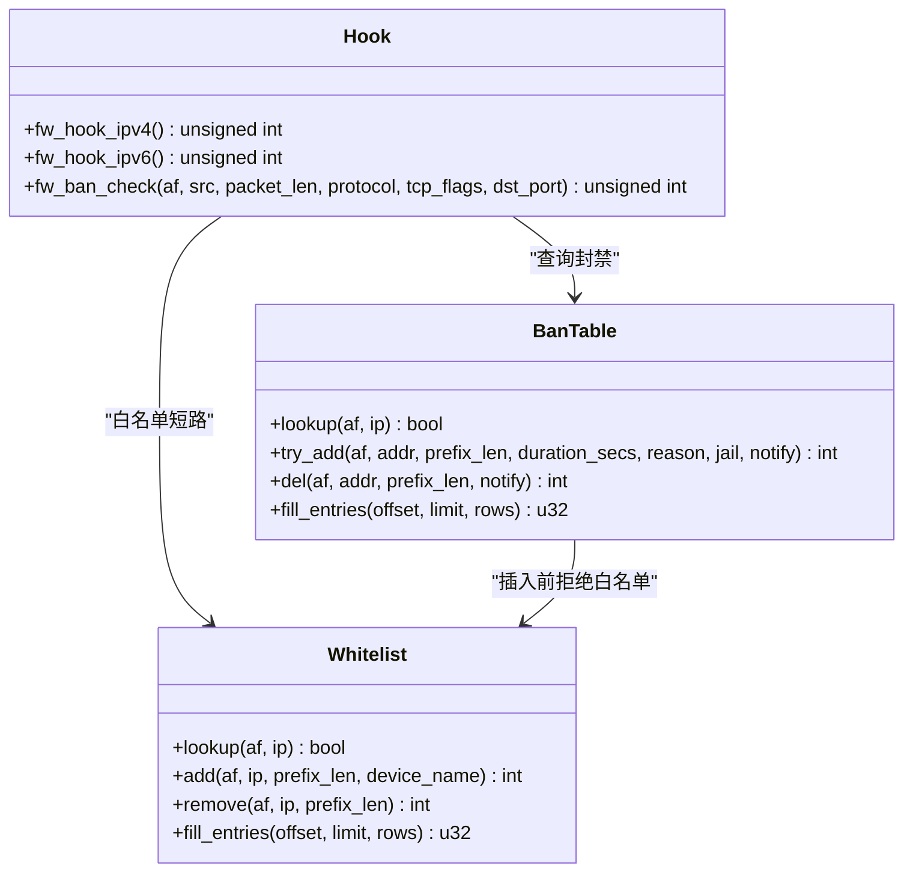
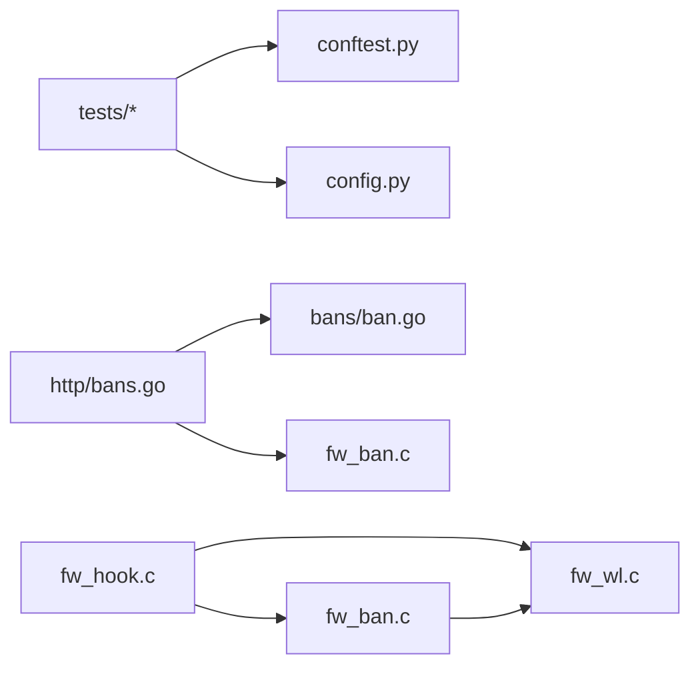

# 封禁解封测试

<cite>
**本文引用的文件**   
- [tests/test_03_ban_unban.py](file://tests/test_03_ban_unban.py)
- [tests/test_14_ban_netfilter.py](file://tests/test_14_ban_netfilter.py)
- [tests/test_15_ddos_detection.py](file://tests/test_15_ddos_detection.py)
- [tests/conftest.py](file://tests/conftest.py)
- [tests/config.py](file://tests/config.py)
- [src/daemon/internal/bans/ban.go](file://src/daemon/internal/bans/ban.go)
- [src/daemon/internal/http/bans.go](file://src/daemon/internal/http/bans.go)
- [src/kernel-module/fw_ban.c](file://src/kernel-module/fw_ban.c)
- [src/kernel-module/fw_hook.c](file://src/kernel-module/fw_hook.c)
- [src/kernel-module/fw_wl.c](file://src/kernel-module/fw_wl.c)
</cite>

## 目录
1. [引言](#引言)
2. [项目结构](#项目结构)
3. [核心组件](#核心组件)
4. [架构总览](#架构总览)
5. [详细组件分析](#详细组件分析)
6. [依赖关系分析](#依赖关系分析)
7. [性能与并发特性](#性能与并发特性)
8. [故障排查指南](#故障排查指南)
9. [结论](#结论)

## 引言
本文件面向“封禁/解封”功能的集成测试，目标是说明如何通过现有测试套件验证 IP 封禁、解封、自动封禁、封禁超时、Netfilter 钩子过滤规则、白名单优先级、并发封禁以及内核态与用户态数据一致性。文档以仓库中已有的 Python 集成测试和内核模块、守护进程实现为依据，给出可执行的场景设计、断言要点和排错建议，帮助读者在不直接阅读源码的情况下也能理解并扩展测试。

## 项目结构
围绕封禁解封的测试与实现主要分布在以下位置：
- 集成测试：tests 目录下按编号组织用例，其中 test_03、test_14、test_15 分别覆盖基础封禁解封、Netfilter 封禁条目与统计、DDoS 检测与自动封禁。
- 测试夹具与配置：tests/conftest.py 提供模块加载、procfs 操作、守护进程管理；tests/config.py 集中定义路径、IP、阈值等常量。
- 用户态逻辑：src/daemon/internal/bans 提供封禁内存模型；src/daemon/internal/http/bans.go 暴露 HTTP API 并协调缓存、数据库与内核下发。
- 内核态逻辑：src/kernel-module/fw_ban.c 维护分层桶封禁表、泛洪闸门、定时器到期；src/kernel-module/fw_hook.c 注册 Netfilter 钩子并执行白名单、本机地址、封禁表、速率判定；src/kernel-module/fw_wl.c 维护白名单并联动解封。

**图表来源**
- [tests/test_03_ban_unban.py:1-109](file://tests/test_03_ban_unban.py#L1-L109)
- [tests/test_14_ban_netfilter.py:1-54](file://tests/test_14_ban_netfilter.py#L1-L54)
- [tests/test_15_ddos_detection.py:1-75](file://tests/test_15_ddos_detection.py#L1-L75)
- [tests/conftest.py:1-662](file://tests/conftest.py#L1-L662)
- [tests/config.py:1-80](file://tests/config.py#L1-L80)
- [src/daemon/internal/bans/ban.go:1-132](file://src/daemon/internal/bans/ban.go#L1-L132)
- [src/daemon/internal/http/bans.go:1-502](file://src/daemon/internal/http/bans.go#L1-L502)
- [src/kernel-module/fw_ban.c:1-674](file://src/kernel-module/fw_ban.c#L1-L674)
- [src/kernel-module/fw_hook.c:1-411](file://src/kernel-module/fw_hook.c#L1-L411)
- [src/kernel-module/fw_wl.c:1-311](file://src/kernel-module/fw_wl.c#L1-L311)

**章节来源**
- [tests/test_03_ban_unban.py:1-109](file://tests/test_03_ban_unban.py#L1-L109)
- [tests/test_14_ban_netfilter.py:1-54](file://tests/test_14_ban_netfilter.py#L1-L54)
- [tests/test_15_ddos_detection.py:1-75](file://tests/test_15_ddos_detection.py#L1-L75)
- [tests/conftest.py:1-662](file://tests/conftest.py#L1-L662)
- [tests/config.py:1-80](file://tests/config.py#L1-L80)

## 核心组件
本节从“测试如何驱动系统”的角度，梳理封禁解封的关键组件及其职责。

- 测试夹具与工具
  - conftest.py 提供内核模块加载卸载、procfs 读写封装、守护进程生命周期管理、Prometheus 指标读取等能力。
  - config.py 集中定义测试 IP、procfs 路径、同步延迟、容量上限说明等。
- 用户态封禁模型与 API
  - bans/ban.go 定义 ValidatedIP、BanInfo、时长计算、过期判断等纯函数模型。
  - http/bans.go 暴露创建封禁、批量封禁、删除封禁、临时封禁批量解封等 HTTP 接口，负责镜像缓存、内核下发、历史事件记录与状态推送。
- 内核态封禁表与钩子
  - fw_ban.c 维护按前缀长度分层的封禁表、泛洪闸门、容量上限、定时器到期解封、分页遍历、白名单联动解封。
  - fw_hook.c 在 NF_INET_PRE_ROUTING 钩子中执行白名单、本机地址、封禁表、速率判定，必要时触发自动封禁。
  - fw_wl.c 维护白名单精确桶与子网链表，命中时短路放行，并在移除时联动解封匹配封禁。

**章节来源**
- [tests/conftest.py:142-246](file://tests/conftest.py#L142-L246)
- [tests/config.py:14-38](file://tests/config.py#L14-L38)
- [src/daemon/internal/bans/ban.go:14-132](file://src/daemon/internal/bans/ban.go#L14-L132)
- [src/daemon/internal/http/bans.go:21-57](file://src/daemon/internal/http/bans.go#L21-L57)
- [src/kernel-module/fw_ban.c:1-41](file://src/kernel-module/fw_ban.c#L1-L41)
- [src/kernel-module/fw_hook.c:1-45](file://src/kernel-module/fw_hook.c#L1-L45)
- [src/kernel-module/fw_wl.c:1-18](file://src/kernel-module/fw_wl.c#L1-L18)

## 架构总览
封禁解封的整体流程可以理解为“用户态发起 → 内核态生效 → 数据包被过滤 → 统计与事件上报”。

**图表来源**
- [tests/test_14_ban_netfilter.py:26-53](file://tests/test_14_ban_netfilter.py#L26-L53)
- [src/kernel-module/fw_ban.c:506-531](file://src/kernel-module/fw_ban.c#L506-L531)
- [src/kernel-module/fw_hook.c:104-154](file://src/kernel-module/fw_hook.c#L104-L154)
- [src/kernel-module/fw_wl.c:114-147](file://src/kernel-module/fw_wl.c#L114-L147)

## 详细组件分析

### 基础封禁与解封测试
test_03_ban_unban.py 覆盖了手动封禁、批量封禁、重复封禁、循环封禁解封、IPv4/IPv6 重复封禁对统计的影响等关键场景。其核心断言包括：
- 基本封禁后 IP 应出现在 procfs bans 中，解封后不应出现。
- 批量封禁数量应与预期一致，批量解封后状态恢复。
- 重复封禁不会在 bans 中产生重复条目。
- 多次封禁解封循环后，最终所有 IP 均处于未封禁状态。
- 重复封禁不污染 total_bans 与 current_bans 计数器。
- IPv6 重复写入 bans 同样只增加一次计数。

这些测试通过 conftest.py 中的 ban_ip、unban_ip、ban_multiple、unban_multiple、ip_is_banned、count_bans、get_stat、wait_procfs 等辅助函数驱动内核模块的 procfs 接口，从而间接验证内核态封禁表行为。

**图表来源**
- [tests/test_03_ban_unban.py:22-60](file://tests/test_03_ban_unban.py#L22-L60)
- [tests/conftest.py:184-234](file://tests/conftest.py#L184-L234)

**章节来源**
- [tests/test_03_ban_unban.py:19-109](file://tests/test_03_ban_unban.py#L19-L109)
- [tests/conftest.py:184-234](file://tests/conftest.py#L184-L234)

### Netfilter 封禁条目与包统计测试
test_14_ban_netfilter.py 聚焦于内核态 Netfilter 钩子的封禁效果与统计一致性：
- 初始 stats 必须包含 packets_dropped 与 packets_accepted 字段，且值非负。
- 向 bans 写入 IP 后，procfs bans 中应存在对应条目。
- 封禁后 current_bans 应增加，解封后应回落到合理范围。

该测试通过直接写 /proc/firewall/bans 与读 /proc/firewall/stats 来验证内核模块的封禁表与统计输出是否符合契约。

**图表来源**
- [tests/test_14_ban_netfilter.py:14-53](file://tests/test_14_ban_netfilter.py#L14-L53)
- [src/kernel-module/fw_ban.c:385-387](file://src/kernel-module/fw_ban.c#L385-L387)
- [src/kernel-module/fw_ban.c:533-570](file://src/kernel-module/fw_ban.c#L533-L570)

**章节来源**
- [tests/test_14_ban_netfilter.py:11-54](file://tests/test_14_ban_netfilter.py#L11-L54)
- [src/kernel-module/fw_ban.c:369-387](file://src/kernel-module/fw_ban.c#L369-L387)
- [src/kernel-module/fw_ban.c:533-570](file://src/kernel-module/fw_ban.c#L533-L570)

### DDoS 检测与自动封禁测试
test_15_ddos_detection.py 关注守护进程参与时的自动封禁链路：
- 验证默认配置中存在 ddos 段且非空。
- 验证 Prometheus 端点暴露 firewall_ddos 指标。
- 验证 firewall_ddos_auto_bans_total 指标存在标准样本行。
- 验证守护进程日志文件存在且包含 JSON Lines 记录。

该测试需要守护进程运行，并通过 get_prometheus_metrics、is_daemon_running 等夹具方法访问外部服务。它更多是“端到端”验证：配置正确 → 指标可见 → 日志可观测。

**图表来源**
- [tests/test_15_ddos_detection.py:21-74](file://tests/test_15_ddos_detection.py#L21-L74)
- [tests/conftest.py:459-470](file://tests/conftest.py#L459-L470)

**章节来源**
- [tests/test_15_ddos_detection.py:12-75](file://tests/test_15_ddos_detection.py#L12-L75)
- [tests/conftest.py:459-470](file://tests/conftest.py#L459-L470)

### 用户态封禁 API 与内核下发
当通过 HTTP API 封禁 IP 时，用户态会先校验 IP、构造 BanInfo、写入内存缓存，再调用内核下发接口；失败时需要回滚缓存，确保面板看到的封禁状态与内核实际状态一致。解封时，用户态先从缓存移除，再尝试通知内核；即使内核下发失败，也不回滚镜像，因为 TTL 到期会自动解封。

**图表来源**
- [src/daemon/internal/http/bans.go:116-190](file://src/daemon/internal/http/bans.go#L116-L190)
- [src/daemon/internal/bans/ban.go:82-132](file://src/daemon/internal/bans/ban.go#L82-L132)

**章节来源**
- [src/daemon/internal/http/bans.go:112-190](file://src/daemon/internal/http/bans.go#L112-L190)
- [src/daemon/internal/bans/ban.go:82-132](file://src/daemon/internal/bans/ban.go#L82-L132)

### 内核态封禁表与白名单优先级
内核态封禁表使用按前缀长度分层的桶结构，支持精确主机（/32 或 /128）与网段封禁；热路径查找优先精确层，再扫描更短前缀层。白名单采用精确桶加子网链表，命中即放行，且白名单优先级高于封禁。白名单移除时会联动解封落在其覆盖范围内的封禁条目。

**图表来源**
- [src/kernel-module/fw_ban.c:369-387](file://src/kernel-module/fw_ban.c#L369-L387)
- [src/kernel-module/fw_ban.c:506-531](file://src/kernel-module/fw_ban.c#L506-L531)
- [src/kernel-module/fw_wl.c:114-147](file://src/kernel-module/fw_wl.c#L114-L147)
- [src/kernel-module/fw_hook.c:104-154](file://src/kernel-module/fw_hook.c#L104-L154)

**章节来源**
- [src/kernel-module/fw_ban.c:1-41](file://src/kernel-module/fw_ban.c#L1-L41)
- [src/kernel-module/fw_ban.c:369-387](file://src/kernel-module/fw_ban.c#L369-L387)
- [src/kernel-module/fw_ban.c:506-531](file://src/kernel-module/fw_ban.c#L506-L531)
- [src/kernel-module/fw_wl.c:114-147](file://src/kernel-module/fw_wl.c#L114-L147)
- [src/kernel-module/fw_hook.c:104-154](file://src/kernel-module/fw_hook.c#L104-L154)

## 依赖关系分析
封禁解封功能涉及多层依赖：
- 测试依赖内核模块加载与 procfs 就绪，conftest.py 在会话级与用例级做环境准备与清理。
- 用户态 HTTP API 依赖 bans 内存模型、数据库持久化、内核下发接口。
- 内核态 fw_hook.c 依赖 fw_ban.c、fw_wl.c、fw_rate.h、fw_stats.h、fw_ports.h 等。
- 白名单与封禁表共享 fw_prefix_match 语义，避免前缀匹配漂移。

**图表来源**
- [tests/conftest.py:574-614](file://tests/conftest.py#L574-L614)
- [src/daemon/internal/http/bans.go:116-190](file://src/daemon/internal/http/bans.go#L116-L190)
- [src/kernel-module/fw_hook.c:58-64](file://src/kernel-module/fw_hook.c#L58-L64)
- [src/kernel-module/fw_ban.c:49-53](file://src/kernel-module/fw_ban.c#L49-L53)

**章节来源**
- [tests/conftest.py:574-614](file://tests/conftest.py#L574-L614)
- [src/daemon/internal/http/bans.go:116-190](file://src/daemon/internal/http/bans.go#L116-L190)
- [src/kernel-module/fw_hook.c:58-64](file://src/kernel-module/fw_hook.c#L58-L64)
- [src/kernel-module/fw_ban.c:49-53](file://src/kernel-module/fw_ban.c#L49-L53)

## 性能与并发特性
内核态封禁表与钩子在设计上强调热路径性能与并发安全：
- 封禁表使用 RCU 读侧临界区与层内桶锁，避免全局自旋锁竞争。
- 白名单与本机地址判定在同一个 RCU 临界区内完成，减少锁切换。
- 端口去重集合位于 per-CPU 槽位，避免频繁取锁。
- 统计、直方图、UDP/ICMP 分布落本地 CPU，降低共享缓存行写放大。
- 泛洪闸门统一由 fw_ban_flood_allow 控制，防止 procfs/netlink/DDoS 三路同时高频封禁导致资源耗尽。
- 容量上限 fw_max_ban_entries 与 fw_max_whitelist_entries 在插入前原子检查，避免无限增长。

这些特性直接影响并发封禁测试的设计：在高并发下，应关注 current_bans 是否稳定、是否出现误判或漏封、统计是否单调递增、是否因泛洪闸门拒绝新增封禁。

**章节来源**
- [src/kernel-module/fw_ban.c:1-41](file://src/kernel-module/fw_ban.c#L1-L41)
- [src/kernel-module/fw_ban.c:393-409](file://src/kernel-module/fw_ban.c#L393-L409)
- [src/kernel-module/fw_hook.c:10-45](file://src/kernel-module/fw_hook.c#L10-L45)
- [src/kernel-module/fw_wl.c:1-18](file://src/kernel-module/fw_wl.c#L1-L18)

## 故障排查指南
常见封禁解封问题及定位方式：
- 模块未加载或 procfs 不可用
  - 现象：测试跳过或无法读写 /proc/firewall。
  - 排查：检查 is_module_loaded、check_module_ready、load_module；确认 root 权限与模块路径。
- 封禁未生效
  - 现象：bans 中有 IP，但流量未被丢弃。
  - 排查：确认 fw_hook.c 钩子已注册、目的端口受保护、白名单未命中、本机地址未豁免。
- 解封后仍拦截
  - 现象：unban 后 current_bans 未下降。
  - 排查：检查定时器到期回调、白名单联动解封、procfs 写入是否正确。
- 自动封禁未触发
  - 现象：DDoS 指标缺失或 auto_bans_total 无样本。
  - 排查：确认守护进程运行、ddos 配置段存在、Prometheus 端点可达、日志有 JSON 记录。
- 内核下发失败导致面板不一致
  - 现象：面板显示封禁但内核未生效。
  - 排查：查看 http/bans.go 的错误日志，确认 TryInsert 与 Send 的回滚逻辑。

**章节来源**
- [tests/conftest.py:34-82](file://tests/conftest.py#L34-L82)
- [tests/conftest.py:574-614](file://tests/conftest.py#L574-L614)
- [src/daemon/internal/http/bans.go:150-163](file://src/daemon/internal/http/bans.go#L150-L163)
- [src/kernel-module/fw_hook.c:104-154](file://src/kernel-module/fw_hook.c#L104-L154)

## 结论
本项目的封禁解封集成测试以 procfs 与守护进程指标为主要观测点，结合内核模块的封禁表、白名单与 Netfilter 钩子，形成从用户态到内核态的完整验证闭环。test_03 验证基础封禁解封与统计稳定性，test_14 验证 Netfilter 封禁条目与包统计，test_15 验证 DDoS 检测与自动封禁的可观测性。内核态实现强调并发安全与热路径性能，用户态实现强调镜像一致性、错误回滚与审计记录。基于这些测试与实现，读者可以进一步扩展 DDoS 模拟、端口扫描检测、并发封禁压力测试，并通过 procfs、Prometheus 与日志三者交叉验证内核态与用户态的数据一致性。