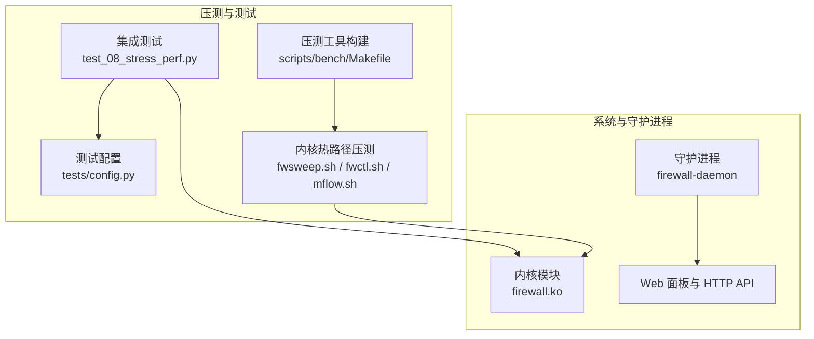
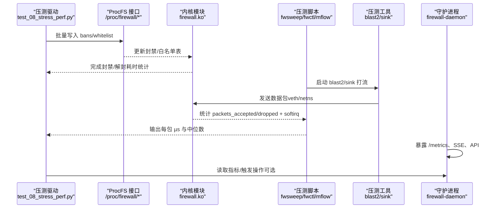
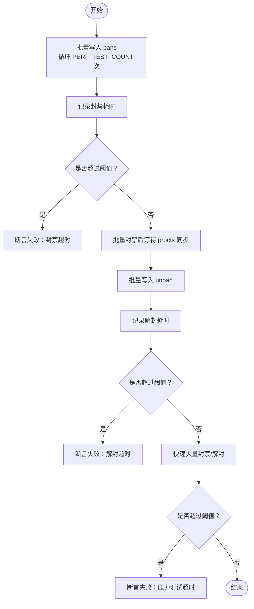
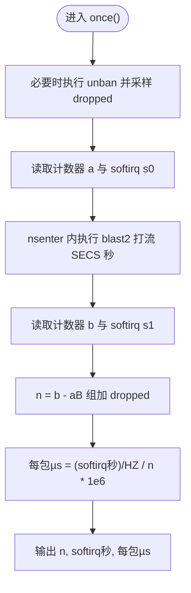
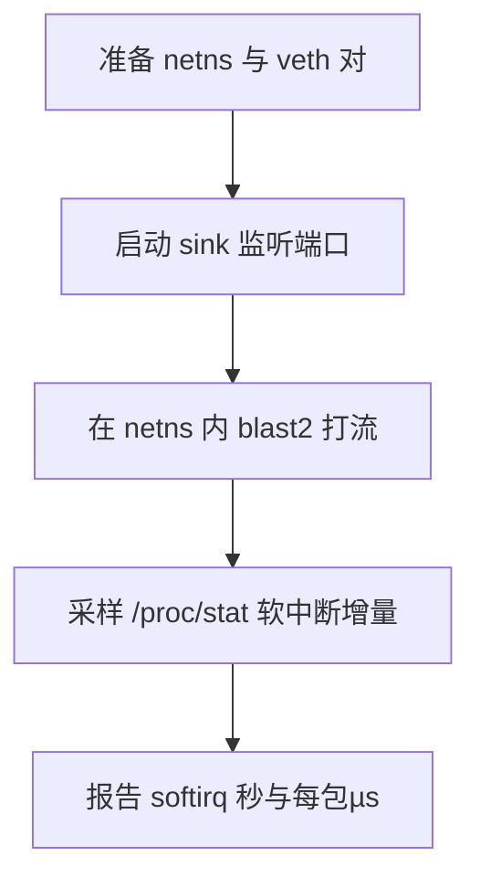
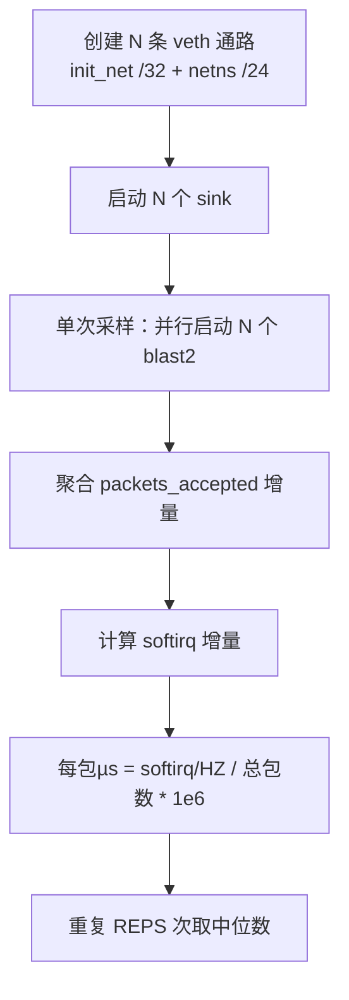
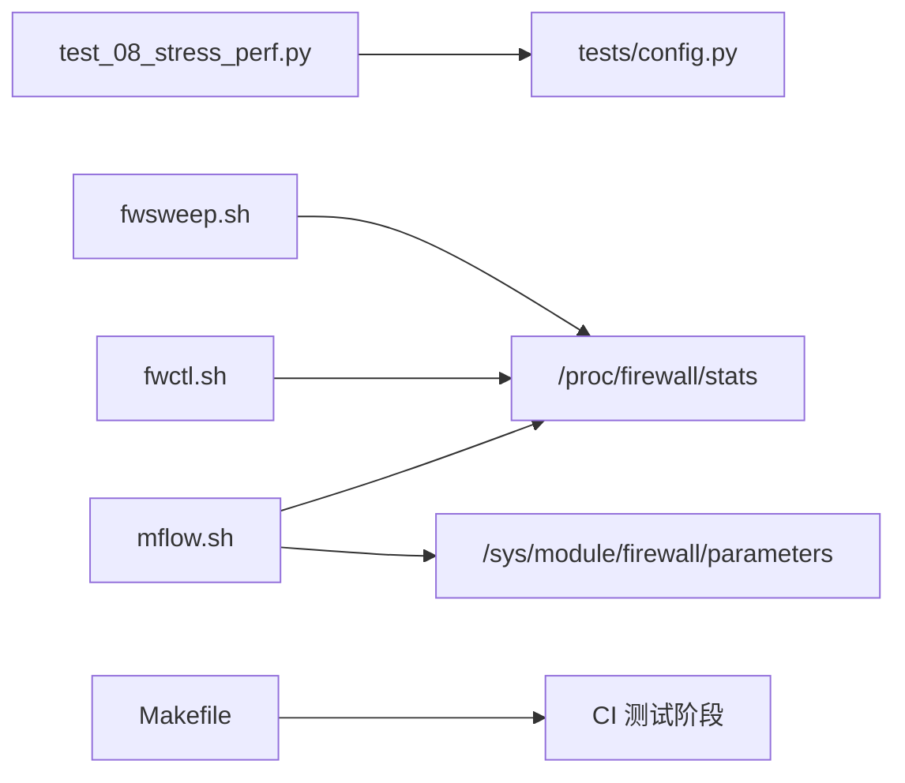

# 性能压力测试

<cite>
**本文引用的文件**   
- [README.md](file://README.md)
- [tests/test_08_stress_perf.py](file://tests/test_08_stress_perf.py)
- [tests/config.py](file://tests/config.py)
- [scripts/bench/fwsweep.sh](file://scripts/bench/fwsweep.sh)
- [scripts/bench/fwctl.sh](file://scripts/bench/fwctl.sh)
- [scripts/bench/mflow.sh](file://scripts/bench/mflow.sh)
- [scripts/bench/Makefile](file://scripts/bench/Makefile)
- [Makefile](file://Makefile)
</cite>

## 目录
1. [引言](#引言)
2. [项目结构](#项目结构)
3. [核心组件](#核心组件)
4. [架构总览](#架构总览)
5. [详细组件分析](#详细组件分析)
6. [依赖关系分析](#依赖关系分析)
7. [性能考量](#性能考量)
8. [故障排查指南](#故障排查指南)
9. [结论](#结论)
10. [附录](#附录)

## 引言
本文件面向“性能压力测试”主题，聚焦高并发场景下的系统稳定性、大量并发请求处理、内存与 CPU 负载分析，并给出长时间运行、资源泄漏检测与性能回归测试的方法。文档基于仓库中已有的压测脚本与集成测试用例进行系统化说明，同时补充 ab、wrk 等通用压测工具在守护进程 HTTP API 上的集成方式，帮助读者建立可复现、可度量、可回归的性能基准体系。

## 项目结构
本项目采用三层架构：内核模块负责高速封禁与过滤；守护进程负责日志采集、风险判定、HTTP API 与面板服务；前端提供可视化监控与管理。压测相关能力主要分布在以下位置：
- 集成测试：tests/test_08_stress_perf.py 定义封禁/解封性能与快速大量封禁的压力测试。
- 压测参数：tests/config.py 集中管理压力测试规模与阈值。
- 内核热路径压测：scripts/bench/fwsweep.sh、fwctl.sh、mflow.sh 分别用于单通路对照、无钩子对照与多通路并发每包成本测量。
- 压测工具构建：scripts/bench/Makefile 构建 blast2 与 sink。
- 构建与 CI：Makefile 提供完整的构建、契约校验与测试流程，便于将性能回归纳入持续集成。

图表来源
- [tests/test_08_stress_perf.py:1-93](file://tests/test_08_stress_perf.py#L1-L93)
- [tests/config.py:53-70](file://tests/config.py#L53-L70)
- [scripts/bench/fwsweep.sh:1-94](file://scripts/bench/fwsweep.sh#L1-L94)
- [scripts/bench/fwctl.sh:1-59](file://scripts/bench/fwctl.sh#L1-L59)
- [scripts/bench/mflow.sh:1-109](file://scripts/bench/mflow.sh#L1-L109)
- [scripts/bench/Makefile:1-27](file://scripts/bench/Makefile#L1-L27)

章节来源
- [README.md:10-31](file://README.md#L10-L31)
- [tests/test_08_stress_perf.py:1-93](file://tests/test_08_stress_perf.py#L1-L93)
- [tests/config.py:53-70](file://tests/config.py#L53-L70)
- [scripts/bench/fwsweep.sh:1-94](file://scripts/bench/fwsweep.sh#L1-L94)
- [scripts/bench/fwctl.sh:1-59](file://scripts/bench/fwctl.sh#L1-L59)
- [scripts/bench/mflow.sh:1-109](file://scripts/bench/mflow.sh#L1-L109)
- [scripts/bench/Makefile:1-27](file://scripts/bench/Makefile#L1-L27)

## 核心组件
- 集成压力测试用例
  - 封禁性能：批量写入 /proc/firewall/bans，统计总耗时与平均耗时，并与阈值比较。
  - 解封性能：先批量封禁，等待 procfs 同步后批量解封，统计耗时与平均值。
  - 快速大量封禁：以较大规模 IP 集合快速封禁与解封，验证整体吞吐与延迟上限。
- 内核热路径压测脚本
  - fwsweep.sh：五条热路径（白名单命中、两表未命中、速率引擎开启、已封禁）的每包 softirq 成本测量。
  - fwctl.sh：无 netfilter 钩子的对照组，隔离出钩子净成本。
  - mflow.sh：多通路并发每包成本，评估跨核共享写争用对每包成本的影响。
- 压测工具构建
  - Makefile 仅依赖 libc/pthread，构建 blast2（发包）与 sink（收包），供上述脚本使用。
- 测试参数与阈值
  - 统一在 tests/config.py 中定义压力规模（如 STRESS_IP_COUNT、PERF_TEST_COUNT）与性能阈值（毫秒级）。

章节来源
- [tests/test_08_stress_perf.py:23-92](file://tests/test_08_stress_perf.py#L23-L92)
- [scripts/bench/fwsweep.sh:1-94](file://scripts/bench/fwsweep.sh#L1-L94)
- [scripts/bench/fwctl.sh:1-59](file://scripts/bench/fwctl.sh#L1-L59)
- [scripts/bench/mflow.sh:1-109](file://scripts/bench/mflow.sh#L1-L109)
- [scripts/bench/Makefile:1-27](file://scripts/bench/Makefile#L1-L27)
- [tests/config.py:53-70](file://tests/config.py#L53-L70)

## 架构总览
下图展示从压测驱动到内核热路径与守护进程的端到端数据流，以及关键指标采集点。

图表来源
- [tests/test_08_stress_perf.py:23-92](file://tests/test_08_stress_perf.py#L23-L92)
- [scripts/bench/fwsweep.sh:32-53](file://scripts/bench/fwsweep.sh#L32-L53)
- [scripts/bench/fwctl.sh:29-57](file://scripts/bench/fwctl.sh#L29-L57)
- [scripts/bench/mflow.sh:49-90](file://scripts/bench/mflow.sh#L49-L90)

## 详细组件分析

### 集成压力测试用例（test_08_stress_perf.py）
该测试覆盖三类关键场景：
- 封禁性能：循环写入 bans，统计总耗时与平均耗时，断言不超过 BAN_PERF_THRESHOLD_MS。
- 解封性能：先批量封禁，等待 procfs 同步，再批量解封，断言不超过 UNBAN_PERF_THRESHOLD_MS。
- 快速大量封禁：以 STRESS_IP_COUNT 规模快速封禁与解封，断言不超过 STRESS_THRESHOLD_MS。

图表来源
- [tests/test_08_stress_perf.py:23-92](file://tests/test_08_stress_perf.py#L23-L92)

章节来源
- [tests/test_08_stress_perf.py:23-92](file://tests/test_08_stress_perf.py#L23-L92)
- [tests/config.py:53-70](file://tests/config.py#L53-L70)

### 内核热路径压测脚本（fwsweep.sh）
fwsweep.sh 通过五种路径对比每包成本，核心思路：
- 使用 /proc/firewall/stats 计数 packets_accepted/packets_dropped。
- 使用 /proc/stat 计算 softirq 增量，结合 HZ 换算为秒。
- 每包成本 = softirq 秒数 / 处理包数，取多次重复的中位数。
- 针对速率引擎开启路径（B 组），需合计 dropped 计数，避免中途自动封禁导致分母偏小。

图表来源
- [scripts/bench/fwsweep.sh:32-53](file://scripts/bench/fwsweep.sh#L32-L53)

章节来源
- [scripts/bench/fwsweep.sh:1-94](file://scripts/bench/fwsweep.sh#L1-L94)

### 无钩子对照组（fwctl.sh）
fwctl.sh 在独立 netns 内创建 veth 对，使流量不经过 init_net 上的防火墙钩子，从而得到“无钩子”软中断开销基线。通过与主测量 softirq 差值，估算钩子净成本。

图表来源
- [scripts/bench/fwctl.sh:29-57](file://scripts/bench/fwctl.sh#L29-L57)

章节来源
- [scripts/bench/fwctl.sh:1-59](file://scripts/bench/fwctl.sh#L1-L59)

### 多通路并发每包成本（mflow.sh）
mflow.sh 创建 N 条独立 veth 通路，每条通路源地址不同，避免共享条目干扰。通过同时起停多个 blast2，聚合 packets_accepted 增量，评估跨核共享写争用对每包成本的影响。

图表来源
- [scripts/bench/mflow.sh:52-90](file://scripts/bench/mflow.sh#L52-L90)

章节来源
- [scripts/bench/mflow.sh:1-109](file://scripts/bench/mflow.sh#L1-L109)

### 压测工具构建（scripts/bench/Makefile）
- 产物：blast2（发包）、sink（收包）。
- 依赖：仅 libc 与 pthread，确保压测工具轻量、稳定。
- 用法：make 构建，make clean 清理。

章节来源
- [scripts/bench/Makefile:1-27](file://scripts/bench/Makefile#L1-L27)

## 依赖关系分析
- 测试与配置耦合
  - test_08_stress_perf.py 依赖 tests/config.py 中的规模与阈值常量。
- 压测脚本与内核模块
  - fwsweep.sh、fwctl.sh、mflow.sh 均依赖 /proc/firewall/stats 与 /sys/module/firewall/parameters。
- 构建与 CI
  - Makefile 提供完整构建与测试流程，可将性能回归纳入 CI。

图表来源
- [tests/test_08_stress_perf.py:1-14](file://tests/test_08_stress_perf.py#L1-L14)
- [tests/config.py:53-70](file://tests/config.py#L53-L70)
- [scripts/bench/fwsweep.sh:28-33](file://scripts/bench/fwsweep.sh#L28-L33)
- [scripts/bench/mflow.sh:46-50](file://scripts/bench/mflow.sh#L46-L50)
- [Makefile:469-499](file://Makefile#L469-L499)

章节来源
- [tests/test_08_stress_perf.py:1-14](file://tests/test_08_stress_perf.py#L1-L14)
- [tests/config.py:53-70](file://tests/config.py#L53-L70)
- [scripts/bench/fwsweep.sh:28-33](file://scripts/bench/fwsweep.sh#L28-L33)
- [scripts/bench/mflow.sh:46-50](file://scripts/bench/mflow.sh#L46-L50)
- [Makefile:469-499](file://Makefile#L469-L499)

## 性能考量
- 指标口径
  - 每包成本：softirq 增量 / 处理包数，单位 µs。
  - 吞吐：packets_accepted/packets_dropped 增量。
  - 延迟：封禁/解封操作的总耗时与平均耗时。
- 关键路径
  - 白名单命中最短路径（E 组）。
  - 两表未命中（A 组）。
  - 速率引擎开启（B 组，含 dropped 合计）。
  - 已封禁命中（D 组，NF_DROP）。
- 多核与共享写
  - mflow.sh 通过多通路并发评估跨核共享写争用（直方图 atomic64、速率桶锁、last_seen）带来的 cache line ping-pong 代价。
- 长时间运行与资源泄漏
  - 建议在 CI 或夜间任务中增加长时间运行（如 30~60 分钟）的 fwsweep/mflow 循环，观察 softirq 与计数器增长是否线性，是否存在异常抖动或持续增长。
  - 配合系统监控（top、htop、pidstat、perf、bpftrace）观察内存与 CPU 使用趋势，定位潜在泄漏或热点。
- 性能回归
  - 将 fwsweep/mflow 的每包 µs 中位数作为回归门槛，在 CI 中失败即阻断合并。
  - 将 test_08_stress_perf.py 的阈值作为封禁/解封性能门禁。

[本节为通用指导，无需具体文件引用]

## 故障排查指南
- 压测工具缺失
  - 现象：脚本提示缺少 blast2/sink。
  - 处理：执行 scripts/bench/Makefile 的 make 目标构建工具。
- 模块未加载或参数不可写
  - 现象：mflow.sh 检查 /sys/module/firewall/parameters 失败。
  - 处理：确认内核模块已加载且参数可写。
- 权限问题
  - 现象：写入 /proc/firewall/bans 报 PermissionError/OSError。
  - 处理：以 root 权限运行测试或脚本。
- 阈值失败
  - 现象：封禁/解封/压力测试断言失败。
  - 处理：调整 tests/config.py 中的阈值或优化内核/守护进程实现。
- 指标异常
  - 现象：softirq 或计数器异常波动。
  - 处理：检查是否有其他进程占用 CPU/网络，或使用 perf/top 定位热点。

章节来源
- [scripts/bench/Makefile:1-27](file://scripts/bench/Makefile#L1-L27)
- [scripts/bench/mflow.sh:46-50](file://scripts/bench/mflow.sh#L46-L50)
- [tests/test_08_stress_perf.py:23-92](file://tests/test_08_stress_perf.py#L23-L92)

## 结论
本项目提供了完善的内核热路径与用户态封禁/解封压力测试能力：
- 集成测试覆盖封禁/解封性能与快速大量封禁场景。
- 内核压测脚本提供五条热路径与多通路并发测量，量化每包 µs 与吞吐。
- 构建与 CI 支持将性能回归纳入自动化流程。
建议在此基础上扩展 ab/wrk 对守护进程 HTTP API 的压测，形成“内核热路径 + 用户态 API”的双层性能基准，并结合长时间运行与资源监控，持续识别瓶颈与回归。

[本节为总结性内容，无需具体文件引用]

## 附录

### ab 与 wrk 集成方法（概念性说明）
- 目标
  - 对守护进程暴露的 HTTP API（如 /metrics、/dashboard 相关接口）进行并发压测，测量 QPS、延迟分布与错误率。
- 环境准备
  - 安装 ab 或 wrk。
  - 确保守护进程已启动并可访问（默认端口见 README）。
- 基本用法
  - ab：并发请求指定 URL，设置并发度与请求总数，输出吞吐与延迟统计。
  - wrk：多线程压测，支持更丰富的延迟百分位与连接复用。
- 结果解读
  - 关注 QPS、P50/P95/P99 延迟、错误率与连接复用情况。
  - 若延迟升高或错误率上升，结合守护进程日志与系统监控定位瓶颈。
- 注意事项
  - 认证：若启用了 metrics_username/password，需在请求头或配置中携带凭据。
  - 安全：避免在生产环境直接压测敏感接口，建议使用受控测试环境。

[本节为概念性说明，无需具体文件引用]