# 集成测试

<cite>
**本文引用的文件**   
- [tests/README.md](file://tests/README.md)
- [tests/conftest.py](file://tests/conftest.py)
- [tests/config.py](file://tests/config.py)
- [tests/test_01_module_lifecycle.py](file://tests/test_01_module_lifecycle.py)
- [tests/test_03_ban_unban.py](file://tests/test_03_ban_unban.py)
- [tests/test_04_whitelist.py](file://tests/test_04_whitelist.py)
- [tests/test_07_concurrency.py](file://tests/test_07_concurrency.py)
- [tests/test_14_ban_netfilter.py](file://tests/test_14_ban_netfilter.py)
- [tests/test_15_ddos_detection.py](file://tests/test_15_ddos_detection.py)
- [tests/test_19_netlink_comm.py](file://tests/test_19_netlink_comm.py)
- [tests/test_20_daemon_lifecycle.py](file://tests/test_20_daemon_lifecycle.py)
</cite>

## 目录
1. [引言](#引言)
2. [项目结构](#项目结构)
3. [核心组件](#核心组件)
4. [架构总览](#架构总览)
5. [详细组件分析](#详细组件分析)
6. [依赖关系分析](#依赖关系分析)
7. [性能与并发特性](#性能与并发特性)
8. [故障排查指南](#故障排查指南)
9. [结论](#结论)

## 引言
本文件面向 linux-firewall-kmod 项目的 Python 集成测试体系，目标是帮助读者理解如何使用 pytest 框架组织内核模块、Netfilter 钩子、守护进程通信等端到端场景的验证。文档覆盖以下主题：
- pytest 框架使用方式、测试夹具设计、测试环境管理
- 内核模块生命周期测试、Netfilter 封禁测试、守护进程通信测试
- 测试标记系统、并发测试处理、资源清理机制
- 典型测试场景：封禁解封流程、白名单操作、DDoS 检测验证
- 如何保证集成测试覆盖完整的系统交互流程

## 项目结构
tests 目录采用“按功能编号”的文件组织方式，每个测试文件对应一个子系统或场景；conftest.py 集中提供 fixtures、辅助函数和共享状态；config.py 集中定义路径、IP、阈值等配置常量。README.md 提供了运行方式、标记说明、CI 集成与常见问题。

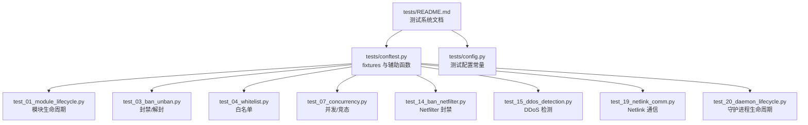

图表来源
- [tests/README.md:1-35](file://tests/README.md#L1-L35)
- [tests/conftest.py:1-28](file://tests/conftest.py#L1-L28)
- [tests/config.py:1-20](file://tests/config.py#L1-L20)

章节来源
- [tests/README.md:1-35](file://tests/README.md#L1-L35)
- [tests/conftest.py:1-28](file://tests/conftest.py#L1-L28)
- [tests/config.py:1-20](file://tests/config.py#L1-L20)

## 核心组件
本节聚焦 pytest 测试框架在该项目中的关键实现点：夹具层次、内核租约卫生、Procfs 封装、守护进程管理、HTTP/指标工具。

- 夹具层次与环境管理
  - session_setup：会话级自动夹具，检查 root 权限、模块文件存在、加载模块；会话结束清理数据并卸载模块。
  - test_isolation：用例级自动夹具，每次测试前重置数据、确保模块就绪；结束后清理状态并释放内核租约。
  - clean_bans：显式夹具，用于需要干净封禁状态的用例。
  - running_daemon / check_daemon / daemon_binary：守护进程相关夹具，按需跳过或返回二进制路径。
  - tmp_config：临时配置目录夹具。

- 内核租约卫生机制
  - 内核对守护进程采用 portid + 活动超时（约 30 秒）的单实例租约模型。
  - mark_daemon_launched()：所有启动守护进程的入口必须调用，以便 teardown 时重载模块释放租约。
  - release_kernel_lease()：若本轮起过守护进程，则重载模块以清空内核侧租约；未起过则为空操作。
  - terminate_process()：SIGTERM → wait → SIGKILL 的优雅停止，避免留下半写状态或未释放租约。

- Procfs 封装
  - wait_procfs()：等待 procfs 同步完成。
  - get_stat(name)：解析 stats 文件中的统计值。
  - count_bans()/count_whitelist()：统计封禁/白名单条目数。
  - ban_ip()/unban_ip()/ban_multiple()/unban_multiple()/ip_is_banned()：封禁/解封与查询。
  - whitelist_add()/whitelist_remove()：白名单增删。

- 守护进程与 HTTP/指标工具
  - is_daemon_running()/get_daemon_pid()：基于精确进程名判断守护进程是否运行。
  - daemon_http_port()：从默认配置读取监听端口。
  - daemon_credentials()：读取 Basic 认证凭据（username/password 同时为空才视为未启用）。
  - run_curl()/http_request()：发起 HTTP 请求，自动注入 Authorization 头，避免密码进入命令行。
  - get_prometheus_metrics()/parse_metric()/wait_for_metric()：Prometheus 指标获取、解析与事件驱动轮询。
  - free_tcp_port()/run_daemon_captured()/daemon_run_probe()：自起守护进程、观察存活、端口分配。

章节来源
- [tests/conftest.py:34-82](file://tests/conftest.py#L34-L82)
- [tests/conftest.py:89-140](file://tests/conftest.py#L89-L140)
- [tests/conftest.py:147-246](file://tests/conftest.py#L147-L246)
- [tests/conftest.py:254-319](file://tests/conftest.py#L254-L319)
- [tests/conftest.py:326-532](file://tests/conftest.py#L326-L532)
- [tests/conftest.py:574-662](file://tests/conftest.py#L574-L662)

## 架构总览
下图展示集成测试中各组件之间的交互关系：pytest 通过 conftest 提供的夹具与辅助函数，驱动内核模块、procfs、守护进程与 HTTP/指标接口，形成从用户态到内核态的闭环验证。

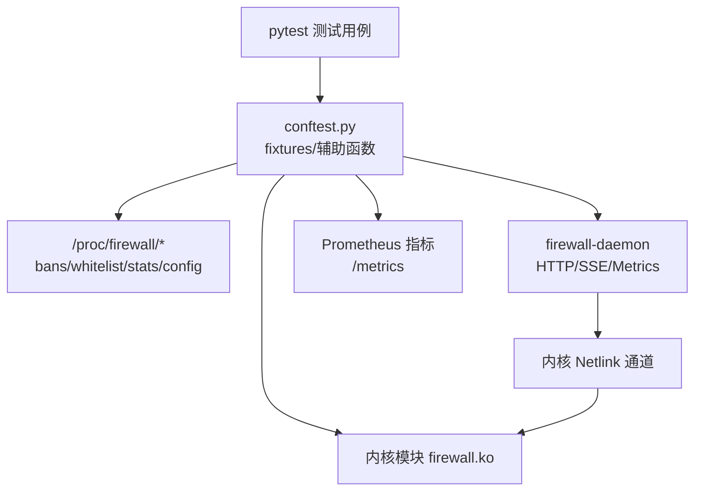

图表来源
- [tests/conftest.py:326-532](file://tests/conftest.py#L326-L532)
- [tests/test_19_netlink_comm.py:25-33](file://tests/test_19_netlink_comm.py#L25-L33)

## 详细组件分析

### 内核模块生命周期测试
目标：验证模块文件存在、可加载、sysfs 参数可读、重复加载被拒绝。

- 关键断言
  - 模块文件存在性
  - 已加载或 procfs 目录存在
  - sysfs 参数 fw_ban_time 可读且非 unknown
  - 重复 insmod 应失败

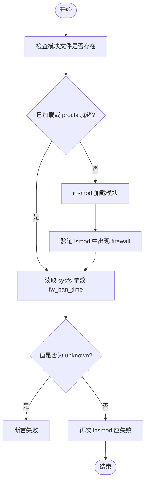

图表来源
- [tests/test_01_module_lifecycle.py:15-38](file://tests/test_01_module_lifecycle.py#L15-L38)
- [tests/conftest.py:34-82](file://tests/conftest.py#L34-L82)

章节来源
- [tests/test_01_module_lifecycle.py:1-39](file://tests/test_01_module_lifecycle.py#L1-L39)

### 封禁/解封流程测试
目标：验证基本封禁/解封、批量封禁、重复封禁去重、循环稳定性、统计计数器不污染、IPv6 行为一致。

- 关键能力
  - 单 IP 封禁/解封
  - 批量封禁/解封
  - 重复封禁只产生一条记录
  - 多次循环后状态稳定
  - total_bans/current_bans 增量正确
  - IPv6 地址同样受去重保护

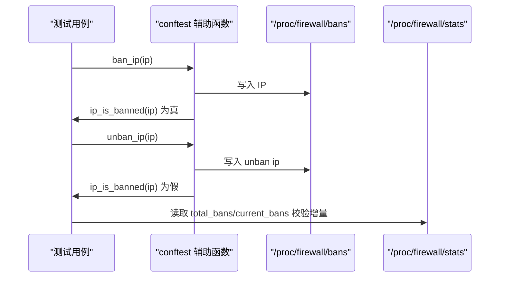

图表来源
- [tests/test_03_ban_unban.py:22-109](file://tests/test_03_ban_unban.py#L22-L109)
- [tests/conftest.py:184-234](file://tests/conftest.py#L184-L234)

章节来源
- [tests/test_03_ban_unban.py:1-109](file://tests/test_03_ban_unban.py#L1-L109)

### 白名单操作测试
目标：验证系统 IP 自动发现、手动添加/移除、白名单保护、特殊 IP 保护、格式校验、容量计数一致性。

- 关键点
  - 白名单计数与成功添加数量一致
  - 白名单内 IP 禁止被封禁，rejects 计数器增加
  - 零地址、广播、组播、回环等特殊 IP 受到保护
  - 非法子网格式会抛出异常

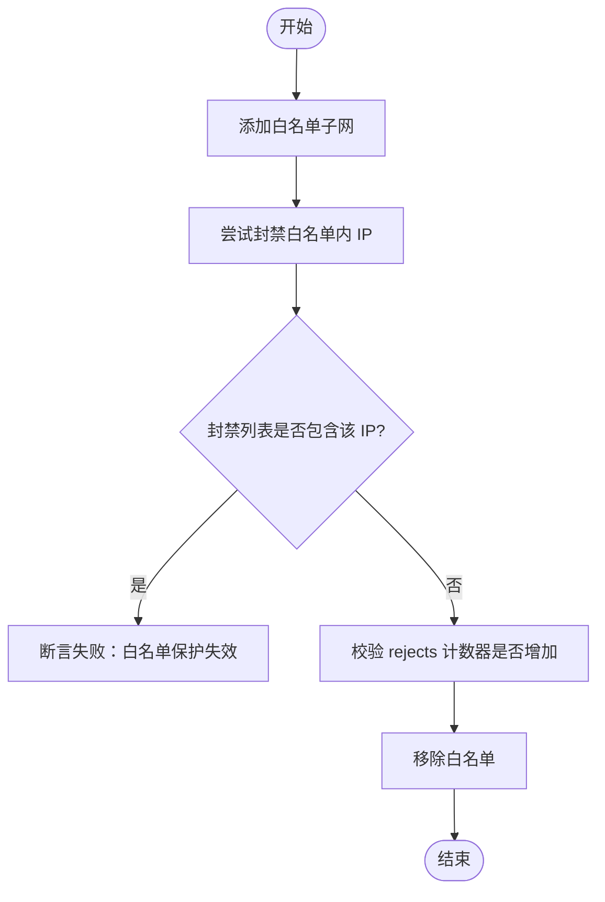

图表来源
- [tests/test_04_whitelist.py:30-133](file://tests/test_04_whitelist.py#L30-L133)
- [tests/conftest.py:237-246](file://tests/conftest.py#L237-L246)

章节来源
- [tests/test_04_whitelist.py:1-133](file://tests/test_04_whitelist.py#L1-L133)

### 并发与竞态条件测试
目标：验证多线程并发封禁、并发封禁+解封、白名单与封禁并发、读写并发下的稳定性。

- 要点
  - 并发写入 bans/whitelist 不应导致死锁或崩溃
  - 并发读/写 procfs 应保持统计信息有效
  - 完成后需统一清理

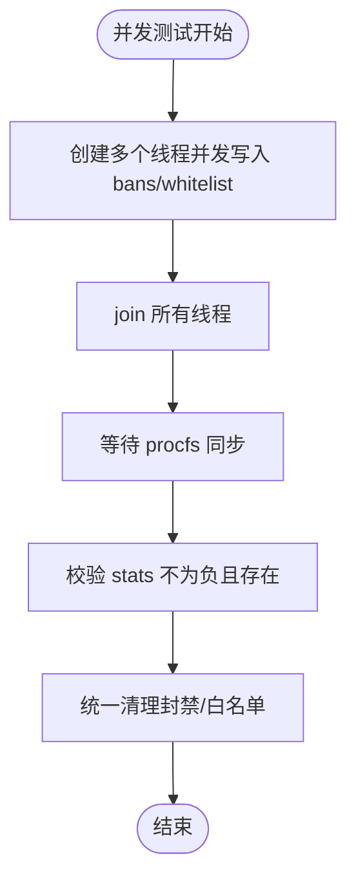

图表来源
- [tests/test_07_concurrency.py:35-135](file://tests/test_07_concurrency.py#L35-L135)
- [tests/conftest.py:147-246](file://tests/conftest.py#L147-L246)

章节来源
- [tests/test_07_concurrency.py:1-135](file://tests/test_07_concurrency.py#L1-L135)

### Netfilter 钩子封禁测试
目标：验证初始包统计字段存在、封禁条目格式、封禁后 current_bans 变化、解封后恢复。

- 关键点
  - packets_dropped/packets_accepted 字段存在且非负
  - 封禁后 bans 文件中出现对应条目
  - current_bans 随封禁/解封合理变化

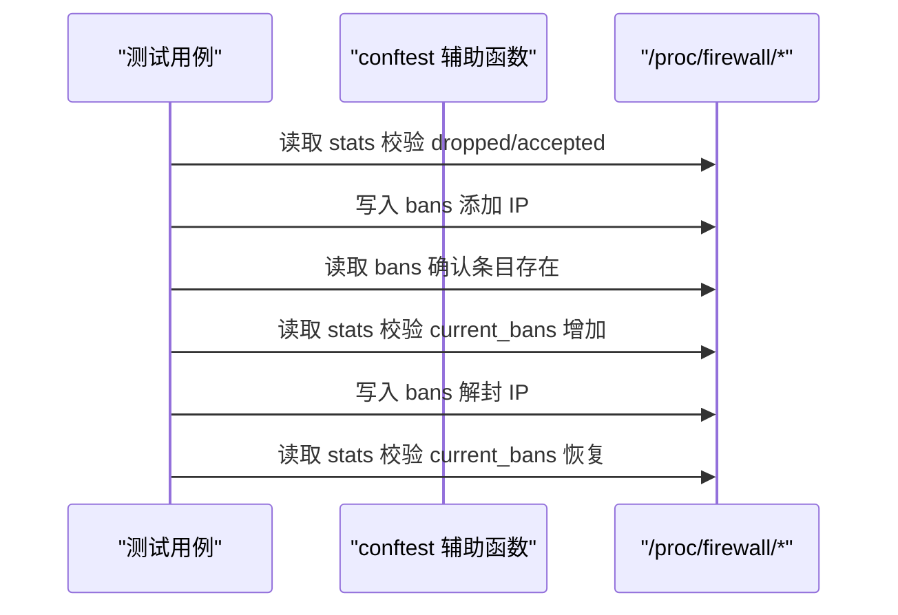

图表来源
- [tests/test_14_ban_netfilter.py:14-54](file://tests/test_14_ban_netfilter.py#L14-L54)
- [tests/conftest.py:152-205](file://tests/conftest.py#L152-L205)

章节来源
- [tests/test_14_ban_netfilter.py:1-54](file://tests/test_14_ban_netfilter.py#L1-L54)

### DDoS 检测验证
目标：验证 DDoS 配置段存在且合法、Prometheus 指标存在、自动封禁指标样本行存在、守护进程日志为 JSON Lines。

- 关键点
  - ddos 配置段解析为非空映射
  - Prometheus 端点可达且包含 firewall_ddos_* 指标
  - firewall_ddos_auto_bans_total 有真实样本行
  - 守护进程日志至少有一条 JSON 记录

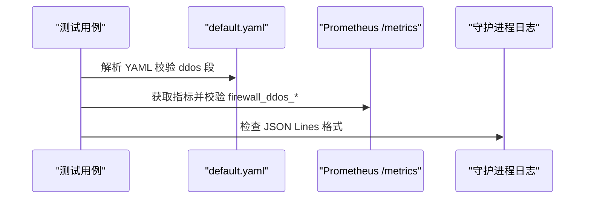

图表来源
- [tests/test_15_ddos_detection.py:21-75](file://tests/test_15_ddos_detection.py#L21-L75)
- [tests/conftest.py:459-470](file://tests/conftest.py#L459-L470)

章节来源
- [tests/test_15_ddos_detection.py:1-75](file://tests/test_15_ddos_detection.py#L1-L75)

### Netlink 通信与健康指标
目标：验证 netlink 健康指标存在且有真实样本行、真实封禁操作触发发送计数自增、错误计数指标存在。

- 关键点
  - 指标集合包括 sent/received/send_errors/recv_errors
  - POST /api/v2/bans 成功后轮询 metrics，确保 firewall_netlink_messages_sent_total 自增
  - 最终 DELETE /api/v2/bans/{ip} 清理

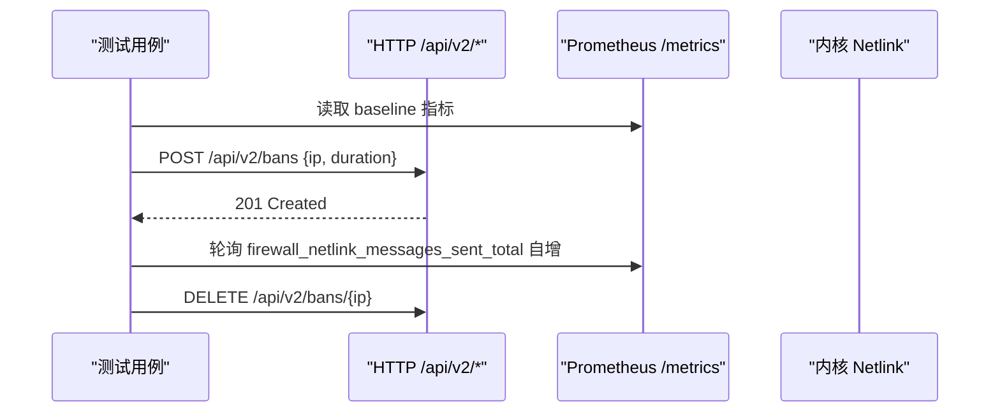

图表来源
- [tests/test_19_netlink_comm.py:66-123](file://tests/test_19_netlink_comm.py#L66-L123)
- [tests/conftest.py:446-502](file://tests/conftest.py#L446-L502)

章节来源
- [tests/test_19_netlink_comm.py:1-123](file://tests/test_19_netlink_comm.py#L1-L123)

### 守护进程生命周期测试
目标：验证守护进程启动与 PID 文件、单实例约束、SIGTERM 优雅退出、崩溃后立即接管。

- 关键点
  - 启动后 PID 文件内容与进程 PID 一致
  - 第二个实例应被拒绝（或根据配置跳过）
  - SIGTERM 后进程退出
  - 模拟 SIGKILL 崩溃后新实例能立即注册（无需等待 30 秒活动超时）

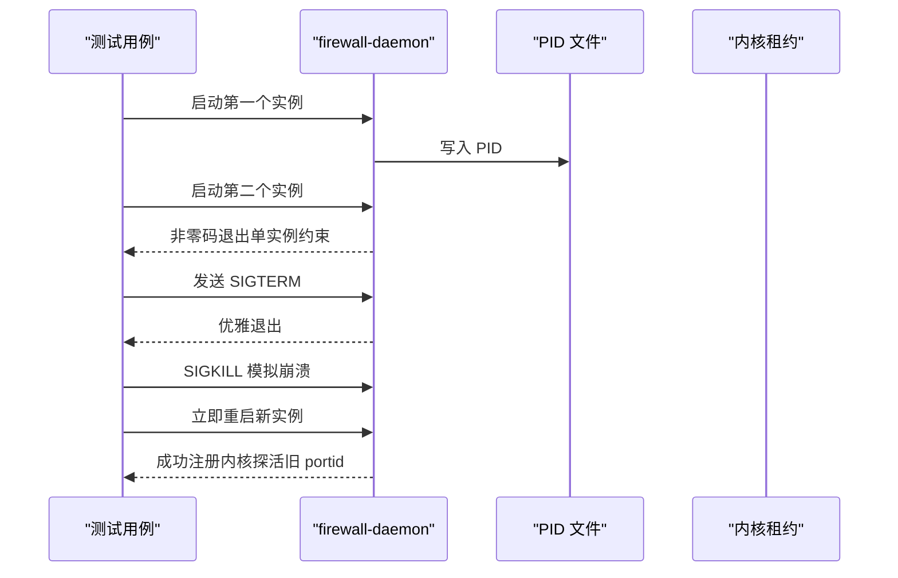

图表来源
- [tests/test_20_daemon_lifecycle.py:89-188](file://tests/test_20_daemon_lifecycle.py#L89-L188)
- [tests/conftest.py:121-140](file://tests/conftest.py#L121-L140)

章节来源
- [tests/test_20_daemon_lifecycle.py:1-188](file://tests/test_20_daemon_lifecycle.py#L1-L188)

## 依赖关系分析
- 测试用例依赖 conftest 提供的夹具与辅助函数，间接依赖 config 中的路径与常量。
- 部分测试依赖外部守护进程（requires_daemon），通过 is_daemon_running 判定并跳过。
- Netlink 与 HTTP 测试依赖 Prometheus 指标端点与 /api/v2 版本化接口。
- 内核模块加载/卸载由 session_setup 与 test_isolation 统一管理，避免状态泄漏。

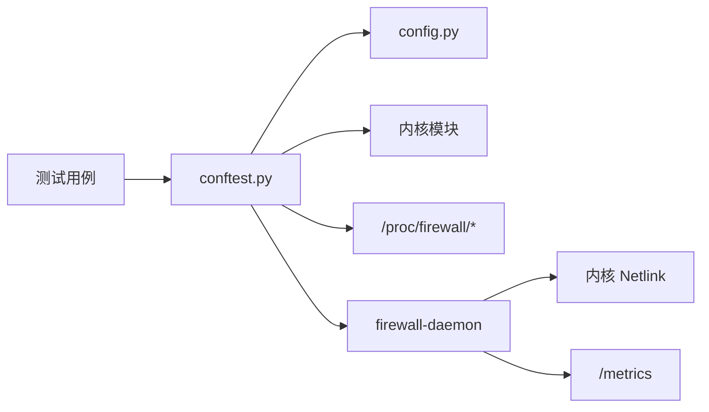

图表来源
- [tests/conftest.py:574-662](file://tests/conftest.py#L574-L662)
- [tests/test_19_netlink_comm.py:25-33](file://tests/test_19_netlink_comm.py#L25-L33)

章节来源
- [tests/conftest.py:574-662](file://tests/conftest.py#L574-L662)
- [tests/test_19_netlink_comm.py:1-123](file://tests/test_19_netlink_comm.py#L1-L123)

## 性能与并发特性
- 并发测试通过多线程并发写入 bans/whitelist，并校验 stats 有效性，确保无死锁与数据不一致。
- 压力与性能测试使用阈值控制（如 BAN_PERF_THRESHOLD_MS），但具体阈值位于 config.py，不同机器可能差异较大。
- 事件驱动等待：wait_for_metric 轮询 Prometheus 指标直到满足条件或超时，避免固定 sleep 导致的偶发失败。

章节来源
- [tests/test_07_concurrency.py:35-135](file://tests/test_07_concurrency.py#L35-L135)
- [tests/config.py:53-61](file://tests/config.py#L53-L61)
- [tests/conftest.py:484-502](file://tests/conftest.py#L484-L502)

## 故障排查指南
- “模块未加载”：确保以 root 运行，build/kernel-module/firewall.ko 存在；session_setup 会自动加载模块。
- “守护进程不存在”：先构建守护进程二进制；running_daemon 夹具会在缺失时跳过测试。
- “性能测试不稳定”：调整 config.py 中的性能阈值；或使用 -m stress/perf 筛选。
- “租约残留导致新 daemon 被拒”：确保所有守护进程启动点调用 mark_daemon_launched()；teardown 会通过 release_kernel_lease 重载模块释放租约。
- “Prometheus 端点不可访问”：检查 default.yaml 的 metrics_port 与认证配置；run_curl/http_request 会自动注入 Authorization 头。

章节来源
- [tests/README.md:153-175](file://tests/README.md#L153-L175)
- [tests/conftest.py:97-118](file://tests/conftest.py#L97-L118)
- [tests/conftest.py:407-456](file://tests/conftest.py#L407-L456)

## 结论
本项目通过 pytest 的夹具分层、内核租约卫生机制、Procfs 封装与守护进程管理，构建了覆盖内核模块、Netfilter 钩子、守护进程通信的完整集成测试体系。借助测试标记、并发处理与事件驱动等待，测试既能覆盖基础功能，也能验证复杂交互与性能边界。建议新增测试时遵循现有编号规则、使用 clean_bans 确保状态隔离，并在涉及守护进程时调用 mark_daemon_launched() 以保证租约卫生。