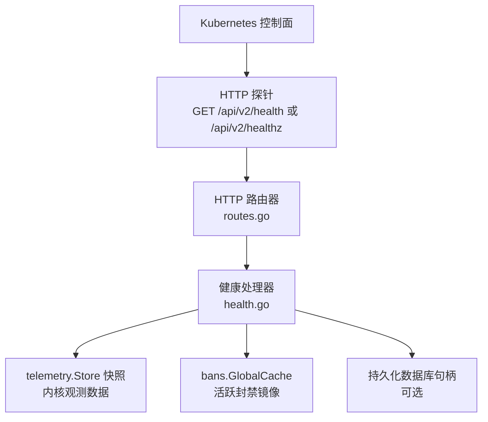
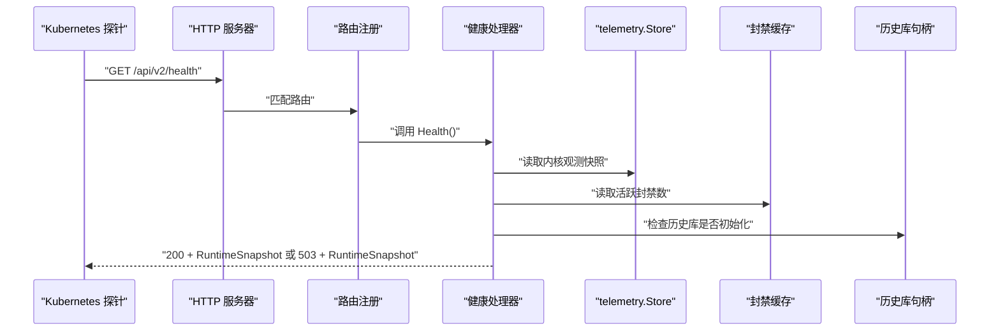
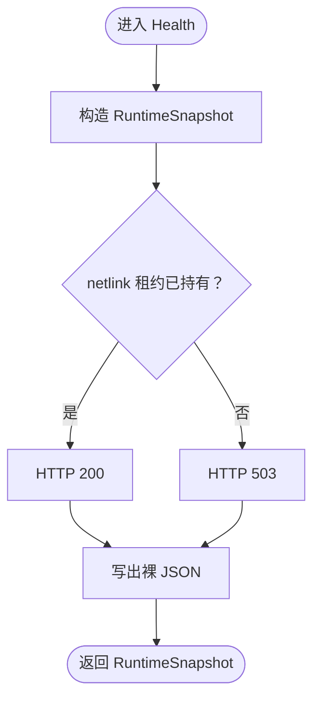
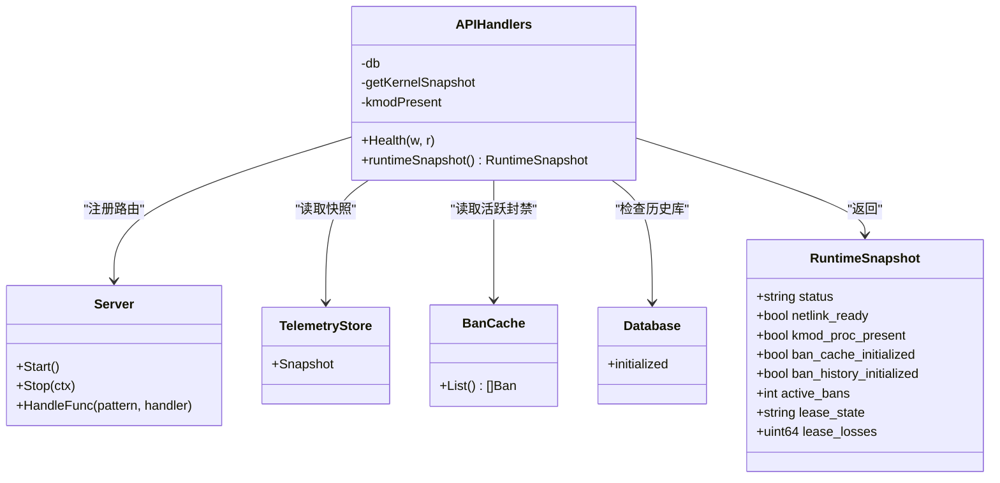
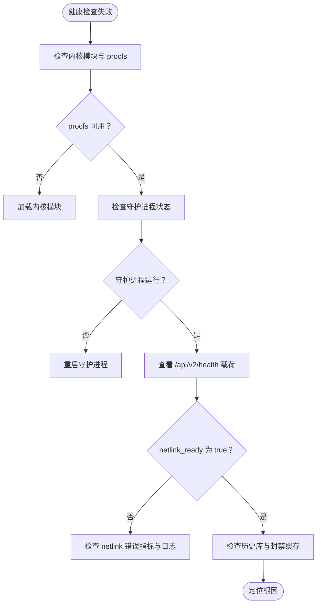

# 健康检查

<cite>
**本文引用的文件**   
- [health.go](file://src/daemon/internal/http/health.go)
- [routes.go](file://src/daemon/internal/http/routes.go)
- [server.go](file://src/daemon/internal/http/server.go)
- [http.fwidl](file://contract/http.fwidl)
- [daemon.md](file://docs/zh/architecture/daemon.md)
- [monitoring.md](file://docs/zh/operations/monitoring.md)
</cite>

## 目录
1. [简介](#简介)
2. [项目结构中的健康检查位置](#项目结构中的健康检查位置)
3. [核心组件](#核心组件)
4. [架构总览](#架构总览)
5. [详细组件分析](#详细组件分析)
6. [依赖关系分析](#依赖关系分析)
7. [性能与可用性特征](#性能与可用性特征)
8. [Kubernetes 探针配置示例](#kubernetes-探针配置示例)
9. [故障诊断流程](#故障诊断流程)
10. [自动恢复与告警建议](#自动恢复与告警建议)
11. [结论](#结论)

## 简介
本文件聚焦守护进程暴露的 HTTP 健康检查机制，重点说明：
- `/api/v2/health` 与 `/api/v2/healthz` 的实现语义。
- 就绪探针（readiness）与存活探针（liveness）的区别、适用场景和配置方法。
- 健康检查项：内核模块状态、netlink 链路租约、procfs 接口存在性、封禁缓存与历史库初始化状态、当前活跃封禁数等。
- Kubernetes 中 `livenessProbe` 与 `readinessProbe` 的 YAML 配置建议。
- 健康检查失败时的自动恢复策略、告警通知思路以及运维排障流程。

需要特别注意：**本项目实现的是“就绪”语义的健康端点，而不是完整的“存活 + 就绪”双探针实现。** 因此文档会明确区分“代码已提供的能力”和“部署侧应补充的能力”。

## 项目结构中的健康检查位置
健康检查相关代码集中在用户态守护进程的 HTTP 层：
- 契约定义：`contract/http.fwidl` 声明 `/api/v2/health` 与 `/api/v2/healthz`。
- 路由注册：`src/daemon/internal/http/routes.go` 把两条路径指向同一个处理器。
- 处理器逻辑：`src/daemon/internal/http/health.go` 构造 `RuntimeSnapshot` 并返回裸 JSON。
- HTTP 服务器：`src/daemon/internal/http/server.go` 提供监听、连接限制、超时与优雅关停。
- 架构与监控文档：`docs/zh/architecture/daemon.md`、`docs/zh/operations/monitoring.md` 对健康端点的用途、数据来源和监控方式做了说明。



**图表来源**
- [routes.go:79-84](file://src/daemon/internal/http/routes.go#L79-L84)
- [health.go:36-48](file://src/daemon/internal/http/health.go#L36-L48)
- [server.go:34-73](file://src/daemon/internal/http/server.go#L34-L73)

**章节来源**
- [http.fwidl:378-394](file://contract/http.fwidl#L378-L394)
- [routes.go:79-84](file://src/daemon/internal/http/routes.go#L79-L84)
- [health.go:1-101](file://src/daemon/internal/http/health.go#L1-L101)
- [daemon.md:236-268](file://docs/zh/architecture/daemon.md#L236-L268)
- [monitoring.md:157-181](file://docs/zh/operations/monitoring.md#L157-L181)

## 核心组件
### 健康载荷结构
健康端点返回的结构体是 `RuntimeSnapshot`，字段包括：
- `status`：`ok` 表示就绪，`degraded` 表示未就绪。
- `netlink_ready`：netlink 链路是否持有有效租约。
- `kmod_proc_present`：内核模块 procfs 接口是否存在。
- `ban_cache_initialized`：封禁缓存是否已创建。
- `ban_history_initialized`：历史库是否可用。
- `active_bans`：当前活跃封禁数量。
- `lease_state`：租约状态字符串。
- `lease_losses`：租约丢失计数。

该结构体的字段名与线上 JSON key 由契约约束，前端与外部探针都应按契约解析。

**章节来源**
- [health.go:15-28](file://src/daemon/internal/http/health.go#L15-L28)
- [http.fwidl:298-304](file://contract/http.fwidl#L298-L304)

### 健康处理器
`APIHandlers.Health` 负责：
1. 调用 `runtimeSnapshot()` 组装快照。
2. 根据 `NetlinkReady` 决定 HTTP 状态码：
   - 就绪：200。
   - 未就绪：503。
3. 直接写出裸 JSON，不经过统一信封。

这是整个项目中**唯一以 HTTP 状态码承载就绪语义的端点**。

**章节来源**
- [health.go:36-48](file://src/daemon/internal/http/health.go#L36-L48)
- [http.fwidl:378-394](file://contract/http.fwidl#L378-L394)

### 运行时快照构造
`runtimeSnapshot()` 从多个权威源聚合运行事实：
- 内核观测快照来自 `telemetry.Snapshot`，由事件泵写入。
- 内核模块存在性通过 `kmodPresent` 函数判断。
- 活跃封禁数来自全局封禁缓存。
- 历史库就绪状态来自 APIHandlers 持有的数据库句柄。

关键判定规则：
- 就绪条件只依赖 netlink 租约是否持有：`LeaseHeld`。
- 其他字段用于排障，不参与就绪判定，避免“降级但仍工作”的进程被误判为死进程。

**章节来源**
- [health.go:50-100](file://src/daemon/internal/http/health.go#L50-L100)

## 架构总览
健康检查的数据流可以概括为：
- Kubernetes 或负载均衡器向 `/api/v2/health` 或 `/api/v2/healthz` 发起 GET 请求。
- HTTP 路由器将两条路径交给同一个 `Health` 处理器。
- 处理器读取 telemetry 快照、内核模块存在性、封禁缓存和历史库状态。
- 如果 netlink 租约已持有，则返回 200；否则返回 503。
- 响应体始终是 `RuntimeSnapshot` 裸 JSON。



**图表来源**
- [routes.go:79-84](file://src/daemon/internal/http/routes.go#L79-L84)
- [health.go:36-100](file://src/daemon/internal/http/health.go#L36-L100)
- [server.go:34-73](file://src/daemon/internal/http/server.go#L34-L73)

## 详细组件分析

### HTTP 健康端点实现
健康端点的关键设计点是：
- 两个路径共享同一个处理器，便于 k8s 和负载均衡器使用。
- 不使用统一信封，因为信封会把业务状态压回 200，使探针无法按 HTTP 状态码判断就绪。
- 契约显式记录这一偏离为“有意保留”，不是缺陷。



**图表来源**
- [health.go:36-48](file://src/daemon/internal/http/health.go#L36-L48)
- [health.go:50-100](file://src/daemon/internal/http/health.go#L50-L100)

**章节来源**
- [health.go:1-101](file://src/daemon/internal/http/health.go#L1-L101)
- [http.fwidl:298-304](file://contract/http.fwidl#L298-L304)
- [http.fwidl:378-394](file://contract/http.fwidl#L378-L394)

### 内核模块状态检测
健康检查包含两类与内核相关的信号：
1. **内核模块 procfs 接口存在性**：通过 `kmodPresent` 判断 `/proc/firewall` 是否可访问。
2. **netlink 链路租约状态**：通过 `telemetry.Snapshot.Link.Lease` 判断守护进程是否与内核建立稳定通信。

两者含义不同：
- `kmod_proc_present` 表示内核模块加载且 procfs 接口存在。
- `netlink_ready` 表示守护进程成功拿到内核租约，能收发 netlink 消息。
- 模块在但租约没拿到，说明指令可能被丢弃。
- 租约在但 procfs 消失，可能表示模块刚被重载。

**章节来源**
- [health.go:65-91](file://src/daemon/internal/http/health.go#L65-L91)
- [daemon.md:120-151](file://docs/zh/architecture/daemon.md#L120-L151)
- [monitoring.md:175-181](file://docs/zh/operations/monitoring.md#L175-L181)

### 数据库连接检查
健康检查中的 `ban_history_initialized` 表示历史库是否可用。它基于 APIHandlers 持有的数据库句柄是否为 nil。

需要注意：
- 健康检查并不主动执行一次“连接测试 SQL”。
- 它更多反映“历史库对象是否成功装配并可读”。
- 如果历史库不可用，部分统计端点会降级，但健康端点仍可按 netlink 租约给出就绪结果。

**章节来源**
- [health.go:92-96](file://src/daemon/internal/http/health.go#L92-L96)
- [routes.go:235-275](file://src/daemon/internal/http/routes.go#L235-L275)
- [daemon.md:289-312](file://docs/zh/architecture/daemon.md#L289-L312)

### 配置文件验证
健康检查本身不直接校验 YAML 配置。配置校验发生在守护进程启动和热重载阶段：
- 配置解析失败时，守护进程可能拒绝启动或保留旧快照。
- 健康端点更关注“运行时是否就绪”，而不是“某次配置是否合法”。

如果需要把“配置合法性”纳入健康检查，应在部署侧增加额外检查步骤，例如：
- 启动前执行配置校验命令。
- 在 readiness 探针之外增加一个自定义健康端点，专门报告配置加载状态。

**章节来源**
- [daemon.md:270-287](file://docs/zh/architecture/daemon.md#L270-L287)

## 依赖关系分析
健康检查依赖以下内部组件：
- HTTP 服务器与路由器。
- telemetry 快照存储。
- 封禁缓存。
- 历史库句柄。
- 内核模块存在性探测。



**图表来源**
- [routes.go:235-301](file://src/daemon/internal/http/routes.go#L235-L301)
- [health.go:15-100](file://src/daemon/internal/http/health.go#L15-L100)
- [server.go:14-82](file://src/daemon/internal/http/server.go#L14-L82)

**章节来源**
- [routes.go:235-301](file://src/daemon/internal/http/routes.go#L235-L301)
- [health.go:15-100](file://src/daemon/internal/http/health.go#L15-L100)
- [server.go:14-82](file://src/daemon/internal/http/server.go#L14-L82)

## 性能与可用性特征
- 健康端点非常轻量：主要读取内存快照和少量布尔标志。
- HTTP 服务器设置了读取头、读取、写入和空闲超时，避免慢客户端拖垮服务。
- 连接数达到上限时，HTTP 层会直接返回 503，这条路径绕过中间件，因此安全头不会覆盖限额提示。
- 健康端点不套信封，有利于 kubelet 和负载均衡器快速按状态码判断。

**章节来源**
- [server.go:34-73](file://src/daemon/internal/http/server.go#L34-L73)
- [server.go:129-149](file://src/daemon/internal/http/server.go#L129-L149)
- [http.fwidl:298-304](file://contract/http.fwidl#L298-L304)

## Kubernetes 探针配置示例

### 概念区别：livenessProbe 与 readinessProbe
- **livenessProbe（存活探针）**：回答“进程是否还活着”。如果失败，kubelet 会重启容器。
- **readinessProbe（就绪探针）**：回答“服务是否准备好接收流量”。如果失败，kubelet 会从 Service 后端摘除 Pod，但不重启容器。

本项目实现的 `/api/v2/health` 与 `/api/v2/healthz` 是**就绪语义**：
- 200 表示内核链路就绪，Pod 可对外提供服务。
- 503 表示未就绪，不应接收业务流量。

### 推荐配置
由于健康端点没有认证要求，可以直接作为 readinessProbe 使用。

#### readinessProbe 示例
```yaml
readinessProbe:
  httpGet:
    path: /api/v2/health
    port: 9119
  initialDelaySeconds: 10
  periodSeconds: 5
  timeoutSeconds: 3
  failureThreshold: 3
  successThreshold: 1
```

#### livenessProbe 示例
对于 livenessProbe，建议使用更保守的判断：
- 优先使用进程级检查，例如 `exec` 检查守护进程主进程是否存在。
- 或者使用一个更简单的 HTTP 端点，只要进程存活就返回 200。
- 不建议直接用 `/api/v2/health` 作为 livenessProbe，因为它可能因内核链路暂时不可用而失败，导致不必要的容器重启。

```yaml
livenessProbe:
  exec:
    command:
      - cat
      - /proc/1/status
  initialDelaySeconds: 15
  periodSeconds: 10
  timeoutSeconds: 3
  failureThreshold: 3
  successThreshold: 1
```

### 为什么不建议把健康端点同时用作 livenessProbe
- 健康端点返回 503 时，表示“未就绪”，可能是内核模块尚未完成租约、procfs 尚未出现、或事件泵尚未采样。
- 这类问题通常不需要重启容器，而是等待内核链路恢复。
- 如果把就绪端点当作存活探针，容易把“暂时不可用”升级为“需要重启”。

**章节来源**
- [health.go:36-48](file://src/daemon/internal/http/health.go#L36-L48)
- [monitoring.md:175-181](file://docs/zh/operations/monitoring.md#L175-L181)

## 故障诊断流程

### 健康检查返回 503 的常见原因
1. **内核模块未加载**：`kmod_proc_present` 为 false。
2. **procfs 接口缺失**：`/proc/firewall` 不存在。
3. **netlink 链路未就绪**：`netlink_ready` 为 false。
4. **事件泵尚未完成首次采样**：租约尚未持有。
5. **历史库未初始化**：`ban_history_initialized` 为 false。
6. **封禁缓存未初始化**：`ban_cache_initialized` 为 false。

### 排查步骤
1. 确认守护进程正在运行。
2. 确认内核模块已加载。
3. 确认 `/proc/firewall/stats` 可读。
4. 查看 `/api/v2/health` 返回的 `RuntimeSnapshot`。
5. 检查 `lease_state` 和 `lease_losses`。
6. 查看守护进程日志，确认 netlink 链路是否报错。
7. 如果是内核链路不稳定，观察 `firewall_netlink_send_errors_total` 与 `firewall_netlink_recv_errors_total`。



**图表来源**
- [health.go:50-100](file://src/daemon/internal/http/health.go#L50-L100)
- [monitoring.md:290-309](file://docs/zh/operations/monitoring.md#L290-L309)

**章节来源**
- [health.go:50-100](file://src/daemon/internal/http/health.go#L50-L100)
- [monitoring.md:175-181](file://docs/zh/operations/monitoring.md#L175-L181)
- [monitoring.md:290-309](file://docs/zh/operations/monitoring.md#L290-L309)

## 自动恢复与告警建议

### 自动恢复策略
- **readinessProbe 失败**：Pod 被摘除，不再接收流量，但容器不重启。适合处理内核链路暂时不可用、模块重载、事件泵冷启动等情况。
- **livenessProbe 失败**：容器被重启。适合处理进程僵死、主 goroutine 退出等真正“进程死亡”的场景。
- **内核模块卸载或重载**：通常更适合让 readiness 失败，而不是触发 liveness 重启。
- **历史库不可用**：部分统计功能降级，但健康端点仍可基于 netlink 租约给出就绪结果。

### 告警通知建议
Prometheus 告警可从两个层面入手：
1. **进程级告警**：`up{job="firewall"} == 0`，表示 Prometheus 抓取不到守护进程。
2. **就绪级告警**：基于 `/api/v2/health` 的状态码或业务指标。

仓库提供的监控文档给出了基础告警模板，包括：
- 高封禁速率。
- 内核拒绝下发指令。
- netlink 链路错误。
- 守护进程不在运行。

```yaml
groups:
  - name: firewall
    rules:
      - alert: DaemonDown
        expr: up{job="firewall"} == 0
        for: 1m
        labels:
          severity: critical
        annotations:
          summary: "firewall-daemon 未在运行"
```

**章节来源**
- [monitoring.md:233-276](file://docs/zh/operations/monitoring.md#L233-L276)

## 结论
- 本项目实现了基于 HTTP 的就绪健康检查端点 `/api/v2/health` 与 `/api/v2/healthz`。
- 健康端点以 HTTP 状态码表达就绪语义：200 表示就绪，503 表示未就绪。
- 就绪判定主要依赖 netlink 租约是否持有，其他字段用于排障。
- 健康检查包含内核模块存在性、procfs 接口、封禁缓存、历史库初始化和活跃封禁数等信息。
- 健康端点不适合直接作为 livenessProbe；livenessProbe 应使用更保守的进程级检查。
- 运维上应结合 Prometheus 指标、守护进程日志和健康端点载荷进行综合诊断。
- 自动恢复策略应以 readiness 摘流为主，liveness 重启为辅，避免把“暂时不可用”误判为“进程死亡”。