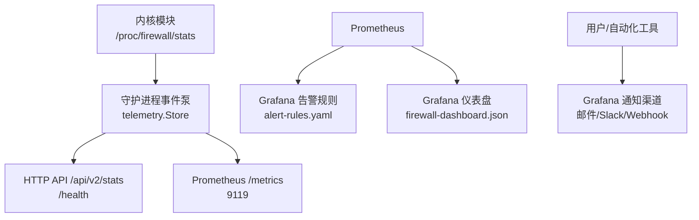
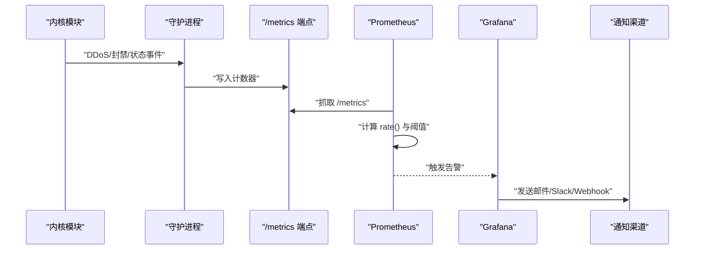
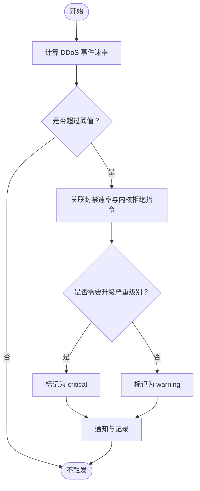
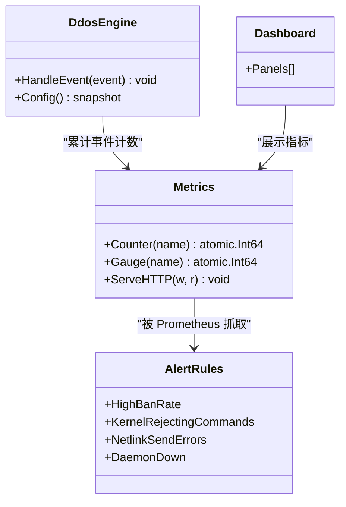

# 告警规则

<cite>
**本文引用的文件**   
- [grafana/alert-rules.yaml](file://grafana/alert-rules.yaml)
- [grafana/firewall-dashboard.json](file://grafana/firewall-dashboard.json)
- [docs/zh/operations/monitoring.md](file://docs/zh/operations/monitoring.md)
- [src/daemon/internal/http/metrics.go](file://src/daemon/internal/http/metrics.go)
- [src/daemon/cmd/firewall-daemon/main.go](file://src/daemon/cmd/firewall-daemon/main.go)
- [src/daemon/internal/config/parser.go](file://src/daemon/internal/config/parser.go)
- [src/daemon/internal/config/kernel_view.go](file://src/daemon/internal/config/kernel_view.go)
- [src/daemon/internal/decision/ddos.go](file://src/daemon/internal/decision/ddos.go)
</cite>

## 目录
1. [引言](#引言)
2. [项目结构](#项目结构)
3. [核心组件](#核心组件)
4. [架构总览](#架构总览)
5. [详细组件分析](#详细组件分析)
6. [依赖关系分析](#依赖关系分析)
7. [性能与阈值调优](#性能与阈值调优)
8. [故障排查指南](#故障排查指南)
9. [结论](#结论)
10. [附录：PromQL 与 Grafana 配置要点](#附录promql-与-grafana-配置要点)

## 引言
本指南面向需要为防火墙系统建立 Prometheus/Grafana 告警能力的运维与平台工程师。文档基于仓库内已实现的守护进程指标、内核侧统计、以及 Grafana 资源，给出告警规则定义语法、阈值设置方法、评估周期与抑制策略，并覆盖防火墙典型场景：DDoS 攻击检测、封禁率异常、系统资源耗尽等。同时提供 Grafana 通知渠道（邮件、Slack、Webhook）的配置思路，以及告警降噪、分级响应、自动化处置的高级管理策略。

## 项目结构
本项目在监控与告警方面主要涉及以下位置：
- Grafana 告警规则与仪表盘：`grafana/alert-rules.yaml`、`grafana/firewall-dashboard.json`
- 守护进程指标导出与说明：`src/daemon/internal/http/metrics.go`、`docs/zh/operations/monitoring.md`
- DDoS 决策引擎与配置映射：`src/daemon/internal/decision/ddos.go`、`src/daemon/internal/config/parser.go`、`src/daemon/internal/config/kernel_view.go`
- 守护进程启动与指标注册点：`src/daemon/cmd/firewall-daemon/main.go`

图表来源
- [docs/zh/operations/monitoring.md:14-28](file://docs/zh/operations/monitoring.md#L14-L28)
- [docs/zh/operations/monitoring.md:33-79](file://docs/zh/operations/monitoring.md#L33-L79)
- [grafana/alert-rules.yaml:1-41](file://grafana/alert-rules.yaml#L1-L41)
- [grafana/firewall-dashboard.json:1-176](file://grafana/firewall-dashboard.json#L1-L176)

章节来源
- [docs/zh/operations/monitoring.md:1-357](file://docs/zh/operations/monitoring.md#L1-L357)
- [grafana/alert-rules.yaml:1-41](file://grafana/alert-rules.yaml#L1-L41)
- [grafana/firewall-dashboard.json:1-176](file://grafana/firewall-dashboard.json#L1-L176)

## 核心组件
- 守护进程指标导出器：以 `/metrics` 暴露 Prometheus 文本格式计数器，包括日志解析、正则命中、封禁触发、DDoS 事件、netlink 收发与错误、内核指令拒绝、配置重载等。
- Grafana 告警规则：定义了封禁速率过高、内核拒绝指令、netlink 发送失败、守护进程未运行等规则。
- 仪表盘：展示日志解析、封禁与 DDoS、netlink 链路健康、运维相关计数。
- DDoS 决策引擎：接收内核推送的 DDoS 事件并累计计数，供监控与告警使用。
- 配置模型：将 YAML 中的 DDoS 参数映射到内核侧行为，影响封禁时长、速率窗口、协议上限等。

章节来源
- [src/daemon/internal/http/metrics.go:11-92](file://src/daemon/internal/http/metrics.go#L11-L92)
- [grafana/alert-rules.yaml:1-41](file://grafana/alert-rules.yaml#L1-L41)
- [grafana/firewall-dashboard.json:1-176](file://grafana/firewall-dashboard.json#L1-L176)
- [src/daemon/internal/decision/ddos.go:31-117](file://src/daemon/internal/decision/ddos.go#L31-L117)
- [src/daemon/internal/config/parser.go:19-119](file://src/daemon/internal/config/parser.go#L19-L119)
- [src/daemon/internal/config/kernel_view.go:15-69](file://src/daemon/internal/config/kernel_view.go#L15-L69)

## 架构总览
下图展示了从内核到 Prometheus、再到 Grafana 告警与通知的整体数据流。

图表来源
- [docs/zh/operations/monitoring.md:33-79](file://docs/zh/operations/monitoring.md#L33-L79)
- [grafana/alert-rules.yaml:1-41](file://grafana/alert-rules.yaml#L1-L41)

## 详细组件分析

### Prometheus 告警规则定义语法与本项目示例
- 分组与规则：通过 `groups` 与 `rules` 组织；每个规则包含 `alert`、`expr`、`for`、`labels.severity`、`annotations.summary/description`。
- 表达式：使用 PromQL，如 `rate(...[5m]) > 阈值` 或 `up{job="..."} == 0`。
- 评估周期：`for` 字段用于持续满足条件后才触发，避免瞬时抖动。
- 标签与注解：用 `severity` 区分级别，用 `summary`/`description` 描述现象与原因。

本项目中已有规则：
- 封禁速率过高：`rate(firewall_bans_triggered_total[5m]) > 10`，持续 2 分钟，级别 warning。
- 内核拒绝指令：`rate(firewall_kernel_commands_rejected_total[5m]) > 0`，持续 5 分钟，级别 warning。
- netlink 发送失败：`rate(firewall_netlink_send_errors_total[5m]) > 0`，持续 5 分钟，级别 warning。
- 守护进程未运行：`up{job="firewall"} == 0`，持续 1 分钟，级别 critical。

章节来源
- [grafana/alert-rules.yaml:1-41](file://grafana/alert-rules.yaml#L1-L41)
- [docs/zh/operations/monitoring.md:233-289](file://docs/zh/operations/monitoring.md#L233-L289)

### 指标清单与采集方式
- 守护进程计数器：由 `/metrics` 暴露，类型均为 counter，按名字排序输出。
- 关键指标：
  - 日志解析：`firewall_lines_parsed_total`、`firewall_lines_skipped_total`、`firewall_regex_matches_total`、`firewall_inotify_events_total`、`firewall_log_rotations_total`
  - 封禁与威胁：`firewall_bans_triggered_total`、`firewall_ddos_events_total`
  - 内核链路：`firewall_kernel_commands_rejected_total`、`firewall_netlink_messages_sent_total`、`firewall_netlink_messages_received_total`、`firewall_netlink_send_errors_total`、`firewall_netlink_recv_errors_total`
  - 运维：`firewall_daemon_config_reloads_total`
- 采集端口：默认 9119，需 Basic Auth。

章节来源
- [docs/zh/operations/monitoring.md:33-79](file://docs/zh/operations/monitoring.md#L33-L79)
- [src/daemon/internal/http/metrics.go:60-92](file://src/daemon/internal/http/metrics.go#L60-L92)

### 针对防火墙系统的特定告警场景

#### DDoS 攻击检测
- 指标：`firewall_ddos_events_total`
- 建议规则：
  - 高 DDoS 事件速率：`rate(firewall_ddos_events_total[5m]) > X`，持续 Y 分钟，级别 warning/critical。
  - 结合封禁速率：当 DDoS 事件与封禁速率同时上升时提升严重级别。
- 关联配置：
  - DDoS 决策引擎会累计内核推送的事件，并通过 API 与仪表盘暴露。
  - 配置项包括检查间隔、全局连接速率、各协议上限、自动封禁时长等。

图表来源
- [grafana/firewall-dashboard.json:84-109](file://grafana/firewall-dashboard.json#L84-L109)
- [src/daemon/internal/decision/ddos.go:31-117](file://src/daemon/internal/decision/ddos.go#L31-L117)
- [src/daemon/internal/config/parser.go:82-119](file://src/daemon/internal/config/parser.go#L82-L119)
- [src/daemon/internal/config/kernel_view.go:15-69](file://src/daemon/internal/config/kernel_view.go#L15-L69)

章节来源
- [grafana/firewall-dashboard.json:84-109](file://grafana/firewall-dashboard.json#L84-L109)
- [src/daemon/internal/decision/ddos.go:31-117](file://src/daemon/internal/decision/ddos.go#L31-L117)
- [src/daemon/internal/config/parser.go:82-119](file://src/daemon/internal/config/parser.go#L82-L119)
- [src/daemon/internal/config/kernel_view.go:15-69](file://src/daemon/internal/config/kernel_view.go#L15-L69)

#### 封禁率异常
- 指标：`firewall_bans_triggered_total`
- 建议规则：
  - 封禁速率过高：`rate(firewall_bans_triggered_total[5m]) > 10`，持续 2 分钟，级别 warning。
  - 封禁表满或白名单拒绝增长：结合内核侧 `ban_table_full_rejects`、`whitelist_rejects`（需自行采集 procfs）。
- 关联面板：仪表盘“封禁触发速率”可辅助观察趋势。

章节来源
- [grafana/alert-rules.yaml:5-13](file://grafana/alert-rules.yaml#L5-L13)
- [grafana/firewall-dashboard.json:84-109](file://grafana/firewall-dashboard.json#L84-L109)
- [docs/zh/operations/monitoring.md:111-155](file://docs/zh/operations/monitoring.md#L111-L155)

#### 系统资源耗尽
- 指标与信号：
  - 内核分配失败：`alloc_failures`（procfs）
  - 丢包突增：`packets_dropped`、`tcp_anomaly_dropped`（procfs）
  - 速率表溢出：`rates` 表头的 `rate_slot_spill`（procfs）
  - 守护进程崩溃：`up{job="firewall"} == 0`
- 建议规则：
  - 分配失败持续增长：级别 critical。
  - 丢包突增且伴随 TCP 标志异常丢弃：级别 critical。
  - 速率表溢出非零：级别 warning，提示活跃源超上限。
  - 守护进程未运行：级别 critical。

章节来源
- [docs/zh/operations/monitoring.md:111-155](file://docs/zh/operations/monitoring.md#L111-L155)
- [grafana/alert-rules.yaml:32-41](file://grafana/alert-rules.yaml#L32-L41)

### Grafana 告警通道配置方法
- 邮件通道：
  - 在 Grafana 配置中启用 SMTP，设置发件人、认证信息、收件人列表。
  - 在告警规则中引用该通道，或通过 Contact Points 绑定。
- Slack 通道：
  - 创建 Slack Incoming Webhook，填入 Grafana 的 Slack 集成配置。
  - 在 Contact Points 中配置频道与消息模板。
- Webhook 通道：
  - 配置自定义 Webhook URL，支持 JSON payload。
  - 可在后端服务实现自动化处置逻辑（如调用封禁 API、扩容、降级）。

注意：具体配置步骤取决于部署环境（Helm、容器编排、本地安装），但核心概念一致：在 Grafana 中定义 Contact Points 与 Notification Policies，将告警路由到对应渠道。

章节来源
- [grafana/alert-rules.yaml:1-41](file://grafana/alert-rules.yaml#L1-L41)

### 告警降噪、分级响应、自动化处置
- 降噪策略：
  - 使用 `for` 字段避免瞬时抖动。
  - 对同一指标设置不同阈值与持续时间，形成多级告警。
  - 使用标签过滤（如按 job、实例、jail）减少重复告警。
- 分级响应：
  - warning：关注趋势，必要时人工介入。
  - critical：立即通知值班人员，并触发自动化处置。
- 自动化处置：
  - 通过 Webhook 调用防火墙 API（如封禁/解封、调整阈值、切换策略）。
  - 结合 CI/CD 与变更管理，确保处置动作可审计、可回滚。

章节来源
- [grafana/alert-rules.yaml:1-41](file://grafana/alert-rules.yaml#L1-L41)

## 依赖关系分析
- 守护进程指标导出器依赖原子计数器与 HTTP 处理器，按名字排序输出。
- 告警规则依赖 Prometheus 抓取的指标名与时间窗口。
- DDoS 决策引擎依赖内核事件与配置快照。
- 仪表盘依赖相同的指标名，确保可视化与告警一致性。

图表来源
- [src/daemon/internal/http/metrics.go:11-92](file://src/daemon/internal/http/metrics.go#L11-L92)
- [grafana/alert-rules.yaml:1-41](file://grafana/alert-rules.yaml#L1-L41)
- [grafana/firewall-dashboard.json:1-176](file://grafana/firewall-dashboard.json#L1-L176)
- [src/daemon/internal/decision/ddos.go:31-117](file://src/daemon/internal/decision/ddos.go#L31-L117)

章节来源
- [src/daemon/internal/http/metrics.go:11-92](file://src/daemon/internal/http/metrics.go#L11-L92)
- [grafana/alert-rules.yaml:1-41](file://grafana/alert-rules.yaml#L1-L41)
- [grafana/firewall-dashboard.json:1-176](file://grafana/firewall-dashboard.json#L1-L176)
- [src/daemon/internal/decision/ddos.go:31-117](file://src/daemon/internal/decision/ddos.go#L31-L117)

## 性能与阈值调优
- 时间窗口：建议使用 `rate(...[5m])`，平衡延迟与稳定性。
- 阈值起点：参考仓库示例值，再根据业务流量规模调整。
- 持续时长：短突发用较短 `for`，长趋势用较长 `for`。
- 指标一致性：仪表盘与告警规则使用的指标名必须一致，避免静默失效。

章节来源
- [docs/zh/operations/monitoring.md:233-289](file://docs/zh/operations/monitoring.md#L233-L289)
- [grafana/firewall-dashboard.json:1-176](file://grafana/firewall-dashboard.json#L1-L176)

## 故障排查指南
- 守护进程未运行：检查 `up{job="firewall"} == 0` 与 `/health` 返回码。
- 内核链路不稳：查看四个 netlink 计数器与 `/health` 的链路字段。
- 封禁下发不生效：检查 `firewall_kernel_commands_rejected_total` 是否非零，并结合 dmesg。
- 速率表溢出：查看 `rates` 表头的 `rate_slot_spill`，非零表示活跃源超上限。
- 封禁表满：检查 `ban_table_full_rejects` 是否增长。
- 白名单挡下发：检查 `whitelist_rejects` 是否增长。
- 丢包突增：分别看 `packets_dropped` 与 `tcp_anomaly_dropped`。
- 日志解析跟不上：检查 `firewall_lines_skipped_total` 是否持续增长。

章节来源
- [docs/zh/operations/monitoring.md:338-350](file://docs/zh/operations/monitoring.md#L338-L350)

## 结论
本指南基于仓库内已实现的守护进程指标与 Grafana 资源，提供了 Prometheus 告警规则的定义语法、阈值设置、评估周期与抑制策略，并覆盖了 DDoS 检测、封禁率异常、系统资源耗尽等防火墙典型场景。同时给出了 Grafana 通知渠道的配置思路与高级告警管理策略。实际部署时，请根据业务流量与风险偏好调整阈值与持续时间，并确保仪表盘与告警规则的指标名保持一致。

## 附录：PromQL 与 Grafana 配置要点
- 常用 PromQL：
  - 日志解析速率：`rate(firewall_lines_parsed_total[5m])`
  - 正则命中率：`rate(firewall_regex_matches_total[5m]) / rate(firewall_lines_parsed_total[5m])`
  - 封禁速率：`rate(firewall_bans_triggered_total[5m])`
  - 内核拒绝指令速率：`rate(firewall_kernel_commands_rejected_total[5m])`
  - DDoS 事件速率：`rate(firewall_ddos_events_total[5m])`
  - 配置重载速率：`rate(firewall_daemon_config_reloads_total[5m])`
  - netlink 发送错误速率：`rate(firewall_netlink_send_errors_total[5m])`
  - 收/发失衡：`rate(firewall_netlink_messages_received_total[5m]) - rate(firewall_netlink_messages_sent_total[5m])`
- Grafana 配置要点：
  - 导入 `grafana/alert-rules.yaml` 与 `grafana/firewall-dashboard.json` 作为起点。
  - 在 Contact Points 中配置邮件、Slack、Webhook。
  - 在 Notification Policies 中将告警路由到对应渠道，并按 severity 分级处理。

章节来源
- [docs/zh/operations/monitoring.md:81-109](file://docs/zh/operations/monitoring.md#L81-L109)
- [docs/zh/operations/monitoring.md:278-289](file://docs/zh/operations/monitoring.md#L278-L289)