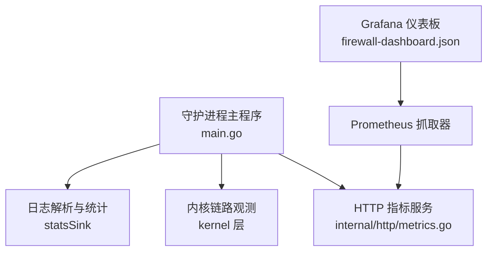
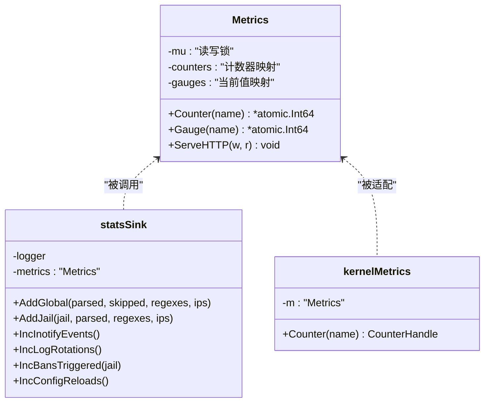
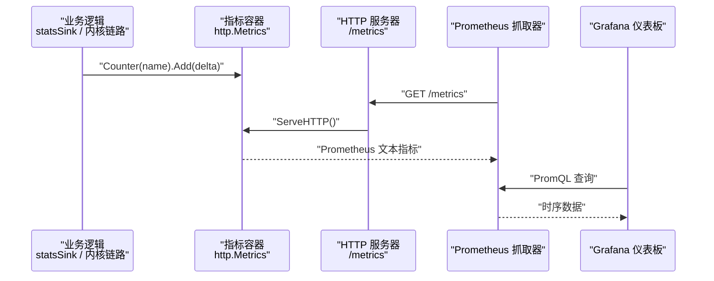
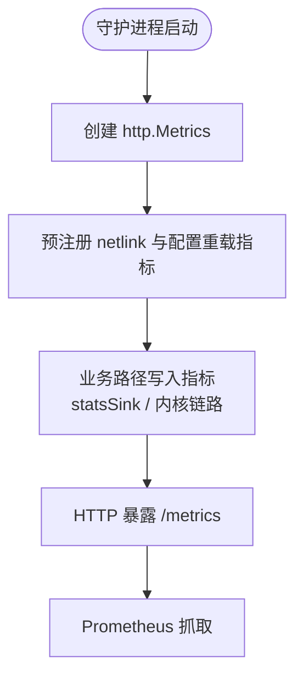
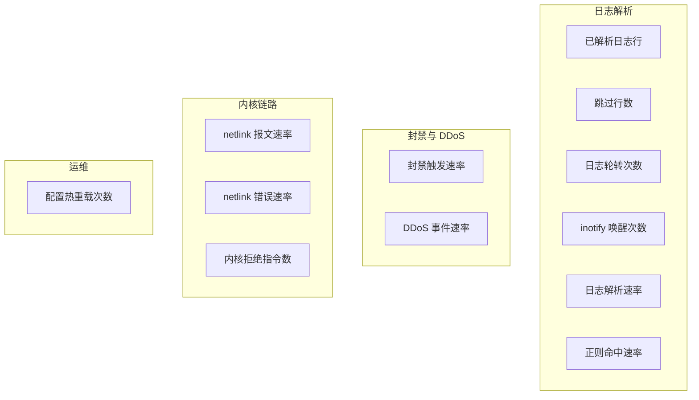
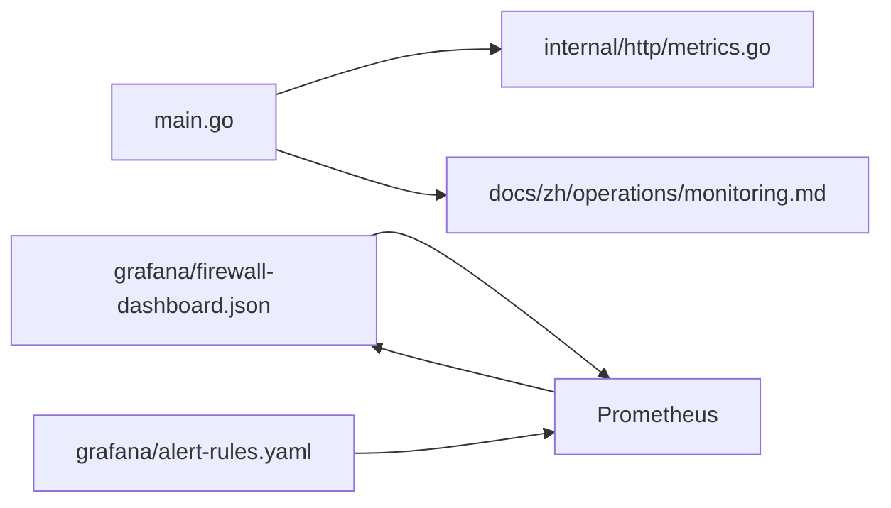
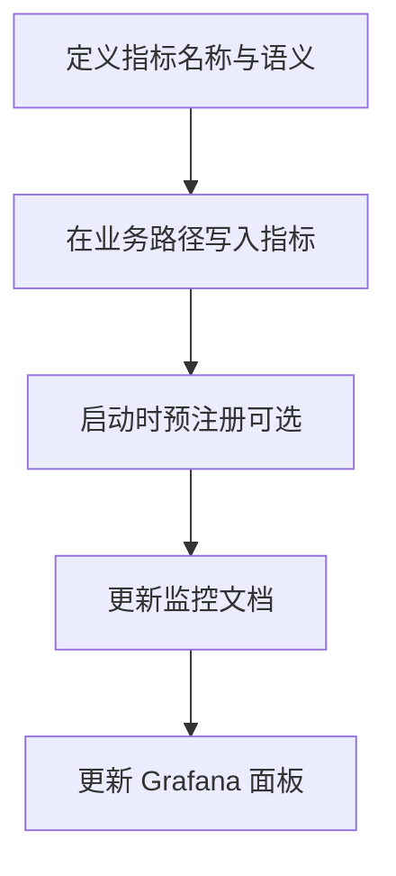

# 指标监控

<cite>
**本文引用的文件**   
- [firewall-dashboard.json](file://grafana/firewall-dashboard.json)
- [monitoring.md](file://docs/zh/operations/monitoring.md)
- [metrics.go](file://src/daemon/internal/http/metrics.go)
- [main.go](file://src/daemon/cmd/firewall-daemon/main.go)
- [alert-rules.yaml](file://grafana/alert-rules.yaml)
</cite>

## 目录
1. [简介](#简介)
2. [项目结构](#项目结构)
3. [核心组件](#核心组件)
4. [架构总览](#架构总览)
5. [详细组件分析](#详细组件分析)
6. [依赖关系分析](#依赖关系分析)
7. [性能与资源监控](#性能与资源监控)
8. [Grafana 仪表板配置](#grafana-仪表板配置)
9. [自定义指标扩展指南](#自定义指标扩展指南)
10. [故障排查](#故障排查)
11. [结论](#结论)

## 简介
本文面向 Prometheus 与 Grafana 使用者，系统化说明 Linux Firewall Kernel Module 守护进程的指标监控体系。重点包括：
- Prometheus 指标收集机制与 `/metrics` 暴露方式
- 核心指标 `firewall_lines_parsed_total`、`firewall_bans_triggered_total` 等采集点与含义
- Grafana 防火墙守护进程仪表板的结构与数据源配置
- 如何扩展监控能力，添加自定义指标
- 性能指标、资源使用、网络流量等关键场景的监控方法

## 项目结构
与指标监控直接相关的代码与配置分布在以下位置：
- 守护进程主入口与指标装配：`src/daemon/cmd/firewall-daemon/main.go`
- Prometheus 指标存储与 HTTP 暴露：`src/daemon/internal/http/metrics.go`
- 监控文档与指标清单：`docs/zh/operations/monitoring.md`
- Grafana 仪表板定义：`grafana/firewall-dashboard.json`
- Grafana 告警规则示例：`grafana/alert-rules.yaml`

**图表来源**
- [main.go:128-140](file://src/daemon/cmd/firewall-daemon/main.go#L128-L140)
- [metrics.go:11-91](file://src/daemon/internal/http/metrics.go#L11-L91)
- [monitoring.md:33-79](file://docs/zh/operations/monitoring.md#L33-L79)

**章节来源**
- [main.go:128-140](file://src/daemon/cmd/firewall-daemon/main.go#L128-L140)
- [metrics.go:11-91](file://src/daemon/internal/http/metrics.go#L11-L91)
- [monitoring.md:33-79](file://docs/zh/operations/monitoring.md#L33-L79)

## 核心组件
本项目的指标系统由三个关键部分组成：
1. 指标容器：`http.Metrics`，负责计数器与当前值容器的创建、并发安全访问与 Prometheus 文本格式输出。
2. 指标注册与计数点：守护进程启动时预注册部分 netlink 与配置重载指标；业务路径通过 `statsSink` 与内核链路适配器写入指标。
3. 指标暴露端点：`/metrics` 以 Prometheus 标准文本协议输出所有已注册指标。

**图表来源**
- [metrics.go:11-91](file://src/daemon/internal/http/metrics.go#L11-L91)
- [main.go:807-916](file://src/daemon/cmd/firewall-daemon/main.go#L807-L916)

**章节来源**
- [metrics.go:11-91](file://src/daemon/internal/http/metrics.go#L11-L91)
- [main.go:807-916](file://src/daemon/cmd/firewall-daemon/main.go#L807-L916)

## 架构总览
指标从业务逻辑与内核链路汇聚到 `http.Metrics`，再由 HTTP 服务器暴露 `/metrics`。Prometheus 按配置抓取该端点，Grafana 基于 Prometheus 查询语言展示面板。

**图表来源**
- [main.go:128-140](file://src/daemon/cmd/firewall-daemon/main.go#L128-L140)
- [metrics.go:60-91](file://src/daemon/internal/http/metrics.go#L60-L91)
- [monitoring.md:33-79](file://docs/zh/operations/monitoring.md#L33-L79)

**章节来源**
- [main.go:128-140](file://src/daemon/cmd/firewall-daemon/main.go#L128-L140)
- [metrics.go:60-91](file://src/daemon/internal/http/metrics.go#L60-L91)
- [monitoring.md:33-79](file://docs/zh/operations/monitoring.md#L33-L79)

## 详细组件分析

### Prometheus 指标收集机制
守护进程在启动阶段创建 `http.Metrics`，并预注册一组计数器，确保即使某些子系统未就绪，`/metrics` 也能稳定返回 0 值样本行。随后，日志解析、封禁触发、netlink 通信、配置重载等路径通过 `statsSink` 或内核链路适配器写入指标。

关键点：
- 预注册指标：四个 netlink 指标与配置重载指标在启动时注册，避免首次自增前缺失样本。
- 指标类型：当前实现为 counter 与 gauge 两类，默认主要使用 counter。
- 暴露协议：`/metrics` 输出 Prometheus 标准文本格式，包含 HELP、TYPE 与样本行。

**图表来源**
- [main.go:128-140](file://src/daemon/cmd/firewall-daemon/main.go#L128-L140)
- [metrics.go:60-91](file://src/daemon/internal/http/metrics.go#L60-L91)

**章节来源**
- [main.go:128-140](file://src/daemon/cmd/firewall-daemon/main.go#L128-L140)
- [metrics.go:60-91](file://src/daemon/internal/http/metrics.go#L60-L91)
- [monitoring.md:33-79](file://docs/zh/operations/monitoring.md#L33-L79)

### 核心指标说明
以下是文档中明确列出的核心指标及其含义与计数点：

| 指标 | 类型 | 含义 | 计数点 |
|------|------|------|--------|
| `firewall_lines_parsed_total` | counter | 已解析的日志行数 | `statsSink.AddGlobal` / `AddJail` |
| `firewall_lines_skipped_total` | counter | 跳过的行数 | `statsSink.AddGlobal` |
| `firewall_regex_matches_total` | counter | 正则命中次数 | `statsSink.AddGlobal` / `AddJail` |
| `firewall_inotify_events_total` | counter | inotify 唤醒次数 | `statsSink.IncInotifyEvents` |
| `firewall_log_rotations_total` | counter | 轮转检测次数 | `statsSink.IncLogRotations` |
| `firewall_bans_triggered_total` | counter | 实际发起的封禁数 | `statsSink.IncBansTriggered` |
| `firewall_daemon_config_reloads_total` | counter | 配置重载成功次数 | `statsSink.IncConfigReloads` |
| `firewall_ddos_events_total` | counter | 内核推来的 DDoS 事件数 | 内核消费者 |
| `firewall_kernel_commands_rejected_total` | counter | 内核拒绝指令数 | 内核消费者 |
| `firewall_netlink_messages_sent_total` | counter | netlink 发送成功次数 | 内核传输层 |
| `firewall_netlink_messages_received_total` | counter | netlink 接收成功次数 | 内核传输层 |
| `firewall_netlink_send_errors_total` | counter | netlink 发送错误次数 | 内核传输层 |
| `firewall_netlink_recv_errors_total` | counter | netlink 接收错误次数 | 内核传输层 |

这些指标的权威清单与计数点位于监控文档与守护进程源码中。

**章节来源**
- [monitoring.md:53-79](file://docs/zh/operations/monitoring.md#L53-L79)
- [main.go:830-882](file://src/daemon/cmd/firewall-daemon/main.go#L830-L882)

### Grafana 仪表板面板含义
防火墙守护进程仪表板包含多个分组与面板，用于观察日志解析、封禁与 DDoS、内核链路健康以及运维状态。

- 日志解析分组
  - 已解析日志行：显示累计解析行数
  - 跳过行数：显示累计跳过行数
  - 日志轮转次数：显示累计轮转次数
  - inotify 唤醒次数：显示累计唤醒次数
  - 日志解析速率：5 分钟窗口内的每秒解析速率
  - 正则命中速率：5 分钟窗口内的每秒命中速率

- 封禁与 DDoS 分组
  - 封禁触发速率：5 分钟窗口内的每秒封禁数
  - DDoS 事件速率：5 分钟窗口内的每秒事件数

- 内核链路分组
  - netlink 报文速率：发送与接收的每秒速率
  - netlink 错误速率：发送与接收错误的每秒速率
  - 内核拒绝指令数：累计拒绝指令数

- 运维分组
  - 配置热重载次数：累计成功重载次数

**图表来源**
- [firewall-dashboard.json:11-171](file://grafana/firewall-dashboard.json#L11-L171)

**章节来源**
- [firewall-dashboard.json:11-171](file://grafana/firewall-dashboard.json#L11-L171)

## 依赖关系分析
指标相关的主要依赖如下：
- `main.go` 负责装配 `http.Metrics`，预注册 netlink 与配置重载指标，并将 metrics 注入到 HTTP API、内核事件泵与入站执行体。
- `internal/http/metrics.go` 提供线程安全的计数器与 gauge 容器，并以 Prometheus 文本协议暴露。
- `docs/zh/operations/monitoring.md` 维护指标清单、查询示例与告警规则建议。
- `grafana/firewall-dashboard.json` 与 `grafana/alert-rules.yaml` 是可视化与告警的配置起点。

**图表来源**
- [main.go:128-140](file://src/daemon/cmd/firewall-daemon/main.go#L128-L140)
- [metrics.go:11-91](file://src/daemon/internal/http/metrics.go#L11-L91)
- [monitoring.md:33-79](file://docs/zh/operations/monitoring.md#L33-L79)
- [firewall-dashboard.json:1-176](file://grafana/firewall-dashboard.json#L1-L176)
- [alert-rules.yaml:1-20](file://grafana/alert-rules.yaml#L1-L20)

**章节来源**
- [main.go:128-140](file://src/daemon/cmd/firewall-daemon/main.go#L128-L140)
- [metrics.go:11-91](file://src/daemon/internal/http/metrics.go#L11-L91)
- [monitoring.md:33-79](file://docs/zh/operations/monitoring.md#L33-L79)
- [firewall-dashboard.json:1-176](file://grafana/firewall-dashboard.json#L1-L176)
- [alert-rules.yaml:1-20](file://grafana/alert-rules.yaml#L1-L20)

## 性能与资源监控
监控文档指出，守护进程计数器与内核侧读数走两条路：
- 守护进程计数器通过 Prometheus `/metrics`（默认端口 9119）暴露，涵盖日志解析、封禁触发、netlink 链路健康、配置重载等。
- 内核侧读数通过 `/proc/firewall/stats` 键值文本给出，涵盖封禁数、丢包数、白名单拒绝数、报文计数等。

重要说明：
- 内核计数不走 Prometheus，需要自行编写采集层（例如 node_exporter 的 textfile collector 或脚本抓取）。
- 性能诊断可结合 `rate(firewall_lines_parsed_total[5m])`、`rate(firewall_bans_triggered_total[5m])`、`rate(firewall_netlink_send_errors_total[5m])` 等指标，配合 `/proc/firewall/stats` 中的 `packets_dropped`、`current_bans`、`ban_table_full_rejects` 等键进行定位。

**章节来源**
- [monitoring.md:5-31](file://docs/zh/operations/monitoring.md#L5-L31)
- [monitoring.md:111-155](file://docs/zh/operations/monitoring.md#L111-L155)
- [monitoring.md:338-349](file://docs/zh/operations/monitoring.md#L338-L349)

## Grafana 仪表板配置
防火墙守护进程仪表板是一个可直接导入的 JSON 配置，包含标题、标签、刷新间隔与多个面板。每个面板通过 PromQL 表达式查询对应指标，并使用 `legendFormat` 设置图例。

配置要点：
- 仪表板 UID：`firewall-daemon`
- 刷新间隔：10 秒
- 数据源：Prometheus（需正确配置目标地址与认证）
- 面板分组：日志解析、封禁与 DDoS、内核链路、运维
- 常用表达式：
  - 累计值：`firewall_lines_parsed_total`
  - 速率：`rate(firewall_lines_parsed_total[5m])`
  - 封禁速率：`rate(firewall_bans_triggered_total[5m])`
  - netlink 收发速率：`rate(firewall_netlink_messages_sent_total[5m])`、`rate(firewall_netlink_messages_received_total[5m])`

**章节来源**
- [firewall-dashboard.json:1-176](file://grafana/firewall-dashboard.json#L1-L176)
- [monitoring.md:33-79](file://docs/zh/operations/monitoring.md#L33-L79)

## 自定义指标扩展指南
如需扩展监控能力，可按以下步骤添加自定义指标：

1. 确定指标语义与命名
   - 使用 `firewall_` 前缀保持命名一致性
   - 使用 `_total` 后缀表示累计计数器，或使用 `_seconds`、`_bytes` 等后缀表示度量单位

2. 在业务路径写入指标
   - 通过 `statsSink` 新增方法，或在现有方法中增加计数
   - 若涉及内核链路，可通过 `kernelMetrics` 适配器写入

3. 预注册指标（可选）
   - 对于可能长期为零的指标，建议在启动时预注册，保证 `/metrics` 始终有稳定样本

4. 更新文档与仪表板
   - 在监控文档中补充指标说明与查询示例
   - 在 Grafana 仪表板中添加对应面板或告警规则

**图表来源**
- [main.go:128-140](file://src/daemon/cmd/firewall-daemon/main.go#L128-L140)
- [main.go:807-916](file://src/daemon/cmd/firewall-daemon/main.go#L807-L916)
- [monitoring.md:53-79](file://docs/zh/operations/monitoring.md#L53-L79)

**章节来源**
- [main.go:128-140](file://src/daemon/cmd/firewall-daemon/main.go#L128-L140)
- [main.go:807-916](file://src/daemon/cmd/firewall-daemon/main.go#L807-L916)
- [monitoring.md:53-79](file://docs/zh/operations/monitoring.md#L53-L79)

## 故障排查
常见监控问题与定位方法：
- 指标端点不可达
  - 检查 Prometheus 抓取配置是否指向正确的端口与绑定地址
  - 确认 Basic Auth 凭据是否正确
- 指标缺失或为 0
  - 确认业务路径是否调用了指标写入
  - 对 netlink 相关指标，检查内核链路是否建立
- 封禁速率异常
  - 结合 `rate(firewall_bans_triggered_total[5m])` 与 `/proc/firewall/stats` 中的 `current_bans`、`ban_table_full_rejects`
- 内核链路不稳定
  - 关注 `firewall_netlink_send_errors_total`、`firewall_netlink_recv_errors_total`
  - 查看 `/health` 的链路字段与内核模块加载状态

参考告警规则与阈值建议见监控文档。

**章节来源**
- [monitoring.md:233-288](file://docs/zh/operations/monitoring.md#L233-L288)
- [monitoring.md:338-349](file://docs/zh/operations/monitoring.md#L338-L349)

## 结论
本项目提供了清晰的 Prometheus 指标收集与暴露机制，并通过 Grafana 仪表板将关键运行状态可视化。核心指标覆盖日志解析、封禁触发、DDoS 事件、netlink 链路健康与配置重载等场景。运维人员可基于现有指标快速搭建监控与告警，并按需扩展自定义指标以满足更细粒度的监控需求。同时，内核侧计数通过 procfs 暴露，需自行采集以纳入 Prometheus 体系。