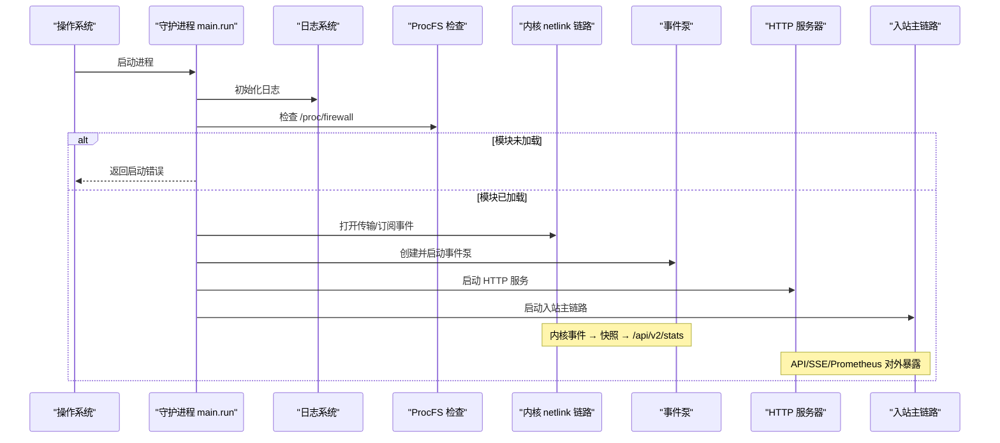
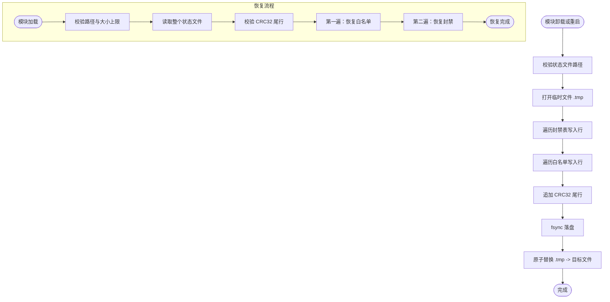
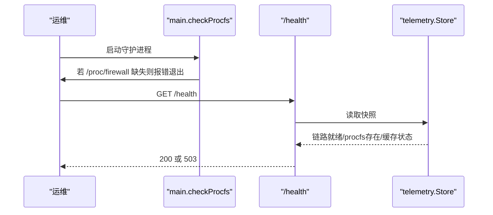
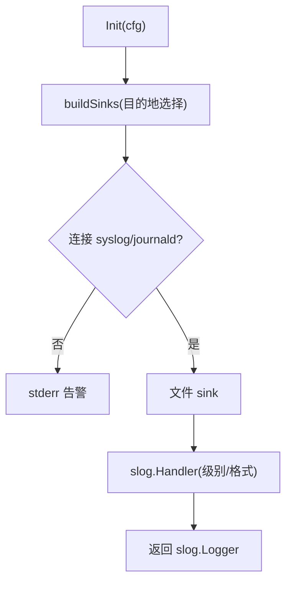
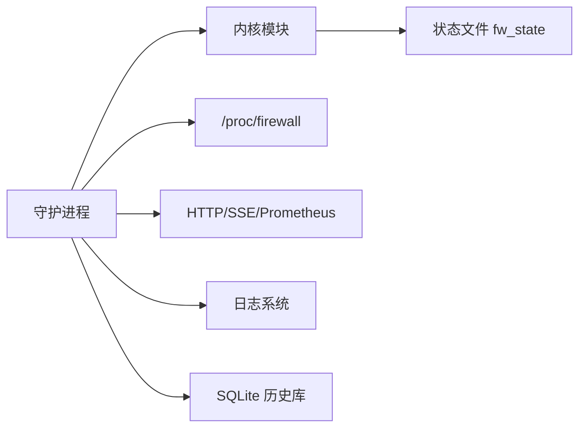

# 故障排查

<cite>
**本文引用的文件**   
- [README.md](file://README.md)
- [management.md](file://docs/zh/operations/management.md)
- [monitoring.md](file://docs/zh/operations/monitoring.md)
- [main.go](file://src/daemon/cmd/firewall-daemon/main.go)
- [logger.go](file://src/daemon/internal/logger/logger.go)
- [fw_state.c](file://src/kernel-module/fw_state.c)
</cite>

## 目录
1. [引言](#引言)
2. [项目结构](#项目结构)
3. [核心组件](#核心组件)
4. [架构总览](#架构总览)
5. [详细组件分析](#详细组件分析)
6. [依赖关系分析](#依赖关系分析)
7. [性能考量与瓶颈定位](#性能考量与瓶颈定位)
8. [故障排查指南](#故障排查指南)
9. [结论](#结论)
10. [附录：常用命令速查](#附录常用命令速查)

## 引言
本指南面向运维与平台工程师，聚焦“内核模块 + 守护进程 + Web 面板”三层架构的故障诊断、性能定位与压力测试方法。文档覆盖常见故障场景（内核模块加载失败、守护进程启动异常、网络连接问题）、性能瓶颈定位（CPU、内存、网络延迟）、日志分析方法、内核调试技巧、压力测试脚本使用方式，以及典型故障案例与解决方案。

## 项目结构
该项目由三部分组成：
- 内核模块：基于 netfilter 的高速封禁表与统计计数。
- 守护进程：负责日志采集、风险判定、HTTP API、Prometheus 指标、SSE 事件流、威胁情报拉取等。
- 前端面板：React + TypeScript，嵌入二进制提供实时监控与管理界面。

```mermaid
graph TB
subgraph "用户态"
Daemon["守护进程<br/>firewall-daemon"]
HTTP["HTTP/SSE/Prometheus 接口"]
Logger["结构化日志系统"]
DB["SQLite 历史库"]
end
subgraph "内核态"
Kmod["内核模块<br/>netfilter 钩子"]
ProcFS["/proc/firewall/*"]
SysFS["/sys/module/firewall/*"]
end
UI["Web 面板"] --> HTTP
HTTP --> Daemon
Daemon --> DB
Daemon --> Logger
Daemon < --> Kmod
Kmod --> ProcFS
Kmod --> SysFS
```

**图示来源**
- [README.md:10-31](file://README.md#L10-L31)
- [main.go:122-223](file://src/daemon/cmd/firewall-daemon/main.go#L122-L223)
- [monitoring.md:1-32](file://docs/zh/operations/monitoring.md#L1-L32)

**章节来源**
- [README.md:10-31](file://README.md#L10-L31)

## 核心组件
- 内核模块：提供包过滤、封禁表、白名单、速率统计、DDoS 检测、ProcFS 与 SysFS 暴露面。
- 守护进程：装配内核链路、事件泵、HTTP 服务、威胁情报、持久化数据库、日志系统。
- 监控与可观测性：/health、/metrics、/api/v2/stats、SSE 事件流、ProcFS stats。
- 配置管理：YAML 配置、热重载、回滚、运行时参数通过 procfs/sysfs 调整。

**章节来源**
- [README.md:76-131](file://README.md#L76-L131)
- [management.md:59-90](file://docs/zh/operations/management.md#L59-L90)
- [monitoring.md:1-32](file://docs/zh/operations/monitoring.md#L1-L32)

## 架构总览
守护进程在启动时完成以下关键步骤：
- 解析命令行与 YAML 配置。
- 初始化日志系统。
- 检查 /proc/firewall 是否存在（模块是否加载）。
- 建立 netlink 传输通道并订阅内核事件。
- 启动事件泵，将内核快照写入 telemetry.Store。
- 启动 HTTP 服务器，注册 API、SSE、/metrics。
- 启动入站主链路，消费日志并触发封禁。



**图示来源**
- [main.go:52-124](file://src/daemon/cmd/firewall-daemon/main.go#L52-L124)
- [main.go:173-223](file://src/daemon/cmd/firewall-daemon/main.go#L173-L223)
- [main.go:228-355](file://src/daemon/cmd/firewall-daemon/main.go#L228-L355)
- [main.go:357-430](file://src/daemon/cmd/firewall-daemon/main.go#L357-L430)

**章节来源**
- [main.go:52-124](file://src/daemon/cmd/firewall-daemon/main.go#L52-L124)
- [main.go:173-223](file://src/daemon/cmd/firewall-daemon/main.go#L173-L223)
- [main.go:228-355](file://src/daemon/cmd/firewall-daemon/main.go#L228-L355)
- [main.go:357-430](file://src/daemon/cmd/firewall-daemon/main.go#L357-L430)

## 详细组件分析

### 内核模块状态持久化与恢复
内核模块在卸载时保存封禁表与白名单到状态文件，并在下次加载时恢复。该实现包含路径校验、CRC32 校验、原子替换、容量限制与两遍解析（先白名单后封禁）等机制。



**图示来源**
- [fw_state.c:81-116](file://src/kernel-module/fw_state.c#L81-L116)
- [fw_state.c:132-167](file://src/kernel-module/fw_state.c#L132-L167)
- [fw_state.c:281-354](file://src/kernel-module/fw_state.c#L281-L354)
- [fw_state.c:360-401](file://src/kernel-module/fw_state.c#L360-L401)
- [fw_state.c:542-653](file://src/kernel-module/fw_state.c#L542-L653)

**章节来源**
- [fw_state.c:81-116](file://src/kernel-module/fw_state.c#L81-L116)
- [fw_state.c:281-354](file://src/kernel-module/fw_state.c#L281-L354)
- [fw_state.c:360-401](file://src/kernel-module/fw_state.c#L360-L401)
- [fw_state.c:542-653](file://src/kernel-module/fw_state.c#L542-L653)

### 守护进程启动与健康检查
守护进程在启动前会检查 /proc/firewall 是否存在；若不存在则直接返回启动错误，避免后续反复失败。健康端点 /health 综合判断 netlink 链路就绪、procfs 存在、缓存与历史库初始化情况。



**图示来源**
- [main.go:122-124](file://src/daemon/cmd/firewall-daemon/main.go#L122-L124)
- [main.go:512-521](file://src/daemon/cmd/firewall-daemon/main.go#L512-L521)
- [monitoring.md:157-181](file://docs/zh/operations/monitoring.md#L157-L181)

**章节来源**
- [main.go:122-124](file://src/daemon/cmd/firewall-daemon/main.go#L122-L124)
- [main.go:512-521](file://src/daemon/cmd/firewall-daemon/main.go#L512-L521)
- [monitoring.md:157-181](file://docs/zh/operations/monitoring.md#L157-L181)

### 日志系统与轮转
守护进程支持多种日志目的地（文件、syslog、journald），不可用时自动降级至 stderr。日志格式为 JSON Lines，按大小轮转，无需外部 logrotate。



**图示来源**
- [logger.go:92-116](file://src/daemon/internal/logger/logger.go#L92-L116)
- [logger.go:118-170](file://src/daemon/internal/logger/logger.go#L118-L170)
- [monitoring.md:183-229](file://docs/zh/operations/monitoring.md#L183-L229)

**章节来源**
- [logger.go:92-116](file://src/daemon/internal/logger/logger.go#L92-L116)
- [logger.go:118-170](file://src/daemon/internal/logger/logger.go#L118-L170)
- [monitoring.md:183-229](file://docs/zh/operations/monitoring.md#L183-L229)

## 依赖关系分析
- 守护进程依赖内核模块提供的 netlink 通道与 ProcFS 接口。
- HTTP 服务依赖事件泵产生的内核快照与 Prometheus 指标注册表。
- 日志系统依赖配置中的目的地与文件大小策略。
- 状态持久化依赖内核模块的参数与文件系统权限。



**图示来源**
- [main.go:122-223](file://src/daemon/cmd/firewall-daemon/main.go#L122-L223)
- [main.go:228-355](file://src/daemon/cmd/firewall-daemon/main.go#L228-L355)
- [fw_state.c:281-354](file://src/kernel-module/fw_state.c#L281-L354)

**章节来源**
- [main.go:122-223](file://src/daemon/cmd/firewall-daemon/main.go#L122-L223)
- [main.go:228-355](file://src/daemon/cmd/firewall-daemon/main.go#L228-L355)
- [fw_state.c:281-354](file://src/kernel-module/fw_state.c#L281-L354)

## 性能考量与瓶颈定位
- CPU 使用率分析：关注守护进程主循环、日志解析正则匹配、内核事件泵处理频率。可通过系统级工具（如 top、pidstat、perf）观察高占用 goroutine 与内核路径。
- 内存泄漏检测：重点检查事件队列、telemetry.Store 环、历史库刷盘调度器、威胁情报源并发拉取。可使用 pprof、go tool trace 与内核 kmemleak（针对内核模块）。
- 网络延迟测量：使用 ss、tcpdump、iperf 与内核侧 PPS/BPS 计数器（/proc/firewall/stats）对比，定位丢包与拥塞。
- 速率表溢出：当活跃源超过速率槽位上限时，rates 表头 rate_slot_spill 非零，新源不做速率判定。

**章节来源**
- [monitoring.md:111-155](file://docs/zh/operations/monitoring.md#L111-L155)
- [monitoring.md:338-350](file://docs/zh/operations/monitoring.md#L338-L350)

## 故障排查指南

### 常见问题与诊断方法

#### 内核模块加载失败
- 现象：insmod 失败、lsmod 无 firewall、/proc/firewall 不存在。
- 诊断要点：
  - 查看 dmesg 中防火墙相关错误。
  - 确认编译产物与运行内核版本一致。
  - 检查模块参数与 sysfs 参数是否合法。
  - 验证 modules-load.d 配置是否生效。
- 参考命令与说明见管理文档。

**章节来源**
- [management.md:59-90](file://docs/zh/operations/management.md#L59-L90)
- [management.md:91-93](file://docs/zh/operations/management.md#L91-L93)

#### 守护进程启动异常
- 现象：进程退出、端口未监听、/health 返回 503。
- 诊断要点：
  - 检查配置文件路径与语法（严格模式默认开启）。
  - 检查面板认证凭据是否对外开放且未设置密码。
  - 检查 /proc/firewall 是否存在（模块是否加载）。
  - 检查 netlink 链路是否建起（事件泵是否启动）。
  - 查看守护进程日志与 journal。

**章节来源**
- [main.go:52-124](file://src/daemon/cmd/firewall-daemon/main.go#L52-L124)
- [main.go:173-223](file://src/daemon/cmd/firewall-daemon/main.go#L173-L223)
- [main.go:512-521](file://src/daemon/cmd/firewall-daemon/main.go#L512-L521)
- [monitoring.md:157-181](file://docs/zh/operations/monitoring.md#L157-L181)

#### 网络连接问题（API/面板/指标）
- 现象：无法访问面板、/metrics 抓取失败、SSE 断连。
- 诊断要点：
  - 检查 metrics_bind_address 与认证凭据。
  - 检查 /health 与 /healthz 响应码。
  - 检查 Prometheus basic_auth 配置。
  - 检查 SSE 连接数是否达到上限。

**章节来源**
- [main.go:106-120](file://src/daemon/cmd/firewall-daemon/main.go#L106-L120)
- [monitoring.md:33-79](file://docs/zh/operations/monitoring.md#L33-L79)
- [monitoring.md:157-181](file://docs/zh/operations/monitoring.md#L157-L181)

#### 封禁不生效或下发被拒
- 现象：/proc/firewall/bans 无新增、/metrics 中内核拒绝指令增长。
- 诊断要点：
  - 查看 firewall_kernel_commands_rejected_total 是否非零。
  - 检查 netlink 发送/接收错误计数器。
  - 查看 dmesg 中内核拒绝原因。
  - 确认租约持有（单实例约束）与 trusted_ips 下发。

**章节来源**
- [monitoring.md:53-79](file://docs/zh/operations/monitoring.md#L53-L79)
- [monitoring.md:338-350](file://docs/zh/operations/monitoring.md#L338-L350)
- [main.go:382-410](file://src/daemon/cmd/firewall-daemon/main.go#L382-L410)

#### 日志解析跟不上或丢失
- 现象：firewall_lines_skipped_total 持续增长、面板数据滞后。
- 诊断要点：
  - 检查 inotify 唤醒次数与轮转检测次数。
  - 检查日志文件大小与轮转策略。
  - 提升正则匹配效率或减少复杂规则。

**章节来源**
- [monitoring.md:53-79](file://docs/zh/operations/monitoring.md#L53-L79)
- [monitoring.md:183-229](file://docs/zh/operations/monitoring.md#L183-L229)

#### 状态文件损坏或恢复失败
- 现象：模块重启后封禁/白名单未恢复、dmesg 报 CRC32 校验失败。
- 诊断要点：
  - 检查状态文件路径是否在允许目录（/var/lib、/tmp、/etc）。
  - 检查文件大小是否超过上限。
  - 检查 CRC32 尾行是否存在且匹配。
  - 必要时删除损坏状态文件后重新加载模块。

**章节来源**
- [fw_state.c:81-116](file://src/kernel-module/fw_state.c#L81-L116)
- [fw_state.c:360-401](file://src/kernel-module/fw_state.c#L360-L401)
- [fw_state.c:542-653](file://src/kernel-module/fw_state.c#L542-L653)

### 性能瓶颈定位工具与方法
- CPU：top、pidstat、perf record/report、go tool pprof。
- 内存：valgrind（用户态）、kmemleak（内核态）、pprof heap/profile。
- 网络：ss、tcpdump、iperf、ethtool、内核 PPS/BPS 计数器。
- 内核：dmesg、/proc/firewall/stats、/sys/module/firewall/parameters。

**章节来源**
- [monitoring.md:111-155](file://docs/zh/operations/monitoring.md#L111-L155)
- [management.md:59-90](file://docs/zh/operations/management.md#L59-L90)

### 压力测试与高并发攻击模拟
- 使用仓库 scripts/bench 下的工具进行压测与扫描模拟（例如 blast2.c、sink.c、fwctl.sh、fwsweep.sh、mflow.sh）。
- 结合 /proc/firewall/stats 与 /metrics 观察 PPS/BPS、封禁速率、丢弃报文数。
- 在高并发场景下关注速率表溢出（rate_slot_spill）与封禁表满（ban_table_full_rejects）。

**章节来源**
- [monitoring.md:143-155](file://docs/zh/operations/monitoring.md#L143-L155)
- [monitoring.md:338-350](file://docs/zh/operations/monitoring.md#L338-L350)

### 日志分析方法
- 守护进程日志：JSON Lines，路径默认为 /var/log/firewall.log，支持按大小轮转。
- 内核日志：dmesg 过滤 firewall 前缀。
- 建议：按时间窗口聚合 ERROR/WARN，按 jail 维度统计，结合 /metrics 指标关联分析。

**章节来源**
- [monitoring.md:183-229](file://docs/zh/operations/monitoring.md#L183-L229)
- [management.md:316-335](file://docs/zh/operations/management.md#L316-L335)

### 内核调试技巧
- 查看模块参数：cat /sys/module/firewall/parameters/*。
- 查看模块版本：cat /sys/module/firewall/version。
- 动态调整部分参数：echo 值 > /sys/module/firewall/parameters/*（仅可写参数）。
- 观察内核统计：cat /proc/firewall/stats。

**章节来源**
- [management.md:59-90](file://docs/zh/operations/management.md#L59-L90)
- [main.go:581-597](file://src/daemon/cmd/firewall-daemon/main.go#L581-L597)

### 性能调优参数
- 内核模块参数：fw_max_rate_entries、fw_max_ban_entries、fw_max_whitelist_entries、fw_ddos_detection 等。
- 守护进程配置：metrics_port、metrics_bind_address、MaxSSEConnections、HistoryDBPath、ThreatFeeds.*。
- 日志策略：log_max_size_mb、log_max_files、log_level。

**章节来源**
- [management.md:59-90](file://docs/zh/operations/management.md#L59-L90)
- [monitoring.md:33-79](file://docs/zh/operations/monitoring.md#L33-L79)
- [monitoring.md:183-229](file://docs/zh/operations/monitoring.md#L183-L229)

### 典型故障案例与解决方案
- 案例一：模块加载失败
  - 现象：insmod 报错，dmesg 显示 API 不兼容或符号缺失。
  - 解决：确认内核头文件与运行内核一致；使用多版本编译；检查模块参数。
- 案例二：守护进程启动即退出
  - 现象：/proc/firewall 不存在导致启动失败。
  - 解决：先加载内核模块，再启动守护进程；检查 systemd 单元顺序。
- 案例三：面板无法访问
  - 现象：/health 返回 503，/metrics 抓取失败。
  - 解决：检查 metrics_bind_address 与认证凭据；确保 Basic Auth 配置正确。
- 案例四：封禁下发被拒
  - 现象：firewall_kernel_commands_rejected_total 增长。
  - 解决：检查 netlink 链路错误；确认租约持有与 trusted_ips 下发。
- 案例五：状态文件损坏
  - 现象：CRC32 校验失败，恢复被拒绝。
  - 解决：删除损坏状态文件；确保路径在允许目录；检查文件大小上限。

**章节来源**
- [management.md:59-90](file://docs/zh/operations/management.md#L59-L90)
- [main.go:122-124](file://src/daemon/cmd/firewall-daemon/main.go#L122-L124)
- [monitoring.md:53-79](file://docs/zh/operations/monitoring.md#L53-L79)
- [fw_state.c:360-401](file://src/kernel-module/fw_state.c#L360-L401)

## 结论
本指南围绕内核模块、守护进程与监控体系提供了完整的故障排查路径。通过 ProcFS、SysFS、/health、/metrics 与结构化日志，可以快速定位模块加载、守护进程启动、网络连接、封禁下发与状态持久化等问题。结合性能工具与压力测试脚本，能够高效识别 CPU、内存与网络瓶颈，并为高并发攻击场景提供可观测性与调优依据。

## 附录：常用命令速查
- 服务管理：systemctl start/stop/restart/status reload firewall-daemon
- 模块操作：insmod/rmmod/modprobe firewall；lsmod | grep firewall；modinfo firewall
- 封禁管理：echo "<ip>" | sudo tee /proc/firewall/bans；unban <ip>
- 白名单管理：echo "<cidr>" | sudo tee /proc/firewall/whitelist
- 配置查询：sudo cat /proc/firewall/config；sudo cat /proc/firewall/stats
- 健康检查：curl http://127.0.0.1:9119/health；curl -u user:pass http://127.0.0.1:9119/api/v2/stats

**章节来源**
- [management.md:357-380](file://docs/zh/operations/management.md#L357-L380)
- [monitoring.md:157-181](file://docs/zh/operations/monitoring.md#L157-L181)