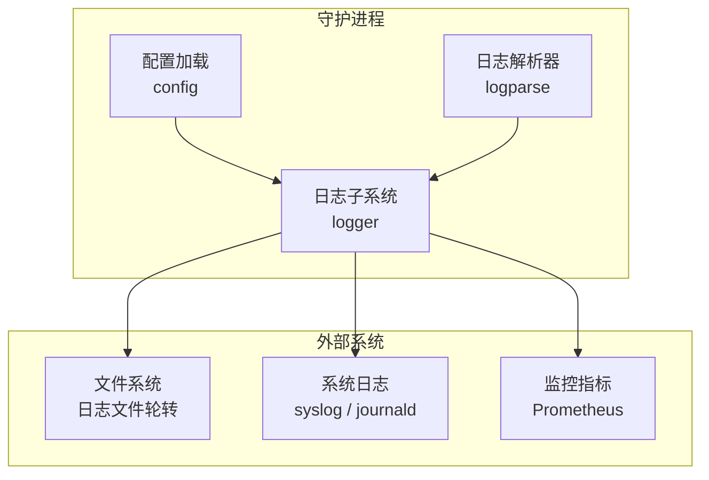
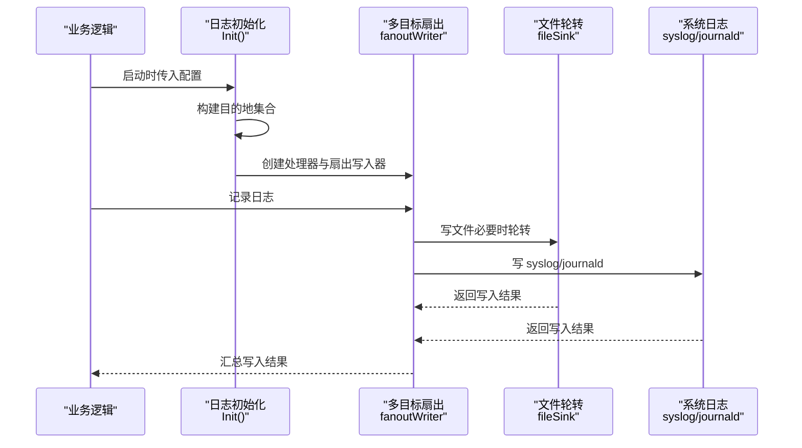
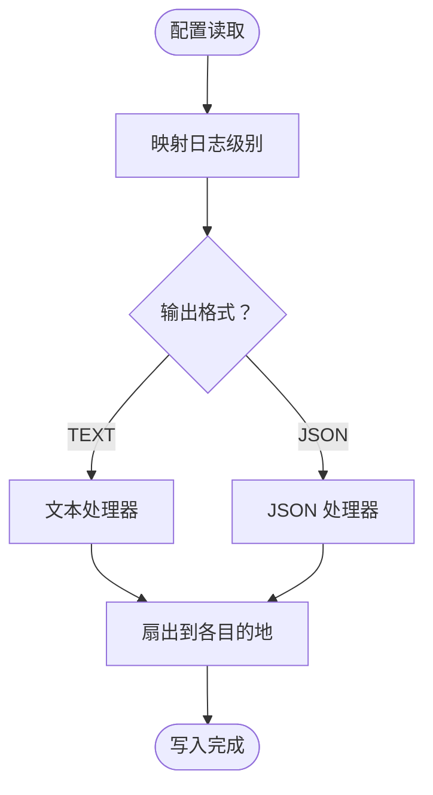
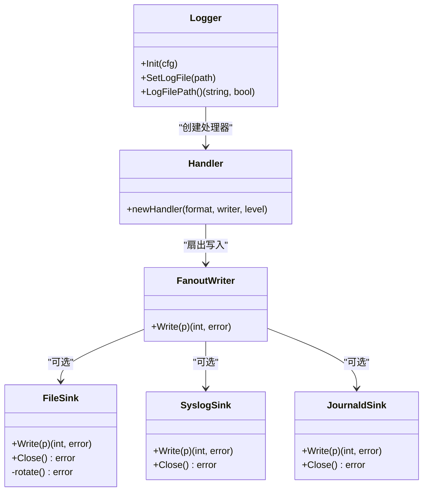
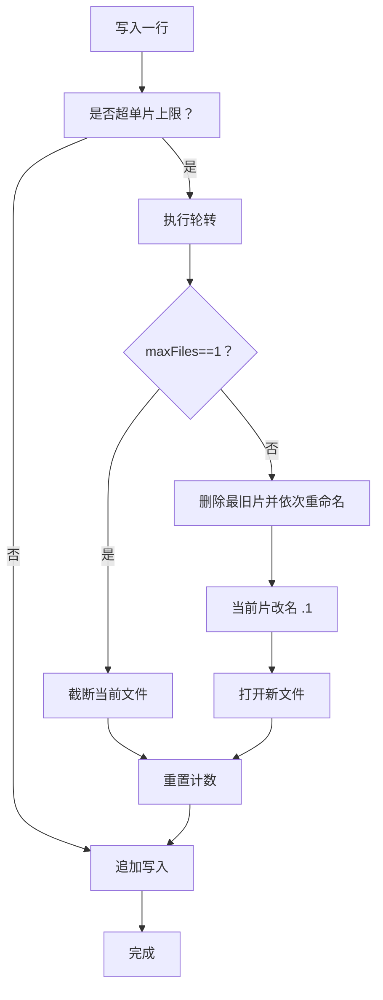
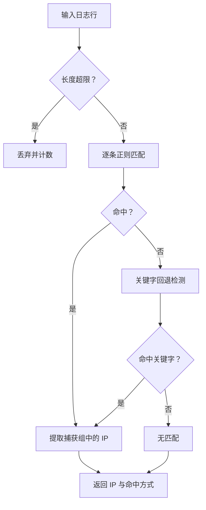
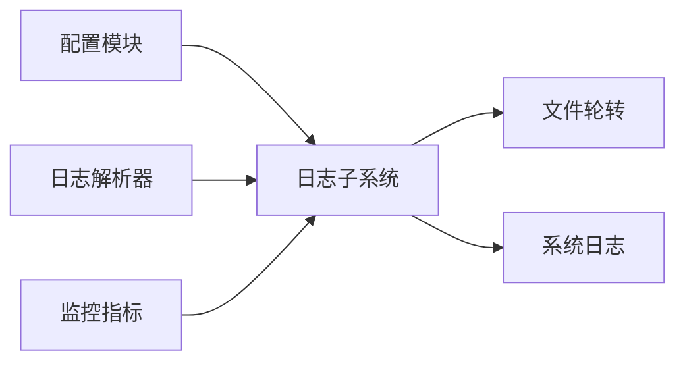

# 日志管理

<cite>
**本文引用的文件**   
- [README.md](file://README.md)
- [default.yaml](file://config/default.yaml)
- [logger.go](file://src/daemon/internal/logger/logger.go)
- [handler.go](file://src/daemon/internal/logger/handler.go)
- [json.go](file://src/daemon/internal/logger/json.go)
- [file.go](file://src/daemon/internal/logger/file.go)
- [splitter.go](file://src/daemon/internal/logparse/splitter.go)
- [rule.go](file://src/daemon/internal/logparse/rule.go)
- [loader.go](file://src/daemon/internal/config/loader.go)
- [logging.go](file://src/daemon/internal/config/logging.go)
- [monitoring.md](file://docs/zh/operations/monitoring.md)
- [test_18_log_rotation.py](file://tests/test_18_log_rotation.py)
</cite>

## 目录
1. [引言](#引言)
2. [项目结构](#项目结构)
3. [核心组件](#核心组件)
4. [架构总览](#架构总览)
5. [详细组件分析](#详细组件分析)
6. [依赖关系分析](#依赖关系分析)
7. [性能与容量优化](#性能与容量优化)
8. [故障排查指南](#故障排查指南)
9. [结论](#结论)

## 引言
本指南聚焦守护进程的日志子系统，覆盖日志轮转机制、正则解析器、日志级别与输出格式、多目标输出（文件、stdout/stderr、syslog/journald），以及运维层面的性能优化、磁盘空间管理与排错实践。该子系统与内核模块、风险引擎、采集器共同构成“日志采集 → 解析 → 判定 → 封禁”的完整链路。

## 项目结构
日志相关代码主要分布在以下位置：
- 守护进程日志实现：`src/daemon/internal/logger/*`
- 日志解析器：`src/daemon/internal/logparse/*`
- 配置项与默认值：`config/default.yaml`、`src/daemon/internal/config/*`
- 监控文档与指标说明：`docs/zh/operations/monitoring.md`
- 轮转集成测试：`tests/test_18_log_rotation.py`

图表来源
- [logger.go:92-116](file://src/daemon/internal/logger/logger.go#L92-L116)
- [file.go:23-52](file://src/daemon/internal/logger/file.go#L23-L52)
- [monitoring.md:221-231](file://docs/zh/operations/monitoring.md#L221-L231)

章节来源
- [README.md:111-118](file://README.md#L111-L118)
- [default.yaml:20-24](file://config/default.yaml#L20-L24)

## 核心组件
- 日志初始化与目的地选择：根据配置决定写入文件、syslog、journald 或 stderr，并在部分不可用时自动降级。
- 文件轮转：按大小轮转，支持保留数量控制；无压缩。
- 输出处理器：文本与 JSON 两种格式，JSON 字段顺序固定，便于下游解析。
- 日志节流：对高频调用点提供时间间隔节流，避免刷爆日志。
- 行分割器：按换行符切分日志，超长行丢弃并计数，轮转时清空半行缓冲。
- 规则解析器：命名正则匹配 + 关键字回退，内置 ReDoS 防护与安全校验。

章节来源
- [logger.go:32-56](file://src/daemon/internal/logger/logger.go#L32-L56)
- [file.go:23-52](file://src/daemon/internal/logger/file.go#L23-L52)
- [handler.go:39-45](file://src/daemon/internal/logger/handler.go#L39-L45)
- [json.go:14-28](file://src/daemon/internal/logger/json.go#L14-L28)
- [logger.go:213-232](file://src/daemon/internal/logger/logger.go#L213-L232)
- [splitter.go:14-40](file://src/daemon/internal/logparse/splitter.go#L14-L40)
- [rule.go:35-48](file://src/daemon/internal/logparse/rule.go#L35-L48)

## 架构总览
日志从守护进程启动到落盘/外发的关键路径如下：

图表来源
- [logger.go:92-116](file://src/daemon/internal/logger/logger.go#L92-L116)
- [handler.go:16-37](file://src/daemon/internal/logger/handler.go#L16-L37)
- [file.go:54-69](file://src/daemon/internal/logger/file.go#L54-L69)

## 详细组件分析

### 日志级别与输出格式
- 日志级别映射：NONE、ERR、WARN、INFO、DEBUG，分别对应不同的 slog 级别。
- 输出格式：TEXT（人类可读）与 JSON（结构化）。JSON 处理器固定字段顺序 `ts → level → msg → 属性`，并对特殊数值做安全处理。
- 级别过滤在处理器层完成，未达级别的日志不会进入后续写入流程。

图表来源
- [logger.go:58-72](file://src/daemon/internal/logger/logger.go#L58-L72)
- [handler.go:39-45](file://src/daemon/internal/logger/handler.go#L39-L45)
- [json.go:30-50](file://src/daemon/internal/logger/json.go#L30-L50)

章节来源
- [logger.go:58-72](file://src/daemon/internal/logger/logger.go#L58-L72)
- [handler.go:39-45](file://src/daemon/internal/logger/handler.go#L39-L45)
- [json.go:14-50](file://src/daemon/internal/logger/json.go#L14-L50)

### 多目标输出（文件、stdout/stderr、syslog/journald）
- 目的地语义：
  - SYSLOG/JOURNAL：仅写系统日志，不创建文件。
  - FILE：仅写文件。
  - BOTH：同时写文件与系统日志。
  - 全部不可用：降级到 stderr，保证日志不丢失。
- 连接策略：
  - syslog：优先 unixgram，失败回退 unix。
  - journald：优先 systemd-journald 兼容入口，失败回退本地 syslog。
- 扇出写入：任一 sink 出错不影响其他 sink，确保“文件失败但系统日志正常”。

图表来源
- [logger.go:118-186](file://src/daemon/internal/logger/logger.go#L118-L186)
- [handler.go:16-37](file://src/daemon/internal/logger/handler.go#L16-L37)
- [file.go:23-52](file://src/daemon/internal/logger/file.go#L23-L52)

章节来源
- [logger.go:118-186](file://src/daemon/internal/logger/logger.go#L118-L186)
- [handler.go:16-37](file://src/daemon/internal/logger/handler.go#L16-L37)

### 日志轮转机制（文件大小限制、保留策略、压缩）
- 触发条件：当累计写入量超过单片上限且已写入字节大于 0 时触发轮转。
- 保留策略：
  - maxFiles=1：只保留当前片，达到上限后截断。
  - maxFiles>1：保留 `.1`（最新）到 `.maxFiles-1`（最旧），删除最旧片后依次重命名。
- 压缩设置：当前实现不包含压缩；如需压缩需配合外部工具或上层调度。
- 并发安全：轮转与写入共用一把锁，避免并发写者看到中途 inode 或将一条记录切进两片。

图表来源
- [file.go:54-69](file://src/daemon/internal/logger/file.go#L54-L69)
- [file.go:85-120](file://src/daemon/internal/logger/file.go#L85-L120)

章节来源
- [file.go:23-52](file://src/daemon/internal/logger/file.go#L23-L52)
- [file.go:54-69](file://src/daemon/internal/logger/file.go#L54-L69)
- [file.go:85-120](file://src/daemon/internal/logger/file.go#L85-L120)

### 日志解析器的正则匹配机制
- 匹配流程：先尝试 jail 配置的命名正则；若全部未命中（或没有正则），则走关键字回退窄路径，再提取 IP。
- 安全校验：
  - 拒绝嵌套量词、占有量词、非法量词组合、分支数过多等易导致 ReDoS 的模式。
  - 模式长度与分支数上限保护。
- 行分割：
  - 以换行符为界切分行，超长行丢弃并计数。
  - 轮转/截断前 flush 半行，避免丢失末尾不完整行。
- 服务日志格式支持：
  - 通过自定义正则适配不同服务（如 SSH、Web、邮件等）。
  - 内置 sshd 失败模式作为兜底。

图表来源
- [rule.go:108-127](file://src/daemon/internal/logparse/rule.go#L108-L127)
- [rule.go:141-191](file://src/daemon/internal/logparse/rule.go#L141-L191)
- [splitter.go:40-73](file://src/daemon/internal/logparse/splitter.go#L40-L73)

章节来源
- [rule.go:35-48](file://src/daemon/internal/logparse/rule.go#L35-L48)
- [rule.go:108-127](file://src/daemon/internal/logparse/rule.go#L108-L127)
- [rule.go:141-191](file://src/daemon/internal/logparse/rule.go#L141-L191)
- [splitter.go:14-40](file://src/daemon/internal/logparse/splitter.go#L14-L40)
- [splitter.go:40-73](file://src/daemon/internal/logparse/splitter.go#L40-L73)

### 配置项与默认值
- 日志文件路径：`log_file`，默认 `/var/log/firewall.log`。
- 日志级别：`log_level`，取值 0=NONE、1=ERR、2=WARN、3=INFO、4=DEBUG。
- 历史库与保留天数：用于面板分析与统计，非日志子系统直接参数。
- 配置加载：支持单文件与目录合并，运行期覆盖文件最后生效。

章节来源
- [default.yaml:20-30](file://config/default.yaml#L20-L30)
- [loader.go:53-127](file://src/daemon/internal/config/loader.go#L53-L127)
- [logging.go:8-13](file://src/daemon/internal/config/logging.go#L8-L13)

## 依赖关系分析
- 日志子系统依赖配置模块提供的级别、目的地、格式、路径与大小限制。
- 解析器与日志子系统解耦：解析器负责从日志行中提取 IP 与类型，日志子系统负责持久化与分发。
- 监控指标暴露轮转次数，便于 Prometheus/Grafana 观测。

图表来源
- [logger.go:43-56](file://src/daemon/internal/logger/logger.go#L43-L56)
- [monitoring.md:221-231](file://docs/zh/operations/monitoring.md#L221-L231)

章节来源
- [logger.go:43-56](file://src/daemon/internal/logger/logger.go#L43-L56)
- [monitoring.md:221-231](file://docs/zh/operations/monitoring.md#L221-L231)

## 性能与容量优化
- 日志节流：对高频调用点使用节流器，降低刷写频率，避免 I/O 抖动。
- 行分割缓冲复用：LineSplitter 内部缓冲按源隔离，跨轮复用容量，减少分配。
- 超长行保护：分割期与解析期均设行长上限，丢弃超长片段并计数，防止内存膨胀。
- 扇出不阻塞：任一 sink 失败不影响其他 sink，提升整体可用性。
- 磁盘空间管理：
  - 合理设置 `log_max_size_mb` 与 `log_max_files`，结合业务增长趋势评估保留周期。
  - 当前实现无压缩；如需压缩可结合外部工具或上层调度在轮转后压缩历史片。
- 监控与告警：
  - 关注轮转计数指标，异常飙升可能提示日志暴增或阈值过小。
  - 结合 Prometheus/Grafana 建立磁盘使用率与轮转频率告警。

章节来源
- [logger.go:213-232](file://src/daemon/internal/logger/logger.go#L213-L232)
- [splitter.go:14-40](file://src/daemon/internal/logparse/splitter.go#L14-L40)
- [splitter.go:40-73](file://src/daemon/internal/logparse/splitter.go#L40-L73)
- [monitoring.md:221-231](file://docs/zh/operations/monitoring.md#L221-L231)

## 故障排查指南
- 无法连接 syslog/journald：
  - 现象：控制台出现警告，目的地降级。
  - 排查：检查套接字路径与权限；确认 journald/syslog 服务状态。
- 日志文件无法打开：
  - 现象：控制台警告，降级到其他目的地。
  - 排查：检查路径、权限、磁盘空间与挂载选项。
- 轮转未生效：
  - 现象：单文件持续增长。
  - 排查：确认 `log_max_size_mb` 与 `log_max_files` 配置；观察轮转指标是否增长。
- 解析失败或误判：
  - 现象：IP 未提取或误提。
  - 排查：检查正则是否合法、是否被安全校验拦截；验证关键字回退路径是否命中。
- 指标异常：
  - 现象：轮转计数突增或停滞。
  - 排查：结合日志量变化、阈值配置与外部 logrotate 行为（守护进程自带轮转，无需外部 logrotate）。

章节来源
- [logger.go:118-186](file://src/daemon/internal/logger/logger.go#L118-L186)
- [file.go:54-69](file://src/daemon/internal/logger/file.go#L54-L69)
- [rule.go:141-191](file://src/daemon/internal/logparse/rule.go#L141-L191)
- [monitoring.md:221-231](file://docs/zh/operations/monitoring.md#L221-L231)
- [test_18_log_rotation.py:1-6](file://tests/test_18_log_rotation.py#L1-L6)

## 结论
本日志子系统以“可配置、可降级、可观测”为核心设计原则：
- 通过目的地扇出与自动降级保障高可用；
- 通过按大小轮转与保留策略控制磁盘占用；
- 通过 JSON/TEXT 双格式满足人类阅读与机器解析需求；
- 通过行分割与正则安全校验保障解析稳定性；
- 通过监控指标与节流机制支撑生产运维。

在实际部署中，建议：
- 明确日志级别与输出格式，生产环境推荐 JSON 以便集中采集；
- 合理设置文件大小与保留数量，结合业务峰值评估；
- 启用轮转指标监控，建立磁盘与轮转频率告警；
- 谨慎编写正则，遵循安全校验约束，优先使用命名捕获组定位 IP。