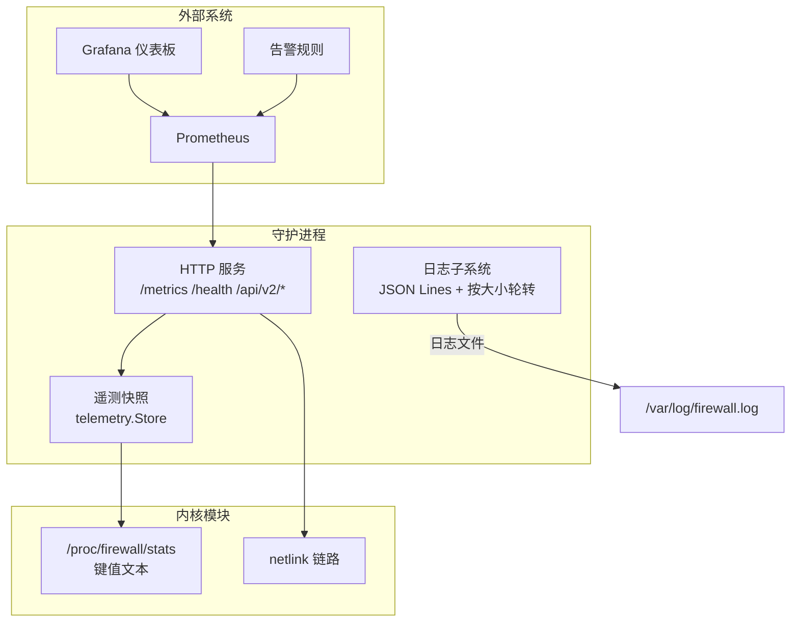
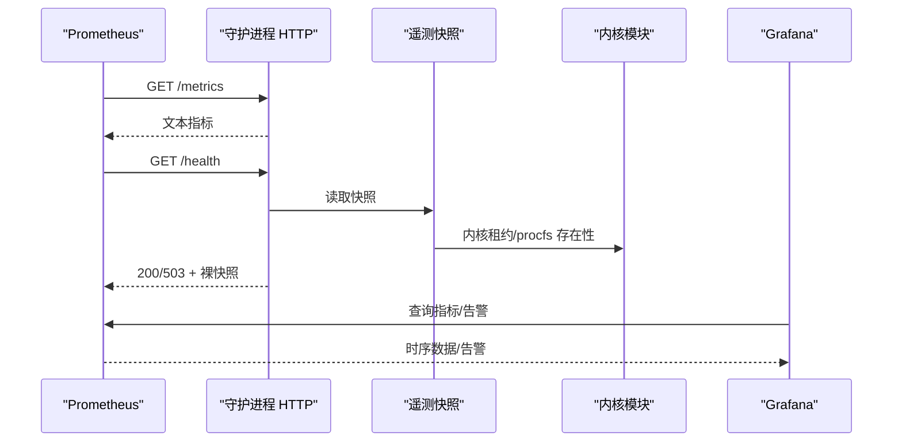
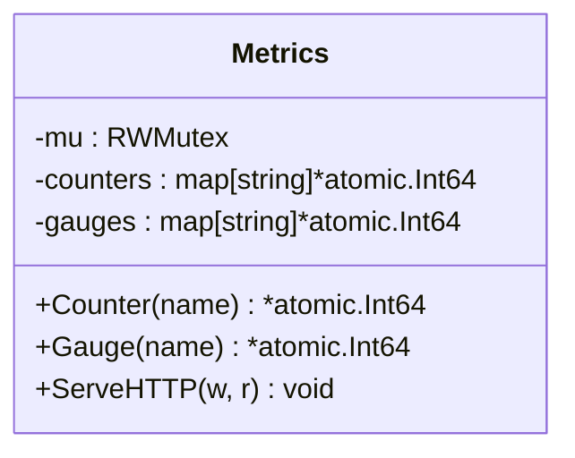
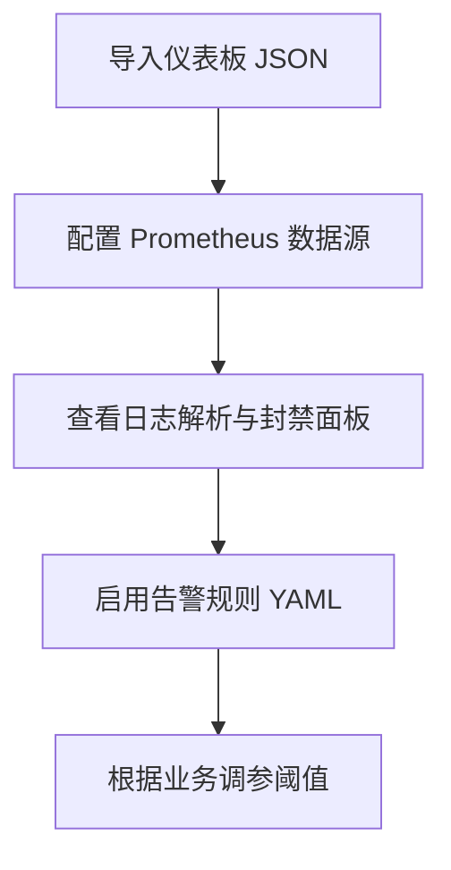
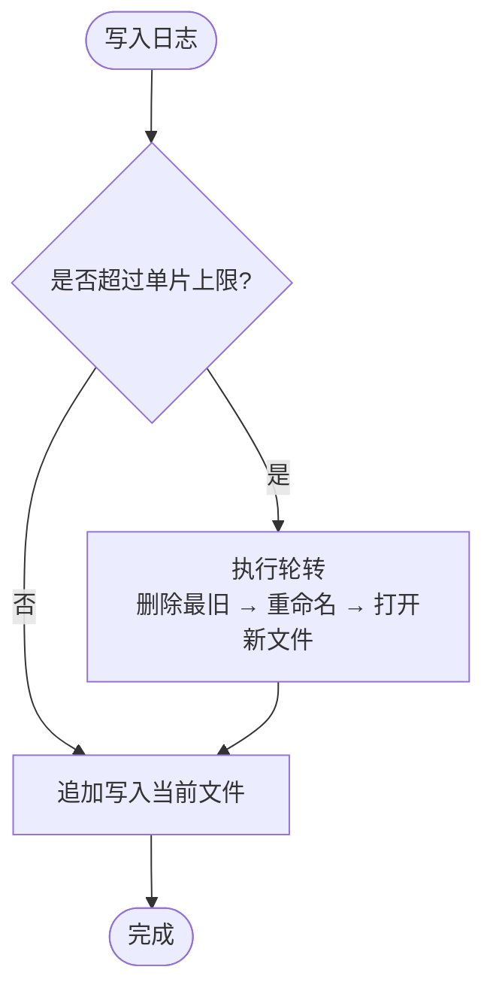
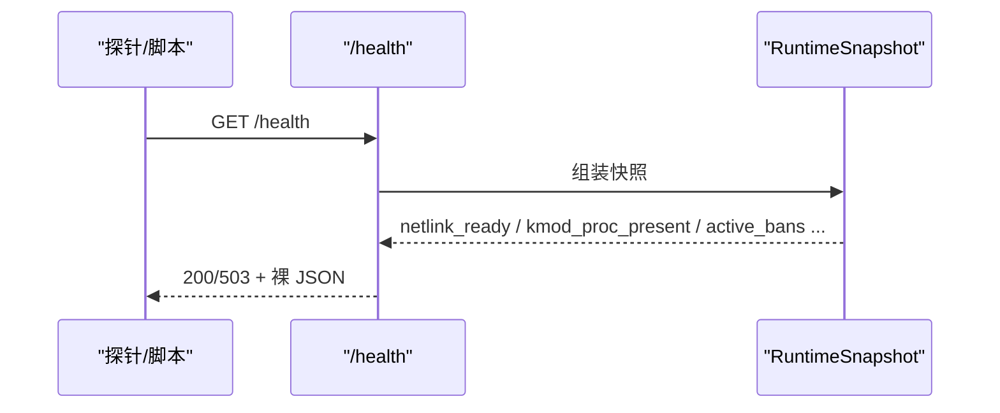
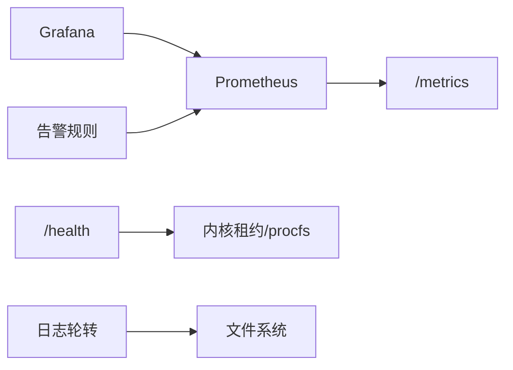

# 监控运维

<cite>
**本文引用的文件**   
- [README.md](file://README.md)
- [monitoring.md](file://docs/zh/operations/monitoring.md)
- [firewall-dashboard.json](file://grafana/firewall-dashboard.json)
- [alert-rules.yaml](file://grafana/alert-rules.yaml)
- [metrics.go](file://src/daemon/internal/http/metrics.go)
- [health.go](file://src/daemon/internal/http/health.go)
- [file.go](file://src/daemon/internal/logger/file.go)
- [default.yaml](file://config/default.yaml)
</cite>

## 目录
1. [引言](#引言)
2. [项目结构](#项目结构)
3. [核心组件](#核心组件)
4. [架构总览](#架构总览)
5. [详细组件分析](#详细组件分析)
6. [依赖关系分析](#依赖关系分析)
7. [性能与容量考虑](#性能与容量考虑)
8. [故障排查指南](#故障排查指南)
9. [结论](#结论)
10. [附录：指标、端点与配置速查](#附录指标端点与配置速查)

## 引言
本指南面向运维人员，围绕该防火墙项目的可观测性体系展开，覆盖 Prometheus 指标采集、Grafana 仪表板与告警规则、日志管理与轮转、健康检查、性能监控、系统资源与网络流量观察、攻击事件追踪，以及故障排查、调优建议与备份恢复策略。目标是让运维团队能够稳定、准确地掌握内核模块与守护进程的运行状态，并在异常发生时快速定位与恢复。

## 项目结构
从监控视角看，关键目录与文件如下：
- `grafana/`：Grafana 仪表板定义与告警规则。
- `src/daemon/internal/http/`：HTTP API、Prometheus `/metrics`、健康检查等出口。
- `src/daemon/internal/logger/`：JSON Lines 日志与按大小轮转实现。
- `config/default.yaml`：默认配置，包含指标端口、认证凭据、日志路径、DDoS 阈值等。
- `docs/zh/operations/monitoring.md`：官方监控文档，明确两条读数路径（守护进程计数器 vs 内核侧计数）。

**图表来源**
- [metrics.go:11-91](file://src/daemon/internal/http/metrics.go#L11-L91)
- [health.go:40-100](file://src/daemon/internal/http/health.go#L40-L100)
- [file.go:23-120](file://src/daemon/internal/logger/file.go#L23-L120)
- [default.yaml:7-30](file://config/default.yaml#L7-L30)

**章节来源**
- [README.md:10-31](file://README.md#L10-L31)
- [monitoring.md:5-31](file://docs/zh/operations/monitoring.md#L5-L31)

## 核心组件
- Prometheus 指标出口：由守护进程内部 `Metrics` 提供，注册 counter/gauge，统一在 `/metrics` 输出。
- 健康检查：`/health` 与 `/healthz` 返回裸快照，以 HTTP 状态码表达就绪与否。
- 日志管理：JSON Lines 格式，内置按大小轮转，支持保留多片。
- 内核侧计数：通过 `/proc/firewall/stats` 暴露键值文本，不直接走 Prometheus。
- Grafana 仪表板与告警：仓库提供导入起点，指标名需与 `/metrics` 保持一致。

**章节来源**
- [metrics.go:11-91](file://src/daemon/internal/http/metrics.go#L11-L91)
- [health.go:40-100](file://src/daemon/internal/http/health.go#L40-L100)
- [file.go:23-120](file://src/daemon/internal/logger/file.go#L23-L120)
- [monitoring.md:33-79](file://docs/zh/operations/monitoring.md#L33-L79)
- [monitoring.md:111-155](file://docs/zh/operations/monitoring.md#L111-L155)

## 架构总览
守护进程负责日志采集、风险判定、HTTP API 与面板服务；内核模块负责高速封禁与统计。监控方面，守护进程暴露 Prometheus 指标与健康接口，内核侧统计通过 procfs 暴露。Grafana 消费 Prometheus 数据，并基于告警规则触发通知。

**图表来源**
- [metrics.go:60-91](file://src/daemon/internal/http/metrics.go#L60-L91)
- [health.go:40-100](file://src/daemon/internal/http/health.go#L40-L100)
- [monitoring.md:157-181](file://docs/zh/operations/monitoring.md#L157-L181)

## 详细组件分析

### Prometheus 指标收集
守护进程内部维护一个线程安全的计数器与仪表盘集合，所有指标通过 `/metrics` 以 Prometheus 文本协议输出。当前实现未预注册 gauge，counter 在启动时装配链中预注册，因此即使链路未建立，相关指标也会以 0 值样本出现。

关键点：
- 指标注册：通过 `Counter(name)` 与 `Gauge(name)` 获取原子整型，业务代码递增。
- 输出顺序：对 key 排序后输出，保证稳定性。
- 内容类型：`text/plain; version=0.0.4; charset=utf-8`。
- 主要指标类别：日志解析、正则命中、inotify 唤醒、日志轮转、封禁触发、DDoS 事件、内核拒绝指令、netlink 收发与错误、配置重载次数。

**图表来源**
- [metrics.go:11-91](file://src/daemon/internal/http/metrics.go#L11-L91)

**章节来源**
- [monitoring.md:33-79](file://docs/zh/operations/monitoring.md#L33-L79)
- [metrics.go:11-91](file://src/daemon/internal/http/metrics.go#L11-L91)

### Grafana 仪表板与告警
仓库提供两个 Grafana 资源：
- `grafana/firewall-dashboard.json`：展示日志解析、封禁速率、DDoS 事件、netlink 链路健康、配置重载等维度。
- `grafana/alert-rules.yaml`：包含封禁速率过高、内核拒绝指令、netlink 发送错误、守护进程宕机等告警。

使用建议：
- 将仪表板导入 Grafana，确保 Prometheus 数据源指向 `localhost:9119`（或实际 metrics 端口）。
- 告警规则中的 job 名称应与 Prometheus scrape 配置一致，例如 `job="firewall"`。
- 阈值应结合业务规模调整，避免误报或漏报。

**图表来源**
- [firewall-dashboard.json:1-176](file://grafana/firewall-dashboard.json#L1-L176)
- [alert-rules.yaml:1-41](file://grafana/alert-rules.yaml#L1-L41)

**章节来源**
- [monitoring.md:233-288](file://docs/zh/operations/monitoring.md#L233-L288)
- [firewall-dashboard.json:1-176](file://grafana/firewall-dashboard.json#L1-L176)
- [alert-rules.yaml:1-41](file://grafana/alert-rules.yaml#L1-L41)

### 日志管理与轮转机制
守护进程写入 JSON Lines 格式的日志，字段顺序固定，单行一次 write，保证重启期间新旧进程并存时的完整性。默认日志路径为 `/var/log/firewall.log`，可通过配置覆盖。

轮转策略：
- 按大小轮转，无需 logrotate 或 SIGHUP。
- `log_max_size_mb`：超过即切片，0 表示关闭。
- `log_max_files`：保留历史片数，1 表示只保留当前片（轮转时截断）。
- 轮转过程加锁，避免并发写者看到中途 inode 或将一条记录切到两片。

**图表来源**
- [file.go:54-120](file://src/daemon/internal/logger/file.go#L54-L120)

**章节来源**
- [monitoring.md:183-231](file://docs/zh/operations/monitoring.md#L183-L231)
- [file.go:23-120](file://src/daemon/internal/logger/file.go#L23-L120)
- [default.yaml:20-24](file://config/default.yaml#L20-L24)

### 健康检查与就绪判定
`/health` 与 `/healthz` 返回裸快照，状态码 200 表示就绪，503 表示未就绪。就绪判定的唯一依据是内核租约已持有；其他字段用于排障，不参与判定。

健康检查脚本建议：
- 检查内核模块是否加载。
- 检查守护进程是否运行。
- 检查 `/proc/firewall/stats` 是否存在。
- 调用 `/health` 并校验 HTTP 状态码。

**图表来源**
- [health.go:40-100](file://src/daemon/internal/http/health.go#L40-L100)
- [monitoring.md:290-309](file://docs/zh/operations/monitoring.md#L290-L309)

**章节来源**
- [health.go:40-100](file://src/daemon/internal/http/health.go#L40-L100)
- [monitoring.md:157-181](file://docs/zh/operations/monitoring.md#L157-L181)

### 系统资源监控与网络流量分析
本项目未内置系统级 CPU/内存/磁盘指标采集器，但可通过以下途径补充：
- 使用 node_exporter 采集主机资源指标，再在 Grafana 中组合展示。
- 利用 `/proc/firewall/rates`、`port_scanners`、`service_probes`、`udp_ports`、`icmp_types`、`pkt_sizes`、`ttl_dist`、`ip_frags` 等不稳定接口进行网络分布与异常行为分析。
- 关注 `packets_dropped`、`tcp_anomaly_dropped`、`current_bans`、`recent_additions` 等内核计数，判断丢包与泛洪情况。

注意：这些 procfs 条目属于“不稳定”契约，允许改版式，监控脚本应仅解析稳定的 `stats` 键值。

**章节来源**
- [monitoring.md:111-155](file://docs/zh/operations/monitoring.md#L111-L155)

### 攻击事件追踪
攻击事件追踪主要通过以下路径：
- Prometheus 指标：`firewall_bans_triggered_total`、`firewall_ddos_events_total`、`firewall_kernel_commands_rejected_total`。
- 内核侧计数：`total_bans`、`total_unbans`、`whitelist_rejects`、`ban_table_full_rejects`、`packets_dropped`、`tcp_anomaly_dropped`。
- 历史库：SQLite 存储攻击事件，支持趋势分析与预测（需在配置中启用 history_db_path）。

建议：
- 在 Grafana 中绘制封禁速率与 DDoS 事件速率曲线。
- 结合 `/proc/firewall/port_scanners` 与 `service_probes` 识别扫描与探测行为。
- 当内核拒绝指令非零时，优先排查 netlink 链路和内核模块状态。

**章节来源**
- [monitoring.md:53-79](file://docs/operations/monitoring.md#L53-L79)
- [monitoring.md:111-155](file://docs/zh/operations/monitoring.md#L111-L155)
- [default.yaml:25-30](file://config/default.yaml#L25-L30)

## 依赖关系分析
- Prometheus 抓取守护进程的 `/metrics`，依赖指标注册与输出逻辑。
- Grafana 依赖 Prometheus 数据源，仪表板与告警规则依赖指标名一致性。
- 健康检查依赖内核租约与 procfs 存在性。
- 日志轮转依赖文件系统权限与磁盘空间。

**图表来源**
- [metrics.go:60-91](file://src/daemon/internal/http/metrics.go#L60-L91)
- [health.go:56-100](file://src/daemon/internal/http/health.go#L56-L100)
- [file.go:85-120](file://src/daemon/internal/logger/file.go#L85-L120)

**章节来源**
- [monitoring.md:33-79](file://docs/zh/operations/monitoring.md#L33-L79)
- [monitoring.md:157-181](file://docs/zh/operations/monitoring.md#L157-L181)

## 性能与容量考虑
- 指标采样间隔：建议 15s 或更长，避免过度抓取造成负载。
- 日志轮转参数：根据日志量调整 `log_max_size_mb` 与 `log_max_files`，避免频繁轮转影响写入性能。
- 内核速率表容量：`max_rate_entries` 决定活跃源数量上限，超限时 `rate_slot_spill` 非零，新源不做速率判定。
- 封禁表容量：`max_ban_entries` 与 `max_whitelist_entries` 决定封禁与白名单上限，满时会产生拒绝计数。
- DDoS 阈值：根据业务流量基线调整 `global_conn_rate`、`max_syn_per_second` 等参数，避免误封。

**章节来源**
- [default.yaml:63-91](file://config/default.yaml#L63-L91)
- [default.yaml:103-110](file://config/default.yaml#L103-L110)
- [monitoring.md:338-349](file://docs/zh/operations/monitoring.md#L338-L349)

## 故障排查指南
常见现象与定位路径：
- 封禁数持续走高：查看 `current_bans` 与 `rate(firewall_bans_triggered_total[5m])`。
- 下发不生效：检查 `rate(firewall_kernel_commands_rejected_total[5m])` 是否非零，再查 dmesg。
- 内核链路不稳：查看四个 `firewall_netlink_*` 计数器与 `/health` 的链路字段。
- 速率表丢样本：查看 `sudo cat /proc/firewall/rates` 的 `rate_slot_spill`，非零说明活跃源超限。
- 封禁表满：查看 `ban_table_full_rejects` 是否增长。
- 白名单挡下发：查看 `whitelist_rejects` 是否增长。
- 丢包突增：分别查看 `packets_dropped` 与 `tcp_anomaly_dropped`，后者涨说明是畸形标志位。
- 日志解析跟不上：查看 `firewall_lines_skipped_total` 是否持续增长。

健康检查脚本建议：
- 检查内核模块、守护进程、procfs 接口与 `/health` 状态码。
- 可使用 systemd timer 定期执行，便于自动化监控。

**章节来源**
- [monitoring.md:338-349](file://docs/zh/operations/monitoring.md#L338-L349)
- [monitoring.md:290-336](file://docs/zh/operations/monitoring.md#L290-L336)

## 结论
本项目的监控体系以守护进程指标为核心，辅以内核侧 procfs 计数，形成双通道可观测性。Prometheus 与 Grafana 提供可视化与告警能力，日志子系统提供完整审计线索。运维人员应重点关注指标一致性、内核链路健康、日志轮转策略与容量配置，并结合业务规模调整阈值，确保监控系统稳定可靠。

## 附录：指标、端点与配置速查

### Prometheus 指标清单（节选）
- `firewall_lines_parsed_total`：已解析日志行数。
- `firewall_lines_skipped_total`：跳过行数。
- `firewall_regex_matches_total`：正则命中次数。
- `firewall_inotify_events_total`：inotify 唤醒次数。
- `firewall_log_rotations_total`：轮转检测次数。
- `firewall_bans_triggered_total`：封禁触发次数。
- `firewall_daemon_config_reloads_total`：配置重载次数。
- `firewall_ddos_events_total`：DDoS 事件数。
- `firewall_kernel_commands_rejected_total`：内核拒绝指令数。
- `firewall_netlink_messages_sent_total`：netlink 发送成功次数。
- `firewall_netlink_messages_received_total`：netlink 接收成功次数。
- `firewall_netlink_send_errors_total`：netlink 发送失败次数。
- `firewall_netlink_recv_errors_total`：netlink 接收失败次数。

**章节来源**
- [monitoring.md:53-79](file://docs/zh/operations/monitoring.md#L53-L79)

### HTTP 端点
- `GET /health`、`GET /healthz`：就绪判定，200/503。
- `GET /api/v2/stats`：内核快照与运行时长。
- `GET /api/v2/stats/sse-status`：SSE 连接数与上限。
- `GET /metrics`：Prometheus 文本指标。

**章节来源**
- [monitoring.md:157-181](file://docs/zh/operations/monitoring.md#L157-L181)

### 默认配置要点
- 指标端口：`defaults.metrics_port`（默认 9119）。
- 指标绑定地址：`defaults.metrics_bind_address`。
- 指标认证：`defaults.metrics_username` 与 `defaults.metrics_password`。
- 日志路径：`defaults.log_file`（默认 `/var/log/firewall.log`）。
- 历史库：`defaults.history_db_path` 与 `history_retention_days`。

**章节来源**
- [default.yaml:7-30](file://config/default.yaml#L7-L30)