# Netfilter钩子实现

<cite>
**本文引用的文件**   
- [fw_hook.c](file://src/kernel-module/fw_hook.c)
- [fw_ban.c](file://src/kernel-module/fw_ban.c)
- [fw_wl.c](file://src/kernel-module/fw_wl.c)
- [fw_local.c](file://src/kernel-module/fw_local.c)
- [fw_ports.c](file://src/kernel-module/fw_ports.c)
- [fw_rate.h](file://src/kernel-module/fw_rate.h)
- [fw_stats.c](file://src/kernel-module/fw_stats.c)
- [fw_state.c](file://src/kernel-module/fw_state.c)
- [README.md](file://README.md)
</cite>

## 目录
1. [引言](#引言)
2. [项目结构](#项目结构)
3. [核心组件](#核心组件)
4. [架构总览](#架构总览)
5. [详细组件分析](#详细组件分析)
6. [依赖关系分析](#依赖关系分析)
7. [性能与优化](#性能与优化)
8. [故障排查指南](#故障排查指南)
9. [结论](#结论)

## 引言
本文件聚焦内核模块中的 Netfilter 钩子实现，系统性说明 IPv4/IPv6 报文在 NF_INET_PRE_ROUTING 钩子的处理流程、协议识别、TCP 标志检查、ICMP 类型处理、源地址合法性校验、分片与扩展头遍历等安全机制，并解释双栈支持、RCU 临界区管理、Per-CPU 统计、零拷贝策略与 DDoS 自决封禁。文档同时给出架构图、时序图与流程图，帮助读者从整体到细节理解该实现。

## 项目结构
内核模块相关源码位于 src/kernel-module，其中与 Netfilter 钩子直接相关的核心文件包括：
- fw_hook.c：注册 NF_INET_PRE_ROUTING 钩子，完成 IPv4/IPv6 报文解析与安全判定主流程。
- fw_ban.c：封禁表（按前缀分层桶 + RCU + 层内桶锁），提供查找、添加、删除、恢复与分页遍历。
- fw_wl.c：白名单（精确桶 + 子网链表），提供快速放行短路逻辑。
- fw_local.c：本机接口精确地址集合（开放寻址哈希集），用于本机地址豁免。
- fw_ports.c：受保护端口位图，控制速率判定作用面。
- fw_rate.h：速率表与窗口滚动、EWMA、违规判定的接口定义与热路径语义。
- fw_stats.c：Per-CPU 统计、直方图、UDP/ICMP 分布与 flush 合并。
- fw_state.c：状态持久化（保存/恢复）与 CRC 校验。

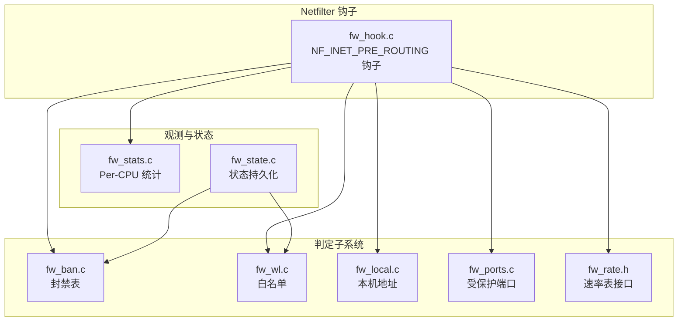

**图表来源**
- [fw_hook.c:82-95](file://src/kernel-module/fw_hook.c#L82-L95)
- [fw_ban.c:101-121](file://src/kernel-module/fw_ban.c#L101-L121)
- [fw_wl.c:114-147](file://src/kernel-module/fw_wl.c#L114-L147)
- [fw_local.c:70-101](file://src/kernel-module/fw_local.c#L70-L101)
- [fw_ports.c:40-49](file://src/kernel-module/fw_ports.c#L40-L49)
- [fw_rate.h:37-60](file://src/kernel-module/fw_rate.h#L37-L60)
- [fw_stats.c:32-48](file://src/kernel-module/fw_stats.c#L32-L48)
- [fw_state.c:281-354](file://src/kernel-module/fw_state.c#L281-L354)

**章节来源**
- [README.md:10-31](file://README.md#L10-L31)
- [fw_hook.c:1-45](file://src/kernel-module/fw_hook.c#L1-L45)

## 核心组件
- 钩子入口与优先级：IPv4/IPv6 各一个钩子，挂在 init_net 的 NF_INET_PRE_ROUTING，优先级为 NF_IP_PRI_FILTER - 1，确保在 filter 表之前看到报文。
- 判定顺序：环回接口豁免 → 白名单命中 → 本机地址命中 → 封禁表命中 → 若开启 DDoS 且目的端口受保护则进行速率判定，违规即自决封禁并丢包。
- 报文解析：IPv4 校验和、长度、版本、IHL；IPv6 扩展头遍历深度上限；传输层识别 TCP/UDP/ICMP；非首片跳过传输层解析。
- 安全机制：源地址非法直接放行（不计丢弃）；TCP 异常标志组合丢包；IPv6 扩展头深度超限丢包；ICMPv6 Echo Request 映射为 IPPROTO_ICMP 以覆盖阈值。
- 统计与观测：Per-CPU 直方图、全局流量计数、UDP/ICMP 分布、端口扫描与服务探测者收集。

**章节来源**
- [fw_hook.c:82-95](file://src/kernel-module/fw_hook.c#L82-L95)
- [fw_hook.c:104-154](file://src/kernel-module/fw_hook.c#L104-L154)
- [fw_hook.c:156-278](file://src/kernel-module/fw_hook.c#L156-L278)
- [fw_hook.c:280-410](file://src/kernel-module/fw_hook.c#L280-L410)
- [fw_stats.c:141-162](file://src/kernel-module/fw_stats.c#L141-L162)

## 架构总览
下图展示 NF_INET_PRE_ROUTING 钩子在 IPv4/IPv6 路径上的关键调用链与数据流。

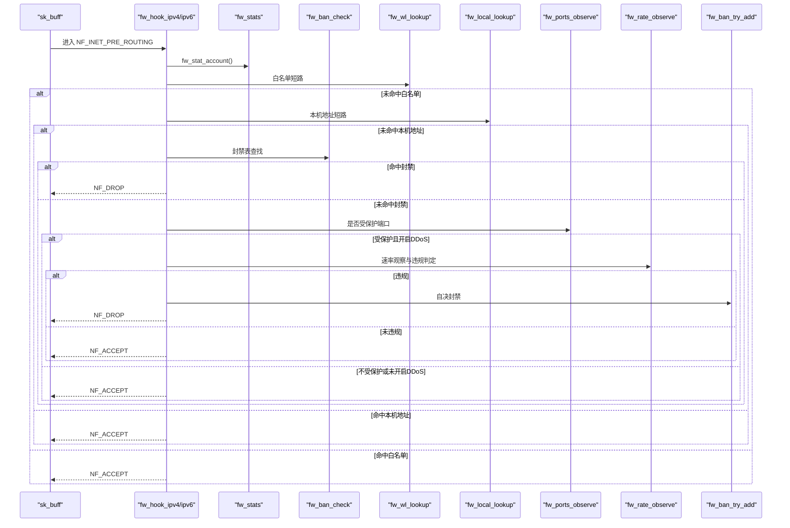

**图表来源**
- [fw_hook.c:156-278](file://src/kernel-module/fw_hook.c#L156-L278)
- [fw_hook.c:280-410](file://src/kernel-module/fw_hook.c#L280-L410)
- [fw_ban.c:369-383](file://src/kernel-module/fw_ban.c#L369-L383)
- [fw_wl.c:114-147](file://src/kernel-module/fw_wl.c#L114-L147)
- [fw_local.c:70-101](file://src/kernel-module/fw_local.c#L70-L101)
- [fw_ports.c:40-49](file://src/kernel-module/fw_ports.c#L40-L49)
- [fw_rate.h:37-60](file://src/kernel-module/fw_rate.h#L37-L60)

## 详细组件分析

### 钩子注册与双栈支持
- 注册点：init_net 的 NF_INET_PRE_ROUTING，IPv4/IPv6 分别注册 nf_ops_ipv4/nf_ops_ipv6，优先级为 NF_IP_PRI_FILTER - 1。
- 双栈支持：两套钩子函数 fw_hook_ipv4/fw_hook_ipv6，分别处理 IPv4/IPv6 报文，共享 fw_ban_check 判定主体。
- 退出保护：钩子入口与判定主体均检测关闭状态，避免卸载期间被新流量拖住。

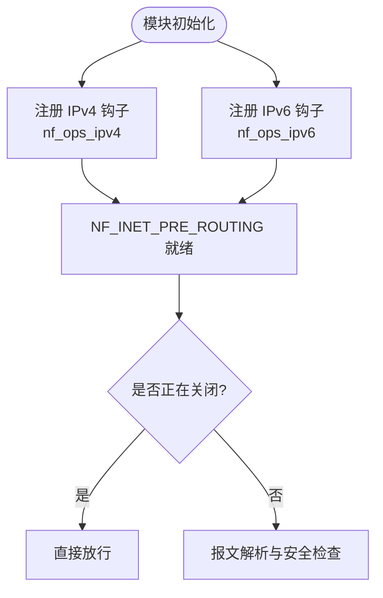

**图表来源**
- [fw_hook.c:82-95](file://src/kernel-module/fw_hook.c#L82-L95)
- [fw_hook.c:171-177](file://src/kernel-module/fw_hook.c#L171-L177)
- [fw_hook.c:297-302](file://src/kernel-module/fw_hook.c#L297-L302)

**章节来源**
- [fw_hook.c:82-95](file://src/kernel-module/fw_hook.c#L82-L95)
- [fw_hook.c:171-177](file://src/kernel-module/fw_hook.c#L171-L177)
- [fw_hook.c:297-302](file://src/kernel-module/fw_hook.c#L297-L302)

### IPv4 报文处理流程
- 基本校验：pskb_may_pull、ip_fast_csum、版本与 IHL、长度一致性。
- 源地址合法性：fw_src_is_invalid_ipv4 返回非法则直接放行。
- 分片处理：MF 或偏移非 0 视为分片；非首片将 protocol 置 0，跳过传输层解析。
- 传输层识别：TCP 提取 SYN/ACK/RST/FIN 标志与目的端口；UDP 提取目的端口；ICMP 记录类型/代码，仅 Echo Request 参与 flood 判定。
- 统计记账：fw_stat_account 记录直方图、TTL 分布、分片、UDP/ICMP 分布；fw_stat_global_traffic 累计全局流量。
- 协议异常：SYN+FIN/SYN+RST/四标志全零丢包，计入 tcp_anomaly_dropped 与 packets_dropped。
- 判定主体：fw_ban_check 一次 RCU 临界区完成白名单/本机/封禁/速率判定。

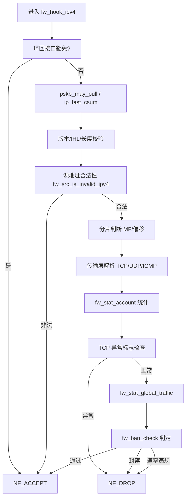

**图表来源**
- [fw_hook.c:156-278](file://src/kernel-module/fw_hook.c#L156-L278)
- [fw_stats.c:141-162](file://src/kernel-module/fw_stats.c#L141-L162)

**章节来源**
- [fw_hook.c:156-278](file://src/kernel-module/fw_hook.c#L156-L278)

### IPv6 报文处理流程
- 基础校验：pskb_may_pull、payload_len 与 skb->len 一致性。
- 扩展头遍历：Hop/Routing/Dest/Auth 扩展头深度上限 8，超限丢包；Fragment 扩展头后无传输层头，protocol 置 0。
- 源地址合法性：fw_src_is_invalid_ipv6 返回非法则直接放行。
- 传输层识别：同 IPv4，ICMPv6 Echo Request 映射为 IPPROTO_ICMP 以统一阈值。
- 统计与异常：与 IPv4 一致。

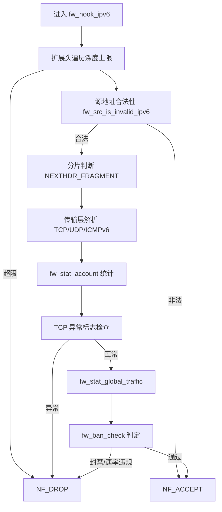

**图表来源**
- [fw_hook.c:280-410](file://src/kernel-module/fw_hook.c#L280-L410)

**章节来源**
- [fw_hook.c:280-410](file://src/kernel-module/fw_hook.c#L280-L410)

### 封禁表设计与查找
- 分层桶表：按 prefix_len 分层，短前缀层使用小桶数组，全长层复用表内桶数组。
- 桶索引：按本层前缀归一化后的地址计算，保证同一网段落同一桶。
- 查找路径：先查精确层（/32 或 /128），再按 used 位图遍历更短前缀层。
- 容量上限：ban_table_full_rejects 唯一递增点，修复旧实现恒为 0 的问题。
- 定时器与释放：到期回调持桶锁摘链 + call_rcu 释放，避免自锁死与 use-after-free。

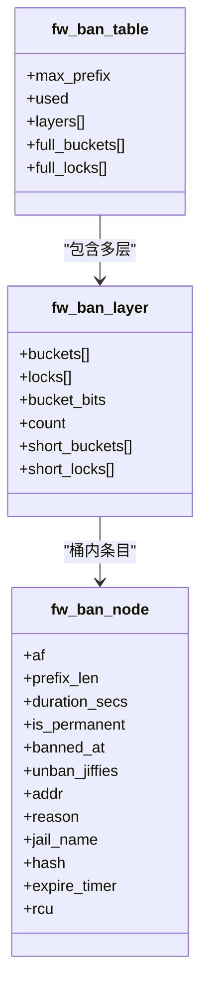

**图表来源**
- [fw_ban.c:101-121](file://src/kernel-module/fw_ban.c#L101-L121)
- [fw_ban.c:162-174](file://src/kernel-module/fw_ban.c#L162-L174)
- [fw_ban.c:234-268](file://src/kernel-module/fw_ban.c#L234-L268)
- [fw_ban.c:369-383](file://src/kernel-module/fw_ban.c#L369-L383)

**章节来源**
- [fw_ban.c:101-121](file://src/kernel-module/fw_ban.c#L101-L121)
- [fw_ban.c:162-174](file://src/kernel-module/fw_ban.c#L162-L174)
- [fw_ban.c:234-268](file://src/kernel-module/fw_ban.c#L234-L268)
- [fw_ban.c:369-383](file://src/kernel-module/fw_ban.c#L369-L383)

### 白名单与本机地址
- 白名单：精确桶 + 子网链表，命中即放行且跳过速率判定；remove 改为精确匹配，避免子网误删。
- 本机地址：开放寻址线性探测哈希集，O(1) 查找；空表窗口消除，发布后内容不再修改。
- 联动：白名单变更时解封落在其覆盖范围内的封禁条目。

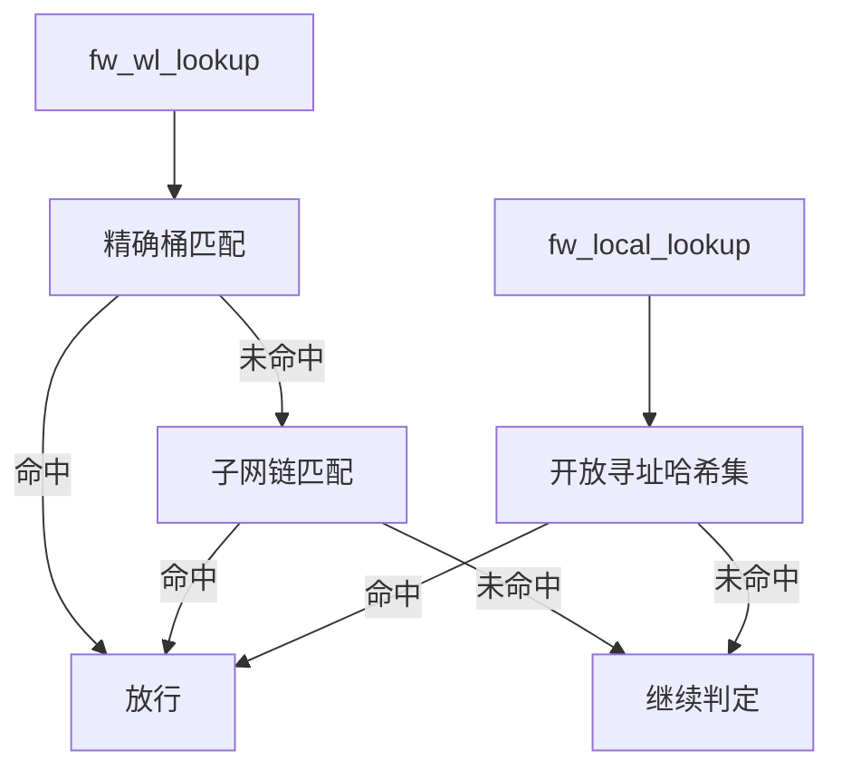

**图表来源**
- [fw_wl.c:114-147](file://src/kernel-module/fw_wl.c#L114-L147)
- [fw_wl.c:212-245](file://src/kernel-module/fw_wl.c#L212-L245)
- [fw_local.c:70-101](file://src/kernel-module/fw_local.c#L70-L101)

**章节来源**
- [fw_wl.c:114-147](file://src/kernel-module/fw_wl.c#L114-L147)
- [fw_wl.c:212-245](file://src/kernel-module/fw_wl.c#L212-L245)
- [fw_local.c:70-101](file://src/kernel-module/fw_local.c#L70-L101)

### 受保护端口与速率判定
- 受保护端口：固定 65536 位位图，缺省为空指针表示全端口受保护；daemon 通过 netlink 下发位图。
- 速率判定：fw_rate_observe 一次查表完成窗口滚动与四类违规判定；per-CPU 槽避免共享 cache line 写；端口去重集合移至 per-CPU 槽。
- 失败开放：速率表满时有意放行，避免误伤正常流量；rate_slot_spill 观测并在 procfs rates 表头读出。

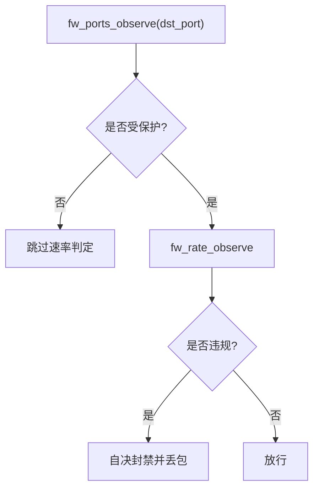

**图表来源**
- [fw_ports.c:40-49](file://src/kernel-module/fw_ports.c#L40-L49)
- [fw_rate.h:37-60](file://src/kernel-module/fw_rate.h#L37-L60)

**章节来源**
- [fw_ports.c:40-49](file://src/kernel-module/fw_ports.c#L40-L49)
- [fw_rate.h:37-60](file://src/kernel-module/fw_rate.h#L37-L60)

### 统计与观测
- Per-CPU 统计：fw_stats_this_cpu 获取本 CPU 槽；fw_stat_account 写入直方图、TTL 分布、分片、UDP/ICMP 分布。
- Flush 合并：fw_stats_flush_all 同步等待每个 CPU 完成，将 per-CPU 计数并入全局哈希表，UDP/ICMP 分布槽清零。
- 读侧快照：fw_stats_snapshot 与 fw_stats_read_analysis 提供聚合视图，保证读数新鲜。

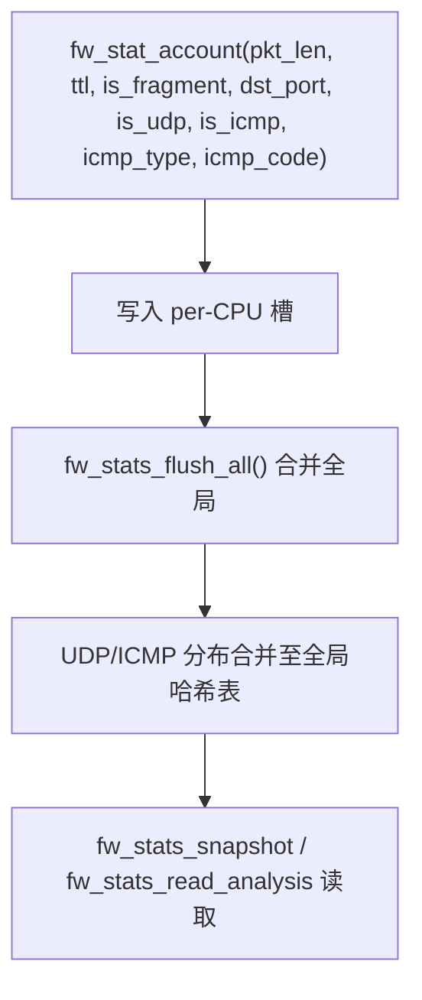

**图表来源**
- [fw_stats.c:141-162](file://src/kernel-module/fw_stats.c#L141-L162)
- [fw_stats.c:291-343](file://src/kernel-module/fw_stats.c#L291-L343)
- [fw_stats.c:376-459](file://src/kernel-module/fw_stats.c#L376-L459)

**章节来源**
- [fw_stats.c:141-162](file://src/kernel-module/fw_stats.c#L141-L162)
- [fw_stats.c:291-343](file://src/kernel-module/fw_stats.c#L291-L343)
- [fw_stats.c:376-459](file://src/kernel-module/fw_stats.c#L376-L459)

### 状态持久化与恢复
- 保存：分页收集封禁/白名单条目，写入临时文件，CRC32 尾行，原子替换目标路径。
- 恢复：校验 CRC32，两遍解析（先白名单后封禁），保留前缀长度与原始起点。
- 安全性：路径校验、URL 转义与 shell 元字符拒绝、文件大小上限按容量参数反推。

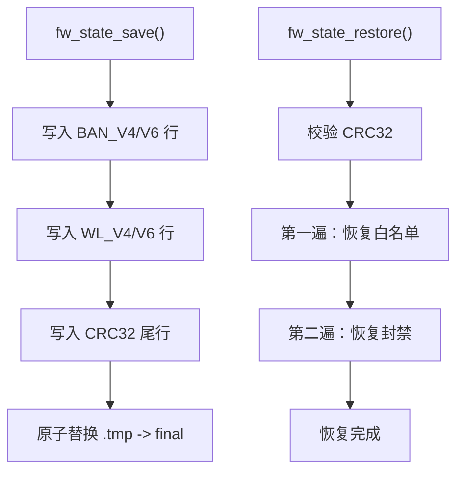

**图表来源**
- [fw_state.c:281-354](file://src/kernel-module/fw_state.c#L281-L354)
- [fw_state.c:542-654](file://src/kernel-module/fw_state.c#L542-L654)

**章节来源**
- [fw_state.c:281-354](file://src/kernel-module/fw_state.c#L281-L354)
- [fw_state.c:542-654](file://src/kernel-module/fw_state.c#L542-L654)

## 依赖关系分析
- 钩子依赖：fw_hook.c 依赖 fw_ban、fw_wl、fw_local、fw_ports、fw_rate、fw_stats。
- 判定链路：白名单/本机地址短路 → 封禁表查找 → 受保护端口门控 → 速率判定 → 自决封禁。
- 统计链路：每包统计落 per-CPU → flush 合并 → 读侧快照。
- 状态链路：保存/恢复与封禁/白名单表交互，保持前缀语义与时间语义一致。

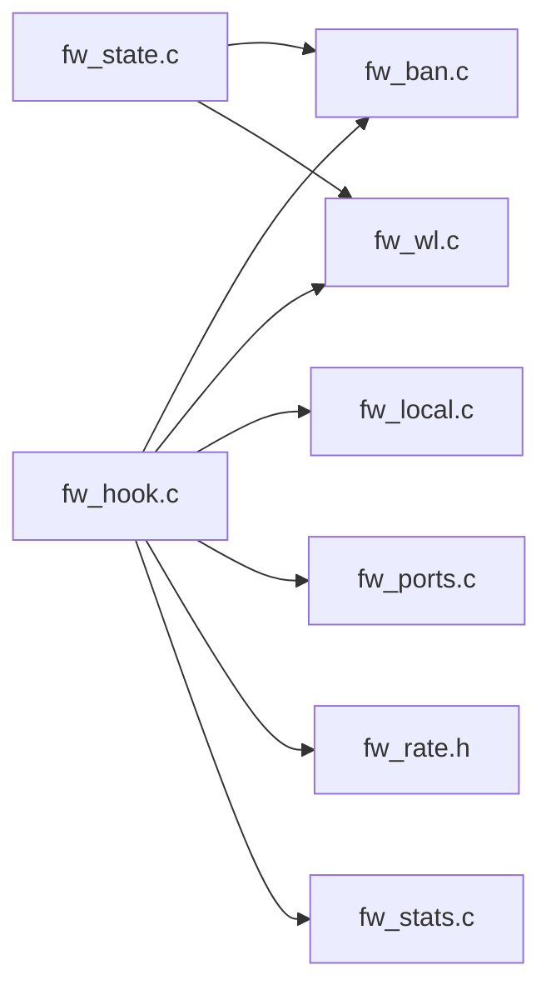

**图表来源**
- [fw_hook.c:58-64](file://src/kernel-module/fw_hook.c#L58-L64)
- [fw_ban.c:49-52](file://src/kernel-module/fw_ban.c#L49-L52)
- [fw_wl.c:24-27](file://src/kernel-module/fw_wl.c#L24-L27)
- [fw_local.c:23-24](file://src/kernel-module/fw_local.c#L23-L24)
- [fw_ports.c:21-22](file://src/kernel-module/fw_ports.c#L21-L22)
- [fw_rate.h:31-31](file://src/kernel-module/fw_rate.h#L31-L31)
- [fw_stats.c:23-24](file://src/kernel-module/fw_stats.c#L23-L24)
- [fw_state.c:42-44](file://src/kernel-module/fw_state.c#L42-L44)

**章节来源**
- [fw_hook.c:58-64](file://src/kernel-module/fw_hook.c#L58-L64)
- [fw_ban.c:49-52](file://src/kernel-module/fw_ban.c#L49-L52)
- [fw_wl.c:24-27](file://src/kernel-module/fw_wl.c#L24-L27)
- [fw_local.c:23-24](file://src/kernel-module/fw_local.c#L23-L24)
- [fw_ports.c:21-22](file://src/kernel-module/fw_ports.c#L21-L22)
- [fw_rate.h:31-31](file://src/kernel-module/fw_rate.h#L31-L31)
- [fw_stats.c:23-24](file://src/kernel-module/fw_stats.c#L23-L24)
- [fw_state.c:42-44](file://src/kernel-module/fw_state.c#L42-L44)

## 性能与优化
- RCU 临界区管理：fw_ban_check 一次进入 rcu_read_lock，白名单/本机/封禁/速率判定在同一临界区内完成；白名单与本机关联函数自带 RCU 读侧临界区，嵌套合法。
- Per-CPU 统计：fw_stats_this_cpu 写入本 CPU 槽，flush 时合并全局，消除多核争用与共享 cache line 写。
- 零拷贝操作：skb_header_pointer 与 pskb_may_pull 避免额外拷贝；硬件校验报文跳过软件校验和。
- 速率表优化：一次查表、per-CPU 槽、端口去重集合移至 per-CPU，热路径无自旋锁。
- 失败开放策略：速率表满时放行，避免误伤；分布槽顶替允许丢观测计数，降低热路径开销。

**章节来源**
- [fw_hook.c:104-154](file://src/kernel-module/fw_hook.c#L104-L154)
- [fw_stats.c:96-162](file://src/kernel-module/fw_stats.c#L96-L162)
- [fw_rate.h:13-26](file://src/kernel-module/fw_rate.h#L13-L26)
- [fw_rate.h:52-57](file://src/kernel-module/fw_rate.h#L52-L57)

## 故障排查指南
- 钩子未生效：确认 NF_INET_PRE_ROUTING 已注册且优先级正确；检查 init_net 绑定与容器 veth 流量是否在 init_net 侧可见。
- 报文被误放：检查源地址合法性校验、分片路径、IPv6 扩展头深度；确认 ICMPv6 Echo Request 映射逻辑。
- 封禁不生效：查看封禁表分层桶与 used 位图；确认白名单/本机地址短路顺序；检查 CIDR 前缀归一化与桶索引。
- 速率判定异常：确认受保护端口位图已下发；检查 rate_slot_spill 观测值；核对 EWMA 基线更新。
- 统计陈旧：调用 fw_stats_flush_all 后再读取；确认 UDP/ICMP 分布槽 flush 合并逻辑。
- 状态恢复失败：检查 CRC32 尾行与文件大小上限；确认白名单先于封禁恢复；验证前缀长度与原始起点换算。

**章节来源**
- [fw_hook.c:171-177](file://src/kernel-module/fw_hook.c#L171-L177)
- [fw_hook.c:280-410](file://src/kernel-module/fw_hook.c#L280-L410)
- [fw_ban.c:369-383](file://src/kernel-module/fw_ban.c#L369-L383)
- [fw_ports.c:40-49](file://src/kernel-module/fw_ports.c#L40-L49)
- [fw_stats.c:338-343](file://src/kernel-module/fw_stats.c#L338-L343)
- [fw_state.c:366-401](file://src/kernel-module/fw_state.c#L366-L401)

## 结论
该 Netfilter 钩子实现以 NF_INET_PRE_ROUTING 为核心，结合白名单、本机地址、封禁表与受保护端口门控，形成高效的双栈报文处理流水线。通过 RCU 临界区、Per-CPU 统计、零拷贝与失败开放策略，在保证安全性的同时显著降低热路径开销。状态持久化与 CRC 校验确保配置可恢复与一致性。建议在生产环境中关注 rate_slot_spill、ban_table_full_rejects 与 UDP/ICMP 分布指标，以便及时调优容量与阈值。