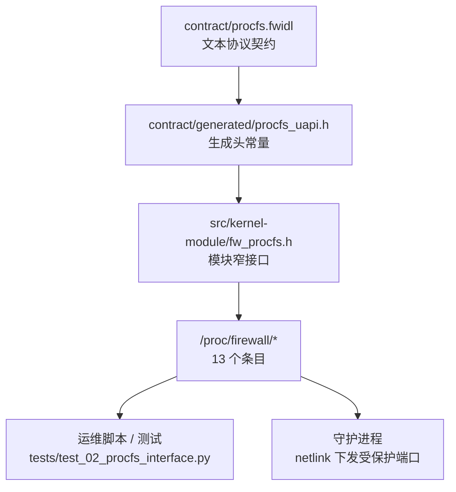
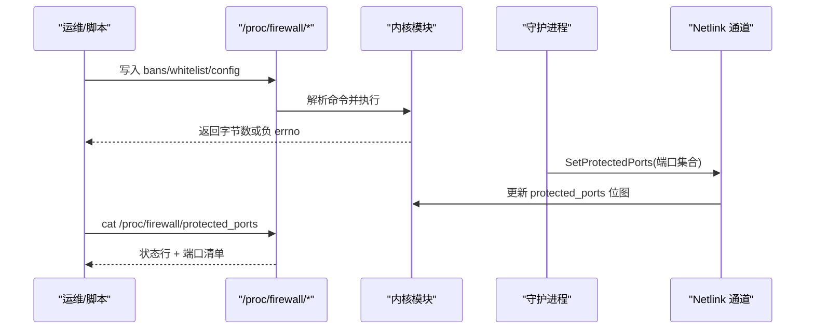
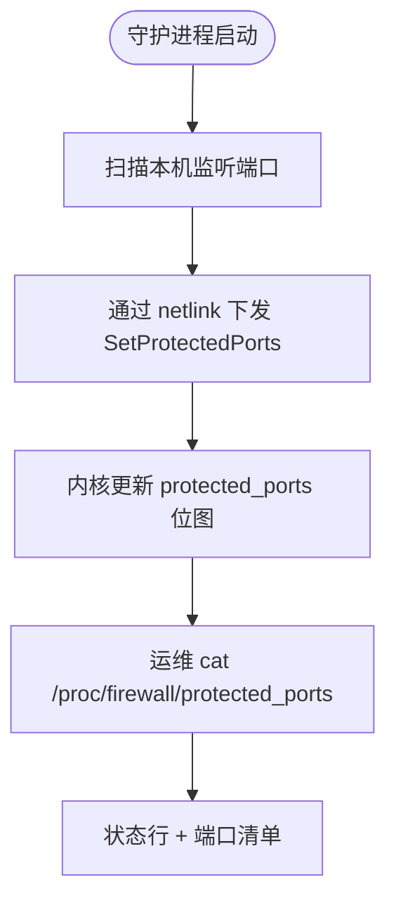
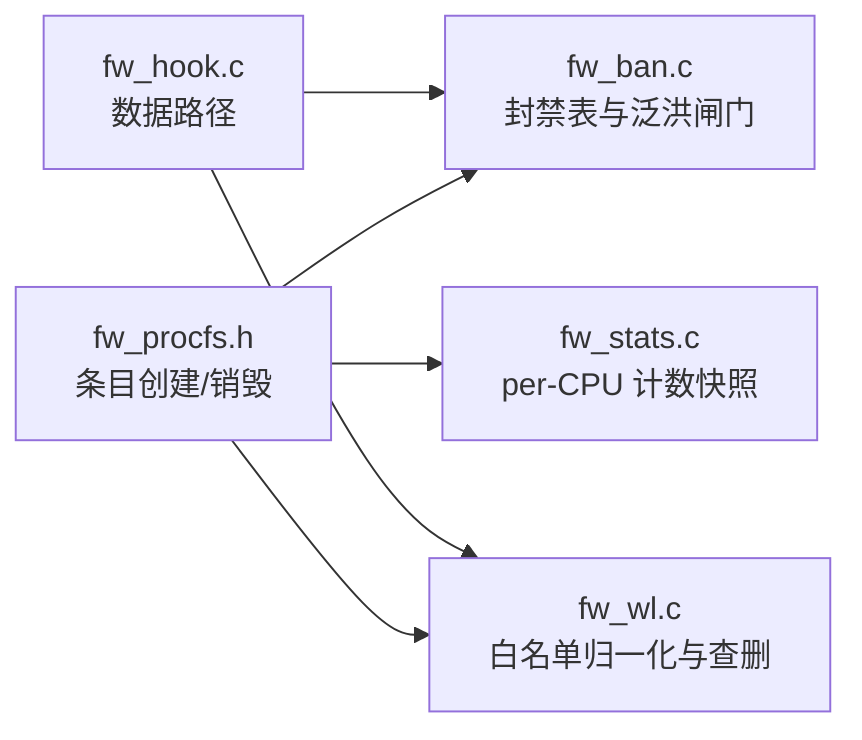

# ProcFS接口

<cite>
**本文引用的文件**   
- [contract/procfs.fwidl](file://contract/procfs.fwidl)
- [contract/generated/procfs_uapi.h](file://contract/generated/procfs_uapi.h)
- [src/kernel-module/fw_procfs.h](file://src/kernel-module/fw_procfs.h)
- [docs/zh/configuration/procfs.md](file://docs/zh/configuration/procfs.md)
- [tests/test_02_procfs_interface.py](file://tests/test_02_procfs_interface.py)
- [src/kernel-module/fw_ban.c](file://src/kernel-module/fw_ban.c)
- [src/kernel-module/fw_wl.c](file://src/kernel-module/fw_wl.c)
- [src/kernel-module/fw_stats.c](file://src/kernel-module/fw_stats.c)
- [src/kernel-module/fw_hook.c](file://src/kernel-module/fw_hook.c)
</cite>

## 目录
1. [简介](#简介)
2. [项目结构](#项目结构)
3. [核心组件](#核心组件)
4. [架构总览](#架构总览)
5. [详细组件分析](#详细组件分析)
6. [依赖关系分析](#依赖关系分析)
7. [性能考虑](#性能考虑)
8. [故障排查指南](#故障排查指南)
9. [结论](#结论)
10. [附录](#附录)

## 简介
本文件面向运维与开发者，系统化说明内核模块对外暴露的 ProcFS 文本接口 `/proc/firewall/*`。内容覆盖：
- 目录结构与 13 个条目的权限、读写语义、机器可读契约
- 写侧命令文法（封禁、解封、白名单、运行时配置）
- 读侧统计字段、列表输出约定与稳定性承诺
- 端口监听扫描机制、服务发现算法、动态端口管理
- 与守护进程的数据交换协议、消息格式、错误处理
- I/O 优化、缓冲策略、并发访问控制
- 使用示例与调试方法

## 项目结构
ProcFS 接口的“单一真相源”是 IDL 契约文件；内核实现通过生成头常量驱动条目路径、权限位、命令形式与键名；用户文档与测试均围绕该契约展开。

**图表来源**
- [contract/procfs.fwidl:1-33](file://contract/procfs.fwidl#L1-L33)
- [contract/generated/procfs_uapi.h:1-36](file://contract/generated/procfs_uapi.h#L1-L36)
- [src/kernel-module/fw_procfs.h:1-27](file://src/kernel-module/fw_procfs.h#L1-L27)
- [tests/test_02_procfs_interface.py:1-69](file://tests/test_02_procfs_interface.py#L1-L69)

**章节来源**
- [contract/procfs.fwidl:1-33](file://contract/procfs.fwidl#L1-L33)
- [contract/generated/procfs_uapi.h:1-36](file://contract/generated/procfs_uapi.h#L1-L36)
- [src/kernel-module/fw_procfs.h:1-27](file://src/kernel-module/fw_procfs.h#L1-L27)

## 核心组件
- 契约层：`contract/procfs.fwidl` 定义根目录、条目清单、权限、读写文法、机器可读键、容量上限与缺陷处置锚点。
- 生成物层：`contract/generated/procfs_uapi.h` 提供路径常量、权限位、操作枚举、命令模板、统计键名与容量上限。
- 内核实现层：`src/kernel-module/fw_procfs.h` 声明 `fw_procfs_init()` / `fw_procfs_exit()`，负责创建/销毁条目并遵循契约。
- 用户层：运维脚本、测试用例与守护进程通过 `/proc/firewall/*` 与内核交互。

关键要点：
- 仅 `bans`、`whitelist`、`config` 可写，其余只读。
- `stats` 是唯一机器可读只读条目，键名与数值类型不可改。
- 其他只读条目为人类可读表格，标注 unstable，不保证排版稳定。

**章节来源**
- [contract/procfs.fwidl:30-164](file://contract/procfs.fwidl#L30-L164)
- [contract/generated/procfs_uapi.h:7-82](file://contract/generated/procfs_uapi.h#L7-L82)
- [src/kernel-module/fw_procfs.h:1-27](file://src/kernel-module/fw_procfs.h#L1-L27)

## 架构总览
ProcFS 是面向人与运维的文本通道，不是守护进程的内部二进制通道。守护进程通过 netlink 与内核通信，但会把本机监听端口集合经 netlink 下发后，由内核以 `protected_ports` 暴露给 ProcFS 观测。

**图表来源**
- [docs/zh/architecture/data-flow.md:245-247](file://docs/zh/architecture/data-flow.md#L245-L247)
- [contract/procfs.fwidl:155-164](file://contract/procfs.fwidl#L155-L164)

**章节来源**
- [docs/zh/architecture/data-flow.md:245-247](file://docs/zh/architecture/data-flow.md#L245-L247)
- [contract/procfs.fwidl:155-164](file://contract/procfs.fwidl#L155-L164)

## 详细组件分析

### 目录与文件接口设计
- 根目录：`/proc/firewall`
- 可写文件：
  - `bans`：封禁、时长封、永久封、解封
  - `whitelist`：添加子网、省略动词即添加、删除子网
  - `config`：查看运行时配置；设置默认封禁时长
- 只读文件：
  - `stats`：13 个计数器，每行 `<key> <十进制整数>`
  - `rates`：速率表明细
  - `udp_ports`：UDP 端口分布
  - `icmp_types`：ICMP 类型分布
  - `pkt_sizes`：包大小分布
  - `ttl_dist`：TTL 分布
  - `ip_frags`：IP 分片统计
  - `port_scanners`：端口扫描检测
  - `service_probes`：服务探测检测
  - `protected_ports`：受保护端口集合（守护进程下发）

权限规则：
- 可写文件权限为 `0600`，仅 root 可读写。
- 只读文件权限为 `0400`，仅 root 可读。

**章节来源**
- [contract/procfs.fwidl:62-164](file://contract/procfs.fwidl#L62-L164)
- [contract/generated/procfs_uapi.h:10-36](file://contract/generated/procfs_uapi.h#L10-L36)
- [docs/zh/configuration/procfs.md:11-30](file://docs/zh/configuration/procfs.md#L11-L30)

### 写侧命令文法与权限控制
通用规则：
- 一次 `write(2)` 一条命令，末尾可选换行。
- 成功返回写入字节数；失败返回负 errno，无文本错误通道。
- 分隔符为空格或制表符，不接受多余 token。
- 除制表符外，所有小于 `0x20` 的字节一律拒绝。

`bans` 写文法：
- `<ip>`：使用内核默认时长
- `<ip> <seconds>`：指定秒数，范围 1..31536000
- `<ip> 0`：永久封
- `unban <ip>`：解封

`whitelist` 写文法：
- `add <subnet>`：添加子网
- `<subnet>`：省略动词即添加
- `remove <subnet>`：删除子网
- 地址归一化：入表前主机位清零；IPv4 补 `/32`，IPv6 补 `/128`
- 禁止加入：`0.0.0.0`、广播、组播、回环、链路本地地址

`config` 写文法：
- `ban_time <seconds>`：取值 1..31536000

权限控制：
- 三个可写文件均为 `0600`，仅 root 可写。
- 白名单 remove 对“本机接口 IP”有保护逻辑，procfs 不再自查本机 IP，交由底层按精确主机地址判定。

**章节来源**
- [contract/procfs.fwidl:166-190](file://contract/procfs.fwidl#L166-L190)
- [docs/zh/configuration/procfs.md:32-153](file://docs/zh/configuration/procfs.md#L32-L153)
- [contract/procfs.fwidl:355-361](file://contract/procfs.fwidl#L355-L361)

### 读侧统计与机器可读契约
`stats` 字段（机器可读）：
- `total_bans`：累计封禁次数
- `total_unbans`：累计解封次数
- `whitelist_rejects`：封禁请求命中白名单被拒、白名单表到上限被拒
- `ban_table_full_rejects`：封禁表到上限被拒次数
- `alloc_failures`：建条目时内存分配失败次数
- `packets_dropped`：丢弃数据包数
- `packets_accepted`：放行数据包数
- `tcp_anomaly_dropped`：按 TCP 异常丢弃的包数
- `cleanup_cycles`：恒为 0（保留字段）
- `cleanup_expired_total`：因到期被摘除的封禁条目数
- `current_bans`：当前封禁条目数
- `current_whitelist`：当前白名单条目数
- `recent_additions`：一秒窗口内已记的封禁添加次数（泛洪限流用）

稳定性承诺：
- `stats` 为 machine 级别契约，键名与数值类型不可改。
- 其他只读条目为 unstable，允许重写时改变排版。

**章节来源**
- [contract/procfs.fwidl:192-216](file://contract/procfs.fwidl#L192-L216)
- [docs/zh/configuration/procfs.md:165-195](file://docs/zh/configuration/procfs.md#L165-L195)

### 端口监听扫描机制与服务发现算法
- `protected_ports` 是只读观测面，表示“纳入防护”的端口集合。
- 守护进程扫描本机对外监听端口，经 netlink 下发至内核。
- 置位端口的入站流量参与 DDoS 速率判定。
- 若守护进程未下发，内核按“全端口受保护”处理。

**图表来源**
- [contract/procfs.fwidl:155-164](file://contract/procfs.fwidl#L155-L164)
- [docs/zh/configuration/procfs.md:229-229](file://docs/zh/configuration/procfs.md#L229-L229)

**章节来源**
- [contract/procfs.fwidl:155-164](file://contract/procfs.fwidl#L155-L164)
- [docs/zh/configuration/procfs.md:229-229](file://docs/zh/configuration/procfs.md#L229-L229)

### 动态端口管理与展示上限
- `protected_ports` 展示行数上限为 256 行。
- 位图本身容量为 65536 位；逐位遍历在展示上限处截断，并打印提示。
- 该文件不提供写入口，运维侧无法手改“谁受保护”。

**章节来源**
- [contract/procfs.fwidl:269-273](file://contract/procfs.fwidl#L269-L273)
- [docs/zh/configuration/procfs.md:248-249](file://docs/zh/configuration/procfs.md#L248-L249)

### 与守护进程的数据交换协议、消息格式与错误处理
- ProcFS 是文本协议，守护进程内部通道是 netlink（二进制）。
- 守护进程通过 netlink 下发受保护端口集合；内核将结果暴露于 `protected_ports`。
- 写侧错误处理：
  - 返回负 errno，无文本错误通道。
  - 常见 errno：`-EINVAL`、`-EBUSY`、`-ENOMEM`、`-EPERM`。
  - 具体拒绝原因进入内核日志，需通过 `dmesg` 查看。

**章节来源**
- [contract/procfs.fwidl:18-26](file://contract/procfs.fwidl#L18-L26)
- [contract/procfs.fwidl:339-345](file://contract/procfs.fwidl#L339-L345)
- [docs/zh/configuration/procfs.md:32-42](file://docs/zh/configuration/procfs.md#L32-L42)

### 端口扫描与服务探测检测
- `port_scanners`：阈值 5 个唯一端口，最多列 20 条。
- `service_probes`：阈值 3 种协议，最多列 20 条。
- 列表顺序为哈希遍历顺序，不保证稳定。

**章节来源**
- [contract/procfs.fwidl:141-153](file://contract/procfs.fwidl#L141-L153)
- [docs/zh/configuration/procfs.md:225-227](file://docs/zh/configuration/procfs.md#L225-L227)

### 容量与上限
| 条目 | 条目上限 | 控制方式 | 代码锚点 |
|------|----------|----------|----------|
| `bans` | 65535 | 模块参数 `fw_max_ban_entries` | `src/kernel-module/fw_ban.c:fw_info.max_ban_entries` |
| `whitelist` | 65535 | 模块参数 `fw_max_whitelist_entries` | `src/kernel-module/fw_wl.c:fw_info.max_wl_entries` |
| `rates` | 65536 | 模块参数 `fw_max_rate_entries` | `src/kernel-module/fw_main.c:fw_max_rate_entries` |
| `udp_ports` | 512 | 常量 | `src/kernel-module/fw_types.h:MAX_UDP_PORT_ENTRIES` |
| `icmp_types` | 128 | 常量 | `src/kernel-module/fw_types.h:MAX_ICMP_TYPE_ENTRIES` |
| `port_scanners` | 20 | 常量 | `src/kernel-module/fw_types.h:PORT_SCAN_MAX_RESULTS` |
| `service_probes` | 20 | 常量 | `src/kernel-module/fw_types.h:SERVICE_PROBE_MAX_RESULTS` |
| `protected_ports` | 256 | 展示行数上限 | `src/kernel-module/fw_types.h:FW_PROCFS_PROTECTED_PORTS_MAX_LINES` |

注意：
- 封禁表满返回 `-ENOSPC`，并递增 `ban_table_full_rejects`。
- 速率表满时新来的源地址有意放行，溢出计数为 `rate_slot_spill`。
- `protected_ports` 展示上限 256 行，位图容量 65536 位。

**章节来源**
- [contract/procfs.fwidl:227-273](file://contract/procfs.fwidl#L227-L273)
- [docs/zh/configuration/procfs.md:231-249](file://docs/zh/configuration/procfs.md#L231-L249)

## 依赖关系分析
ProcFS 实现依赖多个内核子系统：
- 封禁表：`fw_ban.c`
- 白名单：`fw_wl.c`
- 统计快照：`fw_stats.c`
- 数据路径钩子：`fw_hook.c`

**图表来源**
- [src/kernel-module/fw_procfs.h:1-27](file://src/kernel-module/fw_procfs.h#L1-L27)
- [src/kernel-module/fw_ban.c:11-12](file://src/kernel-module/fw_ban.c#L11-L12)
- [src/kernel-module/fw_wl.c:119-119](file://src/kernel-module/fw_wl.c#L119-L119)
- [src/kernel-module/fw_stats.c:9-9](file://src/kernel-module/fw_stats.c#L9-L9)
- [src/kernel-module/fw_hook.c:24-24](file://src/kernel-module/fw_hook.c#L24-L24)

**章节来源**
- [src/kernel-module/fw_procfs.h:1-27](file://src/kernel-module/fw_procfs.h#L1-L27)
- [src/kernel-module/fw_ban.c:11-12](file://src/kernel-module/fw_ban.c#L11-L12)
- [src/kernel-module/fw_wl.c:119-119](file://src/kernel-module/fw_wl.c#L119-L119)
- [src/kernel-module/fw_stats.c:9-9](file://src/kernel-module/fw_stats.c#L9-L9)
- [src/kernel-module/fw_hook.c:24-24](file://src/kernel-module/fw_hook.c#L24-L24)

## 性能考虑
- I/O 优化：
  - `stats` 读取前先刷 per-CPU 批量计数，避免陈旧值。
  - 列表类条目为哈希遍历，不排序；下游不应依赖顺序。
- 缓冲策略：
  - per-CPU 计数达到批次阈值才 flush，降低锁竞争。
- 并发访问控制：
  - 白名单读侧自带 RCU 读侧临界区，热路径与 procfs/netlink 共用。
  - 封禁表容量检查在桶锁内进行，原子递增拒绝计数。

**章节来源**
- [contract/procfs.fwidl:347-353](file://contract/procfs.fwidl#L347-L353)
- [src/kernel-module/fw_wl.c:119-119](file://src/kernel-module/fw_wl.c#L119-L119)
- [contract/procfs.fwidl:227-243](file://contract/procfs.fwidl#L227-L243)

## 故障排查指南
写命令未生效时的排查步骤：
1. 查看内核日志中的拒绝原因：`sudo dmesg | tail`
2. 检查目标是否被白名单挡住：`sudo cat /proc/firewall/whitelist`
3. 检查封禁表是否到顶：`sudo cat /proc/firewall/stats | grep ban_table_full_rejects`
4. 确认写入内容：`echo "<命令>" | sudo tee /proc/firewall/<文件>`

常见 errno：
- `-EINVAL`：参数非法或超出范围
- `-EBUSY`：资源忙
- `-ENOMEM`：内存分配失败
- `-EPERM`：权限不足或受保护地址

**章节来源**
- [docs/zh/configuration/procfs.md:251-270](file://docs/zh/configuration/procfs.md#L251-L270)
- [contract/procfs.fwidl:339-345](file://contract/procfs.fwidl#L339-L345)

## 结论
ProcFS 接口以 `contract/procfs.fwidl` 为单一真相源，严格区分机器可读与人类可读契约。运维通过 `/proc/firewall/*` 进行封禁、白名单与配置管理；守护进程通过 netlink 下发受保护端口集合。实现强调错误码优先、日志辅助，并通过 per-CPU 计数快照与 RCU 读侧临界区保障性能与并发安全。

## 附录

### 使用示例
- 封禁与解封：
  - `echo "203.0.113.9" | sudo tee /proc/firewall/bans`
  - `echo "203.0.113.9 3600" | sudo tee /proc/firewall/bans`
  - `echo "203.0.113.9 0" | sudo tee /proc/firewall/bans`
  - `echo "unban 203.0.113.9" | sudo tee /proc/firewall/bans`
- 白名单管理：
  - `echo "203.0.113.0/24" | sudo tee /proc/firewall/whitelist`
  - `echo "add 198.51.100.7" | sudo tee /proc/firewall/whitelist`
  - `echo "remove 203.0.113.0/24" | sudo tee /proc/firewall/whitelist`
- 运行时配置：
  - `echo "ban_time 300" | sudo tee /proc/firewall/config`
  - `sudo cat /proc/firewall/config`

**章节来源**
- [docs/zh/configuration/procfs.md:60-74](file://docs/zh/configuration/procfs.md#L60-L74)
- [docs/zh/configuration/procfs.md:107-119](file://docs/zh/configuration/procfs.md#L107-L119)
- [docs/zh/configuration/procfs.md:147-153](file://docs/zh/configuration/procfs.md#L147-L153)

### 测试验证要点
- 目录与文件存在性
- 可写性与可读性
- stats 包含预期字段且值为数字

**章节来源**
- [tests/test_02_procfs_interface.py:12-69](file://tests/test_02_procfs_interface.py#L12-L69)