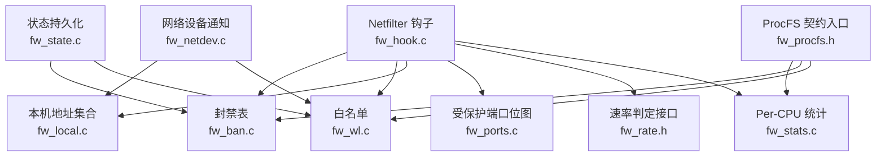
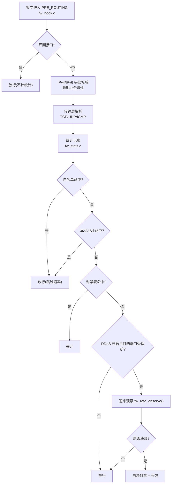
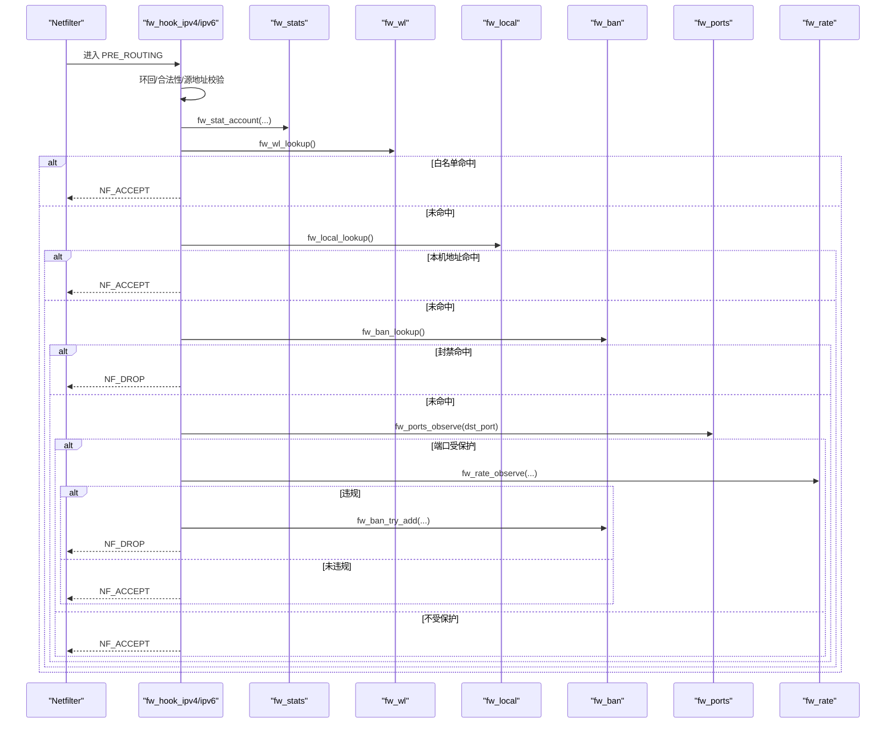
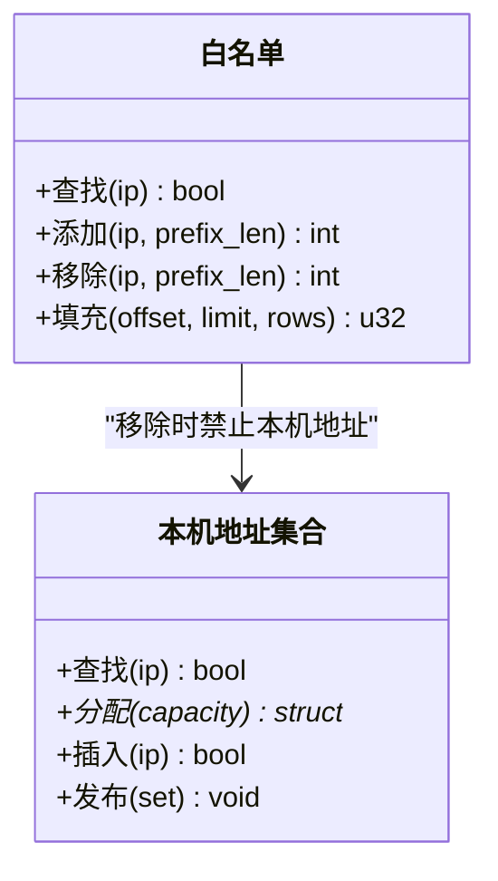
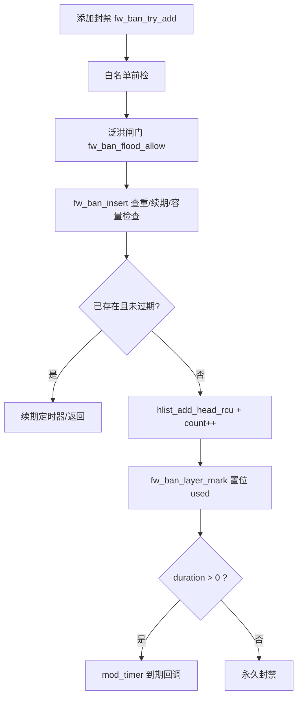
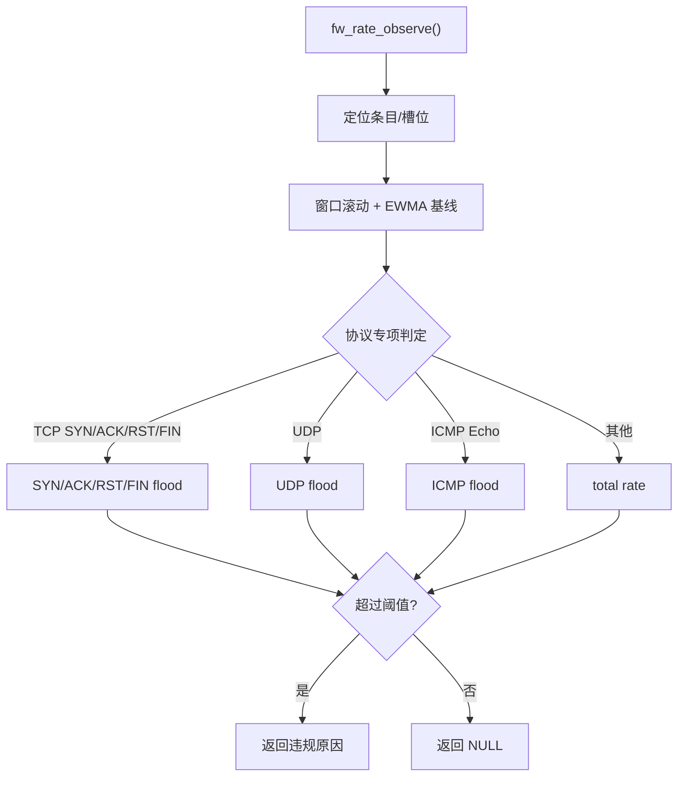
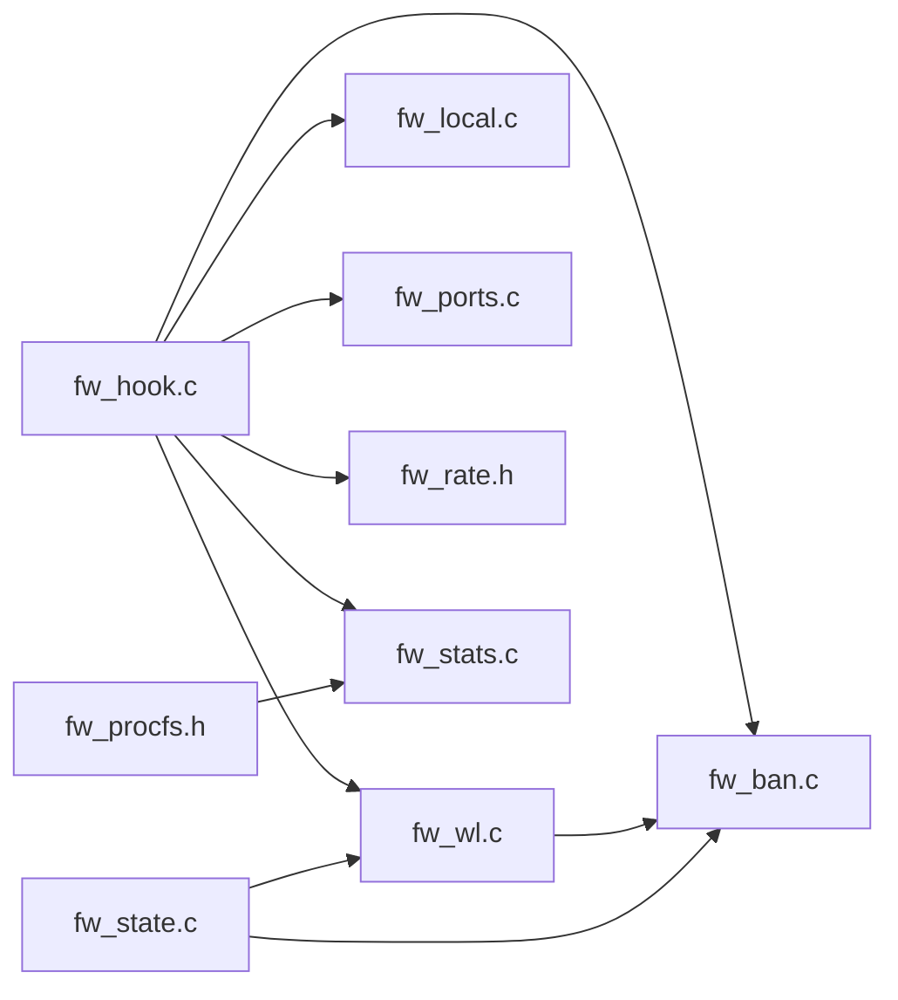

# 内核模块架构

<cite>
**本文引用的文件**   
- [fw_hook.c](file://src/kernel-module/fw_hook.c)
- [fw_ban.c](file://src/kernel-module/fw_ban.c)
- [fw_wl.c](file://src/kernel-module/fw_wl.c)
- [fw_rate.h](file://src/kernel-module/fw_rate.h)
- [fw_stats.c](file://src/kernel-module/fw_stats.c)
- [fw_local.c](file://src/kernel-module/fw_local.c)
- [fw_netdev.c](file://src/kernel-module/fw_netdev.c)
- [fw_ports.c](file://src/kernel-module/fw_ports.c)
- [fw_procfs.h](file://src/kernel-module/fw_procfs.h)
- [fw_state.c](file://src/kernel-module/fw_state.c)
- [fw_ban.h](file://src/kernel-module/fw_ban.h)
- [fw_local.h](file://src/kernel-module/fw_local.h)
- [fw_wl.h](file://src/kernel-module/fw_wl.h)
- [fw_stats.h](file://src/kernel-module/fw_stats.h)
- [fw_state.h](file://src/kernel-module/fw_state.h)
</cite>

## 目录
1. [简介](#简介)
2. [项目结构](#项目结构)
3. [核心组件](#核心组件)
4. [架构总览](#架构总览)
5. [详细组件分析](#详细组件分析)
6. [依赖关系分析](#依赖关系分析)
7. [性能与并发模型](#性能与并发模型)
8. [内核态与用户态通信](#内核态与用户态通信)
9. [状态持久化机制](#状态持久化机制)
10. [关键数据结构与内存管理](#关键数据结构与内存管理)
11. [性能优化建议](#性能优化建议)
12. [故障排查指南](#故障排查指南)
13. [结论](#结论)

## 简介
本文件面向内核模块侧，系统性梳理 Linux Netfilter 钩子实现、IPv4/IPv6 包处理流程、白名单与本机地址豁免、封禁表查找、DDoS 速率统计与自决封禁、RCU 与 Per-CPU 优化、哈希表设计、内核态与用户态通信（Netlink/ProcFS）以及状态持久化。目标是帮助读者在不深入源码的情况下理解热路径决策链、并发控制与扩展点。

## 项目结构
内核模块相关代码集中在 src/kernel-module 下，按职责拆分：
- 钩子与报文解析：fw_hook.c
- 封禁表：fw_ban.c / fw_ban.h
- 白名单：fw_wl.c / fw_wl.h
- 本机地址集合：fw_local.c / fw_local.h
- 端口受保护位图：fw_ports.c
- 速率与窗口统计：fw_rate.h（接口定义）
- 统计与分析：fw_stats.c / fw_stats.h
- 网络事件与自动白名单对账：fw_netdev.c
- ProcFS 契约入口：fw_procfs.h
- 状态保存/恢复：fw_state.c / fw_state.h

**图示来源**
- [fw_hook.c:77-95](file://src/kernel-module/fw_hook.c#L77-L95)
- [fw_ban.c:180-226](file://src/kernel-module/fw_ban.c#L180-L226)
- [fw_wl.c:68-77](file://src/kernel-module/fw_wl.c#L68-L77)
- [fw_local.c:55-64](file://src/kernel-module/fw_local.c#L55-L64)
- [fw_ports.c:24-34](file://src/kernel-module/fw_ports.c#L24-L34)
- [fw_rate.h:33-78](file://src/kernel-module/fw_rate.h#L33-L78)
- [fw_stats.c:32-48](file://src/kernel-module/fw_stats.c#L32-L48)
- [fw_netdev.c:333-347](file://src/kernel-module/fw_netdev.c#L333-L347)
- [fw_state.c:281-354](file://src/kernel-module/fw_state.c#L281-L354)
- [fw_procfs.h:1-28](file://src/kernel-module/fw_procfs.h#L1-L28)

**章节来源**
- [fw_hook.c:1-45](file://src/kernel-module/fw_hook.c#L1-L45)
- [fw_ban.c:1-41](file://src/kernel-module/fw_ban.c#L1-L41)
- [fw_wl.c:1-18](file://src/kernel-module/fw_wl.c#L1-L18)
- [fw_local.c:1-17](file://src/kernel-module/fw_local.c#L1-L17)
- [fw_ports.c:1-14](file://src/kernel-module/fw_ports.c#L1-L14)
- [fw_rate.h:1-26](file://src/kernel-module/fw_rate.h#L1-L26)
- [fw_stats.c:1-14](file://src/kernel-module/fw_stats.c#L1-L14)
- [fw_netdev.c:1-20](file://src/kernel-module/fw_netdev.c#L1-L20)
- [fw_procfs.h:1-14](file://src/kernel-module/fw_procfs.h#L1-L14)
- [fw_state.c:1-29](file://src/kernel-module/fw_state.c#L1-L29)

## 核心组件
- Netfilter 钩子与报文解析：在 NF_INET_PRE_ROUTING 注册 IPv4/IPv6 钩子，完成协议头校验、分片处理、传输层解析、TCP 标志异常检测、直方图与分布统计，并进入统一判定函数。
- 白名单与本机地址：白名单支持精确条目与子网前缀；本机地址集合仅存精确主机地址，二者均提供 RCU 只读查询。
- 封禁表：按 prefix_len 分层桶表 + RCU + 层内桶锁，支持 CIDR 封禁、容量上限、泛洪闸门、到期定时器与分页遍历。
- 速率统计：一次查表完成窗口滚动与四类违规判定；per-CPU 槽落盘，端口去重集合也落在 per-CPU 槽，避免热路径取锁。
- 端口受保护位图：固定 65536 位位图，空指针语义为“全端口参与速率判定”，由 daemon 通过 netlink 下发。
- 统计与分析：Per-CPU 计数 + flush 合并到全局表，UDP/ICMP 分布以直接映射槽 + 冲突顶替策略记录。
- 网络事件与自动白名单对账：netdev notifier 触发延迟重建本机地址集合，并对自动白名单进行对账删除。
- 状态持久化：CRC32 尾行校验，原子替换写入，恢复时先白名单后封禁，保留容量检查。

**章节来源**
- [fw_hook.c:77-154](file://src/kernel-module/fw_hook.c#L77-L154)
- [fw_wl.c:114-147](file://src/kernel-module/fw_wl.c#L114-L147)
- [fw_local.c:70-101](file://src/kernel-module/fw_local.c#L70-L101)
- [fw_ban.c:369-383](file://src/kernel-module/fw_ban.c#L369-L383)
- [fw_rate.h:37-58](file://src/kernel-module/fw_rate.h#L37-L58)
- [fw_ports.c:40-49](file://src/kernel-module/fw_ports.c#L40-L49)
- [fw_stats.c:96-162](file://src/kernel-module/fw_stats.c#L96-L162)
- [fw_netdev.c:261-295](file://src/kernel-module/fw_netdev.c#L261-L295)
- [fw_state.c:281-354](file://src/kernel-module/fw_state.c#L281-L354)

## 架构总览
下图展示从报文进入 Netfilter 到最终放行或丢弃的完整路径，包括白名单短路、本机地址豁免、封禁命中、速率判定与 DDoS 自决封禁。

**图示来源**
- [fw_hook.c:104-154](file://src/kernel-module/fw_hook.c#L104-L154)
- [fw_hook.c:156-278](file://src/kernel-module/fw_hook.c#L156-L278)
- [fw_hook.c:280-410](file://src/kernel-module/fw_hook.c#L280-L410)
- [fw_rate.h:37-58](file://src/kernel-module/fw_rate.h#L37-L58)
- [fw_ports.c:40-49](file://src/kernel-module/fw_ports.c#L40-L49)

## 详细组件分析

### Netfilter 钩子与报文处理
- 钩子注册：IPv4/IPv6 各一个钩子，优先级位于 filter 表之前，仅挂在 init_net。
- 退出保护：双检 fw_is_shutting_down()，卸载期间热路径直接放行，避免被新流量拖住。
- 环回豁免：skb->dev 为 loopback 直接放行，不计统计。
- 报文合法性：长度/版本/头长/校验和校验失败直接放行（不进入防火墙逻辑）。
- 源地址非法：不进任何表、不计丢弃。
- 分片与非首片：非首片传 protocol=0，跳过协议专项判定。
- TCP 标志异常：SYN+FIN/SYN+RST/四标志全零直接丢弃，计入 tcp_anomaly_dropped 与 packets_dropped。
- 统计记账：直方图、TTL 分布、IP 分片、UDP/ICMP 分布在本 CPU 累积。
- 判定顺序：环回 → 白名单 → 本机地址 → 封禁表 → 速率判定（受保护端口门控）。

**图示来源**
- [fw_hook.c:104-154](file://src/kernel-module/fw_hook.c#L104-L154)
- [fw_hook.c:156-278](file://src/kernel-module/fw_hook.c#L156-L278)
- [fw_hook.c:280-410](file://src/kernel-module/fw_hook.c#L280-L410)
- [fw_rate.h:37-58](file://src/kernel-module/fw_rate.h#L37-L58)
- [fw_ports.c:40-49](file://src/kernel-module/fw_ports.c#L40-L49)

**章节来源**
- [fw_hook.c:77-95](file://src/kernel-module/fw_hook.c#L77-L95)
- [fw_hook.c:104-154](file://src/kernel-module/fw_hook.c#L104-L154)
- [fw_hook.c:156-278](file://src/kernel-module/fw_hook.c#L156-L278)
- [fw_hook.c:280-410](file://src/kernel-module/fw_hook.c#L280-L410)

### 白名单与本机地址
- 白名单：64 精确桶 + 子网链表；命中判定 = 精确桶匹配或子网链存在覆盖前缀。
- 本机地址：开放寻址线性探测哈希集，仅存精确主机地址（/32 与 /128），O(1) 查找。
- 并发模型：整体 RCU 发布，旧集合 kfree_rcu 释放；热路径仅 RCU 读。
- 联动：白名单变更时，解封落在其覆盖范围内的封禁条目。

**图示来源**
- [fw_wl.c:114-147](file://src/kernel-module/fw_wl.c#L114-L147)
- [fw_wl.c:157-245](file://src/kernel-module/fw_wl.c#L157-L245)
- [fw_local.c:70-101](file://src/kernel-module/fw_local.c#L70-L101)
- [fw_local.c:107-170](file://src/kernel-module/fw_local.c#L107-L170)

**章节来源**
- [fw_wl.c:1-18](file://src/kernel-module/fw_wl.c#L1-L18)
- [fw_wl.c:114-147](file://src/kernel-module/fw_wl.c#L114-L147)
- [fw_wl.c:157-245](file://src/kernel-module/fw_wl.c#L157-L245)
- [fw_local.c:1-17](file://src/kernel-module/fw_local.c#L1-L17)
- [fw_local.c:70-101](file://src/kernel-module/fw_local.c#L70-L101)

### 封禁表设计与实现
- 分层桶表：按 prefix_len 分层，短前缀层用小桶数组，全长层复用表内大桶。
- 位图与层计数：used 位图表示某层可能有条目；count 保证清位不会误删活条目。
- 容量上限：新增 fw_max_ban_entries，桶锁内原子检查，超限拒绝并递增 ban_table_full_rejects。
- 泛洪闸门：三条封禁路径共用 fw_ban_flood_allow()，滑动 1 秒窗口限制添加速率。
- 定时器与释放：到期回调持桶锁摘链 + call_rcu 释放；删除路径 timer_delete + hlist_del_rcu + call_rcu。
- 分页遍历：offset/limit 支持 netlink/procfs 分页读取。

**图示来源**
- [fw_ban.c:434-504](file://src/kernel-module/fw_ban.c#L434-L504)
- [fw_ban.c:506-531](file://src/kernel-module/fw_ban.c#L506-L531)
- [fw_ban.c:393-409](file://src/kernel-module/fw_ban.c#L393-L409)
- [fw_ban.c:274-329](file://src/kernel-module/fw_ban.c#L274-L329)

**章节来源**
- [fw_ban.c:1-41](file://src/kernel-module/fw_ban.c#L1-L41)
- [fw_ban.c:180-226](file://src/kernel-module/fw_ban.c#L180-L226)
- [fw_ban.c:369-383](file://src/kernel-module/fw_ban.c#L369-L383)
- [fw_ban.c:434-504](file://src/kernel-module/fw_ban.c#L434-L504)
- [fw_ban.c:506-531](file://src/kernel-module/fw_ban.c#L506-L531)
- [fw_ban.c:533-570](file://src/kernel-module/fw_ban.c#L533-L570)
- [fw_ban.c:577-611](file://src/kernel-module/fw_ban.c#L577-L611)
- [fw_ban.c:634-673](file://src/kernel-module/fw_ban.c#L634-L673)

### 速率统计与 DDoS 自决封禁
- 一次查表：fw_rate_observe() 在同一 RCU 临界区内完成窗口滚动与四类违规判定。
- Per-CPU 槽：packet/byte/syn/udp 等原始计数落 per-CPU 槽，滚动时选举 CPU 汇总清零。
- 端口去重：seen_ports 移至 per-CPU 槽，热路径不再取锁。
- 失败开放：速率表满时对新源地址不做速率判定，静默放行，rate_slot_spill 观测。
- DDoS 自决：违规即调用 fw_ban_try_add() 创建单源 IP 封禁，并推送 DdosEvent。

**图示来源**
- [fw_rate.h:37-58](file://src/kernel-module/fw_rate.h#L37-L58)
- [fw_hook.c:104-154](file://src/kernel-module/fw_hook.c#L104-L154)

**章节来源**
- [fw_rate.h:1-26](file://src/kernel-module/fw_rate.h#L1-L26)
- [fw_rate.h:33-78](file://src/kernel-module/fw_rate.h#L33-L78)
- [fw_hook.c:104-154](file://src/kernel-module/fw_hook.c#L104-L154)

### 端口受保护位图
- 固定 65536 位位图，一端口一位；空指针语义为“全端口参与速率判定”。
- 热路径退化为一次位测试；冷路径 rcu_assign_pointer 发布新位图。

**章节来源**
- [fw_ports.c:1-14](file://src/kernel-module/fw_ports.c#L1-L14)
- [fw_ports.c:40-49](file://src/kernel-module/fw_ports.c#L40-L49)
- [fw_ports.c:55-81](file://src/kernel-module/fw_ports.c#L55-L81)

### 统计与分析
- Per-CPU 统计：fw_stat_account 写本 CPU，无锁无共享 cache line 写。
- Flush 合并：fw_stats_flush_all 同步 on_each_cpu 合并到全局 atomic 与哈希表。
- UDP/ICMP 分布：直接映射槽 + 冲突顶替，允许丢失分布细节但可观测 spill。
- 快照接口：fw_stats_snapshot / fw_stats_read_analysis 内部先 flush。

**章节来源**
- [fw_stats.c:1-14](file://src/kernel-module/fw_stats.c#L1-L14)
- [fw_stats.c:96-162](file://src/kernel-module/fw_stats.c#L96-L162)
- [fw_stats.c:291-343](file://src/kernel-module/fw_stats.c#L291-L343)
- [fw_stats.c:376-459](file://src/kernel-module/fw_stats.c#L376-L459)

### 网络事件与自动白名单对账
- netdev notifier 触发延迟重建本机地址集合，防抖 500ms。
- 重建过程：收集接口精确地址 → 构建 fw_local_set → RCU 发布。
- 自动白名单对账：分页扫描白名单，若接口地址清单中不存在对应 (af, 地址, prefix_len)，则 quiet 移除并推送事件。

**章节来源**
- [fw_netdev.c:1-20](file://src/kernel-module/fw_netdev.c#L1-L20)
- [fw_netdev.c:62-118](file://src/kernel-module/fw_netdev.c#L62-L118)
- [fw_netdev.c:151-177](file://src/kernel-module/fw_netdev.c#L151-L177)
- [fw_netdev.c:214-255](file://src/kernel-module/fw_netdev.c#L214-L255)
- [fw_netdev.c:261-295](file://src/kernel-module/fw_netdev.c#L261-L295)
- [fw_netdev.c:305-331](file://src/kernel-module/fw_netdev.c#L305-L331)

## 依赖关系分析
- 钩子依赖：白名单、本机地址、封禁表、端口位图、速率接口、统计。
- 白名单联动：白名单变更触发封禁表匹配解封。
- 状态持久化：保存/恢复封禁表与白名单，恢复顺序白名单优先。
- ProcFS：暴露 stats 与表格，读侧必须先 flush。

**图示来源**
- [fw_hook.c:58-64](file://src/kernel-module/fw_hook.c#L58-L64)
- [fw_wl.c:24-27](file://src/kernel-module/fw_wl.c#L24-L27)
- [fw_state.c:42-44](file://src/kernel-module/fw_state.c#L42-L44)
- [fw_procfs.h:1-14](file://src/kernel-module/fw_procfs.h#L1-L14)

**章节来源**
- [fw_hook.c:58-64](file://src/kernel-module/fw_hook.c#L58-L64)
- [fw_wl.c:24-27](file://src/kernel-module/fw_wl.c#L24-L27)
- [fw_state.c:42-44](file://src/kernel-module/fw_state.c#L42-L44)
- [fw_procfs.h:1-14](file://src/kernel-module/fw_procfs.h#L1-L14)

## 性能与并发模型
- RCU 读多写少：白名单、本机地址、端口位图、封禁表读路径均使用 RCU，写路径使用 call_rcu/kfree_rcu 安全释放。
- Per-CPU 优化：统计、速率窗口原始计数、端口去重集合全部落本 CPU，热路径零自旋锁、零共享 cache line 写。
- 哈希表设计：
  - 封禁表：按 prefix_len 分层，短前缀层小桶，全长层复用大桶；层内桶锁粒度细。
  - 白名单：64 精确桶 + 子网链表；子网条目同时入桶与链表。
  - 本机地址：开放寻址线性探测哈希集，容量为 2 的幂。
- 容量与限流：
  - 封禁表容量上限与泛洪闸门防止突发添加。
  - 白名单容量上限修复旧实现缺陷。
  - 速率表满失败开放，rate_slot_spill 观测。

**章节来源**
- [fw_ban.c:1-41](file://src/kernel-module/fw_ban.c#L1-L41)
- [fw_ban.c:180-226](file://src/kernel-module/fw_ban.c#L180-L226)
- [fw_wl.c:1-18](file://src/kernel-module/fw_wl.c#L1-L18)
- [fw_local.c:1-17](file://src/kernel-module/fw_local.c#L1-L17)
- [fw_rate.h:1-26](file://src/kernel-module/fw_rate.h#L1-L26)
- [fw_stats.c:1-14](file://src/kernel-module/fw_stats.c#L1-L14)

## 内核态与用户态通信
- ProcFS：/proc/firewall 暴露 13 个 key 与人类可读表格；读侧必须 flush 统计；写侧支持 bans/whitelist/config 命令文法。
- Netlink：用于配置下发（如受保护端口位图）、事件推送（BAN_STATE_CHANGE、WHITELIST_STATE_CHANGE、DDOS_EVENT）。
- 状态文件：fw_state_file 路径受严格校验，CRC32 尾行必需，原子替换写入。

**章节来源**
- [fw_procfs.h:1-28](file://src/kernel-module/fw_procfs.h#L1-L28)
- [fw_ports.c:55-81](file://src/kernel-module/fw_ports.c#L55-L81)
- [fw_ban.c:500-503](file://src/kernel-module/fw_ban.c#L500-L503)
- [fw_state.c:81-116](file://src/kernel-module/fw_state.c#L81-L116)
- [fw_state.c:281-354](file://src/kernel-module/fw_state.c#L281-L354)

## 状态持久化机制
- 格式：FW_STATE 2，BAN_V4/V6 带可选前缀，WL_V4/V6 带前缀长度，CRC32 尾行必需。
- 写入：同目录 .tmp 原子替换，CRC32 覆盖 CRC 行之前的全部字节。
- 恢复：两遍解析，先白名单后封禁；恢复走 fw_ban_restore() 跳过泛洪闸门但保留容量检查；banned_at 反推原始起点。
- 安全性：路径校验、URL 转义与 shell 元字符过滤、文件大小上限按容量参数反推。

**章节来源**
- [fw_state.h:1-27](file://src/kernel-module/fw_state.h#L1-L27)
- [fw_state.c:281-354](file://src/kernel-module/fw_state.c#L281-L354)
- [fw_state.c:366-401](file://src/kernel-module/fw_state.c#L366-L401)
- [fw_state.c:410-494](file://src/kernel-module/fw_state.c#L410-L494)
- [fw_state.c:542-653](file://src/kernel-module/fw_state.c#L542-L653)

## 关键数据结构与内存管理
- 封禁节点：含 af/prefix_len/duration_secs/is_permanent/banned_at/unban_jiffies/jail_name/reason/hlist_node/timer_list/rcu_head。
- 白名单条目：含 af/prefix_len/addr/device_name/hlist_node/list_node/rcu_head。
- 本机地址集合：capacity/count/slots[]（af/addr/used）。
- 端口位图：bitmap[count]，rcu_head。
- 统计结构：per-CPU fw_stats_pcpu，包含直方图、TTL 分布、UDP/ICMP 槽、全局流量计数。
- 内存管理：GFP_ATOMIC/GFP_KERNEL 区分上下文；call_rcu/kfree_rcu 安全释放；on_each_cpu 同步 flush。

**章节来源**
- [fw_ban.c:234-268](file://src/kernel-module/fw_ban.c#L234-L268)
- [fw_wl.c:157-210](file://src/kernel-module/fw_wl.c#L157-L210)
- [fw_local.c:107-170](file://src/kernel-module/fw_local.c#L107-L170)
- [fw_ports.c:55-81](file://src/kernel-module/fw_ports.c#L55-L81)
- [fw_stats.c:32-48](file://src/kernel-module/fw_stats.c#L32-L48)
- [fw_stats.c:291-343](file://src/kernel-module/fw_stats.c#L291-L343)

## 性能优化建议
- 保持一次 RCU 临界区：将白名单/本机地址/封禁表/速率判定放在同一临界区，减少锁切换与重复加解锁。
- 利用 Per-CPU 槽：确保所有高频计数与端口去重集合落本 CPU，避免跨核争用。
- 合理设置容量参数：根据业务规模调整 fw_max_ban_entries、fw_max_whitelist_entries、fw_max_local_ips，避免频繁扩容与溢出。
- 端口门控收敛：仅对外监听端口参与速率判定，降低误封概率与计算开销。
- 定期 flush 统计：在 procfs/netlink 读侧显式调用 flush，避免陈旧读数。

[本节为通用指导，不直接分析具体文件]

## 故障排查指南
- 封禁表满：关注 ban_table_full_rejects 与 recent_additions，检查泛洪闸门与容量上限。
- 白名单容量拒绝：查看 wl_reject_count，确认 fw_max_whitelist_entries 是否过小。
- 速率表溢出：rate_slot_spill 上升说明活跃源超过上限，考虑提升 FW_RATE_CPU_SLOTS 或放宽策略。
- 本机地址未生效：检查 fw_netdev_notifier 是否注册成功，确认 fw_local_set 已发布。
- 状态恢复失败：确认 CRC32 尾行存在且校验通过，路径合法，文件大小未超上限。

**章节来源**
- [fw_ban.c:393-409](file://src/kernel-module/fw_ban.c#L393-L409)
- [fw_stats.c:168-195](file://src/kernel-module/fw_stats.c#L168-L195)
- [fw_stats.c:394-397](file://src/kernel-module/fw_stats.c#L394-L397)
- [fw_netdev.c:333-347](file://src/kernel-module/fw_netdev.c#L333-L347)
- [fw_state.c:366-401](file://src/kernel-module/fw_state.c#L366-L401)

## 结论
该内核模块通过 RCU 与 Per-CPU 优化实现了高吞吐、低延迟的 Netfilter 热路径；分层桶表与位图设计兼顾了 CIDR 封禁与端口门控；速率统计一次查表与失败开放策略在稳定性与准确性之间取得平衡；ProcFS/Netlink 与状态持久化提供了完善的运维能力。建议在部署时结合业务规模调优容量参数，并保持统计刷新与日志监控，以获得最佳性能与可观测性。