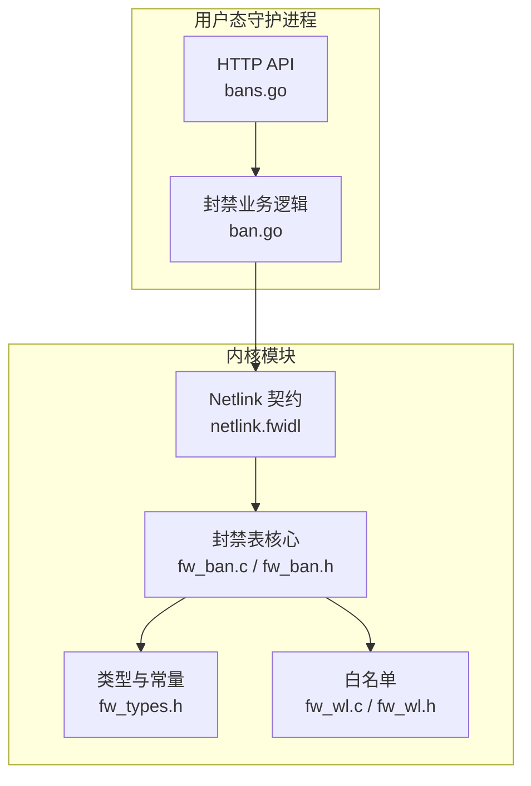
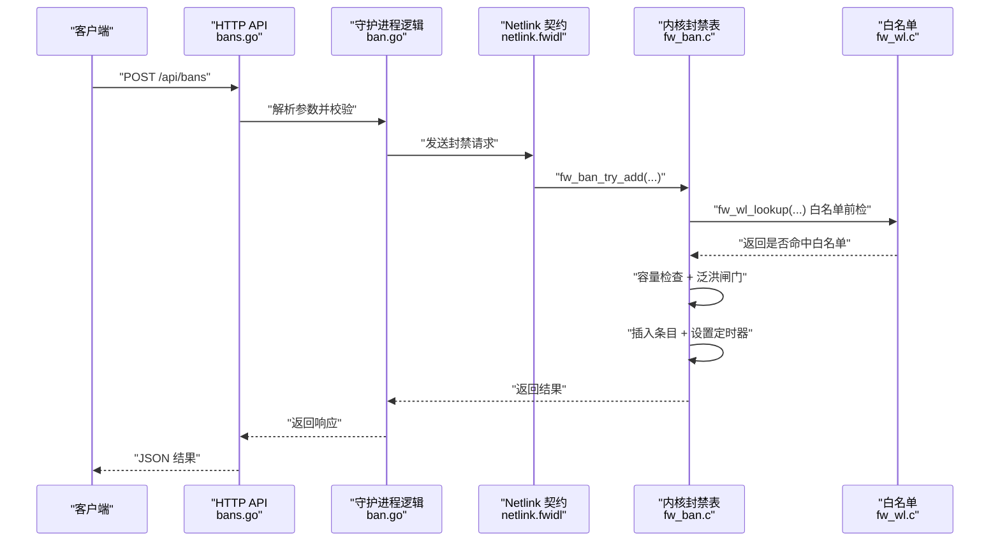
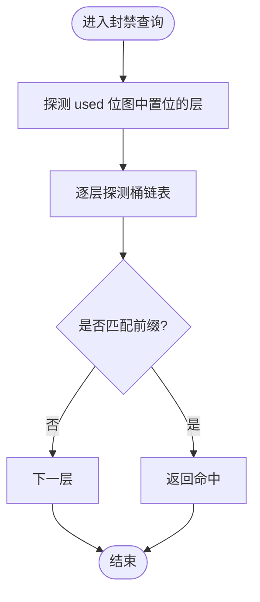
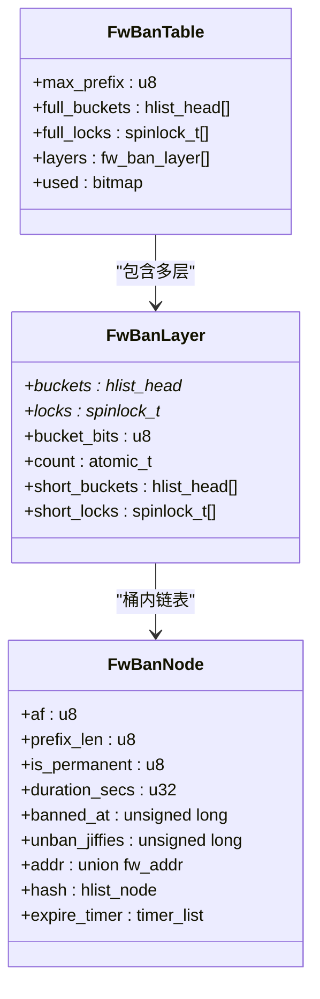
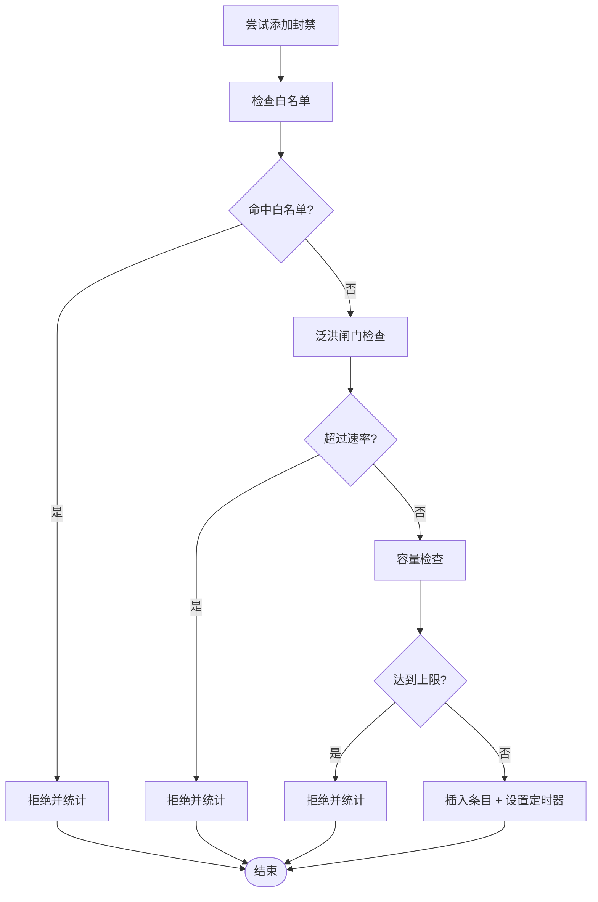
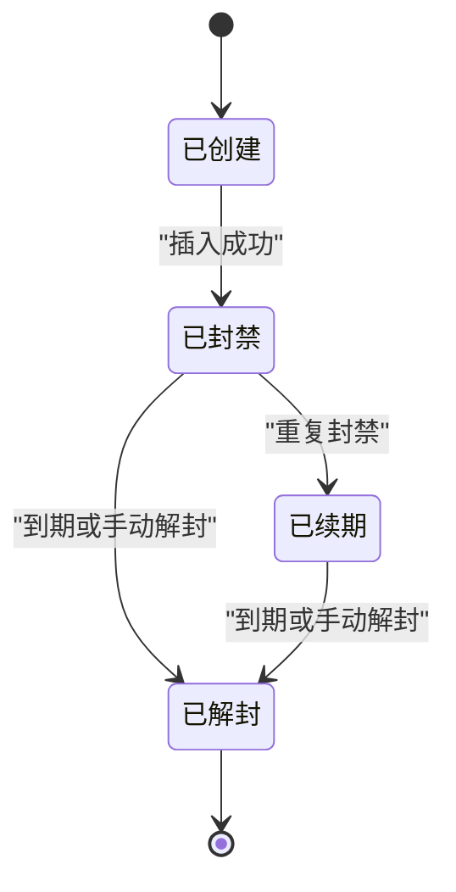
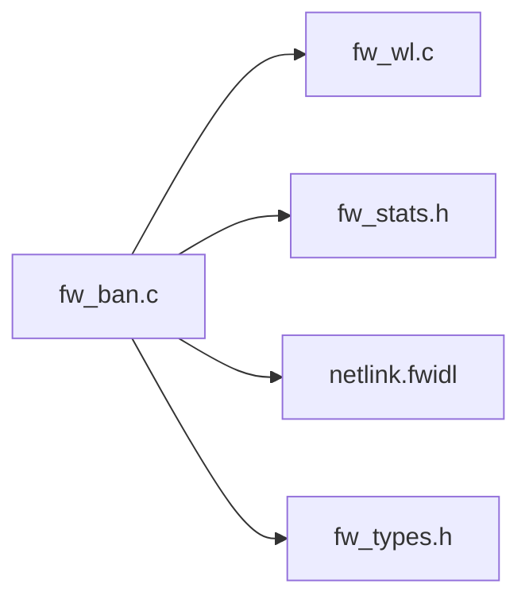

# 封禁表管理

<cite>
**本文引用的文件**   
- [src/kernel-module/fw_ban.c](file://src/kernel-module/fw_ban.c)
- [src/kernel-module/fw_ban.h](file://src/kernel-module/fw_ban.h)
- [src/kernel-module/fw_types.h](file://src/kernel-module/fw_types.h)
- [src/kernel-module/fw_wl.c](file://src/kernel-module/fw_wl.c)
- [src/kernel-module/fw_wl.h](file://src/kernel-module/fw_wl.h)
- [src/daemon/internal/bans/ban.go](file://src/daemon/internal/bans/ban.go)
- [src/daemon/internal/http/bans.go](file://src/daemon/internal/http/bans.go)
- [contract/netlink.fwidl](file://contract/netlink.fwidl)
</cite>

## 目录
1. [引言](#引言)
2. [项目结构](#项目结构)
3. [核心组件](#核心组件)
4. [架构总览](#架构总览)
5. [详细组件分析](#详细组件分析)
6. [依赖关系分析](#依赖关系分析)
7. [性能与优化](#性能与优化)
8. [API 接口说明](#api-接口说明)
9. [故障排查指南](#故障排查指南)
10. [结论](#结论)

## 引言
本文件围绕内核模块中的“封禁表”子系统，系统性解释其 RCU 锁机制、读写分离、并发控制、内存同步、哈希表设计、IP 前缀匹配、动态扩容（容量上限）策略、条目生命周期与自动过期、持久化恢复，以及用户态守护进程侧的封禁 API。目标是让具备基础网络与安全知识的读者也能理解封禁表如何在高吞吐网络路径中安全、高效地工作。

## 项目结构
封禁表由内核模块与守护进程两部分协作实现：
- 内核侧：`fw_ban.c` / `fw_ban.h` 提供封禁表数据结构、RCU 读路径、桶锁写路径、定时器到期处理、白名单联动解封、分页遍历等能力；`fw_types.h` 定义全局结构、常量、地址原语与哈希函数；`fw_wl.c` / `fw_wl.h` 提供白名单，并与封禁表联动。
- 用户态守护进程侧：`ban.go` 封装封禁业务逻辑，`http/bans.go` 暴露 HTTP API，契约定义在 `netlink.fwidl`。

**图表来源**
- [src/kernel-module/fw_ban.c:1-674](file://src/kernel-module/fw_ban.c#L1-L674)
- [src/kernel-module/fw_ban.h:1-76](file://src/kernel-module/fw_ban.h#L1-L76)
- [src/kernel-module/fw_types.h:217-289](file://src/kernel-module/fw_types.h#L217-L289)
- [src/kernel-module/fw_wl.c:1-311](file://src/kernel-module/fw_wl.c#L1-L311)
- [src/daemon/internal/http/bans.go](file://src/daemon/internal/http/bans.go)
- [contract/netlink.fwidl](file://contract/netlink.fwidl)

**章节来源**
- [src/kernel-module/fw_ban.c:1-674](file://src/kernel-module/fw_ban.c#L1-L674)
- [src/kernel-module/fw_ban.h:1-76](file://src/kernel-module/fw_ban.h#L1-L76)
- [src/kernel-module/fw_types.h:217-289](file://src/kernel-module/fw_types.h#L217-L289)
- [src/kernel-module/fw_wl.c:1-311](file://src/kernel-module/fw_wl.c#L1-L311)
- [src/daemon/internal/http/bans.go](file://src/daemon/internal/http/bans.go)
- [contract/netlink.fwidl](file://contract/netlink.fwidl)

## 核心组件
- 封禁表分层桶结构：按前缀长度 `prefix_len` 分层，每层一组桶头与桶锁；全长层复用大桶数组，短前缀层使用小桶数组，减少内存占用。
- RCU 读路径：热路径仅做只读遍历，无锁，通过 `rcu_read_lock()` 保护。
- 桶锁写路径：增删改在桶级自旋锁内完成，避免跨桶竞争。
- 位图与层计数：维护哪些层非空，热路径只探测置位的层，降低扫描成本。
- 每条目定时器：到期回调摘链、释放并推送解封事件。
- 泛洪闸门：限制每秒新增封禁数量，防止恶意批量封禁。
- 白名单联动：白名单变更时，自动解封被覆盖的封禁条目。
- 状态恢复：重启后从持久化数据恢复封禁条目，保持原始封禁起点。

**章节来源**
- [src/kernel-module/fw_ban.c:1-674](file://src/kernel-module/fw_ban.c#L1-L674)
- [src/kernel-module/fw_ban.h:1-76](file://src/kernel-module/fw_ban.h#L1-L76)
- [src/kernel-module/fw_types.h:217-289](file://src/kernel-module/fw_types.h#L217-L289)

## 架构总览
封禁表的核心交互如下：
- 用户态通过 HTTP API 或 CLI 调用守护进程的封禁接口。
- 守护进程将封禁请求经 Netlink 下发到内核。
- 内核封禁表执行查重、容量检查、泛洪闸门、插入/删除、定时器设置。
- 白名单变化触发封禁表联动解封。
- 读侧分页遍历用于导出当前封禁列表。

**图表来源**
- [src/daemon/internal/http/bans.go](file://src/daemon/internal/http/bans.go)
- [src/daemon/internal/bans/ban.go](file://src/daemon/internal/bans/ban.go)
- [contract/netlink.fwidl](file://contract/netlink.fwidl)
- [src/kernel-module/fw_ban.c:506-531](file://src/kernel-module/fw_ban.c#L506-L531)
- [src/kernel-module/fw_wl.c:114-147](file://src/kernel-module/fw_wl.c#L114-L147)

## 详细组件分析

### RCU 锁机制与并发控制
- 读路径：`fw_ban_lookup` 在 `rcu_read_lock()` 下遍历层与桶，不持任何写锁。
- 写路径：所有增删操作在桶级 `spin_lock_bh` 下进行，保证同一桶内的原子性。
- 位图与层计数：通过 `ban_layer_lock` 保护，确保层非空标记与计数一致。
- 定时器回调：持有桶锁摘链，并通过 `call_rcu` 延迟释放节点，避免与读路径冲突。

**图表来源**
- [src/kernel-module/fw_ban.c:369-383](file://src/kernel-module/fw_ban.c#L369-L383)
- [src/kernel-module/fw_ban.c:163-174](file://src/kernel-module/fw_ban.c#L163-L174)

**章节来源**
- [src/kernel-module/fw_ban.c:1-674](file://src/kernel-module/fw_ban.c#L1-L674)
- [src/kernel-module/fw_types.h:12-28](file://src/kernel-module/fw_types.h#L12-L28)

### 哈希表设计与 IP 前缀匹配
- 哈希函数：统一使用 `jhash` 加随机种子，防碰撞攻击。
- 桶索引：对短前缀层，先归一化地址再哈希，使同网段 IP 落入同一桶。
- 前缀匹配：`fw_prefix_match` 同时服务于白名单子网链与封禁表，语义一致。

**图表来源**
- [src/kernel-module/fw_types.h:260-289](file://src/kernel-module/fw_types.h#L260-L289)
- [src/kernel-module/fw_types.h:234-248](file://src/kernel-module/fw_types.h#L234-L248)

**章节来源**
- [src/kernel-module/fw_ban.c:101-121](file://src/kernel-module/fw_ban.c#L101-L121)
- [src/kernel-module/fw_types.h:737-778](file://src/kernel-module/fw_types.h#L737-L778)

### 动态扩容与容量上限
- 容量上限：`fw_max_ban_entries` 默认 65535，在桶锁内原子检查，超限拒绝并统计。
- 泛洪闸门：`fw_ban_flood_allow` 限制每秒新增封禁次数，防止恶意批量封禁。
- 白名单优先：插入前检查白名单，命中直接拒绝。

**图表来源**
- [src/kernel-module/fw_ban.c:506-531](file://src/kernel-module/fw_ban.c#L506-L531)
- [src/kernel-module/fw_ban.c:393-409](file://src/kernel-module/fw_ban.c#L393-L409)

**章节来源**
- [src/kernel-module/fw_ban.c:434-504](file://src/kernel-module/fw_ban.c#L434-L504)
- [src/kernel-module/fw_ban.c:506-531](file://src/kernel-module/fw_ban.c#L506-L531)

### 条目生命周期与自动过期
- 创建：分配节点、初始化字段、设置定时器。
- 续期：若已存在且未过期，更新时长并重装定时器。
- 到期：回调摘链、释放节点、推送解封事件。
- 手动解封：删除定时器、摘链、释放节点。

**图表来源**
- [src/kernel-module/fw_ban.c:234-268](file://src/kernel-module/fw_ban.c#L234-L268)
- [src/kernel-module/fw_ban.c:274-329](file://src/kernel-module/fw_ban.c#L274-L329)
- [src/kernel-module/fw_ban.c:533-570](file://src/kernel-module/fw_ban.c#L533-L570)

**章节来源**
- [src/kernel-module/fw_ban.c:234-329](file://src/kernel-module/fw_ban.c#L234-L329)
- [src/kernel-module/fw_ban.c:533-570](file://src/kernel-module/fw_ban.c#L533-L570)

### 持久化存储与状态恢复
- 持久化：守护进程负责将封禁状态写入数据库或文件。
- 恢复：内核启动时通过 `fw_ban_restore` 恢复条目，跳过泛洪闸门但保留容量检查。
- 时间一致性：恢复时使用原始封禁起点，确保过期时间正确。

**章节来源**
- [src/kernel-module/fw_ban.c:617-628](file://src/kernel-module/fw_ban.c#L617-L628)

### 白名单联动
- 白名单变更时，自动解封被覆盖的封禁条目。
- 精确前缀等价于该地址本身，判定沿用 `fw_prefix_match`。

**章节来源**
- [src/kernel-module/fw_wl.c:212-245](file://src/kernel-module/fw_wl.c#L212-L245)
- [src/kernel-module/fw_ban.c:577-611](file://src/kernel-module/fw_ban.c#L577-L611)

## 依赖关系分析
封禁表依赖以下组件：
- 白名单：提供豁免规则，影响封禁插入决策。
- 统计模块：记录封禁/解封计数、容量拒绝等指标。
- Netlink：用户态与内核态通信协议。
- 类型定义：全局结构、常量、地址原语。

**图表来源**
- [src/kernel-module/fw_ban.c:49-53](file://src/kernel-module/fw_ban.c#L49-L53)
- [src/kernel-module/fw_wl.c:24-27](file://src/kernel-module/fw_wl.c#L24-L27)

**章节来源**
- [src/kernel-module/fw_ban.c:49-53](file://src/kernel-module/fw_ban.c#L49-L53)
- [src/kernel-module/fw_wl.c:24-27](file://src/kernel-module/fw_wl.c#L24-L27)

## 性能与优化
- RCU 读路径：零锁遍历，适合高吞吐场景。
- 桶锁粒度：细粒度桶锁减少竞争。
- 位图优化：只探测非空层，降低扫描开销。
- 定时器异步释放：避免持锁释放导致的死锁。
- 泛洪闸门：限制突发流量，保护系统稳定性。
- 容量上限：防止内存耗尽。

[本节为通用性能讨论，无需特定文件引用]

## API 接口说明
用户态通过 HTTP API 与守护进程交互，守护进程再通过 Netlink 与内核通信。

### 封禁接口
- 方法：`POST /api/bans`
- 参数：
  - `address`: IP 地址或 CIDR
  - `duration`: 封禁时长（秒），0 表示永久
  - `reason`: 原因字符串
  - `jail`: 所属 jail 名称
- 响应：
  - `success`: 是否成功
  - `message`: 消息描述

### 解封接口
- 方法：`DELETE /api/bans/{address}`
- 参数：
  - `address`: IP 地址或 CIDR
- 响应：
  - `success`: 是否成功
  - `message`: 消息描述

### 查询接口
- 方法：`GET /api/bans`
- 参数：
  - `offset`: 偏移量
  - `limit`: 每页条数
- 响应：
  - `data`: 封禁条目列表
  - `total`: 总数

**章节来源**
- [src/daemon/internal/http/bans.go](file://src/daemon/internal/http/bans.go)
- [src/daemon/internal/bans/ban.go](file://src/daemon/internal/bans/ban.go)
- [contract/netlink.fwidl](file://contract/netlink.fwidl)

## 故障排查指南
- 封禁失败：
  - 检查白名单是否命中。
  - 检查泛洪闸门是否触发。
  - 检查容量是否达到上限。
- 封禁未生效：
  - 确认前缀长度是否正确。
  - 检查定时器是否正常设置。
- 解封异常：
  - 确认白名单联动是否触发。
  - 检查手动解封接口调用是否正确。

**章节来源**
- [src/kernel-module/fw_ban.c:506-531](file://src/kernel-module/fw_ban.c#L506-L531)
- [src/kernel-module/fw_ban.c:533-570](file://src/kernel-module/fw_ban.c#L533-L570)

## 结论
封禁表通过 RCU 与桶锁结合，实现了高并发下的读写分离；分层桶结构与位图优化提升了查找效率；白名单联动与泛洪闸门增强了安全性与稳定性；定时器机制确保了条目的自动过期。用户态 API 提供了便捷的封禁管理能力。整体设计兼顾了性能、可扩展性与可维护性。

[本节为总结性内容，无需特定文件引用]