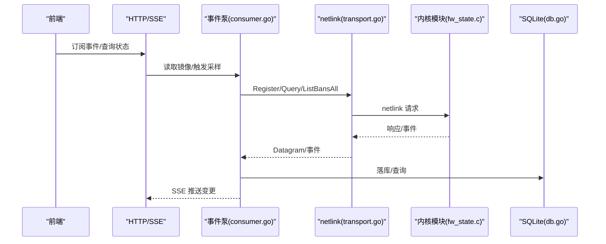
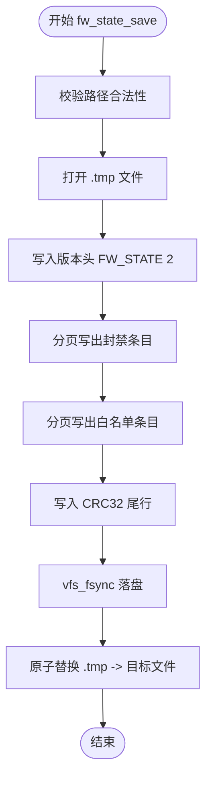
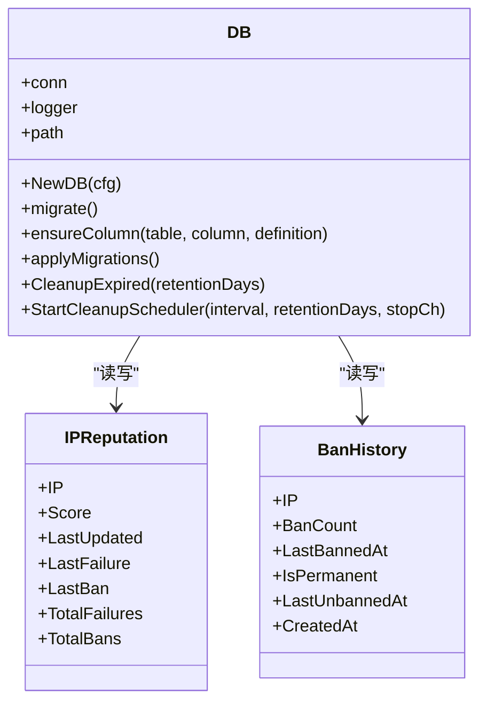
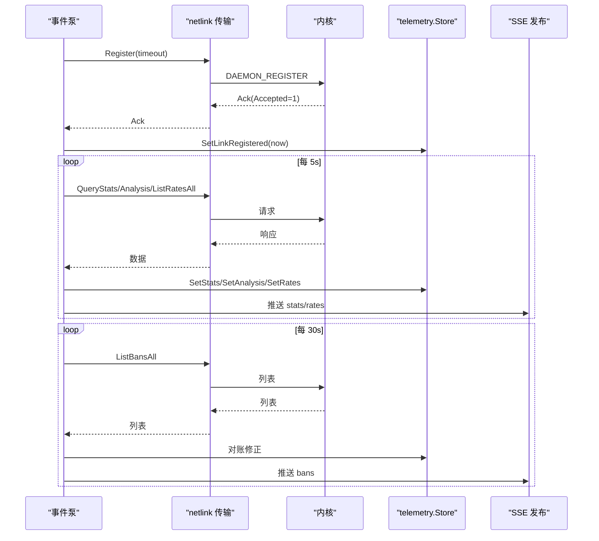
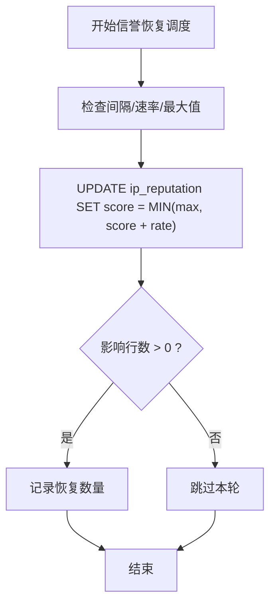
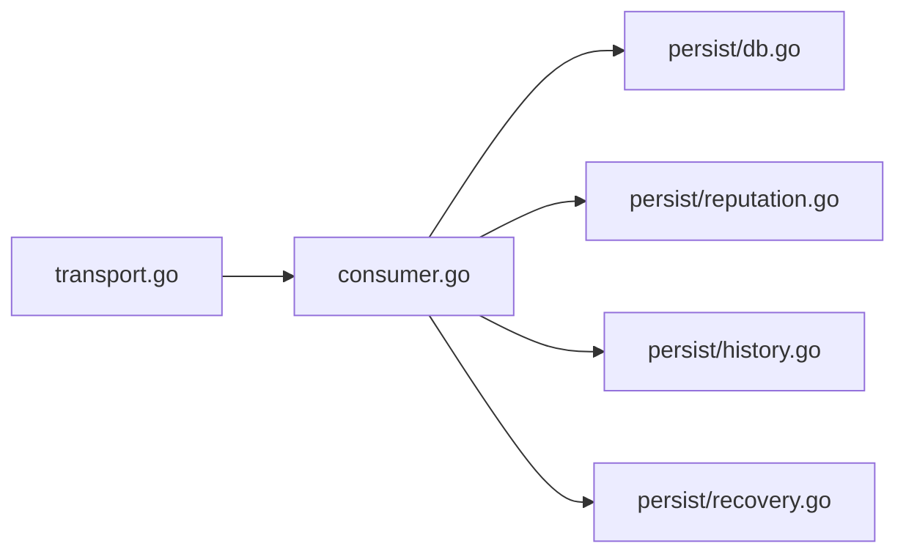

# 状态持久化

<cite>
**本文引用的文件**   
- [src/kernel-module/fw_state.c](file://src/kernel-module/fw_state.c)
- [src/kernel-module/fw_state.h](file://src/kernel-module/fw_state.h)
- [src/daemon/internal/persist/db.go](file://src/daemon/internal/persist/db.go)
- [src/daemon/internal/persist/reputation.go](file://src/daemon/internal/persist/reputation.go)
- [src/daemon/internal/persist/history.go](file://src/daemon/internal/persist/history.go)
- [src/daemon/internal/persist/recovery.go](file://src/daemon/internal/persist/recovery.go)
- [src/daemon/internal/kernel/transport.go](file://src/daemon/internal/kernel/transport.go)
- [src/daemon/internal/kernel/consumer.go](file://src/daemon/internal/kernel/consumer.go)
</cite>

## 目录
1. [引言](#引言)
2. [项目结构](#项目结构)
3. [核心组件](#核心组件)
4. [架构总览](#架构总览)
5. [详细组件分析](#详细组件分析)
6. [依赖关系分析](#依赖关系分析)
7. [性能与一致性](#性能与一致性)
8. [故障恢复与备份策略](#故障恢复与备份策略)
9. [API 与配置示例](#api-与配置示例)
10. [结论](#结论)

## 引言
本文件面向“状态持久化”这一目标，系统性说明内核态状态管理、守护进程侧运行时状态维护、状态序列化格式与版本兼容、迁移策略，以及与用户态守护进程的通信协议、数据同步机制和一致性保证。文档同时给出状态恢复流程、故障恢复机制、备份恢复策略，并汇总相关 API 接口与配置要点。

## 项目结构
本项目在“状态持久化”方面涉及两个主要层次：
- 内核模块层：负责封禁表与白名单的磁盘快照保存与恢复，采用文本格式 + CRC32 校验，并通过原子替换避免半截文件。
- 守护进程层（Go）：使用 SQLite 持久化封禁事件、IP 信誉、历史统计与多维风险向量；通过 netlink 与内核模块通信，维持内存镜像并对账。

```mermaid
graph TB
subgraph "内核模块"
KState["fw_state.c<br/>状态保存/恢复"]
KHeader["fw_state.h<br/>对外接口与格式契约"]
end
subgraph "守护进程"
DTransport["kernel/transport.go<br/>netlink 传输层"]
DPump["kernel/consumer.go<br/>事件泵/对账/发布"]
DB["persist/db.go<br/>SQLite 初始化/迁移/清理"]
DRep["persist/reputation.go<br/>IP 信誉读写/恢复"]
DHist["persist/history.go<br/>封禁历史/统计"]
DRecov["persist/recovery.go<br/>信誉恢复调度器"]
end
KState --> |"文本快照: FW_STATE/CRC32"| 文件系统
DTransport < --> |"netlink 报文"| KState
DPump --> |"更新内存镜像/推送 SSE"| 前端
DPump --> |"写入/查询"| DB
DRep --> DB
DHist --> DB
DRecov --> DB
```

**图示来源**
- [src/kernel-module/fw_state.c:281-354](file://src/kernel-module/fw_state.c#L281-L354)
- [src/kernel-module/fw_state.h:34-41](file://src/kernel-module/fw_state.h#L34-L41)
- [src/daemon/internal/kernel/transport.go:146-173](file://src/daemon/internal/kernel/transport.go#L146-L173)
- [src/daemon/internal/kernel/consumer.go:269-309](file://src/daemon/internal/kernel/consumer.go#L269-L309)
- [src/daemon/internal/persist/db.go:23-65](file://src/daemon/internal/persist/db.go#L23-L65)

**章节来源**
- [src/kernel-module/fw_state.c:1-654](file://src/kernel-module/fw_state.c#L1-L654)
- [src/kernel-module/fw_state.h:1-44](file://src/kernel-module/fw_state.h#L1-L44)
- [src/daemon/internal/kernel/transport.go:1-571](file://src/daemon/internal/kernel/transport.go#L1-L571)
- [src/daemon/internal/kernel/consumer.go:1-832](file://src/daemon/internal/kernel/consumer.go#L1-L832)
- [src/daemon/internal/persist/db.go:1-352](file://src/daemon/internal/persist/db.go#L1-L352)

## 核心组件
- 内核状态快照：按行文本保存封禁与白名单，末尾带 CRC32 校验，写盘走临时文件 + 原子替换。
- 守护进程数据库：SQLite WAL 模式，单连接，启动时执行 schema 创建与增量迁移，定时清理过期数据。
- 事件泵与传输层：基于 netlink 的可靠收发、订阅、轮询、链路健康计数；周期性采样、对账、SSE 推送。
- IP 信誉与历史：记录失败/封禁次数、信誉分衰减与恢复、频繁封禁统计等。

**章节来源**
- [src/kernel-module/fw_state.c:281-354](file://src/kernel-module/fw_state.c#L281-L354)
- [src/daemon/internal/persist/db.go:23-65](file://src/daemon/internal/persist/db.go#L23-L65)
- [src/daemon/internal/kernel/transport.go:146-173](file://src/daemon/internal/kernel/transport.go#L146-L173)
- [src/daemon/internal/kernel/consumer.go:269-309](file://src/daemon/internal/kernel/consumer.go#L269-L309)
- [src/daemon/internal/persist/reputation.go:68-137](file://src/daemon/internal/persist/reputation.go#L68-L137)
- [src/daemon/internal/persist/history.go:42-80](file://src/daemon/internal/persist/history.go#L42-L80)

## 架构总览
内核态只保留最小可恢复状态（封禁+白名单），守护进程承担更丰富的运行时状态（事件、信誉、历史、风险向量）。两者通过 netlink 进行控制面交互，守护进程通过 HTTP/SSE 暴露给前端。



**图示来源**
- [src/daemon/internal/kernel/consumer.go:269-309](file://src/daemon/internal/kernel/consumer.go#L269-L309)
- [src/daemon/internal/kernel/transport.go:233-262](file://src/daemon/internal/kernel/transport.go#L233-L262)
- [src/daemon/internal/persist/db.go:71-175](file://src/daemon/internal/persist/db.go#L71-L175)

## 详细组件分析

### 内核态状态管理：保存与恢复
- 保存流程
  - 路径校验：仅允许 /var/lib/、/tmp/、/etc/ 下，拒绝 URL 转义与 shell 元字符。
  - 分页遍历封禁表与白名单，逐行写出，计算 CRC32。
  - 以 .tmp 原子替换为目标文件，fsync 后 rename。
- 恢复流程
  - 读入整个文件，定位并校验尾行 CRC32。
  - 两遍解析：先白名单后封禁，确保封禁前检命中白名单。
  - 容量检查：达到模块参数上限时跳过该行并计数，不再越限恢复。
  - 地址前缀兼容：BAN 行地址可带 /前缀长度；不带斜杠按全长解释，兼容旧版。



**图示来源**
- [src/kernel-module/fw_state.c:281-354](file://src/kernel-module/fw_state.c#L281-L354)

**章节来源**
- [src/kernel-module/fw_state.c:81-116](file://src/kernel-module/fw_state.c#L81-L116)
- [src/kernel-module/fw_state.c:132-160](file://src/kernel-module/fw_state.c#L132-L160)
- [src/kernel-module/fw_state.c:173-279](file://src/kernel-module/fw_state.c#L173-L279)
- [src/kernel-module/fw_state.c:366-401](file://src/kernel-module/fw_state.c#L366-L401)
- [src/kernel-module/fw_state.c:410-494](file://src/kernel-module/fw_state.c#L410-L494)
- [src/kernel-module/fw_state.c:496-540](file://src/kernel-module/fw_state.c#L496-L540)
- [src/kernel-module/fw_state.c:542-654](file://src/kernel-module/fw_state.c#L542-L654)
- [src/kernel-module/fw_state.h:5-27](file://src/kernel-module/fw_state.h#L5-L27)

### 守护进程数据库：Schema、迁移与清理
- 初始化
  - 设置 WAL 模式、NORMAL 同步、busy_timeout。
  - 建表（ban_events、ip_reputation、ban_history、schema_migrations、attack_events、ip_risk_vectors）。
- 迁移
  - 首次部署用 CREATE TABLE IF NOT EXISTS 建表。
  - 后续启动通过 ensureColumn 幂等补列，不回填历史数据。
  - applyMigrations 顺序执行未应用的迁移，失败则重试。
- 清理
  - 定时任务按 retentionDays 清理 ban_events、ip_reputation、ban_history、attack_events、ip_risk_vectors。



**图示来源**
- [src/daemon/internal/persist/db.go:12-65](file://src/daemon/internal/persist/db.go#L12-L65)
- [src/daemon/internal/persist/db.go:71-175](file://src/daemon/internal/persist/db.go#L71-L175)
- [src/daemon/internal/persist/db.go:283-352](file://src/daemon/internal/persist/db.go#L283-L352)
- [src/daemon/internal/persist/reputation.go:9-20](file://src/daemon/internal/persist/reputation.go#L9-L20)
- [src/daemon/internal/persist/history.go:9-21](file://src/daemon/internal/persist/history.go#L9-L21)

**章节来源**
- [src/daemon/internal/persist/db.go:23-65](file://src/daemon/internal/persist/db.go#L23-L65)
- [src/daemon/internal/persist/db.go:71-175](file://src/daemon/internal/persist/db.go#L71-L175)
- [src/daemon/internal/persist/db.go:283-352](file://src/daemon/internal/persist/db.go#L283-L352)

### 事件泵与 netlink 传输层
- 传输层
  - 固定协议号 NETLINK_USERSOCK，广播组 1。
  - Send/TryRecv/Poll 提供发送、接收、事件轮询能力；支持超时、链路断开通知、健康计数器。
- 事件泵
  - 周期注册租约、采样三张表（统计/分析/速率）、对账封禁表、发布 SSE。
  - 处理内核事件：封禁/解封、白名单变更、DDoS 命中、指令被拒回执。
  - 对账逻辑：以内核为准补镜像、剔除幽灵条目、兜底过期解封。



**图示来源**
- [src/daemon/internal/kernel/transport.go:146-173](file://src/daemon/internal/kernel/transport.go#L146-L173)
- [src/daemon/internal/kernel/transport.go:233-308](file://src/daemon/internal/kernel/transport.go#L233-L308)
- [src/daemon/internal/kernel/consumer.go:269-309](file://src/daemon/internal/kernel/consumer.go#L269-L309)
- [src/daemon/internal/kernel/consumer.go:572-613](file://src/daemon/internal/kernel/consumer.go#L572-L613)
- [src/daemon/internal/kernel/consumer.go:632-690](file://src/daemon/internal/kernel/consumer.go#L632-L690)

**章节来源**
- [src/daemon/internal/kernel/transport.go:13-54](file://src/daemon/internal/kernel/transport.go#L13-L54)
- [src/daemon/internal/kernel/transport.go:146-173](file://src/daemon/internal/kernel/transport.go#L146-L173)
- [src/daemon/internal/kernel/transport.go:233-308](file://src/daemon/internal/kernel/transport.go#L233-L308)
- [src/daemon/internal/kernel/consumer.go:37-51](file://src/daemon/internal/kernel/consumer.go#L37-L51)
- [src/daemon/internal/kernel/consumer.go:269-309](file://src/daemon/internal/kernel/consumer.go#L269-L309)
- [src/daemon/internal/kernel/consumer.go:367-549](file://src/daemon/internal/kernel/consumer.go#L367-L549)
- [src/daemon/internal/kernel/consumer.go:572-690](file://src/daemon/internal/kernel/consumer.go#L572-L690)

### IP 信誉与历史
- IP 信誉
  - 记录失败/封禁扣分、最近失败/封禁时间、累计次数。
  - 支持按周期恢复信誉分（限制最大分值与恢复速率）。
- 封禁历史
  - 记录每个 IP 的累计封禁次数、最近封禁时间、是否永久封禁、最近显式解封时间。
  - 提供高频封禁查询与统计。



**图示来源**
- [src/daemon/internal/persist/recovery.go:7-34](file://src/daemon/internal/persist/recovery.go#L7-L34)
- [src/daemon/internal/persist/reputation.go:118-137](file://src/daemon/internal/persist/reputation.go#L118-L137)

**章节来源**
- [src/daemon/internal/persist/reputation.go:68-137](file://src/daemon/internal/persist/reputation.go#L68-L137)
- [src/daemon/internal/persist/history.go:42-80](file://src/daemon/internal/persist/history.go#L42-L80)
- [src/daemon/internal/persist/recovery.go:7-34](file://src/daemon/internal/persist/recovery.go#L7-L34)

## 依赖关系分析
- 内核模块与守护进程通过 netlink 耦合：守护进程依赖内核提供的命令/事件语义；内核不感知守护进程实现细节。
- 守护进程内部：
  - transport.go 提供底层 netlink 收发与事件轮询。
  - consumer.go 组合 Sampler/Store/Ring/Cache/Whitelist/Publisher/Mirror/Metrics，驱动生命周期。
  - persist.* 提供 SQLite 持久化能力，供上层业务（如 HTTP API）调用。



**图示来源**
- [src/daemon/internal/kernel/transport.go:95-123](file://src/daemon/internal/kernel/transport.go#L95-L123)
- [src/daemon/internal/kernel/consumer.go:132-165](file://src/daemon/internal/kernel/consumer.go#L132-L165)
- [src/daemon/internal/persist/db.go:12-65](file://src/daemon/internal/persist/db.go#L12-L65)

**章节来源**
- [src/daemon/internal/kernel/transport.go:95-123](file://src/daemon/internal/kernel/transport.go#L95-L123)
- [src/daemon/internal/kernel/consumer.go:132-165](file://src/daemon/internal/kernel/consumer.go#L132-L165)

## 性能与一致性
- 内核态
  - 保存：分页遍历 + 原子替换，避免掉电半截文件；文件大小上限由容量参数反推，防止超大快照。
  - 恢复：CRC32 必需，缺失或校验失败直接拒绝；两遍解析保证白名单优先。
- 守护进程
  - SQLite：WAL 模式、单连接、NORMAL 同步，降低并发冲突；busy_timeout 提升稳定性。
  - 事件泵：周期采样与对账，避免面板与内核不一致；丢弃畸形/截断报文并计数。
- 一致性
  - 对账以内核为准：补镜像、删幽灵、兜底过期解封。
  - 指令失败回执：立即撤销镜像条目，通知执行体重试或抑制日志风暴。

**章节来源**
- [src/kernel-module/fw_state.c:281-354](file://src/kernel-module/fw_state.c#L281-L354)
- [src/kernel-module/fw_state.c:542-654](file://src/kernel-module/fw_state.c#L542-L654)
- [src/daemon/internal/persist/db.go:31-51](file://src/daemon/internal/persist/db.go#L31-L51)
- [src/daemon/internal/kernel/consumer.go:632-690](file://src/daemon/internal/kernel/consumer.go#L632-L690)
- [src/daemon/internal/kernel/consumer.go:499-549](file://src/daemon/internal/kernel/consumer.go#L499-L549)

## 故障恢复与备份策略
- 内核态状态文件
  - 若缺少 CRC32 尾行或校验失败：拒绝恢复，避免半截快照被当作可信状态。
  - 文件过大（超过按容量反推的上限）：拒绝恢复。
  - 建议备份 /var/lib/... 下的状态文件，并在升级前校验 CRC32。
- 守护进程数据库
  - 定期清理过期数据，防止无限增长。
  - 迁移失败会阻止应用新版本，需修复迁移脚本后重启。
- 事件丢失
  - 事件队列深度有限，溢出时静默丢弃；但周期采样与对账会收敛到一致状态。
  - 对账周期内可能出现短暂不一致，属设计预期。

**章节来源**
- [src/kernel-module/fw_state.c:366-401](file://src/kernel-module/fw_state.c#L366-L401)
- [src/kernel-module/fw_state.c:542-654](file://src/kernel-module/fw_state.c#L542-L654)
- [src/daemon/internal/persist/db.go:283-352](file://src/daemon/internal/persist/db.go#L283-L352)
- [src/daemon/internal/kernel/consumer.go:632-690](file://src/daemon/internal/kernel/consumer.go#L632-L690)

## API 与配置示例
- 内核态状态文件
  - 保存接口：fw_state_save()
  - 恢复接口：fw_state_restore()
  - 文件格式（见 fw_state.h）：
    - 版本行：FW_STATE 2
    - 封禁行：BAN_V4/BAN_V6 <ip>[/<prefix_len>] <remaining_secs> <jail> <reason...>
    - 白名单行：WL_V4/WL_V6 <network> <prefix_len> <device>
    - 校验行：CRC32 <8位十六进制>
- 守护进程数据库
  - 初始化：NewDB(Config{Path, Logger})
  - 迁移：migrate()/applyMigrations()
  - 清理：CleanupExpired(retentionDays)/StartCleanupScheduler(interval, retentionDays, stopCh)
  - 信誉：SetIPReputation/RecordFailure/RecordBan/RecoverReputation/GetAllReputations/GetLowReputationIPs/DeleteIPReputation
  - 历史：RecordBanHistory/RecordUnbanHistory/GetBanHistory/GetAllBanHistory/GetFrequentBans/DeleteBanHistory/GetBanHistoryStats
- netlink 传输层
  - OpenTransport()/Send()/TryRecv()/Poll()/Close()
  - 健康计数器：SetMetrics(...)
- 事件泵
  - NewEventPump(PumpDeps{...})/Run(stop)/ClaimLease()
  - 周期常量：SampleInterval=5s、ReconcileInterval=30s、RegisterInterval=10s

**章节来源**
- [src/kernel-module/fw_state.h:34-41](file://src/kernel-module/fw_state.h#L34-L41)
- [src/daemon/internal/persist/db.go:23-65](file://src/daemon/internal/persist/db.go#L23-L65)
- [src/daemon/internal/persist/db.go:283-352](file://src/daemon/internal/persist/db.go#L283-L352)
- [src/daemon/internal/persist/reputation.go:68-137](file://src/daemon/internal/persist/reputation.go#L68-L137)
- [src/daemon/internal/persist/history.go:42-80](file://src/daemon/internal/persist/history.go#L42-L80)
- [src/daemon/internal/kernel/transport.go:146-173](file://src/daemon/internal/kernel/transport.go#L146-L173)
- [src/daemon/internal/kernel/transport.go:233-308](file://src/daemon/internal/kernel/transport.go#L233-L308)
- [src/daemon/internal/kernel/consumer.go:217-264](file://src/daemon/internal/kernel/consumer.go#L217-L264)
- [src/daemon/internal/kernel/consumer.go:346-365](file://src/daemon/internal/kernel/consumer.go#L346-L365)

## 结论
该项目的状态持久化方案在内核态保持简洁可靠的文本快照（含 CRC32 与原子替换），在守护进程侧通过 SQLite 承载更丰富的运行时状态，并以 netlink 为纽带实现双向同步与一致性保障。内核态强调安全与健壮性（路径校验、容量限制、CRC 必需），守护进程侧强调可观测性与可维护性（迁移、清理、指标、对账）。整体设计在故障场景下具备明确的恢复路径与降级策略，适合生产环境长期运行。