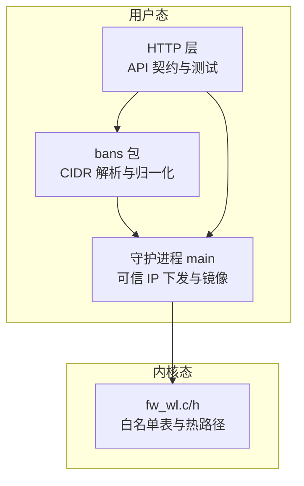
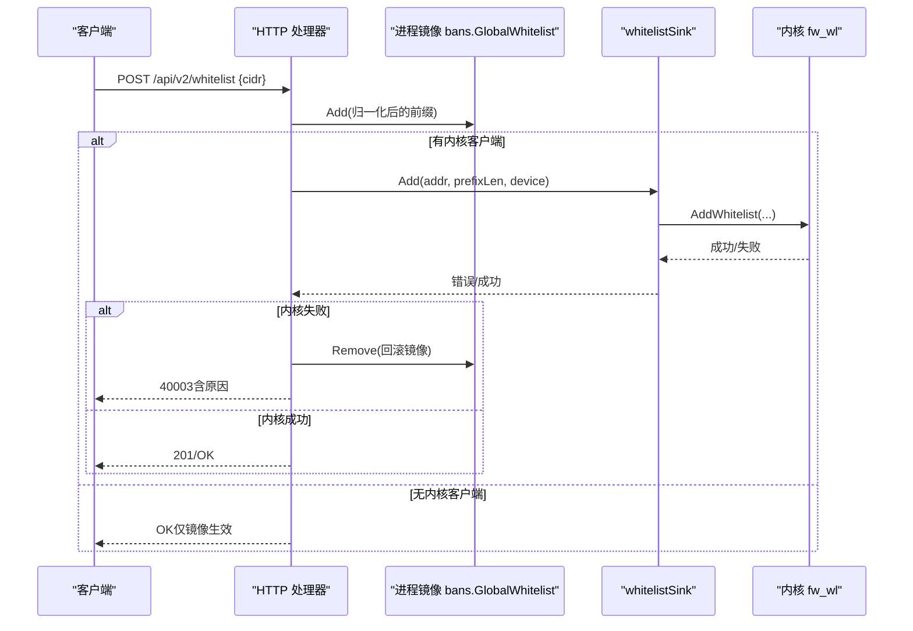
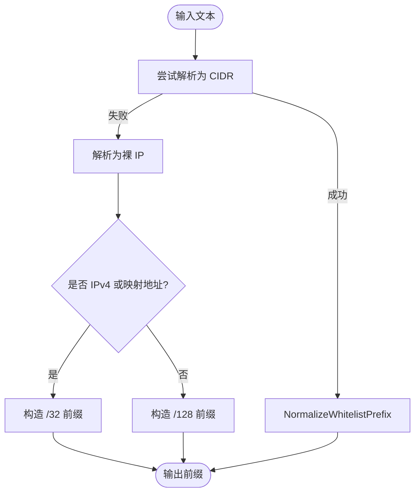
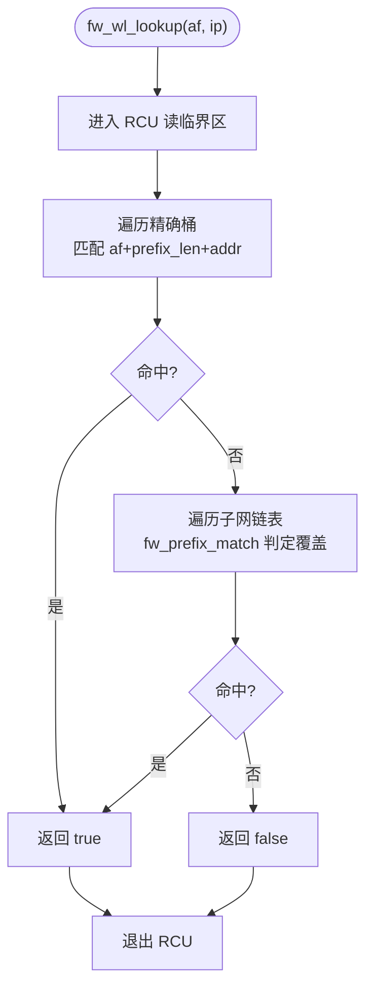
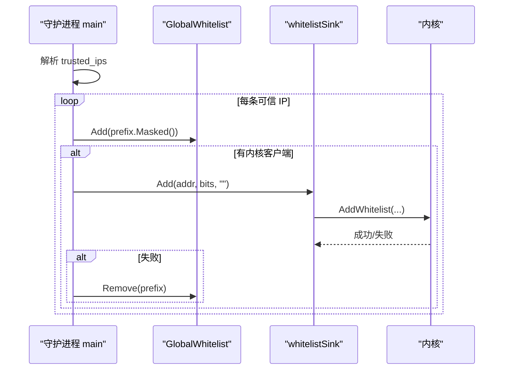
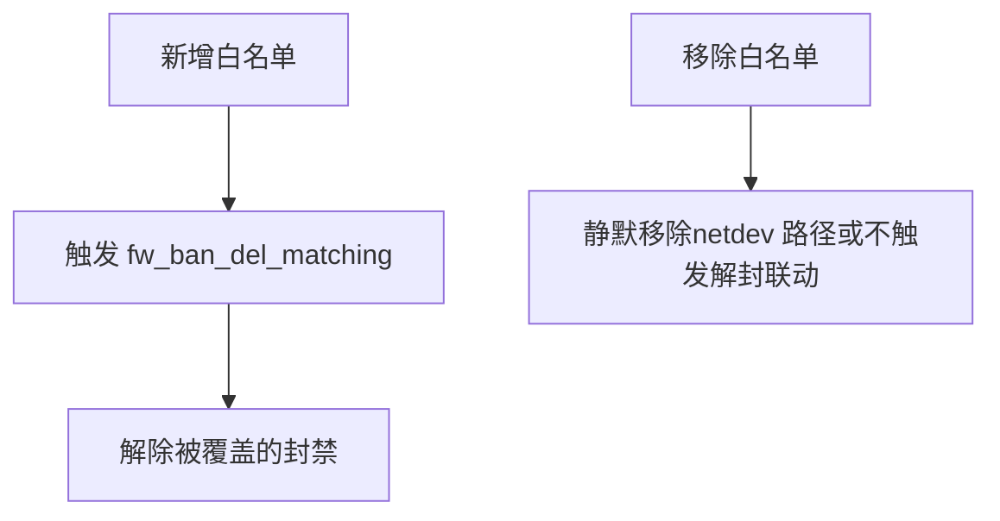
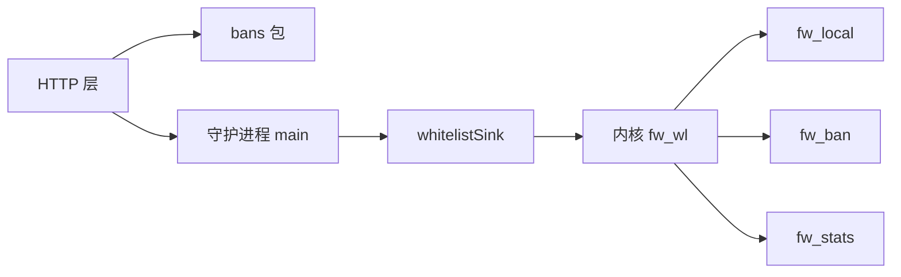

# 白名单处理

<cite>
**本文引用的文件**   
- [whitelist_prefix.go](file://src/daemon/internal/bans/whitelist_prefix.go)
- [whitelist_prefix_test.go](file://src/daemon/internal/bans/whitelist_prefix_test.go)
- [fw_wl.c](file://src/kernel-module/fw_wl.c)
- [fw_wl.h](file://src/kernel-module/fw_wl.h)
- [main.go](file://src/daemon/cmd/firewall-daemon/main.go)
- [whitelist_test.go](file://src/daemon/internal/http/whitelist_test.go)
- [ban.go](file://src/daemon/internal/bans/ban.go)
</cite>

## 目录
1. [简介](#简介)
2. [项目结构](#项目结构)
3. [核心组件](#核心组件)
4. [架构总览](#架构总览)
5. [详细组件分析](#详细组件分析)
6. [依赖关系分析](#依赖关系分析)
7. [性能考量](#性能考量)
8. [故障排查指南](#故障排查指南)
9. [结论](#结论)
10. [附录：配置接口与使用示例](#附录配置接口与使用示例)

## 简介
本文件聚焦“白名单”子系统，覆盖以下主题：
- CIDR 前缀匹配算法、IP 范围判断
- IPv4/IPv6 统一处理机制（含 IPv4 映射地址归一化）
- 内核态数据结构与查找优化（精确桶 + 子网链表）
- 用户态镜像、动态更新、热重载与一致性保障
- 与封禁表的优先级关系、冲突解决策略
- 配置接口、事件泵重建、性能特征与基准建议
- 使用示例与最佳实践

## 项目结构
白名单相关代码横跨内核模块与守护进程两部分：
- 内核态：fw_wl.c / fw_wl.h 实现白名单表、RCU 只读热路径、容量上限与移除联动解封。
- 用户态：bans 包提供文本到前缀的归一化；daemon main 提供可信 IP 启动下发与镜像管理；HTTP 测试用例约束 API 行为与镜像一致性。

**图表来源** 
- [whitelist_prefix.go:1-42](file://src/daemon/internal/bans/whitelist_prefix.go#L1-L42)
- [main.go:685-764](file://src/daemon/cmd/firewall-daemon/main.go#L685-L764)
- [fw_wl.c:1-311](file://src/kernel-module/fw_wl.c#L1-L311)
- [whitelist_test.go:1-273](file://src/daemon/internal/http/whitelist_test.go#L1-L273)

**章节来源**
- [whitelist_prefix.go:1-42](file://src/daemon/internal/bans/whitelist_prefix.go#L1-L42)
- [fw_wl.c:1-311](file://src/kernel-module/fw_wl.c#L1-L311)
- [main.go:685-764](file://src/daemon/cmd/firewall-daemon/main.go#L685-L764)
- [whitelist_test.go:1-273](file://src/daemon/internal/http/whitelist_test.go#L1-L273)

## 核心组件
- 白名单前缀归一化（用户态）
  - 将 CIDR 或裸 IP 转换为统一前缀形态，并处理 IPv4 映射地址（::ffff:x.x.x.x）折回 IPv4 本体。
  - 裸 IP 自动补全为 /32（IPv4）或 /128（IPv6），避免调用方关心地址族差异。
- 内核白名单表
  - 64 位哈希桶存储精确条目；子网条目同时入桶与独立子网链表。
  - RCU 保护的热路径先查精确桶，再遍历子网链进行前缀匹配。
  - 容量上限由模块参数控制；移除时精确匹配，且触发对同覆盖范围的封禁解除。
- 守护进程镜像与下发
  - 启动时从 trusted_ips 解析并下发内核；失败仅跳过该条，不中断启动。
  - HTTP 写入侧维护进程级镜像，内核下发失败时回滚镜像；无内核客户端时按成功返回（契约未定义“依赖未就绪”码）。
- 与封禁的关系
  - 白名单命中优先于封禁；新增白名单会主动解除其覆盖范围内的封禁。

**章节来源**
- [whitelist_prefix.go:11-41](file://src/daemon/internal/bans/whitelist_prefix.go#L11-L41)
- [fw_wl.c:149-245](file://src/kernel-module/fw_wl.c#L149-L245)
- [main.go:723-764](file://src/daemon/cmd/firewall-daemon/main.go#L723-L764)
- [whitelist_test.go:128-259](file://src/daemon/internal/http/whitelist_test.go#L128-L259)

## 架构总览
下图展示从 HTTP 请求到内核白名单表的数据流，以及镜像与内核的一致性保障。

**图表来源** 
- [main.go:704-721](file://src/daemon/cmd/firewall-daemon/main.go#L704-L721)
- [whitelist_test.go:97-150](file://src/daemon/internal/http/whitelist_test.go#L97-L150)

## 详细组件分析

### 白名单前缀归一化（用户态）
- 功能要点
  - NormalizeWhitelistPrefix：若为 IPv4 映射地址且前缀长度 ≥ 96，则折回 IPv4 本体并缩短前缀长度。
  - WhitelistPrefixFromText：先尝试解析 CIDR；失败再解析裸 IP，并按地址族补全主机位。
- 设计动机
  - 避免同一子网出现两个键（镜像与内核事件泵重建不一致导致重复删除失败）。
  - 裸 IP 的主机位由地址自身决定，避免写死 32 导致非法 IPv6 前缀。

**图表来源** 
- [whitelist_prefix.go:17-41](file://src/daemon/internal/bans/whitelist_prefix.go#L17-L41)

**章节来源**
- [whitelist_prefix.go:11-41](file://src/daemon/internal/bans/whitelist_prefix.go#L11-L41)
- [whitelist_prefix_test.go:8-48](file://src/daemon/internal/bans/whitelist_prefix_test.go#L8-L48)

### 内核白名单表与查找算法
- 数据结构
  - 精确桶：按地址族分桶，存储 prefix_len 等于全长（IPv4 /32、IPv6 /128）的条目。
  - 子网链表：存储非精确前缀条目，避免遍历全部桶做前缀匹配。
- 查找流程（热路径）
  - 先查精确桶：命中即返回。
  - 否则遍历子网链表：使用 fw_prefix_match 判定是否覆盖目标 IP。
- 并发模型
  - 写路径加自旋锁；读路径用 RCU 保护，支持软中断与进程上下文复用。
- 容量与去重
  - 插入前原子检查容量上限；相同 (af, 归一化地址, prefix_len) 去重。
- 移除语义
  - 精确匹配移除；本机接口地址不允许直接移除。
  - 移除成功后触发 fw_ban_del_matching，解除被白名单覆盖的封禁。

**图表来源** 
- [fw_wl.c:114-147](file://src/kernel-module/fw_wl.c#L114-L147)

**章节来源**
- [fw_wl.c:29-62](file://src/kernel-module/fw_wl.c#L29-L62)
- [fw_wl.c:114-147](file://src/kernel-module/fw_wl.c#L114-L147)
- [fw_wl.c:157-245](file://src/kernel-module/fw_wl.c#L157-L245)
- [fw_wl.h:1-41](file://src/kernel-module/fw_wl.h#L1-L41)

### 守护进程镜像与可信 IP 下发
- 可信 IP 启动下发
  - 解析 trusted_ips → 归一化为前缀 → 加入全局镜像 → 通过 whitelistSink 下发内核。
  - 单条失败不影响其余条目；内核缺失时仅记录调试日志，不视为失败。
- HTTP 写入侧镜像
  - 添加：先入镜像，再下发内核；内核失败则回滚镜像。
  - 删除：镜像已存在才下发删除；内核失败不改变镜像状态（与解封一致）。
  - 无内核客户端：仍按成功返回，保证契约稳定。

**图表来源** 
- [main.go:723-764](file://src/daemon/cmd/firewall-daemon/main.go#L723-L764)

**章节来源**
- [main.go:704-721](file://src/daemon/cmd/firewall-daemon/main.go#L704-L721)
- [main.go:723-764](file://src/daemon/cmd/firewall-daemon/main.go#L723-L764)
- [whitelist_test.go:246-259](file://src/daemon/internal/http/whitelist_test.go#L246-L259)

### 与封禁表的优先级与冲突解决
- 优先级
  - 白名单命中优先于封禁；命中白名单的流量不会被封禁拦截。
- 冲突解决
  - 新增白名单后，内核主动解除其覆盖范围内的封禁（fw_ban_del_matching）。
  - 本机接口地址不允许从白名单直接移除，防止误删系统关键地址。

**图表来源** 
- [fw_wl.c:241-245](file://src/kernel-module/fw_wl.c#L241-L245)
- [fw_wl.c:247-268](file://src/kernel-module/fw_wl.c#L247-L268)

**章节来源**
- [fw_wl.c:241-268](file://src/kernel-module/fw_wl.c#L241-L268)

## 依赖关系分析
- 用户态依赖
  - HTTP 层依赖 bans 包的 GlobalWhitelist 镜像与 WhitelistPrefixFromText 归一化。
  - 守护进程 main 组合 whitelistSink 作为内核下发出口，并在启动阶段推送可信 IP。
- 内核态依赖
  - fw_wl.c 依赖 fw_local（本机接口地址）、fw_ban（封禁联动）、fw_stats（统计）。
  - 使用 jhash 同源随机种子避免碰撞攻击。

**图表来源** 
- [main.go:685-764](file://src/daemon/cmd/firewall-daemon/main.go#L685-L764)
- [fw_wl.c:20-28](file://src/kernel-module/fw_wl.c#L20-L28)

**章节来源**
- [main.go:685-764](file://src/daemon/cmd/firewall-daemon/main.go#L685-L764)
- [fw_wl.c:20-28](file://src/kernel-module/fw_wl.c#L20-L28)

## 性能考量
- 查找复杂度
  - 精确桶 O(1) 平均；子网链表最坏 O(N)，但通常规模远小于桶总数。
  - 热点路径（fw_hook）走 RCU 只读，避免锁竞争。
- 写入复杂度
  - 插入：哈希桶 O(1) + 可选子网链表尾插；容量检查 O(1)。
  - 删除：精确匹配 O(1)；随后可能触发封禁联动（取决于覆盖范围）。
- 内存与容量
  - 模块参数限制最大白名单条目数，防止恶意膨胀。
- 基准建议
  - 建议在压测中分别测量：纯精确命中、子网命中、大规模子链表场景。
  - 关注 RCU 读路径延迟与写路径扩容时的抖动。

[本节为通用性能讨论，不直接分析具体文件]

## 故障排查指南
- 常见错误码与现象
  - 40003：添加失败（非法 CIDR、已在表中、内核未确认等）。需查看 message 字段区分原因。
  - 镜像不一致：内核拒绝添加后，镜像必须回滚；否则面板显示放行而内核仍拦截。
  - 删除不生效：确保传入 CIDR 的前缀与掩码与镜像一致（主机位会被掩码归一）。
- 排查步骤
  - 检查 HTTP 响应 code 与 message。
  - 核对 bans.GlobalWhitelist() 列表是否与预期一致。
  - 若无内核客户端，确认契约允许“仅镜像生效”。
  - 内核侧检查 fw_max_whitelist_entries 是否耗尽（wl_reject_count 增长）。

**章节来源**
- [whitelist_test.go:128-150](file://src/daemon/internal/http/whitelist_test.go#L128-L150)
- [whitelist_test.go:202-244](file://src/daemon/internal/http/whitelist_test.go#L202-L244)
- [fw_wl.c:180-184](file://src/kernel-module/fw_wl.c#L180-L184)

## 结论
白名单子系统通过“用户态归一化 + 内核态双结构（精确桶 + 子网链表）+ RCU 热路径”实现了高效、一致的放行能力。守护进程镜像与内核下发解耦，既保证面板可读性，又通过回滚与事件泵重建维持一致性。与封禁表的联动确保白名单优先级正确，避免安全策略冲突。

[本节为总结性内容，不直接分析具体文件]

## 附录：配置接口与使用示例

### 配置接口
- 添加白名单
  - 方法：POST /api/v2/whitelist
  - 请求体：{ "cidr": "CIDR 或裸 IP" }
  - 成功：201 或契约 OK；失败：40003（message 说明原因）
- 删除白名单
  - 方法：DELETE /api/v2/whitelist/{encoded-cidr}
  - 成功：契约 OK；内核不存在时仍按成功处理（与解封口径一致）
- 查询白名单
  - 方法：GET /api/v2/whitelist
  - 返回：当前进程镜像中的白名单条目列表

**章节来源**
- [whitelist_test.go:88-126](file://src/daemon/internal/http/whitelist_test.go#L88-L126)
- [whitelist_test.go:202-244](file://src/daemon/internal/http/whitelist_test.go#L202-L244)

### 使用示例与最佳实践
- 示例
  - 添加网段：POST /api/v2/whitelist {"cidr":"203.0.113.0/24"}
  - 添加主机：POST /api/v2/whitelist {"cidr":"198.51.100.7"}
  - 删除网段：DELETE /api/v2/whitelist/203.0.113.0%2F24
- 最佳实践
  - 始终使用 CIDR 形式，便于掩码归一与删除定位。
  - 避免重复添加；重复添加会返回 40003 且不重复下发内核。
  - 在容器或镜像环境中，信任地址应通过 trusted_ips 配置，由守护进程启动时下发。
  - 监控 wl_reject_count 与镜像大小，及时扩容或清理无效规则。

**章节来源**
- [whitelist_test.go:97-126](file://src/daemon/internal/http/whitelist_test.go#L97-L126)
- [main.go:723-764](file://src/daemon/cmd/firewall-daemon/main.go#L723-L764)