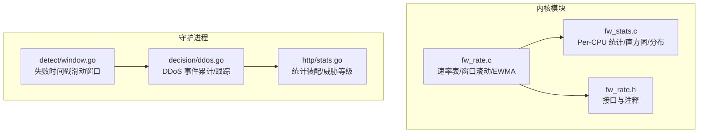
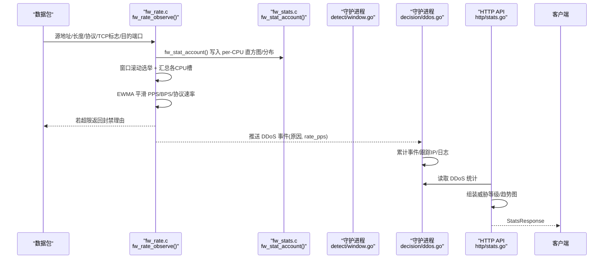
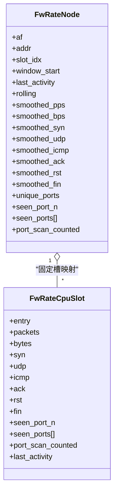
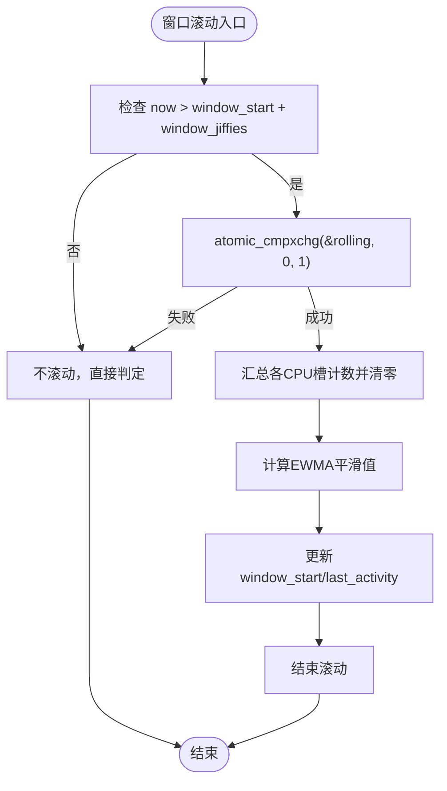
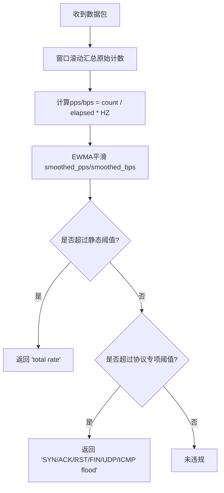
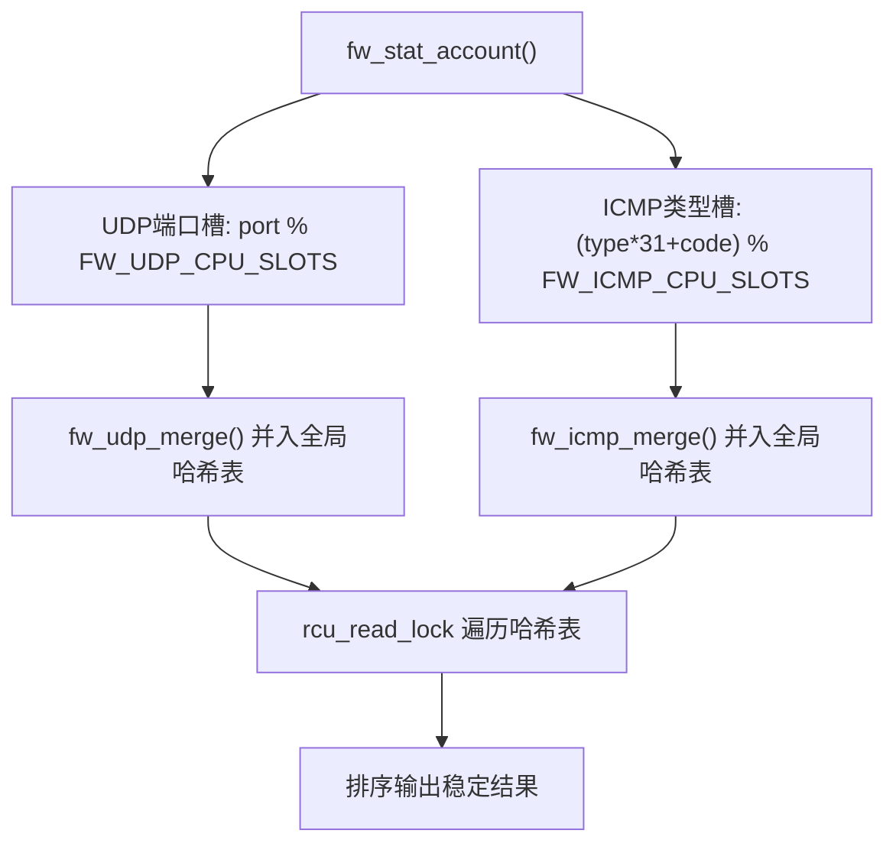
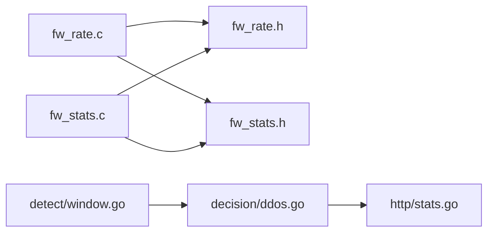

# 速率统计系统

<cite>
**本文引用的文件**   
- [fw_rate.h](file://src/kernel-module/fw_rate.h)
- [fw_rate.c](file://src/kernel-module/fw_rate.c)
- [fw_stats.c](file://src/kernel-module/fw_stats.c)
- [window.go](file://src/daemon/internal/detect/window.go)
- [ddos.go](file://src/daemon/internal/decision/ddos.go)
- [stats.go](file://src/daemon/internal/http/stats.go)
</cite>

## 目录
1. [引言](#引言)
2. [项目结构](#项目结构)
3. [核心组件](#核心组件)
4. [架构总览](#架构总览)
5. [详细组件分析](#详细组件分析)
6. [依赖关系分析](#依赖关系分析)
7. [性能与调优](#性能与调优)
8. [故障排查指南](#故障排查指南)
9. [结论](#结论)

## 引言
本文件系统性地梳理速率统计与 DDoS 检测实现，覆盖内核模块中的 Per-CPU 优化、无锁热路径、时间窗口滚动、EWMA 平滑、PPS/BPS 阈值判定、渐进式封禁策略，以及直方图统计、UDP/ICMP 分布分析与流量特征识别。文档同时给出面向运维的性能参数与监控指标说明，帮助读者在不深入源码的情况下理解系统行为与调优方向。

## 项目结构
速率统计系统横跨内核模块与守护进程两部分：
- 内核模块负责高吞吐热路径的 per-CPU 计数、窗口滚动、EWMA 平滑与协议级违规判定。
- 守护进程负责失败时间戳滑动窗口、DDoS 事件累计与威胁等级计算，并通过 HTTP API 暴露统计结果。

**图表来源**
- [fw_rate.c:1-800](file://src/kernel-module/fw_rate.c#L1-L800)
- [fw_rate.h:1-90](file://src/kernel-module/fw_rate.h#L1-L90)
- [fw_stats.c:1-460](file://src/kernel-module/fw_stats.c#L1-L460)
- [window.go:1-126](file://src/daemon/internal/detect/window.go#L1-L126)
- [ddos.go:1-164](file://src/daemon/internal/decision/ddos.go#L1-L164)
- [stats.go:1-498](file://src/daemon/internal/http/stats.go#L1-L498)

**章节来源**
- [fw_rate.h:1-90](file://src/kernel-module/fw_rate.h#L1-L90)
- [fw_rate.c:1-800](file://src/kernel-module/fw_rate.c#L1-L800)
- [fw_stats.c:1-460](file://src/kernel-module/fw_stats.c#L1-L460)
- [window.go:1-126](file://src/daemon/internal/detect/window.go#L1-L126)
- [ddos.go:1-164](file://src/daemon/internal/decision/ddos.go#L1-L164)
- [stats.go:1-498](file://src/daemon/internal/http/stats.go#L1-L498)

## 核心组件
- 速率表与窗口滚动（内核）：按源地址维护条目，使用 per-CPU 槽位记录原始计数，窗口边界汇总并清零，计算 EWMA 平滑值。
- 协议专项判定（内核）：对 TCP SYN/ACK/RST/FIN、UDP、ICMP 分别设置阈值，命中返回封禁理由。
- 全局速率判定（内核）：结合静态阈值与动态基线（EWMA），比较 smoothed_pps/smoothed_bps。
- Per-CPU 统计与分布（内核）：包长直方图、TTL 分布、IP 分片统计；UDP 端口与 ICMP 类型分布通过 per-CPU 槽 + 全局哈希表合并。
- 失败时间戳滑动窗口（守护进程）：每个 IP 保留固定长度时间戳队列，窗口内计数达到上限触发封禁。
- DDoS 事件累计与跟踪（守护进程）：累计事件数、自动封禁次数、被跟踪 IP 数量，支持配置更新与陈旧条目清理。
- 统计装配与威胁等级（守护进程）：聚合内核快照、历史库、速率窗口等数据，输出威胁等级与趋势图。

**章节来源**
- [fw_rate.c:77-94](file://src/kernel-module/fw_rate.c#L77-L94)
- [fw_rate.c:506-577](file://src/kernel-module/fw_rate.c#L506-L577)
- [fw_rate.c:583-655](file://src/kernel-module/fw_rate.c#L583-L655)
- [fw_stats.c:100-155](file://src/kernel-module/fw_stats.c#L100-L155)
- [window.go:36-80](file://src/daemon/internal/detect/window.go#L36-L80)
- [ddos.go:18-40](file://src/daemon/internal/decision/ddos.go#L18-L40)
- [stats.go:316-372](file://src/daemon/internal/http/stats.go#L316-L372)

## 架构总览
速率统计系统的端到端流程如下：数据包进入内核后，在热路径中仅写 per-CPU 槽位；窗口滚动时由选举出的 CPU 汇总各槽并清零，计算 EWMA 平滑值并进行阈值判定；守护进程侧维护失败时间戳滑动窗口与 DDoS 事件累计，最终通过 HTTP API 输出统计与威胁等级。

**图表来源**
- [fw_rate.c:661-750](file://src/kernel-module/fw_rate.c#L661-L750)
- [fw_stats.c:141-155](file://src/kernel-module/fw_stats.c#L141-L155)
- [ddos.go:103-129](file://src/daemon/internal/decision/ddos.go#L103-L129)
- [stats.go:50-88](file://src/daemon/internal/http/stats.go#L50-L88)

## 详细组件分析

### 速率表与 Per-CPU 优化（内核）
- 一次查表：热路径通过 fw_rate_observe() 一次查表取到条目指针，随后完成窗口滚动与四类违规判定，避免旧实现多次 find_rate_entry_rcu 带来的额外开销。
- Per-CPU 槽位：每条目固定映射一组槽位，热路径只写本 CPU 内存，无共享 cache line 写；窗口滚动时由 cmpxchg 选举出的 CPU 汇总各槽并清零。
- 无锁热路径：端口去重集合移至 per-CPU 槽，滚动时再合并为条目上的并集；桶锁仅在建条目时使用。
- 容量与回收：条目固定占槽，上限受 FW_RATE_CPU_SLOTS 限制；周期回收工作项释放静默超过保留时长的条目，使槽表反映近期活跃源。

**图表来源**
- [fw_rate.c:441-495](file://src/kernel-module/fw_rate.c#L441-L495)
- [fw_rate.c:506-577](file://src/kernel-module/fw_rate.c#L506-L577)

**章节来源**
- [fw_rate.h:33-58](file://src/kernel-module/fw_rate.h#L33-L58)
- [fw_rate.c:1-37](file://src/kernel-module/fw_rate.c#L1-L37)
- [fw_rate.c:441-495](file://src/kernel-module/fw_rate.c#L441-L495)
- [fw_rate.c:506-577](file://src/kernel-module/fw_rate.c#L506-L577)

### 时间窗口算法与滑动窗口（内核与守护进程）
- 内核窗口滚动：窗口起始时间与当前 jiffies 比较，若超时则尝试 atomic_cmpxchg 选举结算者；结算者汇总各 CPU 槽的 packets/bytes/协议计数，清零后计算 EWMA 平滑值，并更新时间窗口。
- 守护进程失败时间戳滑动窗口：每个 IP 维护一个时间戳队列，Observe 追加 now，满员时 FIFO 淘汰最旧；countRecent 统计 [now-window, now] 内的时间戳数，达到 cap 即报告 ReachedCap。

**图表来源**
- [fw_rate.c:737-741](file://src/kernel-module/fw_rate.c#L737-L741)
- [fw_rate.c:506-577](file://src/kernel-module/fw_rate.c#L506-L577)
- [window.go:36-80](file://src/daemon/internal/detect/window.go#L36-L80)

**章节来源**
- [fw_rate.c:737-741](file://src/kernel-module/fw_rate.c#L737-L741)
- [window.go:36-80](file://src/daemon/internal/detect/window.go#L36-L80)

### DDoS 检测算法：PPS/BPS 计算、阈值判定、渐进式封禁
- PPS/BPS 计算：内核在窗口滚动时汇总原始计数，除以 elapsed（jiffies 差值）得到每秒速率，再通过 EWMA 平滑得到 smoothed_pps/smoothed_bps。
- 阈值判定：
  - 协议专项：SYN/ACK/RST/FIN/UDP/ICMP 各自阈值比较。
  - 总速率：静态阈值与动态基线（baseline_pps/baseline_bps × ratio）取较大者，比较 smoothed_pps/smoothed_bps。
- 渐进式封禁策略：守护进程的 DdosEngine 累计事件与违规次数，支持 AutoBanThreshold 配置；内核已执行封禁，守护进程仅记账与日志，避免重复封禁。

**图表来源**
- [fw_rate.c:77-89](file://src/kernel-module/fw_rate.c#L77-L89)
- [fw_rate.c:506-577](file://src/kernel-module/fw_rate.c#L506-L577)
- [fw_rate.c:583-655](file://src/kernel-module/fw_rate.c#L583-L655)
- [ddos.go:103-129](file://src/daemon/internal/decision/ddos.go#L103-L129)

**章节来源**
- [fw_rate.c:77-89](file://src/kernel-module/fw_rate.c#L77-L89)
- [fw_rate.c:506-577](file://src/kernel-module/fw_rate.c#L506-L577)
- [fw_rate.c:583-655](file://src/kernel-module/fw_rate.c#L583-L655)
- [ddos.go:103-129](file://src/daemon/internal/decision/ddos.go#L103-L129)

### 直方图统计、UDP/ICMP 分布分析与流量特征识别
- 直方图统计：fw_stat_account() 将包长落入 fw_pkt_size_bucket，TTL 落入 fw_ttl_bucket，并累计 IP 分片总数与分片数。
- UDP/ICMP 分布：per-CPU 槽直接映射端口或 (type, code)，flush 时并入全局哈希表；读侧 rcu_read_lock 遍历哈希表，排序后输出稳定可比的结果。
- 流量特征识别：端口扫描者与服务探测者来自速率表的 unique_ports 与 seen_ports 并集，结合 PORT_SCAN_THRESHOLD/SERVICE_PROBE_THRESHOLD 进行识别。

**图表来源**
- [fw_stats.c:100-155](file://src/kernel-module/fw_stats.c#L100-L155)
- [fw_stats.c:201-289](file://src/kernel-module/fw_stats.c#L201-L289)
- [fw_stats.c:408-459](file://src/kernel-module/fw_stats.c#L408-L459)

**章节来源**
- [fw_stats.c:100-155](file://src/kernel-module/fw_stats.c#L100-L155)
- [fw_stats.c:201-289](file://src/kernel-module/fw_stats.c#L201-L289)
- [fw_stats.c:408-459](file://src/kernel-module/fw_stats.c#L408-L459)

## 依赖关系分析
- 内核模块内部依赖：
  - fw_rate.c 依赖 fw_rate.h 接口与 fw_stats.h 统计头。
  - fw_stats.c 依赖 fw_stats.h 与 fw_rate.h（用于组合扫描者/探测者信息）。
- 守护进程内部依赖：
  - detect/window.go 提供纯计算部件，供决策引擎复用。
  - decision/ddos.go 依赖 config.DdosConfig 与 logger，维护 ipTracker 与 DdosStats。
  - http/stats.go 依赖 analysis、bans、config、kernel、persist、telemetry 等模块装配统计响应。

**图表来源**
- [fw_rate.c:41-45](file://src/kernel-module/fw_rate.c#L41-L45)
- [fw_stats.c:18-24](file://src/kernel-module/fw_stats.c#L18-L24)
- [ddos.go:1-12](file://src/daemon/internal/decision/ddos.go#L1-L12)
- [stats.go:14-28](file://src/daemon/internal/http/stats.go#L14-L28)

**章节来源**
- [fw_rate.c:41-45](file://src/kernel-module/fw_rate.c#L41-L45)
- [fw_stats.c:18-24](file://src/kernel-module/fw_stats.c#L18-L24)
- [ddos.go:1-12](file://src/daemon/internal/decision/ddos.go#L1-L12)
- [stats.go:14-28](file://src/daemon/internal/http/stats.go#L14-L28)

## 性能与调优
- Per-CPU 优化：
  - 热路径仅写本 CPU 槽位，避免跨核竞争；窗口滚动仅在边界发生，减少锁竞争。
  - 端口去重集合移至 per-CPU 槽，滚动时合并，降低热路径锁开销。
- 窗口与 EWMA：
  - 窗口时长影响平滑响应速度；较短窗口更敏感，较长窗口更稳定。
  - EWMA 系数决定平滑程度；内核使用定点运算提升性能。
- 容量与回收：
  - FW_RATE_CPU_SLOTS 限制同时跟踪的源地址数；周期回收静默条目以释放槽位。
  - 表满时有意放行，rate_slot_spill 观测该情况。
- 监控指标：
  - 内核：packets_accepted/packets_dropped、global_traffic_packets/global_traffic_bytes、rate_slot_spill、rate_reclaimed。
  - 守护进程：DdosEvents、AutoBansTriggered、TrackedIPs、threat_level.factors。

**章节来源**
- [fw_rate.c:1-37](file://src/kernel-module/fw_rate.c#L1-L37)
- [fw_rate.c:226-292](file://src/kernel-module/fw_rate.c#L226-L292)
- [fw_stats.c:376-406](file://src/kernel-module/fw_stats.c#L376-L406)
- [ddos.go:31-55](file://src/daemon/internal/decision/ddos.go#L31-L55)
- [stats.go:316-372](file://src/daemon/internal/http/stats.go#L316-L372)

## 故障排查指南
- 速率表满导致误放行：
  - 现象：rate_slot_spill 增长，新源地址不参与速率判定。
  - 排查：检查 fw_max_rate_entries 与 FW_RATE_CPU_SLOTS 配置，确认回收工作项是否正常运行。
- UDP/ICMP 分布槽顶替：
  - 现象：rate_slot_spill 增长，分布计数允许丢失。
  - 排查：调整 MAX_UDP_PORT_ENTRIES/MAX_ICMP_TYPE_ENTRIES，观察 flush 后的全局哈希表大小。
- 窗口滚动异常：
  - 现象：平滑速率不更新或波动异常。
  - 排查：检查 jiffies 与窗口时长配置，确认 rolling 选举逻辑是否正常。
- DDoS 事件未累计：
  - 现象：DdosEvents 恒为零。
  - 排查：确认内核推送事件通道正常，守护进程 DdosEngine 配置 AutoBanThreshold 合理。

**章节来源**
- [fw_rate.c:441-495](file://src/kernel-module/fw_rate.c#L441-L495)
- [fw_stats.c:201-289](file://src/kernel-module/fw_stats.c#L201-L289)
- [fw_rate.c:737-741](file://src/kernel-module/fw_rate.c#L737-L741)
- [ddos.go:103-129](file://src/daemon/internal/decision/ddos.go#L103-L129)

## 结论
本速率统计系统通过 Per-CPU 优化、无锁热路径、时间窗口滚动与 EWMA 平滑，实现了高吞吐下的精准速率统计与 DDoS 检测。守护进程侧的失败时间戳滑动窗口与 DDoS 事件累计提供了可配置的渐进式封禁策略。直方图统计与 UDP/ICMP 分布分析为流量特征识别提供了基础。运维人员可通过监控指标与调优参数进一步优化系统性能与稳定性。