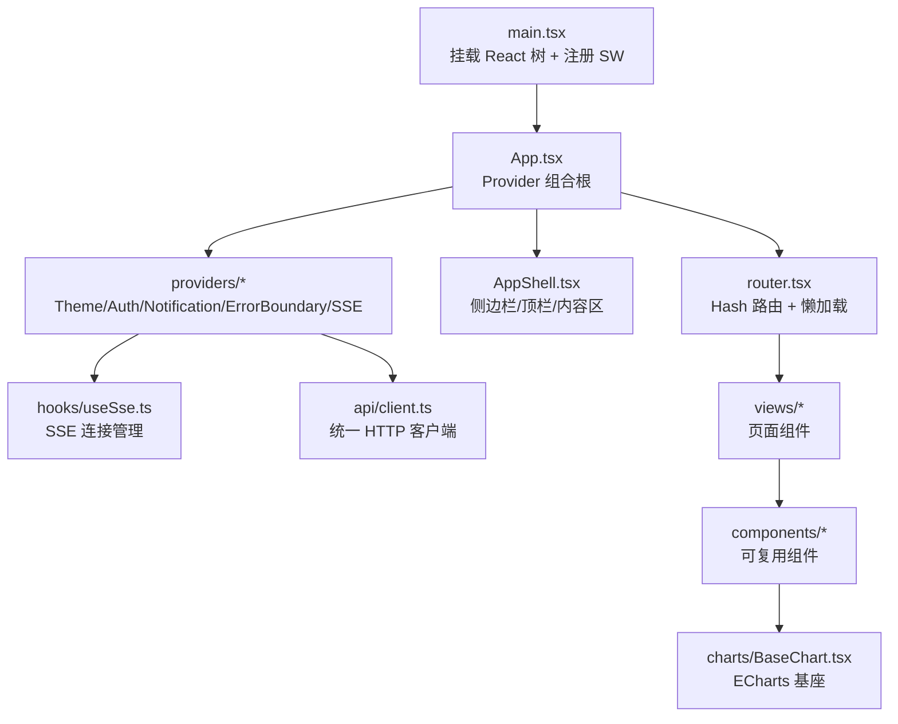
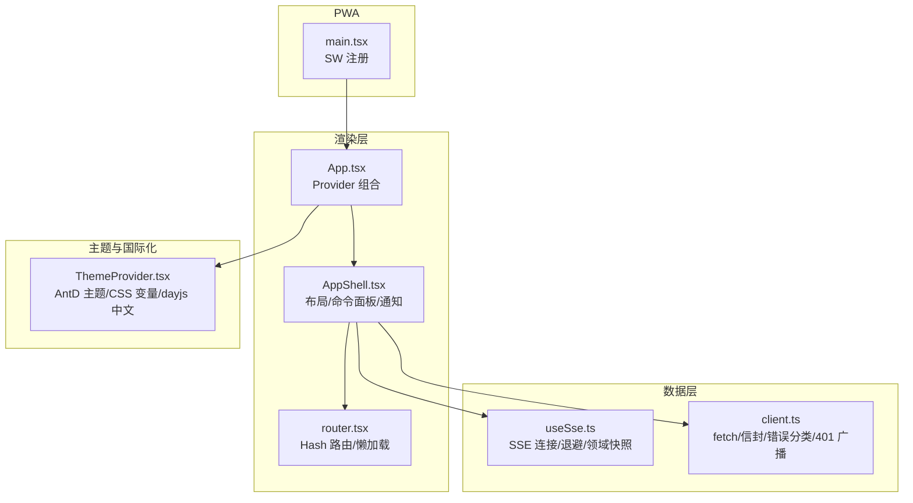
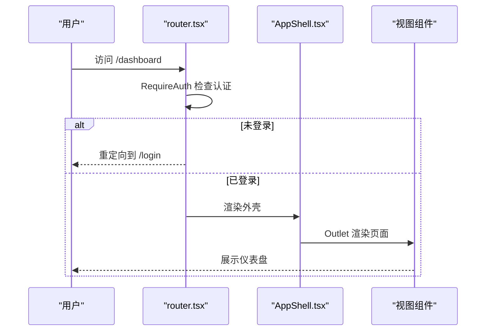
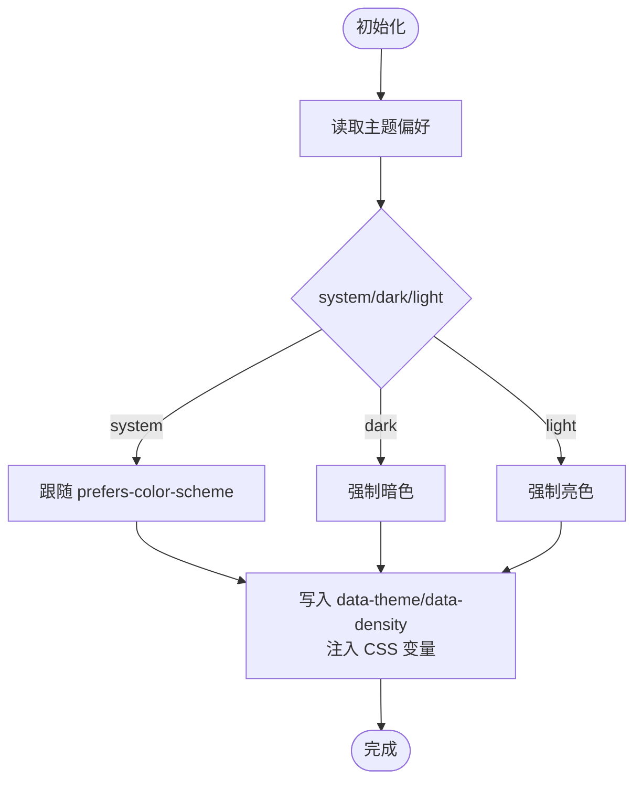
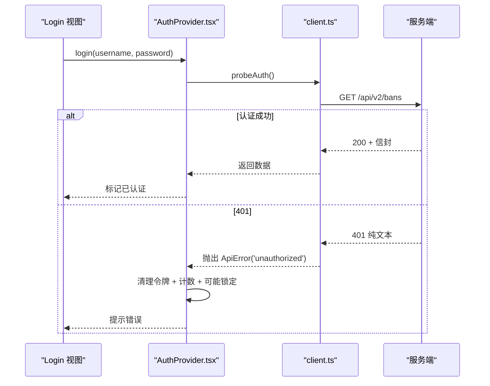
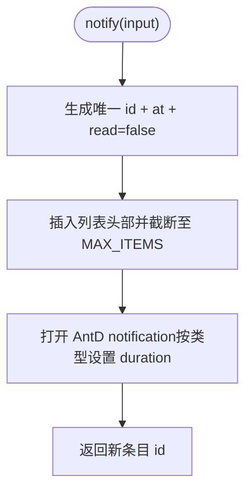
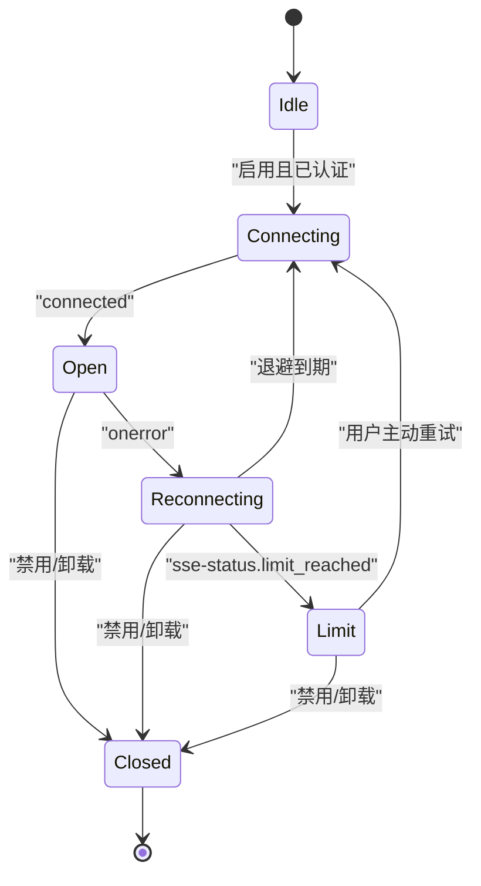
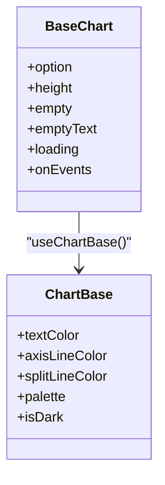
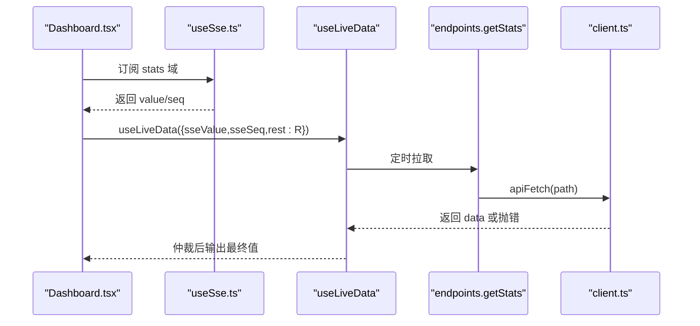
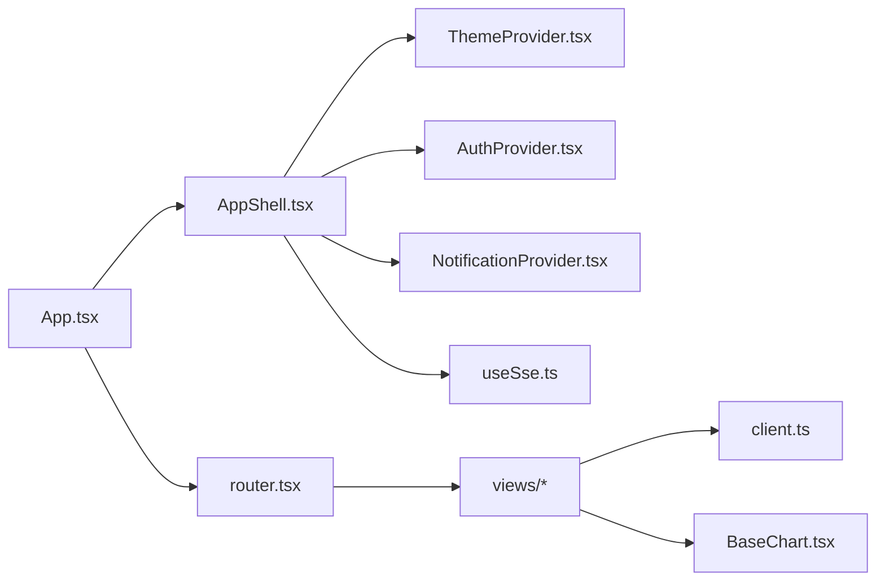

# 前端面板架构

<cite>
**本文引用的文件**   
- [frontend/package.json](file://frontend/package.json)
- [frontend/src/main.tsx](file://frontend/src/main.tsx)
- [frontend/src/app/App.tsx](file://frontend/src/app/App.tsx)
- [frontend/src/app/router.tsx](file://frontend/src/app/router.tsx)
- [frontend/src/app/AppShell.tsx](file://frontend/src/app/AppShell.tsx)
- [frontend/src/providers/ThemeProvider.tsx](file://frontend/src/providers/ThemeProvider.tsx)
- [frontend/src/providers/AuthProvider.tsx](file://frontend/src/providers/AuthProvider.tsx)
- [frontend/src/providers/NotificationProvider.tsx](file://frontend/src/providers/NotificationProvider.tsx)
- [frontend/src/hooks/useSse.ts](file://frontend/src/hooks/useSse.ts)
- [frontend/src/api/client.ts](file://frontend/src/api/client.ts)
- [frontend/src/views/Dashboard.tsx](file://frontend/src/views/Dashboard.tsx)
- [frontend/src/components/charts/BaseChart.tsx](file://frontend/src/components/charts/BaseChart.tsx)
</cite>

## 目录
1. [引言](#引言)
2. [项目结构](#项目结构)
3. [核心组件](#核心组件)
4. [架构总览](#架构总览)
5. [详细组件分析](#详细组件分析)
6. [依赖关系分析](#依赖关系分析)
7. [性能与可维护性](#性能与可维护性)
8. [故障排查指南](#故障排查指南)
9. [结论](#结论)
10. [附录：开发规范与最佳实践](#附录开发规范与最佳实践)

## 引言
本文件面向防火墙控制面板的前端面板，系统性梳理 React 应用的整体架构、组件层次、路由管理、状态管理模式、API 客户端封装、实时数据更新（SSE）、图表可视化、主题系统、PWA 支持、响应式设计与国际化要点。文档同时提供架构图、数据流图与状态流转图，并给出开发规范、最佳实践与性能优化建议，帮助读者快速理解并高效扩展该面板。

## 项目结构
前端采用 Vite + React 19 + TypeScript + Ant Design 6 的桌面优先技术栈，按功能域组织源码：
- app：应用外壳、路由与 Provider 组合根
- providers：认证、主题、通知、错误边界等全局上下文
- hooks：SSE 连接、刷新信号、媒体查询、持久化状态等通用逻辑
- api：HTTP 客户端、类型与端点定义
- views：页面级组件（仪表盘、封禁、白名单、DDoS、风险、威胁情报、日志、设置等）
- components：可复用 UI 组件与图表基座
- theme：设计令牌与主题构建
- main.tsx：应用入口与 Service Worker 注册

**图示来源**
- [frontend/src/main.tsx:1-32](file://frontend/src/main.tsx#L1-L32)
- [frontend/src/app/App.tsx:1-44](file://frontend/src/app/App.tsx#L1-L44)
- [frontend/src/app/router.tsx:1-76](file://frontend/src/app/router.tsx#L1-L76)
- [frontend/src/app/AppShell.tsx:1-366](file://frontend/src/app/AppShell.tsx#L1-L366)
- [frontend/src/hooks/useSse.ts:1-259](file://frontend/src/hooks/useSse.ts#L1-L259)
- [frontend/src/api/client.ts:1-205](file://frontend/src/api/client.ts#L1-L205)
- [frontend/src/components/charts/BaseChart.tsx:1-97](file://frontend/src/components/charts/BaseChart.tsx#L1-L97)

**章节来源**
- [frontend/package.json:1-34](file://frontend/package.json#L1-L34)
- [frontend/src/main.tsx:1-32](file://frontend/src/main.tsx#L1-L32)

## 核心组件
- 应用壳层 AppShell：统一的侧边栏、顶栏与内容区布局；集成命令面板、实时状态灯、主题/密度切换、通知中心与账户菜单；实现响应式策略（≥lg 常驻侧边栏、md–lg 图标条、<md 抽屉）。
- 路由 router：基于 react-router-dom 的 Hash 路由，登录页公开，其余路由受 RequireAuth 保护；页面组件 lazy 加载，配合 Suspense 骨架屏。
- Provider 组合根 App：从外到内依次注入 ThemeProvider → AntdApp → ErrorBoundary → AuthProvider → NotificationProvider → SseProvider → RouterProvider，确保主题、通知实例、认证态与 SSE 连接顺序正确。
- 主题 ThemeProvider：集中处理 AntD ConfigProvider 主题、CSS 变量、data-theme/data-density 属性同步、dayjs 中文本地化与偏好持久化。
- 认证 AuthProvider：令牌生命周期、登录/登出、401 自动登出、连续失败锁定倒计时。
- 通知 NotificationProvider：非阻塞 toast + 可回溯列表，按严重程度控制自动关闭时长，限制最大条目数防止内存增长。
- SSE useEventStream：接管 /api/v2/events 连接，事件名硬编码以通过契约校验；退避重连、上限检测、领域快照与新鲜度序号。
- API client：统一 fetch 封装、信封解包、错误分类、401 广播、超时与取消信号。

**章节来源**
- [frontend/src/app/AppShell.tsx:1-366](file://frontend/src/app/AppShell.tsx#L1-L366)
- [frontend/src/app/router.tsx:1-76](file://frontend/src/app/router.tsx#L1-L76)
- [frontend/src/app/App.tsx:1-44](file://frontend/src/app/App.tsx#L1-L44)
- [frontend/src/providers/ThemeProvider.tsx:1-174](file://frontend/src/providers/ThemeProvider.tsx#L1-L174)
- [frontend/src/providers/AuthProvider.tsx:1-190](file://frontend/src/providers/AuthProvider.tsx#L1-L190)
- [frontend/src/providers/NotificationProvider.tsx:1-119](file://frontend/src/providers/NotificationProvider.tsx#L1-L119)
- [frontend/src/hooks/useSse.ts:1-259](file://frontend/src/hooks/useSse.ts#L1-L259)
- [frontend/src/api/client.ts:1-205](file://frontend/src/api/client.ts#L1-L205)

## 架构总览
整体架构围绕“Provider 上下文 + 路由 + SSE/REST 双通道数据”展开：
- 渲染层：AppShell 提供框架，RouterProvider 分发页面，页面消费 Context 与 Hooks。
- 数据层：useEventStream 订阅 SSE 多域帧，REST 作为校准与兜底；client.ts 统一错误与鉴权。
- 主题与国际化：ThemeProvider 注入 AntD 主题与中文 locale，并通过 CSS 变量暴露语义色给自绘元素。
- PWA：入口注册 Service Worker，离线能力为可选增强，不影响在线主流程。

**图示来源**
- [frontend/src/app/App.tsx:1-44](file://frontend/src/app/App.tsx#L1-L44)
- [frontend/src/app/AppShell.tsx:1-366](file://frontend/src/app/AppShell.tsx#L1-L366)
- [frontend/src/app/router.tsx:1-76](file://frontend/src/app/router.tsx#L1-L76)
- [frontend/src/hooks/useSse.ts:1-259](file://frontend/src/hooks/useSse.ts#L1-L259)
- [frontend/src/api/client.ts:1-205](file://frontend/src/api/client.ts#L1-L205)
- [frontend/src/providers/ThemeProvider.tsx:1-174](file://frontend/src/providers/ThemeProvider.tsx#L1-L174)
- [frontend/src/main.tsx:1-32](file://frontend/src/main.tsx#L1-L32)

## 详细组件分析

### 应用外壳与路由
- AppShell 负责全站布局与跨页能力聚合：命令面板（mod+K）、实时状态灯、主题/密度切换、通知中心、账户菜单；在窄屏下自动折叠或进入抽屉。
- 路由使用 createHashRouter，/login 公开，其余路由由 RequireAuth 保护；页面组件 lazy 加载，Suspense fallback 显示表格骨架。
- NotFound 将已知路径前缀回落到对应页面，未知路径回默认首页，避免无意义的 404。

**图示来源**
- [frontend/src/app/router.tsx:1-76](file://frontend/src/app/router.tsx#L1-L76)
- [frontend/src/app/AppShell.tsx:1-366](file://frontend/src/app/AppShell.tsx#L1-L366)

**章节来源**
- [frontend/src/app/AppShell.tsx:1-366](file://frontend/src/app/AppShell.tsx#L1-L366)
- [frontend/src/app/router.tsx:1-76](file://frontend/src/app/router.tsx#L1-L76)

### 主题系统与国际化
- ThemeProvider 将 AntD 主题、中文 locale、CSS 变量与 data-theme/data-density 属性统一管理；偏好落 localStorage 并跨标签同步。
- 明暗两套表面色与文本色通过 CSS 变量暴露给纯 CSS 与自绘元素；dayjs 设置为 zh-cn，避免日期选择器英文月份。

**图示来源**
- [frontend/src/providers/ThemeProvider.tsx:1-174](file://frontend/src/providers/ThemeProvider.tsx#L1-L174)

**章节来源**
- [frontend/src/providers/ThemeProvider.tsx:1-174](file://frontend/src/providers/ThemeProvider.tsx#L1-L174)

### 认证与鉴权
- AuthProvider 管理令牌生命周期、登录/登出、401 自动登出与连续失败锁定倒计时；登录成功与否通过真实探测接口判定。
- 任何 REST 调用收到 401 会触发 onUnauthorized 广播，AuthProvider 清理令牌并跳转登录，避免视图停留在无效凭据状态。

**图示来源**
- [frontend/src/providers/AuthProvider.tsx:1-190](file://frontend/src/providers/AuthProvider.tsx#L1-L190)
- [frontend/src/api/client.ts:1-205](file://frontend/src/api/client.ts#L1-L205)

**章节来源**
- [frontend/src/providers/AuthProvider.tsx:1-190](file://frontend/src/providers/AuthProvider.tsx#L1-L190)
- [frontend/src/api/client.ts:1-205](file://frontend/src/api/client.ts#L1-L205)

### 通知中心
- NotificationProvider 提供 notify/markRead/clear/dismiss 等方法，toast 与列表联动；错误类通知不自动关闭，需手动清除。
- 列表最多保留固定数量条目，FIFO 丢弃最旧项，避免长会话内存无界增长。

**图示来源**
- [frontend/src/providers/NotificationProvider.tsx:1-119](file://frontend/src/providers/NotificationProvider.tsx#L1-L119)

**章节来源**
- [frontend/src/providers/NotificationProvider.tsx:1-119](file://frontend/src/providers/NotificationProvider.tsx#L1-L119)

### 实时数据更新（SSE）
- useEventStream 接管 /api/v2/events 连接，事件名硬编码以满足契约校验；每个域独立快照与 seq 序号，用于新鲜度仲裁。
- 重连策略：出错即 close，按 min(2^min(n,5),30) 秒退避；重连前先探 sse-status，若 limit_reached 则停止重试并降级为 REST 轮询。
- 外壳监听 SSE 状态跃迁与威胁等级变化，仅在真正变化时推送通知，避免重复打扰。

**图示来源**
- [frontend/src/hooks/useSse.ts:1-259](file://frontend/src/hooks/useSse.ts#L1-L259)
- [frontend/src/app/AppShell.tsx:1-366](file://frontend/src/app/AppShell.tsx#L1-L366)

**章节来源**
- [frontend/src/hooks/useSse.ts:1-259](file://frontend/src/hooks/useSse.ts#L1-L259)
- [frontend/src/app/AppShell.tsx:1-366](file://frontend/src/app/AppShell.tsx#L1-L366)

### 图表可视化
- BaseChart 是全站 ECharts 的唯一渲染入口，统一主题、空态、loading 与尺寸自适应；各页面通过 useChartBase 获取轴色/调色板拼装 option。
- Dashboard 将 stats 域的 SSE 帧与 REST 拉取合流，用 useLiveData 按新鲜度序号仲裁，保证实时性与稳定性。

**图示来源**
- [frontend/src/components/charts/BaseChart.tsx:1-97](file://frontend/src/components/charts/BaseChart.tsx#L1-L97)

**章节来源**
- [frontend/src/components/charts/BaseChart.tsx:1-97](file://frontend/src/components/charts/BaseChart.tsx#L1-L97)
- [frontend/src/views/Dashboard.tsx:1-303](file://frontend/src/views/Dashboard.tsx#L1-L303)

### 页面组件与数据流（概览）
Dashboard 展示了典型的数据流模式：
- 使用 useSseDomain('stats') 获取 SSE 值与 seq
- 使用 useLiveData 合并 REST 拉取（getStats）与 SSE 帧，按新鲜度仲裁
- 使用 useAsync 拉取 Top 复发攻击源
- 使用 useRefreshSignal 响应全局刷新信号

**图示来源**
- [frontend/src/views/Dashboard.tsx:1-303](file://frontend/src/views/Dashboard.tsx#L1-L303)
- [frontend/src/hooks/useSse.ts:1-259](file://frontend/src/hooks/useSse.ts#L1-L259)
- [frontend/src/api/client.ts:1-205](file://frontend/src/api/client.ts#L1-L205)

**章节来源**
- [frontend/src/views/Dashboard.tsx:1-303](file://frontend/src/views/Dashboard.tsx#L1-L303)

## 依赖关系分析
- 组件耦合：AppShell 依赖 Theme/Auth/Sse/Notify 上下文；Router 依赖 Auth 进行鉴权；Dashboard 依赖 SSE 与 REST 双通道。
- 外部依赖：react-router-dom（路由）、antd（UI）、echarts/echarts-for-react（图表）、dayjs（时间）、tslib（运行时）。
- 潜在循环：Provider 之间单向依赖（Theme→AntD，Auth→client，Sse→endpoints），未见直接循环引用。

**图示来源**
- [frontend/src/app/App.tsx:1-44](file://frontend/src/app/App.tsx#L1-L44)
- [frontend/src/app/router.tsx:1-76](file://frontend/src/app/router.tsx#L1-L76)
- [frontend/src/app/AppShell.tsx:1-366](file://frontend/src/app/AppShell.tsx#L1-L366)
- [frontend/src/providers/ThemeProvider.tsx:1-174](file://frontend/src/providers/ThemeProvider.tsx#L1-L174)
- [frontend/src/providers/AuthProvider.tsx:1-190](file://frontend/src/providers/AuthProvider.tsx#L1-L190)
- [frontend/src/providers/NotificationProvider.tsx:1-119](file://frontend/src/providers/NotificationProvider.tsx#L1-L119)
- [frontend/src/hooks/useSse.ts:1-259](file://frontend/src/hooks/useSse.ts#L1-L259)
- [frontend/src/api/client.ts:1-205](file://frontend/src/api/client.ts#L1-L205)
- [frontend/src/components/charts/BaseChart.tsx:1-97](file://frontend/src/components/charts/BaseChart.tsx#L1-L97)

**章节来源**
- [frontend/package.json:1-34](file://frontend/package.json#L1-L34)

## 性能与可维护性
- 首屏与路由性能
  - 路由懒加载 + Suspense 骨架屏，避免一次性下载所有页面代码。
  - 图表使用 notMerge/lazyUpdate 与 canvas 渲染，减少重绘开销。
- 实时数据性能
  - SSE 退避重连与上限检测，避免无限重试；REST 轮询作为稳定兜底。
  - 领域快照与 seq 序号仲裁，避免频繁不必要的重渲染。
- 主题与样式
  - 主题对象 memo 化，避免每次渲染重建导致 ECharts 重新初始化。
  - CSS 变量集中管理，减少多处样式分支。
- 可维护性
  - API 客户端统一错误分类与 401 广播，降低分散的错误处理成本。
  - Provider 组合顺序明确，约束清晰，便于新增上下文。

[本节为通用指导，无需具体文件分析]

## 故障排查指南
- 无法连接 SSE
  - 检查是否已登录（未登录时连接被禁用）；查看外壳实时状态灯与通知。
  - 若处于 limit 状态，点击重试按钮尝试恢复；确认服务端连接数是否释放。
- 401 反复出现
  - 检查令牌是否有效；确认 onUnauthorized 是否触发并清理了令牌。
  - 观察连续失败次数与锁定倒计时，等待解锁后再试。
- 图表空白或异常
  - 确认 BaseChart 的 empty/loading 状态；检查 useChartBase 的主题色是否生效。
- 主题切换闪烁
  - 确认 data-theme/data-density 属性是否正确写入；检查 index.html 防闪烁脚本是否与 Provider 一致。

**章节来源**
- [frontend/src/hooks/useSse.ts:1-259](file://frontend/src/hooks/useSse.ts#L1-L259)
- [frontend/src/providers/AuthProvider.tsx:1-190](file://frontend/src/providers/AuthProvider.tsx#L1-L190)
- [frontend/src/components/charts/BaseChart.tsx:1-97](file://frontend/src/components/charts/BaseChart.tsx#L1-L97)
- [frontend/src/providers/ThemeProvider.tsx:1-174](file://frontend/src/providers/ThemeProvider.tsx#L1-L174)

## 结论
该前端面板以 Provider 上下文为核心，结合 Hash 路由、SSE 实时流与 REST 兜底，构建了高可用、可扩展的安全运维控制台。主题系统、通知中心与图表基座提供了稳定的视觉与交互基础；PWA 与响应式设计提升了多端体验。遵循本文档的开发规范与最佳实践，可在保持契约兼容的前提下持续演进面板功能。

[本节为总结，无需具体文件分析]

## 附录：开发规范与最佳实践
- 组件分层
  - 页面组件位于 views，仅编排数据与 UI；可复用逻辑下沉至 hooks，UI 片段沉淀到 components。
- 数据获取
  - 所有 REST 请求经 client.ts；SSE 连接由 useEventStream 管理；禁止在页面中直接 new EventSource。
- 错误处理
  - 捕获 ApiError 并按 kind 区分网络/超时/业务/解析错误；401 交由 AuthProvider 统一处理。
- 主题与国际化
  - 通过 ThemeProvider 使用 useTheme/useIsDark；AntD 组件走 ConfigProvider 主题；日期组件使用 dayjs 中文。
- 实时数据
  - 使用 useSseDomain 获取领域快照与 seq；结合 useLiveData 做 SSE/REST 仲裁；外壳仅在状态跃迁时推送通知。
- 性能优化
  - 路由懒加载；图表 memo option；避免在高频回调中创建新对象；合理使用 useMemo/useCallback。
- PWA
  - Service Worker 注册失败应静默忽略；离线能力为可选增强，不应影响在线主流程。
- 测试与契约
  - SSE 事件名必须字面量出现在源码中，以通过后端契约校验；REST 端点路径由 endpoints 集中管理。

[本节为通用指导，无需具体文件分析]