# HTTP API服务器

<cite>
**本文引用的文件**   
- [server.go](file://src/daemon/internal/http/server.go)
- [routes.go](file://src/daemon/internal/http/routes.go)
- [auth.go](file://src/daemon/internal/http/auth.go)
- [auth_lockout.go](file://src/daemon/internal/http/auth_lockout.go)
- [envelope.go](file://src/daemon/internal/http/envelope.go)
- [payload.go](file://src/daemon/internal/http/payload.go)
- [headers.go](file://src/daemon/internal/http/headers.go)
- [query.go](file://src/daemon/internal/http/query.go)
- [handlers.go](file://src/daemon/internal/http/handlers.go)
- [snapshot.go](file://src/daemon/internal/http/snapshot.go)
- [metrics.go](file://src/daemon/internal/http/metrics.go)
- [health.go](file://src/daemon/internal/http/health.go)
- [http_contract.go](file://src/daemon/internal/httpcontract/http_contract.go)
</cite>

## 目录
1. [简介](#简介)
2. [项目结构](#项目结构)
3. [核心组件](#核心组件)
4. [架构总览](#架构总览)
5. [详细组件分析](#详细组件分析)
6. [依赖关系分析](#依赖关系分析)
7. [性能与容量特性](#性能与容量特性)
8. [故障排查指南](#故障排查指南)
9. [结论](#结论)
10. [附录：API端点文档](#附录api端点文档)

## 简介
本仓库的守护进程内置一个 Go HTTP API服务器，提供面向运维与前端面板的 RESTful接口、SSE实时推送、Prometheus指标导出、健康检查以及静态资源服务。其设计强调“契约优先”：路由常量、业务码、安全头、SSE上限与事件名等均由生成物 `httpcontract` 包集中声明，实现层不得重复书写字面量，从而让门禁脚本能核对注册串、载荷字段与错误码的一致性。

该服务器默认监听本地地址，支持连接配额、优雅关停、统一信封响应、Basic认证（含失败锁定）、安全响应头、按流限流的SSE、内核快照驱动的统计与速率接口，以及历史库与分析模块提供的扩展能力。

## 项目结构
HTTP相关代码集中在守护进程的 `internal/http` 包中，契约定义在 `internal/httpcontract` 包中。关键文件职责如下：

| 文件 | 职责 |
| --- | --- |
| `server.go` | HTTP服务器生命周期、监听器、ServeMux、连接配额、优雅关停、通用JSON写出 |
| `routes.go` | 路由注册、`APIHandlers` 依赖注入、SSE状态诊断 |
| `auth.go` | Basic认证中间件、凭据来源、常量时间比较、401纯文本响应 |
| `auth_lockout.go` | 进程级认证失败计数与锁定窗口 |
| `envelope.go` | 统一信封 `ApiResponse`、成功/失败写出、业务码到HTTP状态映射 |
| `payload.go` | 资源面具名请求/响应结构体、图表数据、威胁等级、速率与分布载荷 |
| `headers.go` | 安全响应头中间件、Web UI路径识别、CSP差异化策略 |
| `query.go` | 查询参数解析、分页、日志过滤、since时间格式 |
| `handlers.go` | 历史库分析面处理器（复发、信誉、建议、地理等） |
| `snapshot.go` | 内核快照驱动的路由（速率、分布、异常检测等） |
| `metrics.go` | 内存计数器/仪表盘，Prometheus text/plain 输出 |
| `health.go` | 裸载荷就绪探针 `/health` 与 `/healthz` |
| `http_contract.go` | 生成路由常量、业务码、SSE上限、事件名、安全头常量与完整路由表 |

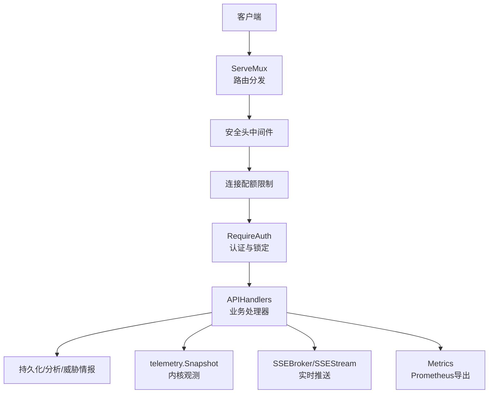

**图示来源**
- [server.go:63-71](file://src/daemon/internal/http/server.go#L63-L71)
- [routes.go:79-233](file://src/daemon/internal/http/routes.go#L79-L233)
- [auth.go:36-69](file://src/daemon/internal/http/auth.go#L36-L69)
- [headers.go:62-86](file://src/daemon/internal/http/headers.go#L62-L86)

**章节来源**
- [server.go:14-71](file://src/daemon/internal/http/server.go#L14-L71)
- [routes.go:22-77](file://src/daemon/internal/http/routes.go#L22-L77)
- [http_contract.go:13-56](file://src/daemon/internal/httpcontract/http_contract.go#L13-L56)

## 核心组件
- **Server**：封装 `net/http.Server`、监听器、ServeMux、活跃连接计数、最大连接数与关停超时；提供 `Handle`/`HandleFunc` 注册入口。
- **APIHandlers**：聚合数据库、SSE、日志流、内核封禁/白名单/配置出口、认证凭据、配置访问函数、Jail控制器、内核快照读取、速率采样、威胁情报管理器。
- **RequireAuth**：包装 handler，实现 `auth=required` 组；支持 Authorization 头与 `access_token` 查询参数；未配置时放行，半配置时拒绝。
- **AuthLockout**：进程级连续失败计数与锁定窗口；阈值与时长来自契约常量。
- **Envelope**：统一信封 `code/data/message`；成功走 `WriteSuccess`/`WriteCreated`，失败走 `WriteCode`/`WriteInternalError`/`WriteServiceUnavailable`。
- **Headers**：为所有响应设置 `X-Content-Type-Options`、`X-Frame-Options`、`Content-Security-Policy`、`Cache-Control`；对 Web UI 使用更宽松的 CSP。
- **Query**：分页与日志查询参数解析；日志参数非法直接报错，列表类参数非法则回退默认值。
- **Snapshot**：基于 `telemetry.Snapshot` 的速率、分布、异常检测等只读接口。
- **Metrics**：内存计数器与仪表盘，以 Prometheus text format 输出。
- **Health**：裸载荷就绪探针，状态码即语义。

**章节来源**
- [server.go:14-32](file://src/daemon/internal/http/server.go#L14-L32)
- [routes.go:235-301](file://src/daemon/internal/http/routes.go#L235-L301)
- [auth.go:22-69](file://src/daemon/internal/http/auth.go#L22-L69)
- [auth_lockout.go:22-82](file://src/daemon/internal/http/auth_lockout.go#L22-L82)
- [envelope.go:15-94](file://src/daemon/internal/http/envelope.go#L15-L94)
- [headers.go:61-86](file://src/daemon/internal/http/headers.go#L61-L86)
- [query.go:20-109](file://src/daemon/internal/http/query.go#L20-L109)
- [snapshot.go:28-97](file://src/daemon/internal/http/snapshot.go#L28-L97)
- [metrics.go:11-91](file://src/daemon/internal/http/metrics.go#L11-L91)
- [health.go:15-48](file://src/daemon/internal/http/health.go#L15-L48)

## 架构总览
HTTP服务器的处理链从外层到内层依次为：

1. **安全头中间件**：对所有响应写入四个安全头；根据路径是否为 Web UI 选择不同 CSP。
2. **连接配额限制器**：维护进程级活跃连接数，超过上限返回 503。
3. **认证中间件**：校验 Basic 或 query token，结合认证锁定窗口决定是否允许进入业务 handler。
4. **路由分发**：`RegisterRoutes` 将契约路由常量绑定到具体 handler。
5. **业务 handler**：读取内核快照、历史库、威胁情报、配置与运行时状态，写出统一信封或裸载荷。
6. **SSE与指标**：独立 handler 暴露 `/api/v2/events`、`/api/v2/logs/stream` 与 `/metrics`。

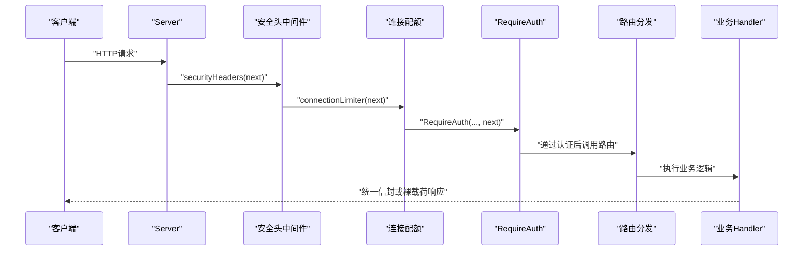

**图示来源**
- [server.go:63-71](file://src/daemon/internal/http/server.go#L63-L71)
- [server.go:129-148](file://src/daemon/internal/http/server.go#L129-L148)
- [auth.go:36-69](file://src/daemon/internal/http/auth.go#L36-L69)
- [routes.go:79-233](file://src/daemon/internal/http/routes.go#L79-L233)

**章节来源**
- [server.go:63-71](file://src/daemon/internal/http/server.go#L63-L71)
- [headers.go:62-86](file://src/daemon/internal/http/headers.go#L62-L86)
- [auth.go:36-69](file://src/daemon/internal/http/auth.go#L36-L69)
- [routes.go:79-233](file://src/daemon/internal/http/routes.go#L79-L233)

## 详细组件分析

### 路由注册机制与REST版本管理
- 所有路由模式使用 `httpcontract.Route*` 常量，避免手写路径导致契约漂移。
- API基础前缀为 `/api/v2`，SPA页面、静态资源与健康检查位于 API 前缀之外。
- 路由按功能分组：健康、指标与SSE、封禁、Jail、配置、白名单、速率、统计、风险、日志、威胁情报、综合分析。
- 方法不匹配由 `ServeMux` 返回 405，handler 不再自查 HTTP 方法。

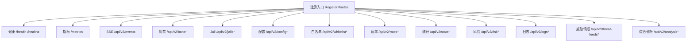

**图示来源**
- [routes.go:79-233](file://src/daemon/internal/http/routes.go#L79-L233)
- [http_contract.go:119-249](file://src/daemon/internal/httpcontract/http_contract.go#L119-L249)

**章节来源**
- [routes.go:79-233](file://src/daemon/internal/http/routes.go#L79-L233)
- [http_contract.go:13-19](file://src/daemon/internal/httpcontract/http_contract.go#L13-L19)
- [http_contract.go:119-249](file://src/daemon/internal/httpcontract/http_contract.go#L119-L249)

### 中间件链与安全头
- 安全头中间件放在最外层，确保即使连接配额满时的 503 响应也携带 CSP/nosniff。
- 四个安全头全部来自契约常量，禁止实现侧出现第二份字符串。
- Web UI 路径通过契约路由表推导，CSP 对 HTML/JS 更宽松；API JSON 响应采用 `default-src 'none'`。
- 所有响应强制 `Cache-Control: no-store`，避免缓存过期状态。

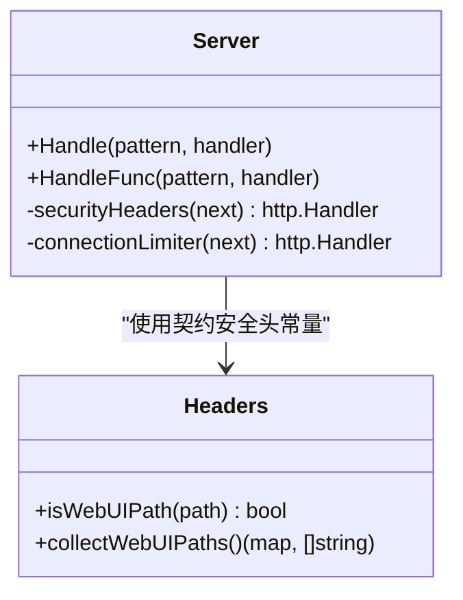

**图示来源**
- [headers.go:25-59](file://src/daemon/internal/http/headers.go#L25-L59)
- [headers.go:62-86](file://src/daemon/internal/http/headers.go#L62-L86)
- [http_contract.go:364-404](file://src/daemon/internal/httpcontract/http_contract.go#L364-L404)

**章节来源**
- [headers.go:1-88](file://src/daemon/internal/http/headers.go#L1-L88)
- [http_contract.go:364-404](file://src/daemon/internal/httpcontract/http_contract.go#L364-L404)

### 认证与授权流程
- 认证凭据来源：
  - `Authorization: Basic <base64>`
  - `?access_token=<base64 user:pass>`（浏览器 EventSource 无法设头）
- 未配置认证：两项都为空时放行。
- 半配置：任一项为空视为结构性失败，整组端点一律 401。
- 认证失败不计入未带凭据的请求；只有“带了且带错”才累计失败次数。
- 成功认证后重置连续失败计数。

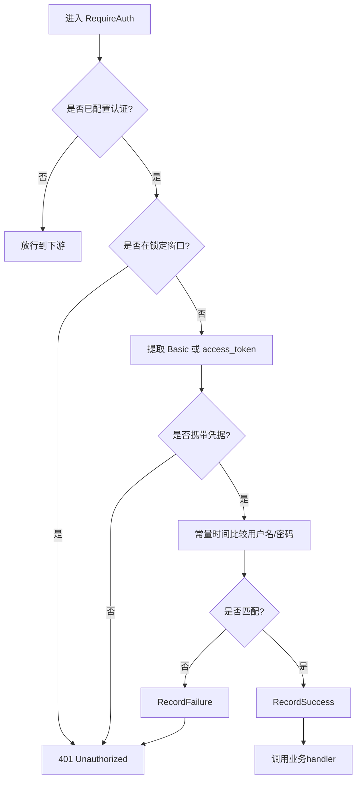

**图示来源**
- [auth.go:36-69](file://src/daemon/internal/http/auth.go#L36-L69)
- [auth_lockout.go:38-72](file://src/daemon/internal/http/auth_lockout.go#L38-L72)

**章节来源**
- [auth.go:22-116](file://src/daemon/internal/http/auth.go#L22-L116)
- [auth_lockout.go:15-82](file://src/daemon/internal/http/auth_lockout.go#L15-L82)
- [http_contract.go:21-34](file://src/daemon/internal/httpcontract/http_contract.go#L21-L34)

### 认证锁out机制
- 进程级账本，不按路由或来源 IP 切分。
- 连续失败达到阈值后进入锁定窗口；期间无论凭据是否正确都拒绝。
- 成功认证后清零连续计数。
- 阈值与时长来自契约常量，避免实现侧硬编码。

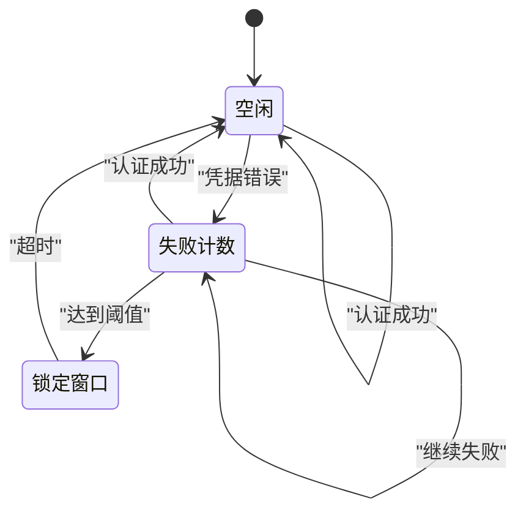

**图示来源**
- [auth_lockout.go:38-72](file://src/daemon/internal/http/auth_lockout.go#L38-L72)

**章节来源**
- [auth_lockout.go:1-83](file://src/daemon/internal/http/auth_lockout.go#L1-L83)
- [http_contract.go:21-34](file://src/daemon/internal/httpcontract/http_contract.go#L21-L34)

### SSE实时推送与连接管理
- 两条SSE流：
  - `/api/v2/events`：事件名包含 `connected`、`stats`、`bans`、`jails`、`whitelist`、`rates`。
  - `/api/v2/logs/stream`：事件名包含 `connected`、`log`、`error`。
- 每条流有独立的最大连接数与心跳间隔，由契约常量声明。
- 连接限额由 `SSEStream` 维护；`/api/v2/stats/sse-status` 分别报告 events 与 logs 的当前连接、最大连接与是否触顶。
- 前端根据 `limit_reached` 决定是否停止重连，避免把 503 当作网络故障无限重试。

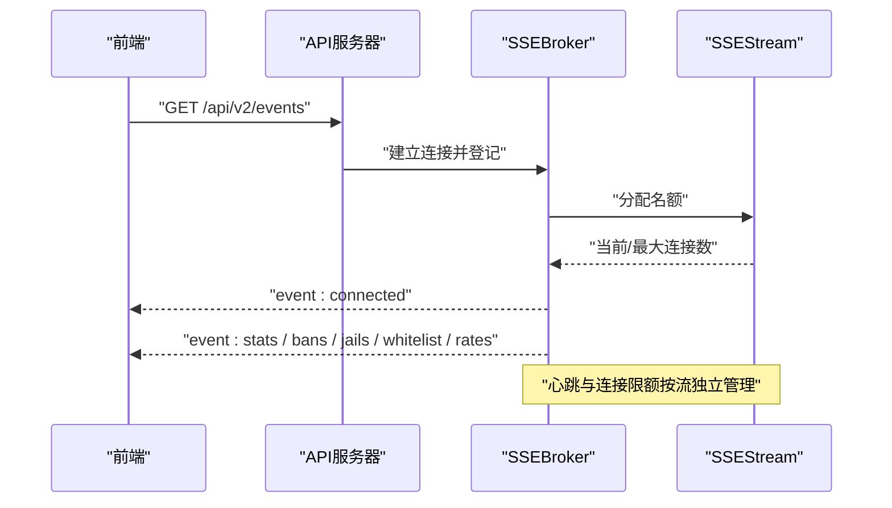

**图示来源**
- [routes.go:323-357](file://src/daemon/internal/http/routes.go#L323-L357)
- [http_contract.go:251-266](file://src/daemon/internal/httpcontract/http_contract.go#L251-L266)

**章节来源**
- [routes.go:323-357](file://src/daemon/internal/http/routes.go#L323-L357)
- [http_contract.go:251-266](file://src/daemon/internal/httpcontract/http_contract.go#L251-L266)

### 健康检查与内核快照
- `/health` 与 `/healthz` 返回裸 `RuntimeSnapshot`，不经统一信封。
- 就绪判定仅依赖内核租约是否持有；其他字段用于排障。
- 内核快照由事件泵发布，同一轮刷新中的速率、协议分布与 Top-N 出自同一次采样。

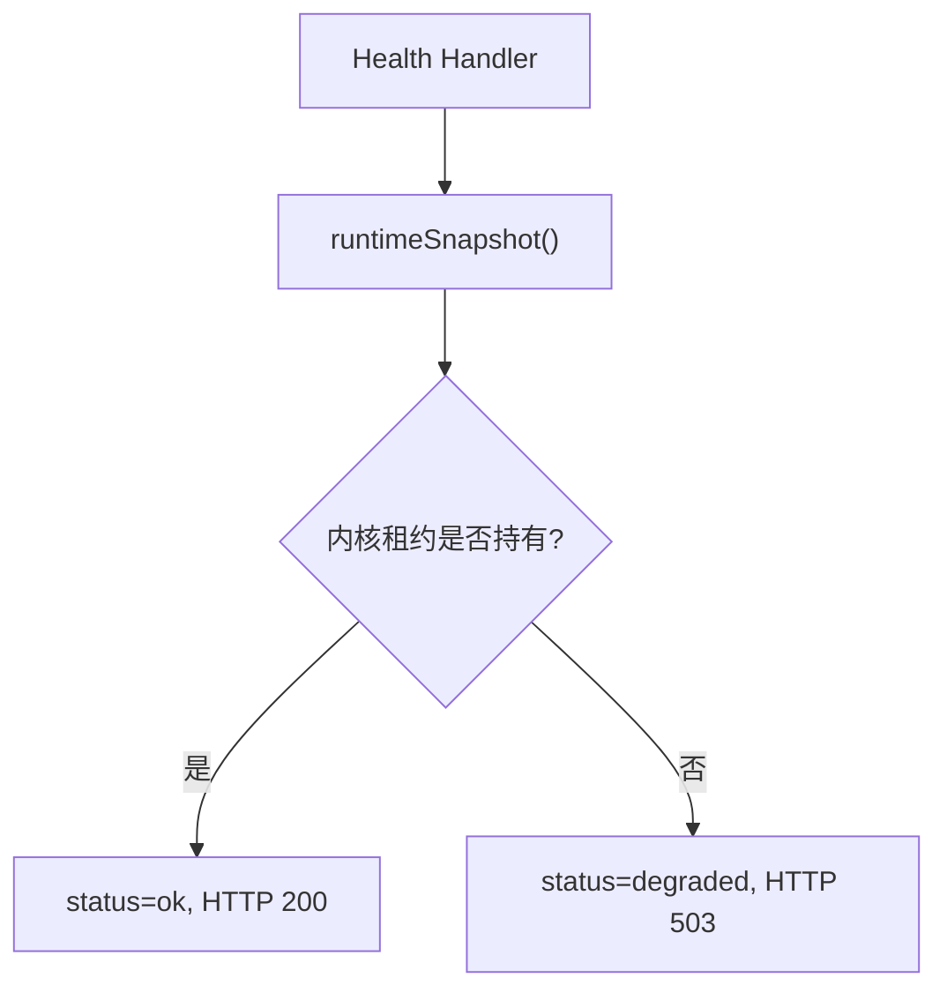

**图示来源**
- [health.go:40-48](file://src/daemon/internal/http/health.go#L40-L48)
- [health.go:56-99](file://src/daemon/internal/http/health.go#L56-L99)

**章节来源**
- [health.go:1-101](file://src/daemon/internal/http/health.go#L1-L101)
- [snapshot.go:1-15](file://src/daemon/internal/http/snapshot.go#L1-L15)

### Prometheus指标收集
- `/metrics` 需认证，输出 Prometheus text format。
- 内部 `Metrics` 提供计数器与仪表盘，键名动态注册，值使用原子整数。
- 输出时对计数器与仪表盘名称排序，保证稳定顺序。

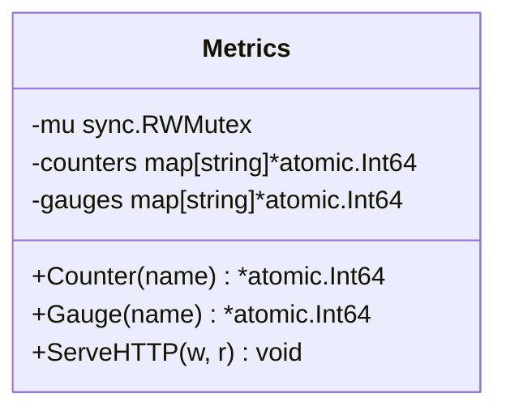

**图示来源**
- [metrics.go:11-91](file://src/daemon/internal/http/metrics.go#L11-L91)

**章节来源**
- [metrics.go:1-92](file://src/daemon/internal/http/metrics.go#L1-L92)
- [routes.go:96-103](file://src/daemon/internal/http/routes.go#L96-L103)

### 静态资源服务
- SPA页面与静态资源位于 API 前缀之外，无需认证。
- `/static/{path...}` 与 `/sw.js` 返回二进制资源，未命中返回 404。
- Web UI 路径由契约路由表推导，CSP 允许同源脚本、样式与字体加载。

**章节来源**
- [http_contract.go:127-146](file://src/daemon/internal/httpcontract/http_contract.go#L127-L146)
- [headers.go:18-43](file://src/daemon/internal/http/headers.go#L18-L43)

### 错误码规范与统一信封
- 统一信封字段顺序固定：`code`、`data`、`message`。
- 成功：`code=0`，`message` 为空串，`data` 为载荷。
- 失败：`data` 必须存在且为 null，`code` 为契约业务码。
- 业务码到 HTTP 状态码映射由 `CodeHTTPStatus` 决定，不在 handler 手写。
- 特殊：健康检查裸载荷，状态码即语义，不走信封。

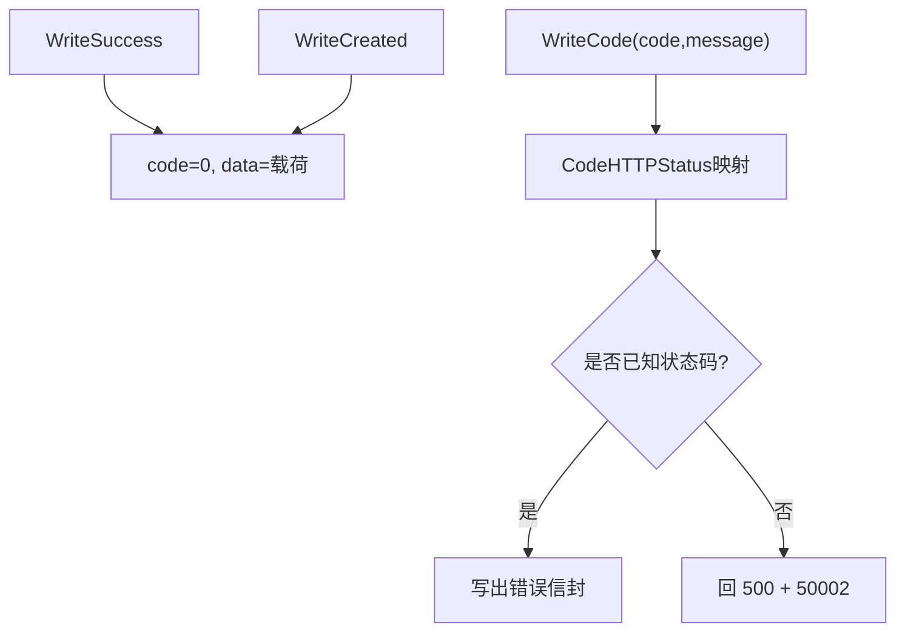

**图示来源**
- [envelope.go:27-94](file://src/daemon/internal/http/envelope.go#L27-L94)
- [http_contract.go:62-117](file://src/daemon/internal/httpcontract/http_contract.go#L62-L117)

**章节来源**
- [envelope.go:1-95](file://src/daemon/internal/http/envelope.go#L1-L95)
- [http_contract.go:58-117](file://src/daemon/internal/httpcontract/http_contract.go#L58-L117)

### 请求参数与分页
- 列表类端点使用 `PaginationParams`：`page`、`page_size`、`sort_by`。
- 日志查询使用 `LogQueryParams`：多出 `level`、`keyword`、`since`。
- 日志参数非法直接返回业务码；列表参数非法回退默认值。
- `page_size` 可被上限夹住，而不是退回默认值。

**章节来源**
- [query.go:20-109](file://src/daemon/internal/http/query.go#L20-L109)
- [query.go:124-181](file://src/daemon/internal/http/query.go#L124-L181)

### 数据模型与载荷结构
- 封禁、白名单、配置、日志、SSE诊断、统计总览、速率、分布、异常检测等均有具名结构体。
- 结构体名与契约类型名一致，json tag 与契约字段名一致，便于门禁脚本双向核对。
- 图表数据使用等长标签与数值切片，避免前端错位渲染。

**章节来源**
- [payload.go:20-275](file://src/daemon/internal/http/payload.go#L20-L275)
- [payload.go:277-545](file://src/daemon/internal/http/payload.go#L277-L545)

## 依赖关系分析
HTTP层依赖以下子系统：
- `persist.DB`：历史库，提供封禁历史、低信誉IP、复发统计、推荐等。
- `telemetry.Snapshot`：内核观测快照，提供速率、分布、窗口EWMA、链路租约。
- `threatfeeds.FeedManager`：威胁情报源管理。
- `config.Config`：当前配置与Web UI段落。
- `bans`：活跃封禁镜像与白名单。
- `analysis`：异常检测、周期攻击者、协同攻击、网络分布、预测与建议。

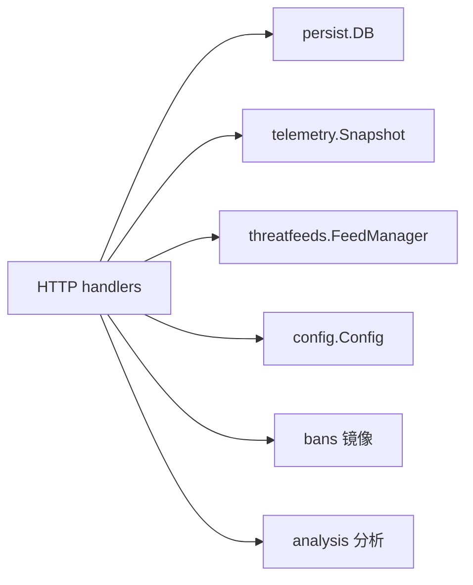

**图示来源**
- [routes.go:235-301](file://src/daemon/internal/http/routes.go#L235-L301)
- [snapshot.go:17-26](file://src/daemon/internal/http/snapshot.go#L17-L26)
- [handlers.go:12-19](file://src/daemon/internal/http/handlers.go#L12-L19)

**章节来源**
- [routes.go:235-301](file://src/daemon/internal/http/routes.go#L235-L301)
- [snapshot.go:17-26](file://src/daemon/internal/http/snapshot.go#L17-L26)
- [handlers.go:12-19](file://src/daemon/internal/http/handlers.go#L12-L19)

## 性能与容量特性
- **连接配额**：进程级活跃连接数超过上限返回 503，防止过载。
- **优雅关停**：先尝试 `Shutdown`，超时后强制 `Close`，避免端口占用。
- **SSE连接限额**：events 与 logs 各自独立限额，避免一条流占满影响另一条。
- **内核快照一致性**：同一轮刷新的多个统计端点共享一次快照，避免时间不一致。
- **直方图累计口径**：包长与TTL分布是自模块加载起的累计计数，不是时间窗口。
- **速率窗口派生**：短/中/长窗口 EWMA 在守护进程侧计算，内核只提供平均速率。

**章节来源**
- [server.go:92-113](file://src/daemon/internal/http/server.go#L92-L113)
- [server.go:129-148](file://src/daemon/internal/http/server.go#L129-L148)
- [snapshot.go:1-15](file://src/daemon/internal/http/snapshot.go#L1-L15)
- [snapshot.go:75-97](file://src/daemon/internal/http/snapshot.go#L75-L97)

## 故障排查指南
- **401 Unauthorized**：
  - 检查是否配置了 `metrics_username`/`metrics_password`。
  - 确认 Authorization 头或 `access_token` 查询参数正确。
  - 查看是否处于认证锁定窗口。
- **503 Service Unavailable**：
  - 可能因连接配额已满。
  - 也可能因依赖未就绪（历史库未初始化、日志文件不可读、SSE名额已满）。
- **健康检查 degraded**：
  - 检查内核租约是否持有。
  - 查看 `netlink_ready`、`kmod_proc_present`、`lease_state`、`lease_losses`。
- **SSE连接被拒**：
  - 查看 `/api/v2/stats/sse-status` 中对应流的 `limit_reached`。
  - 前端应根据 `limit_reached` 停止重连。
- **指标不可用**：
  - 确认 `/metrics` 需要认证。
  - 检查 `Metrics` 是否已创建并注入。

**章节来源**
- [auth.go:36-69](file://src/daemon/internal/http/auth.go#L36-L69)
- [auth_lockout.go:38-72](file://src/daemon/internal/http/auth_lockout.go#L38-L72)
- [server.go:129-148](file://src/daemon/internal/http/server.go#L129-L148)
- [health.go:40-99](file://src/daemon/internal/http/health.go#L40-L99)
- [routes.go:323-357](file://src/daemon/internal/http/routes.go#L323-L357)

## 结论
该HTTP API服务器以契约为中心，将路由、认证、错误码、SSE行为与安全头集中管理，实现层通过具名结构与常量引用保持与前端和门禁脚本的一致性。其设计兼顾安全性（常量时间比较、CSP、nosniff、no-store）、可观测性（健康检查、Prometheus指标、SSE状态）、可扩展性（内核快照、历史库、威胁情报）与可运维性（优雅关停、连接配额、认证锁定）。对于集成方，应严格遵循统一信封、业务码与SSE事件名，并在前端正确处理 `limit_reached` 与认证失败场景。

## 附录：API端点文档

### 健康检查
- `GET /api/v2/health`
- `GET /api/v2/healthz`
- 响应：裸 `RuntimeSnapshot`，就绪时 200，未就绪时 503。
- 关键字段：`status`、`netlink_ready`、`kmod_proc_present`、`ban_cache_initialized`、`ban_history_initialized`、`active_bans`、`lease_state`、`lease_losses`。

**章节来源**
- [health.go:15-48](file://src/daemon/internal/http/health.go#L15-L48)
- [http_contract.go:123-126](file://src/daemon/internal/httpcontract/http_contract.go#L123-L126)

### 指标导出
- `GET /metrics`
- 认证：必需。
- 响应：Prometheus text format，包含计数器与仪表盘。

**章节来源**
- [metrics.go:60-91](file://src/daemon/internal/http/metrics.go#L60-L91)
- [http_contract.go:147-148](file://src/daemon/internal/httpcontract/http_contract.go#L147-L148)

### 实时推送
- `GET /api/v2/events`
- `GET /api/v2/logs/stream`
- 认证：必需。
- 事件名：
  - events：`connected`、`stats`、`bans`、`jails`、`whitelist`、`rates`
  - logs：`connected`、`log`、`error`
- 连接上限与心跳：
  - events：上限 10，心跳 15秒
  - logs：上限 5，心跳 15秒

**章节来源**
- [http_contract.go:251-266](file://src/daemon/internal/httpcontract/http_contract.go#L251-L266)
- [routes.go:100-103](file://src/daemon/internal/http/routes.go#L100-L103)
- [routes.go:215-218](file://src/daemon/internal/http/routes.go#L215-L218)

### 封禁管理
- `GET /api/v2/bans`
- `POST /api/v2/bans`
- `DELETE /api/v2/bans/{ip}`
- `GET /api/v2/bans/{ip}/detail`
- `POST /api/v2/bans/unban-temporary`
- `POST /api/v2/bans/batch`
- 认证：必需。
- 主要响应结构：`BanResponse`、`BanDetailResponse`、`BanOperationResponse`、`BatchOperationResponse`、`PaginatedResponse<BanResponse>`。
- 常见业务码：40001、40002、40003、40005、40006、40007、40008。

**章节来源**
- [payload.go:20-106](file://src/daemon/internal/http/payload.go#L20-L106)
- [http_contract.go:155-166](file://src/daemon/internal/httpcontract/http_contract.go#L155-L166)
- [http_contract.go:315-320](file://src/daemon/internal/httpcontract/http_contract.go#L315-L320)

### Jail管理
- `GET /api/v2/jails`
- `PUT /api/v2/jails/{name}`
- 认证：必需。
- 请求结构：`UpdateJailRequest`。
- 常见业务码：404、40007、40008、50003。

**章节来源**
- [payload.go:125-132](file://src/daemon/internal/http/payload.go#L125-L132)
- [http_contract.go:167-170](file://src/daemon/internal/httpcontract/http_contract.go#L167-L170)
- [http_contract.go:321-322](file://src/daemon/internal/httpcontract/http_contract.go#L321-L322)

### 配置管理
- `GET /api/v2/config`
- `PUT /api/v2/config`
- 认证：必需。
- 请求结构：`UpdateConfigRequest`。
- 响应结构：`WebuiConfigResponse`。
- 常见业务码：40004、40007、40008、50003。

**章节来源**
- [payload.go:138-202](file://src/daemon/internal/http/payload.go#L138-L202)
- [http_contract.go:171-174](file://src/daemon/internal/httpcontract/http_contract.go#L171-L174)
- [http_contract.go:323-324](file://src/daemon/internal/httpcontract/http_contract.go#L323-L324)

### 白名单
- `GET /api/v2/whitelist`
- `POST /api/v2/whitelist`
- `DELETE /api/v2/whitelist/{cidr}`
- `GET /api/v2/whitelist/recommendations`
- 认证：必需。
- 主要结构：`WhitelistEntryResponse`、`WhitelistOperationResponse`、`CreateWhitelistRequest`。
- 常见业务码：40003、40004、40007、40008、50002、50003。

**章节来源**
- [payload.go:108-123](file://src/daemon/internal/http/payload.go#L108-L123)
- [http_contract.go:175-182](file://src/daemon/internal/httpcontract/http_contract.go#L175-L182)
- [http_contract.go:325-328](file://src/daemon/internal/httpcontract/http_contract.go#L325-L328)

### 速率
- `GET /api/v2/rates/current`
- `GET /api/v2/rates/history`
- `GET /api/v2/rates/windows`
- 认证：必需。
- 主要结构：`RateResponse`、`RateHistoryResponse`、`RateWindowSnapshot`。

**章节来源**
- [payload.go:340-380](file://src/daemon/internal/http/payload.go#L340-L380)
- [http_contract.go:183-188](file://src/daemon/internal/httpcontract/http_contract.go#L183-L188)

### 统计与分析
- `GET /api/v2/stats`
- `GET /api/v2/stats/heatmap`
- `GET /api/v2/stats/recidivism`
- `GET /api/v2/stats/ban-effectiveness`
- `GET /api/v2/stats/periodic-attackers`
- `GET /api/v2/stats/collaborative-attacks`
- `GET /api/v2/stats/udp-ports`
- `GET /api/v2/stats/icmp-types`
- `GET /api/v2/stats/sse-status`
- `GET /api/v2/stats/ban-duration-histogram`
- `GET /api/v2/stats/packet-sizes`
- `GET /api/v2/stats/ttl-distribution`
- `GET /api/v2/stats/ip-fragments`
- `GET /api/v2/stats/port-scanners`
- `GET /api/v2/stats/service-probes`
- `GET /api/v2/stats/ban-duration-recommendations`
- `GET /api/v2/stats/reputation`
- `GET /api/v2/stats/threshold-recommendations`
- `GET /api/v2/stats/network-distribution`
- `GET /api/v2/stats/attack-predictions`
- `GET /api/v2/stats/anomalies`
- `GET /api/v2/stats/attack-geo`
- 认证：必需。
- 主要结构：`StatsResponse`、`ThreatLevel`、`ChartData`、`PacketSizeDistributionResponse`、`TtlDistributionResponse`、`IpFragmentStatsResponse`、`UdpPortDistributionResponse`、`IcmpTypeDistributionResponse`、`PortScanResponse`、`ServiceProbeResponse`、`AnomalyResponse`、`SseStatusResponse`。

**章节来源**
- [payload.go:277-545](file://src/daemon/internal/http/payload.go#L277-L545)
- [http_contract.go:189-236](file://src/daemon/internal/httpcontract/http_contract.go#L189-L236)

### 风险引擎
- `GET /api/v2/risk/vectors`
- `GET /api/v2/risk/vectors/{ip}`
- `GET /api/v2/risk/events/{ip}`
- 认证：必需。
- 常见业务码：40006、50003。

**章节来源**
- [http_contract.go:221-226](file://src/daemon/internal/httpcontract/http_contract.go#L221-L226)
- [http_contract.go:348-350](file://src/daemon/internal/httpcontract/http_contract.go#L348-L350)

### 日志
- `GET /api/v2/logs`
- `GET /api/v2/logs/stream`
- 认证：必需。
- 查询参数：`page`、`page_size`、`level`、`keyword`、`since`。
- 主要结构：`LogPageResponse`、`LogEntry`。
- 常见业务码：40005、50002、50003。

**章节来源**
- [payload.go:237-255](file://src/daemon/internal/http/payload.go#L237-L255)
- [query.go:27-37](file://src/daemon/internal/http/query.go#L27-L37)
- [http_contract.go:237-238](file://src/daemon/internal/httpcontract/http_contract.go#L237-L238)
- [http_contract.go:356-356](file://src/daemon/internal/httpcontract/http_contract.go#L356-L356)

### 威胁情报
- `GET /api/v2/threat-feeds`
- `POST /api/v2/threat-feeds/sync`
- `GET /api/v2/threat-feeds/{id}`
- 认证：必需。
- 常见业务码：404、50002、50003。

**章节来源**
- [http_contract.go:239-244](file://src/daemon/internal/httpcontract/http_contract.go#L239-L244)
- [http_contract.go:357-359](file://src/daemon/internal/httpcontract/http_contract.go#L357-L359)

### 综合分析
- `GET /api/v2/analysis/summary`
- `GET /api/v2/analysis/ip/{ip}`
- 认证：必需。
- 常见业务码：40006、50002、50003。

**章节来源**
- [http_contract.go:245-248](file://src/daemon/internal/httpcontract/http_contract.go#L245-L248)
- [http_contract.go:360-361](file://src/daemon/internal/httpcontract/http_contract.go#L360-L361)