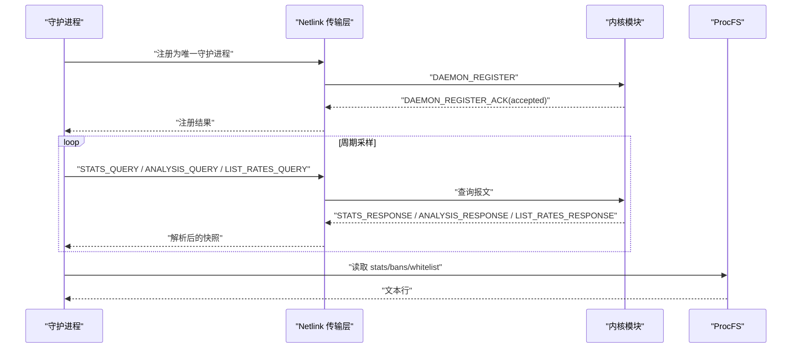
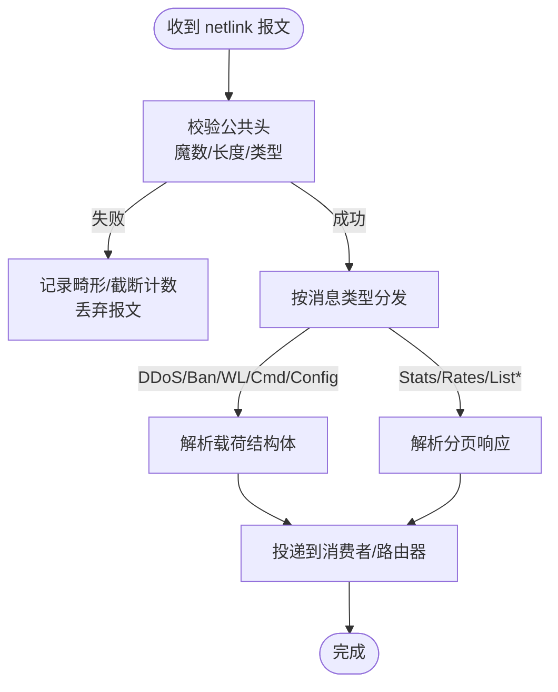
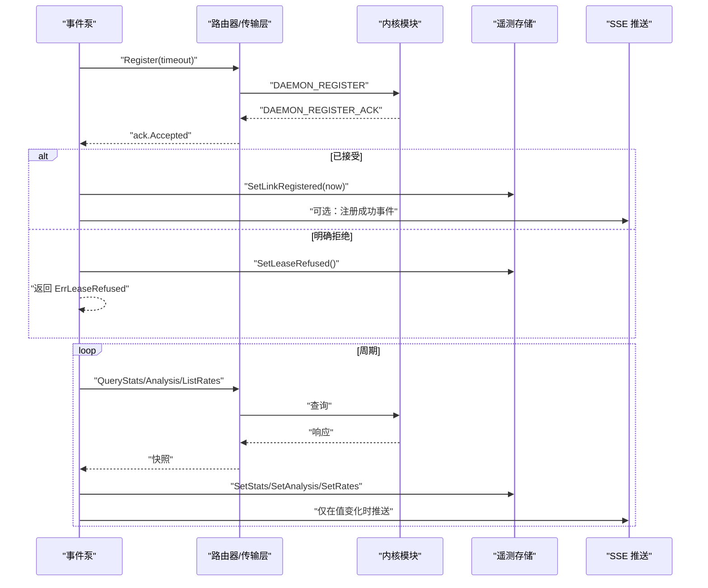
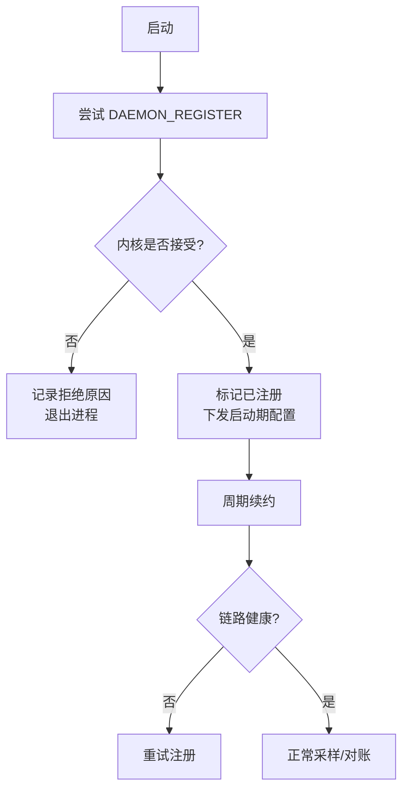
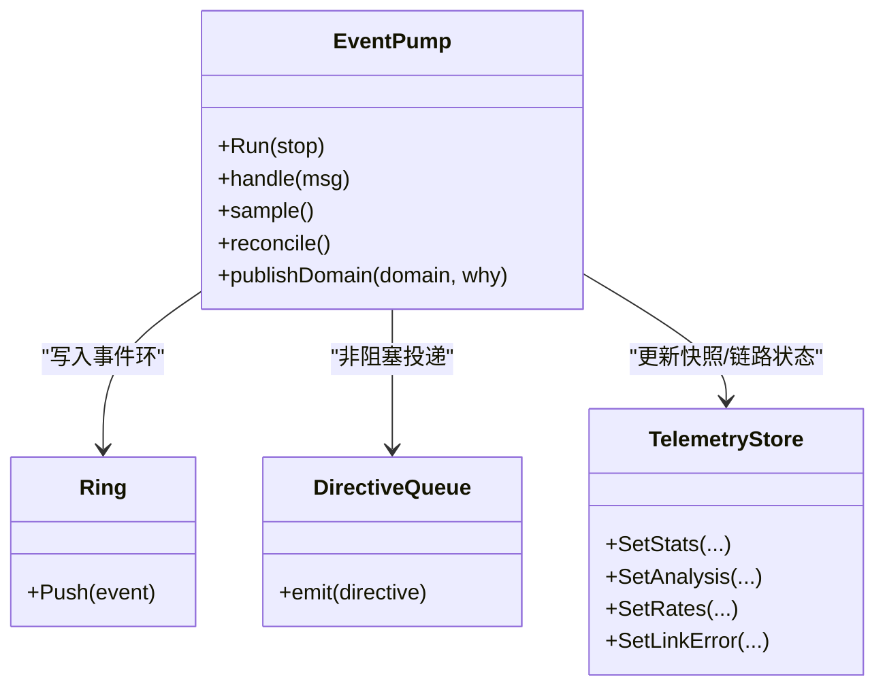
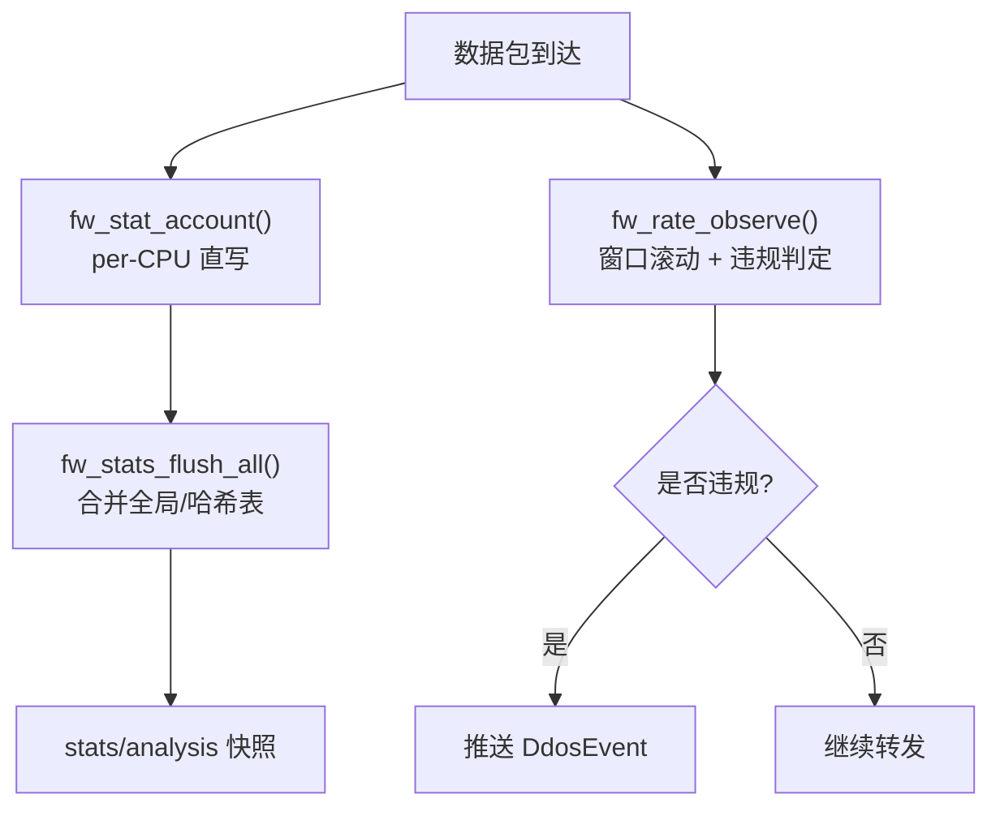
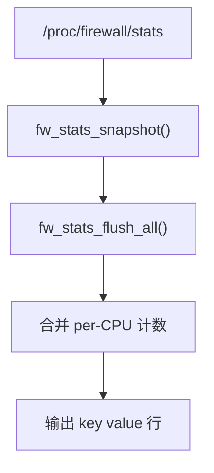
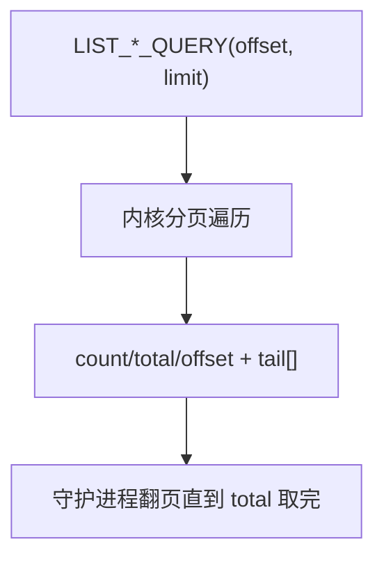
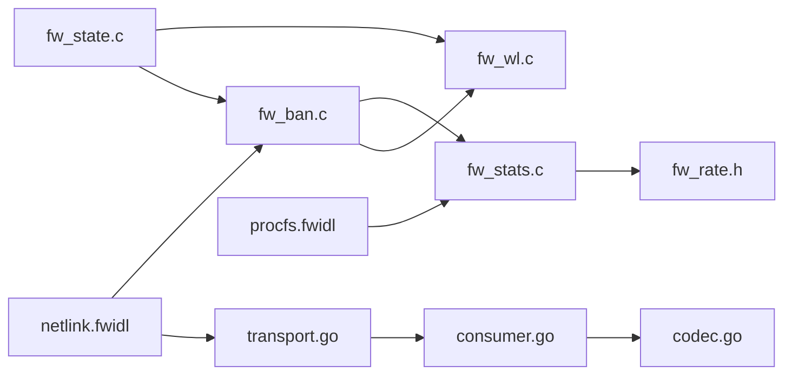

# 内核通信层

<cite>
**本文引用的文件**   
- [netlink.fwidl](file://contract/netlink.fwidl)
- [procfs.fwidl](file://contract/procfs.fwidl)
- [fw_state.c](file://src/kernel-module/fw_state.c)
- [fw_stats.c](file://src/kernel-module/fw_stats.c)
- [fw_ban.c](file://src/kernel-module/fw_ban.c)
- [fw_wl.c](file://src/kernel-module/fw_wl.c)
- [fw_rate.h](file://src/kernel-module/fw_rate.h)
- [transport.go](file://src/daemon/internal/kernel/transport.go)
- [consumer.go](file://src/daemon/internal/kernel/consumer.go)
- [codec.go](file://src/daemon/internal/kernel/codec.go)
</cite>

## 目录
1. [引言](#引言)
2. [项目结构](#项目结构)
3. [核心组件](#核心组件)
4. [架构总览](#架构总览)
5. [详细组件分析](#详细组件分析)
6. [依赖关系分析](#依赖关系分析)
7. [性能考量](#性能考量)
8. [故障排查指南](#故障排查指南)
9. [结论](#结论)
10. [附录](#附录)

## 引言
本文件面向“内核通信层”，聚焦守护进程与 Linux 内核模块之间的 Netlink 控制面、ProcFS 文本接口、状态持久化、统计与分析快照、速率与事件处理，以及单实例租约机制。文档从协议契约出发，解释消息编解码、双向通信、错误处理、事件通道、队列管理、异步模型，并给出流程图、数据流图与调优建议。

## 项目结构
内核侧由 C 模块实现封禁表、白名单、速率表、统计与分析分布；用户态 Go 守护进程通过 Netlink 收发二进制报文，并通过 ProcFS 暴露文本接口。协议契约以 IDL 形式维护，生成三端头文件与校验脚本。

```mermaid
graph TB
subgraph "用户态守护进程"
T["传输层<br/>transport.go"]
C["消费者/泵<br/>consumer.go"]
K["编解码器<br/>codec.go"]
end
subgraph "内核模块"
S["状态持久化<br/>fw_state.c"]
ST["统计与分析<br/>fw_stats.c"]
B["封禁表<br/>fw_ban.c"]
W["白名单<br/>fw_wl.c"]
R["速率表接口<br/>fw_rate.h"]
end
NIDL["Netlink 契约<br/>netlink.fwidl"]
PIDL["ProcFS 契约<br/>procfs.fwidl"]
T --> K
K --> C
C --> T
T < --> |"NETLINK_USERSOCK"| B
T < --> |"NETLINK_USERSOCK"| W
T < --> |"NETLINK_USERSOCK"| ST
T < --> |"NETLINK_USERSOCK"| R
C -.->|"SSE/REST 聚合"| ST
C -.->|"SSE/REST 聚合"| B
C -.->|"SSE/REST 聚合"| W
S < --> B
S < --> W
ST < --> R
NIDL --> T
NIDL --> B
NIDL --> W
NIDL --> ST
NIDL --> R
PIDL --> ST
PIDL --> B
PIDL --> W
```

**图表来源**
- [transport.go:13-50](file://src/daemon/internal/kernel/transport.go#L13-L50)
- [consumer.go:37-68](file://src/daemon/internal/kernel/consumer.go#L37-L68)
- [codec.go:10-20](file://src/daemon/internal/kernel/codec.go#L10-L20)
- [fw_state.c:46-75](file://src/kernel-module/fw_state.c#L46-L75)
- [fw_stats.c:5-14](file://src/kernel-module/fw_stats.c#L5-L14)
- [fw_ban.c:3-41](file://src/kernel-module/fw_ban.c#L3-L41)
- [fw_wl.c:3-18](file://src/kernel-module/fw_wl.c#L3-L18)
- [fw_rate.h:3-26](file://src/kernel-module/fw_rate.h#L3-L26)
- [netlink.fwidl:1-30](file://contract/netlink.fwidl#L1-L30)
- [procfs.fwidl:1-27](file://contract/procfs.fwidl#L1-L27)

**章节来源**
- [netlink.fwidl:1-30](file://contract/netlink.fwidl#L1-L30)
- [procfs.fwidl:1-27](file://contract/procfs.fwidl#L1-L27)

## 核心组件
- Netlink 协议契约：定义魔数、地址族、消息类型、公共头、分页响应、事件载荷与控制指令。
- 内核状态与表：封禁表（分层桶 + RCU + per-entry 定时器）、白名单（精确桶 + 子网链）、速率表（per-CPU 槽 + 窗口滚动）。
- 统计与分析：per-CPU 计数、UDP/ICMP 分布、全局流量采样、分析快照。
- 用户态传输与消费者：epoll/eventfd 驱动的事件循环、请求配对与超时、事件环与 SSE 推送、单实例租约续约。
- ProcFS 文本接口：只读 stats/rates/分析条目，可写 bans/whitelist/config。

**章节来源**
- [netlink.fwidl:32-81](file://contract/netlink.fwidl#L32-L81)
- [netlink.fwidl:108-133](file://contract/netlink.fwidl#L108-L133)
- [fw_ban.c:3-41](file://src/kernel-module/fw_ban.c#L3-L41)
- [fw_wl.c:3-18](file://src/kernel-module/fw_wl.c#L3-L18)
- [fw_rate.h:3-26](file://src/kernel-module/fw_rate.h#L3-L26)
- [fw_stats.c:5-14](file://src/kernel-module/fw_stats.c#L5-L14)
- [transport.go:13-50](file://src/daemon/internal/kernel/transport.go#L13-L50)
- [consumer.go:37-68](file://src/daemon/internal/kernel/consumer.go#L37-L68)
- [procfs.fwidl:62-164](file://contract/procfs.fwidl#L62-L164)

## 架构总览
内核与守护进程通过 NETLINK_USERSOCK 建立双向通道：守护进程发起查询/控制命令，内核返回响应或主动推送事件；同时内核通过 ProcFS 提供文本接口供运维读取统计与列表。



**图表来源**
- [consumer.go:311-344](file://src/daemon/internal/kernel/consumer.go#L311-L344)
- [consumer.go:568-613](file://src/daemon/internal/kernel/consumer.go#L568-L613)
- [transport.go:233-261](file://src/daemon/internal/kernel/transport.go#L233-L261)
- [netlink.fwidl:56-81](file://contract/netlink.fwidl#L56-L81)
- [netlink.fwidl:482-485](file://contract/netlink.fwidl#L482-L485)
- [procfs.fwidl:92-164](file://contract/procfs.fwidl#L92-L164)

## 详细组件分析

### Netlink 消息编解码与双向通信
- 公共头：固定 12 字节，含魔数、消息类型、长度、序列号。序列号用于请求/响应配对；推送类事件使用内核自增 seq，不参与配对。
- 编解码：守护进程按 msg_type 分派到具体结构体 Decode；公共头校验魔数与长度，拒绝畸形报文。
- 传输层：封装 nlmsghdr，设置广播组订阅内核事件；发送原子性受互斥保护；接收使用 epoll/eventfd 与 SO_RCVTIMEO，区分截断与畸形报文。
- 错误处理：sendto 失败计数；recvfrom 失败计数；长度不一致、魔数不匹配、端口不可信等路径均上报计数器并丢弃。



**图表来源**
- [codec.go:10-20](file://src/daemon/internal/kernel/codec.go#L10-L20)
- [codec.go:99-118](file://src/daemon/internal/kernel/codec.go#L99-L118)
- [transport.go:264-308](file://src/daemon/internal/kernel/transport.go#L264-L308)
- [netlink.fwidl:108-133](file://contract/netlink.fwidl#L108-L133)

**章节来源**
- [netlink.fwidl:108-133](file://contract/netlink.fwidl#L108-L133)
- [codec.go:10-20](file://src/daemon/internal/kernel/codec.go#L10-L20)
- [codec.go:99-118](file://src/daemon/internal/kernel/codec.go#L99-L118)
- [transport.go:233-308](file://src/daemon/internal/kernel/transport.go#L233-L308)

### 事件通道设计与异步处理模型
- 事件泵：单一 goroutine 消费内核事件流，周期执行采样、对账、租约续约与心跳轮询。
- 事件环：所有内核事件入环，便于回溯；镜像变化时发布域通知（bans/whitelist/stats/rates）。
- 单向指令与失败回执：Ban/Unban/白名单增删投递即返回；只有失败才回 CmdResult，消费者据此撤销本地镜像并触发反向指令。
- 单实例租约：守护进程必须向内核注册；内核拒绝表示已有活跃守护进程，当前进程应退出；租约定期续约，避免空闲链路被判定死亡。



**图表来源**
- [consumer.go:311-344](file://src/daemon/internal/kernel/consumer.go#L311-L344)
- [consumer.go:568-613](file://src/daemon/internal/kernel/consumer.go#L568-L613)
- [consumer.go:632-690](file://src/daemon/internal/kernel/consumer.go#L632-L690)
- [transport.go:146-173](file://src/daemon/internal/kernel/transport.go#L146-L173)

**章节来源**
- [consumer.go:37-68](file://src/daemon/internal/kernel/consumer.go#L37-L68)
- [consumer.go:311-344](file://src/daemon/internal/kernel/consumer.go#L311-L344)
- [consumer.go:568-613](file://src/daemon/internal/kernel/consumer.go#L568-L613)
- [consumer.go:632-690](file://src/daemon/internal/kernel/consumer.go#L632-L690)
- [transport.go:146-173](file://src/daemon/internal/kernel/transport.go#L146-L173)

### 内核模块状态同步与租约机制
- 状态持久化：保存 bans/whitelist 到带 CRC32 的文件，恢复时先 WL 后 BAN，支持前缀长度字段；容量检查在恢复中保留，泛洪闸门跳过。
- 租约机制：内核侧 portid 独占 + 旧 portid 探活；守护进程必须注册，拒绝则退出；周期性续约保持租约有效。
- 单实例约束：内核拒绝注册时，守护进程不得继续运行；面板需暴露「未取得内核唯一租约」的状态。



**图表来源**
- [consumer.go:311-344](file://src/daemon/internal/kernel/consumer.go#L311-L344)
- [consumer.go:346-365](file://src/daemon/internal/kernel/consumer.go#L346-L365)
- [fw_state.c:542-654](file://src/kernel-module/fw_state.c#L542-L654)

**章节来源**
- [consumer.go:311-344](file://src/daemon/internal/kernel/consumer.go#L311-L344)
- [consumer.go:346-365](file://src/daemon/internal/kernel/consumer.go#L346-L365)
- [fw_state.c:542-654](file://src/kernel-module/fw_state.c#L542-L654)

### 消息队列管理与异步处理
- 事件环：内核事件进入环形缓冲区，便于 UI 回溯；泵在变更时发布域通知。
- 反向指令队列：CONFIG_CHANGE 与命令被拒等事件非阻塞投递给执行体；队列满时丢弃并记日志，保证事件流不被阻塞。
- 路由计数：接收侧的丢包、解码错误、畸形报文、未匹配回复、外部端口号等指标并入链路状态。



**图表来源**
- [consumer.go:132-165](file://src/daemon/internal/kernel/consumer.go#L132-L165)
- [consumer.go:371-396](file://src/daemon/internal/kernel/consumer.go#L371-L396)
- [consumer.go:551-566](file://src/daemon/internal/kernel/consumer.go#L551-L566)
- [consumer.go:731-745](file://src/daemon/internal/kernel/consumer.go#L731-L745)

**章节来源**
- [consumer.go:132-165](file://src/daemon/internal/kernel/consumer.go#L132-L165)
- [consumer.go:371-396](file://src/daemon/internal/kernel/consumer.go#L371-L396)
- [consumer.go:551-566](file://src/daemon/internal/kernel/consumer.go#L551-L566)
- [consumer.go:731-745](file://src/daemon/internal/kernel/consumer.go#L731-L745)

### 数据包采样机制、速率统计与网络事件处理
- 热路径统计：per-CPU 槽无锁累加包大小/TTL/分片/UDP端口/ICMP类型；读侧统一 flush 再汇总。
- 速率表：一次查表完成窗口滚动与四类违规判定；per-CPU 槽汇总去重端口集合；表满时有意放行并观测 spill。
- 网络事件：DDoS 命中推送 reason 与 rate_pps；封禁/解封/白名单变更推送实时统计字段。



**图表来源**
- [fw_stats.c:96-162](file://src/kernel-module/fw_stats.c#L96-L162)
- [fw_stats.c:338-406](file://src/kernel-module/fw_stats.c#L338-L406)
- [fw_rate.h:37-59](file://src/kernel-module/fw_rate.h#L37-L59)
- [netlink.fwidl:139-146](file://contract/netlink.fwidl#L139-L146)

**章节来源**
- [fw_stats.c:96-162](file://src/kernel-module/fw_stats.c#L96-L162)
- [fw_stats.c:338-406](file://src/kernel-module/fw_stats.c#L338-L406)
- [fw_rate.h:37-59](file://src/kernel-module/fw_rate.h#L37-L59)
- [netlink.fwidl:139-146](file://contract/netlink.fwidl#L139-L146)

### ProcFS 接口读取与性能统计收集
- 只读接口：stats（机器可读 key/value）、rates、udp_ports、icmp_types、pkt_sizes、ttl_dist、ip_frags、port_scanners、service_probes、protected_ports。
- 可写接口：bans（默认时长/指定时长/永久/unban）、whitelist（add/remove/隐式 add）、config（ban_time）。
- 统计刷新：stats_show 经 fw_stats_snapshot 内部 flush，避免陈旧读数。



**图表来源**
- [procfs.fwidl:92-164](file://contract/procfs.fwidl#L92-L164)
- [procfs.fwidl:170-190](file://contract/procfs.fwidl#L170-L190)
- [fw_stats.c:376-392](file://src/kernel-module/fw_stats.c#L376-L392)

**章节来源**
- [procfs.fwidl:92-164](file://contract/procfs.fwidl#L92-L164)
- [procfs.fwidl:170-190](file://contract/procfs.fwidl#L170-L190)
- [fw_stats.c:376-392](file://src/kernel-module/fw_stats.c#L376-L392)

### 分页与容量上限
- 列表响应：LIST_BANS_RESPONSE、LIST_WHITELIST_RESPONSE、LIST_RATES_RESPONSE 必须分页，携带 count/total/offset。
- 容量上限：bans/whitelist/rates 均有 entries 上限，超限返回 -ENOSPC 或有意放行（rates），并递增相应计数器。
- 历史缺陷修复：旧实现无分页导致 msg_len 回绕与 GFP_ATOMIC 大分配；新实现统一分页与 u16 上限反推页大小。



**图表来源**
- [netlink.fwidl:230-237](file://contract/netlink.fwidl#L230-L237)
- [netlink.fwidl:258-270](file://contract/netlink.fwidl#L258-L270)
- [netlink.fwidl:295-310](file://contract/netlink.fwidl#L295-L310)
- [netlink.fwidl:437-459](file://contract/netlink.fwidl#L437-L459)
- [procfs.fwidl:227-273](file://contract/procfs.fwidl#L227-L273)

**章节来源**
- [netlink.fwidl:230-237](file://contract/netlink.fwidl#L230-L237)
- [netlink.fwidl:258-270](file://contract/netlink.fwidl#L258-L270)
- [netlink.fwidl:295-310](file://contract/netlink.fwidl#L295-L310)
- [netlink.fwidl:437-459](file://contract/netlink.fwidl#L437-L459)
- [procfs.fwidl:227-273](file://contract/procfs.fwidl#L227-L273)

## 依赖关系分析
- 内核侧：fw_ban.c 依赖 fw_wl.c（白名单前检）、fw_stats.c（计数）、fw_netlink.h（事件推送）；fw_stats.c 依赖 fw_rate.h（扫描者/探测者组合）；fw_state.c 依赖 fw_ban.c/fw_wl.c（恢复）。
- 用户态：transport.go 提供 socket/epoll/eventfd 能力；consumer.go 组合 Sampler/Publisher/Metrics；codec.go 负责载荷解析。
- 契约：netlink.fwidl 与 procfs.fwidl 作为单一真相源，驱动生成头与校验。



**图表来源**
- [fw_ban.c:49-53](file://src/kernel-module/fw_ban.c#L49-L53)
- [fw_stats.c:23-25](file://src/kernel-module/fw_stats.c#L23-L25)
- [fw_state.c:42-44](file://src/kernel-module/fw_state.c#L42-L44)
- [transport.go:13-50](file://src/daemon/internal/kernel/transport.go#L13-L50)
- [consumer.go:37-68](file://src/daemon/internal/kernel/consumer.go#L37-L68)
- [codec.go:10-20](file://src/daemon/internal/kernel/codec.go#L10-L20)
- [netlink.fwidl:1-30](file://contract/netlink.fwidl#L1-L30)
- [procfs.fwidl:1-27](file://contract/procfs.fwidl#L1-L27)

**章节来源**
- [fw_ban.c:49-53](file://src/kernel-module/fw_ban.c#L49-L53)
- [fw_stats.c:23-25](file://src/kernel-module/fw_stats.c#L23-L25)
- [fw_state.c:42-44](file://src/kernel-module/fw_state.c#L42-L44)
- [transport.go:13-50](file://src/daemon/internal/kernel/transport.go#L13-L50)
- [consumer.go:37-68](file://src/daemon/internal/kernel/consumer.go#L37-L68)
- [codec.go:10-20](file://src/daemon/internal/kernel/codec.go#L10-L20)
- [netlink.fwidl:1-30](file://contract/netlink.fwidl#L1-L30)
- [procfs.fwidl:1-27](file://contract/procfs.fwidl#L1-L27)

## 性能考量
- 热路径零共享写：统计与速率采用 per-CPU 槽，避免多核争用同一 cache line。
- 批量合并：flush 时一次性合并 per-CPU 计数与 UDP/ICMP 分布，减少锁竞争。
- 分页限制：列表响应强制分页，避免单次 MB 级分配与 u16 长度回绕。
- 表满策略：速率表满时有意放行并观测 spill，避免阻断正常流量；封禁/白名单表满返回 -ENOSPC 并计数。
- 轮询节拍：采样 5 秒、对账 30 秒、租约续约 10 秒，与内核判死时间解耦。

[本节为通用指导，不直接分析具体文件]

## 故障排查指南
- 注册失败或被拒绝：检查链路错误与租约状态；若被拒绝，说明另有活跃守护进程，当前进程应退出。
- 命令被拒绝：查看 CmdResult 中的 original_cmd 与 error_code；镜像会撤销待确认条目并触发反向指令。
- 统计陈旧：确认 stats_show 走 fw_stats_snapshot 内部 flush；低速率下 per-CPU 槽可能延迟 flush。
- 列表截断：确认 offset/limit 分页逻辑；total 与 count 用于判断是否还有后续页。
- 事件丢失：检查事件环与 SSE 推送；队列满时反向指令会被丢弃但事件流不受影响。

**章节来源**
- [consumer.go:311-344](file://src/daemon/internal/kernel/consumer.go#L311-L344)
- [consumer.go:499-549](file://src/daemon/internal/kernel/consumer.go#L499-L549)
- [fw_stats.c:376-392](file://src/kernel-module/fw_stats.c#L376-L392)
- [netlink.fwidl:230-237](file://contract/netlink.fwidl#L230-L237)
- [netlink.fwidl:258-270](file://contract/netlink.fwidl#L258-L270)
- [netlink.fwidl:295-310](file://contract/netlink.fwidl#L295-L310)

## 结论
内核通信层通过严格的 IDL 契约、per-CPU 热路径优化、分页响应与事件驱动模型，实现了高吞吐、低延迟的双向控制面。守护进程侧以事件泵为核心，统一处理采样、对账与租约续约；内核侧以分层桶表、RCU 与 per-entry 定时器保障并发安全。ProcFS 提供稳定的文本观测面，配合 Netlink 的二进制高效通道，形成完整的管理与监控闭环。

[本节为总结性内容，不直接分析具体文件]

## 附录

### 关键消息类型与用途
- DDOS_EVENT：内核 → 守护进程，报告速率/协议阈值命中。
- BAN_IP / UNBAN_IP：守护进程 → 内核，封禁/解封 IP。
- SET_CONFIG：守护进程 → 内核，运行时配置下发。
- BAN_STATE_CHANGE / WHITELIST_STATE_CHANGE：内核 → 守护进程，状态变更推送。
- LIST_BANS_QUERY / LIST_BANS_RESPONSE：分页查询封禁列表。
- STATS_QUERY / STATS_RESPONSE：查询统计。
- LIST_RATES_QUERY / LIST_RATES_RESPONSE：分页查询速率统计。
- ADD_WHITELIST / REMOVE_WHITELIST：守护进程 → 内核，白名单增删。
- CONFIG_ACK / CONFIG_CHANGE：配置确认与变更广播。
- CMD_RESULT：内核 → 守护进程，命令执行失败通知。
- DAEMON_REGISTER / DAEMON_REGISTER_ACK：守护进程注册与确认。
- SET_PROTECTED_PORTS：守护进程 → 内核，受保护端口位图。

**章节来源**
- [netlink.fwidl:56-81](file://contract/netlink.fwidl#L56-L81)
- [netlink.fwidl:139-212](file://contract/netlink.fwidl#L139-L212)
- [netlink.fwidl:218-358](file://contract/netlink.fwidl#L218-L358)
- [netlink.fwidl:376-485](file://contract/netlink.fwidl#L376-L485)