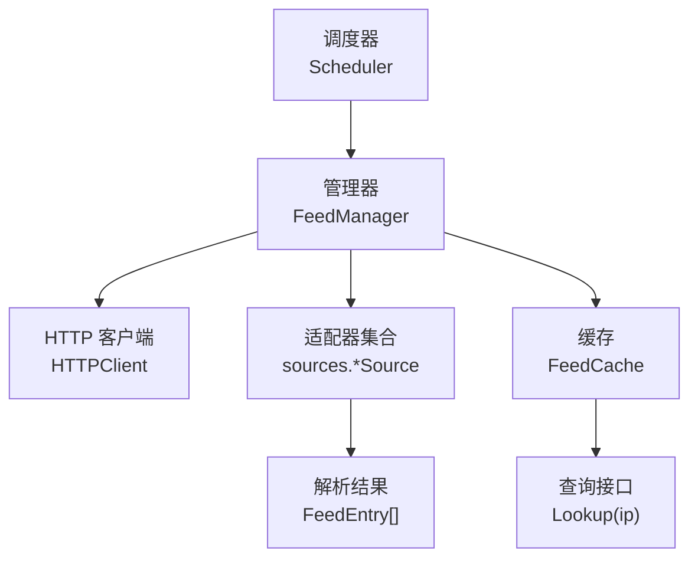
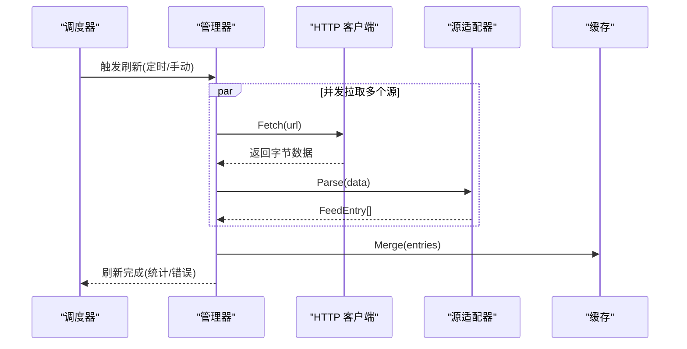
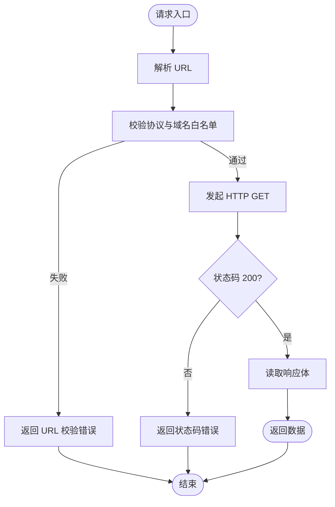
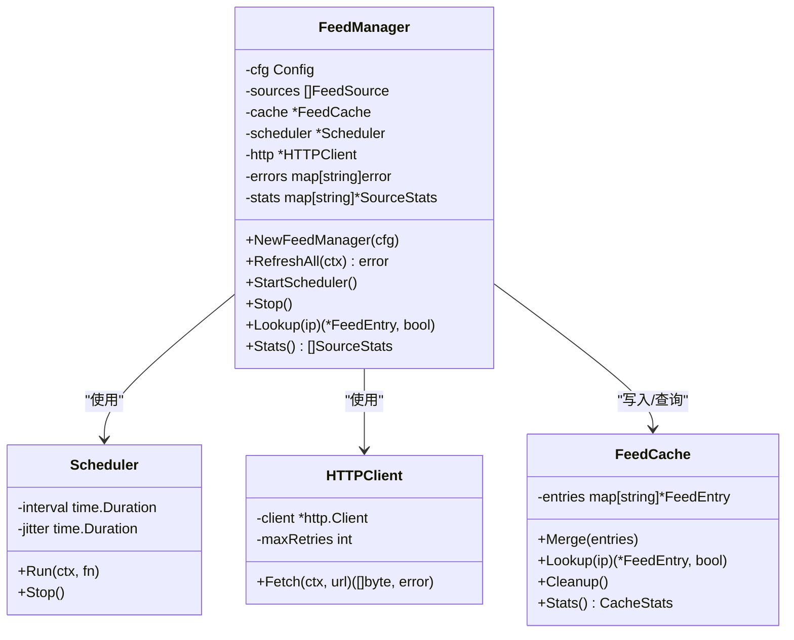
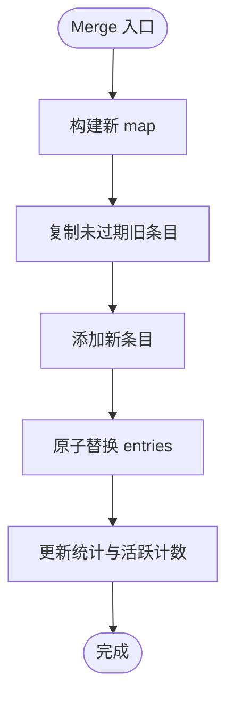
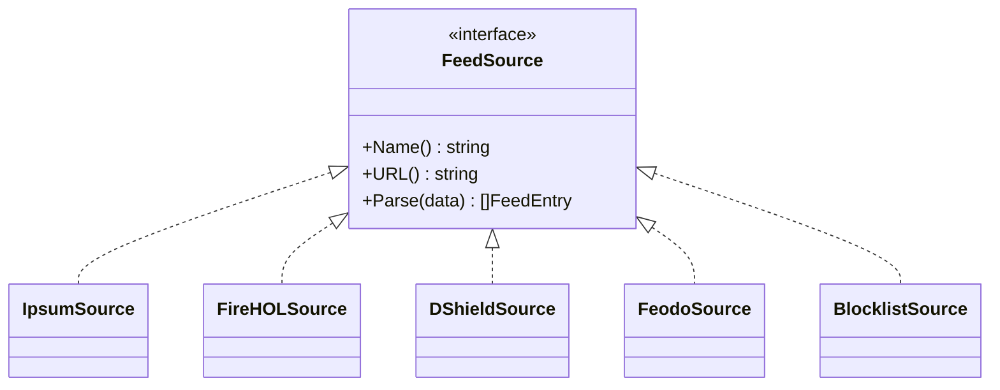
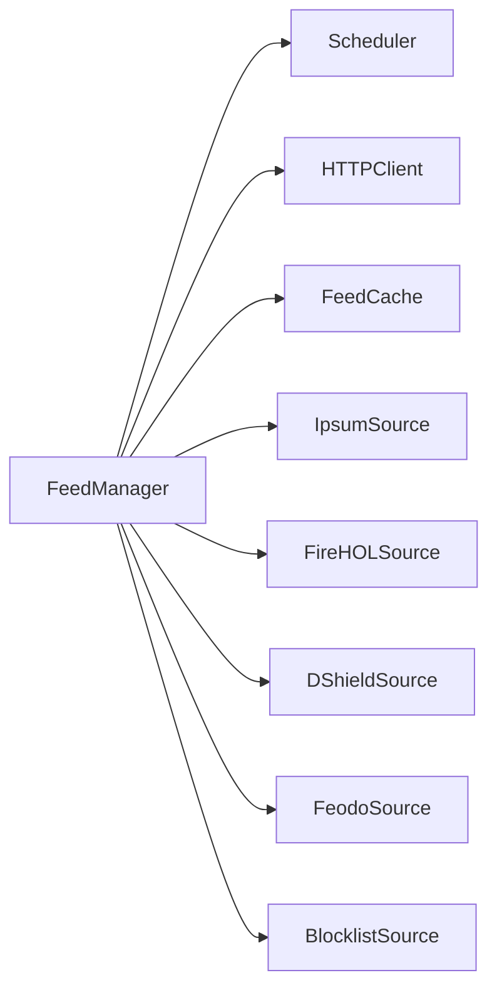

# 威胁情报系统

<cite>
**本文引用的文件**   
- [README.md](file://README.md)
- [config.go](file://src/daemon/internal/threatfeeds/config.go)
- [http.go](file://src/daemon/internal/threatfeeds/http.go)
- [scheduler.go](file://src/daemon/internal/threatfeeds/scheduler.go)
- [cache.go](file://src/daemon/internal/threatfeeds/cache.go)
- [parser.go](file://src/daemon/internal/threatfeeds/parser.go)
- [manager.go](file://src/daemon/internal/threatfeeds/manager.go)
- [types.go](file://src/daemon/internal/threatfeeds/types.go)
- [ipsum.go](file://src/daemon/internal/threatfeeds/sources/ipsum.go)
- [firehol.go](file://src/daemon/internal/threatfeeds/sources/firehol.go)
- [dshield.go](file://src/daemon/internal/threatfeeds/sources/dshield.go)
- [feodo.go](file://src/daemon/internal/threatfeeds/sources/feodo.go)
- [blocklist.go](file://src/daemon/internal/threatfeeds/sources/blocklist.go)
</cite>

## 目录
1. [引言](#引言)
2. [项目结构](#项目结构)
3. [核心组件](#核心组件)
4. [架构总览](#架构总览)
5. [详细组件分析](#详细组件分析)
6. [依赖关系分析](#依赖关系分析)
7. [性能与并发特性](#性能与并发特性)
8. [故障排查指南](#故障排查指南)
9. [结论](#结论)
10. [附录：配置示例与扩展指南](#附录配置示例与扩展指南)

## 引言
本文件系统性地梳理威胁情报子系统，覆盖多源聚合、HTTP 拉取、本地解析、增量更新、置信度评估、SSRF 防护、并发控制、调度器与缓存管理，并给出各格式适配器的实现要点与扩展方法。该子系统位于守护进程内部，负责从公网或本地源自动拉取、解析、聚合威胁 IP/CIDR 列表，并通过高性能缓存为上层风险引擎提供高置信度情报判定能力。

## 项目结构
威胁情报子系统主要位于守护进程的 threatfeeds 包及其 sources 子包中，职责清晰分层：
- 顶层模块：配置、HTTP 客户端、调度器、缓存、管理器、类型定义
- 适配器层：针对 Blocklist、DShield、Feodo、FireHOL、IPsum 的专用解析器
- 数据流：调度器触发 → 管理器并发拉取 → HTTP 客户端（含 SSRF 防护）→ 适配器解析 → 合并到缓存 → 对外查询

图表来源
- [scheduler.go:10-94](file://src/daemon/internal/threatfeeds/scheduler.go#L10-L94)
- [manager.go:20-268](file://src/daemon/internal/threatfeeds/manager.go#L20-L268)
- [http.go:23-129](file://src/daemon/internal/threatfeeds/http.go#L23-L129)
- [cache.go:9-173](file://src/daemon/internal/threatfeeds/cache.go#L9-L173)
- [ipsum.go:21-104](file://src/daemon/internal/threatfeeds/sources/ipsum.go#L21-L104)

章节来源
- [README.md:88-98](file://README.md#L88-L98)

## 核心组件
- 配置模型：SourceConfig 与 Config 描述单个源与全局开关、刷新间隔、超时、重试次数等。
- HTTP 客户端：封装 HTTPS 强制、域名白名单、重定向限制、指数退避重试。
- 调度器：定时触发 + 抖动防惊群，支持优雅停止。
- 管理器：构建源适配器、并发拉取、错误隔离、统计与缓存合并。
- 缓存：原子 Merge、精确匹配优先、CIDR 包含匹配、过期清理与统计。
- 解析器：通用 IP/CIDR 行解析与各源特定格式解析。
- 类型定义：RefreshResult、FeedStats 等运行时状态对象。

章节来源
- [config.go:5-93](file://src/daemon/internal/threatfeeds/config.go#L5-L93)
- [http.go:23-129](file://src/daemon/internal/threatfeeds/http.go#L23-L129)
- [scheduler.go:10-94](file://src/daemon/internal/threatfeeds/scheduler.go#L10-L94)
- [manager.go:20-268](file://src/daemon/internal/threatfeeds/manager.go#L20-L268)
- [cache.go:9-173](file://src/daemon/internal/threatfeeds/cache.go#L9-L173)
- [parser.go:11-80](file://src/daemon/internal/threatfeeds/parser.go#L11-L80)
- [types.go:14-39](file://src/daemon/internal/threatfeeds/types.go#L14-L39)

## 架构总览
下图展示一次完整的情报刷新流程，包括调度、并发拉取、解析、缓存合并与统计更新。

图表来源
- [scheduler.go:35-64](file://src/daemon/internal/threatfeeds/scheduler.go#L35-L64)
- [manager.go:111-184](file://src/daemon/internal/threatfeeds/manager.go#L111-L184)
- [http.go:72-129](file://src/daemon/internal/threatfeeds/http.go#L72-L129)
- [cache.go:44-82](file://src/daemon/internal/threatfeeds/cache.go#L44-L82)

## 详细组件分析

### 配置与默认源
- SourceConfig：name/url/enabled/category/confidence
- Config：enabled/refresh_interval/http_timeout/max_retries/sources
- DefaultConfig：内置 IPsum、FireHOL Level1 默认启用；DShield、Blocklist.de、Feodo 可选启用，分别赋予 abuse/scanner/botnet 分类与不同置信度

章节来源
- [config.go:5-93](file://src/daemon/internal/threatfeeds/config.go#L5-L93)

### HTTP 客户端与 SSRF 防护
- 协议强制：仅允许 https
- 域名白名单：raw.githubusercontent.com、www.dshield.org、lists.blocklist.de、feodotracker.abuse.ch
- 重定向限制：禁止自动跟随，最多 3 次重定向校验
- 私有地址检查：辅助函数用于安全判断
- 指数退避重试：1s、2s、4s... 直至达到最大重试次数

图表来源
- [http.go:51-65](file://src/daemon/internal/threatfeeds/http.go#L51-L65)
- [http.go:72-129](file://src/daemon/internal/threatfeeds/http.go#L72-L129)

章节来源
- [http.go:14-129](file://src/daemon/internal/threatfeeds/http.go#L14-L129)

### 调度器与抖动防惊群
- 首次立即触发，随后按 interval ± jitter 随机延迟触发
- 支持 context 取消与 Stop 信号，保证优雅退出
- 抖动范围可配置，避免集群内多实例同时拉取造成雪崩

章节来源
- [scheduler.go:10-94](file://src/daemon/internal/threatfeeds/scheduler.go#L10-L94)

### 管理器与并发控制
- 构建阶段：根据配置动态创建对应源适配器
- 刷新阶段：使用 WaitGroup + channel 并发拉取所有源，任一失败不影响其他源
- 统计阶段：记录每个源的刷新次数、错误次数、最近更新时间、条目数
- 生命周期：StartScheduler 启动后台定时任务；Stop 关闭调度器与上下文

图表来源
- [manager.go:20-268](file://src/daemon/internal/threatfeeds/manager.go#L20-L268)
- [scheduler.go:10-94](file://src/daemon/internal/threatfeeds/scheduler.go#L10-L94)
- [http.go:23-129](file://src/daemon/internal/threatfeeds/http.go#L23-L129)
- [cache.go:9-173](file://src/daemon/internal/threatfeeds/cache.go#L9-L173)

章节来源
- [manager.go:54-268](file://src/daemon/internal/threatfeeds/manager.go#L54-L268)

### 缓存设计与增量更新
- 原子 Merge：先复制未过期旧条目到新 map，再追加新条目，最后一次性替换，减少写锁持有时间
- 查询策略：先精确匹配 IP，再遍历 CIDR 进行包含匹配，跳过已过期条目
- 过期清理：定期 Cleanup 删除过期条目，维护 ActiveEntries 统计
- 统计指标：ExactHits、CIDRHits、Misses、TotalEntries、ActiveEntries、LastUpdate

图表来源
- [cache.go:44-82](file://src/daemon/internal/threatfeeds/cache.go#L44-L82)
- [cache.go:133-165](file://src/daemon/internal/threatfeeds/cache.go#L133-L165)

章节来源
- [cache.go:9-173](file://src/daemon/internal/threatfeeds/cache.go#L9-L173)

### 解析器与多源格式适配
- 通用解析：ParseIPList 支持每行一个 IP 或 CIDR，忽略空行与注释，自动识别 IPv4/IPv6 前缀长度
- 适配器接口：FeedSource 统一 Name()/URL()/Parse(data)
- 具体适配器：
  - IpsumSource：纯文本 IP/CIDR 列表
  - FireHOLSource：同 IP/CIDR 列表
  - DShieldSource：TSV 首列为 IP/CIDR
  - FeodoSource：CSV 第二列为 IP，跳过表头
  - BlocklistSource：纯文本 IP/CIDR 列表

图表来源
- [ipsum.go:21-104](file://src/daemon/internal/threatfeeds/sources/ipsum.go#L21-L104)
- [firehol.go:5-28](file://src/daemon/internal/threatfeeds/sources/firehol.go#L5-L28)
- [dshield.go:66-89](file://src/daemon/internal/threatfeeds/sources/dshield.go#L66-L89)
- [feodo.go:60-83](file://src/daemon/internal/threatfeeds/sources/feodo.go#L60-L83)
- [blocklist.go:5-28](file://src/daemon/internal/threatfeeds/sources/blocklist.go#L5-L28)

章节来源
- [parser.go:11-80](file://src/daemon/internal/threatfeeds/parser.go#L11-L80)
- [ipsum.go:21-104](file://src/daemon/internal/threatfeeds/sources/ipsum.go#L21-L104)
- [firehol.go:5-28](file://src/daemon/internal/threatfeeds/sources/firehol.go#L5-L28)
- [dshield.go:11-89](file://src/daemon/internal/threatfeeds/sources/dshield.go#L11-L89)
- [feodo.go:11-83](file://src/daemon/internal/threatfeeds/sources/feodo.go#L11-L83)
- [blocklist.go:5-28](file://src/daemon/internal/threatfeeds/sources/blocklist.go#L5-L28)

### 置信度评估与高置信度直封
- 每条 FeedEntry 携带 confidence 字段，由配置默认值与解析器共同决定
- 高置信度 IP 可直接进入内核封禁流程，绕过常规窗口计数，提升处置时效
- 分类 category 可用于策略区分（abuse/scanner/botnet），便于差异化处理

章节来源
- [config.go:33-81](file://src/daemon/internal/threatfeeds/config.go#L33-L81)
- [ipsum.go:12-19](file://src/daemon/internal/threatfeeds/sources/ipsum.go#L12-L19)

## 依赖关系分析
- FeedManager 依赖 Scheduler、HTTPClient、FeedCache 以及一组 FeedSource 适配器
- HTTPClient 依赖标准库 http 与 net/netip，实现 SSRF 防护与重试
- 各适配器依赖通用解析工具（如 parseIPList、parseTSV、parseCSV）
- 管理器在构建阶段依据名称映射到具体适配器

图表来源
- [manager.go:54-109](file://src/daemon/internal/threatfeeds/manager.go#L54-L109)
- [scheduler.go:10-94](file://src/daemon/internal/threatfeeds/scheduler.go#L10-L94)
- [http.go:23-129](file://src/daemon/internal/threatfeeds/http.go#L23-L129)
- [cache.go:9-173](file://src/daemon/internal/threatfeeds/cache.go#L9-L173)
- [ipsum.go:81-104](file://src/daemon/internal/threatfeeds/sources/ipsum.go#L81-L104)
- [firehol.go:5-28](file://src/daemon/internal/threatfeeds/sources/firehol.go#L5-L28)
- [dshield.go:66-89](file://src/daemon/internal/threatfeeds/sources/dshield.go#L66-L89)
- [feodo.go:60-83](file://src/daemon/internal/threatfeeds/sources/feodo.go#L60-L83)
- [blocklist.go:5-28](file://src/daemon/internal/threatfeeds/sources/blocklist.go#L5-L28)

章节来源
- [manager.go:54-109](file://src/daemon/internal/threatfeeds/manager.go#L54-L109)

## 性能与并发特性
- 并发拉取：WaitGroup + channel 并行拉取所有源，整体耗时取决于最慢源
- 原子更新：缓存 Merge 采用“构建新 map + 原子替换”，降低写锁竞争
- 查询优化：精确匹配优先，其次 CIDR 包含匹配，跳过过期条目
- 抖动防惊群：调度器引入随机抖动，避免集群内多实例同步刷新
- 指数退避重试：HTTP 层对失败请求实施 1s/2s/4s 退避，减轻远端压力

[本节为通用性能讨论，不直接分析具体文件]

## 故障排查指南
- HTTP 拉取失败
  - 现象：日志出现“只允许 HTTPS 协议”“域名不在白名单中”“重定向次数过多”“HTTP 状态码非 200”
  - 排查：确认 URL 是否以 https 开头且域名在白名单中；检查服务端返回码与重定向链
  - 参考路径
    - [http.go:51-65](file://src/daemon/internal/threatfeeds/http.go#L51-L65)
    - [http.go:104-129](file://src/daemon/internal/threatfeeds/http.go#L104-L129)
- 解析失败
  - 现象：某源刷新报错，但其他源正常
  - 排查：检查该源数据格式是否符合预期（TSV/CSV/IP 列表），确认表头与列位置
  - 参考路径
    - [dshield.go:11-64](file://src/daemon/internal/threatfeeds/sources/dshield.go#L11-L64)
    - [feodo.go:11-58](file://src/daemon/internal/threatfeeds/sources/feodo.go#L11-L58)
- 缓存命中异常
  - 现象：命中率为低或大量 Misses
  - 排查：确认条目 ExpiresAt 是否过早过期；检查 CIDR 是否正确；观察 ActiveEntries 与 TotalEntries 差异
  - 参考路径
    - [cache.go:84-115](file://src/daemon/internal/threatfeeds/cache.go#L84-L115)
    - [cache.go:133-165](file://src/daemon/internal/threatfeeds/cache.go#L133-L165)
- 调度器不触发
  - 现象：长时间未刷新
  - 排查：检查 RefreshInterval 与 Jitter 配置；确认 StartScheduler 已调用；验证 context 未被提前取消
  - 参考路径
    - [scheduler.go:35-64](file://src/daemon/internal/threatfeeds/scheduler.go#L35-L64)
    - [manager.go:212-219](file://src/daemon/internal/threatfeeds/manager.go#L212-L219)

章节来源
- [http.go:51-129](file://src/daemon/internal/threatfeeds/http.go#L51-L129)
- [dshield.go:11-89](file://src/daemon/internal/threatfeeds/sources/dshield.go#L11-L89)
- [feodo.go:11-83](file://src/daemon/internal/threatfeeds/sources/feodo.go#L11-L83)
- [cache.go:84-165](file://src/daemon/internal/threatfeeds/cache.go#L84-L165)
- [scheduler.go:35-64](file://src/daemon/internal/threatfeeds/scheduler.go#L35-L64)
- [manager.go:212-219](file://src/daemon/internal/threatfeeds/manager.go#L212-L219)

## 结论
威胁情报子系统通过“配置驱动 + 适配器模式 + 并发拉取 + 原子缓存”的设计，实现了高可用、可扩展、可观测的多源情报聚合能力。HTTPS 强制、域名白名单与重定向限制有效防范 SSRF；调度器抖动避免惊群；缓存的精确+CIDR 匹配兼顾性能与覆盖率。结合高置信度直封策略，可在保障误报可控的前提下显著提升封禁效率。

[本节为总结性内容，不直接分析具体文件]

## 附录：配置示例与扩展指南

### 配置项说明
- enabled：是否启用整个情报系统
- refresh_interval：自动刷新周期
- http_timeout：单次拉取超时
- max_retries：拉取失败后的最大重试次数
- sources：情报源列表，每项包含 name/url/enabled/category/confidence

章节来源
- [config.go:5-93](file://src/daemon/internal/threatfeeds/config.go#L5-L93)

### 支持的源格式与解析规则
- Blocklist.de：纯文本 IP/CIDR 列表，忽略注释与空行
- DShield：TSV 格式，首列为 IP/CIDR
- Feodo Tracker：CSV 格式，第二列为 IP，跳过表头
- FireHOL：纯文本 IP/CIDR 列表
- IPsum：纯文本 IP/CIDR 列表

章节来源
- [blocklist.go:23-27](file://src/daemon/internal/threatfeeds/sources/blocklist.go#L23-L27)
- [dshield.go:11-64](file://src/daemon/internal/threatfeeds/sources/dshield.go#L11-L64)
- [feodo.go:11-58](file://src/daemon/internal/threatfeeds/sources/feodo.go#L11-L58)
- [firehol.go:23-27](file://src/daemon/internal/threatfeeds/sources/firehol.go#L23-L27)
- [ipsum.go:28-79](file://src/daemon/internal/threatfeeds/sources/ipsum.go#L28-L79)

### 自定义情报源适配器开发指南
- 实现 FeedSource 接口：Name()/URL()/Parse(data)
- 在管理器中注册：在 buildSource 中添加 case 分支，将名称映射到新的适配器构造器
- 建议：
  - 复用通用解析工具（parseIPList/parseTSV/parseCSV）以减少重复代码
  - 合理设置 ExpiresAt，确保缓存命中率与资源占用平衡
  - 为新增源配置合适的 category 与 confidence，便于上层策略差异化处理

章节来源
- [ipsum.go:21-26](file://src/daemon/internal/threatfeeds/sources/ipsum.go#L21-L26)
- [manager.go:93-109](file://src/daemon/internal/threatfeeds/manager.go#L93-L109)