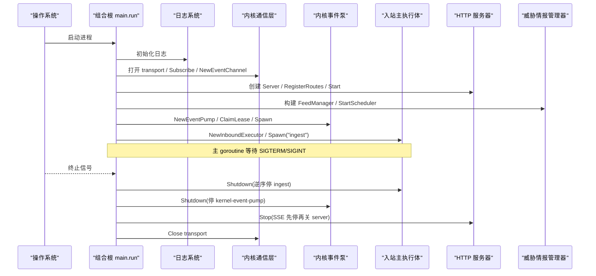
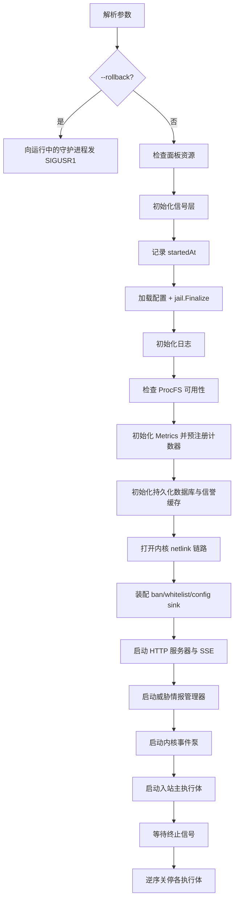
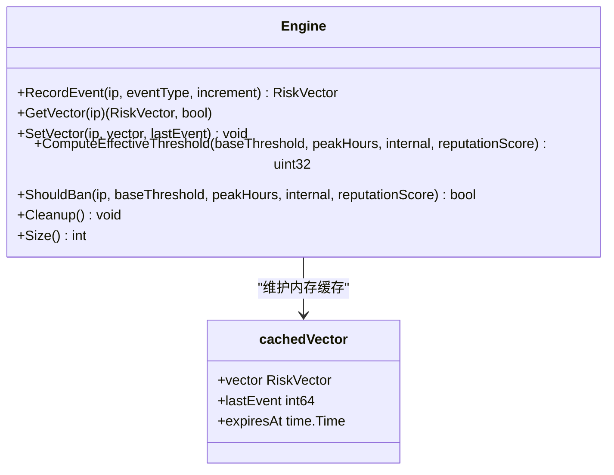
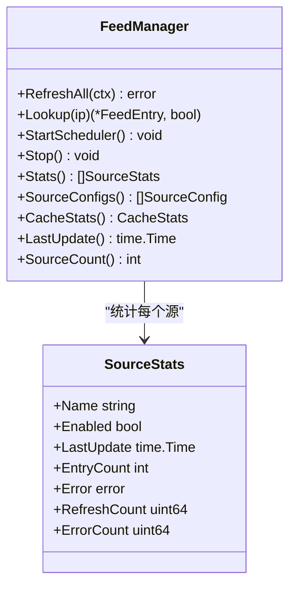
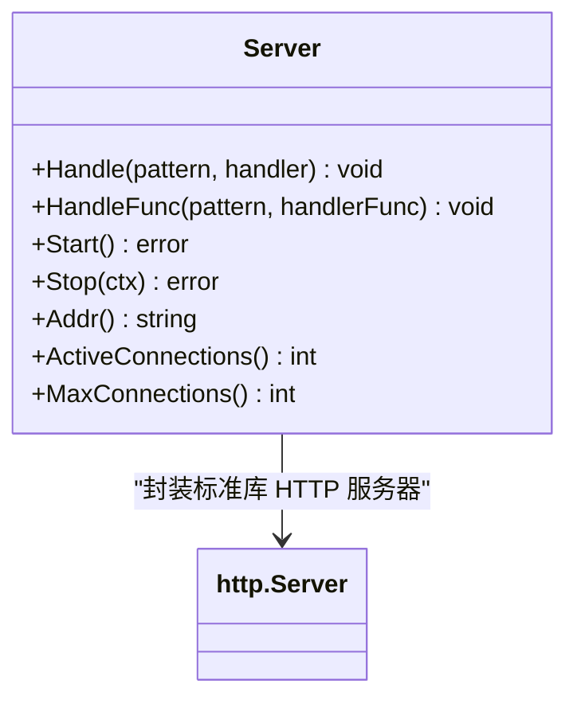
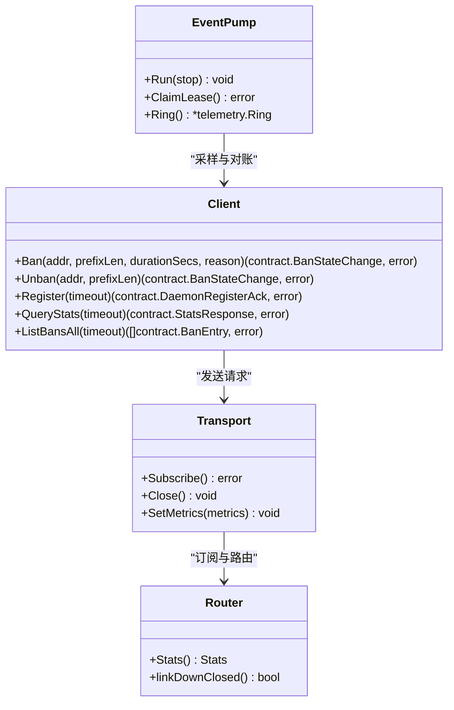
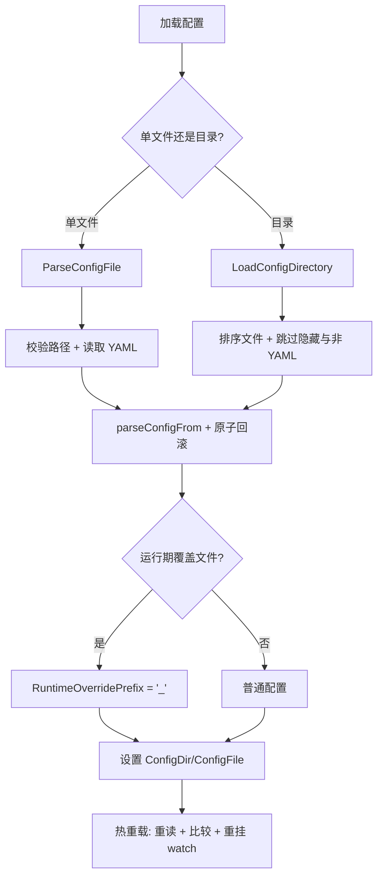
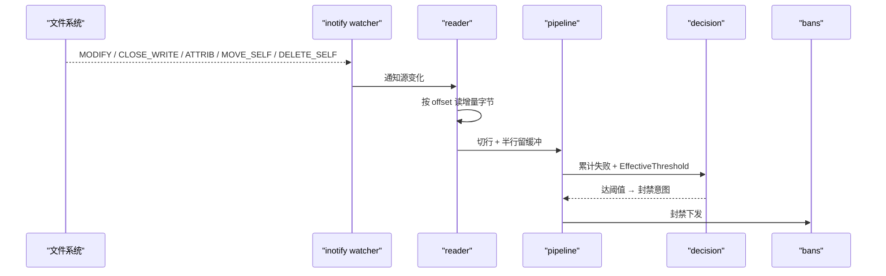
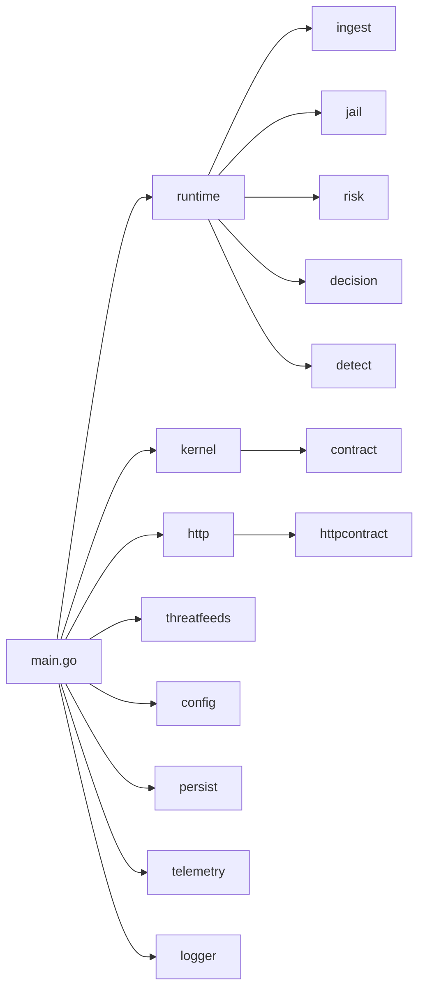

# 守护进程架构

<cite>
**本文引用的文件**   
- [README.md](file://README.md)
- [main.go](file://src/daemon/cmd/firewall-daemon/main.go)
- [daemon.md](file://docs/zh/architecture/daemon.md)
- [data-flow.md](file://docs/zh/architecture/data-flow.md)
- [kernel-module.md](file://docs/zh/architecture/kernel-module.md)
- [engine.go](file://src/daemon/internal/risk/engine.go)
- [manager.go](file://src/daemon/internal/threatfeeds/manager.go)
- [server.go](file://src/daemon/internal/http/server.go)
- [consumer.go](file://src/daemon/internal/kernel/consumer.go)
- [loader.go](file://src/daemon/internal/config/loader.go)
</cite>

## 目录
1. [引言](#引言)
2. [项目结构](#项目结构)
3. [核心组件](#核心组件)
4. [架构总览](#架构总览)
5. [详细组件分析](#详细组件分析)
6. [依赖关系分析](#依赖关系分析)
7. [性能与容量特性](#性能与容量特性)
8. [故障排查指南](#故障排查指南)
9. [结论](#结论)

## 引言
本项目是“用户态智能判定 + 内核态高速封禁”的三层架构防火墙：内核模块在 netfilter PREROUTING 钩子中做零用户态开销的包过滤，守护进程负责日志采集、多维风险判定、威胁情报聚合、HTTP API 与面板服务，并通过 netlink 与内核通信。前端 React 面板通过 REST 与 SSE 实时展示状态并下发配置。

该文档聚焦守护进程架构：组合根装配顺序、包职责划分、生命周期管理；风险引擎算法、威胁情报聚合机制、HTTP API 服务实现；与内核模块的 Netlink 通信层设计、配置管理系统、日志采集处理流程；事件驱动与异步模型、错误处理策略；以及组件依赖图、数据流向图和 API 接口设计说明。

**章节来源**
- [README.md:10-31](file://README.md#L10-L31)

## 项目结构
守护进程以 Go 单二进制形式提供，入口为 `cmd/firewall-daemon`，业务逻辑集中在 `internal/*` 包。内核模块位于 `src/kernel-module`，契约定义位于 `contract`，前端面板嵌入到守护进程静态资源中。

```mermaid
graph TB
subgraph "守护进程Go"
CMD["组合根<br/>cmd/firewall-daemon"]
RUNTIME["运行时与执行体<br/>runtime"]
INGEST["日志采集<br/>ingest / logparse"]
JAIL["Jail 规则集<br/>jail"]
RISK["风险引擎<br/>risk / decision / detect"]
PERSIST["持久化 SQLite<br/>persist"]
TELEMETRY["遥测快照<br/>telemetry"]
KERNEL["Netlink 通信层<br/>kernel"]
HTTP["HTTP/SSE/Metrics<br/>http"]
THREAT["威胁情报源<br/>threatfeeds"]
CONFIG["配置系统<br/>config"]
LOGGER["结构化日志<br/>logger"]
end
subgraph "内核模块C"
KMOD["firewall.ko<br/>netfilter 钩子 + 表 + procfs + netlink"]
end
CMD --> RUNTIME
RUNTIME --> INGEST
RUNTIME --> JAIL
RUNTIME --> RISK
RUNTIME --> PERSIST
RUNTIME --> TELEMETRY
RUNTIME --> KERNEL
RUNTIME --> HTTP
RUNTIME --> THREAT
RUNTIME --> CONFIG
RUNTIME --> LOGGER
KERNEL < --> KMOD
HTTP --> TELEMETRY
HTTP --> PERSIST
HTTP --> THREAT
```

**图表来源**
- [main.go:1-34](file://src/daemon/cmd/firewall-daemon/main.go#L1-L34)
- [daemon.md:32-56](file://docs/zh/architecture/daemon.md#L32-L56)

**章节来源**
- [daemon.md:20-56](file://docs/zh/architecture/daemon.md#L20-L56)
- [main.go:1-34](file://src/daemon/cmd/firewall-daemon/main.go#L1-L34)

## 核心组件
- **组合根**：解析参数、加载配置、初始化日志、装配内核链路、HTTP 服务器、威胁情报管理器、入站主执行体，并按登记逆序优雅关停。
- **内核通信层**：封装 netlink socket、编解码、路由、接收回路、类型化客户端、事件泵与采样对账。
- **HTTP API 服务**：承载面板静态资源、REST 接口、SSE 事件流、Prometheus `/metrics`、认证与连接配额。
- **风险引擎**：维护多维风险向量、时间衰减、有效阈值加法模型、自动分类与历史信誉联动。
- **威胁情报聚合**：多源并发拉取、解析、合并缓存、定时调度、错误隔离与可观测统计。
- **配置系统**：单文件或目录模式、严格模式、运行期覆盖文件、热重载与内核配置下发。
- **日志采集处理**：inotify 增量读取、按源偏移、行切分、正则/IP 提取、协议解析与统计。
- **持久化与遥测**：SQLite 保存封禁历史、事件底账、信誉分；telemetry.Store 提供版本化快照与速率环形缓冲。

**章节来源**
- [main.go:51-498](file://src/daemon/cmd/firewall-daemon/main.go#L51-L498)
- [daemon.md:58-119](file://docs/zh/architecture/daemon.md#L58-L119)

## 架构总览
守护进程启动后形成四条主要 goroutine：入站主链路、内核接收回路、内核事件泵、HTTP 服务器。信号层将信号转为 poll fd，与 inotify fd 共用同一轮询池。组合根按依赖顺序装配，关停时按登记逆序串行收尾，避免上游未停导致下游堆积。



**图表来源**
- [main.go:72-498](file://src/daemon/cmd/firewall-daemon/main.go#L72-L498)
- [daemon.md:58-83](file://docs/zh/architecture/daemon.md#L58-L83)

**章节来源**
- [main.go:72-498](file://src/daemon/cmd/firewall-daemon/main.go#L72-L498)
- [daemon.md:58-119](file://docs/zh/architecture/daemon.md#L58-L119)

## 详细组件分析

### 组合根装配顺序与生命周期
组合根 `run(args)` 是守护进程的装配中心，负责：
- 解析 CLI 参数与回滚短路径
- 检查前端静态面板是否嵌入
- 建立信号层与 `startedAt`
- 加载配置并执行 `jail.Finalize`
- 初始化日志、健康与安全告警
- 预注册 Prometheus 计数器
- 初始化 SQLite 历史库与信誉缓存
- 打开内核 netlink 链路并启动 reactor/client
- 装配 banSink / whitelistSink / configSink
- 启动 HTTP 服务器、SSE Broker、威胁情报管理器
- 启动内核事件泵与入站主执行体
- 监听终止信号并按登记逆序关停



**图表来源**
- [main.go:51-498](file://src/daemon/cmd/firewall-daemon/main.go#L51-L498)

**章节来源**
- [main.go:51-498](file://src/daemon/cmd/firewall-daemon/main.go#L51-L498)
- [daemon.md:84-119](file://docs/zh/architecture/daemon.md#L84-L119)

### 风险引擎核心算法
风险引擎维护 IP 的多维风险向量，支持事件记录、时间衰减、有效阈值计算与封禁判定。关键要点：
- 向量维度包括失败、封禁、扫描、暴力破解、DDoS、地理、集群等
- 每次记录事件时对旧向量施加衰减，并更新最后事件时间
- 有效阈值为加法模型：基础阈值 + 高峰加成 + 内网加成 + 信誉调整
- 信誉调整映射为 -2 到 0，避免乘法模型导致的系数抵消
- 缓存带过期时间，定期清理



**图表来源**
- [engine.go:16-210](file://src/daemon/internal/risk/engine.go#L16-L210)

**章节来源**
- [engine.go:16-210](file://src/daemon/internal/risk/engine.go#L16-L210)

### 威胁情报聚合机制
威胁情报管理器支持多源并发拉取、解析、合并缓存、定时调度与错误隔离。关键特性：
- 每个源独立 goroutine 刷新，总耗时取最慢源
- 单个源失败不影响其他源，记录错误与统计
- 缓存按 IP 查询，支持高置信度直接封禁
- 调度器周期性触发刷新，支持手动触发与停止
- 提供源配置、统计、缓存统计与最后更新时间



**图表来源**
- [manager.go:27-268](file://src/daemon/internal/threatfeeds/manager.go#L27-L268)

**章节来源**
- [manager.go:27-268](file://src/daemon/internal/threatfeeds/manager.go#L27-L268)

### HTTP API 服务实现
HTTP 服务器承载面板静态资源、REST 接口、SSE 事件流与 Prometheus 指标。关键设计：
- 默认监听 `127.0.0.1:9119`，可通过配置修改
- 连接配额限制，超限返回 503
- 安全头中间件在连接配额外层，确保限额响应也带安全头
- 优雅关停：先停 SSE 流，再调用 `http.Server.Shutdown`，超时强制关闭
- 认证中间件每请求读取凭据，支持 Basic Auth 与 SSE Token



**图表来源**
- [server.go:14-158](file://src/daemon/internal/http/server.go#L14-L158)

**章节来源**
- [server.go:14-158](file://src/daemon/internal/http/server.go#L14-L158)
- [daemon.md:225-260](file://docs/zh/architecture/daemon.md#L225-L260)

### Netlink 通信层设计
内核通信层负责 netlink socket 管理、消息编解码、路由、接收回路、类型化客户端与事件泵。关键特性：
- 单写者 transport，长度以 `nlmsghdr.nlmsg_len` 为准
- Router 按 `(type, seq)` 路由，未知类型计数
- Client 区分「已投递」与「已确认」，分页续页到底
- EventPump 消费事件流，周期采样、对账、注册租约
- 四类周期：采样 5 秒、对账 30 秒、注册 10 秒、请求超时 2 秒



**图表来源**
- [consumer.go:70-264](file://src/daemon/internal/kernel/consumer.go#L70-L264)

**章节来源**
- [consumer.go:37-51](file://src/daemon/internal/kernel/consumer.go#L37-L51)
- [daemon.md:120-163](file://docs/zh/architecture/daemon.md#L120-L163)

### 配置管理系统
配置系统支持单文件或目录模式、严格模式、运行期覆盖文件、热重载与内核配置下发。关键行为：
- 单文件解析失败时原子回滚
- 目录加载按文件名序列合并，运行期覆盖文件最后合并
- 运行期覆盖文件前缀 `_`，由 Web UI 写回
- 热重载重读、比较差异、重挂 watch、重编译正则、更新内核白名单
- 配置下发通过 `configSink.ApplyConfig` 投影成 `SetConfig`



**图表来源**
- [loader.go:17-129](file://src/daemon/internal/config/loader.go#L17-L129)

**章节来源**
- [loader.go:17-129](file://src/daemon/internal/config/loader.go#L17-L129)
- [daemon.md:270-287](file://docs/zh/architecture/daemon.md#L270-L287)

### 日志采集处理流程
日志采集使用 inotify 监视文件变化，按源长驻 fd 与 offset 增量读取，处理轮转与半行缓冲。关键流程：
- inotify 掩码包含 MODIFY、ATTRIB、CLOSE_WRITE、MOVE_SELF、DELETE_SELF
- 轮转时重新挂载新 inode
- 稳定 SourceID 标识日志源
- 行切分与正则/IP 提取，保留段校验
- 累计失败次数，达阈值触发封禁意图



**图表来源**
- [data-flow.md:149-189](file://docs/zh/architecture/data-flow.md#L149-L189)

**章节来源**
- [data-flow.md:149-189](file://docs/zh/architecture/data-flow.md#L149-L189)

## 依赖关系分析
守护进程内部依赖清晰分层：组合根装配所有组件，业务包之间通过接口或不可变快照通信。共享状态通过显式对象承载，如 `bans.GlobalCache()`、`bans.GlobalWhitelist()`、`telemetry.Store`。



**图表来源**
- [main.go:22-34](file://src/daemon/cmd/firewall-daemon/main.go#L22-L34)
- [daemon.md:32-56](file://docs/zh/architecture/daemon.md#L32-L56)

**章节来源**
- [main.go:22-34](file://src/daemon/cmd/firewall-daemon/main.go#L22-L34)
- [daemon.md:32-56](file://docs/zh/architecture/daemon.md#L32-L56)

## 性能与容量特性
- 内核热路径每包开销极低：RCU 读侧临界区一次读完四张表，自决封禁在临界区外执行
- 封禁表按前缀长度分层，精确层常态一次哈希命中
- 白名单精确桶 + 子网链，避免线性扫描
- 速率表 per-CPU 槽，热点源不查全局表
- 守护进程入站主链路为单一 goroutine 顺序处理，段间无队列，不存在满时丢弃
- 事件泵周期采样与对账，避免频繁 netlink 往返
- HTTP 服务器连接配额保护，SSE 流独立上限

**章节来源**
- [kernel-module.md:157-170](file://docs/zh/architecture/kernel-module.md#L157-L170)
- [kernel-module.md:274-283](file://docs/zh/architecture/kernel-module.md#L274-L283)
- [daemon.md:58-68](file://docs/zh/architecture/daemon.md#L58-L68)

## 故障排查指南
- **内核链路不可用**：组合根只告警，入站主链路照常；封禁表只反映本进程下发记录
- **历史库打不开**：判定层退回 `NoHistory`，阈值乘数按满分算
- **未配 HTTP 监听**：api 为 nil，事件泵的域载荷镜像与 jail 快照通知按缺席处理
- **租约被拒绝**：内核明确拒绝本进程成为守护进程，组合根以非零码退出
- **命令被内核拒绝**：事件泵记录 CmdResult，撤销镜像条目并通知执行体抑制重复下发
- **配置热重载失败**：保留旧快照，不重置失败窗口
- **面板静态资源缺失**：启动直接返回错误，不假装可运行

**章节来源**
- [main.go:173-200](file://src/daemon/cmd/firewall-daemon/main.go#L173-L200)
- [main.go:428-430](file://src/daemon/cmd/firewall-daemon/main.go#L428-L430)
- [consumer.go:346-365](file://src/daemon/internal/kernel/consumer.go#L346-L365)
- [consumer.go:499-549](file://src/daemon/internal/kernel/consumer.go#L499-L549)
- [daemon.md:112-119](file://docs/zh/architecture/daemon.md#L112-L119)

## 结论
守护进程架构通过清晰的组合根装配顺序、分层包职责与严格的生命周期管理，实现了日志采集、风险判定、威胁情报聚合、HTTP API 与内核通信的解耦协作。风险引擎采用多维向量与加法阈值模型，威胁情报支持多源并发与错误隔离，HTTP 服务提供 REST、SSE 与指标暴露，内核通信层通过 netlink 实现可靠的双向通信。整体设计强调降级能力、可观测性与运维友好性，适合在生产环境中部署与维护。