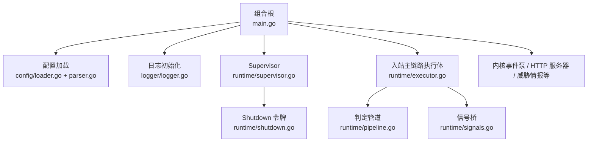
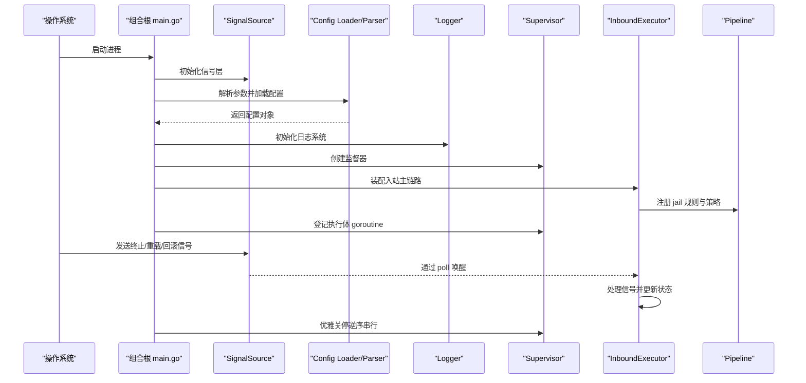
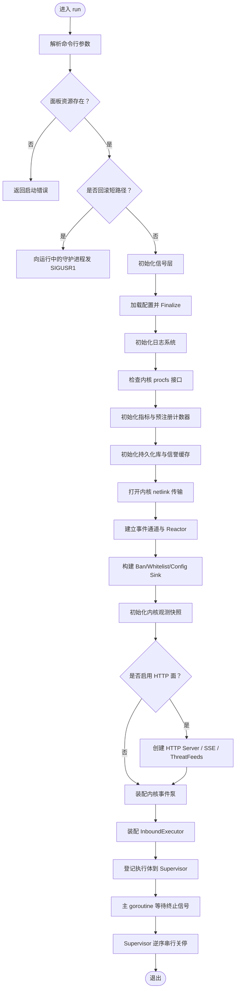
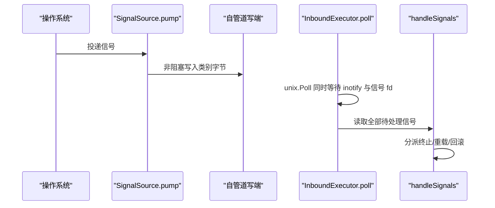
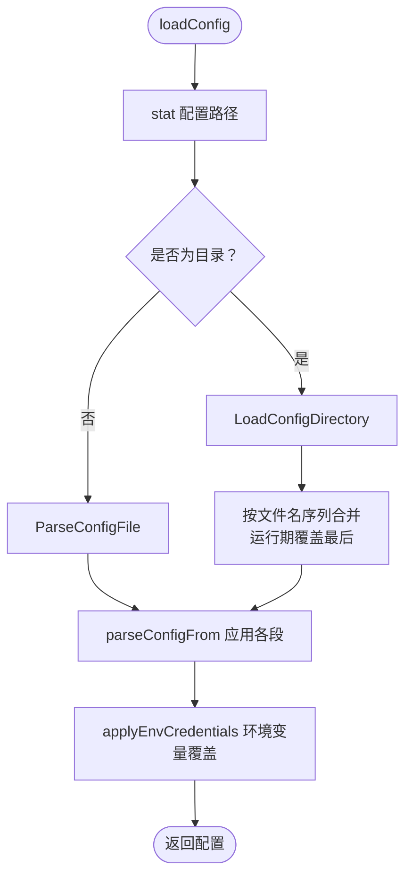
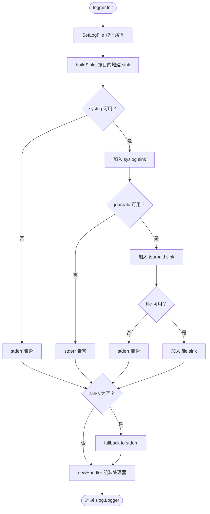
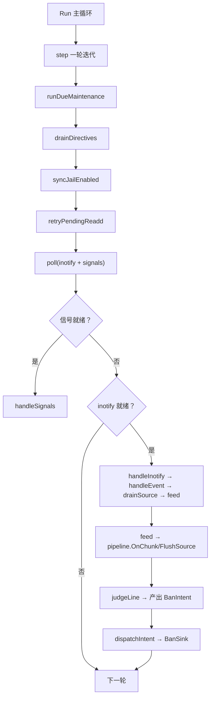
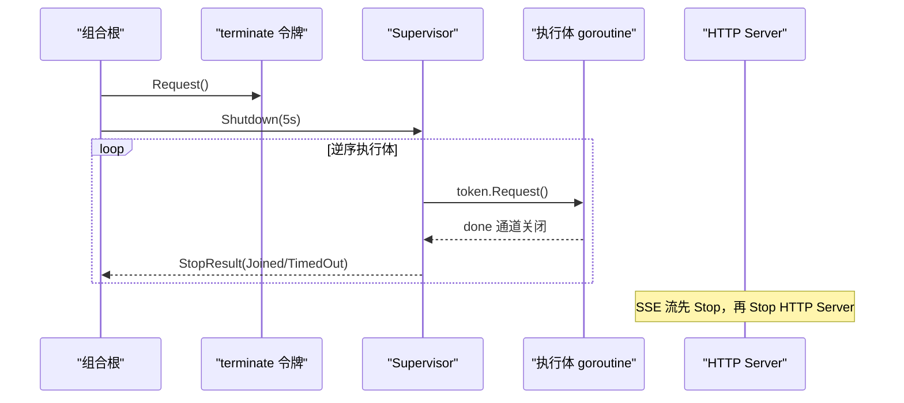
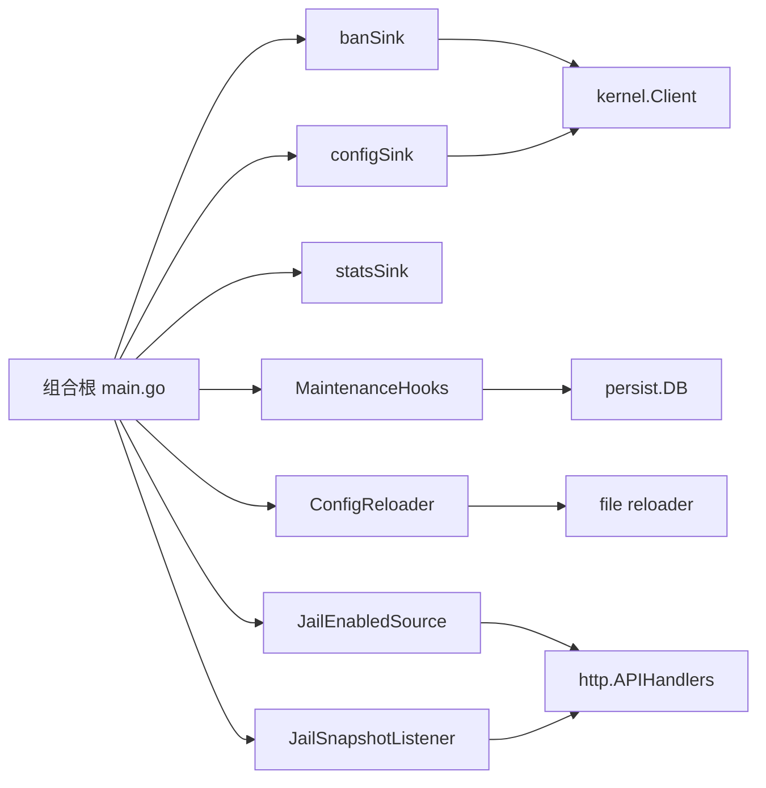

# 核心架构设计

<cite>
**本文引用的文件**   
- [main.go](file://src/daemon/cmd/firewall-daemon/main.go)
- [executor.go](file://src/daemon/internal/runtime/executor.go)
- [pipeline.go](file://src/daemon/internal/runtime/pipeline.go)
- [supervisor.go](file://src/daemon/internal/runtime/supervisor.go)
- [shutdown.go](file://src/daemon/internal/runtime/shutdown.go)
- [signals.go](file://src/daemon/internal/runtime/signals.go)
- [loader.go](file://src/daemon/internal/config/loader.go)
- [parser.go](file://src/daemon/internal/config/parser.go)
- [logger.go](file://src/daemon/internal/logger/logger.go)
</cite>

## 目录
1. [引言](#引言)
2. [项目结构](#项目结构)
3. [核心组件](#核心组件)
4. [架构总览](#架构总览)
5. [详细组件分析](#详细组件分析)
6. [依赖关系分析](#依赖关系分析)
7. [性能与运行时监控](#性能与运行时监控)
8. [故障排查指南](#故障排查指南)
9. [结论](#结论)

## 引言
本文聚焦 Go 守护进程的核心架构，围绕组合根装配模式、Supervisor 执行器、goroutine 管理、优雅关停、信号处理、配置加载与日志系统展开。目标是让读者既能理解整体启动时序和组件协作，也能定位关键实现位置并评估性能与可维护性。

## 项目结构
守护进程的入口位于 `cmd/firewall-daemon`，组合根在 `main.go` 中完成参数解析、配置加载、子系统装配、生命周期管理与优雅关停；运行时模型集中在 `internal/runtime`，包含执行体、管道、监督器、停机令牌与信号桥；配置解析在 `internal/config`；结构化日志在 `internal/logger`。



**图示来源**
- [main.go:44-498](file://src/daemon/cmd/firewall-daemon/main.go#L44-L498)
- [executor.go:225-320](file://src/daemon/internal/runtime/executor.go#L225-L320)
- [pipeline.go:130-156](file://src/daemon/internal/runtime/pipeline.go#L130-L156)
- [supervisor.go:21-82](file://src/daemon/internal/runtime/supervisor.go#L21-L82)
- [signals.go:37-68](file://src/daemon/internal/runtime/signals.go#L37-L68)
- [loader.go:17-50](file://src/daemon/internal/config/loader.go#L17-L50)
- [parser.go:155-207](file://src/daemon/internal/config/parser.go#L155-L207)
- [logger.go:92-116](file://src/daemon/internal/logger/logger.go#L92-L116)

**章节来源**
- [main.go:44-498](file://src/daemon/cmd/firewall-daemon/main.go#L44-L498)
- [executor.go:225-320](file://src/daemon/internal/runtime/executor.go#L225-L320)
- [pipeline.go:130-156](file://src/daemon/internal/runtime/pipeline.go#L130-L156)
- [supervisor.go:21-82](file://src/daemon/internal/runtime/supervisor.go#L21-L82)
- [signals.go:37-68](file://src/daemon/internal/runtime/signals.go#L37-L68)
- [loader.go:17-50](file://src/daemon/internal/config/loader.go#L17-L50)
- [parser.go:155-207](file://src/daemon/internal/config/parser.go#L155-L207)
- [logger.go:92-116](file://src/daemon/internal/logger/logger.go#L92-L116)

## 核心组件
- 组合根：负责命令行参数解析、面板资源校验、回滚短路径、信号层初始化、配置加载与后处理、日志初始化、内核链路、HTTP 面、事件泵、入站主链路的装配与关停编排。
- Supervisor：登记 goroutine 执行体，按登记逆序串行关停，保证上游先于下游停止。
- Shutdown：只置位不撤销的停机标志，支持轮询与通道等待两种消费方式。
- SignalSource：把 SIGTERM/SIGINT/SIGHUP/SIGUSR1 桥接到 poll 可读 fd，避免 signalfd 与 Go 运行时的冲突。
- InboundExecutor：单 goroutine 驱动 inotify → 解析 → 判定 → 封禁意图 → 下发汇聚点的主循环。
- Pipeline：无锁判定装配体，封装规则集、失败窗口、计数与集群扫描。
- Config loader/parser：YAML 解析、目录合并、运行期覆盖、严格模式、环境变量覆盖与原子回滚。
- Logger：多目的地（syslog/journald/file/stderr）降级链，带文件轮转与节流能力。

**章节来源**
- [main.go:44-498](file://src/daemon/cmd/firewall-daemon/main.go#L44-L498)
- [supervisor.go:21-82](file://src/daemon/internal/runtime/supervisor.go#L21-L82)
- [shutdown.go:5-36](file://src/daemon/internal/runtime/shutdown.go#L5-L36)
- [signals.go:37-143](file://src/daemon/internal/runtime/signals.go#L37-L143)
- [executor.go:225-349](file://src/daemon/internal/runtime/executor.go#L225-L349)
- [pipeline.go:130-385](file://src/daemon/internal/runtime/pipeline.go#L130-L385)
- [loader.go:17-128](file://src/daemon/internal/config/loader.go#L17-L128)
- [parser.go:155-207](file://src/daemon/internal/config/parser.go#L155-L207)
- [logger.go:92-170](file://src/daemon/internal/logger/logger.go#L92-L170)

## 架构总览
组合根是装配中心，不承载业务判定；它按依赖顺序创建各子系统，并把副作用收敛到接口（BanSink、KernelConfigPusher、StatsSink 等）。Supervisor 统一调度 goroutine 生命周期，Shutdown 令牌贯穿所有执行体，SignalSource 提供统一控制信号源。



**图示来源**
- [main.go:52-498](file://src/daemon/cmd/firewall-daemon/main.go#L52-L498)
- [signals.go:50-68](file://src/daemon/internal/runtime/signals.go#L50-L68)
- [executor.go:276-320](file://src/daemon/internal/runtime/executor.go#L276-L320)
- [pipeline.go:145-156](file://src/daemon/internal/runtime/pipeline.go#L145-L156)
- [supervisor.go:53-82](file://src/daemon/internal/runtime/supervisor.go#L53-L82)

## 详细组件分析

### 组合根装配顺序与生命周期
组合根的 `run` 函数是装配主线：
1. 解析命令行参数，处理帮助与回滚短路径。
2. 校验前端静态面板资源是否嵌入。
3. 初始化信号层，确保启动窗口内信号不会丢失。
4. 记录 `startedAt`，用于 uptime 统计。
5. 加载配置并执行 Finalize 后处理（智能默认、校验、正则编译告警）。
6. 初始化日志系统，输出认证凭据来源与安全告警。
7. 检查 procfs 是否存在，确认内核模块接口可用。
8. 创建 Prometheus 指标注册表并预注册计数器。
9. 初始化持久化数据库与信誉缓存（可选）。
10. 打开内核 netlink 传输，建立事件通道与 Reactor，登记到 Supervisor。
11. 构建 BanSink、WhitelistSink、ConfigSink 三个下沉出口。
12. 初始化内核观测快照 Store。
13. 初始化 JailEnabledSource。
14. 若启用 HTTP 面，则创建 Server、SSE Broker、Logs Stream、ThreatFeeds Manager，并注入 APIHandlers。
15. 创建内核→执行体的反向指令通道，装配 EventPump 并 ClaimLease。
16. 装配 InboundExecutor，将其 Run 挂到 Supervisor。
17. 主 goroutine 监听 SIGTERM/SIGINT，触发 terminate 令牌。
18. 调用 Supervisor.Shutdown 按登记逆序串行关停。



**图示来源**
- [main.go:52-498](file://src/daemon/cmd/firewall-daemon/main.go#L52-L498)

**章节来源**
- [main.go:52-498](file://src/daemon/cmd/firewall-daemon/main.go#L52-L498)

### Supervisor 执行器与 goroutine 管理
Supervisor 维护一个执行体登记表，Spawn 时记录 name、Shutdown 令牌与 done 通道，并启动 goroutine。Shutdown 从尾部向前遍历，对每个执行体 token.Request() 后 joinWithTimeout，超时返回 TimedOut，正常退出返回 Joined。该设计保证「上游完全停止后才允许下游收尾」，避免上下游同时收尾导致的死锁或数据不一致。

```mermaid
classDiagram
class Supervisor {
-executors []executorEntry
+NewSupervisor() *Supervisor
+Len() int
+IsEmpty() bool
+Spawn(name, token, body) void
+Shutdown(timeout) []StopResult
}
class executorEntry {
+name string
+token *Shutdown
+done chan struct{}
}
class StopResult {
+Name string
+Outcome StopOutcome
}
class StopOutcome {
<<enum>>
Joined
TimedOut
}
Supervisor --> executorEntry : "登记"
executorEntry --> Shutdown : "持有"
Supervisor --> StopResult : "返回关停结果"
```

**图示来源**
- [supervisor.go:21-82](file://src/daemon/internal/runtime/supervisor.go#L21-L82)
- [shutdown.go:5-36](file://src/daemon/internal/runtime/shutdown.go#L5-L36)

**章节来源**
- [supervisor.go:21-82](file://src/daemon/internal/runtime/supervisor.go#L21-L82)
- [shutdown.go:5-36](file://src/daemon/internal/runtime/shutdown.go#L5-L36)

### 信号处理机制
SignalSource 使用自管道将 SIGTERM/SIGINT/SIGHUP/SIGUSR1 转换为可读 fd，供主循环与 inotify fd 一起被 unix.Poll 等待。pump goroutine 非阻塞写入字节，消费端 PollRead 循环取空，语义等价于 signalfd 但兼容 Go 运行时。



**图示来源**
- [signals.go:50-143](file://src/daemon/internal/runtime/signals.go#L50-L143)
- [executor.go:378-462](file://src/daemon/internal/runtime/executor.go#L378-L462)

**章节来源**
- [signals.go:50-143](file://src/daemon/internal/runtime/signals.go#L50-L143)
- [executor.go:378-462](file://src/daemon/internal/runtime/executor.go#L378-L462)

### 配置加载流程
配置加载支持单文件与目录两种模式：
- 单文件：ParseConfigFile 校验路径、读取 YAML、应用 defaults/jails/ddos/webui/trusted_ips/capacity/threat_feeds/geoip，并在失败时整体回滚。
- 目录：LoadConfigDirectory 收集 .yml/.yaml，跳过隐藏文件与非普通文件，按文件名排序并将 `_` 前缀的运行期覆盖文件排在最后合并，任一文件失败整体回滚。
- 环境变量覆盖：认证凭据在 YAML 全部应用之后进行，优先级为「环境变量 > YAML > Default()」。



**图示来源**
- [main.go:500-510](file://src/daemon/cmd/firewall-daemon/main.go#L500-L510)
- [loader.go:17-128](file://src/daemon/internal/config/loader.go#L17-L128)
- [parser.go:155-207](file://src/daemon/internal/config/parser.go#L155-L207)

**章节来源**
- [main.go:500-510](file://src/daemon/cmd/firewall-daemon/main.go#L500-L510)
- [loader.go:17-128](file://src/daemon/internal/config/loader.go#L17-L128)
- [parser.go:155-207](file://src/daemon/internal/config/parser.go#L155-L207)

### 日志系统初始化
日志系统根据配置选择目的地：syslog、journald、file、both，不可用时降级到 stderr。Init 会登记日志文件路径供日志查看器读取，并返回可直接使用的结构化日志器。



**图示来源**
- [logger.go:92-170](file://src/daemon/internal/logger/logger.go#L92-L170)

**章节来源**
- [logger.go:92-170](file://src/daemon/internal/logger/logger.go#L92-L170)

### 入站主链路执行体与管道
InboundExecutor 由单个 goroutine 独占，内部状态不加锁。每轮迭代：
- 跑到期维护（清理失败窗口、集群扫描、重扫监视集合、历史快照、数据清理）。
- 排空内核→执行体的反向指令。
- 同步 Web UI 的 jail 启用状态。
- 重试轮转后待重挂的源。
- poll inotify 与信号 fd。
- 分派信号与 inotify 事件：内容变更读新字节送 pipeline，自身被移走/删除处理轮转。

Pipeline 负责行切分、正则匹配、失败窗口观察、阈值计算与封禁意图产出。外部事实（信誉分、历史次数）经 DecisionFacts 注入，测试可替换为 NoHistory。



**图示来源**
- [executor.go:331-376](file://src/daemon/internal/runtime/executor.go#L331-L376)
- [executor.go:512-556](file://src/daemon/internal/runtime/executor.go#L512-L556)
- [pipeline.go:221-342](file://src/daemon/internal/runtime/pipeline.go#L221-L342)

**章节来源**
- [executor.go:331-376](file://src/daemon/internal/runtime/executor.go#L331-L376)
- [executor.go:512-556](file://src/daemon/internal/runtime/executor.go#L512-L556)
- [pipeline.go:221-342](file://src/daemon/internal/runtime/pipeline.go#L221-L342)

### 优雅关停流程
组合根在收到 SIGTERM/SIGINT 后关闭 stopCh，调用 terminate.Request()，然后调用 Supervisor.Shutdown(5s)。Supervisor 按登记逆序逐个执行体请求关停并等待，超时返回 TimedOut。HTTP 服务器的 SSE 流会在关停前先 Stop，避免连接永远不空闲导致 Stop 超时。



**图示来源**
- [main.go:465-497](file://src/daemon/cmd/firewall-daemon/main.go#L465-L497)
- [supervisor.go:69-82](file://src/daemon/internal/runtime/supervisor.go#L69-L82)
- [shutdown.go:22-36](file://src/daemon/internal/runtime/shutdown.go#L22-L36)

**章节来源**
- [main.go:465-497](file://src/daemon/cmd/firewall-daemon/main.go#L465-L497)
- [supervisor.go:69-82](file://src/daemon/internal/runtime/supervisor.go#L69-L82)
- [shutdown.go:22-36](file://src/daemon/internal/runtime/shutdown.go#L22-L36)

## 依赖关系分析
组合根通过接口解耦子系统：
- BanSink：封禁下发汇聚点，组合根实现 banSink，注入 kernel.Client、活跃缓存、DB 与信誉缓存回调。
- KernelConfigPusher：配置下发出口，组合根实现 configSink，复用 kernel.Client。
- StatsSink：统计计数器写入端，组合根实现 newStatsSink。
- MaintenanceHooks：周期维护钩子，组合根注入 persist.DB 与 logger。
- ConfigReloader：配置热重载与回滚，组合根注入 NewFileReloader。
- JailEnabledSource：Web UI 权威启用状态，组合根注入 runtime.NewJailEnabledSource。
- JailSnapshotListener：jail 配置快照变化通知，组合根桥接到 http.APIHandlers。



**图示来源**
- [main.go:202-318](file://src/daemon/cmd/firewall-daemon/main.go#L202-L318)
- [main.go:607-800](file://src/daemon/cmd/firewall-daemon/main.go#L607-L800)
- [executor.go:158-184](file://src/daemon/internal/runtime/executor.go#L158-L184)

**章节来源**
- [main.go:202-318](file://src/daemon/cmd/firewall-daemon/main.go#L202-L318)
- [main.go:607-800](file://src/daemon/cmd/firewall-daemon/main.go#L607-L800)
- [executor.go:158-184](file://src/daemon/internal/runtime/executor.go#L158-L184)

## 性能与运行时监控
- 指标预注册：Prometheus 计数器在 HTTP 未启用时也预注册，保证 /metrics 启动即有稳定样本。
- 内核链路健康计数：transport.SetMetrics 在接收回路启动前设置，Send/TryRecv 直接读句柄，避免竞争。
- 速率采样环：telemetry.Ring 与 kernelStore 提供速率历史与快照，供 /api/v2/stats 与异常检测基线使用。
- 单 goroutine 主链路：InboundExecutor 内部无锁，减少上下文切换与锁竞争。
- 定时器解耦：维护任务用单调时钟定时器驱动，不被事件洪泛推迟。
- 日志节流：LogThrottler 限制高频调用点日志频率，避免刷满日志。

**章节来源**
- [main.go:126-140](file://src/daemon/cmd/firewall-daemon/main.go#L126-L140)
- [main.go:188-198](file://src/daemon/cmd/firewall-daemon/main.go#L188-L198)
- [main.go:393-427](file://src/daemon/cmd/firewall-daemon/main.go#L393-L427)
- [executor.go:46-64](file://src/daemon/internal/runtime/executor.go#L46-L64)
- [logger.go:213-233](file://src/daemon/internal/logger/logger.go#L213-L233)

## 故障排查指南
- 面板静态资源缺失：组合根在启动早期直接报错，避免反复报接口失败。
- 内核接口不可用：checkProcfs 检查 /proc/firewall 与 /proc/firewall/bans，缺失则启动失败。
- 内核 netlink 链路失败：仅告警并降级，入站主链路仍可独立运行；事件泵未启动时封禁表只反映本进程下发记录。
- 租约持有失败：EventPump.ClaimLease 返回错误表示已有活跃守护进程，当前进程以非零码退出，便于运维发现重复实例。
- 配置加载失败：ParseConfigFile/LoadConfigDirectory 失败时整体回滚，避免部分生效。
- 日志目的地不可用：自动降级到 stderr，并记录告警。
- 认证凭据安全：对外网监听但未配置凭据、或使用出厂默认口令时显式告警。

**章节来源**
- [main.go:62-70](file://src/daemon/cmd/firewall-daemon/main.go#L62-L70)
- [main.go:122-124](file://src/daemon/cmd/firewall-daemon/main.go#L122-L124)
- [main.go:173-200](file://src/daemon/cmd/firewall-daemon/main.go#L173-L200)
- [main.go:413-418](file://src/daemon/cmd/firewall-daemon/main.go#L413-L418)
- [loader.go:17-50](file://src/daemon/internal/config/loader.go#L17-L50)
- [logger.go:118-170](file://src/daemon/internal/logger/logger.go#L118-L170)
- [main.go:106-120](file://src/daemon/cmd/firewall-daemon/main.go#L106-L120)

## 结论
该守护进程采用组合根装配模式，将配置、内核链路、HTTP 面、入站主链路等子系统解耦并通过接口注入副作用。Supervisor 与 Shutdown 令牌保障 goroutine 的生命周期与优雅关停，SignalSource 提供统一的信号桥接。配置加载具备原子性与运行期覆盖能力，日志系统具备多目的地降级链。整体设计强调可测性、可观测性与健壮性，适合在生产环境中长期运行。